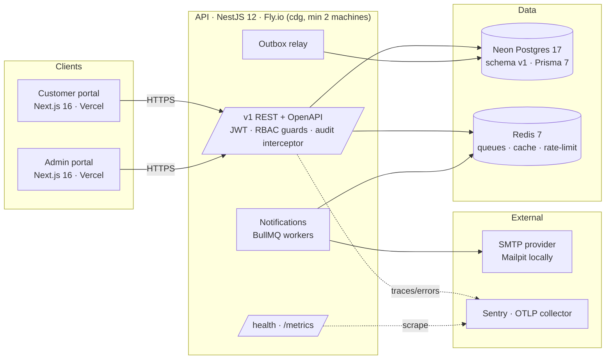

# BI-Rem

Pan-African remittance and mobile-money platform. This monorepo contains the **Phase 1
foundation** (API, customer portal, admin portal, data layer, infrastructure) and the planning
documentation for all 13 delivery phases.

[](https://github.com/wouapit999/wouapit999/actions/workflows/ci.yml)
[](https://github.com/wouapit999/wouapit999/actions/workflows/security.yml)

## What is being built

BI-Rem lets customers in Africa send and receive money across mobile-money wallets, banks
and cash-out partners, domestically and cross-border, with the compliance tooling (KYC,
AML, audit) a licensed remittance operator needs. Target scale by go-live: 1 M users,
100 k transactions/day, 50 providers, 20 countries, 99.9 % availability
(`docs/roadmap/schedule.json`).

| #   | Phase                             | Window                  | Team       |
| --- | --------------------------------- | ----------------------- | ---------- |
| 1   | Foundation & Platform Setup       | 2026-11-16 → 2026-12-25 | core       |
| 2   | Customer Management & KYC         | 2026-12-28 → 2027-02-19 | core       |
| 3   | Connectivity Management Framework | 2027-01-25 → 2027-03-05 | platform   |
| 4   | Wallet Connector Engine           | 2027-03-08 → 2027-04-30 | platform   |
| 5   | Domestic Transfers                | 2027-04-19 → 2027-05-28 | core       |
| 6   | International Remittance          | 2027-05-31 → 2027-07-23 | core       |
| 7   | FX & Treasury Management          | 2027-06-28 → 2027-08-06 | platform   |
| 8   | AML, Fraud & Compliance           | 2027-07-26 → 2027-09-17 | compliance |
| 9   | Partner & Merchant Portal         | 2027-08-23 → 2027-10-01 | core       |
| 10  | Reporting & Business Intelligence | 2027-09-20 → 2027-10-29 | platform   |
| 11  | Mobile Applications               | 2027-08-09 → 2027-10-15 | mobile     |
| 12  | Production Go-Live                | 2027-11-01 → 2027-12-10 | all        |
| 13  | Pan-African Expansion             | 2028-01-03 → 2028-06-30 | all        |

Per-phase scope, estimates and risks: `docs/phases/phase-NN-<key>.md`; master schedule:
`docs/roadmap/schedule.json`.

## Architecture (Phase 1)



- **Backend** `apps/api`: NestJS 12, REST under `/v1`, OpenAPI at `/docs`, auth (argon2,
  JWT access + rotating refresh tokens, TOTP MFA), RBAC (`resource:action` permissions),
  audit log on every mutation, notifications (BullMQ), feature flags, settings, API keys,
  transactional outbox, Terminus health and Prometheus metrics.
- **Frontends** `apps/web` (customer, :3000) and `apps/admin` (admin, :3001): Next.js 16 App
  Router, React 19, Tailwind 4, TanStack Query, Zod-validated env.
- **Data** `packages/db`: Prisma 7 with the `pg` driver adapter (local Postgres and Neon),
  SQL migrations, idempotent seed; `packages/shared`: Zod schemas, DTO types, constants.
- **Infra** `infra/`: Docker images, docker-compose, Fly.io, Vercel, AWS/Terraform
  alternative, operational scripts; `.github/workflows`: CI/CD.

## Quickstart

Prerequisites: Node 22 (`.nvmrc`), pnpm 10 (`corepack enable`), Docker with compose v2.

```bash
git clone https://github.com/wouapit999/wouapit999.git bi-rem && cd bi-rem
infra/scripts/bootstrap.sh        # toolchain check, .env files, docker services, generate + migrate + seed
pnpm dev                          # api http://localhost:4000/docs · web :3000 · admin :3001
```

Manual equivalent:

```bash
pnpm install
cp .env.example .env
docker compose -f infra/docker/docker-compose.yml up -d   # postgres:17, redis:7, mailpit (UI :8025)
pnpm db:generate && pnpm db:migrate:dev && pnpm db:seed
pnpm dev
pnpm lint && pnpm typecheck && pnpm test && pnpm build
```

Seeded logins (local only): see `packages/db/.env.example` (`SEED_ADMIN_EMAIL`,
`SEED_CUSTOMER_EMAIL`). Mail sent by the API lands in Mailpit at <http://localhost:8025>.

## Repository layout

| Path                           | Package          | Purpose                                                                                                |
| ------------------------------ | ---------------- | ------------------------------------------------------------------------------------------------------ |
| `apps/api`                     | `@bi-rem/api`    | NestJS 12 backend, port 4000, `dist/main.js`                                                           |
| `apps/web`                     | `@bi-rem/web`    | Customer portal, Next.js 16 (`output: standalone`), port 3000                                          |
| `apps/admin`                   | `@bi-rem/admin`  | Admin portal, Next.js 16, port 3001                                                                    |
| `packages/db`                  | `@bi-rem/db`     | Prisma 7 schema v1, migrations, seed, `createPrismaClient()`                                           |
| `packages/shared`              | `@bi-rem/shared` | Zod schemas, DTO types, enums, constants                                                               |
| `packages/config`              | `@bi-rem/config` | Shared `tsconfig` and ESLint flat-config presets                                                       |
| `infra/docker`                 | —                | Dockerfiles, docker-compose, Postgres init script                                                      |
| `infra/fly`                    | —                | `api.fly.toml` + Fly deployment guide                                                                  |
| `infra/vercel`                 | —                | Vercel project settings and env matrix for the portals                                                 |
| `infra/aws`, `infra/terraform` | —                | ECS Fargate alternative with a Terraform skeleton                                                      |
| `infra/ci`                     | —                | CI-only Prisma config (`shadowDatabaseUrl`) for the migration drift check                              |
| `infra/scripts`                | —                | `bootstrap.sh`, `smoke-test.sh`, `deploy-api.sh`, `db-backup.sh`, `db-restore.sh`, `rotate-secrets.md` |
| `.github/workflows`            | —                | CI, security scans, deploys, DB migrate, releases                                                      |
| `docs/`                        | —                | Roadmap, phase plans, architecture notes                                                               |

Conventions for contributors and coding agents: `CLAUDE.md`.

## CI/CD

| Workflow                             | Trigger                                      | What it does                                                                                                                                                          |
| ------------------------------------ | -------------------------------------------- | --------------------------------------------------------------------------------------------------------------------------------------------------------------------- |
| `ci.yml`                             | PR, push to `main`, merge queue              | lint, typecheck, unit + e2e tests (Postgres 17 + Redis 7 services), Prisma validate + migration drift check, build, infra lint; `ci-ok` is the single required status |
| `security.yml`                       | PR, push, weekly                             | CodeQL, dependency review, gitleaks, `pnpm audit` report, Trivy scan of the API image                                                                                 |
| `deploy-api.yml`                     | push `main` → staging, tag `v*` → production | GHCR image with SBOM + provenance, Fly deploy with `prisma migrate deploy` as release command, smoke test, rollback notes                                             |
| `deploy-web.yml`, `deploy-admin.yml` | PR → preview, `main` → production            | Vercel CLI deploys (`pull` / `build` / `deploy --prebuilt`), PR comment with the preview URL                                                                          |
| `db-migrate.yml`                     | manual                                       | `prisma migrate status` / `deploy` against staging or production, protected by GitHub Environments                                                                    |
| `release.yml`                        | push `main`                                  | release-please release PR, changelog and `vX.Y.Z` tags from Conventional Commits                                                                                      |

GitHub Environments: `staging` (auto), `production` (required reviewers), `preview`.

## Environments & secrets

| Environment  | API                         | Portals                         | Database                                                                        |
| ------------ | --------------------------- | ------------------------------- | ------------------------------------------------------------------------------- |
| local        | `pnpm dev` / docker compose | `pnpm dev`                      | docker `postgres:17` (`birem`/`birem`)                                          |
| preview (PR) | shared staging API          | Vercel preview deployments      | staging Neon branch (optional per-PR Neon branch, see `infra/vercel/README.md`) |
| staging      | Fly `bi-rem-api-staging`    | Vercel preview branch of `main` | Neon branch `staging`                                                           |
| production   | Fly `bi-rem-api`            | Vercel production               | Neon `main` (PITR enabled)                                                      |

- Every variable is documented in `.env.example` (root) and the per-workspace
  `.env.example`, and validated at boot with Zod. `.env` files are git-ignored.
- Production secrets live only in the hosting provider's store: `fly secrets` for the API,
  Vercel environment variables for the portals, GitHub Environment secrets for pipelines.
  Rotation schedule and procedures: `infra/scripts/rotate-secrets.md`.
- Backups: Neon point-in-time restore plus off-platform `pg_dump` (`infra/scripts/db-backup.sh`).
- Vulnerability reporting: `SECURITY.md`.

## Documentation

- `docs/roadmap/schedule.json` — master schedule (source of truth for dates)
- `docs/phases/` — one plan per phase
- `docs/architecture/` — architecture notes: `infrastructure-architecture.md`,
  `database-schema-v1.md`, `environment-management.md`, `monitoring-framework.md`,
  `security-baseline.md`, `phase-1-implementation-notes.md`
- `infra/docker/README.md`, `infra/fly/README.md`, `infra/vercel/README.md`, `infra/aws/README.md`
- `apps/api/README.md`, `packages/db/README.md`, `packages/shared/README.md`

## License

Proprietary. All rights reserved.
