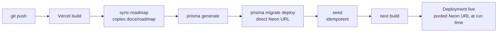

# Deploying BI-Rem Lite — GitHub + Vercel + Neon

BI-Rem Lite needs three things and nothing else: this repository on **GitHub**, one **Vercel**
project and one **Neon** PostgreSQL database. There is no server to manage, no Redis, no queue
and no object storage.

- Time: about fifteen minutes the first time.
- Cost: fits Vercel Hobby and Neon Free (see [Limits](#11-limits-and-plan-fit) — Hobby is for
  non-commercial use).
- After the first deploy, **every push deploys by itself** through Vercel's Git integration.
  There is deliberately no deploy workflow in `.github/workflows/`; GitHub Actions only checks
  the code ([How deploys work](#6-how-deploys-work-from-then-on)).

> **BI-Rem Lite is a demonstration.** Mobile-money operators and KYC vendors are simulated, the
> screening list is fictional and nothing is reported to a regulator. Deploying it does not make
> it a licensed service. Before anything real, work through the
> [go-live checklist](../../docs/07-go-live-checklist.md).

What was rehearsed for this guide, and what could not be, is stated at the end
([§14](#14-what-was-rehearsed-and-what-was-not)).

---

## 1. What a deployment does

Vercel runs two commands from [`vercel.json`](./vercel.json), with `apps/lite` as the project's
Root Directory:

| Step    | Command                                                   | What it does                                                    |
| ------- | --------------------------------------------------------- | --------------------------------------------------------------- |
| Install | `pnpm install --frozen-lockfile --filter @bi-rem/lite...` | Installs Lite and `@bi-rem/config` only, from the root lockfile |
| Build   | `pnpm run vercel-build`                                   | The five steps below, in order; any failure stops the deploy    |



- **Migrations and the seed run at build time over the direct connection**
  (`DATABASE_URL_UNPOOLED`, falling back to `DATABASE_URL`). The running app uses the pooled
  connection (`DATABASE_URL`).
- **The seed is idempotent.** It upserts the reference data (countries, providers, rails, FX
  rates, fee rules, AML rules, the fictional screening list), creates the administrator once and
  never modifies it afterwards, and adds the demo data only once. A second deploy on the same
  database changes nothing.
- **A failed build never replaces the running deployment.** But a migration that was applied
  before the failure stays applied: write migrations so the previous version of the app still
  works with them (add first, remove in a later release).

---

## 2. Before you start

1. The repository is on GitHub **with `pnpm-lock.yaml` committed**. Push the whole monorepo, not
   only `apps/lite`: the install needs the root `package.json`, `pnpm-lock.yaml`,
   `pnpm-workspace.yaml`, `.npmrc`, `tsconfig.base.json` and `packages/config`
   ([§12](#12-what-the-build-needs-from-the-repository)).
2. You have a Vercel account connected to that GitHub account, and (for path B) a Neon account.
3. Generate three secrets on your own machine and keep them in a password manager:

   ```bash
   openssl rand -base64 48   # AUTH_SECRET          — signs session cookies (at least 32 characters)
   openssl rand -base64 32   # ENCRYPTION_KEY       — exactly 32 bytes, base64 (AES-256-GCM key)
   openssl rand -base64 18   # SEED_ADMIN_PASSWORD  — or your own, at least 10 characters
   ```

   `ENCRYPTION_KEY` decrypts the provider credentials, webhook secrets and two-factor secrets
   stored in the database. **If you lose it, those secrets are unreadable.** Never reuse the
   values of another deployment, and never commit them.

---

## 3. Path A — everything from the Vercel dashboard (recommended)

### (a) Import the repository

1. Vercel dashboard → **Add New… → Project**.
2. Under **Import Git Repository**, choose the GitHub account and press **Import** next to the
   repository. If it is not listed, use **Adjust GitHub App Permissions** and give Vercel access
   to it.
3. On the **Configure Project** screen:

   | Setting                   | Value                                                                               |
   | ------------------------- | ----------------------------------------------------------------------------------- |
   | Project Name              | for example `bi-rem-lite`                                                           |
   | Root Directory            | **Edit → `apps/lite`**                                                              |
   | Framework Preset          | Next.js (detected once the Root Directory is set)                                   |
   | Build and Output Settings | leave untouched — Install and Build commands come from `vercel.json`                |
   | Node.js Version           | nothing to set: `"engines": { "node": "22.x" }` in `apps/lite/package.json` pins 22 |

4. Open **Environment Variables** on the same screen and add the variables of step (c) now, so
   you only type them once.
5. Press **Deploy**.

   This first build **stops at `prisma migrate deploy`** with
   `P1001: Can't reach database server at missing-database-url.invalid:5432` — there is no
   database yet. That is expected and harmless: Vercel creates the project when you press
   Deploy, and a database can only be connected to an existing project.

### (b) Create the database: Storage → Create Database → Neon

1. Open the project → **Storage** tab → **Create Database**.
2. Choose **Neon** (Serverless Postgres, a Marketplace integration) → **Continue**, and accept
   the Marketplace terms if asked.
3. Pick the **region** closest to where the functions run (see [Regions](#regions)), the
   **Free** plan, a name, then **Create**.
4. In the **Connect Project** dialog:
   - Environments: tick **Production** (and **Development** if you use `vercel env pull`).
     Tick **Preview** only together with a database branch per preview — read
     [§7](#7-preview-deployments-and-neon-branches) first.
   - Custom prefix: leave it **empty**, so the variables are named `DATABASE_URL` and
     `DATABASE_URL_UNPOOLED`.
5. **Connect**. The integration injects, among others:

   | Variable                                                  | What it is                                    | Used by Lite                 |
   | --------------------------------------------------------- | --------------------------------------------- | ---------------------------- |
   | `DATABASE_URL`                                            | pooled connection (host contains `-pooler`)   | the running app              |
   | `DATABASE_URL_UNPOOLED`                                   | direct connection                             | migrations and seed at build |
   | `PGHOST`, `PGUSER`, `PGPASSWORD`, `PGDATABASE`, …         | the same connection, split into parts         | no                           |
   | `POSTGRES_URL`, `POSTGRES_PRISMA_URL`, `POSTGRES_URL_*` … | names kept for older Vercel Postgres projects | no                           |

   Check them under **Settings → Environment Variables**. Use the pooled URL exactly as Neon
   gives it: Lite talks to PostgreSQL through the `pg` driver adapter, so no `?pgbouncer=true`
   or `connection_limit` parameter is needed.

### (c) Add the application variables

**Settings → Environment Variables** (or the import screen in step (a)). Scope them to
**Production**; see [§7](#7-preview-deployments-and-neon-branches) for Preview.

| Variable               | Value                                                                                            | Required                           |
| ---------------------- | ------------------------------------------------------------------------------------------------ | ---------------------------------- |
| `AUTH_SECRET`          | output of `openssl rand -base64 48`                                                              | yes                                |
| `ENCRYPTION_KEY`       | output of `openssl rand -base64 32`                                                              | yes                                |
| `SEED_ADMIN_EMAIL`     | the administrator's e-mail address                                                               | recommended (`admin@bi-rem.local`) |
| `SEED_ADMIN_PASSWORD`  | the administrator's first password, at least 10 characters                                       | yes — the build fails without it   |
| `SEED_DEMO_DATA`       | `true` for a demonstration with the demo accounts and 30 days of history; leave it out otherwise | no (off in production)             |
| `DATABASE_POOL_MAX`    | connections per function instance, 1–50                                                          | no (default `5`)                   |
| `NEXT_PUBLIC_APP_NAME` | name shown in the interface                                                                      | no (default `BI-Rem Lite`)         |

> **`SEED_DEMO_DATA=true` publishes credentials.** Every demo account — including the demo
> compliance, treasury and support officers — has the password `ChangeMe123!`, which is printed
> on the sign-in page and in this repository. Use it for a demonstration deployment and for
> nothing else.

Mark `AUTH_SECRET`, `ENCRYPTION_KEY` and `SEED_ADMIN_PASSWORD` as **Sensitive** when Vercel
offers it.

### (d) Deploy

**Deployments** tab → the failed deployment → **⋯ → Redeploy**. The build log shows, in order:

```
sync-roadmap: copies are up to date
✔ Generated Prisma Client (7.x) to ./src/generated/prisma
1 migration found in prisma/migrations … All migrations have been successfully applied.
[seed] reference data…
[seed] administrator <your e-mail>: created
[seed] demo data disabled (SEED_DEMO_DATA is not true)
[seed] ledger balanced in 0 currencies — done
▲ Next.js 16 … ✓ Compiled successfully
```

Then go to [§5](#5-check-the-deployment).

### Regions

Latency between the function and the database matters more than anything else you can tune.
Vercel runs functions in one region on Hobby (`iad1`, Washington D.C., unless you change it
under **Settings → Functions → Function Region**). Create the Neon database in the matching
cloud region — for `iad1` that is AWS US East (N. Virginia); for users in West and Central
Africa a European pair such as Vercel `fra1` with Neon AWS Europe (Frankfurt) is usually the
better choice. The database region cannot be changed afterwards; the function region can.

---

## 4. Path B — a Neon project created at neon.tech

Use this when the database must live in your own Neon account, or when you want the first
deploy to succeed in one go.

1. <https://console.neon.tech> → **New Project**: name, PostgreSQL 16 or newer, the region
   closest to your Vercel function region → **Create**.
2. Project dashboard → **Connect**. Copy two connection strings for the same branch, database
   and role:
   - with **Connection pooling** switched **on** (the host contains `-pooler`) →
     `DATABASE_URL`
   - with **Connection pooling** switched **off** → `DATABASE_URL_UNPOOLED`

   They look like
   `postgresql://<role>:<password>@ep-…-pooler.<region>.aws.neon.tech/<db>?sslmode=require&channel_binding=require`.
   Paste them as they are.

3. Import the repository in Vercel as in [path A, step (a)](#a-import-the-repository), and add
   on the import screen: `DATABASE_URL`, `DATABASE_URL_UNPOOLED` and the variables of
   [step (c)](#c-add-the-application-variables), all scoped to **Production**.
4. **Deploy**. The first build already migrates, seeds and ships.

Nothing links the two accounts in this path: when you reset the database password in Neon,
update both variables in Vercel and redeploy.

### Deploy button

For someone who wants **their own copy** of the repository and a Vercel project in one go:

```
https://vercel.com/new/clone?repository-url=https%3A%2F%2Fgithub.com%2Fwouapit999%2Fwouapit999&root-directory=apps%2Flite&env=AUTH_SECRET,ENCRYPTION_KEY,SEED_ADMIN_PASSWORD&envDescription=Secrets%20BI-Rem%20Lite%20needs%20to%20start&envLink=https%3A%2F%2Fgithub.com%2Fwouapit999%2Fwouapit999%2Fblob%2Fmain%2Fapps%2Flite%2FDEPLOY.md&project-name=bi-rem-lite&repository-name=bi-rem
```

```markdown
[](https://vercel.com/new/clone?repository-url=https%3A%2F%2Fgithub.com%2Fwouapit999%2Fwouapit999&root-directory=apps%2Flite&env=AUTH_SECRET,ENCRYPTION_KEY,SEED_ADMIN_PASSWORD&envDescription=Secrets%20BI-Rem%20Lite%20needs%20to%20start&envLink=https%3A%2F%2Fgithub.com%2Fwouapit999%2Fwouapit999%2Fblob%2Fmain%2Fapps%2Flite%2FDEPLOY.md&project-name=bi-rem-lite&repository-name=bi-rem)
```

- `repository-url`, `root-directory`, `env` (comma-separated names the form makes mandatory),
  `envDescription`, `envLink`, `project-name` and `repository-name` are the parameter names of
  Vercel's Deploy Button as we know them. **They were written from memory**: Vercel's
  documentation could not be opened from the environment this guide was prepared in, so check
  the button once before publishing it.
- The button **clones** the repository into the visitor's GitHub account. It only works while
  the source repository is public, and it is not the way to deploy your own repository — use
  path A or B for that.
- The button does not create the database. The first build stops at `prisma migrate deploy`
  exactly as in path A; continue with [step (b)](#b-create-the-database-storage--create-database--neon)
  and redeploy. (Vercel's button can also provision Marketplace storage through an extra
  parameter; we did not include it because we could not verify its current syntax.)

---

## 5. Check the deployment

| Check                                        | Expected                                                                             |
| -------------------------------------------- | ------------------------------------------------------------------------------------ |
| `https://<project>.vercel.app/api/health`    | `200` and `{"status":"ok", … "checks":{"database":{"status":"up", …}}}`              |
| `/status`                                    | "All systems operational", the commit that was deployed, links to this guide         |
| `/roadmap`                                   | the 13 phases with the dates of `docs/roadmap/schedule.json`                         |
| Sign in with `SEED_ADMIN_EMAIL` and password | the back office at `/admin`                                                          |
| **My security → Start two-factor setup**     | switch on two-factor authentication for the administrator before doing anything else |
| **My security → Change password**            | replace the seeded password; the variable is only used to create the account         |
| **Staff & roles**                            | create named accounts for compliance, treasury and support instead of sharing one    |

Against a demonstration deployment (`SEED_DEMO_DATA=true`) you can also run the end-to-end
suite from your machine — it changes the data it finds:

```bash
E2E_BASE_URL=https://<project>.vercel.app pnpm --filter @bi-rem/lite test:e2e
```

That only works when the administrator is `admin@bi-rem.local` with the demo password.

---

## 6. How deploys work from then on

| Event                                       | What happens                                                                                 |
| ------------------------------------------- | -------------------------------------------------------------------------------------------- |
| Push or merge to the production branch      | Vercel builds and promotes a **Production** deployment (migrate → seed → build)              |
| Push to any other branch, or a pull request | Vercel builds a **Preview** deployment — read [§7](#7-preview-deployments-and-neon-branches) |
| Any push or pull request                    | GitHub Actions runs [`ci.yml`](../../.github/workflows/ci.yml); the `lite` job is below      |

The `lite` job of the CI workflow rehearses a deployment on PostgreSQL 16 before Vercel does it
for real: it runs the exact `installCommand` of `vercel.json`, `prisma validate`,
`prisma migrate deploy` on an empty database, lint, typecheck, the unit and integration tests,
`vercel-build` as a production deployment with throw-away secrets, the same migrate + seed a
second time (it must be a no-op), a check that the function bundle carries the Prisma client,
and the Playwright end-to-end suite. It is part of `ci-ok`, the single status check to require
in **GitHub → Settings → Branches → branch protection**.

Vercel does not wait for GitHub Actions. To make a red CI block production, protect the
production branch with the `ci-ok` check so that nothing unverified can be merged into it.

Optional — skip Lite builds when a commit does not touch Lite: **Settings → Git → Ignored Build
Step → Custom**, with

```bash
git diff --quiet HEAD^ HEAD -- . ../../packages/config ../../pnpm-lock.yaml ../../docs/roadmap
```

(exit code 0 skips the build). Leave it off until you need it: a skipped build is also a
skipped migration.

Rolling back: **Deployments → the previous good deployment → ⋯ → Instant Rollback** (or
**Promote**). That swaps the code, not the database — see the note on migrations in
[§1](#1-what-a-deployment-does).

---

## 7. Preview deployments and Neon branches

A preview deployment runs the **same build** as production: it migrates and seeds whatever
database its variables point to.

> **Never let a preview build reach the production database.** The unmerged migrations of the
> branch would be applied to production.

Every Vercel build — preview included — gets the production rules, whatever `NODE_ENV` the
build step runs with: `AUTH_SECRET` and `ENCRYPTION_KEY` are mandatory, the seed refuses to
create the administrator without `SEED_ADMIN_PASSWORD`, and demo accounts are only seeded when
`SEED_DEMO_DATA=true`. A preview with none of these variables therefore fails at the seed step
instead of writing accounts with the public demo password into whatever database it reached.

Choose one of the three setups:

| Setup                           | How                                                                                                                                                                                                                                           |
| ------------------------------- | --------------------------------------------------------------------------------------------------------------------------------------------------------------------------------------------------------------------------------------------- |
| **No previews** (simplest)      | Scope `DATABASE_URL` and `DATABASE_URL_UNPOOLED` to **Production only**. Preview builds then fail at `prisma migrate deploy` (`missing-database-url.invalid`) and nothing is touched.                                                         |
| **One Neon branch per preview** | Path A: in the Neon integration's **Connect Project** settings, switch on the creation of a database branch for **Preview** deployments. Each preview gets its own copy-on-write branch and its own `DATABASE_URL` / `DATABASE_URL_UNPOOLED`. |
| **One shared preview database** | Path B: in Neon create a branch (for example `preview`), copy its two connection strings into Vercel scoped to **Preview only**. All previews share it; migrations from different pull requests can collide — reset the branch when they do.  |

For the two setups with previews, also set for the **Preview** environment:

| Variable              | Value for Preview                                                                                                                  |
| --------------------- | ---------------------------------------------------------------------------------------------------------------------------------- |
| `AUTH_SECRET`         | its own value — the app refuses to start without it                                                                                |
| `ENCRYPTION_KEY`      | the **production** key if the preview branch is a copy of production data (the copied secrets are encrypted with it), else its own |
| `SEED_ADMIN_EMAIL`    | set it explicitly                                                                                                                  |
| `SEED_ADMIN_PASSWORD` | its own value — the build fails without it                                                                                         |
| `SEED_DEMO_DATA`      | `true` only for a preview on demo data; the default is `false`                                                                     |

A branch copied from production contains production users and their data. Keep **Deployment
Protection** on for previews (**Settings → Deployment Protection → Vercel Authentication**,
which is the default), or branch previews from a database that holds demo data only.

Neon branches created for previews are not always deleted when the Git branch is; prune them in
the Neon console from time to time (the Free plan limits the number of branches).

---

## 8. Custom domain

1. **Settings → Domains → Add**, enter the domain, and create the DNS record Vercel shows (an
   `A` record for an apex domain, a `CNAME` for a subdomain). The certificate is issued
   automatically.
2. Nothing to change in the app: links, the session cookie and the examples in the partner API
   reference follow the host of the request. The session cookie is `Secure`, so the app must be
   reached over HTTPS — it always is on Vercel.
3. Update what you gave to third parties: provider **Callback URL**s in **Providers & rails**
   (`https://<domain>/api/webhooks/providers/<provider code>`) and the base URL partners call
   (`https://<domain>/api/v1`).

The app sends `Strict-Transport-Security: max-age=63072000; includeSubDomains; preload`. On an
apex domain that tells browsers to use HTTPS for **every subdomain** for two years: make sure
all of them serve HTTPS before pointing the apex at the app, or use a dedicated subdomain.

---

## 9. Rotating secrets

| Secret                         | How                                                                                                                                                                                                                                                                                                                                                                                                | Effect                                                  |
| ------------------------------ | -------------------------------------------------------------------------------------------------------------------------------------------------------------------------------------------------------------------------------------------------------------------------------------------------------------------------------------------------------------------------------------------------- | ------------------------------------------------------- |
| `AUTH_SECRET`                  | Replace the value, redeploy.                                                                                                                                                                                                                                                                                                                                                                       | Everyone is signed out.                                 |
| `ENCRYPTION_KEY`               | 1. Add `ENCRYPTION_KEYS_PREVIOUS` = `{"<current version>":"<current key>"}` (version `1` unless you rotated before). 2. Set `ENCRYPTION_KEY` to the new key and `ENCRYPTION_KEY_VERSION` to the next number. 3. Redeploy: the seed step re-encrypts every stored secret with the new key and prints `every stored secret uses the current key`. 4. Remove `ENCRYPTION_KEYS_PREVIOUS` and redeploy. | None for users.                                         |
| Database password              | Neon console → **Roles** → reset the password. Path A updates the Vercel variables itself; path B: paste both new strings. Redeploy.                                                                                                                                                                                                                                                               | Requests fail between the reset and the new deployment. |
| Administrator password         | In the app: **My security → Change password**. `SEED_ADMIN_PASSWORD` is only read when the account is first created; changing the variable later does nothing.                                                                                                                                                                                                                                     | The administrator's other sessions are signed out.      |
| Provider credentials / secrets | In the app: **Providers & rails → provider → Credentials / Webhook secret**. Each save is a new version; the previous one is retired.                                                                                                                                                                                                                                                              | The previous webhook secret stops verifying.            |
| Partner API keys and webhooks  | Partners do it themselves in the partner portal (**API keys**, **Webhooks**).                                                                                                                                                                                                                                                                                                                      | The revoked key stops working at once.                  |

Two limits to know:

- Re-encryption happens **at deploy time**, in the seed step (`src/server/secrets-rotation.ts`):
  provider credentials, provider webhook secrets, partner webhook signing secrets and
  two-factor secrets are rewritten with the current key. If the build log says
  `key version(s) … still in use`, or lists secrets that could not be decrypted, keep the old
  key in `ENCRYPTION_KEYS_PREVIOUS` until that is resolved.
- If you believe `ENCRYPTION_KEY` itself leaked, rotating the key is not enough: rotate every
  provider credential and webhook secret with the operators, since the old ciphertexts can be
  read with the leaked key.

**Lost administrator access**: set `SEED_ADMIN_EMAIL` to a new address and
`SEED_ADMIN_PASSWORD` to a new password, redeploy — the seed creates that administrator because
it does not exist yet. Sign in, then suspend the old account under **Staff & roles**.

---

## 10. Resetting or removing the demo data

The demo data is seeded once and then left alone, so there is no "reseed" button.

**Start again from an empty database** (everything is lost):

1. Neon console → **SQL Editor**, on the right branch and database:

   ```sql
   DROP SCHEMA public CASCADE;
   CREATE SCHEMA public;
   ```

2. Vercel → **Deployments → latest → ⋯ → Redeploy**. The build recreates the tables, the
   reference data, the administrator and — with `SEED_DEMO_DATA=true` — a fresh demo history.

With path A you can also delete the database under **Storage** and create a new one; with path
B, Neon's **Branches → Reset from parent** does the same for a preview branch.

**Turn a demonstration into a clean deployment**: do the reset above with `SEED_DEMO_DATA`
removed. Merely removing the variable stops nothing that already exists: the demo accounts stay
until you suspend them (**Staff & roles**, **Customers**, **Partners**).

**Keep the data, refresh the reference data**: just redeploy. The seed adds reference rows that
are missing and leaves what an administrator changed in the back office alone: a country's
on/off switch and risk level, provider settings, fee rules, liquidity thresholds, AML rule
tuning and manual FX overrides are written only when the row is first created. What does follow
the code on every deploy: names and descriptions of seeded countries, rails, AML rules and
screening entries, and the mid rate of FX pairs whose source is still `seed`.

---

## 11. Limits and plan fit

| Topic           | What Lite does                                                                                                                                                                                            | What to watch                                                                                                                                                                                                                                                               |
| --------------- | --------------------------------------------------------------------------------------------------------------------------------------------------------------------------------------------------------- | --------------------------------------------------------------------------------------------------------------------------------------------------------------------------------------------------------------------------------------------------------------------------- |
| Connections     | One small `pg` pool per function instance (`DATABASE_POOL_MAX`, default 5, idle connections closed after 20 s) on the **pooled** Neon URL. No session state, advisory locks or named prepared statements. | Never put the direct URL in `DATABASE_URL`: under load every instance would hold direct connections and Neon would refuse new ones.                                                                                                                                         |
| Transactions    | Every transfer is one interactive transaction with row locks — compatible with Neon's pooler (transaction mode).                                                                                          | A transfer normally takes well under a second, but may wait up to 15 s for a lock and run up to 30 s. Check **Settings → Functions → Function Max Duration**: with Fluid compute (the default for new projects) it is far above that; without it the Hobby default is 10 s. |
| Cold starts     | Nothing is kept warm.                                                                                                                                                                                     | On Neon Free the database sleeps after a few idle minutes; the first request then takes a second or so longer.                                                                                                                                                              |
| Request size    | KYC documents are capped at 1 MB each, at most four per submission.                                                                                                                                       | Vercel refuses request bodies over 4.5 MB.                                                                                                                                                                                                                                  |
| Background work | None: notifications, webhooks to partners and AML screening run inside the request.                                                                                                                       | A partner webhook is attempted once, with a 3-second timeout; partners retry from their portal.                                                                                                                                                                             |
| File system     | Nothing is written to disk at run time; documents are stored in PostgreSQL.                                                                                                                               | Database size on the Free plan: KYC documents count towards it.                                                                                                                                                                                                             |
| Rate limiting   | Stored in PostgreSQL, so it holds across function instances; the client address is the first `x-forwarded-for` entry, which Vercel sets.                                                                  | Behind any other proxy, make sure that proxy overwrites `x-forwarded-for`.                                                                                                                                                                                                  |
| Plans           | Vercel Hobby and Neon Free are enough technically.                                                                                                                                                        | Vercel Hobby is for personal, non-commercial projects; quotas of both plans change — check them before relying on a figure quoted anywhere.                                                                                                                                 |

---

## 12. What the build needs from the repository

The Vercel project's Root Directory is `apps/lite`, but the build is not confined to it. With
**Include files outside the Root Directory in the Build Step** switched on (**Settings →
General → Root Directory**; it is the default) the build uses exactly these paths outside
`apps/lite`:

| Path                                     | Why                                                                                         |
| ---------------------------------------- | ------------------------------------------------------------------------------------------- |
| `package.json`, `pnpm-workspace.yaml`    | workspace root; `packageManager` pins pnpm 10                                               |
| `pnpm-lock.yaml`                         | the install is `--frozen-lockfile`                                                          |
| `.npmrc`                                 | hoisting rules for Prisma and ESLint                                                        |
| `tsconfig.base.json`, `packages/config/` | `apps/lite/tsconfig.json` extends the shared TypeScript preset (also the ESLint preset)     |
| `docs/roadmap/` (optional)               | `sync-roadmap` refreshes `/roadmap` from it; without it the committed copies are used as is |

Nothing else is read: not `apps/api`, `apps/web`, `apps/admin`, `packages/db` or
`packages/shared`. Lite has its own Prisma schema and its own database.

The generated Prisma client (`src/generated/prisma`, git-ignored) is produced by
`prisma generate` during the build and bundled into every function by Next.js; its runtime and
PostgreSQL query compiler are traced from `node_modules` automatically. CI fails if they are
missing from the bundle.

pnpm 10 does not run dependency install scripts unless they are allow-listed. The root
`pnpm-workspace.yaml` allow-lists `prisma`, `@prisma/engines` and `esbuild`
(`onlyBuiltDependencies`), so Prisma's schema engine is downloaded from `binaries.prisma.sh`
once, during `pnpm install`, rather than by `prisma migrate deploy` in every build. Vercel
builds have that network access.

---

## 13. Troubleshooting

| Symptom                                                                                                 | Cause                                                                                                              | Fix                                                                                                                                                                                                  |
| ------------------------------------------------------------------------------------------------------- | ------------------------------------------------------------------------------------------------------------------ | ---------------------------------------------------------------------------------------------------------------------------------------------------------------------------------------------------- |
| Build: `P1001: Can't reach database server at missing-database-url.invalid:5432`                        | No `DATABASE_URL` / `DATABASE_URL_UNPOOLED` for the environment being built                                        | Connect the database ([step (b)](#b-create-the-database-storage--create-database--neon)) or scope the variables to that environment; for previews see [§7](#7-preview-deployments-and-neon-branches) |
| Build: `P1001` with a real Neon host                                                                    | Wrong string, deleted branch, or the password was reset                                                            | Copy both strings again from Neon; path A: reconnect the integration                                                                                                                                 |
| Build: `[seed] failed: SEED_ADMIN_PASSWORD must be set in production (the default password is public).` | Variable missing for Production                                                                                    | Add it, redeploy                                                                                                                                                                                     |
| Build: `[seed] failed: AUTH_SECRET and ENCRYPTION_KEY must be set in production`                        | One or both missing                                                                                                | Add them ([§2](#2-before-you-start)), redeploy                                                                                                                                                       |
| Build: `ENCRYPTION_KEY must be 32 bytes, base64-encoded (got N bytes)`                                  | Not generated with `openssl rand -base64 32`, or pasted with quotes or a line break                                | Generate again, paste the single line without quotes                                                                                                                                                 |
| Build: `Invalid environment: AUTH_SECRET: AUTH_SECRET must be at least 32 characters`                   | Secret too short                                                                                                   | `openssl rand -base64 48`                                                                                                                                                                            |
| Build: `Invalid environment: SEED_ADMIN_PASSWORD: Too small…`                                           | Password shorter than 10 characters                                                                                | Choose a longer one                                                                                                                                                                                  |
| Build: `AUTH_SECRET is the public development value` (or the same for `ENCRYPTION_KEY`)                 | The development fallback from the source code was set as the real value                                            | Generate your own                                                                                                                                                                                    |
| Install: `ERR_PNPM_OUTDATED_LOCKFILE`                                                                   | `pnpm-lock.yaml` does not match a `package.json`                                                                   | Run `pnpm install` locally, commit the lockfile                                                                                                                                                      |
| Install: `ERR_PNPM_UNSUPPORTED_ENGINE` or a pnpm 9 banner                                               | Vercel picked an older pnpm than `packageManager: pnpm@10.x` asks for                                              | Add the variable `ENABLE_EXPERIMENTAL_COREPACK=1` and redeploy                                                                                                                                       |
| Build: "No Next.js version detected"                                                                    | Root Directory is not `apps/lite`                                                                                  | **Settings → General → Root Directory**                                                                                                                                                              |
| Build: `File '../../../tsconfig.base.json' not found`, or pnpm cannot find the workspace                | "Include files outside the Root Directory" is off, or only part of the repository was pushed                       | Switch it on; push the paths of [§12](#12-what-the-build-needs-from-the-repository)                                                                                                                  |
| Build: an error fetching `binaries.prisma.sh`                                                           | Prisma could not download its schema engine                                                                        | Redeploy (the download happens in `pnpm install`; a transient network error is the usual cause)                                                                                                      |
| Build: `P3009` / "migrate found failed migrations"                                                      | A migration failed half-way on an earlier build                                                                    | Fix the cause, then `prisma migrate resolve --rolled-back <name>` against the direct URL from your machine, and redeploy                                                                             |
| Runtime: every page answers 500 right after a deploy                                                    | A variable needed at run time is missing for that environment (`AUTH_SECRET`, `ENCRYPTION_KEY`)                    | **Deployments → Functions / Logs** shows `… must be set in production`; add it, redeploy                                                                                                             |
| `/api/health` answers `503` with `"database":{"status":"down"}`                                         | Neon project suspended, deleted branch, wrong pooled string                                                        | Open the Neon console; check `DATABASE_URL`                                                                                                                                                          |
| First request after a quiet period is slow                                                              | Neon compute waking up plus a cold function                                                                        | Expected on the free plans                                                                                                                                                                           |
| Runtime: `remaining connection slots are reserved` / too many connections                               | `DATABASE_URL` is the direct string, or `DATABASE_POOL_MAX` is high                                                | Use the pooled string (`-pooler`); lower `DATABASE_POOL_MAX`                                                                                                                                         |
| Log: `SECURITY WARNING: The SSL modes 'prefer', 'require', and 'verify-ca' are treated as aliases…`     | The `pg` driver announces a future change; Neon's `sslmode=require` is verified strictly today                     | Harmless. Path B: write `sslmode=verify-full` instead to silence it                                                                                                                                  |
| "Secret could not be decrypted (wrong key or tampered data)" on a provider or at two-factor sign-in     | `ENCRYPTION_KEY` changed without `ENCRYPTION_KEYS_PREVIOUS`, or a preview uses another key than the data it copied | Restore the old key in `ENCRYPTION_KEYS_PREVIOUS` ([§9](#9-rotating-secrets))                                                                                                                        |
| KYC upload fails with 413                                                                               | Request larger than Vercel's 4.5 MB limit                                                                          | Documents must be at most 1 MB each                                                                                                                                                                  |
| Demo accounts exist on a deployment that should be clean                                                | `SEED_DEMO_DATA=true` at some point, or a preview build reached this database                                      | Suspend them, or reset ([§10](#10-resetting-or-removing-the-demo-data)); fix the scoping ([§7](#7-preview-deployments-and-neon-branches))                                                            |
| "Too many attempts. Please wait a moment and try again." at sign-in                                     | The rate limit (10 attempts per e-mail and 20 per address in 5 minutes)                                            | Wait five minutes; five wrong passwords also lock the account for 15 minutes                                                                                                                         |
| `/roadmap` shows old dates                                                                              | `docs/roadmap/schedule.json` changed but the copies in `apps/lite` were not refreshed and committed                | `pnpm --filter @bi-rem/lite sync:roadmap`, commit — or simply deploy: the build refreshes them when `docs/` is in the repository                                                                     |

---

## 14. What was rehearsed, and what was not

Rehearsed on 2026-11-10, on a copy of the repository containing only what Git would push (no
`node_modules`, no generated client, no `.env`), with Node 22, pnpm 10 and a local PostgreSQL 16:

| Rehearsal                                                                                                                                | Result                                                                                                                                |
| ---------------------------------------------------------------------------------------------------------------------------------------- | ------------------------------------------------------------------------------------------------------------------------------------- |
| `pnpm install --frozen-lockfile --filter @bi-rem/lite...` from `apps/lite`                                                               | 2 of 8 workspace projects installed; lockfile in sync                                                                                 |
| `pnpm run vercel-build` as a production deployment on an **empty** database, secrets from the `openssl` commands                         | migrations applied, reference data + administrator + demo data seeded, ledger balanced, `next build` passed                           |
| The same build a **second time** on that database, with only `DATABASE_URL` set                                                          | nothing to migrate, administrator unchanged, demo data skipped, identical row counts                                                  |
| `next start` on that build                                                                                                               | `/api/health` 200; the 85 capabilities of the phase-by-phase audit were exercised against it ([docs/lite](../../docs/lite/README.md)) |
| The build with **only** `apps/lite`, `packages/config` and the root files of [§12](#12-what-the-build-needs-from-the-repository) present | passed (it failed without `tsconfig.base.json`, which is why that file is listed)                                                     |
| Function bundle (`.next/server/**/*.nft.json`)                                                                                           | contains the Prisma client runtime, the PostgreSQL query compiler and `pg`; no file outside the repository                            |
| Playwright end-to-end suite on a production build made from that install                                                                 | 46 tests passed                                                                                                                       |
| The `lite` job of `ci.yml`, step by step with the same commands, on a fresh copy of the working tree                                     | every step passed, including the end-to-end suite on the build made by `vercel-build`                                                 |
| TLS: `pg` and Prisma's schema engine against a PostgreSQL server with `sslmode=require&channel_binding=require`                          | both connect over TLS 1.3                                                                                                             |
| Every configuration error quoted in [§13](#13-troubleshooting) from "Build:" rows about variables                                        | reproduced; messages copied from the output                                                                                           |
| Reset by `DROP SCHEMA public CASCADE` + redeploy                                                                                         | database rebuilt from scratch                                                                                                         |

Not rehearsed, because neither service can be reached from where this was prepared:

- **No build has run on Vercel and nothing has connected to Neon.** The click paths, the names
  of the variables the Neon integration injects and the Deploy Button parameters are written
  from knowledge of those products, not from a run. Expect labels in either dashboard to differ
  slightly.
- Which pnpm version Vercel selects for this lockfile, and whether Vercel sets
  `NODE_ENV=production` for the build step of a preview deployment
  ([§7](#7-preview-deployments-and-neon-branches) assumes the unsafe answer).
- Behaviour through Neon's pooler under real concurrency, and Neon cold starts.

If a step of this guide does not match what you see, the build log is the authority: every
failure of the build names the variable or the host it could not use.
