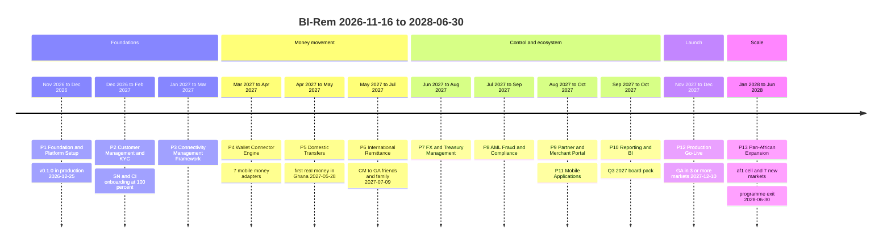
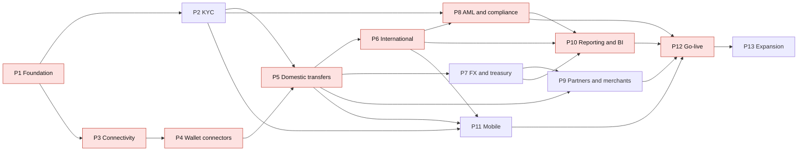

# BI-Rem — Implementation Roadmap

| Item                      | Value                                                                                                                                                                                                                                                                                                                                                                                                                       |
| ------------------------- | --------------------------------------------------------------------------------------------------------------------------------------------------------------------------------------------------------------------------------------------------------------------------------------------------------------------------------------------------------------------------------------------------------------------------- |
| Programme                 | **BI-Rem** — pan-African remittance and mobile-money platform                                                                                                                                                                                                                                                                                                                                                               |
| Window                    | **2026-11-16 → 2028-06-30** · 85 weeks · 13 independently deployable phases                                                                                                                                                                                                                                                                                                                                                 |
| Production go-live        | **2027-12-10** (Phase 12 exit, gate G12, programme week W56)                                                                                                                                                                                                                                                                                                                                                                |
| Source of truth for dates | [`docs/roadmap/schedule.json`](./roadmap/schedule.json) — every date in this document is copied from it                                                                                                                                                                                                                                                                                                                     |
| Companion documents       | [Gantt chart & critical path](./01-gantt-chart.md) · [Milestone tracker & phase gates](./02-milestone-tracker.md) · [`milestones.csv`](./roadmap/milestones.csv)                                                                                                                                                                                                                                                            |
| Architecture baseline     | [Infrastructure architecture](./architecture/infrastructure-architecture.md) · [Database schema v1](./architecture/database-schema-v1.md) · [Environment management](./architecture/environment-management.md) · [Monitoring framework](./architecture/monitoring-framework.md) · [Security baseline](./architecture/security-baseline.md) · [Phase 1 implementation notes](./architecture/phase-1-implementation-notes.md) |
| Owner                     | Program Manager, for the steering committee                                                                                                                                                                                                                                                                                                                                                                                 |
| Status                    | Baseline v1 submitted for steering-committee approval, 2026-11-10                                                                                                                                                                                                                                                                                                                                                           |

---

## 1. Executive summary

BI-Rem will be built as **13 phases over 85 weeks**, each shipped to production on its own (dark behind feature flags, then ramped), so that the platform earns production evidence continuously instead of in one big-bang launch. Real customer money moves for the first time in Ghana on **2027-05-28** (Phase 5), the first cross-border corridor (Cameroon → Gabon) opens to friends and family on **2027-07-09** (Phase 6), and the platform is **formally launched on 2027-12-10** after an external penetration test, two disaster-recovery drills, SOC 2 Type I readiness and PCI SAQ A, and three go/no-go board decisions (Phase 12). The first half of 2028 (Phase 13) adds a second African deployment cell in Cape Town, card and bank rails, and seven new markets, taking BI-Rem to its target of **20 countries, 50 providers, 1,000,000 users and 100,000 transfers per day at 99.9 % availability**.

What the board is asked to note and decide:

| #   | Item                                                 | Figure                                                                                                                                                                                       | Detail                                                                                                                                                                                            |
| --- | ---------------------------------------------------- | -------------------------------------------------------------------------------------------------------------------------------------------------------------------------------------------- | ------------------------------------------------------------------------------------------------------------------------------------------------------------------------------------------------- |
| 1   | Planned engineering and delivery effort              | **1,097.5 person-weeks** across 13 phases                                                                                                                                                    | Bottom-up from the phase plans (section 11). At an assumed blended loaded cost of USD 2,000–4,000 per person-week this is **USD 2.2–4.4 M** of internal cost (not in the external figures below). |
| 2   | External one-off spend                               | **USD 0.51 M – 1.33 M**                                                                                                                                                                      | Pentests, counsel and licensing, certifications, onboarding fees, device lab (section 11). Phase 13 alone is USD 240–592 k, of which counsel and licensing in seven countries is USD 105–280 k.   |
| 3   | Recurring run-rate at programme exit                 | **USD 24.8 k – 82.9 k per month** (USD 0.30–0.99 M per year)                                                                                                                                 | Cloud, SaaS, data, KYC vendors, insurance, compliance platform; excludes per-transaction provider and scheme fees, which scale with volume.                                                       |
| 4   | Returnable working capital                           | **USD 50.5 k – 152 k**                                                                                                                                                                       | Float for production probes (Phase 4) and nostro pre-funding across six currencies (Phase 6). Capital, not expense.                                                                               |
| 5   | **Decision needed — resourcing peak**                | ~**100 person-weeks** of demand above the rostered 16.5 FTE between 2027-01-25 and 2027-10-11, concentrated in **Aug–Sep 2027** (P8, P9, P10, P11 inside eight weeks, three at any one time) | Recommend funding a contractor surge of ~75 person-weeks (3–4 backend, 1–2 frontend, 1 QA) at USD 190–380 k, decision at G4 (2027-04-30). Section 8.3.                                            |
| 6   | **Decision needed — critical external dependencies** | Provider production onboarding, COBAC sponsor bank, FIU registrations, app-store accounts, pentest vendor, country licences                                                                  | Each needs a contract or application started **before** its phase (section 10.4).                                                                                                                 |
| 7   | Critical path                                        | P1 → P3 → P4 → P5 → P6 → P8 → P10 → P12                                                                                                                                                      | Zero float from 2027-01-25 to go-live; P2, P7, P9, P11 carry 8, 6, 4 and 2 weeks of float respectively ([Gantt §4](./01-gantt-chart.md#4-critical-path)).                                         |

---

## 2. Vision and target scale

**Vision.** A customer anywhere in the 20 target countries can register on a phone, pass tiered KYC in minutes, and send money to a wallet, bank account, card or cash agent in their own country or across borders, at a rate locked before confirmation, with the money tracked end to end — on a platform that operators can extend to a new provider or country by configuration rather than code, and that regulators, sponsor banks and auditors can inspect without special access.

| Target                   | Value               | How the programme proves it                                                                                                                                                                                                                                                               | Phase and evidence                                                                                  |
| ------------------------ | ------------------- | ----------------------------------------------------------------------------------------------------------------------------------------------------------------------------------------------------------------------------------------------------------------------------------------- | --------------------------------------------------------------------------------------------------- |
| Users                    | **1,000,000**       | Platform capacity: customer search p95 < 500 ms with 1 M seeded customers; load campaigns on a production-shaped branch with ≥ 1 M users, 25 M transfers, 300 M ledger entries. Commercial: active-user KPI (section 7).                                                                  | [P2](./phases/phase-02-customer-kyc.md) M2.6 · [P12](./phases/phase-12-go-live.md) M12.1            |
| Transactions             | **100,000 per day** | 300 rps steady for 1 h with p95 `POST /v1/transfers` ≤ 600 ms; stress breakpoint ≥ 1,200 rps with graceful 429/503 and no ledger imbalance; then 100 k transfers/day sustained 2 h split 60/40 across two cells with p95 < 800 ms                                                         | P12 M12.2–M12.3 · [P13](./phases/phase-13-pan-african-expansion.md) M13.10                          |
| Providers                | **50+**             | Provider onboarding by configuration (no PR, TC3.06); new wallet connector in < 30 min; ≥ 30 providers LIVE in the Provider Directory at M13.12, the remainder in SANDBOX/onboarding through country packs                                                                                | [P3](./phases/phase-03-connectivity.md) · [P4](./phases/phase-04-wallet-connectors.md) · P13 M13.12 |
| Countries                | **20+**             | KYC policy per country as data (P2); corridors as data (P6); CountryLaunch state machine and country packs (P13); 18 of 20 LIVE at M13.12 and a Zambia rehearsal pack reaching SANDBOX in ≤ 10 engineering days with zero API deploys                                                     | P2 · [P6](./phases/phase-06-international.md) · P13                                                 |
| Availability             | **99.9 %**          | SLO 1 (API availability) ≥ 99.9 % over the trailing 30 days at go-live, measured at Cloudflare and the API, corroborated by synthetic probes from Lagos, Nairobi, Dakar and Paris; per-cell SLOs in P13                                                                                   | P12 M12.6 · P13                                                                                     |
| RPO                      | **< 15 minutes**    | Logical replication to a standby Neon project in `aws-eu-west-2`, replication lag < 30 s; two timed DR drills (announced, then unannounced)                                                                                                                                               | P12 M12.3, M12.5 · P13 game days                                                                    |
| RTO                      | **< 60 minutes**    | Cloudflare load-balancer failover to Fly `ams` with pre-staged secrets; 35-minute target leaves a 25-minute buffer (R12.4)                                                                                                                                                                | P12 · P13 Route 53 fail-away drills                                                                 |
| Multi-region             | eu1 + af1           | P12: warm-standby DR region; P13: second production cell `af1` (AWS af-south-1) with a PII-free global control plane and inter-region clearing; data residency enforced by an egress guard                                                                                                | P12 · P13                                                                                           |
| Zero-downtime deployment | Every phase         | Rolling Fly deploys with `release_command` migrations (P1); **expand → migrate → contract** migrations only; worker-then-http canaries (P3); drain gate for in-flight sagas (P6); OTA with republish (P11); same image digest promoted after a 24 h staging soak with auto-rollback (P12) | All phases                                                                                          |

---

## 3. Guiding principles

| #   | Principle                                    | What it means in practice                                                                                                                                                                                                                                                                                       | Where it is enforced                                                                                                                   |
| --- | -------------------------------------------- | --------------------------------------------------------------------------------------------------------------------------------------------------------------------------------------------------------------------------------------------------------------------------------------------------------------- | -------------------------------------------------------------------------------------------------------------------------------------- |
| 1   | **Independently deployable phases**          | Each phase ships to production with its feature flags off and must cause zero customer-visible change; it is then ramped (staff → 5 % → 25 % → 100 %, or SANDBOX → FRIENDS_FAMILY → LIVE) with kill switches exercised. A phase never waits for a later phase to be useful.                                     | Gate rule in the [milestone tracker §3.1](./02-milestone-tracker.md#31-gate-mechanics); e.g. M2.4, M3.3, M4.4, M5.3, M6.4 dark deploys |
| 2   | **Configuration over code for connectivity** | Providers, credentials, webhooks, corridors, fee schedules, KYC policies, margins, AML rules, commission plans and whole countries are versioned data with maker-checker, not deployments. Adding a scheme or rail is a code change confined to one package.                                                    | P3 Provider Directory and vault; P4 Connector SDK; P6 corridors; P8 rule DSL; P13 country packs                                        |
| 3   | **Compliance by design**                     | Restricted data is encrypted per object (P2) and per credential (P3) with KMS; every mutating request writes an `AuditLog` row from day one; four-eyes on money-affecting configuration; screening and AML decisions are inside the transfer saga, not bolted on; retention and legal hold are schema features. | [Security baseline](./architecture/security-baseline.md); P1 audit interceptor; P8                                                     |
| 4   | **Ledger-first money movement**              | No balance exists outside a balanced double-entry journal (`BIGINT` minor units + ISO-4217 currency, never floats). Sagas post journals; projections are rebuilt from entries; nightly trial balance must be zero; an unbalanced posting pages on-call and can freeze postings.                                 | P5 ledger, DB trigger and append-only role; P6 two-journal FX; P7 EOD close                                                            |
| 5   | **Idempotent and recoverable by default**    | Idempotency keys at the API edge and provider edge; explicit state machines; `UNKNOWN` outcomes resolved by status lookup before any retry; DLQs with replay; chaos tests kill workers at every step boundary.                                                                                                  | P4 TC4.07–TC4.13; P5 chaos harness; P6 chaos suite                                                                                     |
| 6   | **Evidence over assertion**                  | Every milestone has binary acceptance criteria and an evidence folder; gates review evidence, not slides; numbers on dashboards are tied out to the ledger before they are certified.                                                                                                                           | [Milestone tracker](./02-milestone-tracker.md); P10 `kpi_daily` tie-out                                                                |
| 7   | **Pinned, boring stack**                     | Node 22, pnpm 10, TypeScript 5.9, NestJS 12, Next 16, Prisma 7.10, Postgres on Neon, Fly.io, Vercel, Upstash — no swaps or downgrades without an ADR.                                                                                                                                                           | `CLAUDE.md`; ADR-0001..0006 (M1.1)                                                                                                     |

---

## 4. Phase-by-phase roadmap

| #   | Phase                                                                  | Dates · weeks                | Track      | Depends on   | Objective                                                          | Key deliverables                                                                                                                                                                                                                                                                                                                                                     | Headline success criteria                                                                                                                           | Gate                       |
| --- | ---------------------------------------------------------------------- | ---------------------------- | ---------- | ------------ | ------------------------------------------------------------------ | -------------------------------------------------------------------------------------------------------------------------------------------------------------------------------------------------------------------------------------------------------------------------------------------------------------------------------------------------------------------- | --------------------------------------------------------------------------------------------------------------------------------------------------- | -------------------------- |
| 1   | [Foundation & Platform Setup](./phases/phase-01-foundation.md)         | 2026-11-16 → 2026-12-25 · 6  | core       | —            | Build the platform every later phase deploys onto, moving no money | Monorepo (api, web, admin, db, shared, config); two-realm auth with RBAC and admin TOTP; append-only `AuditLog`; notification spine (BullMQ); Prisma schema v1 (14 tables); CI/CD to Vercel, Fly.io, Neon; Sentry/Grafana baseline                                                                                                                                   | Customer and operator log-in on production; Neon operational with PITR drill; PR → production with no manual command; `v0.1.0` live                 | G1 2026-12-25              |
| 2   | [Customer Management & KYC](./phases/phase-02-customer-kyc.md)         | 2026-12-28 → 2027-02-19 · 8  | core       | 1            | Phone-first onboarding and tiered KYC for SN, CI, NG, KE, GH       | OTP + multi-device MFA; customer profile; encrypted document pipeline with ClamAV; KYC orchestrator behind `KycProvider` (Smile ID, Sumsub, Veriff); per-country KYC policies; beneficiaries; risk engine v1; verification queue and compliance dashboard (16 tables)                                                                                                | Onboarding end-to-end in production with ≥ 1 approval per pilot country; provider failover game day; DPIA approved; registration open 100 % SN + CI | G2 2027-02-19              |
| 3   | [Connectivity Management Framework](./phases/phase-03-connectivity.md) | 2027-01-25 → 2027-03-05 · 6  | platform   | 1            | Make "integrate a provider" a configuration change                 | Provider Directory; KMS envelope-encrypted, versioned credentials and mTLS; generic webhook ingress (nine signature schemes, replay protection); health monitoring and status board; test console; rotation with overlap; resilient `HttpConnector` (16 tables)                                                                                                      | No hardcoded credential; provider added with no PR; webhook replay suite and one week of dual verification; breakers 48 h without false opens       | G3 2027-03-05              |
| 4   | [Wallet Connector Engine](./phases/phase-04-wallet-connectors.md)      | 2027-03-08 → 2027-04-30 · 8  | platform   | 3            | One `WalletConnector` interface for seven mobile-money providers   | MTN MoMo, Orange Money, Airtel Money, Moov Money, M-Pesa Daraja, Unitel Money, e-Mola; Connector SDK, scaffolding CLI, conformance suite and simulator; BullMQ transaction queue with state machine, idempotency, DLQs; webhook normalisation (8 tables)                                                                                                             | New provider in < 30 min (recorded); conformance 100 % × 7; production probes MTN GH, Daraja KE, Airtel UG                                          | G4 2027-04-30              |
| 5   | [Domestic Transfers](./phases/phase-05-domestic-transfers.md)          | 2027-04-19 → 2027-05-28 · 6  | core       | 2, 4         | First real money: same-country transfers in Ghana and Kenya        | Double-entry ledger; wallets; Fee Calculation Engine (E-Levy, excise); per-KYC-tier limits; `TransferSaga` for funding, W2W, W2M, W2A with compensation; PDF receipts; reconciliation hooks (19 tables)                                                                                                                                                              | Internal p95 ≤ 3 s, external p95 ≤ 20 s over 72 h at 100 % GH/GHS; trial balance zero nightly; KE/KES at 5 %                                        | G5 2027-05-28              |
| 6   | [International Remittance](./phases/phase-06-international.md)         | 2027-05-31 → 2027-07-23 · 8  | core       | 5            | Cross-border across CEMAC (XAF) and Lusophone markets              | Corridors and routing; FX rate table and quote locking behind `FxRateProvider`; `CrossBorderSaga` with two linked journals; nostro pre-funding; settlement files over SFTP; three-way reconciliation; regulatory capture and reports (BEAC, BNA, BM); tracking links (17 tables)                                                                                     | Wave A canary success ≥ 98 %, payout p95 < 15 min; locked rate identical in quote, ledger, receipt, settlement and BEAC line; recon ≥ 99.5 %        | G6 2027-07-23              |
| 7   | [FX & Treasury Management](./phases/phase-07-fx-treasury.md)           | 2027-06-28 → 2027-08-06 · 6  | platform   | 5            | Control liquidity and profitability                                | Multi-source FX engine with composition, guards, maker-checker margins and versioned quotes; settlement accounts with camt.053/MT940/CSV import; liquidity monitoring and forecast; four-eyes rebalancing; Treasury Dashboard; per-transfer profitability, EOD close, `pnl_daily` (24 tables)                                                                        | Margin change live within 60 s; EOD close 5 days with delta ≤ 1 minor unit; zero below-cost conversions                                             | G7 2027-08-06              |
| 8   | [AML, Fraud & Compliance](./phases/phase-08-aml-compliance.md)         | 2027-07-26 → 2027-09-17 · 8  | compliance | 2, 6         | Compliance control plane inside the transfer path                  | Versioned AML rule DSL (real-time + batch); OFAC/UN/EU/UK sanctions and PEP screening with in-house fuzzy matching; risk scoring; velocity; fraud signals; triage queues; case management with four-eyes; SAR/STR with goAML; travel rule; 10-year retention and legal hold (34 tables)                                                                              | 100 % of transfers carry a decision, p95 < 150 ms; alert → case → freeze → MLRO-approved STR → FIU acknowledgement from the admin portal            | G8 2027-09-17              |
| 9   | [Partner & Merchant Portal](./phases/phase-09-partner-merchant.md)     | 2027-08-23 → 2027-10-01 · 6  | core       | 5, 7         | B2B ecosystem: merchants, agent networks, API partners             | PARTNER realm and `apps/partner`; self-serve KYB onboarding; Commission Engine; agent hierarchy, float and cash-in; settlement cycles with pain.001/CSV/MoMo payout files; partner API (keys, OAuth, rate limits, isolated sandbox); signed outbound webhooks (27 tables)                                                                                            | ≥ 5 partners onboarded with zero admin edits; commissions 100 % automated; first settlement cycle reconciled without a spreadsheet                  | G9 2027-10-01              |
| 10  | [Reporting & Business Intelligence](./phases/phase-10-reporting-bi.md) | 2027-09-20 → 2027-10-29 · 6  | platform   | 6, 7, 8      | Executive oversight on certified numbers                           | Neon logical-replication CDC to ClickHouse Cloud; outbox streaming for real-time tiles; `@bi-rem/metrics` (20 KPIs as code); certified `kpi_daily` tied out to the ledger; five dashboards; PDF/XLSX/CSV exports; scheduled distribution; board pack (13 tables)                                                                                                     | Failed transfer on the Operational Dashboard within 30 s; Executive MTD revenue = `pnl_daily` to the minor unit; Q3-2027 board pack signed          | G10 2027-10-29             |
| 11  | [Mobile Applications](./phases/phase-11-mobile.md)                     | 2027-08-09 → 2027-10-15 · 10 | mobile     | 2, 5, 6      | Customer mobile channel on Google Play and the App Store           | React Native/Expo app: native KYC capture and liveness, wallets, domestic and international send, tracking, push (FCM/APNs) with SMS fallback, hardware-backed biometrics, pinning/RASP/attestation, offline tolerance for low-end Android, OTA policy; Mobile Operations console (6 tables)                                                                         | Listings public in 6 countries; ≥ 1,000 installs crash-free ≥ 99.5 %; ≥ 200 in-app transfers; push ≥ 97 % first attempt                             | G11 2027-10-15             |
| 12  | [Production Go-Live](./phases/phase-12-go-live.md)                     | 2027-11-01 → 2027-12-10 · 6  | all        | 8, 9, 10, 11 | Turn flag-guarded capability into a launched, operated service     | External pentest closed; 100 k tx/day load evidence; multi-region DR (RPO < 15 min, RTO < 60 min); 7 SLOs with on-call and ≥ 30 runbooks; SOC 2 Type I readiness; PCI SAQ A; go/no-go board and market ladder INTERNAL → PILOT → SOFT_LAUNCH → GA; hypercare (17 tables)                                                                                             | 99.9 % over trailing 30 days; 0 Critical/High open; three board GO decisions; GA in ≥ 3 markets                                                     | **G12 2027-12-10 go-live** |
| 13  | [Pan-African Expansion](./phases/phase-13-pan-african-expansion.md)    | 2028-01-03 → 2028-06-30 · 26 | all        | 12           | Pan-African, multi-region network at target scale                  | Second cell `af1` (AWS af-south-1) with global control plane and inter-region clearing; country-as-configuration (CountryLaunch state machine, packs, playbook v2); aggregators (TerraPay, Onafriq, Flutterwave, Paystack); Visa Direct, Mastercard Send, AFT; ISO 20022 bank rails, SWIFT, SEPA, PAPSS; USSD; KE, GH, NG, UG, RW, TZ, ZA in three waves (20 tables) | af1 8 weeks at 99.9 %; seven countries launched; 18 countries and ≥ 30 providers LIVE; 100 k/day capacity                                           | G13 2028-06-30             |

Schema growth: the 13 phases add **231 tables** to the Phase 1 baseline, every one through an expand migration; contract migrations are deliberately deferred to a later phase (Phase 2/4 contracts in P5 W1, Phase 6 contract in P9 W1, Phase 9 contract in P10 W1, device and region contracts in P13).

---

## 5. Timeline

The full Gantt with team tracks, gates and launch markers is in [01-gantt-chart.md](./01-gantt-chart.md). Dependencies between phases:

Customer-facing launch sequence (what changes for customers, by date):

| Date                    | Customer-visible event                              | Markets                                                                |
| ----------------------- | --------------------------------------------------- | ---------------------------------------------------------------------- |
| 2026-12-25              | Customer portal register/login (no money)           | —                                                                      |
| 2027-02-19              | KYC onboarding open                                 | SN, CI 100 %; NG, KE, GH ≥ 25 %                                        |
| 2027-05-28              | Domestic wallet transfers, W2M and W2A pilots       | GH 100 %; KE 5 %                                                       |
| 2027-07-09 → 2027-07-23 | Cross-border friends and family, then wave A canary | CM→GA, CM→TD, CM→CG, GA→CM                                             |
| 2027-10-01              | Partner self-serve onboarding, 5 pilot partners     | GH, KE                                                                 |
| 2027-10-15              | Mobile apps public                                  | GH, KE, NG, SN, CI, CM                                                 |
| 2027-11-26 → 2027-12-10 | PILOT → SOFT_LAUNCH → GENERAL_AVAILABILITY          | CM, SN, CI, KE, GH, NG domestic; CM↔GA cross-border; GA in ≥ 3 markets |
| 2028-03-10              | Wave 1 on the af1 cell                              | KE, GH                                                                 |
| 2028-04-21              | Wave 2                                              | NG, UG, RW                                                             |
| 2028-06-16 → 2028-06-30 | Wave 3 and programme exit                           | TZ, ZA; 18 countries LIVE                                              |

---

## 6. Delivery waves

| Wave                         | Phases          | Window                  | Business outcome                                                                             | Exit evidence                                                           |
| ---------------------------- | --------------- | ----------------------- | -------------------------------------------------------------------------------------------- | ----------------------------------------------------------------------- |
| **A. Foundations**           | 1, 2, 3         | 2026-11-16 → 2027-03-05 | Identity, KYC and connectivity in production; no money                                       | G1–G3; pen-test (P2) closed; DPIA approved                              |
| **B. Money movement**        | 4, 5, 6         | 2027-03-08 → 2027-07-23 | Real domestic and cross-border transfers on a balanced ledger                                | Trial balance zero daily since 2027-05-28; wave A canary ≥ 98 % success |
| **C. Control and ecosystem** | 7, 8, 9, 10, 11 | 2027-06-28 → 2027-10-29 | Treasury, AML, partners, analytics, mobile — everything a regulator, partner and board needs | G7–G11; Q3-2027 board pack signed                                       |
| **D. Launch**                | 12              | 2027-11-01 → 2027-12-10 | Formal production launch under SLO                                                           | Three board GO decisions; 99.9 % trailing 30 days                       |
| **E. Scale**                 | 13              | 2028-01-03 → 2028-06-30 | Multi-region, multi-rail, 20 countries                                                       | G13 evidence pack                                                       |

---

## 7. KPI framework

All KPIs are defined once as code in `@bi-rem/metrics` and certified by an owner in Phase 10 (see [Phase 10 §3.6](./phases/phase-10-reporting-bi.md#3-deliverables)); reporting currency is USD at the Phase 7 published mid rate frozen per business date. The data behind each KPI is produced by an earlier phase, so the **source phase** is the one that must instrument it and the **metric phase** is the one that certifies and displays it. Targets marked _(assumption)_ are planning values for steering-committee confirmation; all others come from the phase plans or `schedule.json`.

| KPI                  | Definition                                                                                                                    | Formula                                                                                                                                                 | Data source                                                                                         | Target                                                                                                                                           | Source phase → metric phase | Owner / certifier      |
| -------------------- | ----------------------------------------------------------------------------------------------------------------------------- | ------------------------------------------------------------------------------------------------------------------------------------------------------- | --------------------------------------------------------------------------------------------------- | ------------------------------------------------------------------------------------------------------------------------------------------------ | --------------------------- | ---------------------- |
| **Active Users**     | Distinct users (sender or recipient) with ≥ 1 completed transfer or wallet transaction in the trailing 30 days                | `uniq(user_id)` over `transfers` (COMPLETED) ∪ `wallet_transactions` in `[d−29, d]`                                                                     | `agg.active_users_daily` (ClickHouse `uniqState`) from `transfers` (P5), `wallet_transactions` (P4) | ≥ 400,000 by 2028-06-30, i.e. 40 % of the 1 M user target _(assumption)_                                                                         | P4/P5 → P10                 | CPO / COO              |
| **DAU**              | Distinct users with ≥ 1 authenticated session or transaction on the day                                                       | `uniq(user_id)` over `auth.login.succeeded`, mobile session events and transactions on day `d`                                                          | `events.domain_events` (P1 auth events, P11 app sessions)                                           | ≥ 75,000 by 2028-06-30 _(assumption)_; coverage complete only from 2027-10-15 when mobile session events ship (R10.11)                           | P1/P11 → P10                | CPO / COO              |
| **MAU**              | Distinct users as for DAU over the trailing 30 days; stickiness = DAU / MAU                                                   | `uniq(user_id)` over `[d−29, d]`; `DAU / MAU`                                                                                                           | `agg.active_users_daily`                                                                            | ≥ 500,000 MAU and stickiness ≥ 15 % by 2028-06-30 _(assumption)_                                                                                 | P1/P11 → P10                | CPO / COO              |
| **Transfer Volume**  | Count of completed money movements: transfers plus wallet top-ups and withdrawals; Transaction Volume counts `transfers` only | `count(*)` of terminal `COMPLETED` rows per day, by country, corridor, type, provider                                                                   | `transfers`, `wallet_transactions`                                                                  | **100,000 transfers/day** sustained (`schedule.json`); platform headroom proven at 1,200 rps stress (P12)                                        | P4/P5 → P10                 | COO / COO              |
| **Transfer Value**   | Sum of principal of completed transfers, native and USD                                                                       | `Σ amount_minor × fx_mid(business_date)`                                                                                                                | `transfers`, `fx_rate_publications` (P7)                                                            | USD 6–12 M per day at 100 k transfers/day _(assumption: average ticket USD 60–120)_                                                              | P5/P7 → P10                 | CFO / CFO              |
| **Settlement Time**  | Customer: `completed − initiated`; cross-border: payout confirmed − FX locked; partner: `paid_at − period_end`                | p50/p95 of the intervals per corridor, provider, partner                                                                                                | `transfer_events` (P5), `transfer_tracking_events` (P6), `settlement_runs` (P9)                     | Internal W2W p95 ≤ 3 s; external domestic p95 ≤ 20 s; cross-border payout p95 < 15 min; partner settlement p50 ≤ T+1 business day _(assumption)_ | P5/P6/P9 → P10              | COO / COO              |
| **Failure Rate**     | Failed ÷ (completed + failed) terminal transfers in the window, excluding customer cancellations                              | `FAILED / (COMPLETED + FAILED)` by provider, corridor, failure code; 5-min, hourly, daily                                                               | `events.domain_events`, `transfers`                                                                 | ≤ 1.5 % per market (pilot exit success ≥ 98.5 %, P12); ≤ 2 % per corridor in canary (P6 ≥ 98 %)                                                  | P4/P5 → P10                 | COO / COO              |
| **Provider Uptime**  | Share of minutes a provider connection is neither DOWN nor DEGRADED nor under an open incident                                | `1 − bad_minutes / minutes_in_window`                                                                                                                   | `connection_health_results`, `connection_incidents` (P3)                                            | ≥ 99.5 % per production connection per month _(assumption)_; platform API availability ≥ 99.9 % (SLO 1, P12)                                     | P3/P4 → P10                 | Head of platform / COO |
| **FX Profit**        | Realised + unrealised FX result plus captured spread; FX profitability = FX profit ÷ FX-converted value (bps)                 | `fx_realised_minor + fx_unrealised_minor` (+ spread) per pair and segment                                                                               | `pnl_daily`, `fx_positions_daily`, `fx_conversions` (P7)                                            | Zero conversions below cost; distinct margins by RETAIL / STAFF / PARTNER segment; customer total cost ≤ 3 % of send amount (P7 KPI)             | P6/P7 → P10                 | Head of treasury / CFO |
| **CAC**              | Customer acquisition cost per country and channel                                                                             | Approved `marketing_spend` (month, country, channel) ÷ new customers with first completed transfer that month and country                               | `marketing_spend` (P10, maker-checker), `transfers`                                                 | ≤ USD 20 per first-transfer customer _(assumption)_                                                                                              | P5 → P10                    | CMO / CFO              |
| **CLV**              | Customer lifetime value                                                                                                       | ARPU (net revenue per active user per month, trailing 3 months) × gross margin % × expected lifetime months (`1 / monthly churn`, capped at 36)         | `kpi_daily`, cohort tables, `transfer_profitability` (P7)                                           | ≥ USD 60, i.e. CLV/CAC ≥ 3 _(assumption)_                                                                                                        | P7 → P10                    | CFO / CFO              |
| **Fraud Loss Rate**  | Confirmed fraud losses relative to value moved                                                                                | `Σ aml_cases.loss_usd_minor` (type FRAUD, CLOSED_CONFIRMED) ÷ Transfer Value USD, in bps                                                                | `aml_cases` amount columns only (P8)                                                                | ≤ 5 bps per month, alert at 3 bps _(assumption)_                                                                                                 | P8 → P10                    | MLRO / CFO             |
| **Liquidity Ratios** | Coverage, runway and float utilisation per currency and account                                                               | Coverage = available ÷ projected 24 h outflow; runway days = available ÷ 7-day average outflow; utilisation = (ledger float − available) ÷ ledger float | `liquidity_positions`, `settlement_accounts` (P7), `provider_balance_snapshots` (P4)                | Coverage ≥ 1.5 (CRITICAL < 1.0) and runway ≥ 3 days _(assumption)_; launch float ≥ 3× expected daily external volume (P5)                        | P4/P7 → P10                 | Head of treasury / CFO |
| **Country Growth**   | Growth of value and active users per country; countries live                                                                  | MoM and YoY growth of Transfer Value and Active Users; count of countries in stage LIVE                                                                 | `kpi_daily` (P10), `country_launches` (P13)                                                         | 20 countries in scope, 18 LIVE at M13.12 (2028-06-16); MoM value growth ≥ 10 % in each market's first 6 months _(assumption)_                    | P10/P13 → P10               | CEO / CFO              |

Supporting KPIs delivered alongside (Phase 10 catalogue): Revenue (net of provider fees, commissions, treasury fees and taxes), Failed Transactions, Provider Performance (success rate, leg latency p50/p95, circuit-open minutes), Country Activity and FX Profitability. Programme-delivery KPIs reported weekly by the PM: milestones on time (target ≥ 90 % of milestones accepted on their target Friday), gates passed first time (target ≥ 11 of 13), open Critical/High findings at gate (target 0), spend vs range.

KPI governance: a KPI number appears on a board document only if it is **certified** (`metric_catalog.certified_by_id` set) and the daily tie-out against `pnl_daily` / ledger balances is green; definitions are versioned and a definition change creates a new series rather than overwriting history (Phase 10 R10.2, R10.5).

---

## 8. Overlapping team model

### 8.1 Rostered team

From `schedule.json`: 1 program manager, 1 solution architect, 4 backend, 3 frontend, 2 mobile, 2 QA, 1 DevOps/SRE, 1 compliance analyst, 1 product designer and 0.5 security engineer — **16.5 FTE**. Business owners (COO, CFO, MLRO, head of treasury, head of partnerships, head of customer operations, general counsel) are not counted and are named per phase.

### 8.2 Tracks

| Track          | Phases             | Mission                                                                    | Typical composition (from the phase plans)                                                                                                                 |
| -------------- | ------------------ | -------------------------------------------------------------------------- | ---------------------------------------------------------------------------------------------------------------------------------------------------------- |
| **core**       | P1, P2, P5, P6, P9 | Customer and money-movement product line                                   | 4 backend, 2–3 frontend, 2 QA, architect, PM, designer; drops to 2 backend in P6 W5–W8 when two engineers move to P7                                       |
| **platform**   | P3, P4, P7, P10    | Engines consumed by core: connectivity, connectors, FX/treasury, analytics | 2–3 backend (growing to 4 when the preceding core phase closes), 1–2 frontend, 1 QA, architect 50 %, DevOps/SRE 50 %                                       |
| **compliance** | P8                 | AML, sanctions, fraud, SAR                                                 | 3 backend W1–W4 freed by P6, 2 backend W5–W8 plus 1 platform engineer from W3; compliance analyst 100 % as product owner; MLRO designate as business owner |
| **mobile**     | P11                | Customer app                                                               | 2 mobile engineers full time; 1 backend from core W1–W6 then 50 %; QA shared with P9 until 2027-10-01                                                      |
| **all**        | P12, P13           | Launch and expansion                                                       | Whole team; P13 splits backend into a _rails_ squad (cards, ISO 20022) and a _regions_ squad (cells, directory, country framework); AWS contractor W2–W9   |

Overlap windows and the rule that governs each:

| Window                  | Phases in parallel                                                                 | Shared resources                                              | Rule                                                                                                                  |
| ----------------------- | ---------------------------------------------------------------------------------- | ------------------------------------------------------------- | --------------------------------------------------------------------------------------------------------------------- |
| 2027-01-25 → 2027-02-19 | P2 + P3                                                                            | DevOps/SRE, QA, architect                                     | P2 infra delta provisioned by P2 W3 (R2.10); platform squad formed from P1 engineers                                  |
| 2027-03-08 → 2027-04-02 | P4 + P2 rollout tail                                                               | 1 backend + 1 QA borrowed from core W1–W4                     | Core keeps the KYC ramp (NG/KE/GH beyond 25 %) and P5 discovery                                                       |
| 2027-04-19 → 2027-04-30 | P4 W7–W8 + P5 W1–W2                                                                | Interface frozen at M4.1; one platform engineer on loan to P5 | P5 builds against FakeConnector and the simulator (R5.1)                                                              |
| 2027-06-28 → 2027-07-23 | P6 W5–W8 + P7 W1–W4                                                                | Two backend engineers move core → platform on 2027-06-28      | Saga/ledger/settlement front-loaded in P6 W1–W4 (R6.7)                                                                |
| 2027-07-26 → 2027-08-06 | P7 + P8                                                                            | Platform engineer joins P8 W3                                 | P7 descoping order agreed at M7.1                                                                                     |
| 2027-08-09 → 2027-10-15 | P8 + P9 + P11 until 2027-09-17, then P9 + P10 + P11 (three in parallel throughout) | Backend, frontend, QA, compliance analyst                     | Pact contract tests P9 ↔ P11; ScreeningService interface P8 ↔ P9 agreed in P9 W1; P10 starts at half strength (R10.4) |
| 2027-11-01 → 2027-12-10 | P12 only, all hands                                                                | Everyone; change freeze                                       | Phase 13 feature work paused for rostered hypercare staff (R12.10)                                                    |

### 8.3 Capacity heat map and the 2027 Q3 peak

Peak-week FTE demand per month, computed by spreading each phase's bottom-up effort (person-weeks per role from the phase plans) evenly over its weeks and summing overlapping phases. Cells above the rostered capacity are in **bold**. The even-spread model slightly overstates demand where phase plans front- or back-load staff, but the Aug–Sep 2027 peak is also visible in the phase plans' own team tables: P8 (2) + P9 (4) + P11 (1) = 7 backend engineers named for early Sep 2027, then P9 (4) + P10 (2) + P11 (0.5) = 6.5 from 2027-09-20.

| Month        | Phases active | Backend (4) | Frontend (3) | Mobile (2) |  QA (2) | DevOps (1) | Compliance (1) | Total (16.5) |
| ------------ | ------------- | ----------: | -----------: | ---------: | ------: | ---------: | -------------: | -----------: |
| Nov–Dec 2026 | 1, 2          |         3.3 |          2.3 |        0.1 |     1.5 |        0.8 |            0.6 |         10.3 |
| Jan–Feb 2027 | 2, 3          |     **5.3** |      **3.3** |        0.1 | **2.1** |        1.0 |            0.7 |         15.8 |
| Mar 2027     | 3, 4          |         3.5 |          1.0 |        0.1 |     1.3 |        0.6 |            0.3 |          8.5 |
| Apr 2027     | 4, 5          |     **7.8** |          2.5 |        0.1 | **3.1** |    **1.3** |            0.8 |     **20.1** |
| May 2027     | 5, 6          |     **4.3** |          1.9 |        0.1 |     1.8 |        0.7 |            0.8 |         11.6 |
| Jun–Jul 2027 | 6, 7, 8       |     **6.3** |      **3.2** |        0.1 | **2.4** |        1.0 |        **1.4** |     **18.1** |
| Aug 2027     | 7, 8, 9, 11   |     **7.5** |      **4.8** |    **2.3** | **3.5** |    **1.2** |        **1.6** |     **25.7** |
| Sep 2027     | 8, 9, 10, 11  |     **8.1** |      **5.3** |    **2.3** | **3.5** |    **1.4** |        **1.6** |     **26.6** |
| Oct 2027     | 9, 10, 11     |     **4.1** |          2.3 |    **2.1** |     1.9 |        0.9 |            0.4 |         14.8 |
| Nov–Dec 2027 | 12            |         4.0 |          3.0 |        1.7 |     2.0 |        1.0 |            1.0 |         15.3 |
| Jan–Jun 2028 | 13            |         3.5 |          1.6 |        0.8 |     1.7 |        1.0 |            1.0 |         12.3 |

Summed over the programme, demand exceeds the rostered team by **≈ 100 person-weeks** between 2027-01-25 and 2027-10-11: backend 50, frontend 13, QA 13, PM 7, architect 4.6, compliance 4.4, security 3.4, others ≈ 5. Recommendation:

1. **Fund a contractor surge of ≈ 75 person-weeks** (backend 50, frontend 13, QA 13) — 3–4 backend, 1–2 frontend and 1 QA contractors from **2027-06-28 to 2027-10-15**, plus short loans in the Jan–Feb and Apr 2027 overlaps. At USD 2,500–5,000 per person-week _(assumption: senior contractors, remote, Africa/Europe rates)_ this is **USD 190–380 k**, not included in the phase cost ranges. Decision at **G4 (2027-04-30)** to allow eight weeks of sourcing.
2. **Absorb the remaining ≈ 25 person-weeks** (PM, architect, compliance, security) through business-owner time already named in the phase plans and the part-time security engineer moving to full time for Aug–Sep 2027.
3. **Pre-agree descoping ladders** if the surge is not funded: P9 merchant analytics/export, P11 agent mode and inbox, P10 Revenue/Compliance dashboards to W4 — none of these block G12.

---

## 9. Release and environment strategy

Environments, branching, secrets and Neon branching are defined in [environment management](./architecture/environment-management.md); deploy topology in [infrastructure architecture](./architecture/infrastructure-architecture.md).

| Topic                    | Strategy                                                                                                                                                                                                                                                                                                                                                                                                                                                                    |
| ------------------------ | --------------------------------------------------------------------------------------------------------------------------------------------------------------------------------------------------------------------------------------------------------------------------------------------------------------------------------------------------------------------------------------------------------------------------------------------------------------------------- |
| Environments             | `preview` (per PR: Vercel preview per portal, Neon `pr-<n>` branch), `staging` (main auto-deploys; Fly `bi-rem-api-staging`, Neon `staging`), `production` (release tag + required reviewers; Fly `bi-rem-api`, Neon `main`). Later additions: partner `sandbox` app and Neon branch (P9); `perf-20271101` production-shaped branch (P12); DR standby in `ams` / `aws-eu-west-2` (P12); `af1-staging` and `af1-production` cells (P13).                                     |
| Branching and review     | Trunk-based on `main` with branch protection (`CI / ci-ok`, 1 review, linear history, CODEOWNERS on `infra/`, `.github/`, `packages/db/prisma`); Conventional Commits; production deploys only from `v*` tags via `release.yml`.                                                                                                                                                                                                                                            |
| Versioning               | Phase _N_ ships as `v0.N.x` (e.g. `v0.1.0` at M1.6, `v0.10.x` in P10, `v0.13.0`–`v0.13.8` across P13); patch releases inside a phase. A `v1.0.0` tag at the G12 GA decision is proposed for steering-committee confirmation.                                                                                                                                                                                                                                                |
| Promotion                | Same image digest from staging to production (GHCR → `registry.fly.io`), attested; smoke test after every deploy; rollback by redeploying the previous digest (< 10 min target) and Vercel promote for portals. From P12: release candidate soaks 24 h on staging at 300 rps before promotion; automatic rollback on failed post-deploy smoke.                                                                                                                              |
| Zero-downtime migrations | Expand → migrate → contract only. Expand migrations ship with the phase; contract migrations are scheduled in a later phase after a Neon snapshot (`pre-phase5-contract`, `pre-phase9`), rehearsed on a production branch with a `down.sql`, PITR rollback ≤ 60 min. `release_command` applies migrations before the rolling deploy.                                                                                                                                        |
| Dark launch and ramp     | Every capability behind flags in the Phase 1 `FeatureFlag` registry (percentage and role rules); dark deploy → staff allow-list → 5 % → 25 % → 100 % for domestic features (`flag-ramp.yml` with auto-hold); SANDBOX → FRIENDS_FAMILY → LIVE for corridors with four-eyes promotion (P6); INTERNAL → PILOT → SOFT_LAUNCH → GENERAL_AVAILABILITY per market under the go/no-go board (P12); country stage machine in P13.                                                    |
| Kill switches            | Named per phase and exercised before each gate: `platform.maintenance-mode`, `auth.registration.open` (P1); `kyc.manual-review-only` (P2); `connectivity.webhooks.ingress.enabled` (P3); `wallet.engine.enabled` (P4); `ledger.postings.frozen` (P5); corridor pause and FX freeze (P6/P7); `aml.realtime.enforce` (P8); `analytics.source=POSTGRES` (P10); `mobile.pinning.enforce` (P11). Money-affecting switches need two-person confirmation and step-up MFA from P12. |
| Mobile releases          | Two-week release train, staged Play rollout, phased App Store release; OTA for JS-only changes under ADR-0035 with two approvals and republish drill (P11).                                                                                                                                                                                                                                                                                                                 |
| Freeze windows           | Holiday coverage 2026-12-21 → 2027-01-03 (P1 release on 2026-12-22, buffer 2026-12-23); launch freeze 2027-11-01 → 2027-12-10 (`launch-freeze` ruleset: only `fix:` with two reviewers); year-end freeze 2027-12-13 → 2027-12-31 with hypercare.                                                                                                                                                                                                                            |
| Observability            | Per [monitoring framework](./architecture/monitoring-framework.md): correlation id `x-request-id` end to end, Prometheus `/metrics`, Grafana dashboards and alert rules added per phase, Sentry per deployable, logs shipped with redaction; SLOs and burn-rate alerts from P12.                                                                                                                                                                                            |

---

## 10. Governance

### 10.1 Forums

| Forum                             | Members                                                                                                                 | Cadence                                                                           | Decides                                                                                                                                                                       |
| --------------------------------- | ----------------------------------------------------------------------------------------------------------------------- | --------------------------------------------------------------------------------- | ----------------------------------------------------------------------------------------------------------------------------------------------------------------------------- |
| **Steering committee**            | Executive sponsor (chair), CEO, COO, CFO, CTO, Head of Compliance/MLRO, Solution Architect, Program Manager (secretary) | Fortnightly, plus every gate                                                      | Gate outcomes G1–G11 and G13; re-baselining within 2 weeks on the critical path; contractor and vendor spend inside the envelope; scope changes affecting a success criterion |
| **Go/no-go board** (P12 onward)   | CEO, COO, CFO, MLRO, General Counsel (charter signed at M12.1); quorum and two approvers per decision                   | Boards #1 2027-11-26, #2 2027-12-03, #3 2027-12-10; then per country stage in P13 | Market stage advances (INTERNAL → PILOT → SOFT_LAUNCH → GA) on evidence in `go_live_gates`; G12                                                                               |
| **Architecture review**           | Solution Architect (chair), track leads, security engineer                                                              | Weekly, Thursday                                                                  | ADRs (ADR-0001 → ADR-0053), interface freezes (M4.1, M6.1, M7.1), cross-phase contracts                                                                                       |
| **Change advisory**               | DevOps/SRE, PM, on-call lead                                                                                            | Weekly; daily during freezes                                                      | Production change requests and change calendar; freeze exceptions                                                                                                             |
| **Risk and compliance committee** | MLRO, compliance analyst, General Counsel, security engineer                                                            | Monthly; ad hoc for regulator contact                                             | Licensing matrix, DPIAs, risk acceptance for Medium findings, regulator correspondence                                                                                        |

### 10.2 Phase gates and go/no-go

Gate rules, entry/exit criteria for G1–G13, RAG thresholds, reporting cadence and the escalation ladder are defined in the [milestone tracker](./02-milestone-tracker.md#3-phase-gate-definitions). Summary:

- **One gate per phase**, held on the phase end date; outcomes PASS, PASS WITH CONDITIONS (≤ 4 weeks), FAIL.
- **Non-waivable at any gate**: open Critical/High security finding on a production component; ledger imbalance or reconciliation break older than 24 h; licensing gap for live money; missing rollback path.
- **Go/no-go is distinct from the gate**: from P12, exposing real customers in a market requires a board decision with recorded votes and conditions, enforced server-side by `LaunchService` (only writer of launch flags).

### 10.3 Decision rights

| Decision                                 | Responsible       | Accountable                                 | Consulted                     | Informed                           |
| ---------------------------------------- | ----------------- | ------------------------------------------- | ----------------------------- | ---------------------------------- |
| Milestone acceptance                     | Milestone owner   | Program Manager                             | QA lead, business owner       | Steering committee (weekly report) |
| Interface or schema change across phases | Phase architect   | Solution Architect                          | Consuming phase leads         | Track leads                        |
| Feature-flag ramp step                   | Phase lead        | COO (money features) / Product (non-money)  | SRE, compliance               | Support                            |
| Corridor / market stage advance          | Phase lead        | Go/no-go board                              | Compliance, finance, treasury | Partners                           |
| Margin, fee, limit, rule publication     | Maker (ops)       | Checker with approve permission (≠ maker)   | Compliance                    | Audit log                          |
| Risk acceptance (Medium)                 | Security engineer | CTO                                         | MLRO                          | Steering committee                 |
| Budget above phase high estimate         | PM                | Steering committee (≤ 10 %), board (> 10 %) | CFO                           | —                                  |

### 10.4 External dependencies to start early

| Dependency                                                                     | Needed by                | Start no later than                                             | Owner              | Risk ref          |
| ------------------------------------------------------------------------------ | ------------------------ | --------------------------------------------------------------- | ------------------ | ----------------- |
| Smile ID / Sumsub / Veriff DPAs                                                | M2.4 (2027-01-22)        | 2026-12-28                                                      | Program Manager    | R2.1              |
| MTN OpCos, Safaricom, Airtel production onboarding and static-IP allow-listing | M4.8 (2027-04-30)        | 2027-03-08                                                      | Program Manager    | R4.1              |
| COBAC sponsor bank / partner EMI for CEMAC outbound                            | M6.6 (2027-07-09)        | 2027-05-31 (short-list)                                         | PM / Compliance    | R6.1              |
| BEAC declaration layout confirmation                                           | M6.8 (2027-07-23)        | 2027-05-31                                                      | Compliance Analyst | R6.2              |
| Counsel on own-margin and FX position licensing per corridor                   | M7.6 (2027-08-06)        | 2027-06-28                                                      | Compliance Analyst | R7.3              |
| MLRO and deputy appointed; FIU registration and goAML test access (NG, KE, GH) | M8.1 / M8.6              | 2027-07-26                                                      | PM / Compliance    | R8.3, R8.9        |
| Pilot bank payout formats (pain.001 / CSV)                                     | M9.5 (2027-09-24)        | 2027-08-23                                                      | PM / Finance       | R9.4              |
| Apple / Google organisation accounts, D-U-N-S                                  | M11.1 (2027-08-13)       | before 2027-08-09                                               | PM                 | R11.14            |
| Pentest vendor with penalty-backed dates and retest capacity                   | M12.2 (2027-11-12)       | contracted before 2027-11-01                                    | Security Engineer  | R12.2             |
| Cyber, E&O and crime insurance                                                 | First PILOT (2027-11-26) | 2027-10-01                                                      | CFO                | P12 go-live check |
| Country licences / partner-first arrangements (NG IMTO, KE, GH, ZA ADLA …)     | P13 waves                | applications W2–W6 of P13; counsel opinions commissioned in P10 | Compliance Analyst | R13.1, R12.5      |

---

## 11. Budget envelope

External costs per phase in USD, from the phase plans' cost tables. Internal salaries are excluded. Ranges are low–high; recurring items are **deltas** that stack phase on phase (each phase's run-rate adds to the previous).

| Phase     | Effort (PW) | One-off external    | Recurring monthly delta | Annual items         | Returnable capital | Main cost drivers                                                                                                                |
| --------- | ----------: | ------------------- | ----------------------- | -------------------- | ------------------ | -------------------------------------------------------------------------------------------------------------------------------- |
| P1        |          54 | 3.0 k – 8.1 k       | 0.2 k – 0.6 k           | —                    | —                  | Optional light security review; Neon, Fly, Vercel, GitHub, Sentry                                                                |
| P2        |          82 | 13.1 k – 35.8 k     | 6.2 k – 21.6 k          | —                    | —                  | KYC checks (Smile ID, Sumsub, Veriff), SMS OTP, pen-test, counsel in 5 jurisdictions                                             |
| P3        |        33.5 | 0 – 12.0 k          | 0.1 k – 0.3 k           | —                    | —                  | Optional ingress pen-test; KMS, worker group                                                                                     |
| P4        |          68 | 9.1 k – 31.7 k      | 0.2 k – 0.5 k           | —                    | 0.5 k – 2.0 k      | Provider onboarding fees, pen-test, partner-agreement counsel                                                                    |
| P5        |        69.5 | 8.3 k – 18.2 k      | 0.7 k – 2.3 k           | —                    | —                  | Pen-test, pilot incentives, transfer SMS                                                                                         |
| P6        |        77.5 | 39.3 k – 157.5 k    | 0.3 k – 1.1 k           | —                    | 50 k – 150 k       | CEMAC/Lusophone counsel (25–80 k), sponsor bank fees, pen-test; nostro pre-funding capital                                       |
| P7        |        50.5 | 15.2 k – 41.0 k     | 0.6 k – 2.6 k           | —                    | —                  | Market data (OXR, currencylayer), counsel, pen-test, treasury advisory                                                           |
| P8        |        68.5 | 31.0 k – 75.0 k     | —                       | 11.4 k – 29.7 k      | —                  | OpenSanctions licence (7.2–20 k/yr), AML counsel, MLRO consultant, pen-test                                                      |
| P9        |        70.5 | 18.1 k – 38.5 k     | 0.8 k – 3.5 k           | —                    | —                  | KYB checks, pen-test, partner/API/agent terms, tax advisory                                                                      |
| P10       |        56.5 | 16.0 k – 38.0 k     | —                       | 10.9 k – 28.8 k      | —                  | ClickHouse Cloud (7.2–18 k/yr), BI consultant, pen-test extension                                                                |
| P11       |          54 | 22.0 k – 54.5 k     | 0.7 k – 4.4 k           | 0.1 k                | —                  | Mobile pen-test (15–25 k), EAS, device lab, BrowserStack, store assets                                                           |
| P12       |          92 | 94.2 k – 229.6 k    | 2.1 k – 7.7 k           | 36.0 k – 108.0 k     | —                  | External pentest (45–90 k), SOC 2 readiness + Type I (20–45 k), counsel in 6 markets, insurance (25–80 k/yr), DR standby         |
| P13       |         321 | 240.0 k – 592.0 k   | 7.3 k – 22.2 k          | 10.0 k – 28.0 k      | —                  | Counsel and licensing in 7 countries (105–280 k), af1 AWS cell, card-scheme onboarding, pen-test, entities and resident officers |
| **Total** | **1,097.5** | **509 k – 1,332 k** | **19.1 k – 66.7 k**     | **68.4 k – 194.6 k** | **50.5 k – 152 k** |                                                                                                                                  |

Assumptions behind the envelope:

- Recurring figures are the steady-state increments listed by each phase; the all-in run-rate at programme exit is monthly deltas + annual items / 12 = **USD 24.8 k – 82.9 k per month**.
- Excluded and volume-driven: provider, scheme and aggregator per-transaction fees (e.g. TerraPay/Onafriq 0.5–1.5 % of payout value, card OCT/AFT USD 0.30–1.00 per transaction), SMS beyond pilot volumes, minimum regulatory capital and guarantees.
- Excluded and conditional: in-country Nigerian cell `ng1` (USD 4–8 k per month plus ≈ 20 person-weeks) only if a regulator mandates it (R13.2); optional vendor AML screening pilot (USD 0–30 k per year); commercial RASP (USD 20–60 k per year).
- Not in the phase ranges: the recommended contractor surge (USD 190–380 k, section 8.3) and internal salaries (≈ USD 2.2–4.4 M at an assumed USD 2,000–4,000 per person-week).
- Phase 1 and Phase 2 plans quote phase totals including ~1.5 months of recurring spend (USD 3,350–9,000 and USD 23,000–73,000); Phase 10 quotes a first-year total of USD 26,860–66,800. The table above separates one-off and recurring so the figures add up across phases.

---

## 12. Programme-level risks

Cross-cutting risks; phase-specific risks are in section 13 of each phase plan.

| ID    | Risk                                                                                                                     | L    | I    | Mitigation                                                                                                                                                 | Owner              |
| ----- | ------------------------------------------------------------------------------------------------------------------------ | ---- | ---- | ---------------------------------------------------------------------------------------------------------------------------------------------------------- | ------------------ |
| PR-1  | Resource peak Aug–Sep 2027 (three phases at a time, ~26.6 FTE peak-week demand vs 16.5) delays P10 and therefore go-live | High | High | Contractor surge decided at G4; descoping ladders pre-agreed; P10 infrastructure-first plan (R10.4)                                                        | Program Manager    |
| PR-2  | Provider and partner production access slips (MTN, Safaricom, Airtel, COBAC sponsor bank)                                | High | High | Start before the phase; sandbox-only dark launches keep phases shippable; GH/KE sequenced first; friends-and-family under partner EMI licence (R4.1, R6.1) | Program Manager    |
| PR-3  | Ledger or saga defect causes unbalanced position or double payout                                                        | Low  | High | DB balanced-journal trigger, append-only role, property and chaos tests, nightly trial balance, `ledger.postings.frozen` (R5.2, R6.9)                      | Backend Lead       |
| PR-4  | Regulatory or licensing gap in a market at launch                                                                        | Med  | High | Per-market gates in `go_live_gates`; partner-first model; counsel opinions in P10; a market can stay INTERNAL without blocking others (R12.5, R13.1)       | Compliance Analyst |
| PR-5  | Data-residency mandate (NDPA, Kenya DPA) incompatible with EU hosting                                                    | Med  | High | No Restricted data before P2 controls; residency class `IN_COUNTRY` modelled; af1 cell in P13; `ng1` designed and costed (R1.9, R13.2)                     | Solution Architect |
| PR-6  | Key-person dependency on single DevOps/SRE and single compliance analyst                                                 | Med  | High | Named deputies who execute every DR and backup procedure once; break-glass held by two officers; contractor in P13 (R12.8)                                 | Program Manager    |
| PR-7  | External pentest findings late or architectural                                                                          | Med  | High | Phase-level pen-tests from P2 onward reduce the P12 backlog; P12 pentest starts W2 with daily findings; second vendor on retainer (R12.1, R12.2)           | Security Engineer  |
| PR-8  | Alert volume and false positives overwhelm a small compliance team                                                       | High | Med  | Shadow periods with FPR gates; ≤ 60 alerts per analyst per day; hiring trigger in P8 section 11 (R8.1, R8.7)                                               | Compliance Analyst |
| PR-9  | Very recent framework majors (NestJS 12, Next 16, Prisma 7, React 19) expose ecosystem gaps                              | Med  | Med  | Versions pinned; Dependabot grouped; 2 PW contingency in P1 (R1.2)                                                                                         | Solution Architect |
| PR-10 | Single-region latency (90–180 ms) and outage exposure before P12/P13                                                     | Med  | Med  | Accepted until go-live; DR region in P12; af1 cell in P13; RUM latency from pilot countries measured from M1.5 (R1.8)                                      | Solution Architect |

---

## 13. Assumptions and constraints

**Assumptions**

1. The rostered team of 16.5 FTE in `schedule.json` is in place from 2026-11-16 and remains stable; business owners are available as named in each phase plan.
2. Phase effort figures are bottom-up estimates in person-weeks; they include design, build, test, deploy and documentation but not BAU support after a phase exits.
3. Partner-first market entry: BI-Rem operates under licensed partners (EMIs, sponsor banks, aggregators) until its own licences are granted; launch dates do not depend on own licences (R13.1).
4. Provider sandboxes exist for MTN, Daraja, Airtel and Orange; Unitel Money and e-Mola are built against simulators and recorded fixtures until partner UAT in P13 (R4.3).
5. Hosting stays EU-first (Fly `cdg`, Neon `aws-eu-central-1`) until P12 DR and P13 af1; no Restricted data is stored before P2 encryption controls are live.
6. KPI targets marked _(assumption)_ in section 7 are planning values to be confirmed by the CFO, COO and CPO at G10 when the KPI sheet is signed.
7. All money values are stored as `BIGINT` minor units with an ISO-4217 currency; reporting in USD uses the Phase 7 mid rate frozen per business date.
8. Cost figures are 2026 list prices in USD; vendor pricing is negotiated per phase and may move within the stated ranges.

**Constraints**

1. Pinned stack (`CLAUDE.md`): Node 22.x, pnpm 10.x, TypeScript ^5.9 (not 7.x), NestJS ^12, Next ^16, React ^19, Prisma ^7.10 (not the 8.x RC), Zod ^4, Tailwind ^4.
2. Every mutating API request writes an `AuditLog` row; all IDs are UUIDs; all timestamps `timestamptz`; RBAC permissions are `resource:action` strings.
3. Dates in every planning document must match `schedule.json`; changes to `schedule.json` require a steering-committee decision.
4. Expand → migrate → contract is mandatory; no destructive migration ships in the same release as the code that stops using a column.
5. Change freezes: 2026-12-21 → 2027-01-03 (holiday coverage), 2027-11-01 → 2027-12-10 (launch), 2027-12-13 → 2027-12-31 (year end).
6. Four-eyes (requester ≠ approver) on every money-affecting configuration change from P3 onward; self-approval is rejected server-side.
7. Regulatory retention: audit logs 7 years (P1), AML records 10 years (P8), board packs 10 years under Object Lock (P10).

---

## 14. Related documents

- Schedule views: [Gantt chart & critical path](./01-gantt-chart.md) · [Milestone tracker & phase gates](./02-milestone-tracker.md) · [`milestones.csv`](./roadmap/milestones.csv) · [`schedule.json`](./roadmap/schedule.json)
- Phase plans: [P1](./phases/phase-01-foundation.md) · [P2](./phases/phase-02-customer-kyc.md) · [P3](./phases/phase-03-connectivity.md) · [P4](./phases/phase-04-wallet-connectors.md) · [P5](./phases/phase-05-domestic-transfers.md) · [P6](./phases/phase-06-international.md) · [P7](./phases/phase-07-fx-treasury.md) · [P8](./phases/phase-08-aml-compliance.md) · [P9](./phases/phase-09-partner-merchant.md) · [P10](./phases/phase-10-reporting-bi.md) · [P11](./phases/phase-11-mobile.md) · [P12](./phases/phase-12-go-live.md) · [P13](./phases/phase-13-pan-african-expansion.md)
- Architecture: [infrastructure](./architecture/infrastructure-architecture.md) · [database schema v1](./architecture/database-schema-v1.md) · [environments](./architecture/environment-management.md) · [monitoring](./architecture/monitoring-framework.md) · [security baseline](./architecture/security-baseline.md) · [Phase 1 implementation notes](./architecture/phase-1-implementation-notes.md)
