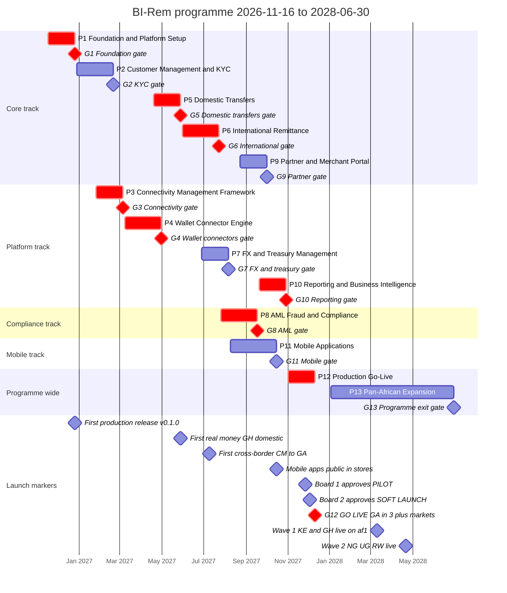
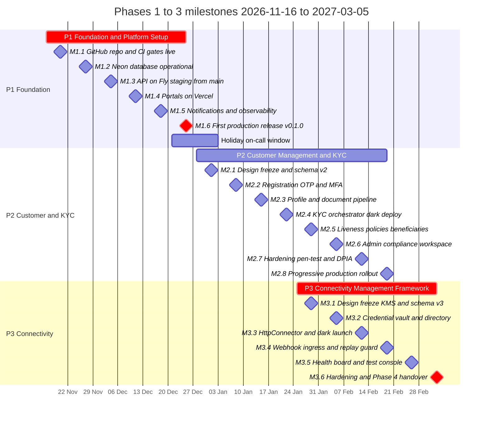

# BI-Rem — Programme Gantt Chart & Critical Path

| Item               | Value                                                                                                                                                                |
| ------------------ | -------------------------------------------------------------------------------------------------------------------------------------------------------------------- |
| Document           | `docs/01-gantt-chart.md` — schedule view of the [implementation roadmap](./00-implementation-roadmap.md)                                                             |
| Source of truth    | [`docs/roadmap/schedule.json`](./roadmap/schedule.json) — every date below is copied from it; if they ever disagree, `schedule.json` wins and this file is corrected |
| Programme window   | **2026-11-16 → 2028-06-30** (85 weeks; W1 = week of 2026-11-16)                                                                                                      |
| Production go-live | **2027-12-10** (Phase 12 exit, programme week W56)                                                                                                                   |
| Milestone detail   | [Milestone tracker](./02-milestone-tracker.md) and [`milestones.csv`](./roadmap/milestones.csv) (97 milestones)                                                      |
| Owner              | Program Manager; reviewed at every steering committee                                                                                                                |
| Status             | Baseline v1 for steering committee approval, 2026-11-10                                                                                                              |

Conventions used in every chart:

- Bars run from the phase **start Monday** to the phase **end Friday** in `schedule.json`. A phase gate `Gn` sits on the phase end date and is the formal exit review defined in the [milestone tracker](./02-milestone-tracker.md#3-phase-gate-definitions).
- Red (`crit`) bars and gates are on the critical path to the 2027-12-10 go-live (section 4).
- Team tracks follow the `team` field of `schedule.json`: `core`, `platform`, `compliance`, `mobile`, and `all` for the two programme-wide phases.

---

## 1. Programme Gantt — all 13 phases by team track



Reading the chart:

| Track      | Phases (dates)                                                                                                                                                                                                                                                                                                                                   | Track lead                                     | Note                                                                          |
| ---------- | ------------------------------------------------------------------------------------------------------------------------------------------------------------------------------------------------------------------------------------------------------------------------------------------------------------------------------------------------ | ---------------------------------------------- | ----------------------------------------------------------------------------- |
| Core       | [P1](./phases/phase-01-foundation.md) 2026-11-16 → 2026-12-25 · [P2](./phases/phase-02-customer-kyc.md) 2026-12-28 → 2027-02-19 · [P5](./phases/phase-05-domestic-transfers.md) 2027-04-19 → 2027-05-28 · [P6](./phases/phase-06-international.md) 2027-05-31 → 2027-07-23 · [P9](./phases/phase-09-partner-merchant.md) 2027-08-23 → 2027-10-01 | Backend Lead (core)                            | Money-movement product line: identity, KYC, transfers, cross-border, partners |
| Platform   | [P3](./phases/phase-03-connectivity.md) 2027-01-25 → 2027-03-05 · [P4](./phases/phase-04-wallet-connectors.md) 2027-03-08 → 2027-04-30 · [P7](./phases/phase-07-fx-treasury.md) 2027-06-28 → 2027-08-06 · [P10](./phases/phase-10-reporting-bi.md) 2027-09-20 → 2027-10-29                                                                       | Backend Lead (platform)                        | Integration, FX/treasury and analytics engines consumed by the core track     |
| Compliance | [P8](./phases/phase-08-aml-compliance.md) 2027-07-26 → 2027-09-17                                                                                                                                                                                                                                                                                | Backend Lead (compliance) + Compliance Analyst | Squad formed from core engineers released by P6                               |
| Mobile     | [P11](./phases/phase-11-mobile.md) 2027-08-09 → 2027-10-15                                                                                                                                                                                                                                                                                       | Mobile Lead                                    | 10-week phase, two mobile engineers full time                                 |
| All        | [P12](./phases/phase-12-go-live.md) 2027-11-01 → 2027-12-10 · [P13](./phases/phase-13-pan-african-expansion.md) 2028-01-03 → 2028-06-30                                                                                                                                                                                                          | Program Manager                                | Launch under change freeze, then multi-region expansion                       |

---

## 2. Zoom — Phases 1 to 3 milestones (2026-11-16 → 2027-03-05)

The first 16 weeks set the delivery rhythm (weekly milestone, Friday acceptance) and contain the hand-off from the core track to the newly formed platform track. Milestone dates are the targets from the phase plans and the [milestone register](./02-milestone-tracker.md#2-master-milestone-register).



What the zoom shows:

| Window                            | What happens                                                                                                                                                                                                            | Why it matters                                                                                                                                                                                                                                                                      |
| --------------------------------- | ----------------------------------------------------------------------------------------------------------------------------------------------------------------------------------------------------------------------- | ----------------------------------------------------------------------------------------------------------------------------------------------------------------------------------------------------------------------------------------------------------------------------------- |
| W1–W6 (2026-11-16 → 2026-12-25)   | P1 delivers one milestone per Friday, ending with `v0.1.0` in production on 2026-12-25 ([M1.6](./phases/phase-01-foundation.md#2-milestones)); the release is scheduled for 2026-12-22 with 2026-12-23 as buffer (R1.5) | Every later phase deploys through the pipeline, identity layer, audit interceptor and observability built here; see [infrastructure architecture](./architecture/infrastructure-architecture.md) and [Phase 1 implementation notes](./architecture/phase-1-implementation-notes.md) |
| 2026-12-21 → 2027-01-03           | Holiday on-call rota (P1 go-live check); P2 W1 design work runs at reduced reviewer capacity (R1.13)                                                                                                                    | P2 M2.1 (2027-01-01) is a design-freeze milestone deliberately free of production change                                                                                                                                                                                            |
| W11–W16 (2027-01-25 → 2027-03-05) | P2 and P3 run in parallel: `core` finishes KYC rollout while `platform` builds the vault, connectors and webhook ingress                                                                                                | First overlap of two teams; DevOps/SRE time is shared (R2.10), the infra delta of P2 must be provisioned by P2 W3                                                                                                                                                                   |
| 2027-02-19                        | P2 M2.8 and P3 M3.4 land the same Friday; M3.4 mirrors Phase 2 KYC webhooks through the new ingress                                                                                                                     | The KYC webhook path is the first production consumer of Phase 3 — dual verification for one week (Smile ID, Sumsub) before cut-over                                                                                                                                                |
| 2027-03-05                        | P3 exits with provider secrets removed from Fly (`env-fallback` contract)                                                                                                                                               | Gate G3 opens P4 on 2027-03-08 with zero slack                                                                                                                                                                                                                                      |

---

## 3. Plain-text month grid (fallback when Mermaid does not render)

Legend: `>##` phase starts in the month · `###` active all month · `##G` phase ends (gate) in the month · `.` inactive. Months are calendar months; programme starts 2026-11-16 and ends 2028-06-30.

```text
Phase                      Nov26 Dec26 Jan27 Feb27 Mar27 Apr27 May27 Jun27 Jul27 Aug27 Sep27 Oct27 Nov27 Dec27 Jan28 Feb28 Mar28 Apr28 May28 Jun28
P1  foundation             >##   ##G    .     .     .     .     .     .     .     .     .     .     .     .     .     .     .     .     .     .
P2  customer-kyc            .    >##   ###   ##G    .     .     .     .     .     .     .     .     .     .     .     .     .     .     .     .
P3  connectivity            .     .    >##   ###   ##G    .     .     .     .     .     .     .     .     .     .     .     .     .     .     .
P4  wallet-connectors       .     .     .     .    >##   ##G    .     .     .     .     .     .     .     .     .     .     .     .     .     .
P5  domestic-transfers      .     .     .     .     .    >##   ##G    .     .     .     .     .     .     .     .     .     .     .     .     .
P6  international           .     .     .     .     .     .    >##   ###   ##G    .     .     .     .     .     .     .     .     .     .     .
P7  fx-treasury             .     .     .     .     .     .     .    >##   ###   ##G    .     .     .     .     .     .     .     .     .     .
P8  aml-compliance          .     .     .     .     .     .     .     .    >##   ###   ##G    .     .     .     .     .     .     .     .     .
P9  partner-merchant        .     .     .     .     .     .     .     .     .    >##   ###   ##G    .     .     .     .     .     .     .     .
P10 reporting-bi            .     .     .     .     .     .     .     .     .     .    >##   ##G    .     .     .     .     .     .     .     .
P11 mobile                  .     .     .     .     .     .     .     .     .    >##   ###   ##G    .     .     .     .     .     .     .     .
P12 go-live                 .     .     .     .     .     .     .     .     .     .     .     .    >##   ##G    .     .     .     .     .     .
P13 pan-african-expansion   .     .     .     .     .     .     .     .     .     .     .     .     .     .    >##   ###   ###   ###   ###   ##G
```

Track view of the same grid (who is busy when):

| Month        | Core                  | Platform             | Compliance      | Mobile           | All                              |
| ------------ | --------------------- | -------------------- | --------------- | ---------------- | -------------------------------- |
| Nov 2026     | P1                    | —                    | —               | —                | —                                |
| Dec 2026     | P1 → P2               | —                    | —               | —                | —                                |
| Jan 2027     | P2                    | P3 (from 01-25)      | —               | —                | —                                |
| Feb 2027     | P2 (exit 02-19)       | P3                   | —               | —                | —                                |
| Mar 2027     | P2 tail, P5 discovery | P3 (exit 03-05) → P4 | —               | —                | —                                |
| Apr 2027     | P5 (from 04-19)       | P4 (exit 04-30)      | —               | —                | —                                |
| May 2027     | P5 (exit 05-28) → P6  | P5/P6 support        | —               | —                | —                                |
| Jun 2027     | P6                    | P7 (from 06-28)      | —               | —                | —                                |
| Jul 2027     | P6 (exit 07-23)       | P7                   | P8 (from 07-26) | —                | —                                |
| Aug 2027     | P9 (from 08-23)       | P7 (exit 08-06)      | P8              | P11 (from 08-09) | —                                |
| Sep 2027     | P9                    | P10 (from 09-20)     | P8 (exit 09-17) | P11              | —                                |
| Oct 2027     | P9 (exit 10-01)       | P10 (exit 10-29)     | —               | P11 (exit 10-15) | —                                |
| Nov 2027     | —                     | —                    | —               | —                | P12                              |
| Dec 2027     | —                     | —                    | —               | —                | P12 (exit 12-10), holiday freeze |
| Jan–Jun 2028 | —                     | —                    | —               | —                | P13                              |

---

## 4. Critical path

### 4.1 The path

The programme has two hard dates: **production go-live 2027-12-10** (G12) and **programme exit 2028-06-30** (G13). The critical path to go-live is:

```mermaid
flowchart LR
    P1["P1 Foundation<br/>2026-11-16 to 2026-12-25"] --> P3["P3 Connectivity<br/>2027-01-25 to 2027-03-05"]
    P3 --> P4["P4 Wallet connectors<br/>2027-03-08 to 2027-04-30"]
    P4 --> P5["P5 Domestic transfers<br/>2027-04-19 to 2027-05-28"]
    P5 --> P6["P6 International<br/>2027-05-31 to 2027-07-23"]
    P6 --> P8["P8 AML and compliance<br/>2027-07-26 to 2027-09-17"]
    P8 --> P10["P10 Reporting and BI<br/>2027-09-20 to 2027-10-29"]
    P8 -.-> P12["P12 Go-live<br/>2027-11-01 to 2027-12-10"]
    P10 --> P12
    P12 --> P13["P13 Expansion<br/>2028-01-03 to 2028-06-30"]
    classDef crit fill:#fde2e1,stroke:#c0392b,color:#111
    class P1,P3,P4,P5,P6,P8,P10,P12 crit
```



The declared chain is **P1 → P3 → P4 → P5 → P6 → P8 → P12**. A forward/backward pass on `schedule.json` shows that P8 does not reach P12 directly with zero float: P8 ends 2027-09-17 and P12 starts 2027-11-01 (6 weeks apart), but P8 also feeds **P10** (`dependsOn: [6, 7, 8]`), which starts the next Monday (2027-09-20) and ends the Friday before P12 starts. The zero-float route is therefore **P1 → P3 → P4 → P5 → P6 → P8 → P10 → P12**, and P10 is drawn `crit` in the Gantt. Any week lost on P8 is lost by P10 and therefore by go-live.

### 4.2 Float per phase

Float is measured in weeks against the fixed go-live start of P12 (2027-11-01). **Total float (TF)** is how far a phase can slip before go-live moves; **free float (FF)** is how far it can slip before its earliest successor moves. Weeks are Monday-to-Monday.

| Phase                                             | Dates (schedule.json)   | Successors      |                       TF |  FF | Critical?        | Explanation                                                                                                                                                                                                                                               |
| ------------------------------------------------- | ----------------------- | --------------- | -----------------------: | --: | ---------------- | --------------------------------------------------------------------------------------------------------------------------------------------------------------------------------------------------------------------------------------------------------- |
| [P1](./phases/phase-01-foundation.md)             | 2026-11-16 → 2026-12-25 | P2, P3          | 4 (logic) / 0 (resource) |   0 | **Yes**          | P3 does not start until 2027-01-25, so logic alone gives 4 weeks; but P2 (same `core` team) starts 2026-12-28 and the platform team for P3 is formed from P1 engineers. A P1 slip pushes P2 immediately and erodes P3 staffing. Treated as critical.      |
| [P2](./phases/phase-02-customer-kyc.md)           | 2026-12-28 → 2027-02-19 | P5, P8, P11     |                        8 |   8 | No               | P5 starts 2027-04-19. The 8 weeks are not idle time: they absorb the country-scoped rollout tail (NG/KE/GH ramp past 25 %), the 1 backend + 1 QA loan to P4 W1–W4 and P5 discovery. Consuming more than 4 weeks puts P5 staffing at risk.                 |
| [P3](./phases/phase-03-connectivity.md)           | 2027-01-25 → 2027-03-05 | P4              |                        0 |   0 | **Yes**          | P4 starts the next Monday.                                                                                                                                                                                                                                |
| [P4](./phases/phase-04-wallet-connectors.md)      | 2027-03-08 → 2027-04-30 | P5              |           0 (−2 overlap) |   0 | **Yes**          | P5 starts 2027-04-19, two weeks **before** P4 ends: P5 W1–W2 build against FakeConnector and the simulator with the interface frozen at M4.1 (R5.1). A P4 slip beyond M4.3 (2027-03-26, transaction queue) removes that overlap and moves P5 one-for-one. |
| [P5](./phases/phase-05-domestic-transfers.md)     | 2027-04-19 → 2027-05-28 | P6, P7, P9, P11 |                        0 |   0 | **Yes**          | P6 starts 2027-05-31.                                                                                                                                                                                                                                     |
| [P6](./phases/phase-06-international.md)          | 2027-05-31 → 2027-07-23 | P8, P10, P11    |                        0 |   0 | **Yes**          | P8 starts 2027-07-26.                                                                                                                                                                                                                                     |
| [P7](./phases/phase-07-fx-treasury.md)            | 2027-06-28 → 2027-08-06 | P9, P10         |                        6 |   2 | No               | P9 starts 2027-08-23 (FF 2 weeks); P9 itself has 4 weeks TF. P7 overlaps P6 W5–W8 so that the FX engine can replace the Phase 6 rate table during the P6 canary.                                                                                          |
| [P8](./phases/phase-08-aml-compliance.md)         | 2027-07-26 → 2027-09-17 | P10, P12        |                        0 |   0 | **Yes**          | P10 starts 2027-09-20.                                                                                                                                                                                                                                    |
| [P9](./phases/phase-09-partner-merchant.md)       | 2027-08-23 → 2027-10-01 | P12             |                        4 |   4 | No               | P12 starts 2027-11-01. P10 reads P9 settlement tables but does not list P9 as a dependency; the P9 contract migration runs inside P10 W1.                                                                                                                 |
| [P10](./phases/phase-10-reporting-bi.md)          | 2027-09-20 → 2027-10-29 | P12             |                        0 |   0 | **Yes**          | Ends the Friday before P12 starts.                                                                                                                                                                                                                        |
| [P11](./phases/phase-11-mobile.md)                | 2027-08-09 → 2027-10-15 | P12             |                        2 |   2 | Near-critical    | Store review (R11.1) and developer-account verification (R11.14) are external and can eat the 2 weeks; the P12 go-live does not require 100 % store coverage.                                                                                             |
| [P12](./phases/phase-12-go-live.md)               | 2027-11-01 → 2027-12-10 | P13             |             0 to go-live |   3 | **Yes**          | The 3 weeks to P13 (2027-12-13 → 2027-12-31) are the year-end change freeze and hypercare window — **not** schedule contingency.                                                                                                                          |
| [P13](./phases/phase-13-pan-african-expansion.md) | 2028-01-03 → 2028-06-30 | —               |                        0 |   0 | End of programme | Ends on the programme end date; the phase plan keeps W25–W26 (2028-06-19 → 2028-06-30) as its internal buffer (R13.14).                                                                                                                                   |

### 4.3 What a slip costs

| If this slips by 1 week… | …go-live (2027-12-10) moves by            | Cheapest recovery lever (from the phase plans)                                                                  |
| ------------------------ | ----------------------------------------- | --------------------------------------------------------------------------------------------------------------- |
| P1                       | 0–1 week (via P2/P3 staffing)             | Use the 2026-12-23 release buffer; defer non-blocking hardening to P2 W1                                        |
| P3                       | 1 week                                    | Scope ladder: four-eyes UI and auto-rotation can trail into P4 W1; vault and ingress cannot                     |
| P4                       | 1 week once the P5 overlap is consumed    | Ship four of seven adapters (MTN, Daraja, Airtel, Orange) at M4.5; Unitel/e-Mola are EXPERIMENTAL anyway (R4.3) |
| P5                       | 1 week                                    | Launch with W2W only; W2M/W2A pilots can follow (R5.11)                                                         |
| P6                       | 1 week                                    | Wave B corridors are not an exit criterion (R6.7); keep wave A at 25 %                                          |
| P7                       | 0 (up to 6 weeks)                         | Phase 6 rate table keeps quoting; descoping order agreed at M7.1                                                |
| P8                       | 1 week                                    | CTR scheduler and export packs can slip to W8 (R8.8); enforce canary stays at 50 %                              |
| P9                       | 0 (up to 4 weeks)                         | Merchant analytics/export descoped first (R9.8)                                                                 |
| P10                      | 1 week                                    | Revenue/Compliance dashboards can slip to W4, export UI to W5 (R10.4); board pack is a hard requirement         |
| P11                      | 0 (up to 2 weeks)                         | Agent mode, international send and inbox are the first descopes (R11.2)                                         |
| P12                      | 1 week; P13 start unchanged until 3 weeks | Board #1 may approve PILOT for a subset of markets with hard caps (R12.1); GA requires ≥ 3 markets, not all     |

### 4.4 Schedule controls

- **Near-critical watch list**: P11 (2 weeks TF, external store dependency), P9 (4 weeks TF but overlaps the Sep 2027 resource peak), P2 rollout tail (8 weeks TF but shared core team).
- **Resource-driven criticality**: the Aug–Oct 2027 window runs P8, P9, P10 and P11 within ten weeks, three of them in any given week. The bottom-up effort in the phase plans implies a peak-week demand of ~8.1 backend, 5.3 frontend and 3.5 QA FTE in Sep 2027 against 4, 3 and 2 rostered (see [roadmap §8.3](./00-implementation-roadmap.md#83-capacity-heat-map-and-the-2027-q3-peak)). The contractor surge decision is due at the **G4 steering committee (2027-04-30)**, eight weeks before the surge window opens on 2027-06-28 (P6/P7 overlap).
- **Fixed calendar constraints**: holiday on-call 2026-12-21 → 2027-01-03; P12 launch freeze 2027-11-01 → 2027-12-10; year-end freeze 2027-12-13 → 2027-12-31; SOC 2 Type I audit 2028-01-15 (inside P13 W2).
- **External critical items** that do not appear as bars but gate milestones: provider production onboarding (R4.1, M4.8), COBAC sponsor bank for CEMAC outbound (R6.1, M6.6), FIU / goAML test access (R8.3, M8.6), app-store review (R11.1, M11.9), pentest vendor slots (R12.2, M12.4), country licences (R13.1). Each has a named owner in the [milestone tracker escalation path](./02-milestone-tracker.md#6-escalation-path).
- **Re-baselining rule**: the Gantt is re-baselined only by steering committee decision; slips are reported against this baseline (planned vs forecast date) in the weekly status report.
