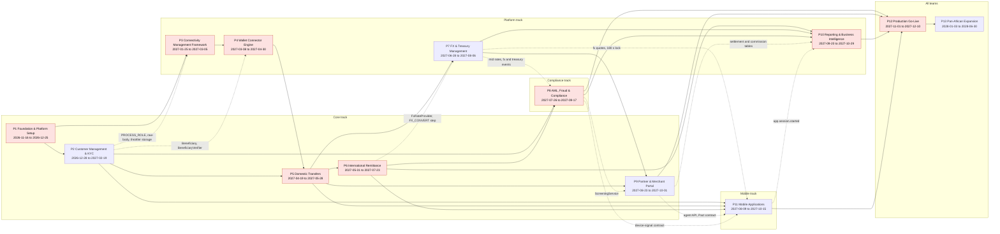
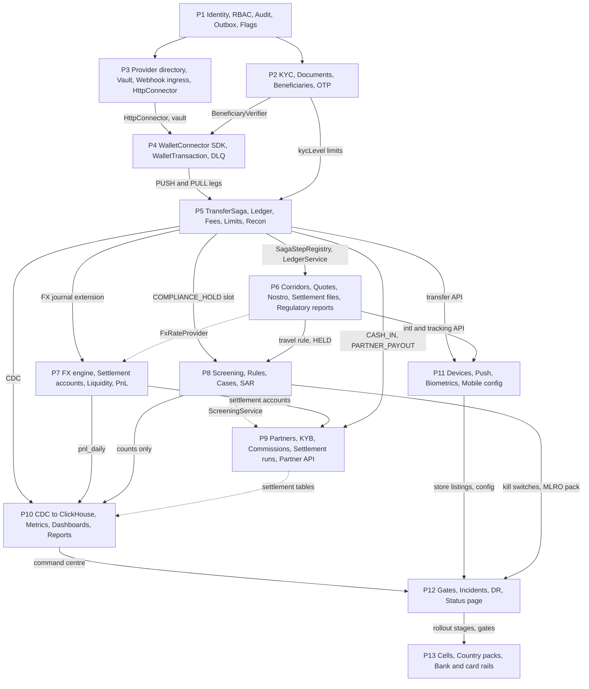
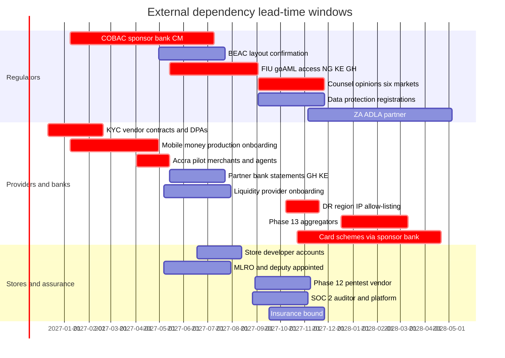

# BI-Rem — Phase & Component Dependency Map

| Item             | Value                                                                                                                                                                                                                                                                                                                                                                   |
| ---------------- | ----------------------------------------------------------------------------------------------------------------------------------------------------------------------------------------------------------------------------------------------------------------------------------------------------------------------------------------------------------------------- |
| Document         | `docs/03-dependency-map.md` — how the 13 phases, their components and their external counterparties depend on each other                                                                                                                                                                                                                                                |
| Source of truth  | [`docs/roadmap/schedule.json`](./roadmap/schedule.json) for dates and hard dependencies (`dependsOn`); each phase plan's **§15 Dependencies & Handover** for component-level detail. If a date here disagrees with `schedule.json`, `schedule.json` wins                                                                                                                |
| Programme window | **2026-11-16 → 2028-06-30**; production go-live **2027-12-10** (Phase 12 exit)                                                                                                                                                                                                                                                                                          |
| Baseline         | v1, 2026-11-10                                                                                                                                                                                                                                                                                                                                                          |
| Owner            | Solution Architect (component and integration sections) with the Program Manager (schedule, external dependencies)                                                                                                                                                                                                                                                      |
| Related          | [Gantt and float per phase](./01-gantt-chart.md#4-critical-path) · [Risk register](./06-risk-register.md) · [milestones.csv](./roadmap/milestones.csv) · [Infrastructure architecture](./architecture/infrastructure-architecture.md) · [Database schema v1](./architecture/database-schema-v1.md) · [Environment management](./architecture/environment-management.md) |

**Headline findings for the steering committee**

1. **22 hard dependencies** connect the 13 phases. The zero-float chain to go-live is **P1 → P3 → P4 → P5 → P6 → P8 → P10 → P12**, and P5 starts two weeks _before_ P4 ends (2027-04-19 vs 2027-04-30) — the only hard dependency planned with a negative gap.
2. **Nine external dependencies are triggered later than their lead time allows** if the phase plans are followed literally: KYC vendor DPAs, mobile-money production onboarding, Accra pilot agreements, the COBAC sponsor bank, FIU/goAML access, per-market counsel opinions, DR allow-listing, Phase 13 aggregators and card schemes (section 5.7). Starting them on the dates below costs nothing in engineering and is the cheapest schedule protection available.
3. **Peak concurrency is three phases on three tracks** (2027-08-23 → 2027-10-01: P8, P9, P11, then P9, P10, P11) on one DevOps/SRE, two QA engineers and one compliance analyst. Every integration point in that window has a contract test (section 8).
4. **Three schema/numbering conflicts** already exist between plans — `fx_rate_sources` is declared by both Phase 6 and Phase 7, ADR-0033…0036 (Phase 10) collides with ADR-0033…0037 (Phase 11), and Phase 10 reads `health_check_results`/`provider_incidents` where Phase 3 creates `connection_health_results`/`connection_incidents`. They must be resolved before the later expand migrations (section 4.5).

---

## 1. How to read this map

| Symbol                  | Meaning                                                                                                                                                                             | Example                    |
| ----------------------- | ----------------------------------------------------------------------------------------------------------------------------------------------------------------------------------- | -------------------------- |
| **H** — hard            | Listed in `schedule.json` `dependsOn`. The successor's start is gated on the predecessor's exit review (phase gate)                                                                 | P5 `dependsOn: [2, 4]`     |
| **C** — consumes        | The phase uses tables, services or contracts from an earlier phase that has **already ended by calendar**, but the edge is not in `dependsOn` (often transitive)                    | P9 reads Phase 6 corridors |
| **S** — soft / parallel | The phase uses an artefact from a phase that **overlaps it in time**; the dependency is managed by an interface agreed at a design-freeze milestone and verified by a contract test | P7 ↔ P6 `FxRateProvider`   |
| —                       | No dependency                                                                                                                                                                       |                            |

Team tracks come from the `team` field of `schedule.json`: **core** (P1, P2, P5, P6, P9), **platform** (P3, P4, P7, P10), **compliance** (P8), **mobile** (P11) and **all** (P12, P13).

---

## 2. Phase dependency graph

Solid arrows are hard dependencies from `schedule.json`; dashed arrows are soft or informational dependencies (parallel contracts, or consumption outside the hard chain), labelled with the artefact that crosses the boundary.

Critical-path phases are shaded. The hard edges with their calendar gap (predecessor end Friday → successor start Monday; 0 weeks = no float on that edge):

|  #  | Edge      | Predecessor ends | Successor starts | Edge float | Note                                                                                                                               |
| :-: | --------- | ---------------- | ---------------- | :--------: | ---------------------------------------------------------------------------------------------------------------------------------- |
|  1  | P1 → P2   | 2026-12-25       | 2026-12-28       |    0 w     | Same core team; holiday on-call 2026-12-21 → 2027-01-03                                                                            |
|  2  | P1 → P3   | 2026-12-25       | 2027-01-25       |    4 w     | Logical float only; platform team is formed from P1 engineers ([gantt §4.2](./01-gantt-chart.md#42-float-per-phase))               |
|  3  | P3 → P4   | 2027-03-05       | 2027-03-08       |    0 w     | **Critical**                                                                                                                       |
|  4  | P2 → P5   | 2027-02-19       | 2027-04-19       |    8 w     | Absorbs the Phase 2 country rollout tail and loans to P4                                                                           |
|  5  | P4 → P5   | 2027-04-30       | 2027-04-19       |  **−2 w**  | **Critical, overlapping**: P5 W1–W2 build against `FakeConnector` and the simulator with the interface frozen at M4.1 (2027-03-12) |
|  6  | P5 → P6   | 2027-05-28       | 2027-05-31       |    0 w     | **Critical**                                                                                                                       |
|  7  | P5 → P7   | 2027-05-28       | 2027-06-28       |    4 w     |                                                                                                                                    |
|  8  | P2 → P8   | 2027-02-19       | 2027-07-26       |    22 w    |                                                                                                                                    |
|  9  | P6 → P8   | 2027-07-23       | 2027-07-26       |    0 w     | **Critical**                                                                                                                       |
| 10  | P5 → P9   | 2027-05-28       | 2027-08-23       |    12 w    |                                                                                                                                    |
| 11  | P7 → P9   | 2027-08-06       | 2027-08-23       |    2 w     | Near-critical for P9 start                                                                                                         |
| 12  | P6 → P10  | 2027-07-23       | 2027-09-20       |    8 w     |                                                                                                                                    |
| 13  | P7 → P10  | 2027-08-06       | 2027-09-20       |    6 w     |                                                                                                                                    |
| 14  | P8 → P10  | 2027-09-17       | 2027-09-20       |    0 w     | **Critical**                                                                                                                       |
| 15  | P2 → P11  | 2027-02-19       | 2027-08-09       |    24 w    |                                                                                                                                    |
| 16  | P5 → P11  | 2027-05-28       | 2027-08-09       |    10 w    |                                                                                                                                    |
| 17  | P6 → P11  | 2027-07-23       | 2027-08-09       |    2 w     | International send in the app needs Phase 6 `/intl/*`                                                                              |
| 18  | P8 → P12  | 2027-09-17       | 2027-11-01       |    6 w     | P8 reaches P12 with zero float **through P10**                                                                                     |
| 19  | P9 → P12  | 2027-10-01       | 2027-11-01       |    4 w     |                                                                                                                                    |
| 20  | P10 → P12 | 2027-10-29       | 2027-11-01       |    0 w     | **Critical**                                                                                                                       |
| 21  | P11 → P12 | 2027-10-15       | 2027-11-01       |    2 w     | Near-critical; app-store review (R11.1) is external                                                                                |
| 22  | P12 → P13 | 2027-12-10       | 2028-01-03       |    3 w     | Year-end freeze and hypercare, **not** contingency                                                                                 |

---

## 3. Dependency matrix

Rows are the **dependent** phase, columns the phase it depends on. Read a row to see what a phase needs; read a column to see how many later phases a phase's slippage or defects can reach.

| Depends on →  Phase ↓                                             |  P1   |  P2   |  P3   |   P4   |  P5   |  P6   |  P7   |  P8   |  P9   |  P10  |  P11  |  P12  | P13 |  Hard  | Total  |
| -------------------------------------------------------------------- | :---: | :---: | :---: | :----: | :---: | :---: | :---: | :---: | :---: | :---: | :---: | :---: | :-: | :----: | :----: |
| [**P1** Foundation](./phases/phase-01-foundation.md)                 |   ·   |   —   |   —   |   —    |   —   |   —   |   —   |   —   |   —   |   —   |   —   |   —   |  —  |   0    |   0    |
| [**P2** Customer & KYC](./phases/phase-02-customer-kyc.md)           | **H** |   ·   |   —   |   —    |   —   |   —   |   —   |   —   |   —   |   —   |   —   |   —   |  —  |   1    |   1    |
| [**P3** Connectivity](./phases/phase-03-connectivity.md)             | **H** |   S   |   ·   |   —    |   —   |   —   |   —   |   —   |   —   |   —   |   —   |   —   |  —  |   1    |   2    |
| [**P4** Wallet connectors](./phases/phase-04-wallet-connectors.md)   |   C   |   C   | **H** |   ·    |   —   |   —   |   —   |   —   |   —   |   —   |   —   |   —   |  —  |   1    |   3    |
| [**P5** Domestic transfers](./phases/phase-05-domestic-transfers.md) |   C   | **H** |   C   | **H**¹ |   ·   |   —   |   —   |   —   |   —   |   —   |   —   |   —   |  —  |   2    |   4    |
| [**P6** International](./phases/phase-06-international.md)           |   C   |   C   |   C   |   C    | **H** |   ·   |   —   |   —   |   —   |   —   |   —   |   —   |  —  |   1    |   5    |
| [**P7** FX & Treasury](./phases/phase-07-fx-treasury.md)             |   C   |   C   |   C   |   C    | **H** |   S   |   ·   |   —   |   —   |   —   |   —   |   —   |  —  |   1    |   6    |
| [**P8** AML & Compliance](./phases/phase-08-aml-compliance.md)       |   C   | **H** |   C   |   C    |   C   | **H** |   S   |   ·   |   —   |   —   |   —   |   —   |  —  |   2    |   7    |
| [**P9** Partner & Merchant](./phases/phase-09-partner-merchant.md)   |   C   |   C   |   C   |   C    | **H** |   C   | **H** |   S   |   ·   |   —   |   —   |   —   |  —  |   2    |   8    |
| [**P10** Reporting & BI](./phases/phase-10-reporting-bi.md)          |   C   |   C   |   C   |   C    |   C   | **H** | **H** | **H** |   S   |   ·   |   S   |   —   |  —  |   3    |   10   |
| [**P11** Mobile](./phases/phase-11-mobile.md)                        |   C   | **H** |   C   |   C    | **H** | **H** |   C   |   S   |   S   |   —   |   ·   |   —   |  —  |   3    |   9    |
| [**P12** Go-Live](./phases/phase-12-go-live.md)                      |   C   |   C   |   C   |   C    |   C   |   C   |   C   | **H** | **H** | **H** | **H** |   ·   |  —  |   4    |   11   |
| [**P13** Expansion](./phases/phase-13-pan-african-expansion.md)      |   C   |   C   |   C   |   C    |   C   |   C   |   C   |   C   |   C   |   C   |   C   | **H** |  ·  |   1    |   12   |
| **Hard fan-out**                                                     |   2   |   3   |   1   |   1    |   4   |   3   |   2   |   2   |   1   |   1   |   1   |   1   |  0  | **22** |        |
| **Reached by (all kinds)**                                           |  12   |  11   |  10   |   9    |   8   |   7   |   6   |   5   |   4   |   2   |   3   |   1   |  0  |        | **78** |

¹ Hard dependency planned with a two-week overlap (edge 5 above).

What the matrix says:

- **Phase 5 has the largest hard fan-out (4)**: P6, P7, P9 and P11 all build on `TransferSaga`, `LedgerService` and the transfer API. A defect in the Phase 5 saga or ledger is the most expensive defect in the programme; its double-entry invariants (trial balance zero nightly, `birem_ledger_unbalanced_total = 0`) are therefore programme-level go-live checks, not only Phase 5 checks.
- **Phase 12 has the largest hard fan-in (4)** and Phase 10 the largest total fan-in (10), which is why Phase 10 sits on the critical path even though it moves no money.
- **Soft dependencies cluster in 2027-06 → 2027-10** (P6↔P7, P7→P8, P8→P9, P8/P9→P11, P9/P11→P10). All are managed as frozen interfaces with contract tests (section 8).

---

## 4. Component-level dependencies

### 4.1 Platform primitives every phase consumes (Phase 1)

Every later phase depends on the Phase 1 foundation documented in [Database schema v1](./architecture/database-schema-v1.md), [Infrastructure architecture](./architecture/infrastructure-architecture.md) and [Phase 1 implementation notes](./architecture/phase-1-implementation-notes.md): `User` with `realm`, RBAC (`Role` ⟷ `Permission`, `PermissionsGuard`, `@Public()`), `AuditInterceptor` writing `audit_logs`, `FeatureFlag` with `rolloutPercentage` and `rules`, `Setting`, the transactional `Outbox` and relay, `NotificationService` with BullMQ, `CryptoService` (AES-256-GCM), `prom-client` metrics, `nestjs-pino` redaction, Zod env validation, the Prisma 7 client with `@prisma/adapter-pg`, and the GitHub → Fly/Vercel/Neon delivery path. Changes to any of these are **programme-wide changes** and need architecture-review approval.

### 4.2 What each phase consumes

| Phase   | Services / modules consumed (from phase)                                                                                                                                                                                                                                                                                                                                 | Tables consumed (owning phase)                                                                                                                                                                                                                                                                                                          | External providers and infrastructure consumed                                                                                                                                                                  | New tables |
| ------- | ------------------------------------------------------------------------------------------------------------------------------------------------------------------------------------------------------------------------------------------------------------------------------------------------------------------------------------------------------------------------ | --------------------------------------------------------------------------------------------------------------------------------------------------------------------------------------------------------------------------------------------------------------------------------------------------------------------------------------- | --------------------------------------------------------------------------------------------------------------------------------------------------------------------------------------------------------------- | :--------: |
| **P1**  | —                                                                                                                                                                                                                                                                                                                                                                        | —                                                                                                                                                                                                                                                                                                                                       | GitHub Team + Actions, Neon (eu-central-1), Fly.io (cdg), Vercel (cdg1), Upstash Redis, Sentry, Grafana Cloud, Resend or Postmark, Cloudflare DNS                                                               |     14     |
| **P2**  | Auth and refresh rotation, `MfaService`, `CryptoService`, `PasswordService`, flags, settings, outbox, notifications, throttler (P1)                                                                                                                                                                                                                                      | `users`, `refresh_tokens`, `roles`/`permissions`, `notifications`, `feature_flags`, `settings`, `outbox` (P1)                                                                                                                                                                                                                           | Smile ID, Sumsub, Veriff, SMS gateway, S3-compatible storage, KMS, ClamAV                                                                                                                                       |     16     |
| **P3**  | `CryptoService`, `@Audit`, `OutboxService`, `RedisModule`/BullMQ, `MonitoringModule`, `ProblemDetailsFilter` (P1); `PROCESS_ROLE` switch, raw-body middleware, `ResilientKycProvider`, `@RequiresRecentMfa` (P2, soft)                                                                                                                                                   | `api_keys`, `settings`, `feature_flags`, `audit_logs` (P1); `kyc_provider_events` for mirrored KYC webhooks (P2)                                                                                                                                                                                                                        | AWS KMS + CloudTrail, LocalStack (CI), Fly static egress IPs, `hooks.` hostname, provider sandboxes (MTN MoMo, Daraja, Airtel, Smile ID, Sumsub)                                                                |     16     |
| **P4**  | Provider directory, `CredentialVault`, `@bi-rem/connectivity` (`HttpConnector`, `CircuitBreaker`, `Bulkhead`, `Signer`/`Verifier`), webhook ingress and `WebhookRouter` (P3); `BeneficiaryVerifier`, documents pipeline (P2); `Money` helpers, `countries.ts` (P1)                                                                                                       | `providers`, `provider_connections`, `provider_endpoints`, `provider_credentials`, `webhook_endpoints`, `webhook_deliveries`, `provider_callbacks` (P3); `beneficiaries` (P2)                                                                                                                                                           | MTN MoMo, Orange Money, Airtel Money, Moov Money, M-Pesa Daraja, Unitel Money, e-Mola; production credentials MTN GH/CI/CM, Daraja KE, Airtel UG/TZ                                                             |     8      |
| **P5**  | `WalletTransactionService`, `wallet.transaction.*` events, `IdempotencyKey`, `FakeConnector`, simulator (P4); `kycLevel`, `KycLevelPolicy`, `OtpCode`, `@RequiresRecentMfa` (P2); worker group, `HttpConnector` (P3)                                                                                                                                                     | `wallet_transactions`, `provider_accounts`, `provider_balance_snapshots`, `idempotency_keys` (P4); `customer_profiles`, `kyc_level_policies`, `beneficiaries`, `otp_codes` (P2)                                                                                                                                                         | MTN MoMo GH and Daraja KE production; SMS; object storage with Object Lock for receipts                                                                                                                         |     19     |
| **P6**  | `Transfer`, `TransferSaga` + `SagaStepRegistry`, `LedgerService`, `FeeEngine`, `LimitService`, receipts, `recon` (P5); PUSH/PULL legs, `UNKNOWN` semantics, connector SDK, simulator (P4); provider connections for FX vendor and SFTP, vault, static IPs (P3)                                                                                                           | `transfers`, `ledger_*`, `fee_schedules`, `reconciliation_breaks`, `notification_dedup` (P5); `wallet_transactions`, `provider_accounts` (P4); `customer_profiles`, `beneficiaries` (P2)                                                                                                                                                | FX market-data vendor, COBAC-zone sponsor bank / partner EMI, aggregator payout partner, SFTP partners, BEAC / BNA / BM reporting channels                                                                      |     17     |
| **P7**  | `LedgerService` FX extension point (D6), chart of accounts, `recon` (P5); `WalletTransactionService.create()` `FLOAT_TRANSFER` (P4); `FX_CONVERT` + `FxRateProvider` (P6, soft); vault for market-data keys, LP APIs and bank SFTP (P3)                                                                                                                                  | `ledger_*`, `ledger_account_daily_balances`, `transfers` (P5); `provider_accounts`, `provider_balance_snapshots` (P4); `corridors`, `fx_rates`, `nostro_accounts` (P6)                                                                                                                                                                  | Open Exchange Rates, currencylayer, BoG / CBK / BCEAO fixings, two partner banks (camt.053 / MT940 / CSV), liquidity providers, PagerDuty                                                                       |     24     |
| **P8**  | `COMPLIANCE_HOLD` slot, `HELD` status, `WalletsService.freeze` (P5); HELD release/refund, travel-rule metadata slot (P6); `FxQuoteService.mid` (P7, soft); `DocumentsModule`, anonymisation hook (P2); provider directory for list sources and FIUs (P3); static IPs, `data-jobs.yml` (P4)                                                                               | `customer_profiles`, `beneficiaries`, `kyc_applications` (P2); `transfers`, `wallets`, `limit_overrides` (P5); `transfer_cross_border_details`, `corridors`, `regulatory_reports` (P6); `fx_rate_publications` (P7)                                                                                                                     | OFAC (SDN + Consolidated), UN, EU FSF, UK OFSI, OpenSanctions, FIU goAML (NG, KE, GH), KMS                                                                                                                      |     34     |
| **P9**  | `merchants`/`agents`, saga extension points `CASH_IN`/`PARTNER_PAYOUT`, `CommissionProvider` hook, `LedgerService`, receipts, `recon` (P5); `settlement_accounts`, `BankStatementSource`, `FxQuoteService` PARTNER segment (P7); `ScreeningService` (P8, soft); `DocumentsModule`, `KycModule` (P2); PULL/PUSH legs (P4); corridor routing and `pain.001` rendering (P6) | `merchants`, `agents`, `ledger_*`, `transfers` (P5); `settlement_accounts`, `settlement_statement_lines` (P7); `screening_requests` (P8); `kyc_documents` (P2); `corridors` (P6)                                                                                                                                                        | Smile ID Business Verification, Sumsub KYB, company registries (CAC, BRS, RGD), pilot banks (pain.001 / bank CSV), KMS                                                                                          |     27     |
| **P10** | Outbox relay fan-out (P1); health results (P3); wallet tables (P4); transfers, ledger and daily balances (P5); corridors and tracking (P6); P&L and positions (P7); AML counts-only contract (P8); partner settlement tables (P9, soft); `app.session.started` (P11, soft)                                                                                               | `wallet_transactions`, `provider_balance_snapshots` (P4); `transfers`, `ledger_*` (P5); `corridors`, `transfer_tracking_events`, `regulatory_reports` (P6); `pnl_daily`, `transfer_profitability`, `fx_positions_daily`, `liquidity_positions` (P7); `aml_cases` counts (P8); `partners`, `settlement_runs`, `commission_accruals` (P9) | ClickHouse Cloud, ClickPipes Postgres CDC, Neon logical replication, Resend, headless Chromium                                                                                                                  |     13     |
| **P11** | Refresh rotation and `NotificationChannel.PUSH` (P1); `/me/*`, KYC session, multipart uploads, consent (P2); `customerActionRequired` (P4); `/transfers`, `/wallets/me`, `/fees/quote`, `/limits/me`, receipts (P5); `/intl/*`, tracking (P6); `/fx/quotes` with 180 s lock (P7); `POST /v1/aml/signals` (P8, soft); agent API (P9, soft)                                | `refresh_tokens` (P1); `consent_records`, `kyc_applications`, `mfa_devices` (P2); `transfers` (P5); `intl_quotes` (P6)                                                                                                                                                                                                                  | Apple Developer + App Store Connect, Google Play Console, Expo EAS, FCM, APNs, Play Integrity, App Attest, BrowserStack, Firebase Test Lab, Talsec freeRASP, Smile ID and Sumsub native SDKs                    |     6      |
| **P12** | MLRO sign-off pack and `aml.*` kill switches (P8); partner runbooks, SLA text, `platform.status` webhook (P9); Operational Dashboard as command centre, `kpi_daily`, `is_synthetic` (P10); store listings, mobile config `launch.stage` (P11); flags, health and backup scripts (P1, P3–P7)                                                                              | `feature_flags`, `audit_logs` (P1); `corridors` as `market_key` (P6); `kpi_daily` (P10); `mobile_configs` (P11)                                                                                                                                                                                                                         | External pentest vendor (CREST), Grafana k6 Cloud, Cloudflare (LB, WAF), Neon standby (eu-west-2), AWS backup account, PagerDuty, Vanta or Drata, SOC 2 CPA firm, PCI QSA and ASV, insurers, counsel per market |     17     |
| **P13** | Every module, notably `WalletConnector` and conformance suite (P4), ledger and fees per country (P5), `CrossBorderSaga` and settlement (P6), `FxQuoteService` (P7), regulator profiles and legal holds (P8), payout files (P9), marts with a `region` dimension (P10), devices (P11), rollout stages and go/no-go template (P12)                                         | `corridors`, `corridor_routes`, `nostro_accounts`, `prefunding_instructions` (P6); `settlement_statements` (P7); `regulator_profiles`, `legal_holds` (P8); `payout_files` (P9); `devices`, `mobile_configs` (P11); `corridor_rollout_stages`, `go_live_gates` (P12)                                                                     | AWS af-south-1, VGS or Basis Theory, Visa Direct, Mastercard Send, TerraPay, Onafriq, Flutterwave, Paystack, SWIFT service bureau, EU sponsor EMI, PAPSS member bank, Africa's Talking, seven new regulators    |     20     |
|         |                                                                                                                                                                                                                                                                                                                                                                          |                                                                                                                                                                                                                                                                                                                                         | **Total declared new tables**                                                                                                                                                                                   |  **231**   |

### 4.3 Shared-table ownership registry

The owning phase is the only phase that may change a table's shape; consumers change it only through an expand migration reviewed by the owner (CODEOWNERS on `packages/db/prisma`).

| Table(s)                                                                                | Owner | Consumers                                                                                                  | Contract that protects consumers                                                                                            |
| --------------------------------------------------------------------------------------- | :---: | ---------------------------------------------------------------------------------------------------------- | --------------------------------------------------------------------------------------------------------------------------- |
| `users`, `roles`, `permissions`, `refresh_tokens`                                       |  P1   | all                                                                                                        | Realm in JWT; permission strings `resource:action`; `refresh_tokens.device_id` added P11, made `NOT NULL` in P13 (M13.4)    |
| `audit_logs`, `outbox`                                                                  |  P1   | all; P10 consumes the outbox via a second relay queue                                                      | Append-only grants for `birem_app`; event names versioned                                                                   |
| `customer_profiles`, `kyc_level_policies`                                               |  P2   | P5 (limits), P6 (regulatory snapshot), P7 (segment), P8 (risk), P11                                        | `kycLevel` and policy versioning; P10 does **not** mirror `customer_profiles` (PII)                                         |
| `beneficiaries`                                                                         |  P2   | P4 (verifier, `provider_id`), P5, P6, P8 (screening), P13 (card/bank columns)                              | `provider_id` backfilled P4, contract in P5 W1                                                                              |
| `risk_rules`, `risk_assessments`                                                        |  P2   | P8 (input to composite `aml_risk_profiles`)                                                                | P8 supersedes the P2 risk engine; P2 rows remain an input factor                                                            |
| `providers`, `provider_connections`, `provider_credentials`                             |  P3   | P4, P6, P7, P8, P9, P13                                                                                    | Credentials only via `CredentialResolver`; no provider secret in env (TC3.01)                                               |
| `webhook_endpoints`, `webhook_deliveries`                                               |  P3   | P4 (`webhook_events`), P9 (inbound KYB callbacks)                                                          | Delivery row before any 200; signature schemes as data                                                                      |
| `connection_health_results`, `connection_incidents`                                     |  P3   | P10 (uptime marts), P12 (status page)                                                                      | **Name drift**: P10 plan reads `health_check_results`/`provider_incidents` — align before M10.1                             |
| `wallet_transactions`, `idempotency_keys`                                               |  P4   | P5, P6, P7 (rebalancing legs), P9 (payouts, float top-up), P10                                             | `parentType` discriminator; `externalReference` idempotency; append-only `wallet_transaction_events`                        |
| `provider_accounts`, `provider_balance_snapshots`                                       |  P4   | P5 (opening float), P7 (`settlement_accounts` 1:1), P10                                                    | P7 backfill check: `settlement_accounts` count = `provider_accounts` count                                                  |
| `ledger_accounts`, `ledger_journals`, `ledger_entries`, `ledger_account_daily_balances` |  P5   | P6 (two-journal FX), P7 (FX journals, EOD), P9 (commission, settlement), P10, P13 (inter-region clearing)  | DB-level balanced-journal trigger; `birem_app` cannot UPDATE/DELETE; chart of accounts seeded and extended by each consumer |
| `transfers`, `transfer_events`                                                          |  P5   | P6 (`CROSS_BORDER`, `corridor_id`), P8, P9, P10, P11                                                       | `corridor_id` added P6, made `NOT NULL` in P9 W1                                                                            |
| `merchants`, `agents`                                                                   |  P5   | P9 (backfilled into `partners`), P10                                                                       | `partner_id` backfilled P9, contract in P10 W1 (zero-NULL pre-check)                                                        |
| `reconciliation_runs`, `reconciliation_breaks`                                          |  P5   | P6 (partner statements), P7 (`BANK_STATEMENT`), P9 (`AGENT_FLOAT`)                                         | `ReconciliationSource` interface; new `source` values are additive                                                          |
| `corridors`, `corridor_routes`                                                          |  P6   | P7 (pairs), P8 (corridor rules), P9 (international payouts), P10, P12 (`market_key`), P13 (new rail types) | Status workflow with four-eyes; rail type enum extended additively                                                          |
| `fx_rates`, `fx_rate_sources`                                                           |  P6   | P7 (fallback table), P8 (fallback for USD equivalents)                                                     | **Conflict**: P7 also declares `fx_rate_sources` — see 4.5                                                                  |
| `nostro_accounts`, `prefunding_instructions`                                            |  P6   | P7 (liquidity, rebalancing), P13 (inter-region settlement between cell nostros)                            | Pre-funding lifecycle under four-eyes                                                                                       |
| `regulatory_reports`, `regulatory_report_items`                                         |  P6   | P8 (report store), P10 (returns), P13 (seven new regulators)                                               | Generators table-driven with `layoutVersion`                                                                                |
| `fx_quotes`, `fx_rate_publications`, `fx_conversions`                                   |  P7   | P6 (`FX_CONVERT`), P9 (PARTNER segment), P10, P11, P13                                                     | Signed quote ids (`FX_QUOTE_KEY`), lock semantics, `maxAgeSeconds`                                                          |
| `settlement_accounts`, `settlement_statements`, `settlement_statement_lines`            |  P7   | P9 (payout debtor accounts, matching), P13 (SWIFT camt.053)                                                | `BankStatementSource` matching by `EndToEndId`                                                                              |
| `pnl_daily`, `transfer_profitability`, `fx_positions_daily`                             |  P7   | P10 (replica read)                                                                                         | Reconciled to ledger at EOD close; replica access from M7.6                                                                 |
| `screening_requests`, `aml_*`, `sar_*`                                                  |  P8   | P9 (screening of partners and UBOs), P10 (**counts only**), P12 (kill switches)                            | SAR content readable only by `mlro` and assigned officer; small-cell suppression in P10                                     |
| `regulator_profiles`, `legal_holds`, `retention_policies`                               |  P8   | P10 (legal hold on artefacts), P13 (seven new regulators, re-homing holds)                                 | Profiles are data; legal hold blocks retention and anonymisation                                                            |
| `partners`, `settlement_runs`, `commission_accruals`, `payout_files`                    |  P9   | P10 (replica from M9.5), P13 (`payout_files` move to `@bi-rem/iso20022`)                                   | Append-only grants on accruals and run lines                                                                                |
| `kpi_daily`, `metric_catalog`                                                           |  P10  | P12 (backup row-count tie-outs, launch report)                                                             | Certified snapshots only after daily tie-out                                                                                |
| `devices`, `push_tokens`, `mobile_configs`                                              |  P11  | P12 (`launch.stage`, status URL), P13 (`WEB` pseudo-devices, `USSD` platform, per-country config)          | `GET /v1/mobile/config` with embedded defaults                                                                              |
| `corridor_rollout_stages`, `go_live_gates`, `go_live_decisions`                         |  P12  | P13 (country stages map onto rollout stages; gates reused per country)                                     | `LaunchService` is the only writer of launch flags                                                                          |

### 4.4 Runtime component graph

### 4.5 Deferred contract migrations and cross-phase schema hand-offs

The programme uses **expand → migrate → contract** (Phase 1 policy). Several contracts are executed by a _later_ phase, which turns them into hard hand-offs:

| Contract (what becomes strict)                         | Expanded in                                 | Executed in                                             | Pre-check and safety net                                                                                                        |
| ------------------------------------------------------ | ------------------------------------------- | ------------------------------------------------------- | ------------------------------------------------------------------------------------------------------------------------------- |
| Phase 2 schema contract (customer/realm columns)       | P2 `20261228000000_phase2_expand`           | P5 W1 (2027-04-19)                                      | Backfill verified (profiles = CUSTOMER users); Neon snapshot `pre-phase5-contract` kept 30 days; PITR rollback ≤ 60 min (R5.12) |
| `beneficiaries.provider_id NOT NULL` for MOBILE_MONEY  | P4 `20270308090000_phase4_expand`           | P5 W1 (2027-04-19)                                      | Backfill 100 % (P4 go-live check)                                                                                               |
| Provider secrets removed from Fly env (`env-fallback`) | P3 `20270125000000_phase3_expand`           | P3 M3.6 (2027-03-05)                                    | 72 h at `env-fallback=false` with zero mismatches; sealed backup 30 days (R3.9)                                                 |
| `transfers.corridor_id NOT NULL`                       | P6 (M6.1, 2027-06-04)                       | P9 W1 (2027-08-23)                                      | NULL count zero (P6 go-live check); snapshot `pre-phase9`                                                                       |
| `merchants.partner_id`, `agents.partner_id NOT NULL`   | P9 (M9.1, 2027-08-27)                       | P10 W1 (2027-09-20)                                     | Zero-NULL pre-check at M10.1                                                                                                    |
| Phase 5 velocity guardrail settings deleted            | P8 `aml.velocity.replace-limits-guardrails` | ≥ 1 month after P8 enforce (2027-10-17 at the earliest) | Equivalence report signed (P8); P10 depends on the flag being on                                                                |
| `refresh_tokens.device_id NOT NULL`                    | P11 `20270809090000_phase11_expand`         | P13 M13.4 (2028-02-25)                                  | 100 % of web sessions carry `device_id` (M13.1)                                                                                 |
| `users.region_code`, `wallets.region_code NOT NULL`    | P13 `expand_regions` (M13.1)                | P13 M13.6 (2028-03-24)                                  | Backfill 100 % with zero NULLs (M13.2)                                                                                          |

**Migration ordering across tracks.** Expand migrations are timestamp-ordered in one Prisma history shared by all tracks. P11's `20270809090000_phase11_expand` lands between P8 (`20270726090000`) and P9 (2027-08-23) from a different team, and P9/P10 each execute another phase's contract in their W1. Rule: one migration owner per week in a shared **migration calendar**; `prisma migrate diff` must be empty on a snapshot of the previous phase before merge; contract migrations never share a deploy with an expand migration.

**Conflicts to resolve now (owner: Solution Architect):**

| Conflict                                                                                                                              | Where                          | Resolution                                                                                                                                                                     | Deadline                  |
| ------------------------------------------------------------------------------------------------------------------------------------- | ------------------------------ | ------------------------------------------------------------------------------------------------------------------------------------------------------------------------------ | ------------------------- |
| `fx_rate_sources` declared by both P6 and P7                                                                                          | P6 new tables vs P7 new tables | P6 creates it; P7's expand migration **alters** it (adds adapter, weight and health columns) and owns it afterwards; record in ADR-0021                                        | Before M7.1 (2027-07-02)  |
| ADR-0033…0036 (P10) vs ADR-0033…0037 (P11)                                                                                            | ADR registry                   | P11 accepts first (M11.1, 2027-08-13) and keeps 0033–0037 (ADR-0035 is the OTA policy referenced by P12); P10 renumbers to the next free block below 0045 (P13 starts at 0045) | Before M10.1 (2027-09-24) |
| `health_check_results`/`provider_incidents` (P10) vs `connection_health_results`/`connection_incidents` (P3)                          | P10 §15.1                      | P10 mirrors the P3 names; publication column lists updated                                                                                                                     | Before M10.1              |
| Three account abstractions: `provider_accounts` (P4), `nostro_accounts` + `nostro_provider_accounts` (P6), `settlement_accounts` (P7) | Treasury model                 | P7 is the system of record for balances; P6 nostros link to P7 settlement accounts; mapping documented in ADR-0022                                                             | M7.1                      |
| Bucket naming: `bi-rem-kyc-docs-{env}` (P2) vs `bi-rem-documents` receipts prefix (P5) vs `bi-rem-settlement-<env>` (P6)              | Object storage                 | One naming convention `bi-rem-<purpose>-<env>` recorded in [environment management](./architecture/environment-management.md)                                                  | Before P5 W1              |

---

## 5. External dependencies

Lead times are **planning assumptions** for African and EU counterparties (they are confirmed with each counterparty or counsel at the triggering milestone). _Latest trigger_ = date needed minus the upper end of the lead time. A row marked **GAP** means the phase plan triggers it later than the latest trigger.

### 5.1 Lead-time windows for the items that can move go-live

Bars run from the latest safe trigger date to the date the dependency is needed; red bars are items the phase plans currently trigger too late.

### 5.2 Licences and regulatory approvals per country

Day-one route is the licence basis assumed by the phase plans (partner-first); "own licence" applications run in parallel and are tracked in the licensing matrix (Phase 6 §8.4) and later the `licences` registry (Phase 13).

| Country                 | Regulator(s)                                            | Needed for                                                              | Day-one route (assumption)                                                    | Own-licence lead time                   | First needed                                  | Latest trigger                         | Triggering phase                                           |
| ----------------------- | ------------------------------------------------------- | ----------------------------------------------------------------------- | ----------------------------------------------------------------------------- | --------------------------------------- | --------------------------------------------- | -------------------------------------- | ---------------------------------------------------------- |
| GH                      | Bank of Ghana; DPC-GH; GRA (E-Levy); FIC (STR)          | Domestic transfers (P5), FX margin (P7), merchants (P9), af1 LIVE (P13) | Partner EMI / MNO aggregator agreement confirmed by counsel                   | 4–9 months (PSP/EMI)                    | M5.3 shadow 2027-05-07                        | 2026-12-04 for counsel memo (5 months) | P1/P2 programme action                                     |
| KE                      | Central Bank of Kenya; ODPC; KRA (excise); FRC (STR)    | Domestic 5 % canary (P5), af1 LIVE (P13)                                | Partner PSP + Safaricom Daraja agreement                                      | 3–6 months (PSP / MRP)                  | M5.6 2027-05-28                               | 2026-12-28                             | P2                                                         |
| CM + GA, TD, CG, CF, GQ | COBAC / BEAC; ANIF; national DPAs                       | CEMAC corridors (P6), anchor market (P12)                               | Sponsor bank / payment institution in Cameroon; partner EMI is a GIMAC member | 3–6 months for the sponsor arrangement  | M6.6 2027-07-09                               | 2027-01-08                             | **GAP** — P6 plan starts the short-list in W1 (2027-05-31) |
| AO                      | Banco Nacional de Angola                                | Wave B CM→AO (P6)                                                       | Inbound-only via payout partner                                               | 6–12 months                             | M6.8 2027-07-23 (SANDBOX acceptable)          | 2027-01-23 for counsel memo            | P3/P4 programme action                                     |
| MZ                      | Banco de Moçambique                                     | Wave B CM→MZ (P6)                                                       | Inbound-only via e-Mola / aggregator                                          | 6–9 months                              | M6.8 2027-07-23                               | 2027-01-23                             | P3/P4                                                      |
| CV, ST, GW              | BCV; BCSTP; BCEAO                                       | Wave B/C corridors (P6)                                                 | Aggregator bank payout                                                        | 6–9 months                              | M6.8 (SANDBOX)                                | 2027-01-23                             | P3/P4                                                      |
| SN, CI                  | BCEAO; CDP (SN); ARTCI (CI)                             | KYC onboarding pilot (P2), Orange/Moov (P4), FX margin (P7)             | Partner EMI in UEMOA                                                          | 4–8 months                              | M2.8 2027-02-19 (registration only, no money) | 2026-11-16 for DPA registration        | P1                                                         |
| NG                      | CBN (IMTO, inbound-only); NDPC; NFIU (goAML)            | KYC pilot (P2), FIU (P8), FRIENDS_FAMILY (M13.7 2028-04-07)             | Licensed partner IMTO / aggregator                                            | 6–12 months (IMTO)                      | M13.7 2028-04-07                              | 2027-04-07 for own IMTO                | **GAP** — P13 files own applications W2–W6 (2028-01)       |
| UG                      | Bank of Uganda; PDPO                                    | Wave 2 LIVE (M13.8 2028-04-21)                                          | Aggregator / partner PSP                                                      | 3–6 months                              | 2028-04-21                                    | 2027-10-21                             | P10/P12 programme action                                   |
| TZ                      | Bank of Tanzania; PDPC-TZ                               | Wave 3 (M13.11 2028-06-02)                                              | Aggregator / partner PSP                                                      | 4–8 months                              | 2028-06-02                                    | 2027-10-02                             | P10                                                        |
| RW                      | National Bank of Rwanda; NCSA                           | Wave 2 LIVE (M13.8)                                                     | Aggregator / partner PSP                                                      | 3–6 months                              | 2028-04-21                                    | 2027-10-21                             | P10/P12                                                    |
| ZA                      | SARB via ADLA partner; FSCA; Information Regulator; FIC | Wave 3 (M13.11), ADLA signed (M13.9 2028-05-05)                         | Authorised Dealer with Limited Authority partner                              | 3–6 months (partner); 6–12 months (own) | M13.9 2028-05-05                              | 2027-11-05                             | **GAP** risk — P13 signs at M13.9 with no earlier trigger  |

### 5.3 Provider sandbox and production access

| ID   | Dependency                                                                                 | Counterparty                                                                 | Lead time (assumption) | Needed by                     | Latest trigger | Plan trigger                  | Status / action                                                 |
| ---- | ------------------------------------------------------------------------------------------ | ---------------------------------------------------------------------------- | ---------------------- | ----------------------------- | -------------- | ----------------------------- | --------------------------------------------------------------- |
| X-04 | KYC sandboxes                                                                              | Smile ID, Sumsub, Veriff                                                     | 1–2 weeks              | M2.1 2027-01-01               | 2026-12-18     | P2 W1                         | Trigger in P1 W5 (2026-12-14)                                   |
| X-05 | KYC contracts and DPAs                                                                     | Smile ID, Sumsub, Veriff                                                     | 6–10 weeks             | M2.8 2027-02-19               | 2026-12-11     | P2 W1 (2026-12-28)            | **GAP** — start P1 W3 (2026-11-30) (R2.1)                       |
| X-06 | SMS sender IDs and routes                                                                  | SMS gateway, 5 pilot countries                                               | 2–6 weeks              | M2.2 2027-01-08               | 2026-11-27     | —                             | Trigger P1 W2 (2026-11-23) (R2.4)                               |
| X-08 | Mobile-money production onboarding: contracts, security questionnaires, KYB, callback URLs | MTN OpCos (GH, CI, CM), Safaricom (KE), Airtel (UG, TZ), Orange (CI, SN, CM) | 8–16 weeks             | M4.8 2027-04-30               | 2027-01-08     | P4 W1 (2027-03-08)            | **GAP** — start at P2 W1 (2026-12-28), latest 2027-01-08 (R4.1) |
| X-09 | Static egress IP allow-listing                                                             | Safaricom, MTN OpCos, Airtel, Orange                                         | 2–6 weeks              | M4.8 2027-04-30               | 2027-03-19     | P3 M3.1 IPs exist             | Send IPs at M3.3 (2027-02-12)                                   |
| X-10 | Float accounts and provider KYB                                                            | Same operators; finance                                                      | 4–8 weeks              | M4.8 probes                   | 2027-03-05     | P4 W1–W4                      | Start 2027-02-01 (R4.13)                                        |
| X-11 | Pilot agreements: 3 merchants, 5 agents in Accra                                           | Pilot businesses                                                             | 4–6 weeks              | M5.4 2027-05-14               | 2027-04-02     | identified M5.1 (2027-04-23)  | **GAP** — identify in P4 W4 (2027-03-29) (R5.11)                |
| X-14 | Payout partners and UAT (CV/ST bank payout, Unitel Money, e-Mola)                          | Aggregator, Unitel, e-Mola                                                   | 8–12 weeks             | M6.4 2027-06-25               | 2027-04-02     | P6 W1                         | Start in P4 (R4.3, R6.8)                                        |
| X-15 | Partner SFTP and host-key pinning                                                          | Settlement partners                                                          | 2–4 weeks              | M6.5 2027-07-02               | 2027-06-04     | P6 W1                         | On time                                                         |
| X-17 | Bank statements camt.053 / MT940 + SFTP                                                    | Two pilot banks (GH, KE)                                                     | 6–10 weeks             | M7.4 2027-07-23               | 2027-05-14     | P7 W1 (2027-06-28)            | **Tight** — start in P5 (R7.5)                                  |
| X-18 | Liquidity provider onboarding and dealing procedure                                        | 1–2 LPs                                                                      | 6–12 weeks             | M7.5 2027-07-30               | 2027-05-07     | P7                            | Start in P5 (R7.10)                                             |
| X-23 | KYB providers and registries                                                               | Smile ID Business Verification, Sumsub KYB, CAC, BRS                         | 2–4 weeks              | M9.2 2027-09-03               | 2027-08-06     | P9 W1                         | Start at M8.1 (2027-07-30)                                      |
| X-24 | Payout file format and bank UAT harness                                                    | Pilot banks (pain.001 / CSV)                                                 | 4–8 weeks              | M9.5 2027-09-24               | 2027-07-30     | P9 W1 (Phase 7 Q7.3 contacts) | Start at M7.6 (2027-08-06) (R9.4)                               |
| X-37 | DR region (ams) IP allow-listing                                                           | All production providers                                                     | 2–6 weeks              | DR drill #1, M12.3 2027-11-19 | 2027-10-08     | M12.1 (2027-11-05)            | **GAP** — send at M11.9 (2027-10-08) (R12.6)                    |
| X-39 | Aggregators (contracts, sandbox, production)                                               | TerraPay, Onafriq, Flutterwave, Paystack                                     | 8–12 weeks             | M13.5 2028-03-10              | 2027-12-17     | RFP M13.1 (2028-01-14)        | **GAP** — issue RFP in P12 W3 (2027-11-15)                      |
| X-40 | Card push and funding via sponsor bank + PCI vault                                         | Visa Direct, Mastercard Send, sponsor bank, VGS / Basis Theory               | 3–6 months             | M13.8 canary 2028-04-21       | 2027-10-22     | P13 W1                        | **GAP** — sponsor RFP in P10 (2027-10) (R13.3)                  |
| X-41 | SWIFT service bureau + sponsor bank                                                        | Bureau, sponsor bank                                                         | 3–4 months             | M13.9 2028-05-05              | 2028-01-05     | P13 W1                        | On time if started 2028-01-03                                   |
| X-42 | PAPSS indirect participation                                                               | PAPSS member bank (NG/GH/KE)                                                 | 3–6 months             | M13.9 sandbox 2028-05-05      | 2027-11-05     | P13 RFP                       | Start in P12 (R13.11)                                           |
| X-43 | SEPA virtual IBANs                                                                         | EU sponsor EMI                                                               | 2–4 months             | M13.7 2028-04-07              | 2027-12-07     | P13 RFP                       | Start in P12 W5                                                 |
| X-44 | USSD short codes                                                                           | MNOs via Africa's Talking (KE, UG)                                           | 6–12 weeks             | M13.8 2028-04-21              | 2028-01-28     | P13 W1 (2028-01-03)           | On time; shared codes as interim (R13.13)                       |

### 5.4 Platform vendors and data providers

| ID   | Dependency                                                                                        | Lead time | Needed by                                          | Latest trigger | Notes                                                        |
| ---- | ------------------------------------------------------------------------------------------------- | --------- | -------------------------------------------------- | -------------- | ------------------------------------------------------------ |
| X-01 | GitHub Team, Neon, Fly.io, Vercel, Upstash, Sentry, Grafana Cloud billing accounts                | 1–5 days  | M1.1 2026-11-20                                    | 2026-11-13     | Pre-W1 prerequisite (Phase 1 §15.1)                          |
| X-02 | Apex domain, Cloudflare DNS, TLS for `app.`, `admin.`, `api.`                                     | 1–5 days  | M1.4 2026-12-11                                    | 2026-12-04     | Decision Q1 in P1 W1                                         |
| X-03 | Transactional e-mail domain (SPF/DKIM/DMARC)                                                      | 1–2 weeks | M1.5 2026-12-18                                    | 2026-12-04     | Provider sandbox domain until DNS lands (R1.10)              |
| X-07 | AWS account, KMS CMKs, Fly OIDC trust                                                             | 1–2 weeks | M3.1 2027-01-29                                    | 2027-01-15     | Spike on P3 day 1 (R3.1)                                     |
| X-16 | FX market data: P6 commercial vendor; P7 Open Exchange Rates, currencylayer; central-bank fixings | 1–3 weeks | M6.2 2027-06-11; M7.1 2027-07-02 (keys in staging) | 2027-05-21     | Second vendor is the P6 outage fallback (R6.11)              |
| X-21 | OpenSanctions commercial licence; EU FSF token; OFAC, UN, UK OFSI public files                    | 2–4 weeks | M8.1 2027-07-30                                    | 2027-07-02     | Budget USD 7,200–20,000/year (R8.5)                          |
| X-26 | ClickHouse Cloud; Neon logical replication enabled (Q10.10)                                       | 1–3 weeks | M10.1 2027-09-24                                   | 2027-09-03     | Q10.10 is also a hard prerequisite for P12 DR replication    |
| X-45 | AWS af-south-1 account, Business Support, Terraform contractor                                    | 2–4 weeks | M13.2 2028-01-28                                   | 2027-12-31     | Contract the contractor during P12 so W2 start holds (R13.5) |

### 5.5 App stores

| ID   | Dependency                                                                                                         | Lead time                                                  | Needed by                                   | Latest trigger    | Notes                                                     |
| ---- | ------------------------------------------------------------------------------------------------------------------ | ---------------------------------------------------------- | ------------------------------------------- | ----------------- | --------------------------------------------------------- |
| X-27 | Apple Developer Program (organisation, D-U-N-S) and Google Play Console organisation verification                  | 2–8 weeks                                                  | M11.1 2027-08-13 (EAS signing)              | 2027-06-18        | Pre-phase PM action (R11.14)                              |
| X-28 | Licence document pack per country, Play Financial Features declaration, Data Safety, App Privacy, Privacy Manifest | 2–6 weeks to assemble                                      | Submission W9, approval by M11.9 2027-10-08 | 2027-08-27        | Phase 11 gathers by W4; depends on PR-01 licence evidence |
| X-29 | App review                                                                                                         | Apple 1–7 days; Google 1–7 days, longer for financial apps | M11.9 2027-10-08                            | Submit 2027-10-04 | Narrow per-country availability rather than delay (R11.1) |
| X-30 | Device lab (11 devices incl. rooted/jailbroken)                                                                    | 2–4 weeks                                                  | M11.1 2027-08-13                            | 2027-07-16        | Order from Accra/Nairobi retailers (R11.13)               |

### 5.6 Security auditors, SOC 2, PCI and insurance

| ID    | Dependency                                                                                                                                          | Lead time               | Needed by                                              | Latest trigger             | Notes                                                                                                                        |
| ----- | --------------------------------------------------------------------------------------------------------------------------------------------------- | ----------------------- | ------------------------------------------------------ | -------------------------- | ---------------------------------------------------------------------------------------------------------------------------- |
| X-31a | Phase-level external pentests: P2 (M2.7), P3 (optional), P4 (M4.7), P5 (M5.5), P6 (M6.7), P7 (M7.5), P8 (M8.7), P9 (M9.5), P10 (M10.5), P11 (M11.8) | 4–8 weeks to book each  | Each test window                                       | 8 weeks before each window | One framework agreement covering all phase tests avoids re-procurement; security engineer is 0.5 FTE so no two tests overlap |
| X-31  | Phase 12 pentest (API, portals, partner API, mobile delta, cloud review, phishing, retest, sign-off letter) + second CREST vendor on retainer       | 6–10 weeks              | Start W2 2027-11-08; retest letter by M12.4 2027-11-26 | 2027-08-30                 | R12.1, R12.2                                                                                                                 |
| X-32  | SOC 2 CPA firm (readiness + Type I on 2028-01-15) and Vanta or Drata                                                                                | 6–10 weeks              | Platform connected M12.1 2027-11-05                    | 2027-08-27                 | Connecting earlier (P9/P10) lets automated evidence accrue (R12.11)                                                          |
| X-33  | PCI QSA gap assessment, SAQ A; ASV scans                                                                                                            | 4–6 weeks               | M12.4 2027-11-26                                       | 2027-10-15                 | P13 moves to SAQ A-EP with QSA review (M13.6)                                                                                |
| X-34  | Insurance: cyber liability, technology E&O, crime/fidelity                                                                                          | 6–10 weeks underwriting | Bound before first PILOT (M12.4 2027-11-26)            | 2027-09-17                 | Supports PR-05 and PR-24 contingencies                                                                                       |
| X-35  | Counsel per market: licence opinions, DPA registrations, consumer-protection review, courtesy letters (6 markets)                                   | 8–12 weeks              | Board #1 M12.4 2027-11-26                              | 2027-09-03                 | **GAP** — P12 plan commissions in P10 (2027-09-20) (R12.5)                                                                   |
| X-20  | MLRO and deputy named                                                                                                                               | 8–12 weeks recruitment  | M8.1 2027-07-30                                        | 2027-05-07                 | Exit criterion of M8.1 (R8.9)                                                                                                |
| X-22  | FIU registration and goAML test access (NFIU NG, FRC KE, FIC GH)                                                                                    | 8–16 weeks              | M8.6 2027-09-03                                        | 2027-05-14                 | **GAP** — P8 requests at M8.1 (2027-07-30) (R8.3)                                                                            |

### 5.7 Trigger calendar — actions the plan must pull forward

Ordered by latest trigger date. These are the board's cheapest schedule protections: none needs engineering capacity, all need an owner and a signature.

| Latest trigger | Action                                                                                                       | Owner                                  | Protects                | Phase plan default |
| -------------- | ------------------------------------------------------------------------------------------------------------ | -------------------------------------- | ----------------------- | ------------------ |
| 2026-11-23     | Register SMS sender IDs in SN, CI, NG, KE, GH                                                                | Backend Lead                           | M2.2                    | not stated         |
| **2026-11-30** | Start KYC vendor contracts and DPAs (Smile ID first)                                                         | Program Manager                        | M2.8                    | P2 W1              |
| **2026-12-28** | Open production onboarding with MTN OpCos, Safaricom, Airtel, Orange (contracts, security questionnaires)    | Head of Partnerships                   | M4.8, P5 canary         | P4 W1 (2027-03-08) |
| **2027-01-08** | Open sponsor-bank negotiations in Cameroon (two-bank short-list)                                             | Program Manager / Compliance           | M6.6, P12 anchor market | P6 W1 (2027-05-31) |
| 2027-01-23     | Commission counsel memos for AO, MZ, CV, ST, GW corridors                                                    | Compliance Analyst                     | M6.8 wave B             | P6                 |
| 2027-02-01     | Open float accounts with each operator                                                                       | Finance Lead                           | M4.8 probes             | P4 W1–W4           |
| **2027-03-29** | Identify and start agreements with 3 merchants and 5 agents in Accra                                         | Head of Partnerships                   | M5.4                    | M5.1 (2027-04-23)  |
| 2027-04-02     | Start payout-partner UAT for Unitel Money, e-Mola and CV/ST bank payout                                      | Platform Backend Lead                  | M6.4                    | P6 W1              |
| 2027-04-07     | File own CBN IMTO application (or confirm partner IMTO)                                                      | Compliance Analyst                     | M13.7                   | P13 W2–W6          |
| 2027-05-07     | Appoint MLRO and deputy; start LP onboarding                                                                 | Executive sponsor / Head of Treasury   | M8.1, M7.5              | M8.1               |
| **2027-05-14** | File FIU registrations and goAML test-access requests (NG, KE, GH) via counsel; request bank statement feeds | Compliance Analyst / Finance Lead      | M8.6, M7.4              | M8.1 (2027-07-30)  |
| 2027-06-18     | Complete Apple (D-U-N-S) and Google Play organisation verification                                           | Program Manager                        | M11.1                   | pre-phase          |
| 2027-08-27     | Contract SOC 2 auditor and compliance platform; book Phase 12 pentest (by 2027-08-30)                        | Compliance Analyst / Security Engineer | M12.1, M12.4            | before P12 W1      |
| **2027-09-03** | Commission counsel opinions and DPA registrations for the six Phase 12 markets                               | General Counsel                        | M12.4 board #1          | P10                |
| 2027-09-17     | Bind cyber, E&O and crime/fidelity insurance                                                                 | CFO                                    | First PILOT             | before PILOT       |
| **2027-10-08** | Send ams DR egress IPs to every production provider                                                          | DevOps/SRE                             | M12.3 DR drill #1       | M12.1              |
| **2027-10-22** | Issue card-scheme sponsor RFP (Visa Direct, Mastercard Send) and PCI vault RFP                               | Program Manager                        | M13.6, M13.8            | P13 W1             |
| 2027-11-05     | Engage ZA ADLA partner and PAPSS member bank                                                                 | Head of Partnerships                   | M13.9                   | P13                |
| **2027-11-15** | Issue aggregator RFP (TerraPay, Onafriq, Flutterwave, Paystack)                                              | Program Manager                        | M13.3, M13.5            | M13.1 (2028-01-14) |
| 2027-12-31     | Enable AWS af-south-1, Business Support and contract the AWS/Terraform contractor                            | DevOps/SRE                             | M13.2                   | P13 W1             |

Bold rows are the nine **GAP** items called out in the headline findings. The own-licence filings for NG (CBN IMTO) and the ZA ADLA engagement are also flagged in section 5.2, but they do not block the partner-first day-one route.

---

## 6. Critical path analysis

### 6.1 The chain

The zero-float route to go-live is **P1 → P3 → P4 → P5 → P6 → P8 → P10 → P12**, then **P12 → P13** to programme exit (float per phase and slip costs are in [Gantt §4](./01-gantt-chart.md#4-critical-path); this section looks at _why_ the edges are critical and what crosses them).

| Critical edge      | What must be handed over on the gate date                                                                                                                                            | If late                                                           |
| ------------------ | ------------------------------------------------------------------------------------------------------------------------------------------------------------------------------------ | ----------------------------------------------------------------- |
| P1 → P3 (resource) | Fly multi-process layout, `CryptoService`, Redis/BullMQ, monitoring, deployment pipeline; platform engineers released from P1                                                        | P3 staffing and AWS KMS spike slip                                |
| P3 → P4            | Provider directory, `CredentialVault` with KMS, `@bi-rem/connectivity`, webhook ingress, provider-sim                                                                                | P4 adapters cannot resolve credentials or receive callbacks       |
| P4 → P5 (−2 weeks) | `WalletConnector` v1 frozen at M4.1 (2027-03-12); `WalletTransaction` API and `FakeConnector` by M4.3 (2027-03-26); production credentials MTN GH and Daraja KE by M4.8 (2027-04-30) | P5 consumes its two-week overlap; GH/GHS canary moves one for one |
| P5 → P6            | `SagaStepRegistry` slots `FX_CONVERT`/`COMPLIANCE_HOLD`, `LedgerService` pair link, `HELD` status, recon interfaces                                                                  | `CrossBorderSaga` cannot register; M6.3 slips                     |
| P6 → P8            | Cross-border details and regulatory snapshots, `HELD` release/refund, `intl.transfer.created` fixtures on day one (M6.8)                                                             | AML rules have no cross-border facts; travel rule untestable      |
| P8 → P10           | AML counts-only replica contract; MLRO sign-off of compliance tiles                                                                                                                  | Compliance dashboard and board pack incomplete                    |
| P10 → P12          | Operational Dashboard accepted as command centre (M10.6), `kpi_daily`, `is_synthetic`, launch report schedule                                                                        | Go/no-go boards lack readiness evidence                           |
| P12 → P13          | GA in ≥ 3 markets, SOC 2 Type I readiness, rollout-stage machine, on-call for production                                                                                             | Country waves start without the operating model                   |

### 6.2 Near-critical paths

| Path           |   Float   | Why it matters                                                                                                                                 |
| -------------- | :-------: | ---------------------------------------------------------------------------------------------------------------------------------------------- |
| P6 → P11 → P12 | 2 w + 2 w | International send in the app needs P6; store review (R11.1) and developer-account verification (R11.14) are external and can absorb the float |
| P7 → P9 → P12  | 2 w + 4 w | P9 settlement needs P7 settlement accounts and statement matching; P9 overlaps the 2027-09 resource peak                                       |
| P7 → P10       |    6 w    | P10 Revenue and Treasury dashboards read `pnl_daily`; float is real only if P7's EOD close posts from M7.6                                     |
| P2 → P5        |    8 w    | Float is consumed by the Phase 2 country rollout tail and core-team loans to P4                                                                |

### 6.3 Hidden critical items

- **External**: the nine GAP items in section 5.7 are effectively on the critical path, because each gates a critical-path milestone (M4.8, M6.6, M8.6, M12.3, M12.4) or a Phase 13 wave.
- **Resource**: one DevOps/SRE carries every infrastructure delta (Fly process groups in P3/P4/P7/P8/P10, Neon replica, KMS, ClickHouse, Cloudflare, DR) and the Phase 12 DR drills; one compliance analyst carries KYC policy (P2), licensing matrix (P6), AML calibration (P8), KYB matrix (P9) and regulatory gates (P12); two QA engineers span three tracks in 2027-08/10. These are modelled as PR-06 in the [risk register](./06-risk-register.md).
- **Interface freezes** act as hidden milestones on the critical path: M4.1 (`WalletConnector` v1), M6.1 / M7.1 (`FxRateProvider`), M9.1 (`ScreeningService`), M10.1 (Phase 11 event contract). A late freeze removes the overlap that makes a soft dependency safe.

### 6.4 Slip propagation rule

A slip on any critical edge moves go-live (2027-12-10) one for one unless the receiving phase compresses by its scope ladder. The 24 days between P12 and P13 (2027-12-10 → 2028-01-03) are the year-end freeze and hypercare window and must not be planned as contingency; Phase 13 keeps its own buffer in W25–W26 (2028-06-19 → 2028-06-30).

---

## 7. Parallelisation

### 7.1 Concurrency windows (from `schedule.json`)

| Window                      | Phases running   | Tracks                     | Weeks | Coordination mechanism                                                                                  | Main contention                                                                         |
| --------------------------- | ---------------- | -------------------------- | :---: | ------------------------------------------------------------------------------------------------------- | --------------------------------------------------------------------------------------- |
| 2027-01-25 → 2027-02-19     | P2, P3           | core + platform            |   4   | Joint stand-up; IP-01, IP-02                                                                            | DevOps/SRE (R2.10), shared QA (R3.4)                                                    |
| 2027-04-19 → 2027-04-30     | P4, P5           | platform + core            |   2   | Interface frozen at M4.1; `FakeConnector`; daily sync                                                   | Platform engineer on loan (R5.1, R4.10)                                                 |
| 2027-06-28 → 2027-07-23     | P6, P7           | core + platform            |   4   | `FxRateProvider` contract suite; joint review at M6.5                                                   | FX boundary (R6.6); two backend engineers on P7 W1–W4 (R7.8)                            |
| 2027-07-26 → 2027-08-06     | P7, P8           | platform + compliance      |   2   | Mid-rate lookup contract; Phase 6 `fx_rates` fallback                                                   | —                                                                                       |
| 2027-08-09 → 2027-08-20     | P8, P11          | compliance + mobile        |   2   | Draft device-signal contract (P11 W2)                                                                   | Staging environment                                                                     |
| **2027-08-23 → 2027-09-17** | **P8, P9, P11**  | compliance + core + mobile |   4   | `ScreeningService` interface (M9.1); Pact agent API from P9 W4; device-signal contract final 2027-09-03 | **Peak**: QA, DevOps, compliance analyst, staging; core engineers pulled from P8 (R8.8) |
| **2027-09-20 → 2027-10-01** | **P9, P10, P11** | core + platform + mobile   |   2   | Replica grants from M9.5; `app.session.started` agreed P10 W1                                           | Half-strength P10 team (R10.4)                                                          |
| 2027-10-04 → 2027-10-15     | P10, P11         | platform + mobile          |   2   | Store submission week                                                                                   | Mobile release train vs analytics launch                                                |

Outside these windows one phase runs at a time (P1; P3 alone 2027-02-22 → 03-05; P4 alone 2027-03-08 → 04-16; P5 alone 2027-05-03 → 05-28; P6 alone 2027-05-31 → 06-25; P10 alone 2027-10-18 → 10-29; P12; P13). The single-phase windows are where the _idle_ track's capacity can be lent forward (7.2).

### 7.2 Safe opportunities to parallelise further

| Opportunity                                                                         | Window                                                       | Uses                                  | Benefit                                                                        | Precondition                                                   |
| ----------------------------------------------------------------------------------- | ------------------------------------------------------------ | ------------------------------------- | ------------------------------------------------------------------------------ | -------------------------------------------------------------- |
| Pull every GAP external trigger forward (section 5.7)                               | from 2026-11-23                                              | PM, partnerships, compliance, counsel | Removes nine external items from the critical path                             | Budget release for counsel and vendor fees at G1               |
| Phase 6 aggregator-payout connector and Unitel/e-Mola partner UAT                   | 2027-05-03 → 2027-06-25 (platform pocket between P4 and P7)  | Platform engineers                    | De-risks wave B (R4.3, R6.8)                                                   | Connector SDK and conformance suite released at M4.2           |
| Phase 8 golden name-pair set (2,000 pairs) and regulator profile research           | 2027-05-31 → 2027-07-23                                      | Compliance analyst + counsel          | Shortens M8.2 calibration (R8.1, R8.4)                                         | Synthetic and consented data only                              |
| Phase 10 dark infrastructure (ClickHouse service, Neon publication, CDC in staging) | 2027-08-09 → 2027-09-17 (platform pocket between P7 and P10) | Platform engineers, architect         | Absorbs the half-strength W1–W2 (R10.4) and the two-week dark CDC soak (R10.1) | Q10.10 answered; publication column lists reviewed by security |
| Phase 12 compliance automation platform connected early                             | from M9.1 (2027-08-27)                                       | Compliance analyst                    | Automated SOC 2 evidence accrues for 10 weeks before readiness (R12.11)        | Platform contracted (X-32)                                     |
| Phase 12 runbook catalogue drafted per phase                                        | each phase exit                                              | Phase leads                           | ≥ 30 runbooks exercised by W5 of P12                                           | Runbook template from P12 published at M10.6                   |

### 7.3 What must not run in parallel

- **Contract migrations from two tracks in the same deploy** — serialise through the migration calendar (section 4.5).
- **Feature work during freezes** — Phase 12 launch freeze 2027-11-01 → 2027-12-10 and year-end freeze 2027-12-13 → 2027-12-31 (R12.9).
- **Two external pentests at once** — the security engineer is 0.5 FTE; remediation capacity is two backend engineers at best.
- **Production load tests and finance closes** — Phase 12 campaign 2 must avoid the Phase 7 EOD close window (R12.14).
- **DR drills and hypercare in the same market week**, and Phase 13 country waves closer than two weeks apart (R13.14).
- **Phase 13 `af1` build during Phase 12** — the only DevOps/SRE is fully committed to DR and the edge; the AWS contractor starts in Phase 13 W2.

---

## 8. Integration points between tracks

Every integration point has a producer, a consumer, a freeze date and a machine check. A failing check blocks the consumer's merge, not the producer's.

| ID    | Producer → consumer (tracks) | Interface / artefact                                                                                                          | Frozen / agreed by                                                                          | Consumed from                                                               | Verification                                                                                      | Owner                           |
| ----- | ---------------------------- | ----------------------------------------------------------------------------------------------------------------------------- | ------------------------------------------------------------------------------------------- | --------------------------------------------------------------------------- | ------------------------------------------------------------------------------------------------- | ------------------------------- |
| IP-01 | P2 core → P3 platform        | `PROCESS_ROLE` switch, raw-body middleware, Redis-backed throttler, `@RequiresRecentMfa`                                      | 2027-01-25                                                                                  | P3 W1                                                                       | Merged to main; P3 integration tests (R3.3)                                                       | Solution Architect              |
| IP-02 | P3 platform → P2 core        | KYC adapters resolved via `CredentialResolver`; Smile ID and Sumsub webhooks mirrored through ingress                         | M3.4 2027-02-19                                                                             | P3 M3.5 (10 % of checks)                                                    | One week of dual verification with zero disagreement                                              | Platform Backend Lead           |
| IP-03 | P3 platform → P4 platform    | `@bi-rem/connectivity` SDK, `ProviderCredential` versions, `WebhookRouter`                                                    | M3.6 2027-03-05                                                                             | P4 W1                                                                       | Phase 4 lead reviews config model at M3.1 (R3.7)                                                  | Solution Architect              |
| IP-04 | P4 platform → P5 core        | `WalletConnector` v1, `WalletTransaction` API, `wallet.transaction.*` events, `FakeConnector`, OpenAPI                        | M4.1 2027-03-12 (interface); OpenAPI frozen P4 W6                                           | P5 W1 (2027-04-19)                                                          | TC4.06 saga stub across three providers; Phase 5 consumes in its W2                               | Solution Architect              |
| IP-05 | P5 core → P6 core            | `SagaStepRegistry` (`CROSS_BORDER`, `FX_CONVERT`), `LedgerService` pair link, `HELD`                                          | M6.1 2027-06-04                                                                             | P6 W2                                                                       | Phase 5 regression suite green on expanded schema                                                 | Backend Lead                    |
| IP-06 | P6 core ↔ P7 platform        | `FxRateProvider` interface and contract suite; fallback rate table and `rateSource` marker                                    | Boundary at M6.1 2027-06-04; interface agreed M7.1 2027-07-02; suite signed M6.5 2027-07-02 | P7 engine on staging behind `fx.corridor.<pair>.enabled` at M6.7 2027-07-16 | Contract suite green against the P7 implementation                                                | Solution Architect              |
| IP-07 | P5 core → P7 platform        | `LedgerService.post()` FX extension point, chart of accounts, `recon` sources                                                 | M7.1 2027-07-02                                                                             | P7 M7.3                                                                     | 100,000 random FX journals balance per currency                                                   | Backend Lead (platform)         |
| IP-08 | P4 platform → P7 platform    | `provider_accounts` → `settlement_accounts` (1:1), `FLOAT_TRANSFER` legs with `parentType='RebalancingOrder'`                 | M7.1                                                                                        | P7 M7.4                                                                     | Backfill count check                                                                              | Backend Lead (platform)         |
| IP-09 | P5/P6 core → P8 compliance   | `COMPLIANCE_HOLD` slot, `HELD` release/refund endpoints, `transfer.*` and `intl.transfer.*` events, travel-rule metadata slot | M6.8 2027-07-23 (fixtures day one)                                                          | P8 M8.3 shadow                                                              | 48 h shadow decisions with zero saga regression > 20 ms p95                                       | Backend Lead (compliance)       |
| IP-10 | P7 platform → P8 compliance  | `FxQuoteService.mid` for USD equivalents; `fx.trade.*`, `treasury.rebalance.*` events                                         | M7.3 2027-07-16                                                                             | P8 M8.3                                                                     | Fallback to P6 `fx_rates` if P7 slips                                                             | Backend Lead (compliance)       |
| IP-11 | P8 compliance → P9 core      | `ScreeningService` interface and `screening-sim`                                                                              | M9.1 2027-08-27                                                                             | P9 M9.2 (KYB screening)                                                     | Interface contract tests; ManualScreeningAdapter fallback (R9.1); P9 consuming on staging by M8.8 | Solution Architect / Compliance |
| IP-12 | P8 compliance → P11 mobile   | `POST /v1/aml/signals`, device-attestation header, `FraudSignalType.MOBILE_ATTESTATION_FAILED`, neutral templates             | Draft P11 W2 (2027-08-20); final 2027-09-03                                                 | P11 M11.3 / M11.8                                                           | `docs/handbooks/mobile-compliance.md` contract tests                                              | Mobile Lead                     |
| IP-13 | P9 core → P11 mobile         | Agent API (`/v1/partner/agents/*` cash-in/cash-out), `payment_requests` QR format                                             | M9.4 2027-09-17                                                                             | P11 M11.7 (agent mode behind flag)                                          | Pact consumer tests verified in P9 CI from P9 W4 (R9.12, R11.10)                                  | Mobile Lead / Backend Lead      |
| IP-14 | P7 platform → P9 core        | `settlement_accounts` as payout debtors, `BankStatementSource` matching by `EndToEndId`, PARTNER FX segment                   | M7.6 2027-08-06                                                                             | P9 M9.5                                                                     | Paid instruction matched to statement line, run reaches RECONCILED                                | Backend Lead (core)             |
| IP-15 | P6 core → P9 core            | `transfers.corridor_id NOT NULL` contract; `pain.001` rendering reused                                                        | P6 exit 2027-07-23                                                                          | P9 W1                                                                       | NULL count zero; ISO 20022 XSD validation                                                         | Backend Lead                    |
| IP-16 | P7 platform → P10 platform   | `pnl_daily`, `transfer_profitability`, `fx_positions_daily` on the replica; `pnl.day.closed`                                  | M7.6 2027-08-06                                                                             | P10 M10.3                                                                   | Tie-out to the minor unit                                                                         | Backend Lead (platform)         |
| IP-17 | P8 compliance → P10 platform | Replica access to AML tables under the counts-only contract; `aml_cases.loss_usd_minor`                                       | M8.8 2027-09-17                                                                             | P10 M10.3                                                                   | `no-aml-content` semgrep; MLRO sign-off of tiles                                                  | MLRO                            |
| IP-18 | P9 core → P10 platform       | `partners`, `settlement_runs`, `commission_accruals`, `partner_api_usage_daily` on replica; `statement.ready` webhook         | M9.5 2027-09-24                                                                             | P10 M10.5 (partner statements)                                              | Phase 9 contract executed in P10 W1 with zero-NULL pre-check                                      | Backend Lead (core)             |
| IP-19 | P11 mobile → P10 platform    | `app.session.started` outbox event                                                                                            | P10 W1 (M10.1 2027-09-24)                                                                   | P10 DAU/MAU from 2027-10-15                                                 | Event schema in `@bi-rem/shared`; coverage note in catalogue (R10.11)                             | Phase 11 lead                   |
| IP-20 | P10 platform → P12 all       | Operational Dashboard as command centre, `EXECUTIVE_PACK`, launch report, `kpi_daily`, `is_synthetic`                         | M10.6 2027-10-29                                                                            | P12 W1                                                                      | COO acceptance at M10.6                                                                           | Program Manager                 |
| IP-21 | P11 mobile → P12 all         | Store listings and account custody, runbooks, `mobile.hard-min-version.*` kill switch, `GET /v1/mobile/config` `launch.stage` | M11.10 2027-10-15                                                                           | P12 W1                                                                      | Release calendar with P12 freeze windows                                                          | Mobile Lead                     |
| IP-22 | P8 compliance → P12 all      | MLRO sign-off pack, regulator contact matrix, `aml.*` kill switches on the Kill Switch Panel, planted-name rehearsal          | M8.8 2027-09-17                                                                             | P12 M12.1                                                                   | Gate keys `compliance.aml.mlro-signoff`, `compliance.aml.regulator-matrix`                        | MLRO                            |
| IP-23 | P12 all → P13 all            | `corridor_rollout_stages`, `go_live_gates` template, SLOs and on-call, SOC 2 Type I evidence, DR standby                      | M12.6 2027-12-10                                                                            | P13 W1                                                                      | Handover accepted by the Phase 13 lead                                                            | Program Manager                 |
| IP-24 | P11 mobile → P13 all         | `devices` (`WEB` pseudo-devices, `USSD`), `refresh_tokens.device_id` contract                                                 | P13 M13.1 2028-01-14                                                                        | P13 M13.4                                                                   | 100 % web sessions carry `device_id` on staging                                                   | Solution Architect              |

**Shared-artefact rules that make these integration points work:** permissions, feature-flag keys, settings keys and `API_ROUTES` are registered in `@bi-rem/shared` in the producing phase's W1 (every phase plan lists them as "gaps to close in W1"); events are versioned in the outbox catalogue; OpenAPI documents are reviewed by the consuming phase before freeze; Thursday architecture review is the single forum for interface changes after a freeze.

---

## 9. Dependency governance

| Control                                                            | Cadence                                  | Owner                                  | Evidence                                                                    |
| ------------------------------------------------------------------ | ---------------------------------------- | -------------------------------------- | --------------------------------------------------------------------------- |
| Critical-path review (edges in section 2, triggers in section 5.7) | Weekly                                   | Program Manager                        | Weekly status report: planned vs forecast for every critical-path milestone |
| Interface freeze checkpoint (M4.1, M6.1, M7.1, M9.1, M10.1, M11.2) | At the milestone                         | Solution Architect                     | ADR accepted; contract test merged in the consumer's CI                     |
| Joint stand-ups during concurrency windows                         | Daily in overlap weeks, otherwise weekly | Leads of both phases                   | Decision log                                                                |
| Migration calendar                                                 | Weekly                                   | Backend Lead (core)                    | One owner per week; `prisma migrate diff` empty on the prior-phase snapshot |
| External dependency tracker (X-01 … X-46)                          | Fortnightly in the programme risk review | Program Manager / Head of Partnerships | Status per row; GAP rows escalated                                          |
| Phase exit review                                                  | Each phase end date                      | Program Manager                        | §15.2 handover rows accepted by every consuming phase lead                  |

---

## 10. Related documents

- [Gantt chart and critical path](./01-gantt-chart.md) — float per phase, slip costs and schedule controls.
- [Risk register](./06-risk-register.md) — risks behind the external dependencies (R2.1, R4.1, R6.1, R8.3, R11.14, R12.2, R12.5, R13.1, R13.3) and programme risks PR-01, PR-06, PR-22, PR-23.
- [milestones.csv](./roadmap/milestones.csv) — every milestone date referenced above.
- Architecture: [Infrastructure](./architecture/infrastructure-architecture.md) · [Database schema v1](./architecture/database-schema-v1.md) · [Environment management](./architecture/environment-management.md) · [Monitoring framework](./architecture/monitoring-framework.md) · [Security baseline](./architecture/security-baseline.md) · [Phase 1 implementation notes](./architecture/phase-1-implementation-notes.md).
- Phase plans (§15 Dependencies & Handover): [01](./phases/phase-01-foundation.md) · [02](./phases/phase-02-customer-kyc.md) · [03](./phases/phase-03-connectivity.md) · [04](./phases/phase-04-wallet-connectors.md) · [05](./phases/phase-05-domestic-transfers.md) · [06](./phases/phase-06-international.md) · [07](./phases/phase-07-fx-treasury.md) · [08](./phases/phase-08-aml-compliance.md) · [09](./phases/phase-09-partner-merchant.md) · [10](./phases/phase-10-reporting-bi.md) · [11](./phases/phase-11-mobile.md) · [12](./phases/phase-12-go-live.md) · [13](./phases/phase-13-pan-african-expansion.md).
