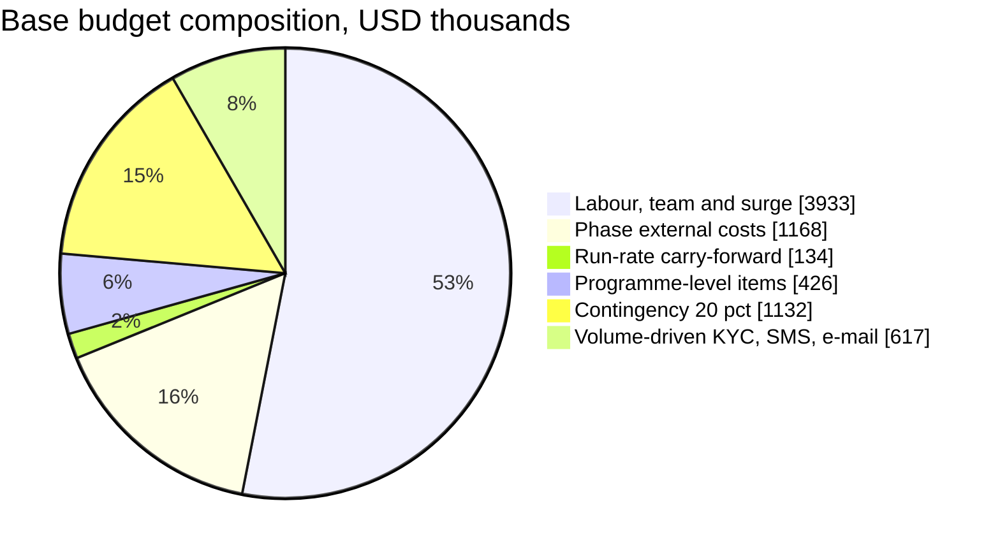
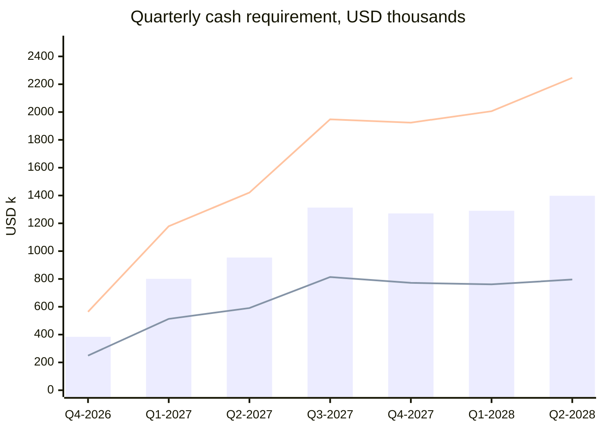

# BI-Rem — Programme Budget Estimates

| Item                | Value                                                                                                                                                                                                                                                                                       |
| ------------------- | ------------------------------------------------------------------------------------------------------------------------------------------------------------------------------------------------------------------------------------------------------------------------------------------- |
| Programme           | **BI-Rem** — pan-African remittance and mobile-money platform, 13 phases                                                                                                                                                                                                                    |
| Budget window       | **2026-11-16 → 2028-06-30** (85 programme weeks, 19.5 months, quarters Q4-2026 → Q2-2028)                                                                                                                                                                                                   |
| Currency            | USD, nominal, excluding VAT and withholding taxes on vendor invoices                                                                                                                                                                                                                        |
| Dates               | Copied from [`docs/roadmap/schedule.json`](./roadmap/schedule.json)                                                                                                                                                                                                                         |
| Machine-readable    | [`docs/roadmap/budget.csv`](./roadmap/budget.csv) — one row per phase plus the programme-level lines, low and high                                                                                                                                                                          |
| Companion documents | [Implementation roadmap](./00-implementation-roadmap.md) (budget envelope §11, team model §8) · [Gantt chart](./01-gantt-chart.md) · [Milestone tracker](./02-milestone-tracker.md) · [Infrastructure estimates](./05-infrastructure-estimates.md) · [Risk register](./06-risk-register.md) |
| Sources             | `effortPersonWeeks` and `externalCostsUsd` of the 13 phase plans in [`docs/phases/`](./phases/)                                                                                                                                                                                             |
| Owner               | Program Manager with the CFO; reviewed at every phase gate                                                                                                                                                                                                                                  |
| Status              | Baseline v1 for steering-committee approval, 2026-11-10                                                                                                                                                                                                                                     |

---

## 1. Executive summary

The programme needs **USD 7.41 M in the base case** (range **USD 4.50 M – 11.29 M**) to take BI-Rem from an empty repository on 2026-11-16 to a two-cell, 20-country platform on 2028-06-30. Of the base figure, **USD 6.79 M** is the build-and-run programme itself; the remaining **USD 0.62 M** is volume-driven cost of sales (identity checks, SMS and e-mail) that only arises if customers actually onboard and transact, and scales with revenue.

| #   | What the board should know                                                                                  | Figure (low / base / high)                                                            | Where |
| --- | ----------------------------------------------------------------------------------------------------------- | ------------------------------------------------------------------------------------- | ----- |
| 1   | **Total programme budget** to 2028-06-30                                                                    | **USD 4.50 M / 7.41 M / 11.29 M**                                                     | §8    |
| 2   | Labour is the budget: rostered 16.5 FTE + a 75 person-week contractor surge                                 | USD 2.82 M / 3.93 M / 5.42 M — **53 % of base**                                       | §2–3  |
| 3   | Bottom-up effort in the 13 phase plans                                                                      | **1,097.5 person-weeks**, of which Phase 13 alone is 321 (29 %)                       | §3    |
| 4   | External spend inside phase windows (pentests, counsel, licences, vendors, cloud)                           | USD 0.63 M – 1.70 M; Phase 12 + Phase 13 = **65–67 %** of it                          | §4    |
| 5   | Programme-level items no phase owns (counsel retainer, interim insurance, recruitment, tooling, bug bounty) | USD 0.21 M – 0.64 M                                                                   | §5    |
| 6   | Volume-driven costs to 2028-06-30 (KYC per check, SMS, e-mail)                                              | USD 0.21 M / 0.62 M / 1.32 M                                                          | §6    |
| 7   | Contingency                                                                                                 | 15 % / 20 % / 25 % → USD 0.56 M / 1.13 M / 1.99 M                                     | §9    |
| 8   | Peak quarter                                                                                                | **Q2-2028, USD 1.40 M base** (Q3-2027 USD 1.31 M is the build peak)                   | §10   |
| 9   | Cost of one week of critical-path slip                                                                      | **≈ USD 45 k** base (USD 33 k Africa-based, USD 63 k Europe-based) of team burn alone | §9.2  |
| 10  | Platform cost per transfer at 100 k transfers/day                                                           | **USD 0.12 – 0.24** all-in excluding rail fees (≈ 0.14–0.28 % of a USD 85 transfer)   | §11   |
| 11  | Returnable working capital (not expense)                                                                    | USD 51 k / 101 k / 152 k for float probes and nostro pre-funding                      | §4.4  |

**Decisions requested:**

1. **Approve the base budget of USD 7.41 M** and release it in three tranches tied to gates (§10.2): **USD 2.14 M** to G5 (2027-05-28), **USD 2.58 M** to G12 (2027-12-10), **USD 2.69 M** for Phase 13.
2. **Choose the staffing scenario** (§2): the base case assumes a blended Africa-based core with nearshore specialists. A fully Europe-based team adds **USD 1.49 M** of labour before contingency; a fully Africa-based team saves **USD 1.11 M** but carries hiring-time risk for scarce profiles (SRE, security, mobile).
3. **Fund the contractor surge** of ≈ 75 person-weeks at G4 (2027-04-30), USD 190–380 k ([roadmap §8.3](./00-implementation-roadmap.md#83-capacity-heat-map-and-the-2027-q3-peak)). Without it the Aug–Sep 2027 peak delays Phase 10 and therefore go-live; one month of slip costs more than the surge.
4. **Mandate the CFO to negotiate KYC and SMS volume pricing** before Phase 2 W4: the identity-check line alone ranges USD 0.14 M – 0.89 M and is the most price-sensitive item in the budget.

### 1.1 How the budget is built

| Block                         | Content                                                                                       | Method                                                                                                                                                                             |
| ----------------------------- | --------------------------------------------------------------------------------------------- | ---------------------------------------------------------------------------------------------------------------------------------------------------------------------------------- |
| **A. Labour**                 | Rostered team from `schedule.json` (16.5 FTE) for the whole window, plus the contractor surge | Role FTE × rostered weeks × fully-loaded rate; three rate scenarios (§2). Reconciled to the 1,097.5 person-weeks of the phase plans (§3)                                           |
| **B. Phase external costs**   | Every line of every phase plan's cost table                                                   | One-off at face value; monthly lines × phase duration; annual lines once at phase start; returnable capital, per-unit fees, conditional items and phase "total" rows excluded (§4) |
| **C. Run-rate carry-forward** | Recurring non-volume lines after their phase ends                                             | Monthly delta × months from phase end to 2028-06-30 (superseded lines stop at the superseding phase)                                                                               |
| **D. Programme-level**        | Costs no phase owns                                                                           | Itemised with basis (§5)                                                                                                                                                           |
| **E. Contingency**            | Schedule and estimate risk                                                                    | 15 % / 20 % / 25 % of A + B + C + D (§9)                                                                                                                                           |
| **F. Volume-driven**          | KYC per check, SMS, e-mail beyond the phase windows                                           | Volume path × unit price (§6); no contingency, its own range                                                                                                                       |

Scenario convention used everywhere in this document: **low** = Africa-based rates, low end of every external range, 0.6 × base volume at low prices, 15 % contingency; **base** = blended rates, midpoint of external ranges, base volume at mid prices, 20 % contingency; **high** = Europe-based rates, high end of every range, 1.5 × base volume at high prices, 25 % contingency. The low and high cases are deliberately coherent extremes, not statistical bounds; the most likely outcome sits between low and base for labour and between base and high for counsel, licensing and pentest lines (§12.3).

---

## 2. Staffing model and rate assumptions

### 2.1 Team

The rostered team is taken from `schedule.json` without change: 1 program manager, 1 solution architect, 4 backend, 3 frontend, 2 mobile, 2 QA, 1 DevOps/SRE, 1 compliance analyst, 1 product designer and a 0.5 FTE security engineer — **16.5 FTE**. Tracks (core, platform, compliance, mobile, all) and overlap rules are defined in the [roadmap §8](./00-implementation-roadmap.md#8-overlapping-team-model). Rostering assumptions:

- All roles rostered from **2026-11-16** to **2028-06-30** (85 weeks), except the **two mobile engineers from 2027-07-12**, four weeks before Phase 11 starts (store accounts, EAS signing, device lab). The 3 person-weeks of mobile effort in Phases 1–6 (capture UX research, push contract, connector status screens) are delivered by frontend engineers.
- Paid capacity is therefore **1,330 person-weeks**; leave and public holidays (~10 %) are inside that figure, not on top of it.
- Business owners named in the phase plans (COO, CFO, MLRO and deputy, general counsel, head of treasury, head of partnerships, head of customer operations, finance and treasury operations, support agents) are **not** in this budget (§12.2).

### 2.2 Fully-loaded monthly rates in three scenarios

Fully loaded = gross salary or contractor day-rate equivalent, employer social charges, benefits and medical cover, equipment, home-office and connectivity allowance, and a share of employer-of-record fees where staff are hired in countries without a BI-Rem entity. Recruitment fees are separate (§5, PL6).

| Scenario                       | Who and where                                                                                                                                            | Typical locations                                | When it fits                                                                                                            |
| ------------------------------ | -------------------------------------------------------------------------------------------------------------------------------------------------------- | ------------------------------------------------ | ----------------------------------------------------------------------------------------------------------------------- |
| **Africa-based** (low)         | All 16.5 FTE hired in Africa, senior fintech profiles, employer-of-record where needed                                                                   | Nairobi, Lagos, Accra, Cape Town, Kigali, Dakar  | Cheapest; closest to markets and partners; longest hiring time for SRE, security, mobile and ISO 20022/card specialists |
| **Blended / nearshore** (base) | Product, backend, frontend and QA core in Africa; architect, SRE, security, part of mobile from nearshore Europe/North Africa or senior African diaspora | Nairobi/Lagos + Lisbon, Casablanca/Tunis, Warsaw | Recommended: keeps scarce skills available in Phase 1, 12 and 13 windows, time-zone overlap WAT/EAT/CET ≤ 2 h           |
| **Europe-based** (high)        | Whole team in Western Europe, employed or long-term contractors                                                                                          | Paris, London, Berlin, Amsterdam                 | Upper bound; fastest hiring for regulated-fintech veterans; weakest proximity to African partners                       |

| Role                                                        | FTE (schedule.json) | Africa-based USD/month | Blended / nearshore USD/month | Europe-based USD/month | Blended USD/person-week |
| ----------------------------------------------------------- | ------------------: | ---------------------: | ----------------------------: | ---------------------: | ----------------------: |
| Program manager                                             |                   1 |                  9,000 |                        12,500 |                 17,000 |                   2,885 |
| Solution architect                                          |                   1 |                 12,000 |                        16,500 |                 22,000 |                   3,808 |
| Backend engineer                                            |                   4 |                  9,000 |                        12,500 |                 17,500 |                   2,885 |
| Frontend engineer                                           |                   3 |                  8,000 |                        11,000 |                 15,500 |                   2,538 |
| Mobile engineer                                             |                   2 |                  8,500 |                        12,000 |                 16,500 |                   2,769 |
| QA engineer                                                 |                   2 |                  6,500 |                         9,000 |                 12,500 |                   2,077 |
| DevOps / SRE                                                |                   1 |                 10,000 |                        14,000 |                 19,000 |                   3,231 |
| Compliance analyst                                          |                   1 |                  8,000 |                        11,000 |                 15,000 |                   2,538 |
| Product designer                                            |                   1 |                  7,000 |                         9,500 |                 13,000 |                   2,192 |
| Security engineer (0.5)                                     |                 0.5 |                 11,000 |                        15,500 |                 21,000 |                   3,577 |
| **Full team per month**                                     |            **16.5** |            **141,500** |                   **196,250** |            **271,000** |                       — |
| **Weighted average per person-week** (programme effort mix) |                   — |              **2,000** |                     **2,772** |              **3,830** |                       — |

Rate assumptions: senior or lead level for every role (the team is small and owns production); 52 paid weeks per year; Africa-based figures include a 15–25 % premium over local market medians for scarce fintech skills and USD-denominated pay; Europe-based figures include ~35–45 % employer charges. Rates are held flat across the window (no indexation) — a 5 % mid-programme pay round adds ≈ USD 90 k to the base labour line.

---

## 3. Effort and labour cost by phase

### 3.1 Person-weeks from the phase plans

Bottom-up effort from each phase plan's `effortPersonWeeks`, in person-weeks (PW). Column keys: BE backend, FE frontend, Mob mobile, QA, Ops DevOps/SRE, Cmp compliance, Des design, PM program management, Arch solution architect, Sec security.

| Phase                                             |  Weeks |      BE |        FE |      Mob |        QA |      Ops |      Cmp |      Des |       PM |   Arch |    Sec | **Total PW** | Avg FTE |
| ------------------------------------------------- | -----: | ------: | --------: | -------: | --------: | -------: | -------: | -------: | -------: | -----: | -----: | -----------: | ------: |
| [P1](./phases/phase-01-foundation.md)             |      6 |      16 |        10 |      0.5 |         8 |        5 |      1.5 |      2.5 |        4 |      4 |    2.5 |       **54** |     9.0 |
| [P2](./phases/phase-02-customer-kyc.md)           |      8 |      26 |        18 |        1 |        12 |        4 |        5 |        4 |        6 |      4 |      2 |       **82** |    10.3 |
| [P3](./phases/phase-03-connectivity.md)           |      6 |      12 |         6 |        0 |       3.5 |        3 |      0.5 |      1.5 |      1.5 |      3 |    2.5 |     **33.5** |     5.6 |
| [P4](./phases/phase-04-wallet-connectors.md)      |      8 |      28 |         7 |      0.5 |        10 |        5 |        2 |        2 |        6 |      5 |    2.5 |       **68** |     8.5 |
| [P5](./phases/phase-05-domestic-transfers.md)     |      6 |      26 |        10 |        0 |        11 |        4 |        3 |        3 |        5 |      5 |    2.5 |     **69.5** |    11.6 |
| [P6](./phases/phase-06-international.md)          |      8 |      24 |        15 |        1 |        10 |        4 |        6 |        3 |        7 |      5 |    2.5 |     **77.5** |     9.7 |
| [P7](./phases/phase-07-fx-treasury.md)            |      6 |      20 |         8 |        0 |         6 |        3 |      2.5 |        2 |        4 |    3.5 |    1.5 |     **50.5** |     8.4 |
| [P8](./phases/phase-08-aml-compliance.md)         |      8 |      22 |        12 |      0.5 |        11 |        3 |        8 |        2 |        4 |      4 |      2 |     **68.5** |     8.6 |
| [P9](./phases/phase-09-partner-merchant.md)       |      6 |      24 |        18 |      1.5 |         9 |        3 |        3 |        3 |        4 |    3.5 |    1.5 |     **70.5** |    11.8 |
| [P10](./phases/phase-10-reporting-bi.md)          |      6 |      20 |        12 |      0.5 |         8 |      3.5 |      1.5 |      2.5 |        3 |      4 |    1.5 |     **56.5** |     9.4 |
| [P11](./phases/phase-11-mobile.md)                |     10 |       8 |       2.5 |       20 |         6 |        3 |      1.5 |        3 |        4 |      3 |      3 |       **54** |     5.4 |
| [P12](./phases/phase-12-go-live.md)               |      6 |      24 |        18 |       10 |        12 |        6 |        6 |        2 |        6 |      5 |      3 |       **92** |    15.3 |
| [P13](./phases/phase-13-pan-african-expansion.md) |     26 |      92 |        42 |       21 |        44 |       26 |       26 |       10 |       26 |     21 |     13 |      **321** |    12.3 |
| **Total demand**                                  | **85** | **342** | **178.5** | **56.5** | **150.5** | **72.5** | **66.5** | **40.5** | **80.5** | **70** | **40** |   **1097.5** |    12.9 |
| Rostered capacity (paid weeks)                    |      — |     339 |       254 |      101 |       169 |       85 |       85 |       85 |       85 |     85 |     42 |        1,330 |       — |
| Demand ÷ paid capacity                            |      — |   101 % |      70 % |     56 % |      89 % |     86 % |     78 % |     48 % |     95 % |   83 % |   94 % |         83 % |       — |

Reading the table:

- **Total demand is 1,097.5 PW against 1,330 paid PW (83 %).** The aggregate fits; the problem is timing. Backend demand (342 PW) equals 101 % of backend capacity and peaks at 8.1 FTE against 4 in Sep 2027 ([roadmap §8.3](./00-implementation-roadmap.md#83-capacity-heat-map-and-the-2027-q3-peak)) — hence the contractor surge.
- **Phase 13 is 29 % of all effort** (321 PW in 26 weeks, 12.3 average FTE) and is where the rails squad (cards, ISO 20022, SWIFT, PAPSS) and the regions squad (af1 cell, control plane, country packs) run in parallel ([P13](./phases/phase-13-pan-african-expansion.md)).
- **Design (48 %) and mobile (56 %) carry the most unallocated capacity.** Design absorbs help-centre, store-asset and launch-comms work not itemised in phase plans; mobile capacity after Phase 12 runs the two-week release train (BAU, [P11](./phases/phase-11-mobile.md)).

### 3.2 Effort-based labour cost per phase

Each phase's person-weeks × role rate (monthly × 12 / 52). This is the cost **attributable** to each phase and is the labour column of [`budget.csv`](./roadmap/budget.csv).

| Phase     | Name                                           |          PW | Africa-based USD k | Blended USD k | Europe-based USD k |
| --------- | ---------------------------------------------- | ----------: | -----------------: | ------------: | -----------------: |
| P1        | Foundation & Platform Setup                    |          54 |                109 |           151 |                208 |
| P2        | Customer Management & KYC                      |          82 |                161 |           222 |                308 |
| P3        | Connectivity Management Framework              |        33.5 |                 69 |            96 |                133 |
| P4        | Wallet Connector Engine                        |          68 |                138 |           192 |                265 |
| P5        | Domestic Transfers                             |        69.5 |                139 |           193 |                267 |
| P6        | International Remittance                       |        77.5 |                154 |           214 |                296 |
| P7        | FX & Treasury Management                       |        50.5 |                102 |           141 |                195 |
| P8        | AML, Fraud & Compliance                        |        68.5 |                135 |           186 |                258 |
| P9        | Partner & Merchant Portal                      |        70.5 |                139 |           192 |                266 |
| P10       | Reporting & Business Intelligence              |        56.5 |                113 |           156 |                216 |
| P11       | Mobile Applications                            |          54 |                108 |           151 |                208 |
| P12       | Production Go-Live                             |          92 |                183 |           254 |                351 |
| P13       | Pan-African Expansion                          |         321 |                645 |           895 |              1,234 |
| **Total** | effort-based (person-weeks in the phase plans) | **1,097.5** |          **2,195** |     **3,042** |          **4,204** |

### 3.3 From effort to the labour budget

The programme pays for the rostered team, not for planned person-weeks. The difference is real cost: leave and public holidays, production support once real money moves (Phase 5 onwards: on-call, provider incidents, reconciliation breaks, partner questions), recruitment and onboarding ramp, and roles that are under-allocated in some phases.

| Line                                                       | Low (Africa-based) USD k | Base (blended) USD k | High (Europe-based) USD k | Note                                                                                                                                                        |
| ---------------------------------------------------------- | -----------------------: | -------------------: | ------------------------: | ----------------------------------------------------------------------------------------------------------------------------------------------------------- |
| Effort-based labour (sum of phase plans)                   |                    2,195 |                3,042 |                     4,204 | 1,097.5 PW × role rates                                                                                                                                     |
| Roster capacity not allocated to phase plans               |                      438 |                  606 |                       835 | ≈ 307 PW: leave and public holidays (~10 %), BAU support of live production from 2027-05-28, recruitment ramp, idle design/frontend capacity in P3, P7, P13 |
| **Rostered team cost** (16.5 FTE; mobile from 2027-07-12)  |                **2,633** |            **3,648** |                 **5,039** | 1,330 paid person-weeks                                                                                                                                     |
| Contractor surge, ≈ 75 PW (backend 50, frontend 13, QA 13) |                      190 |                  285 |                       380 | 2027-06-28 → 2027-10-15 at USD 2,500–5,000/PW ([roadmap §8.3](./00-implementation-roadmap.md#83-capacity-heat-map-and-the-2027-q3-peak))                    |
| **Labour total carried into the budget**                   |                **2,823** |            **3,933** |                 **5,419** | roster + surge                                                                                                                                              |

---

## 4. External costs from the phase plans

### 4.1 Treatment rules

| Line type in the phase plans                                                                             | Treatment in this budget                                                                      | Example                                                          |
| -------------------------------------------------------------------------------------------------------- | --------------------------------------------------------------------------------------------- | ---------------------------------------------------------------- |
| One-off                                                                                                  | Face value inside the phase window                                                            | P12 external pentest USD 45–90 k                                 |
| Monthly                                                                                                  | Monthly × phase duration (weeks × 7 / 30.44) inside the window, then carried forward (§4.3)   | P5 Neon autoscale + 30-day PITR USD 150–400 per month            |
| Annual, paid upfront (licences, insurance, compliance platform, ASV, QSA, registrations)                 | Once at phase start; no renewal falls inside the window                                       | P8 OpenSanctions USD 7.2–20 k; P12 insurance USD 25–80 k         |
| Annual figures that are really metered cloud spend (P8 workers, Neon, Redis; P10 ClickHouse, ClickPipes) | Converted to monthly (÷ 12)                                                                   | P10 ClickHouse Cloud USD 7.2–18 k/year → USD 600–1,500 per month |
| Volume-driven monthly (P2 Smile ID, Sumsub, Veriff, SMS OTP; P5 transfer SMS; P11 liveness increments)   | Inside the window only; afterwards replaced by the volume model (§6) to avoid double counting | P2 Smile Identity USD 2.5–10 k per month                         |
| Returnable capital (P4 float, P6 nostro pre-funding)                                                     | Excluded; memo line (§4.4)                                                                    | P6 USD 50–150 k across six currencies                            |
| Per-unit fees (P13 card OCT/AFT, TerraPay/Onafriq, Flutterwave/Paystack)                                 | Excluded; unit economics (§11)                                                                | Card push USD 0.30–1.00 per transaction                          |
| Conditional (P8 vendor screening pilot, P13 ng1 cell)                                                    | Excluded; §12.1                                                                               | ng1 USD 4–8 k per month                                          |
| Phase "total" rows (P1, P2, P10)                                                                         | Excluded; the lines underneath are used                                                       | P10 first-year total USD 26.9–66.8 k                             |

### 4.2 External cost per phase

| Phase     |   One-off USD k | Recurring inside phase window USD k | Annual (paid once) USD k | **Phase external total USD k** | Run-rate carried to 2028-06-30 USD k | Returnable capital (excluded) USD k |
| --------- | --------------: | ----------------------------------: | -----------------------: | -----------------------------: | -----------------------------------: | ----------------------------------: |
| P1        |           3 – 8 |                           0.3 – 0.9 |                        — |                      **3 – 9** |                               4 – 11 |                                   — |
| P2        |         13 – 36 |                             11 – 40 |                        — |                    **24 – 76** |                               3 – 10 |                                   — |
| P3        |          6 – 12 |                           0.1 – 0.4 |                        — |                     **6 – 12** |                                1 – 4 |                                   — |
| P4        |          9 – 32 |                           0.3 – 0.9 |                        — |                     **9 – 33** |                                3 – 7 |                             0.5 – 2 |
| P5        |          8 – 18 |                               1 – 3 |                        — |                     **9 – 21** |                               4 – 10 |                                   — |
| P6        |        39 – 158 |                             0.6 – 2 |                        — |                   **40 – 160** |                               3 – 13 |                            50 – 150 |
| P7        |         15 – 41 |                             0.8 – 4 |                        — |                    **16 – 45** |                               6 – 27 |                                   — |
| P8        |         31 – 75 |                             0.6 – 1 |                   7 – 20 |                    **39 – 96** |                                3 – 8 |                                   — |
| P9        |         18 – 39 |                               1 – 5 |                        — |                    **19 – 43** |                               7 – 31 |                                   — |
| P10       |         16 – 38 |                               1 – 3 |                        — |                    **17 – 41** |                               7 – 19 |                                   — |
| P11       |         22 – 55 |                              2 – 10 |                0.1 – 0.1 |                    **24 – 65** |                               4 – 19 |                                   — |
| P12       |        94 – 230 |                              3 – 11 |                 36 – 108 |                  **133 – 348** |                              14 – 51 |                                   — |
| P13       |       240 – 592 |                            44 – 132 |                  10 – 28 |                  **294 – 752** |                                0 – 0 |                                   — |
| **Total** | **515 – 1,332** |                        **66 – 213** |             **53 – 156** |                **634 – 1,701** |                         **58 – 210** |                        **51 – 152** |

Observations:

- **Phase 13 (USD 294–752 k) and Phase 12 (USD 133–348 k) are 65–67 % of external spend.** Phase 13 is dominated by local counsel and licensing in seven countries (USD 105–280 k), regulatory application fees (USD 20–60 k), local entities and resident officers (USD 20–60 k), card-scheme onboarding (USD 15–40 k), the external multi-region pen test (USD 30–50 k) and six months of the af1 AWS cell. Phase 12 is the go-live pentest with phishing and retest (USD 45–90 k), SOC 2 readiness and Type I (USD 20–45 k), counsel in six markets (USD 18–45 k) and first-year insurance (USD 25–80 k).
- **Phase 6 has the widest range (USD 40–160 k)**: CEMAC and Lusophone counsel (USD 25–80 k), sponsor-bank / payment-institution agency fees (USD 5–40 k) and aggregator setup minimums (USD 0–15 k) all depend on the COBAC sponsor bank chosen (R6.1).
- **The roadmap envelope reconciles**: one-off lines total USD 515 k – 1,332 k here against USD 509 k – 1,332 k in [roadmap §11](./00-implementation-roadmap.md#11-budget-envelope); the USD 6 k difference at the low end is the optional Phase 3 ingress pen-test, which the roadmap floors at zero and this budget counts at its quoted low of USD 6 k.

### 4.3 Run-rate carry-forward

Recurring non-volume lines keep billing after their phase ends. The carry-forward is each line's monthly delta × the months from its phase end to 2028-06-30: **USD 58 k – 210 k**. Largest contributors: Phase 12 Cloudflare, standby Neon, PagerDuty Business, Grafana step and synthetics (USD 14–51 k, seven months); Phase 9 KYB vendors, partner Fly machines and Vercel projects (USD 7–31 k); Phase 7 market data and partner bank fees (USD 6–27 k). PagerDuty seats bought in Phases 7 and 9 stop at 2027-11-01, when Phase 12 moves everyone to the Business tier. The infrastructure share of this run-rate, component by component, is in [Infrastructure estimates §5](./05-infrastructure-estimates.md#5-cost-by-stage).

### 4.4 Returnable working capital (memo)

| Item                                                               | Phase                                        |        USD k | Note                                                                                                                              |
| ------------------------------------------------------------------ | -------------------------------------------- | -----------: | --------------------------------------------------------------------------------------------------------------------------------- |
| Float funding for production probes (MTN GH, Daraja KE, Airtel UG) | [P4](./phases/phase-04-wallet-connectors.md) |      0.5 – 2 | 1-unit float transfers and balance reads                                                                                          |
| Pre-funding capital across nostros (XAF, AOA, MZN, CVE, XOF, STN)  | [P6](./phases/phase-06-international.md)     |     50 – 150 | Sized at 3× expected daily external volume; grows with volume and is managed by treasury ([P7](./phases/phase-07-fx-treasury.md)) |
| **Total**                                                          |                                              | **51 – 152** | Balance-sheet capital, recovered on wind-down; not in the totals                                                                  |

Phase 13 rails add further pre-funding (PAPSS member bank, aggregators, USD nostro via SWIFT) sized by Phase 7 thresholds; treasury should plan for **USD 0.3–0.8 M** of float by 2028-06-30 at the base volume path — outside this budget and owned by the CFO.

---

## 5. Programme-level costs

### 5.1 Coverage of the cost categories the board asked about

Most categories are already inside the phase plans. The table shows where, what is added at programme level, and what is deliberately excluded.

| Category                                               | Inside phase plans (USD k, phase windows) | Where                                                                                                                                                         | Added at programme level                                                                   | Excluded                                                                                        |
| ------------------------------------------------------ | ----------------------------------------- | ------------------------------------------------------------------------------------------------------------------------------------------------------------- | ------------------------------------------------------------------------------------------ | ----------------------------------------------------------------------------------------------- |
| Identity verification — Veriff, Sumsub, Smile Identity | 12 – 43                                   | [P2](./phases/phase-02-customer-kyc.md), [P9](./phases/phase-09-partner-merchant.md), [P11](./phases/phase-11-mobile.md)                                      | Volume model after 2027-02-19, §6                                                          | Negotiated discounts not yet secured                                                            |
| Sanctions and PEP data                                 | 7 – 21                                    | [P8](./phases/phase-08-aml-compliance.md) OpenSanctions, P9 screening increment                                                                               | — (renewal falls 2028-07)                                                                  | Optional vendor pilot USD 0–30 k/yr                                                             |
| FX rate data                                           | 0.4 – 3 + carry-forward ≈ 3–19            | [P6](./phases/phase-06-international.md), [P7](./phases/phase-07-fx-treasury.md)                                                                              | —                                                                                          | Bloomberg/Refinitiv terminals                                                                   |
| SMS and e-mail                                         | 7 – 21                                    | P1, P2, P5, P10, P13 sender IDs                                                                                                                               | Volume model after the P2/P5 windows, §6                                                   | Voice OTP (R2.4 stretch)                                                                        |
| Penetration tests and security reviews                 | 154 – 317                                 | Every phase P1–P13                                                                                                                                            | Private bug bounty from GA (PL8)                                                           | Red-team exercise                                                                               |
| SOC 2 and PCI readiness, auditors, tooling             | 50 – 126                                  | [P12](./phases/phase-12-go-live.md) (SOC 2 readiness + Type I, Vanta/Drata, QSA, ASV), [P13](./phases/phase-13-pan-african-expansion.md) (SAQ A-EP QSA + ASV) | —                                                                                          | SOC 2 Type II audit (observation from 2028-01-15; fieldwork after 2028-06-30, est. USD 25–60 k) |
| Licences, registrations, regulatory fees               | 48 – 173                                  | P6 sponsor bank, P8 FIU, P12 DP registrations, P13 applications, entities, DP registrations                                                                   | Licence maintenance and supervisory fees (PL4)                                             | Minimum regulatory capital, guarantees, escrow                                                  |
| Legal, counsel and tax                                 | 191 – 519                                 | P2, P4, P6–P13                                                                                                                                                | Commercial/privacy/employment retainer (PL1), group structuring and transfer pricing (PL5) | Litigation                                                                                      |
| Insurance                                              | 25 – 80                                   | P12 cyber, technology E&O, crime/fidelity (first year)                                                                                                        | Interim cover from first money movement (PL2), D&O (PL3)                                   | Credit insurance on partners                                                                    |
| App-store fees                                         | 0.1 (USD 99 + 25)                         | P11 Apple Developer Program (annual) + Google Play (one-off)                                                                                                  | —                                                                                          | No store commission: remittance is outside in-app purchase rules                                |

### 5.2 Identity-verification per-check pricing (planning assumptions)

List-price planning ranges at the time of writing, used for the volume model. They must be replaced by negotiated rates from the vendor RFP (P2 M2.1, sandbox and contracts by 2027-01-22).

| Vendor                    | Check                                               |   USD per check | Role in BI-Rem                                                                         | Phase   |
| ------------------------- | --------------------------------------------------- | --------------: | -------------------------------------------------------------------------------------- | ------- |
| Smile Identity            | ID-number lookup (NIN/BVN, Ghana Card, IPRS)        |     0.10 – 0.60 | Primary for NG, GH, KE; LEVEL_1                                                        | P2      |
| Smile Identity            | Document verification                               |     0.50 – 1.50 | LEVEL_2 where no ID authority lookup                                                   | P2      |
| Smile Identity            | SmartSelfie / biometric KYC (liveness + face match) |     0.20 – 1.00 | LEVEL_2, native in the app                                                             | P2, P11 |
| Smile Identity            | Business verification (CAC, BRS)                    |     1.00 – 5.00 | Partner KYB                                                                            | P9      |
| Sumsub                    | Individual verification (document + liveness)       |     1.35 – 2.50 | Fallback and CEMAC/Lusophone coverage; monthly minimum applies                         | P2, P11 |
| Sumsub                    | KYB company applicant + UBOs                        |    5.00 – 20.00 | Partner KYB                                                                            | P9      |
| Veriff                    | Session (document + selfie/liveness)                |     0.80 – 1.90 | Third provider for liveness failover; contract deferred until volume justifies (R2.12) | P2      |
| **Blended per applicant** | Average route mix, 1.25 attempts per applicant      | **1.10 – 2.75** | Used in §6 and §11                                                                     | —       |

### 5.3 Programme-level fixed additions

| #    | Item                                                                                       | Low USD k | High USD k | Timing                  | Basis                                                                                                                                               |
| ---- | ------------------------------------------------------------------------------------------ | --------: | ---------: | ----------------------- | --------------------------------------------------------------------------------------------------------------------------------------------------- |
| PL1  | Commercial, privacy and employment counsel retainer (outside phase-specific reviews)       |        39 |         98 | 2026-11-16 → 2028-06-30 | USD 2–5 k per month for 19.5 months: vendor MSAs and DPAs (~40 vendors), T&Cs and privacy notices per market, employment contracts in 3–4 countries |
| PL2  | Interim crime/fidelity and cyber cover from first real money movement to the Phase 12 bind |         8 |         25 | 2027-05-28              | Six months of cover 2027-05-28 → 2027-11-26 while pilots move real money; replaced by the Phase 12 programme                                        |
| PL3  | Directors and officers (D&O) liability, two policy years                                   |         5 |         20 | 2026-11-16              | Board-level cover from programme start; renewal 2027-11                                                                                             |
| PL4  | Licence maintenance and supervisory fees for partner/agency arrangements in pilot markets  |        10 |         40 | 2027-05-28 → 2028-06-30 | GH, KE, SN, CI, CM and CEMAC partner-EMI agency schedules; annual supervisory levies where BI-Rem is registered as agent                            |
| PL5  | Group structuring and transfer-pricing advice (holding company + local entities)           |        15 |         40 | 2027-01-01 → 2027-06-30 | Needed before Phase 6 nostros and Phase 13 entities; inter-company service agreements                                                               |
| PL6  | Recruitment fees for ~10 external hires (15–20 % of first-year base)                       |        60 |        220 | 2026-11-16 → 2027-07-31 | Low end assumes Africa-based hires via local agencies; high end assumes European agencies                                                           |
| PL7  | Collaboration and engineering tooling not in phase tables                                  |        45 |        110 | 2026-11-16 → 2028-06-30 | 18 seats × USD 130–310 per seat-month: issue tracker, docs wiki, Figma, Slack/Google Workspace, 1Password, AI coding assistants                     |
| PL8  | Private bug bounty from GA (bounty pool + platform fee)                                    |        10 |         35 | 2027-12-10 → 2028-06-30 | Managed private programme; pool sized for ~10–25 valid Medium+ reports                                                                              |
| PL9  | Team travel for pilot launches and partner on-sites outside Phase 13                       |        15 |         45 | 2027-04-01 → 2027-12-10 | Accra, Nairobi, Douala/Yaoundé, Dakar, Abidjan: launch weeks and provider/partner workshops                                                         |
| PL10 | Security awareness, secure-coding and SRE training                                         |         3 |         10 | 2027-01-01 → 2027-12-31 | Phishing-simulation platform, OWASP/secure-code training, on-call/incident training before Phase 12                                                 |
|      | **Total programme-level fixed additions**                                                  |   **210** |    **643** |                         |                                                                                                                                                     |

### 5.4 Licences and regulatory costs per country group

All 20 target countries in `schedule.json` launch **partner-first** (agent of a licensed EMI, bank or aggregator); own licences are filed in parallel and are not on the launch critical path (R13.1). The figures below are an indicative apportionment, per country group, of the counsel, application, entity and registration lines already in the phase plans (P2, P6, P8, P12, P13) and of PL4; they add up to those lines (USD 223–663 k).

| Country group            | Countries              | Launch route                                                                  | Regulators and data-protection authorities                      | Phases                                                                                                | USD k in budget |
| ------------------------ | ---------------------- | ----------------------------------------------------------------------------- | --------------------------------------------------------------- | ----------------------------------------------------------------------------------------------------- | --------------: |
| West Africa UEMOA        | SN, CI                 | Partner EMI agent under BCEAO rules                                           | BCEAO; CDP (SN), ARTCI (CI)                                     | [P2](./phases/phase-02-customer-kyc.md), [P12](./phases/phase-12-go-live.md), PL4                     |          8 – 25 |
| Ghana                    | GH                     | MTN MoMo partner; PSP application in P13                                      | Bank of Ghana; Data Protection Commission                       | [P5](./phases/phase-05-domestic-transfers.md), P12, [P13](./phases/phase-13-pan-african-expansion.md) |         22 – 60 |
| Kenya                    | KE                     | M-Pesa Daraja partner; money-remittance/PSP application in P13                | Central Bank of Kenya; ODPC                                     | P5, P12, P13                                                                                          |         22 – 60 |
| Nigeria                  | NG                     | Inbound-only IMTO model via licensed partner                                  | CBN (IMTO); NDPC                                                | P8 (FIU), P13                                                                                         |         25 – 65 |
| CEMAC                    | CM, GA, TD, CG, CF, GQ | Sponsor bank / payment institution in Cameroon; GIMAC routing via partner EMI | COBAC, BEAC; national DP authorities                            | [P6](./phases/phase-06-international.md), [P8](./phases/phase-08-aml-compliance.md), P12              |         25 – 95 |
| Lusophone + GW           | AO, MZ, CV, ST, GW     | Payout partners and aggregator                                                | BNA, Banco de Moçambique, BCV, BCSTP, BCEAO                     | P6                                                                                                    |         12 – 40 |
| East and Southern Africa | UG, RW, TZ, ZA         | Aggregator / partner first; ZA via ADLA partner                               | BoU, BNR, BoT, SARB; PDPO, NCSA, PDPC-TZ, Information Regulator | P13                                                                                                   |        70 – 190 |
| Rehearsal                | ZM                     | Data-only country pack to SANDBOX                                             | —                                                               | P13 M13.12                                                                                            |               0 |
| Not country-specific     | —                      | —                                                                             | P8 AML counsel across all regulators, programme-wide opinions   | P8, P12, P13                                                                                          |        39 – 128 |

Indicative per-country rule of thumb for any market added after 2028-06-30: **USD 15–40 k counsel and licensing opinion, USD 3–9 k application fees, USD 0.3–1.2 k data-protection registration, USD 5–15 k per entity where an entity is required**, plus ≈ 10 engineering days to build and certify the country pack (P13 Zambia rehearsal).

---

## 6. Volume-driven operating costs

These costs arise only when customers onboard and transact. They are budgeted so that the cash plan is complete, but they are cost of sales, scale linearly and should be read against revenue.

### 6.1 Volume path (budgeting assumption, not a commercial forecast)

The 100,000 transfers/day in `schedule.json` is a **capacity target** proven by load tests in [P12](./phases/phase-12-go-live.md) and [P13](./phases/phase-13-pan-african-expansion.md). Commercial volume ramps behind it. Real money starts in Ghana on 2027-05-28 (Phase 5); push notifications become primary on 2027-10-15 (Phase 11), cutting SMS per transfer from 2 to ≈ 1.

| Quarter   | Active days | Transfers/day (base, average) | Transfers in quarter (base) | New KYC applicants (base) | SMS per transfer |
| --------- | ----------: | ----------------------------: | --------------------------: | ------------------------: | ---------------: |
| Q4-2026   |           0 |                             0 |                           0 |                         0 |                2 |
| Q1-2027   |           0 |                             0 |                           0 |                     2,000 |                2 |
| Q2-2027   |          34 |                           300 |                      10,200 |                     8,000 |                2 |
| Q3-2027   |          92 |                         1,500 |                     138,000 |                    20,000 |                2 |
| Q4-2027   |          92 |                         4,000 |                     368,000 |                    35,000 |             1.35 |
| Q1-2028   |          91 |                        10,000 |                     910,000 |                    60,000 |                1 |
| Q2-2028   |          91 |                        25,000 |                   2,275,000 |                    90,000 |                1 |
| **Total** |             |                               |               **3,701,200** |               **215,000** |                  |

Low = 0.6 × base, high = 1.5 × base. At the high path BI-Rem exits June 2028 at ≈ 37,500 transfers/day; at base 25,000.

### 6.2 Cost

| Driver                                                                                                 | Volume low / base / high                                                     | Unit price low / mid / high (USD)   | Cost low USD k | Cost base USD k | Cost high USD k |
| ------------------------------------------------------------------------------------------------------ | ---------------------------------------------------------------------------- | ----------------------------------- | -------------: | --------------: | --------------: |
| Individual KYC (Smile Identity, Sumsub, Veriff) per applicant, after the Phase 2 window                | 129,000 / 215,000 / 322,500 applicants                                       | 1.10 / 1.93 / 2.75                  |            142 |             414 |             887 |
| SMS: transfer notifications + OTP (3 per applicant, 0.3 step-up per transfer) after the Phase 5 window | 2.22 / 3.70 / 5.55 M transfers                                               | 0.020 / 0.035 / 0.050 per SMS       |             69 |             201 |             430 |
| Transactional e-mail (5 per applicant, 0.5 per transfer)                                               | as above                                                                     | 0.0004 / 0.0008 / 0.0012 per e-mail |            0.7 |               2 |               5 |
| **Total volume-driven**                                                                                | low = 0.6 × base volume at low price; high = 1.5 × base volume at high price |                                     |        **211** |         **617** |       **1,322** |

SMS price range reflects GH/KE rates of USD 0.02–0.04 (P5) at the low end and CEMAC/Lusophone international-route rates at the high end; Nigerian DND filtering and sender-ID registration (P13) are covered by the secondary route already in the notification pipeline (R2.4). Push (FCM/APNs) is free ([P11](./phases/phase-11-mobile.md)).

---

## 7. Cost per phase

Labour here is effort-based (§3.2); external is the phase window cost (§4.2). Programme-level lines follow the phase rows so that the table sums to the total budget. Base external = midpoint of the phase range.

| Phase                                                                      | Window                  |  Weeks |          PW | Labour low / base / high USD k | External low – high USD k | **Total low USD k** | **Total base USD k** | **Total high USD k** |
| -------------------------------------------------------------------------- | ----------------------- | -----: | ----------: | ------------------------------ | ------------------------- | ------------------: | -------------------: | -------------------: |
| [P1 Foundation & Platform Setup](./phases/phase-01-foundation.md)          | 2026-11-16 → 2026-12-25 |      6 |          54 | 109 / 151 / 208                | 3 – 9                     |             **112** |              **157** |              **217** |
| [P2 Customer Management & KYC](./phases/phase-02-customer-kyc.md)          | 2026-12-28 → 2027-02-19 |      8 |          82 | 161 / 222 / 308                | 24 – 76                   |             **185** |              **272** |              **384** |
| [P3 Connectivity Management Framework](./phases/phase-03-connectivity.md)  | 2027-01-25 → 2027-03-05 |      6 |        33.5 | 69 / 96 / 133                  | 6 – 12                    |              **75** |              **105** |              **145** |
| [P4 Wallet Connector Engine](./phases/phase-04-wallet-connectors.md)       | 2027-03-08 → 2027-04-30 |      8 |          68 | 138 / 192 / 265                | 9 – 33                    |             **148** |              **213** |              **297** |
| [P5 Domestic Transfers](./phases/phase-05-domestic-transfers.md)           | 2027-04-19 → 2027-05-28 |      6 |        69.5 | 139 / 193 / 267                | 9 – 21                    |             **148** |              **208** |              **288** |
| [P6 International Remittance](./phases/phase-06-international.md)          | 2027-05-31 → 2027-07-23 |      8 |        77.5 | 154 / 214 / 296                | 40 – 160                  |             **194** |              **313** |              **455** |
| [P7 FX & Treasury Management](./phases/phase-07-fx-treasury.md)            | 2027-06-28 → 2027-08-06 |      6 |        50.5 | 102 / 141 / 195                | 16 – 45                   |             **118** |              **171** |              **240** |
| [P8 AML, Fraud & Compliance](./phases/phase-08-aml-compliance.md)          | 2027-07-26 → 2027-09-17 |      8 |        68.5 | 135 / 186 / 258                | 39 – 96                   |             **174** |              **254** |              **354** |
| [P9 Partner & Merchant Portal](./phases/phase-09-partner-merchant.md)      | 2027-08-23 → 2027-10-01 |      6 |        70.5 | 139 / 192 / 266                | 19 – 43                   |             **158** |              **223** |              **310** |
| [P10 Reporting & Business Intelligence](./phases/phase-10-reporting-bi.md) | 2027-09-20 → 2027-10-29 |      6 |        56.5 | 113 / 156 / 216                | 17 – 41                   |             **130** |              **185** |              **257** |
| [P11 Mobile Applications](./phases/phase-11-mobile.md)                     | 2027-08-09 → 2027-10-15 |     10 |          54 | 108 / 151 / 208                | 24 – 65                   |             **132** |              **195** |              **272** |
| [P12 Production Go-Live](./phases/phase-12-go-live.md)                     | 2027-11-01 → 2027-12-10 |      6 |          92 | 183 / 254 / 351                | 133 – 348                 |             **316** |              **494** |              **699** |
| [P13 Pan-African Expansion](./phases/phase-13-pan-african-expansion.md)    | 2028-01-03 → 2028-06-30 |     26 |         321 | 645 / 895 / 1,234              | 294 – 752                 |             **939** |            **1,418** |            **1,987** |
| **Sum of phases**                                                          |                         | **85** | **1,097.5** | 2,195 / 3,042 / 4,204          | 634 – 1,701               |           **2,829** |            **4,210** |            **5,905** |
| Roster capacity not allocated to phases                                    |                         |        |             |                                |                           |                 438 |                  606 |                  835 |
| Contractor surge                                                           |                         |        |             |                                |                           |                 190 |                  285 |                  380 |
| Run-rate carry-forward                                                     |                         |        |             |                                |                           |                  58 |                  134 |                  210 |
| Programme-level fixed additions                                            |                         |        |             |                                |                           |                 210 |                  426 |                  643 |
| Contingency 15 / 20 / 25 %                                                 |                         |        |             |                                |                           |                 559 |                1,132 |                1,993 |
| Volume-driven operating costs                                              |                         |        |             |                                |                           |                 211 |                  617 |                1,322 |
| **Total programme budget**                                                 | 2026-11-16 → 2028-06-30 |        |             |                                |                           |           **4,496** |            **7,411** |           **11,289** |

---

## 8. Total programme budget

| Line                                               | Low USD k | Base USD k | High USD k | Basis                                                                 |
| -------------------------------------------------- | --------: | ---------: | ---------: | --------------------------------------------------------------------- |
| A1. Rostered team (16.5 FTE)                       |     2,633 |      3,648 |      5,039 | Africa-based / blended / Europe-based rates, section 2                |
| A2. Contractor surge (≈ 75 PW)                     |       190 |        285 |        380 | Roadmap §8.3 recommendation, decision at G4                           |
| **A. Labour**                                      | **2,823** |  **3,933** |  **5,419** |                                                                       |
| B. Phase external costs                            |       634 |      1,168 |      1,701 | Phase plans, inside each phase window, section 4                      |
| C. Run-rate carried to 2028-06-30                  |        58 |        134 |        210 | Non-volume recurring items after each phase ends, section 4.3         |
| D. Programme-level fixed additions                 |       210 |        426 |        643 | Section 5                                                             |
| **Subtotal (contingency base)**                    | **3,725** |  **5,662** |  **7,973** |                                                                       |
| E. Contingency                                     |       559 |      1,132 |      1,993 | 15 % / 20 % / 25 % of the subtotal, section 9                         |
| **Programme budget excluding volume-driven costs** | **4,284** |  **6,794** |  **9,966** |                                                                       |
| F. Volume-driven operating costs                   |       211 |        617 |      1,322 | KYC, SMS, e-mail to 2028-06-30, section 6                             |
| **Total programme budget**                         | **4,496** |  **7,411** | **11,289** | 2026-11-16 → 2028-06-30                                               |
| _Memo: returnable working capital_                 |      _51_ |      _101_ |      _152_ | _Float probes (P4) and nostro pre-funding (P6); capital, not expense_ |

Breakdown of the base case by nature: labour 53 %, external phase costs 16 %, programme-level and carry-forward 8 %, contingency 15 %, volume-driven 8 %.

---

## 9. Contingency

### 9.1 Level and rationale

| Scenario | Contingency | Rationale                                                                                                                                                                                       |
| -------- | ----------: | ----------------------------------------------------------------------------------------------------------------------------------------------------------------------------------------------- |
| Low      |        15 % | Phase plans already carry internal buffers (e.g. P1 R1.2 2 PW contingency; P12 35-min RTO target vs 60-min requirement; P13 W25–W26 buffer) and Africa-based rates leave room                   |
| Base     |        20 % | Programme with three hard external dependencies on the critical path (provider production onboarding R4.1, COBAC sponsor bank R6.1, pentest remediation R12.1) and 13 phases of which 8 overlap |
| High     |        25 % | Europe-based team plus slip on two of the three dependencies                                                                                                                                    |

### 9.2 What contingency is expected to absorb

| Driver                                                          | Risk ids                 |     Exposure (base) | Note                                                                             |
| --------------------------------------------------------------- | ------------------------ | ------------------: | -------------------------------------------------------------------------------- |
| Critical-path slip of 4 weeks (go-live 2027-12-10 → 2028-01-07) | R5.1, R10.4, R12.1, PR-1 |         ≈ USD 180 k | Team burn USD 45 k per week at blended rates; P13 start would also move          |
| Pentest Critical/High remediation needing architectural change  | R12.1, R12.2             |         USD 30–80 k | Second vendor retest (already USD 0–15 k), 2 extra backend engineers for 2 weeks |
| Sponsor-bank or licence delay forcing a second partner          | R6.1, R13.1, R13.3       |        USD 40–120 k | Second counsel round, second onboarding fee                                      |
| Load test reveals a database bottleneck                         | R12.3, R13.15            |         USD 10–40 k | Neon compute ceiling raised early; contractor DBA                                |
| Ledger or reconciliation defect in production                   | R5.2, R6.9               |         USD 20–60 k | Incident response, forensic reconciliation, customer remediation                 |
| Vendor price increases vs list prices used here                 | R2.12, R7.2              |         USD 20–50 k | KYC, market data, observability                                                  |
| **Indicative total**                                            |                          | **≈ USD 0.3–0.5 M** | Base contingency is USD 1.13 M: headroom for a second simultaneous slip          |

### 9.3 Sensitivities (base case, before contingency)

| Change                                                                    |                  Effect USD k | Comment                                                           |
| ------------------------------------------------------------------------- | ----------------------------: | ----------------------------------------------------------------- |
| Europe-based instead of blended team                                      |                       + 1,486 | Roster + surge at Europe rates                                    |
| Africa-based instead of blended team                                      |                       − 1,110 | Hiring-time risk for SRE, security, mobile                        |
| Go-live slips one month (critical path)                                   |                         + 196 | Blended team burn, one month                                      |
| Contractor surge not funded                                               | − 285 now, + 196 to 392 later | Expected 1–2 months slip of P10 → P12 (PR-1)                      |
| KYC price at Sumsub list (USD 2.50 per applicant) instead of USD 1.93 mid |                         + 123 | Base volume                                                       |
| Volume 2× base path                                                       |                         + 617 | Volume-driven block only; infrastructure scales by far less (§11) |
| In-country Nigerian cell ng1 mandated (R13.2)                             |                   + 50 to 110 | USD 4–8 k per month for ~3 months + ≈ 20 PW                       |
| Phase 13 counsel at high end in all seven countries                       |                          + 88 | 280 k vs 192.5 k midpoint                                         |

---

## 10. Cash flow by quarter

### 10.1 Quarterly requirement

Labour is spread by rostered days (surge 20 % in Q2-2027, 65 % in Q3-2027, 15 % in Q4-2027); external lines are spread over each phase window, annual lines land in the quarter the phase starts; contingency is allocated in proportion to each quarter's spend. USD thousands.

| Quarter   |    Labour | Phase external | Carry-forward | Programme-level | Volume-driven | Contingency | **Base total** | Base cumulative | Low total | High total |
| --------- | --------: | -------------: | ------------: | --------------: | ------------: | ----------: | -------------: | --------------: | --------: | ---------: |
| Q4-2026   |       261 |             10 |           0.1 |              49 |             0 |          64 |        **384** |             384 |       249 |        564 |
| Q1-2027   |       511 |             65 |             2 |              86 |             4 |         133 |        **801** |           1,185 |       513 |      1,179 |
| Q2-2027   |       574 |             87 |             4 |             117 |            17 |         156 |        **954** |           2,139 |       591 |      1,421 |
| Q3-2027   |       772 |            211 |            10 |              58 |            52 |         210 |      **1,313** |           3,452 |       814 |      1,948 |
| Q4-2027   |       638 |            272 |            31 |              41 |            93 |         196 |      **1,271** |           4,723 |       772 |      1,924 |
| Q1-2028   |       589 |            268 |            44 |              38 |           164 |         188 |      **1,290** |           6,013 |       761 |      2,006 |
| Q2-2028   |       589 |            255 |            44 |              38 |           287 |         185 |      **1,398** |           7,411 |       796 |      2,246 |
| **Total** | **3,933** |      **1,168** |       **134** |         **426** |       **617** |   **1,132** |      **7,411** |                 | **4,496** | **11,289** |

Bars: base case; lines: low and high cases.

### 10.2 Funding tranches tied to gates

| Tranche | Released at       | Covers                                           | Base USD M | Low – high USD M | Gate evidence required to release the next tranche                                                                    |
| ------- | ----------------- | ------------------------------------------------ | ---------: | ---------------- | --------------------------------------------------------------------------------------------------------------------- |
| T1      | Approval, 2026-11 | Q4-2026 → Q2-2027: Phases 1–5, first money in GH |       2.14 | 1.35 – 3.16      | G5 (2027-05-28): GH/GHS 100 %, 72 h trial balance zero, KE 5 % canary ([P5](./phases/phase-05-domestic-transfers.md)) |
| T2      | G5, 2027-05-28    | Q3–Q4 2027: Phases 6–12, surge, go-live          |       2.58 | 1.59 – 3.87      | G12 (2027-12-10): GA in ≥ 3 markets, pentest sign-off, DR drills within RPO/RTO ([P12](./phases/phase-12-go-live.md)) |
| T3      | G12, 2027-12-10   | Q1–Q2 2028: Phase 13                             |       2.69 | 1.56 – 4.25      | G13 (2028-06-30): af1 cell, seven countries, success criteria ([P13](./phases/phase-13-pan-african-expansion.md))     |

The tranche split follows the quarter table (T1 = first three quarters, T2 = Q3 and Q4 2027, T3 = 2028). Q4-2027 contains both the Phase 12 launch and the first fortnight of hypercare; the CFO should hold **USD 0.2 M** of T2 contingency unreleased until board #3 (M12.6, 2027-12-10).

---

## 11. Unit economics inputs

Platform cost per transfer at three steady-state volumes, excluding rail and scheme fees (which are passed through in customer pricing). Infrastructure figures come from [Infrastructure estimates §5](./05-infrastructure-estimates.md#5-cost-by-stage); vendor and compliance fixed costs are the non-volume, non-infrastructure recurring lines of the phase plans.

| Input (USD)                                                | 10 k tx/day       | 50 k tx/day       | 100 k tx/day      | Assumption                                                                                                                                               |
| ---------------------------------------------------------- | ----------------- | ----------------- | ----------------- | -------------------------------------------------------------------------------------------------------------------------------------------------------- |
| Transfers per month                                        | 304,375           | 1,521,875         | 3,043,750         | 30.44 days/month                                                                                                                                         |
| Infrastructure run-rate per month                          | 6,155 – 19,750    | 8,978 – 27,560    | 11,800 – 35,370   | [Infrastructure estimates](./05-infrastructure-estimates.md): production-launch stage, midpoint, scale stage                                             |
| Vendor, data and compliance fixed per month                | 4,458 – 15,635    | 9,292 – 32,968    | 9,292 – 32,968    | FX data, OpenSanctions, KYB, compliance platform, insurance, ASV; from 50 k adds Phase 13 rails (PCI vault, SWIFT bureau, sponsor banks, SEPA EMI, USSD) |
| Product and engineering team per month                     | 196,250           | 196,250           | 196,250           | 16.5 FTE at blended rates held flat; excludes operations, support and executives                                                                         |
| **Platform fixed cost per transfer** (infra + vendor)      | 0.035 – 0.116     | 0.012 – 0.040     | 0.007 – 0.022     |                                                                                                                                                          |
| Team cost per transfer                                     | 0.645             | 0.129             | 0.064             |                                                                                                                                                          |
| SMS per transfer                                           | 0.012 – 0.060     | 0.012 – 0.060     | 0.012 – 0.060     | 0.6–1.2 SMS per transfer once push is primary (P11), USD 0.02–0.05 per SMS                                                                               |
| KYC amortised per transfer                                 | 0.037 – 0.092     | 0.037 – 0.092     | 0.037 – 0.092     | 1 new applicant per 30 transfers at USD 1.10–2.75 per applicant                                                                                          |
| E-mail per transfer                                        | 0.000 – 0.001     | 0.000 – 0.001     | 0.000 – 0.001     | 0.5 e-mails per transfer                                                                                                                                 |
| **All-in platform cost per transfer, excluding rail fees** | **0.728 – 0.913** | **0.190 – 0.321** | **0.120 – 0.239** |                                                                                                                                                          |
| As % of a USD 85 average transfer                          | 0.86 – 1.07 %     | 0.22 – 0.38 %     | 0.14 – 0.28 %     | Programme KPI: total customer cost ≤ 3 % (P7)                                                                                                            |

Pass-through rail and scheme fees (not platform cost; recovered in pricing and modelled per corridor by Phase 7 profitability):

| Rail                                                             | Fee range                                                    | Source                                                                                      |
| ---------------------------------------------------------------- | ------------------------------------------------------------ | ------------------------------------------------------------------------------------------- |
| Mobile-money disbursement (MTN MoMo, M-Pesa B2C, Airtel, Orange) | Provider tariff; typically 0.5–1.5 % or flat per transaction | [P4](./phases/phase-04-wallet-connectors.md), [P5](./phases/phase-05-domestic-transfers.md) |
| Aggregator payout (TerraPay, Onafriq)                            | 0.5–1.5 % of payout value                                    | [P13](./phases/phase-13-pan-african-expansion.md)                                           |
| Flutterwave / Paystack                                           | USD 0.10–0.50 per transfer; card collections 1.4–3.9 %       | P13                                                                                         |
| Card push (Visa Direct OCT, Mastercard Send) and AFT funding     | USD 0.30–1.00 per transaction plus sponsor fees              | P13                                                                                         |
| SWIFT (bureau + sponsor bank)                                    | USD 0.20–0.50 per message + bank charges                     | P13                                                                                         |
| Statutory levies (GH E-Levy, KE excise duty)                     | Per statute, shown on receipts                               | P5                                                                                          |

What the numbers say:

1. **Below ~50 k transfers/day the team, not the cloud, is the unit cost.** At 10 k/day the 16.5 FTE team is USD 0.65 of a USD 0.73–0.91 all-in cost; infrastructure and vendors are 5–13 %.
2. **At 100 k/day the platform costs USD 0.12–0.24 per transfer (0.14–0.28 % of a USD 85 ticket)**, leaving the 3 % total-cost KPI almost entirely to rail fees, FX margin and partner commissions — the levers Phase 7 and Phase 9 control.
3. **KYC is the largest variable item** (USD 0.04–0.09 per transfer at 1 applicant per 30 transfers). Re-use of verified identity across corridors and the "continue on another device" path (R2.3) matter more for unit cost than any infrastructure choice.

---

## 12. Assumptions and exclusions

### 12.1 Assumptions

| #   | Assumption                                                                                             | Effect if wrong                                                           |
| --- | ------------------------------------------------------------------------------------------------------ | ------------------------------------------------------------------------- |
| A1  | Dates and team sizes exactly as in `schedule.json`; no phase added or removed                          | Re-baseline at the next gate                                              |
| A2  | Fully-loaded monthly rates in §2.2, flat for 19.5 months                                               | ± 5 % rates ≈ ± USD 0.2 M base                                            |
| A3  | Two mobile engineers rostered from 2027-07-12; everyone else from 2026-11-16                           | Earlier mobile hiring adds ≈ USD 24 k per month                           |
| A4  | Contractor surge of 75 PW at USD 2,500–5,000 per PW, 2027-06-28 → 2027-10-15                           | See §9.3                                                                  |
| A5  | External ranges as written in the phase plans; base uses the midpoint                                  | Counsel and licensing have the widest spread (§4.2)                       |
| A6  | Monthly lines run for the phase duration, then carry to 2028-06-30 unless superseded                   | Over-states slightly where a later phase resizes rather than adds         |
| A7  | Annual licences and policies paid upfront once; renewals after 2028-06-30                              | Insurance, compliance platform, OpenSanctions renew mid-2028 to late 2028 |
| A8  | Volume path §6.1; 1.25 KYC attempts per applicant; 2 SMS per transfer until 2027-10-15, then 1.0–1.35  | Volume-driven block scales linearly                                       |
| A9  | USD nominal; vendor quotes in EUR converted at 1.08–1.10 USD/EUR; no hedging                           | 5 % EUR move ≈ USD 20 k on EUR-priced vendors                             |
| A10 | Contingency as a percentage of A–D (15/20/25 %); not applied to volume-driven costs or working capital | —                                                                         |

### 12.2 Exclusions

| Excluded item                                                                                                                                                                            | Indicative size                                                                    | Owner                 |
| ---------------------------------------------------------------------------------------------------------------------------------------------------------------------------------------- | ---------------------------------------------------------------------------------- | --------------------- |
| Business-side staff: CEO, COO, CFO, MLRO and deputy, general counsel, head of treasury, treasury and finance operations, head of partnerships, customer-support agents, country managers | ≈ 8–12 FTE from 2027-04 at USD 6–15 k per month: **USD 0.7–2.4 M** over the window | COO / CFO             |
| Marketing, customer acquisition, launch campaigns, partner incentives beyond the P5 pilot                                                                                                | Commercial plan                                                                    | CMO                   |
| Minimum regulatory capital, guarantees, escrow and safeguarding balances                                                                                                                 | Per licence; sized by counsel in P13                                               | CFO                   |
| Nostro and float working capital beyond §4.4 (USD 0.3–0.8 M by mid-2028 at base volume)                                                                                                  | Capital                                                                            | Treasury              |
| Rail, scheme and provider per-transaction fees                                                                                                                                           | Pass-through (§11)                                                                 | Pricing               |
| Conditional in-country Nigerian cell ng1 (R13.2)                                                                                                                                         | USD 4–8 k per month + ≈ 20 PW                                                      | Architect             |
| Optional vendor AML screening pilot (P8) and commercial RASP (P11)                                                                                                                       | USD 0–30 k/yr and USD 20–60 k/yr                                                   | Compliance / Security |
| SOC 2 Type II audit fieldwork (after the 2028-01-15 Type I and a 6-month observation)                                                                                                    | USD 25–60 k, 2028-H2                                                               | Compliance            |
| Offices, corporate overhead, board fees, audit of statutory accounts                                                                                                                     | Corporate budget                                                                   | CFO                   |
| VAT, withholding tax on cross-border services, FX gains/losses                                                                                                                           | Tax advisory (P9 Q9.5)                                                             | CFO                   |

### 12.3 Confidence

| Block                                         | Confidence  | Why                                                               |
| --------------------------------------------- | ----------- | ----------------------------------------------------------------- |
| Labour                                        | Medium-high | Team size fixed; rate scenario is a decision, not an estimate     |
| Phase external — cloud and SaaS               | High        | Published price lists, small absolute amounts                     |
| Phase external — counsel, licensing, pentests | Medium-low  | Quotes not yet obtained; widest ranges; skew towards the high end |
| Volume-driven                                 | Low         | Depends on commercial traction and negotiated KYC rates           |
| Contingency                                   | —           | Policy choice (§9)                                                |

---

## 13. Maintenance of this document

- Re-run at every phase gate with actuals from finance: replace the phase's estimate row in [`budget.csv`](./roadmap/budget.csv) with actual labour and external spend, keep the remaining phases as estimates, and report variance against the base case in the gate pack ([milestone tracker](./02-milestone-tracker.md)).
- When a phase plan's cost table changes, update the phase document first, then this budget; dates must continue to match [`schedule.json`](./roadmap/schedule.json).
- Infrastructure figures are maintained in [Infrastructure estimates](./05-infrastructure-estimates.md) and [`infrastructure.csv`](./roadmap/infrastructure.csv); cost risks are tracked in the [risk register](./06-risk-register.md).
