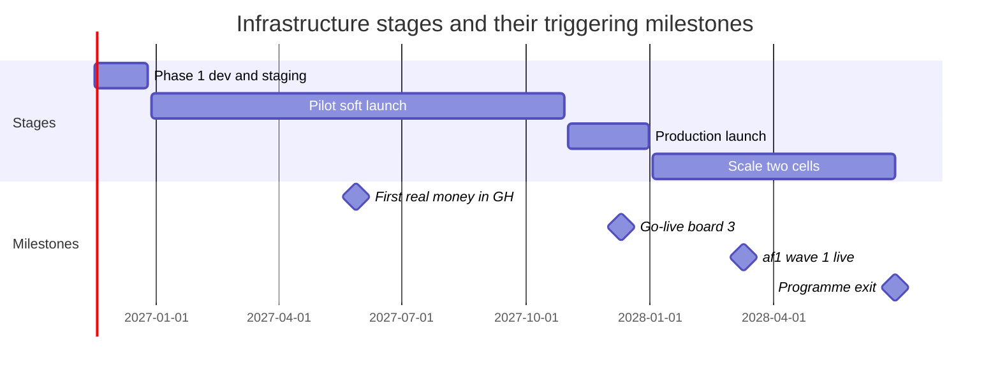
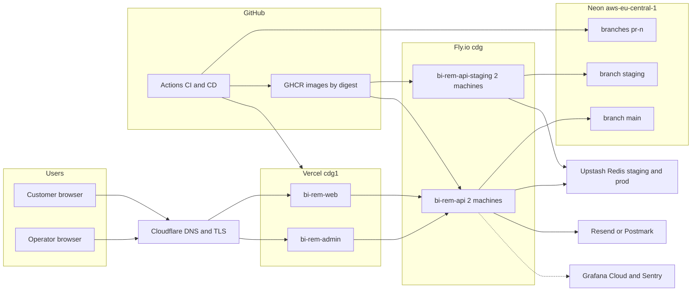
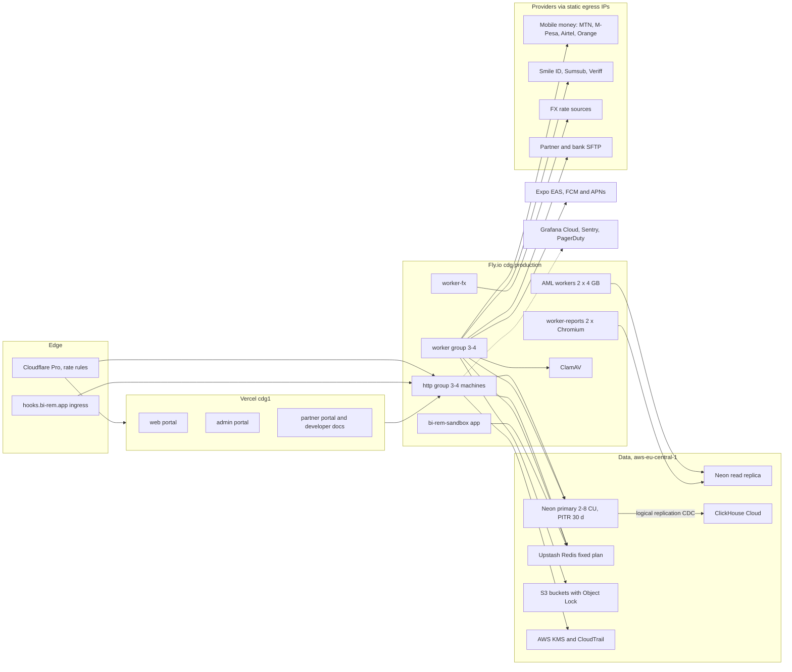
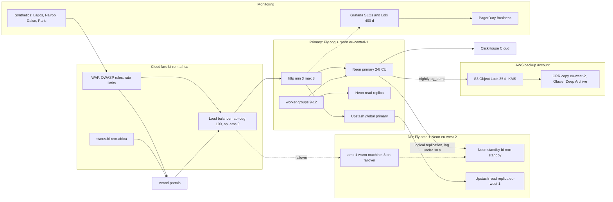
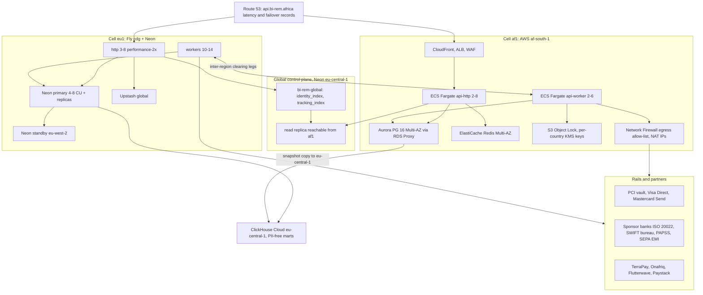

# BI-Rem — Infrastructure Estimates

| Item                                      | Value                                                                                                                                                                                                                                                                                                                                                                                                                       |
| ----------------------------------------- | --------------------------------------------------------------------------------------------------------------------------------------------------------------------------------------------------------------------------------------------------------------------------------------------------------------------------------------------------------------------------------------------------------------------------- |
| Programme                                 | **BI-Rem** — pan-African remittance and mobile-money platform                                                                                                                                                                                                                                                                                                                                                               |
| Target scale (`schedule.json`)            | **1,000,000 users · 100,000 transfers/day · 50 providers · 20 countries · 99.9 % availability · RPO 15 min · RTO 60 min**                                                                                                                                                                                                                                                                                                   |
| Window                                    | 2026-11-16 → 2028-06-30, four infrastructure stages                                                                                                                                                                                                                                                                                                                                                                         |
| Currency                                  | USD per month, list prices at the time of writing, excluding VAT                                                                                                                                                                                                                                                                                                                                                            |
| Machine-readable                          | [`docs/roadmap/infrastructure.csv`](./roadmap/infrastructure.csv) — `stage,component,spec,monthly_low_usd,monthly_high_usd,introduced_in_phase`                                                                                                                                                                                                                                                                             |
| Architecture baseline (not repeated here) | [Infrastructure architecture](./architecture/infrastructure-architecture.md) · [Environment management](./architecture/environment-management.md) · [Monitoring framework](./architecture/monitoring-framework.md) · [Security baseline](./architecture/security-baseline.md) · [Database schema v1](./architecture/database-schema-v1.md) · [Phase 1 implementation notes](./architecture/phase-1-implementation-notes.md) |
| Companion documents                       | [Budget estimates](./04-budget-estimates.md) · [Implementation roadmap](./00-implementation-roadmap.md) · [Risk register](./06-risk-register.md)                                                                                                                                                                                                                                                                            |
| Owner                                     | DevOps/SRE lead with the Solution Architect                                                                                                                                                                                                                                                                                                                                                                                 |
| Status                                    | Baseline v1, 2026-11-10                                                                                                                                                                                                                                                                                                                                                                                                     |

---

## 1. Executive summary

BI-Rem's infrastructure grows in four stages, each the cumulative sum of the infrastructure deltas declared by the phase plans. The run-rate rises from **under USD 0.7 k per month** in Phase 1 to **USD 11,800 – 35,370 per month** at programme exit with two production cells. Infrastructure is not the cost driver of this programme: even at 100,000 transfers/day it is **USD 0.004–0.012 per transfer**, against USD 0.12–0.24 all-in platform cost ([budget §11](./04-budget-estimates.md#11-unit-economics-inputs)).

| Stage                 | Window                                                | Users        | Transfers/day | USD/month low | USD/month high | USD/year low – high | Infra cost per transfer |
| --------------------- | ----------------------------------------------------- | ------------ | ------------: | ------------: | -------------: | ------------------- | ----------------------- |
| Phase 1 — dev/staging | 2026-11-16 → 2026-12-25                               | staff only   |             — |           197 |            698 | 2 – 8 k             | —                       |
| Pilot — soft launch   | 2026-12-28 → 2027-10-29 (run-rate at end of Phase 10) | ≤ 50 k       |         5,000 |         3,218 |         10,430 | 39 – 125 k          | USD 0.021 – USD 0.069   |
| Production launch     | 2027-11-01 → 2027-12-31 (Phase 12 and hypercare)      | 100–250 k    |        15,000 |         6,155 |         19,750 | 74 – 237 k          | USD 0.013 – USD 0.043   |
| Scale — Phase 13      | 2028-01-03 → 2028-06-30 (run-rate at programme exit)  | 1 M capacity |       100,000 |        11,800 |         35,370 | 142 – 424 k         | USD 0.004 – USD 0.012   |

What the board and the architecture review should take away:

1. **The design point is 600 API requests/s at peak with a tested breakpoint of 1,200 rps**, derived from 100 k transfers/day, 1 M users and a 5× peak factor (§2). Phase 12 proves it on a production-shaped branch; Phase 13 proves 100 k transfers/day split 60/40 across two cells.
2. **The database is sized by durability, not throughput.** Peak writes are ≈ 500 rows/s — modest for PostgreSQL — but the ledger, audit and AML tables grow ≈ 0.6 TB per year at target volume, and the RPO < 15 min requirement drives a logical-replication standby, 30-day PITR and Object-Locked dumps (§7).
3. **Three line items deserve active management:** ClickHouse Cloud (USD 1.2–3.5 k at scale, the largest single SaaS line), the af1 AWS cell (USD 2.5–4.5 k, of which Network Firewall and NAT are ≈ 40 %), and Redis billing — BullMQ at target volume issues ≈ 50 M Redis commands per day, which would cost ≈ USD 3 k per month on pay-per-command pricing; a fixed-price plan is mandatory from the pilot stage (§6.2).
4. **Multi-region is phased**: Phase 12 adds a warm-standby DR region for the single eu1 cell (RPO bounded by replication lag < 30 s, RTO target 35 min); Phase 13 adds a second _active_ cell af1 in AWS af-south-1 for latency and data residency, with a PII-free global control plane (§4.4, §7).

---

## 2. Target sizing: from 100,000 transfers/day to requests per second

### 2.1 Transfer throughput

| Quantity                        |   Value | Derivation                                                                                                                                                                                                                     |
| ------------------------------- | ------: | ------------------------------------------------------------------------------------------------------------------------------------------------------------------------------------------------------------------------------ |
| Transfers per day (target)      | 100,000 | `schedule.json` `targetScale.transactionsPerDay`                                                                                                                                                                               |
| Average transfers per second    |    1.16 | 100,000 ÷ 86,400                                                                                                                                                                                                               |
| Peak factor                     |      5× | ≈ 2.5× daily peak hour (evening in WAT/EAT) × ≈ 2× salary-day effect (25th → 5th of the month), the dominant remittance pattern                                                                                                |
| **Peak transfers per second**   | **5.8** | 1.16 × 5                                                                                                                                                                                                                       |
| Saga steps per transfer         |     6–9 | Funding pull, limits, AML decision, FX convert, payout leg, ledger posting, notifications ([P5](./phases/phase-05-domestic-transfers.md), [P6](./phases/phase-06-international.md), [P8](./phases/phase-08-aml-compliance.md)) |
| Provider legs per transfer      |     1–2 | Pull and/or payout through the WalletConnector ([P4](./phases/phase-04-wallet-connectors.md))                                                                                                                                  |
| Provider callbacks per transfer |     1–3 | Webhook ingress, signature-verified and de-duplicated ([P3](./phases/phase-03-connectivity.md))                                                                                                                                |

### 2.2 API request rate

| Traffic source                                    |                                                                               Requests per day | Basis                                                                                                                                                          |
| ------------------------------------------------- | ---------------------------------------------------------------------------------------------: | -------------------------------------------------------------------------------------------------------------------------------------------------------------- |
| Customer sessions (app + portal)                  |                                                                                          7.2 M | 1 M registered users × 12 % daily active × 3 sessions × 20 requests (balances, history, quotes, config, tracking)                                              |
| Transfer lifecycle                                |                                                                                          1.5 M | 100 k transfers × 15 requests: 2 quotes, 2 create/confirm, 6 status/tracking polls or push-triggered refreshes, 3 wallet reads, 1 receipt, 1 provider callback |
| Partner API and outbound-webhook acknowledgements |                                                                                          0.5 M | [P9](./phases/phase-09-partner-merchant.md) partner API and webhooks                                                                                           |
| Admin, BI and synthetic probes                    |                                                                                          0.2 M | Operators, [P10](./phases/phase-10-reporting-bi.md) dashboards (served from ClickHouse), [P12](./phases/phase-12-go-live.md) probes                            |
| **Total**                                         |                                                                                    **≈ 9.4 M** |                                                                                                                                                                |
| **Average**                                       |                                                                                  **≈ 109 rps** | 9.4 M ÷ 86,400                                                                                                                                                 |
| **Peak (5×)**                                     |                                                           **≈ 545 rps → design point 600 rps** |                                                                                                                                                                |
| Tested breakpoint                                 |                                                          **≥ 1,200 rps** with graceful 429/503 | 2× headroom over design peak; Phase 12 stress test (M12.3)                                                                                                     |
| Steady-load acceptance                            | 300 rps for 1 h with p95 `POST /v1/transfers` ≤ 600 ms, quotes ≤ 250 ms, `wallets/me` ≤ 150 ms | Phase 12 campaign 1 (M12.2)                                                                                                                                    |

### 2.3 Per-transfer data footprint (PostgreSQL, retained)

| Table family                                            | Rows per transfer | Approx. bytes incl. indexes | Notes                                                                             |
| ------------------------------------------------------- | ----------------: | --------------------------: | --------------------------------------------------------------------------------- |
| `ledger_entries` (+ journals)                           |                12 |                      4.2 KB | 300 M entries per 25 M transfers in the Phase 12 perf branch                      |
| `transfer_events`, `transfers`, fee lines, tracking     |                10 |                      4.5 KB | Monthly partitions, 84-month drop ([P5](./phases/phase-05-domestic-transfers.md)) |
| `wallet_transactions` + events                          |                 6 |                      2.0 KB | Append-only, partitioned ([P4](./phases/phase-04-wallet-connectors.md))           |
| `audit_logs`                                            |                 2 |                      2.4 KB | Before/after diff; 7-year retention ([P1](./phases/phase-01-foundation.md))       |
| AML decisions, evaluations, screening                   |                 4 |                      2.0 KB | 10-year retention ([P8](./phases/phase-08-aml-compliance.md))                     |
| Notifications, outbox, profitability, receipts metadata |                 6 |                      1.3 KB | Outbox and raw webhook bodies purged at 30 days                                   |
| **Total**                                               |     **≈ 40 rows** |                 **≈ 16 KB** | → **≈ 1.6 GB per day, ≈ 0.6 TB per year at 100 k/day**                            |

---

## 3. Capacity model

| Metric                                     | Phase 1                                         | Pilot                                                                                                | Production launch                                                     | Scale (target)                                                                    |
| ------------------------------------------ | ----------------------------------------------- | ---------------------------------------------------------------------------------------------------- | --------------------------------------------------------------------- | --------------------------------------------------------------------------------- |
| Registered users                           | staff (< 100)                                   | ≤ 50 k                                                                                               | 100–250 k                                                             | 1 M                                                                               |
| Transfers per day (average)                | synthetic only                                  | 1–5 k                                                                                                | 10–20 k                                                               | 100 k                                                                             |
| Peak transfers per second (5×)             | —                                               | 0.3                                                                                                  | 1.2                                                                   | 5.8                                                                               |
| API requests per day                       | < 0.1 M                                         | 0.6 M                                                                                                | 2.2 M                                                                 | 9.4 M                                                                             |
| API rps average / peak                     | < 1 / 5                                         | 7 / 35                                                                                               | 25 / 130                                                              | 109 / 545                                                                         |
| Load test evidence                         | smoke + k6 login p95 < 300 ms at 100 rps (M1.5) | per-phase k6: ingress 300 rps (P3), 100 TPS wallet engine (P4), 50 TPS W2W (P5), 200 rps quotes (P6) | 300 rps steady, 900 rps burst, ≥ 1,200 rps breakpoint, 8 h soak (P12) | 100 k transfers/day for 2 h split 60/40 across cells, p95 < 800 ms per cell (P13) |
| HTTP machines (production)                 | 2 shared-cpu-2x 1 GB                            | 3–4 shared-cpu-2x 2 GB                                                                               | cdg min 3 / max 8 shared-cpu-4x 4 GB + ams 1 warm                     | eu1 3–8 performance-2x + ams; af1 ECS api-http 2–8 tasks                          |
| Worker machines (production)               | 0 (in-process)                                  | 8–10 across 4 groups + ClamAV                                                                        | 9–12 with queue-depth autoscaling                                     | eu1 10–14; af1 ECS api-worker 2–6 tasks                                           |
| PostgreSQL compute                         | Neon 0.25–2 CU                                  | Neon 2–8 CU + replica 1–4 CU                                                                         | Neon 2–8 CU (3–5 sustained) + replica + standby                       | eu1 Neon 4–8 CU sustained; af1 Aurora 2 × db.r6g.large                            |
| DB row writes per second, peak             | < 5                                             | ≈ 30                                                                                                 | ≈ 110                                                                 | ≈ 500 (eu1 + af1)                                                                 |
| DB client → server connections             | 40 direct                                       | ≈ 150 → 60 pooled                                                                                    | ≈ 290 → 200 pooled (PgBouncer)                                        | eu1 ≈ 290 → 200; af1 ≈ 280 via RDS Proxy                                          |
| PostgreSQL hot storage                     | < 5 GB                                          | 60–150 GB                                                                                            | 200–400 GB                                                            | 0.6–1 TB eu1 + 0.2–0.5 TB af1                                                     |
| PostgreSQL growth per year                 | —                                               | ≈ 30 GB                                                                                              | ≈ 90 GB                                                               | ≈ 0.6 TB                                                                          |
| Object storage (KYC docs, receipts, files) | 0                                               | 0.3–1 TB                                                                                             | ≈ 1–1.5 TB                                                            | 4–7 TB, growing ≈ 7 TB/year (4 MB per applicant, 60 KB per receipt)               |
| Egress bandwidth per month                 | < 50 GB                                         | 0.3–1 TB                                                                                             | ≈ 1.5 TB                                                              | 3–5 TB across Vercel, Fly, CloudFront                                             |
| Queue jobs per day / peak jobs per second  | < 1 k / —                                       | 80 k / 5                                                                                             | 250 k / 15                                                            | 1.5 M / 90                                                                        |
| Redis commands per day                     | < 0.1 M                                         | ≈ 3 M                                                                                                | ≈ 10 M                                                                | ≈ 50 M                                                                            |
| Redis memory                               | < 50 MB                                         | 0.5–1.5 GB                                                                                           | 2–4 GB                                                                | 4–8 GB per cell                                                                   |
| Webhook ingress peak                       | —                                               | < 5 /s (tested 300 rps)                                                                              | ≈ 5 /s                                                                | ≈ 17 /s                                                                           |
| Push notifications per day                 | —                                               | — (P11 cohort)                                                                                       | ≈ 40 k                                                                | ≈ 260 k (load-tested 50/s sustained, 500/s burst, P11)                            |
| CDC rows into ClickHouse per day           | —                                               | ≈ 0.2 M                                                                                              | ≈ 0.7 M                                                               | ≈ 4.5 M; lag p95 < 10 s ([P10](./phases/phase-10-reporting-bi.md))                |

Machine sizing rule used throughout: one shared-cpu-4x / performance-2x machine serves ≈ 150–200 rps of the BI-Rem request mix within the Phase 12 concurrency limits (soft 150, hard 200); 545 rps peak therefore needs 3–4 machines and the maximum of 8 gives the 1,200 rps breakpoint with one machine lost.

---

## 4. Component sizing and deployment by stage

Monthly figures are the **run-rate at the end of each stage** and are cumulative (each stage contains the previous one, resized). "Introduced in" links the phase whose plan first adds the component; the phase-by-phase attribution of every infrastructure delta is in §8.

### 4.1 Phase 1 — development and staging

Everything runs in one European region (Fly `cdg`, Neon `aws-eu-central-1`, Vercel `cdg1`); production exists from M1.3 but carries no customers. See [Phase 1 implementation notes](./architecture/phase-1-implementation-notes.md) for what is deployed.

| Component       | Specification                                                                                                                | USD/month low | USD/month high | Introduced in                         |
| --------------- | ---------------------------------------------------------------------------------------------------------------------------- | ------------: | -------------: | ------------------------------------- |
| Neon Postgres   | Launch plan; project bi-rem aws-eu-central-1 PG 17; branches main + staging + pr-n; 0.25-2 CU autoscale; < 5 GB; PITR 7 days |            19 |             69 | [P1](./phases/phase-01-foundation.md) |
| Redis           | Upstash 2 regional databases (staging + production) pay-as-you-go < 256 MB                                                   |             0 |             50 | [P1](./phases/phase-01-foundation.md) |
| API compute     | Fly.io cdg: bi-rem-api-staging + bi-rem-api; 2 x shared-cpu-2x 1 GB each (4 machines); rolling deploys                       |            60 |            140 | [P1](./phases/phase-01-foundation.md) |
| Workers         | None: notification BullMQ consumers run in the API process                                                                   |             0 |              0 | [P1](./phases/phase-01-foundation.md) |
| Vercel          | Pro; projects bi-rem-web + bi-rem-admin in cdg1; per-PR previews; 1 TB bandwidth included                                    |            40 |            100 | [P1](./phases/phase-01-foundation.md) |
| Object storage  | None: no customer documents before Phase 2                                                                                   |             0 |              0 | [P1](./phases/phase-01-foundation.md) |
| Secrets and KMS | Fly secrets + GitHub Environment secrets; no KMS yet                                                                         |             0 |              0 | [P1](./phases/phase-01-foundation.md) |
| Observability   | Grafana Cloud free to Pro (Prometheus + Loki 30 days) + Sentry Team (api/web/admin)                                          |            26 |            129 | [P1](./phases/phase-01-foundation.md) |
| CDN WAF DNS     | Cloudflare DNS + TLS for app. admin. api.; domain amortised                                                                  |             2 |             25 | [P1](./phases/phase-01-foundation.md) |
| CI              | GitHub Team ~10 seats incl. 3000 Actions minutes + GHCR; light overage                                                       |            50 |            160 | [P1](./phases/phase-01-foundation.md) |
| Email           | Resend or Postmark starter tier (SPF/DKIM/DMARC)                                                                             |             0 |             20 | [P1](./phases/phase-01-foundation.md) |
| Network egress  | Fly Europe egress < 50 GB/month                                                                                              |             0 |              5 | [P1](./phases/phase-01-foundation.md) |
| **Stage total** | 12 components                                                                                                                |       **197** |        **698** |                                       |

### 4.2 Pilot — soft launch (Phases 2–11)

Real money moves from 2027-05-28 (GH/GHS, then KE/KES at 5 %), cross-border friends-and-family from 2027-07-09, all behind corridor flags. This stage adds restricted-data storage with per-object envelope encryption (P2), a credential vault on AWS KMS and a public webhook ingress `hooks.bi-rem.app` (P3), the worker groups and simulators (P2–P10), the analytics warehouse (P10) and the mobile build chain (P11). Customers are ≤ 50 k; the platform is sized for the Phase 12 load campaigns rather than for pilot traffic.

| Component                     | Specification                                                                                                                                          | USD/month low | USD/month high | Introduced in                                 |
| ----------------------------- | ------------------------------------------------------------------------------------------------------------------------------------------------------ | ------------: | -------------: | --------------------------------------------- |
| Neon Postgres                 | Scale plan; primary autoscale 2-8 CU; 60-150 GB; PITR 30 days; pg_trgm/unaccent; monthly partitions                                                    |           400 |          1,100 | [P5](./phases/phase-05-domestic-transfers.md) |
| Neon read replica             | 1 read-only endpoint 1-4 CU for explorer, recon, AML batch and BI fallback (DATABASE_REPLICA_URL)                                                      |           120 |            400 | [P5](./phases/phase-05-domestic-transfers.md) |
| Neon non-production branches  | staging + sandbox (Phase 9, reset nightly) + perf + ephemeral pr-n branches                                                                            |            60 |            200 | [P1](./phases/phase-01-foundation.md)         |
| Redis                         | Upstash fixed-price plans: production 2-4 GB noeviction + staging + sandbox; ~35 BullMQ queues + throttler + caches                                    |           200 |            600 | [P4](./phases/phase-04-wallet-connectors.md)  |
| API compute                   | Fly cdg http group: production 3-4 shared-cpu-2x 2 GB + staging 2; partner API headroom                                                                |           120 |            320 | [P1](./phases/phase-01-foundation.md)         |
| Workers                       | Fly worker groups: worker 3-4 shared-cpu-2x + worker-fx + 2 shared-cpu-4x 4 GB (AML) + worker-reports 2 x 2 GB (Chromium)                              |           450 |            950 | [P2](./phases/phase-02-customer-kyc.md)       |
| ClamAV sandbox and simulators | ClamAV clamd 2 GB (P2) + bi-rem-sandbox app 1 http + 1 worker (P9) + bi-rem-simulator, fx-sim, kyb-sim (staging only)                                  |            90 |            240 | [P2](./phases/phase-02-customer-kyc.md)       |
| Static egress IPs             | Fly static egress IPv4 per environment + 2 dedicated webhook egress IPs                                                                                |             8 |             25 | [P3](./phases/phase-03-connectivity.md)       |
| Vercel                        | Pro; web + admin + partner portals + developers docs; bandwidth < 1 TB                                                                                 |            80 |            250 | [P1](./phases/phase-01-foundation.md)         |
| Object storage                | S3-compatible buckets with SSE + versioning + Object Lock: kyc-docs (cold after 90 d), receipts, settlement, statements, compliance, reports; 0.3-1 TB |           120 |            450 | [P2](./phases/phase-02-customer-kyc.md)       |
| Secrets and KMS               | AWS KMS CMKs (kyc, connectivity, compliance, oauth-signing ES256) + CloudTrail to S3 400 days                                                          |            35 |            135 | [P2](./phases/phase-02-customer-kyc.md)       |
| Observability                 | Grafana Cloud Pro: Prometheus + Loki 30 d; ~20 dashboards (KYC, Connectivity, Wallet Engine, Transfers and Ledger, intl, FX, AML)                      |           150 |            550 | [P1](./phases/phase-01-foundation.md)         |
| Error tracking                | Sentry Team/Business: api, web, admin, partner, mobile projects with release tagging                                                                   |            80 |            380 | [P1](./phases/phase-01-foundation.md)         |
| Paging                        | PagerDuty Professional: engineering, treasury and partner-api rotations (~8 users)                                                                     |           100 |            250 | [P7](./phases/phase-07-fx-treasury.md)        |
| ClickHouse warehouse          | ClickHouse Cloud production (2 replicas, autoscaling capped) + staging dev tier + ClickPipes Postgres CDC                                              |           700 |          1,900 | [P10](./phases/phase-10-reporting-bi.md)      |
| Mobile build and test         | Expo EAS Production + Firebase Test Lab + BrowserStack App Automate (FCM and APNs free)                                                                |           350 |          1,900 | [P11](./phases/phase-11-mobile.md)            |
| CI                            | GitHub Team + Actions overage: conformance matrix, nightly k6, chaos, macOS for iOS fallback builds                                                    |           100 |            400 | [P1](./phases/phase-01-foundation.md)         |
| CDN WAF DNS                   | Cloudflare Pro + rate-limit rules on /v1/auth/register* and /v1/webhooks/*                                                                             |            25 |            250 | [P2](./phases/phase-02-customer-kyc.md)       |
| Email                         | Resend Pro/Scale 50-150 k e-mails per month                                                                                                            |            20 |             90 | [P1](./phases/phase-01-foundation.md)         |
| Network egress                | Fly egress Europe ~0.3-1 TB/month + provider callbacks                                                                                                 |            10 |             40 | [P1](./phases/phase-01-foundation.md)         |
| **Stage total**               | 20 components                                                                                                                                          |     **3,218** |     **10,430** |                                               |

### 4.3 Production launch (Phase 12)

Phase 12 turns the single cell into a launched, operated service: Cloudflare in front with load-balancer pools `api-cdg` (weight 100) and `api-ams` (weight 0), a warm DR region on Fly `ams`, a logical-replication standby Neon project in `aws-eu-west-2`, Upstash global Redis with a read replica, a separate AWS backup account with Object Lock and cross-region replication, synthetic probes from four vantage points and PagerDuty Business for five services ([P12](./phases/phase-12-go-live.md)).

| Component                     | Specification                                                                                                       | USD/month low | USD/month high | Introduced in                                 |
| ----------------------------- | ------------------------------------------------------------------------------------------------------------------- | ------------: | -------------: | --------------------------------------------- |
| Neon Postgres                 | Scale plan; primary 2-8 CU sustained 3-5 CU; 200-400 GB; PITR 30 days; publication birem_all                        |           700 |          1,800 | [P5](./phases/phase-05-domestic-transfers.md) |
| Neon read replica             | 1-2 read-only endpoints 2-4 CU (explorer, recon, AML batch, BI fallback)                                            |           200 |            600 | [P5](./phases/phase-05-domestic-transfers.md) |
| Neon DR standby               | Project bi-rem-standby in aws-eu-west-2; logical subscription birem_sub; compute >= 50 % of primary; lag < 30 s     |           400 |          1,200 | [P12](./phases/phase-12-go-live.md)           |
| Neon non-production branches  | staging + sandbox + perf-20271101 (campaign weeks) + pr-n                                                           |           100 |            300 | [P1](./phases/phase-01-foundation.md)         |
| Redis                         | Upstash global database with eu-west-1 read replica; fixed plan 4-8 GB noeviction                                   |           300 |            900 | [P12](./phases/phase-12-go-live.md)           |
| API compute                   | Fly cdg http: min 3 / max 8 shared-cpu-4x 4 GB, concurrency soft 150 / hard 200 + staging                           |           250 |            700 | [P12](./phases/phase-12-go-live.md)           |
| DR region compute             | Fly ams: 1 warm machine, 3 on failover; secrets pre-staged; DR_REGION env                                           |            60 |            250 | [P12](./phases/phase-12-go-live.md)           |
| Workers                       | Fly worker groups as pilot plus autoscaling headroom on queue depth                                                 |           600 |          1,300 | [P2](./phases/phase-02-customer-kyc.md)       |
| ClamAV sandbox and simulators | ClamAV + bi-rem-sandbox + staging simulators                                                                        |            90 |            240 | [P2](./phases/phase-02-customer-kyc.md)       |
| Static egress IPs             | cdg and ams static IPs allow-listed with providers and FIUs                                                         |            15 |             40 | [P3](./phases/phase-03-connectivity.md)       |
| Vercel                        | Pro (Enterprise evaluated); 4 projects; ~1-2 TB bandwidth                                                           |           150 |            450 | [P1](./phases/phase-01-foundation.md)         |
| Object storage                | KYC documents ~1 TB with cold tier + receipts + settlement + reports/board Object Lock 10 y                         |           200 |            600 | [P2](./phases/phase-02-customer-kyc.md)       |
| Backups                       | Separate AWS account: S3 Object Lock 35 days + KMS + CRR to eu-west-2 + Glacier Deep Archive + CloudTrail           |           100 |            400 | [P12](./phases/phase-12-go-live.md)           |
| Secrets and KMS               | KMS CMKs + AWS Secrets Manager in backup account + key rotation                                                     |            60 |            200 | [P2](./phases/phase-02-customer-kyc.md)       |
| Observability                 | Grafana Cloud plan step: SLO recording rules, Loki 400 days for audit/auth streams, Launch/Capacity/DR dashboards   |           450 |          1,700 | [P12](./phases/phase-12-go-live.md)           |
| Synthetic monitoring          | Grafana Synthetic Monitoring or Checkly: Lagos, Nairobi, Dakar, Paris x 4 checks every 60 s                         |           150 |            600 | [P12](./phases/phase-12-go-live.md)           |
| Error tracking                | Sentry Business incl. hypercare quota                                                                               |           100 |            600 | [P1](./phases/phase-01-foundation.md)         |
| Paging                        | PagerDuty Business: platform, payments, partner-api, mobile, compliance; 15-25 users                                |           600 |          1,500 | [P12](./phases/phase-12-go-live.md)           |
| ClickHouse warehouse          | ClickHouse Cloud 2 replicas + ClickPipes; 13+ months of history                                                     |           800 |          2,200 | [P10](./phases/phase-10-reporting-bi.md)      |
| Mobile build and test         | EAS Production + Firebase Test Lab + BrowserStack                                                                   |           350 |          1,900 | [P11](./phases/phase-11-mobile.md)            |
| CI                            | GitHub Team/Enterprise + Actions (load-test, backup-verify, dr-test, go-live-gates workflows)                       |           150 |            500 | [P1](./phases/phase-01-foundation.md)         |
| CDN WAF DNS                   | Cloudflare zone bi-rem.africa: Load Balancing pools api-cdg/api-ams + WAF managed + OWASP + rate limiting + Logpush |           250 |          1,500 | [P12](./phases/phase-12-go-live.md)           |
| Email                         | Resend Scale ~0.3-0.8 M e-mails per month                                                                           |            50 |            150 | [P1](./phases/phase-01-foundation.md)         |
| Network egress                | Fly egress + Cloudflare origin pulls + Neon logical replication cross-region                                        |            30 |            120 | [P12](./phases/phase-12-go-live.md)           |
| **Stage total**               | 24 components                                                                                                       |     **6,155** |     **19,750** |                                               |

### 4.4 Scale — two production cells (Phase 13)

Phase 13 adds cell **af1** in AWS af-south-1 (Cape Town) for KE, GH, NG, UG, RW, TZ and ZA customers: p95 Nairobi → af1 < 120 ms against ≈ 210 ms to eu1 (M13.2), and a path to data-residency compliance. Cells share nothing but a PII-free global control plane (`@bi-rem/db-global` on Neon: `identity_index`, `tracking_index`, country-to-region map) and inter-region clearing legs; a residency egress guard blocks any cross-cell data path ([P13](./phases/phase-13-pan-african-expansion.md)).

| Component                     | Specification                                                                                                                                                                                                                      | USD/month low | USD/month high | Introduced in                                     |
| ----------------------------- | ---------------------------------------------------------------------------------------------------------------------------------------------------------------------------------------------------------------------------------- | ------------: | -------------: | ------------------------------------------------- |
| Neon Postgres                 | eu1 primary autoscale 4-8 CU sustained; 0.6-1 TB; PITR 30 days                                                                                                                                                                     |         1,000 |          2,400 | [P5](./phases/phase-05-domestic-transfers.md)     |
| Neon read replica             | eu1 2 read-only endpoints 2-4 CU                                                                                                                                                                                                   |           300 |            900 | [P5](./phases/phase-05-domestic-transfers.md)     |
| Neon DR standby               | bi-rem-standby aws-eu-west-2 logical replica for eu1                                                                                                                                                                               |           500 |          1,500 | [P12](./phases/phase-12-go-live.md)               |
| Neon global control plane     | Project bi-rem-global (PII-free directories identity_index, tracking_index) + read replica reachable from af1                                                                                                                      |            70 |            250 | [P13](./phases/phase-13-pan-african-expansion.md) |
| Neon non-production branches  | staging + sandbox + perf + pr-n                                                                                                                                                                                                    |           100 |            300 | [P1](./phases/phase-01-foundation.md)             |
| Redis                         | eu1 Upstash global fixed plan 8-16 GB                                                                                                                                                                                              |           400 |          1,200 | [P12](./phases/phase-12-go-live.md)               |
| API compute                   | eu1 Fly cdg http min 3 / max 8 performance-2x 4 GB                                                                                                                                                                                 |           400 |          1,200 | [P1](./phases/phase-01-foundation.md)             |
| DR region compute             | Fly ams warm standby for eu1                                                                                                                                                                                                       |            60 |            250 | [P12](./phases/phase-12-go-live.md)               |
| Workers                       | eu1 worker groups incl. AML, FX, reports, rails:* and region:* queues                                                                                                                                                              |           700 |          1,600 | [P2](./phases/phase-02-customer-kyc.md)           |
| ClamAV sandbox and simulators | ClamAV + sandbox + rail-sim + provider-sim (both cells staging)                                                                                                                                                                    |            90 |            240 | [P2](./phases/phase-02-customer-kyc.md)           |
| Static egress IPs             | eu1 static IPs; af1 NAT Elastic IPs counted in the af1 cell                                                                                                                                                                        |            20 |             50 | [P3](./phases/phase-03-connectivity.md)           |
| Vercel                        | Pro or Enterprise; 4 projects; 2-4 TB bandwidth                                                                                                                                                                                    |           300 |          2,500 | [P1](./phases/phase-01-foundation.md)             |
| Object storage                | eu1 KYC documents 3-5 TB (cold tier) + receipts ~2 TB/year + reports                                                                                                                                                               |           300 |            900 | [P2](./phases/phase-02-customer-kyc.md)           |
| Backups                       | AWS backup account for eu1 dumps + af1 cross-region snapshot copies                                                                                                                                                                |           200 |            700 | [P12](./phases/phase-12-go-live.md)               |
| Secrets and KMS               | KMS CMK per cell + per-country key aliases + Secrets Manager                                                                                                                                                                       |           100 |            300 | [P13](./phases/phase-13-pan-african-expansion.md) |
| Observability                 | Grafana Cloud both cells (region labels, per-cell SLOs) via Alloy sidecar from CloudWatch                                                                                                                                          |           600 |          2,200 | [P12](./phases/phase-12-go-live.md)               |
| Synthetic monitoring          | 4 African vantage points + Paris, both cells                                                                                                                                                                                       |           200 |            700 | [P12](./phases/phase-12-go-live.md)               |
| Error tracking                | Sentry Business both cells + mobile                                                                                                                                                                                                |           150 |            800 | [P1](./phases/phase-01-foundation.md)             |
| Paging                        | PagerDuty Business; both cells on one rota                                                                                                                                                                                         |           800 |          1,800 | [P12](./phases/phase-12-go-live.md)               |
| ClickHouse warehouse          | ClickHouse Cloud eu-central-1 (PII-free marts with region dimension) + ClickPipes from Neon and Aurora                                                                                                                             |         1,200 |          3,500 | [P10](./phases/phase-10-reporting-bi.md)          |
| Mobile build and test         | EAS Production + Firebase Test Lab + BrowserStack                                                                                                                                                                                  |           350 |          1,900 | [P11](./phases/phase-11-mobile.md)                |
| CI                            | GitHub Enterprise or Team + Actions deploying both cells on every main push                                                                                                                                                        |           200 |            700 | [P1](./phases/phase-01-foundation.md)             |
| CDN WAF DNS                   | Cloudflare for eu1 edge + status page                                                                                                                                                                                              |           300 |          1,800 | [P12](./phases/phase-12-go-live.md)               |
| Email                         | Resend Scale/Enterprise ~1-2 M e-mails per month                                                                                                                                                                                   |            90 |            300 | [P1](./phases/phase-01-foundation.md)             |
| af1 production cell           | AWS af-south-1: Aurora PG 16 Multi-AZ 2 x db.r6g.large + RDS Proxy + ECS Fargate api-http 2-8 and api-worker 2-6 tasks + ElastiCache Multi-AZ + NAT x3 + Network Firewall + S3 Object Lock + KMS + CloudFront/ALB/WAF + CloudWatch |         2,500 |          4,500 | [P13](./phases/phase-13-pan-african-expansion.md) |
| af1 staging cell              | Aurora Serverless v2 0.5-4 ACU + 2 Fargate tasks + single-AZ cache                                                                                                                                                                 |           500 |            900 | [P13](./phases/phase-13-pan-african-expansion.md) |
| AWS Business Support          | 10 % of AWS spend, minimum USD 100                                                                                                                                                                                                 |           100 |          1,000 | [P13](./phases/phase-13-pan-african-expansion.md) |
| DNS failover                  | Route 53 latency-based and failover records for api.bi-rem.africa with /health/ready checks, TTL <= 60 s                                                                                                                           |            20 |             80 | [P13](./phases/phase-13-pan-african-expansion.md) |
| Network egress                | af1 data transfer out (Africa) + inter-region snapshot copy + control-plane replica traffic + eu1 egress                                                                                                                           |           250 |            900 | [P13](./phases/phase-13-pan-african-expansion.md) |
| **Stage total**               | 29 components                                                                                                                                                                                                                      |    **11,800** |     **35,370** |                                                   |

---

## 5. Cost by stage

### 5.1 Summary

| Stage                 | Window                                                | Users        | Transfers/day | USD/month low | USD/month high | USD/year low – high | Infra cost per transfer |
| --------------------- | ----------------------------------------------------- | ------------ | ------------: | ------------: | -------------: | ------------------- | ----------------------- |
| Phase 1 — dev/staging | 2026-11-16 → 2026-12-25                               | staff only   |             — |           197 |            698 | 2 – 8 k             | —                       |
| Pilot — soft launch   | 2026-12-28 → 2027-10-29 (run-rate at end of Phase 10) | ≤ 50 k       |         5,000 |         3,218 |         10,430 | 39 – 125 k          | USD 0.021 – USD 0.069   |
| Production launch     | 2027-11-01 → 2027-12-31 (Phase 12 and hypercare)      | 100–250 k    |        15,000 |         6,155 |         19,750 | 74 – 237 k          | USD 0.013 – USD 0.043   |
| Scale — Phase 13      | 2028-01-03 → 2028-06-30 (run-rate at programme exit)  | 1 M capacity |       100,000 |        11,800 |         35,370 | 142 – 424 k         | USD 0.004 – USD 0.012   |

### 5.2 Component matrix (USD per month, low – high)

| Component                     | Phase 1       | Pilot              | Production launch  | Scale               |
| ----------------------------- | ------------- | ------------------ | ------------------ | ------------------- |
| Neon Postgres                 | 19 – 69       | 400 – 1,100        | 700 – 1,800        | 1,000 – 2,400       |
| Neon read replica             | —             | 120 – 400          | 200 – 600          | 300 – 900           |
| Neon DR standby               | —             | —                  | 400 – 1,200        | 500 – 1,500         |
| Neon global control plane     | —             | —                  | —                  | 70 – 250            |
| Neon non-production branches  | —             | 60 – 200           | 100 – 300          | 100 – 300           |
| Redis                         | 0 – 50        | 200 – 600          | 300 – 900          | 400 – 1,200         |
| API compute                   | 60 – 140      | 120 – 320          | 250 – 700          | 400 – 1,200         |
| DR region compute             | —             | —                  | 60 – 250           | 60 – 250            |
| Workers                       | 0             | 450 – 950          | 600 – 1,300        | 700 – 1,600         |
| ClamAV sandbox and simulators | —             | 90 – 240           | 90 – 240           | 90 – 240            |
| Static egress IPs             | —             | 8 – 25             | 15 – 40            | 20 – 50             |
| Vercel                        | 40 – 100      | 80 – 250           | 150 – 450          | 300 – 2,500         |
| Object storage                | 0             | 120 – 450          | 200 – 600          | 300 – 900           |
| Backups                       | —             | —                  | 100 – 400          | 200 – 700           |
| Secrets and KMS               | 0             | 35 – 135           | 60 – 200           | 100 – 300           |
| Observability                 | 26 – 129      | 150 – 550          | 450 – 1,700        | 600 – 2,200         |
| Synthetic monitoring          | —             | —                  | 150 – 600          | 200 – 700           |
| Error tracking                | —             | 80 – 380           | 100 – 600          | 150 – 800           |
| Paging                        | —             | 100 – 250          | 600 – 1,500        | 800 – 1,800         |
| ClickHouse warehouse          | —             | 700 – 1,900        | 800 – 2,200        | 1,200 – 3,500       |
| Mobile build and test         | —             | 350 – 1,900        | 350 – 1,900        | 350 – 1,900         |
| CI                            | 50 – 160      | 100 – 400          | 150 – 500          | 200 – 700           |
| CDN WAF DNS                   | 2 – 25        | 25 – 250           | 250 – 1,500        | 300 – 1,800         |
| DNS failover                  | —             | —                  | —                  | 20 – 80             |
| Email                         | 0 – 20        | 20 – 90            | 50 – 150           | 90 – 300            |
| Network egress                | 0 – 5         | 10 – 40            | 30 – 120           | 250 – 900           |
| af1 production cell           | —             | —                  | —                  | 2,500 – 4,500       |
| af1 staging cell              | —             | —                  | —                  | 500 – 900           |
| AWS Business Support          | —             | —                  | —                  | 100 – 1,000         |
| **Total**                     | **197 – 698** | **3,218 – 10,430** | **6,155 – 19,750** | **11,800 – 35,370** |

### 5.3 Where the money goes at scale

| Share of scale-stage run-rate (midpoint) | Components                                                                                         |
| ---------------------------------------- | -------------------------------------------------------------------------------------------------- |
| ≈ 20 % — af1 AWS cell                    | Aurora, ECS Fargate, ElastiCache, NAT, Network Firewall, CloudFront, AWS Business Support          |
| ≈ 16 % — Neon databases (eu1)            | Primary, read replicas, DR standby, global control plane, non-production branches                  |
| ≈ 15 % — Observability and paging        | Grafana Cloud, synthetics, Sentry, PagerDuty                                                       |
| ≈ 13 % — Compute and queues in eu1       | Fly http, DR region, workers, ClamAV, Redis                                                        |
| ≈ 10 % — Warehouse                       | ClickHouse Cloud + ClickPipes                                                                      |
| ≈ 26 % — Edge, delivery and tooling      | Cloudflare, Vercel, CI, EAS/device testing, object storage, backups, KMS, e-mail, Route 53, egress |

Savings levers if the scale run-rate lands at the high end: single-endpoint Network Firewall or security-group egress control with VPC endpoints in af1 (≈ USD 0.5–0.9 k), ClickHouse autoscaling cap and the composed-dashboard cache (R10.6), Grafana label-cardinality review, and Vercel Pro instead of Enterprise unless SSO/SLA is required.

---

## 6. Component notes

### 6.1 PostgreSQL — Neon (eu1) and Aurora (af1)

| Concern                | Decision                                                                                                                                                                                                                                                                                                                                                                     | Stage       |
| ---------------------- | ---------------------------------------------------------------------------------------------------------------------------------------------------------------------------------------------------------------------------------------------------------------------------------------------------------------------------------------------------------------------------- | ----------- |
| Engine and region      | Neon PostgreSQL 17, `aws-eu-central-1`, Prisma 7 with `@prisma/adapter-pg` ([environment management §5](./architecture/environment-management.md#5-neon-branching-model))                                                                                                                                                                                                    | P1          |
| Plan                   | Launch in Phase 1, Scale from Phase 2 when Restricted data and IP allow-listing arrive (R1.6)                                                                                                                                                                                                                                                                                | P1 → P2     |
| Compute                | Autoscale 0.25–2 CU (P1), ceiling 8 CU from P5; production autosuspend disabled; sustained 3–5 CU at launch, 4–8 CU at scale                                                                                                                                                                                                                                                 | P5          |
| Pooling                | Runtime on pooled endpoint `DATABASE_POOL_URL` (PgBouncer transaction mode); migrations, outbox relay and CDC on direct endpoint (R1.1); `maxConnections ≤ pooler limit ÷ machines`                                                                                                                                                                                          | P1          |
| Read replicas          | One from P5 (explorer, recon, P7 dashboards, P8 batch monitoring `DATABASE_REPLICA_URL`, P10 fallback); second at scale; lag < 5 s alert                                                                                                                                                                                                                                     | P5 → P13    |
| Partitioning           | Monthly range partitions created 3 months ahead by `data-jobs.yml`: `webhook_deliveries`, `connection_health_results` (P3), `wallet_transaction_events` (P4), `ledger_entries`, `transfer_events` (P5), `fx_rates`, `transfer_tracking_events` (P6), `fx_rate_ticks`, `liquidity_positions` (P7), six AML tables (P8), `settlement_run_lines`, `partner_webhook_events` (P9) | P3 → P9     |
| Branches               | `main`, `staging`, `pr-<n>` (P1); `sandbox` reset nightly (P9); `perf-20271101` with ≥ 1 M users / 25 M transfers / 300 M ledger entries for ≈ 3 weeks (P12)                                                                                                                                                                                                                 | P1, P9, P12 |
| Point-in-time recovery | 7 days on Launch (P1), 30 days from P5, confirmed in production in P12                                                                                                                                                                                                                                                                                                       | P5          |
| Logical replication    | Publication `birem_analytics` with PII-excluding column lists for ClickPipes (P10); publication `birem_all` → standby subscription `birem_sub` (P12)                                                                                                                                                                                                                         | P10, P12    |
| af1                    | Aurora PostgreSQL 16 Multi-AZ, writer + reader `db.r6g.large`, RDS Proxy, 35-day backups, encrypted cross-region snapshot copy to eu-central-1                                                                                                                                                                                                                               | P13         |
| Append-only guarantees | `birem_app` has no UPDATE/DELETE on `audit_logs`, ledger, event and accrual tables ([security baseline §4](./architecture/security-baseline.md#4-audit-trail))                                                                                                                                                                                                               | P1 → P9     |

### 6.2 Redis

BullMQ queues (≈ 35 by Phase 10: notifications, `kyc-*`, `connectivity:*`, `wallet:*`, `transfers:saga`, `receipts:render`, `intl:*`, `fx:*`, `treasury:*`, `aml:*`, `screening:*`, `commission:*`, `settlement:*`, `webhooks:outbound`, `analytics:*`, `reports:*`, `notifications:push`), the throttler store, permission and flag caches, limit counters (P5), velocity windows (P8, ≈ 350 MB) and biometric nonces (P11). Rules: `maxmemory-policy noeviction` from P4; keys prefixed per domain and, in P13, per cell (`birem:<region>:`); every queue has a DLQ.

**Billing model is the risk, not memory.** At target volume Redis sees ≈ 50 M commands per day (≈ 15 per job, ≈ 3 per API request). Upstash pay-as-you-go at USD 0.20 per 100 k commands would be ≈ USD 100 per day; fixed-price plans (no per-command charge) are therefore used from P4 and costed above. af1 uses ElastiCache Redis 7 Multi-AZ inside the cell estimate. Recovery after Redis loss is designed in: outbox relay, `wallet:recover`, limit-counter rebuild from Postgres (P5), velocity rebuild from snapshots (P8), schedule reconciler (P10).

### 6.3 API and worker compute

| Group                            | Image                                                 | Phase 1                        | Pilot                                | Launch                               | Scale                                                    |
| -------------------------------- | ----------------------------------------------------- | ------------------------------ | ------------------------------------ | ------------------------------------ | -------------------------------------------------------- |
| `http`                           | `apps/api`                                            | 2 × shared-cpu-2x 1 GB per env | 3–4 × shared-cpu-2x 2 GB             | cdg 3–8 × shared-cpu-4x 4 GB + ams 1 | eu1 3–8 × performance-2x 4 GB; af1 ECS 2–8 × 1 vCPU/2 GB |
| `worker` (`PROCESS_ROLE=worker`) | same                                                  | in-process                     | 3–4 × shared-cpu-2x (P2–P6)          | autoscaled on queue depth            | eu1 + af1 ECS 2–6 × 1 vCPU/4 GB                          |
| `worker-fx`                      | same                                                  | —                              | 1 × shared-cpu-2x (P7)               | 1–2                                  | 1–2                                                      |
| AML workers                      | same                                                  | —                              | 2 × shared-cpu-4x 4 GB (P8)          | 2–3                                  | 2–4                                                      |
| `worker-reports`                 | Chromium image +350 MB                                | —                              | 2 × shared-cpu-2x 2 GB (P10)         | 2                                    | 2                                                        |
| ClamAV                           | `clamd`                                               | —                              | 1 × 2 GB (P2)                        | 1–2                                  | 1–2                                                      |
| Sandbox                          | same, `SANDBOX_MODE=true`                             | —                              | 1 http + 1 worker shared-cpu-1x (P9) | same                                 | same                                                     |
| Simulators (staging only)        | `ghcr.io/bi-rem/simulator`, fx-sim, kyb-sim, rail-sim | —                              | 1–3 small machines                   | same                                 | + rail-sim                                               |

Deploys are rolling with `release_command` migrations; worker canary then http canary from P3; drain gate for in-flight sagas from P6; the same image digest is promoted to production after a 24 h staging soak from P12 ([infrastructure architecture §4](./architecture/infrastructure-architecture.md#4-cicd-flow)).

### 6.4 Vercel

Pro plan with per-PR previews; projects `bi-rem-web`, `bi-rem-admin` (P1), `bi-rem-partner` and `developers.bi-rem.app` (P9); admin previews behind Vercel Authentication. Pro includes 1 TB of bandwidth; overage is ≈ USD 0.15 per GB. Enterprise (≈ USD 20–40 k per year) is only justified by SSO, contractual SLA or > 4 TB per month — the high end of the scale stage assumes it. `apps/web` also serves `.well-known/assetlinks.json` and `apple-app-site-association` (P11) and the public status page (P12).

### 6.5 Object storage for KYC documents and records

| Bucket / prefix                                           | Content                                                  | Controls                                                                                                                                        | Lifecycle                                              | Phase |
| --------------------------------------------------------- | -------------------------------------------------------- | ----------------------------------------------------------------------------------------------------------------------------------------------- | ------------------------------------------------------ | ----- |
| `bi-rem-kyc-docs-{env}`                                   | Identity documents, selfies, liveness artefacts          | SSE + per-document DEK wrapped by KMS (`dek_wrapped`, `sha256`), versioning, Object Lock governance, public access blocked, presigned URLs only | Cold tier after 90 days; crypto-shred at retention end | P2    |
| `bi-rem-kyc-preview-{env}`                                | Watermarked admin previews                               | Short presign TTL                                                                                                                               | 15-minute lifecycle                                    | P2    |
| `receipts/`                                               | Transfer receipt PDFs (≈ 60 KB each)                     | Object Lock 7 years                                                                                                                             | Cold tier after 90 days                                | P5    |
| `bi-rem-settlement-<env>`                                 | Settlement files, partner statements                     | Object Lock compliance 7 years, write-once IAM key                                                                                              | —                                                      | P6    |
| `treasury-statements`, `fx-raw-ticks`, `treasury-exports` | Bank statements, raw ticks, exports                      | Object Lock on statements                                                                                                                       | 7 y / 90 d / 30 d                                      | P7    |
| `compliance/`                                             | Case attachments, SAR artefacts                          | Object Lock compliance 10 years, worker-only write                                                                                              | —                                                      | P8    |
| `birem-partner-statements`, `birem-payout-files`          | Partner statements and payout files                      | Object Lock compliance 7 years                                                                                                                  | Cold after 90 days                                     | P9    |
| `reports/`, `reports/board/`                              | Rendered reports, board packs                            | Object Lock 10 years for board packs                                                                                                            | 90 days for `reports/`                                 | P10   |
| `bi-rem-backups` (separate AWS account)                   | Nightly `pg_dump` + SHA-256                              | Object Lock compliance 35 days, KMS, CRR to eu-west-2                                                                                           | Glacier Deep Archive                                   | P12   |
| af1 buckets (af-south-1)                                  | Documents, ISO 20022 messages, reports for af1 customers | Object Lock compliance, per-country KMS aliases                                                                                                 | As eu1                                                 | P13   |

S3-compatible storage is costed at USD 0.015–0.025 per GB-month standard and USD 0.004–0.0125 cold; Cloudflare R2 is an acceptable alternative for non-regulated prefixes (no egress fees) but the KYC and compliance buckets stay on AWS S3 for Object Lock compliance mode and KMS integration.

### 6.6 Observability

Signals, dashboards and alert rules are defined in the [monitoring framework](./architecture/monitoring-framework.md); this section only sizes them. Grafana Cloud (Prometheus + Loki) grows from the free tier in P1 to a plan with SLO recording rules, 400-day Loki retention for audit/auth streams and per-cell labels in P13; the main cost driver is **active series cardinality** (per-provider and per-corridor labels from P4 and P6). Sentry covers api, web, admin, partner and mobile with release tagging. Datadog is **not** recommended: at ≈ 25–35 hosts/tasks plus log volume it would cost roughly USD 3–8 k per month at scale versus USD 0.6–2.2 k for Grafana Cloud.

### 6.7 CDN, WAF and DNS

Cloudflare DNS and TLS from P1; rate rules on `/v1/auth/register*` and `/v1/webhooks/*` from P2; from P12 the zone `bi-rem.africa` is proxied with load balancing (`api-cdg` 100 / `api-ams` 0, `/health/ready` monitors), WAF managed and OWASP rules, bot fight mode, rate limiting keyed on IP + device fingerprint for CGNAT-heavy mobile networks, Logpush and Authenticated Origin Pulls. Every rule runs 48 h in log mode with per-ASN analysis before blocking (R12.12). af1 uses CloudFront + ALB + AWS WAF; Route 53 latency and failover records select the cell.

### 6.8 Secrets and KMS

Fly secrets and GitHub Environment secrets from P1 ([environment management §4](./architecture/environment-management.md#4-secret-stores-and-handling)); AWS KMS CMKs for KYC documents (P2), the connectivity credential vault with OIDC from Fly machines (P3), AML case encryption (P8), OAuth ES256 signing keys with 90-day rotation (P9); AWS Secrets Manager in the backup account (P12) and in af1 with a CMK per cell and per-country key aliases (P13). After P3 no provider credential lives in environment variables.

### 6.9 CI/CD minutes

GitHub Team includes 3,000 Actions minutes per month; BI-Rem exceeds it from P3 (Testcontainers, LocalStack, connector conformance matrix, nightly k6 and chaos, `security.yml`, macOS fallback builds for iOS in P11). Linux overage is ≈ USD 0.008 per minute; budget 15–60 k extra minutes per month at scale. EAS Build credits cover store builds ([P11](./phases/phase-11-mobile.md)).

### 6.10 ClickHouse warehouse

ClickHouse Cloud `birem-analytics` in `aws-eu-central-1`: staging development tier, production 2 replicas with capped autoscaling, ClickPipes Postgres CDC from the Neon publication with PII-excluding column lists (P10). At scale it also ingests af1 via Aurora logical replication, keeping marts PII-free with a region dimension (P13). It is the largest single SaaS line; its spend is guarded by the `analytics_ro` settings profile, query cache, composed dashboard endpoint and a monthly spend alert (R10.6). Fallback source is the Neon replica (`analytics.source=POSTGRES`).

### 6.11 Mobile delivery

Expo EAS Production (Build, Submit, Update), Firebase project `bi-rem-prod` for FCM and Test Lab (Analytics disabled), APNs via p8 key, BrowserStack App Automate for iOS real devices, Sentry mobile with source maps per build and OTA ([P11](./phases/phase-11-mobile.md)). FCM and APNs are free; the push worker is sized for 100 k transfers/day × 2 pushes × 1.3 devices.

### 6.12 Network egress

| Path                                     | Unit price (list)                          | Volume at scale                           | Note                                                                                  |
| ---------------------------------------- | ------------------------------------------ | ----------------------------------------- | ------------------------------------------------------------------------------------- |
| Fly egress, Europe                       | ≈ USD 0.02 per GB                          | ≈ 1 TB/month                              | API responses behind Cloudflare                                                       |
| Vercel bandwidth                         | 1 TB included, then ≈ USD 0.15 per GB      | 1.5–3 TB/month                            | Portal assets; mobile app traffic goes to the API                                     |
| AWS af-south-1 data transfer out         | ≈ USD 0.15 per GB                          | 0.3–0.6 TB/month                          | af1 customers                                                                         |
| Inter-region (af-south-1 → eu-central-1) | ≈ USD 0.15 per GB                          | Snapshot copies, CDC, control-plane reads | Incremental snapshots keep this < 1 TB/month                                          |
| NAT gateway processing (af1)             | ≈ USD 0.05 per GB                          | Provider and rail calls                   | VPC endpoints for S3, KMS, Secrets Manager, ECR, CloudWatch avoid NAT for AWS traffic |
| Provider static egress IPs               | Fly static IPv4 ≈ USD 2–3 per IP per month | 4–6 IPs                                   | Allow-listed by Safaricom, MTN OpCos, Airtel, FIUs (R4.12)                            |

---

## 7. Multi-region, backup and disaster recovery

### 7.1 Targets and mechanisms

The targets are `schedule.json`'s **RPO < 15 min** and **RTO < 60 min**. They are met in Phase 12 for the single eu1 cell and extended per cell in Phase 13.

| Data or service                                    | Primary mechanism                                                                                                        | Achieved RPO                                                                   | Recovery mechanism                                                                        | Contribution to RTO                        |
| -------------------------------------------------- | ------------------------------------------------------------------------------------------------------------------------ | ------------------------------------------------------------------------------ | ----------------------------------------------------------------------------------------- | ------------------------------------------ |
| PostgreSQL eu1 (regional loss)                     | Logical replication `birem_all` → `bi-rem-standby` in `aws-eu-west-2`; lag < 30 s, alerts at 5 and 10 min                | ≈ replication lag, < 1 min typical, < 15 min bound                             | Promote standby, advance sequences by 10,000, repoint Fly ams secrets                     | 10–15 min                                  |
| PostgreSQL eu1 (logical corruption, bad migration) | Neon PITR 30 days                                                                                                        | Seconds (WAL)                                                                  | Restore a branch at the timestamp before the incident, verify ledger invariant, switch    | 20–40 min; separate from regional DR       |
| PostgreSQL (account-level loss, ransomware)        | Nightly `pg_dump` to Object-Locked S3 in a separate AWS account, CRR to eu-west-2; weekly automated restore verification | ≤ 24 h (last resort)                                                           | `db-restore.sh` into a fresh Neon project or RDS                                          | Hours; outside the 60-min target by design |
| Redis                                              | Upstash global with eu-west-1 read replica                                                                               | Seconds; queues are reconstructable                                            | Promote replica or start empty and run outbox relay, `wallet:recover`, counter rebuilds   | ≈ 5 min                                    |
| Object storage                                     | S3 versioning + cross-region replication                                                                                 | Minutes                                                                        | Read from replica bucket                                                                  | Negligible                                 |
| Secrets and keys                                   | Pre-staged in ams; KMS standby alias (R3.2)                                                                              | —                                                                              | Already in place                                                                          | 0                                          |
| Compute                                            | Fly ams 1 warm machine, `DR_REGION` set                                                                                  | —                                                                              | Scale to 3 machines                                                                       | ≈ 5 min                                    |
| Edge                                               | Cloudflare LB pools with `/health/ready` monitors                                                                        | —                                                                              | Pool weights 0/100                                                                        | ≈ 2 min                                    |
| Warehouse                                          | Rebuildable from Postgres (re-snapshot ≤ 6 h)                                                                            | —                                                                              | Dashboards degrade to `POSTGRES` source                                                   | Not on the RTO path                        |
| af1 cell                                           | Aurora Multi-AZ (failover < 2 min, M13.5), cross-region snapshot copy to eu-central-1, Route 53 failover                 | AZ: 0; region: snapshot interval, bounded ≤ 15 min by continuous backup + PITR | Region evacuation runbook re-homes customers (500 each way rehearsed in < 45 min, M13.10) | < 60 min                                   |

### 7.2 Regional failover runbook timeline (eu1)

Target 35 minutes, leaving a 25-minute buffer inside the 60-minute RTO (R12.4). Rehearsed as DR drill #1 (announced, M12.3) and drill #2 (unannounced, M12.5); monthly non-disruptive `dr-test.yml` clone promotion.

| Step | Elapsed     | Action                                                                                                                     | Owner              |
| ---: | ----------- | -------------------------------------------------------------------------------------------------------------------------- | ------------------ |
|    1 | T+0 → T+5   | Detection: synthetic failure from 2 of 4 vantage points + `/health/ready` failing > 2 min; page                            | On-call SRE        |
|    2 | T+5 → T+10  | Incident commander declares DR; two-person confirmation; `platform.maintenance-mode` on to stop writes; status page update | Incident commander |
|    3 | T+10 → T+20 | Check final replication lag, stop subscription, promote `bi-rem-standby`, advance sequences, run ledger invariant check    | DevOps/SRE         |
|    4 | T+20 → T+25 | `dr-failover.sh`: scale Fly ams to 3 machines with pre-staged secrets pointing at the standby                              | DevOps/SRE         |
|    5 | T+25 → T+27 | Cloudflare LB weights `api-cdg` 0 / `api-ams` 100                                                                          | DevOps/SRE         |
|    6 | T+27 → T+32 | Redis replica promoted (or empty start), workers started, outbox relay and `wallet:recover` run, DLQs inspected            | Backend on-call    |
|    7 | T+32 → T+35 | `smoke-test.sh`, synthetic probes green, maintenance mode off, status page and partner `platform.status` webhook           | Incident commander |
|    — | after       | Failback with `dr-failback.sh` in a maintenance window; post-mortem within 5 business days                                 | SRE / PM           |

### 7.3 Backup and restore verification

| Control                                                                                    | Frequency                                                         | Evidence                                                          |
| ------------------------------------------------------------------------------------------ | ----------------------------------------------------------------- | ----------------------------------------------------------------- |
| Logical backup `db-backup.sh --upload` (pg_dump + SHA-256)                                 | Weekly from P1, nightly from P12                                  | `backup_verifications` rows ([P12](./phases/phase-12-go-live.md)) |
| Automated restore into a Neon branch with ledger invariant                                 | Weekly (`backup-verify.yml`, ≥ 4 consecutive PASS before go-live) | Workflow run links                                                |
| Manual restore drill incl. object storage (KYC document, receipt PDF hash match) and Redis | Quarterly                                                         | Drill log                                                         |
| DR drill (regional failover)                                                               | Two in P12, then semi-annual; game days quarterly in P13          | `dr_drills` rows with RPO/RTO                                     |

---

## 8. Infrastructure additions by phase

Each phase plan declares its infrastructure delta; this table attributes them and shows the monthly delta the plan carries. Stages in §4 are the cumulative result, re-priced for the traffic of that stage.

| Phase                                             | Infrastructure added (from the phase plan)                                                                                                                                                                                                                                                                                                              | Monthly delta in plan (USD)                | First stage       |
| ------------------------------------------------- | ------------------------------------------------------------------------------------------------------------------------------------------------------------------------------------------------------------------------------------------------------------------------------------------------------------------------------------------------------- | ------------------------------------------ | ----------------- |
| [P1](./phases/phase-01-foundation.md)             | GitHub repo + Environments; GHCR mirrored to Fly; Fly apps `bi-rem-api-staging` and `bi-rem-api` in cdg (4 machines); Neon project `bi-rem` (branches main, staging, pr-n; roles `birem_app`, `birem_migrate`); Vercel `bi-rem-web`, `bi-rem-admin`; Upstash ×2; Sentry; Grafana Cloud; transactional e-mail; DNS; Terraform ECS skeleton (not applied) | 195 – 618                                  | Phase 1           |
| [P2](./phases/phase-02-customer-kyc.md)           | Worker process group; ClamAV; KYC document and preview buckets; KMS key; `pg_trgm`/`unaccent` + GIN indexes + `mv_kyc_daily_stats`; Redis 1 → 2–4 GB; CDN/WAF rate rules; provider egress allow-list; readiness indicators for storage, ClamAV, KYC providers                                                                                           | 190 – 590 infra (+ KYC and SMS vendors)    | Pilot             |
| [P3](./phases/phase-03-connectivity.md)           | `[processes]` http + worker; static egress IP; `hooks.` certificate; AWS account with two KMS CMKs + OIDC IAM roles + CloudTrail 400 d; Redis 1 GB noeviction; partitions; staging `provider-sim`; LocalStack in CI; `connectivity-nightly.yml`                                                                                                         | 69 – 269                                   | Pilot             |
| [P4](./phases/phase-04-wallet-connectors.md)      | Worker group 2–3 machines; static egress IPs for Daraja/Orange/MTN; Redis 2–4 GB noeviction; `wallet_transaction_events` partitions; `bi-rem-simulator`; Grafana Wallet/Connectors/Webhooks/Float; per-provider callback URLs                                                                                                                           | 190 – 510                                  | Pilot             |
| [P5](./phases/phase-05-domestic-transfers.md)     | Worker 2 → 3; Neon ceiling 4 → 8 CU and PITR 30 days; read replica ordered; 19 tables with ledger partitions; `receipts/` Object Lock; NotoSans fonts in the API image; `nightly-soak.yml`, `flag-ramp.yml`                                                                                                                                             | 305 – 780 infra (+ SMS)                    | Pilot             |
| [P6](./phases/phase-06-international.md)          | Worker +1; seven `intl:*` queues with DLQs; `fx_rates` and tracking partitions; settlement bucket with Object Lock compliance 7 years; partner SFTP via static IPs; `sftp-sim`, `fx-vendor-sim`, `aggregator-sim`; PagerDuty intl service                                                                                                               | 210 – 630 infra (+ FX data)                | Pilot             |
| [P7](./phases/phase-07-fx-treasury.md)            | +1 http, dedicated `worker-fx`; replica carries dashboard and P&L reads; `fx_rate_ticks`/`liquidity_positions` partitions; three buckets; egress to rate sources and bank SFTP; PagerDuty `birem-treasury`; `apps/fx-sim`                                                                                                                               | 320 – 810 infra (+ market data, bank fees) | Pilot             |
| [P8](./phases/phase-08-aml-compliance.md)         | +2 shared-cpu-4x 4 GB workers; `pg_trgm`, `fuzzystrmatch`, `unaccent`; replica endpoint for batch; six partitioned tables (+40 GB/year); Redis +600 MB; `compliance/` Object Lock 10 years; FIU and list-source egress; `watchlist-sim`, `fiu-sim`; 6 dashboards, 14 alerts                                                                             | 350 – 810                                  | Pilot             |
| [P9](./phases/phase-09-partner-merchant.md)       | Vercel `bi-rem-partner` + developer docs; http +1; two dedicated webhook IPv4s; `bi-rem-sandbox` app + Neon sandbox branch + sandbox Redis; statement and payout-file buckets; ES256 signing keys; PagerDuty `partner-api`                                                                                                                              | 280 – 840 infra (+ KYB, screening)         | Pilot             |
| [P10](./phases/phase-10-reporting-bi.md)          | ClickHouse Cloud + ClickPipes; Neon logical replication with PII-excluding publication; `worker-reports` (Chromium); Redis +200 MB; `reports/`, `reports/board/` Object Lock; Grafana ClickHouse data source; `analytics-contract.yml`                                                                                                                  | 905 – 2,400                                | Pilot             |
| [P11](./phases/phase-11-mobile.md)                | Push, attestation and release queues; Firebase `bi-rem-prod`; Expo EAS; BrowserStack; Sentry mobile; `.well-known` files on `apps/web`; mobile workflows and environments                                                                                                                                                                               | 420 – 2,280                                | Pilot             |
| [P12](./phases/phase-12-go-live.md)               | Cloudflare LB/WAF; Fly ams + cdg min 3/max 8; Neon PITR 30 d, autoscale 2–8 CU, standby `bi-rem-standby` (eu-west-2); Upstash global; AWS backup account; Grafana SLO/Launch/Capacity/DR; synthetics; PagerDuty Business; status page; k6 distributed runners                                                                                           | 2,060 – 7,650                              | Production launch |
| [P13](./phases/phase-13-pan-african-expansion.md) | af1 cell (Aurora, RDS Proxy, ECS Fargate, ElastiCache, NAT, Network Firewall, S3, KMS, CloudFront, CloudWatch); af1 staging; Route 53; Neon global control plane; per-cell queues; cell-aware scripts; observability per cell; conditional ng1 (designed, not built)                                                                                    | 3,320 – 7,150 infra (+ rails vendors)      | Scale             |

---

## 9. Scaling triggers

Thresholds that cause a capacity change, the action, and its cost effect. Alert names follow the phase plans and the [monitoring framework](./architecture/monitoring-framework.md).

|   # | Signal                      | Threshold                                                                         | Action                                                                                        | Lead time        | Cost effect                              |
| --: | --------------------------- | --------------------------------------------------------------------------------- | --------------------------------------------------------------------------------------------- | ---------------- | ---------------------------------------- |
|   1 | Fly http concurrency or CPU | > 120 of soft limit 150, or CPU > 70 % for 10 min                                 | Autoscale within min 3 / max 8; at max for 3 days raise to performance-2x or max 12           | Minutes / 1 week | + USD 30–60 per machine                  |
|   2 | API latency                 | p95 > 500 ms for 10 min (P1 alert); burn-rate on SLO 1                            | Profile; add machines; check Neon and Redis first                                             | Same day         | —                                        |
|   3 | Headroom review             | Peak > 60 % of tested breakpoint (P12 headroom alert); 70 % triggers scale review | Re-run k6 stress on the perf branch; raise ceilings                                           | 2 weeks          | Varies                                   |
|   4 | Neon compute                | CPU > 70 % at the CU ceiling for 30 min, or connections > 80 % (P1 alert)         | Move read paths to replica; add second replica; raise ceiling / fixed compute                 | 1 day            | + USD 200–750 per month                  |
|   5 | Database size               | Hot storage > 1 TB or partition count growth                                      | Enforce partition-drop policy; archive cold partitions to Parquet (`analytics/parquet/`, P10) | 1 month          | Storage flat                             |
|   6 | Standby replication         | Lag > 5 min warn, > 10 min page; retained WAL > 20 GB                             | Scale standby to ≥ 50 % of primary; recreate subscription from snapshot (R12.13)              | Hours            | + USD 100–400 per month                  |
|   7 | CDC slot                    | Slot lag > 15 min or retained WAL > 20 GB (P10)                                   | Pause pipe; auto-drop at 20 GB with page; re-snapshot runbook                                 | Hours            | —                                        |
|   8 | Redis                       | Memory > 70 % (P4 alert) or commands > 3 M/day on pay-per-command                 | Next fixed tier; split queue Redis from cache Redis                                           | 1 day            | + USD 100–400 per month                  |
|   9 | Queue backlog               | Oldest job > 15 min, DLQ depth > 25 (P4), saga backlog (P5)                       | Add worker machines; isolate the hot queue in its own process group                           | Hours            | + USD 30–120 per machine                 |
|  10 | Webhook ingress             | Ack p95 > 200 ms or rejection spikes (P3)                                         | Dedicated http machines for `hooks.`; per-endpoint throttles                                  | Hours            | + USD 30–60                              |
|  11 | African latency             | API RTT p95 > 200 ms from Nairobi/Lagos RUM (R1.8), or a residency mandate        | Serve from cell af1 (P13); ng1 only if mandated (R13.2)                                       | 8–12 weeks       | af1 USD 3–6.4 k per month                |
|  12 | Warehouse                   | ClickHouse monthly spend alert or dashboard p95 > 1.5 s                           | Tighten cache and autoscaling cap; pre-aggregate MVs                                          | 1 week           | Caps spend                               |
|  13 | Observability               | Active series or log volume above plan                                            | Drop high-cardinality labels; sample debug logs                                               | 1 week           | Flat                                     |
|  14 | Object storage              | > 5 TB standard                                                                   | Lifecycle: cold tier after 90 days, deep archive after account closure + retention start      | 1 week           | − 50–70 % on cold data                   |
|  15 | Vercel                      | > 1 TB/month or SSO/SLA requirement                                               | Pay overage; Enterprise only on SSO/SLA or > 4 TB                                             | 1 month          | + USD 1.7–3.5 k per month for Enterprise |
|  16 | Transfers per day           | Sustained > 50 k/day or one cell > 60 % of its tested capacity                    | Capacity review; rebalance country-to-cell map; consider a third cell                         | 1 quarter        | Per cell ≈ USD 3–6 k per month           |

---

## 10. Assumptions and exclusions

**Assumptions**

1. List prices for Neon, Fly.io, Upstash, Vercel, Cloudflare, Grafana Cloud, Sentry, PagerDuty, ClickHouse Cloud, AWS, Expo and BrowserStack at the time of writing, in USD, excluding VAT; no committed-use or start-up credits (any credits are upside).
2. Stage figures are the run-rate at the end of each stage, not averages over it; the cumulative cost over the programme is in the [budget](./04-budget-estimates.md#4-external-costs-from-the-phase-plans) (phase windows plus carry-forward).
3. Traffic model of §2 (12 % DAU, 20 requests per session, 15 requests per transfer, 5× peak factor); a 2× error in any of these moves compute by roughly one to three machines, not the architecture.
4. 16 KB retained per transfer in PostgreSQL and 4 MB per KYC applicant in object storage.
5. Staging and sandbox environments are kept small (single machines, shared Redis tiers, branch-based databases); perf branches exist only during campaigns.
6. The eu1 stack stays on Fly.io + Neon through the programme; the af1 cell uses AWS because Fly and Neon do not offer the required African region and residency controls (ADR set in P13 M13.1).

**Exclusions**

- Vendor and rail services that are not infrastructure: KYC vendors, sanctions data, FX data, PCI vault, SWIFT bureau, sponsor-bank APIs, USSD aggregator, compliance automation platform, insurance — all in the [budget](./04-budget-estimates.md).
- Conditional in-country Nigerian cell ng1 (AWS Local Zone Lagos), USD 4–8 k per month, only if a regulator mandates it (R13.2).
- One-off load-test and DR-drill spend (k6 Cloud, perf branches, drill cloud costs), budgeted as Phase 12 one-off lines.
- Staff time to operate the platform (in the rostered team).
