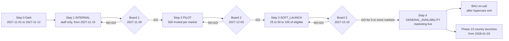
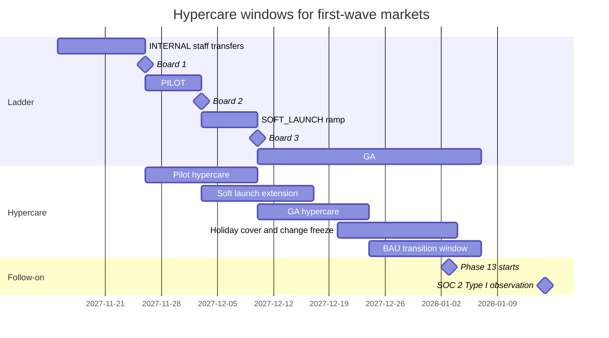

# BI-Rem — Master Go-Live Checklist

| Item                                                   | Value                                                                                                                                                                                                                                                                                                                                                                                      |
| ------------------------------------------------------ | ------------------------------------------------------------------------------------------------------------------------------------------------------------------------------------------------------------------------------------------------------------------------------------------------------------------------------------------------------------------------------------------ |
| Document                                               | `docs/07-go-live-checklist.md` — the single checklist the go/no-go board uses to approve each step of the launch ladder, aggregating every phase's production-readiness items                                                                                                                                                                                                              |
| Applies to                                             | Phase 12 launch ladder (`INTERNAL` → `PILOT` → `SOFT_LAUNCH` → `GENERAL_AVAILABILITY`) for `CM`, `SN`, `CI`, `KE`, `GH`, `NG` domestic and the cross-border waves; reused unchanged by every Phase 13 `country_launches` go-live (KE, GH, NG, UG, RW, TZ, ZA on cell `af1`)                                                                                                                |
| Key dates ([`schedule.json`](./roadmap/schedule.json)) | Phase 12 window **2027-11-01 → 2027-12-10**; `INTERNAL` from 2027-11-15; board #1 (PILOT) **2027-11-26**; board #2 (SOFT_LAUNCH) **2027-12-03**; board #3 (production rollout / GA) **2027-12-10**; Phase 13 window 2028-01-03 → 2028-06-30                                                                                                                                                |
| Target scale                                           | 1,000,000 users · 100,000 transfers/day · 50 providers · 20 countries · 99.9 % availability · RPO 15 min · RTO 60 min                                                                                                                                                                                                                                                                      |
| Owner                                                  | Program Manager (custodian); each item has a role owner who attaches the evidence                                                                                                                                                                                                                                                                                                          |
| System of record                                       | `go_live_gates` / `go_live_decisions` tables and the admin portal **Operations → Launch** board ([Phase 12 §3.11](./phases/phase-12-go-live.md#311-pilot--soft-launch-strategy-per-corridor)); this document is the human-readable index of those gates                                                                                                                                    |
| Related                                                | [Operational handbook](./08-operational-handbook.md) · [Milestone tracker](./02-milestone-tracker.md) · [Risk register](./06-risk-register.md) · [Dependency map](./03-dependency-map.md) · [Security baseline](./architecture/security-baseline.md) · [Monitoring framework](./architecture/monitoring-framework.md) · [Environment management](./architecture/environment-management.md) |

**How to read an item.** `- [ ] **ID** Item — Owner · Evidence · Origin`. _Owner_ is a role (names in the RACI of the [operational handbook](./08-operational-handbook.md#21-raci)). _Evidence_ is what must be attached to the `go_live_gates` row (a link to a CI run, Grafana snapshot, signed PDF, table export). _Origin_ is the phase that built the capability and owns its definition of done. _Stage_ shows the first ladder step at which the item is a **hard gate**: `INT` = before `INTERNAL`, `PIL` = before `PILOT`, `SL` = before `SOFT_LAUNCH`, `GA` = before `GENERAL_AVAILABILITY`. An item is ticked only when the evidence is filed and the owner has set the gate to `PASSED`; "done but not evidenced" is unticked.

---

## 1. Launch ladder and decision points

| Board                   | Date                                                                                | Decides                                                                                                 | Minimum checklist state                                                             | Rubric threshold (§13)                                     |
| ----------------------- | ----------------------------------------------------------------------------------- | ------------------------------------------------------------------------------------------------------- | ----------------------------------------------------------------------------------- | ---------------------------------------------------------- |
| Pre-board (PM + COO)    | 2027-11-12                                                                          | Enter `INTERNAL` on 2027-11-15                                                                          | All `INT` items PASSED                                                              | n/a (gate check only)                                      |
| **#1**                  | **2027-11-26**                                                                      | `PILOT` for `CM`, `SN`, `CI`, `KE`, `GH`, `NG` domestic and `CM→GA`, `GA→CM`                            | All `INT` + `PIL` items PASSED per market; zero Critical/High pentest findings open | ≥ 75 / 100 (conditional), ≥ 85 (GO); every hard gate green |
| **#2**                  | **2027-12-03**                                                                      | `SOFT_LAUNCH` per market with pilot exit green; wave B (`CM→AO`, `CM→MZ`, `CM→GW`) to `PILOT`           | All `SL` items PASSED; DR drill #2 and restore drill #2 PASSED                      | ≥ 85 / 100 (conditional), ≥ 90 (GO)                        |
| **#3**                  | **2027-12-10**                                                                      | Production rollout: `GENERAL_AVAILABILITY` for ≥ 3 markets; others stay `SOFT_LAUNCH` with dated review | All `GA` items PASSED; availability ≥ 99.9 % over trailing 30 days                  | ≥ 90 / 100 (conditional), ≥ 95 (GO)                        |
| Phase 13 country boards | per wave (M13.5 2028-03-10, M13.8 2028-04-21, M13.11 2028-06-02, M13.12 2028-06-16) | `LIVE` for a Phase 13 country on its cell                                                               | This checklist re-run per country (§12.13)                                          | ≥ 85 / 100 for FRIENDS_FAMILY, ≥ 90 for LIVE               |

A market that misses its exit criteria stays at its current step and is reviewed at the next board; one market's delay never blocks another ([R12.5](./06-risk-register.md)).

---

## 2. Governance & approvals

### 2.1 Board and programme governance

- [ ] **GOV-01** Go/no-go board charter signed (CEO, COO, CFO, MLRO, General Counsel), quorum = 4 of 5 including MLRO for any money-moving step — Program Manager · signed charter PDF · [P12](./phases/phase-12-go-live.md) · `INT`
- [ ] **GOV-02** `GO_LIVE_BOARD`, `OPS_ADMIN` and `INCIDENT_COMMANDER` roles assigned to named people; no person holds both requester and approver role for stage advances — Security Engineer · role export from admin portal · [P12](./phases/phase-12-go-live.md) · `INT`
- [ ] **GOV-03** Launch-freeze ruleset active (blocks `feat:` PRs, two reviewers, `change_ref` required for production promotion until `launch.freeze.until` = 2027-12-10T23:59:59Z) — DevOps/SRE · GitHub ruleset export + failed test PR · [P12](./phases/phase-12-go-live.md) · `INT`
- [ ] **GOV-04** Readiness pack generated from the Phase 10 `EXECUTIVE_PACK` variant for each board (gate states, SLO burn, incidents, recon, pilot KPIs) — Program Manager · pack PDF in `reports/board/` (Object Lock) · [P10](./phases/phase-10-reporting-bi.md), [P12](./phases/phase-12-go-live.md) · `PIL`
- [ ] **GOV-05** Every board decision recorded in `go_live_decisions` with votes, conditions, two approvers, readiness snapshot and `rollback_plan_url` — Program Manager · decision rows + signed minutes · [P12](./phases/phase-12-go-live.md) · `PIL`
- [ ] **GOV-06** Risk register reviewed at the board: no Critical-band risk without pre-approved contingency; R12.1–R12.16 statuses current — Program Manager · [risk register](./06-risk-register.md) diff · programme · `PIL`
- [ ] **GOV-07** Insurance bound before first PILOT: cyber liability, technology E&O, crime/fidelity (budget USD 25,000–80,000/yr) — CFO · binders · [P12](./phases/phase-12-go-live.md) · `PIL`
- [ ] **GOV-08** Phase exit reviews G1–G11 closed or open conditions dated ([milestone tracker](./02-milestone-tracker.md)) — Program Manager · gate log · all phases · `INT`

### 2.2 Regulators per market

Each market has a `go_live_gates` group `regulatory.<cc>`; `LaunchService.advance()` refuses any step past `INTERNAL` while one item is not `PASSED` ([Phase 12 §3.14](./phases/phase-12-go-live.md#314-regulatory-sign-offs)).

| Market          | Licence / operating model at launch                                                        | Central bank / supervisor | Data-protection registration                        | FIU reporting route                          | Gate key        |
| --------------- | ------------------------------------------------------------------------------------------ | ------------------------- | --------------------------------------------------- | -------------------------------------------- | --------------- |
| `CM` (anchor)   | Sponsor EMI / partner bank agreement; COBAC notification via partner; BEAC FX declarations | COBAC / BEAC              | National authority or counsel memo on applicability | goAML route via sponsor (counsel to confirm) | `regulatory.cm` |
| `GA` (corridor) | Payout via partner EMI (GIMAC member)                                                      | COBAC / BEAC              | Counsel memo                                        | Via partner                                  | `regulatory.ga` |
| `SN`            | BCEAO-licensed partner agreement + agent registration                                      | BCEAO                     | CDP                                                 | CENTIF via partner                           | `regulatory.sn` |
| `CI`            | BCEAO-licensed partner agreement + agent registration                                      | BCEAO                     | ARTCI                                               | CENTIF via partner                           | `regulatory.ci` |
| `KE`            | CBK PSP authorisation or partner umbrella                                                  | CBK                       | ODPC                                                | FRC (goAML)                                  | `regulatory.ke` |
| `GH`            | BoG PSP (Enhanced) licence or partner                                                      | BoG                       | DPC                                                 | FIC (goAML)                                  | `regulatory.gh` |
| `NG`            | CBN PSP category or partner umbrella (Phase 13 adds IMTO inbound model)                    | CBN                       | NDPC                                                | NFIU (goAML)                                 | `regulatory.ng` |

Per market, all of the following (one checkbox per market in the gate group):

- [ ] **GOV-10** Licence or partner-model confirmation on file (agreement executed, regulator notification sent where required) — Compliance Analyst + General Counsel · executed agreement, notification letter · [P6](./phases/phase-06-international.md), [P12](./phases/phase-12-go-live.md) · `PIL`
- [ ] **GOV-11** External counsel opinion per market covering licence basis, FX margin rights (Q7.2) and data residency of the EU-hosted stack incl. the London standby (Q12.5) — General Counsel · signed opinion · [P7](./phases/phase-07-fx-treasury.md), [P12](./phases/phase-12-go-live.md) · `PIL`
- [ ] **GOV-12** Data-protection registration filed (NDPC, ODPC, DPC, CDP, ARTCI, CEMAC national authorities) or counsel memo; DPIA and addenda from Phases 2, 4, 8, 10, 11 signed — Compliance Analyst · registration receipts, DPIA PDFs · [P2](./phases/phase-02-customer-kyc.md), [P8](./phases/phase-08-aml-compliance.md), [P11](./phases/phase-11-mobile.md) · `PIL`
- [ ] **GOV-13** Consumer-protection disclosures reviewed: pricing page, FX margin wording, receive-amount guarantee, complaint handling, cooling-off where required (en/fr/pt) — Compliance Analyst · counsel review note + screenshots · [P5](./phases/phase-05-domestic-transfers.md), [P6](./phases/phase-06-international.md), [P7](./phases/phase-07-fx-treasury.md) · `PIL`
- [ ] **GOV-14** MLRO attestation per market that AML programme, screening and STR route are operational (Phase 8 exit) — MLRO · signed attestation · [P8](./phases/phase-08-aml-compliance.md) · `PIL`
- [ ] **GOV-15** FIU registration complete (NG, KE, GH) with goAML test filing evidenced; supervised first production filing agreed — MLRO · FIU confirmation + test acknowledgement · [P8](./phases/phase-08-aml-compliance.md) · `PIL`
- [ ] **GOV-16** Regulator courtesy letters sent where customary; BEAC statistics layout confirmed with sponsor bank and first monthly file produced — Compliance Analyst · letters, BEAC file · [P6](./phases/phase-06-international.md), [P12](./phases/phase-12-go-live.md) · `PIL`

### 2.3 Partners

- [ ] **GOV-20** Wallet provider production access and agreements: MTN MoMo (GH, CI, CM), M-Pesa Daraja (KE), Airtel (UG/TZ for later), Orange Money (CI, SN, CM), Moov — production credentials in the Phase 3 vault, static egress IPs allow-listed — Head of Partnerships · signed agreements / access letters, allow-list confirmations · [P4](./phases/phase-04-wallet-connectors.md) · `PIL`
- [ ] **GOV-21** `ams` DR-region egress IPs allow-listed with every live provider and verified by a 1-unit probe from `ams` during DR drill #1 — DevOps/SRE · probe transfer ids · [P12](./phases/phase-12-go-live.md) · `SL`
- [ ] **GOV-22** Cross-border payout partners and sponsor bank: CEMAC sponsor bank signed (R6.1), payout routes for wave A live, wave B in FRIENDS_FAMILY or SANDBOX per partner readiness — Program Manager + Compliance · agreements, `corridors.status` export · [P6](./phases/phase-06-international.md) · `PIL`
- [ ] **GOV-23** Card top-up processors (Paystack, Flutterwave) PCI AoCs on file with expiry tracking — Compliance Analyst · AoC PDFs in `control_evidence` · [P12](./phases/phase-12-go-live.md) · `PIL`
- [ ] **GOV-24** Partner banks for treasury statements (two pilot banks GH/KE) delivering camt.053/MT940/CSV with ≥ 95 % auto-match — Treasury Ops Lead · statement import report · [P7](./phases/phase-07-fx-treasury.md) · `PIL`
- [ ] **GOV-25** Pilot merchants (3) and agents (5) plus 5 pilot partners with signed agreements, reconciliation contacts and settlement calendar — Head of Partnerships · agreements, calendar · [P5](./phases/phase-05-domestic-transfers.md), [P9](./phases/phase-09-partner-merchant.md) · `PIL`
- [ ] **GOV-26** Partner SLA notice, status page URL, escalation matrix and API terms distributed to partners — Head of Partnerships · comms log · [P9](./phases/phase-09-partner-merchant.md), [P12](./phases/phase-12-go-live.md) · `SL`
- [ ] **GOV-27** 24/7 partner escalation matrix (sponsor bank, payout partners, aggregators, FX vendors, KYC vendors) in the command centre — Head of Customer Operations · matrix document · [P6](./phases/phase-06-international.md), [P12](./phases/phase-12-go-live.md) · `PIL`

---

## 3. Security

- [ ] **SEC-01** External pentest complete (OWASP ASVS L2 API/portals, MASVS L2 + R mobile, PTES, cloud configuration review); retest letter shows **0 Critical / 0 High open** — Security Engineer · vendor retest letter, `security_findings` export · [P12](./phases/phase-12-go-live.md) · `PIL`
- [ ] **SEC-02** Medium findings owned with due date ≤ 2028-01-31; earlier phase pentests (P2, P3, P4, P5, P6, P7, P8, P9, P10, P11) High/Critical closed — Security Engineer · findings register · all phases · `PIL`
- [ ] **SEC-03** Security audit sign-off letter filed under gate `security.pentest.signoff` — Security Engineer · signed letter · [P12](./phases/phase-12-go-live.md) · `GA`
- [ ] **SEC-04** Phishing simulation of 40 admins: click rate < 10 % and zero credential submissions, or mandatory training completed — Security Engineer · simulation report · [P12](./phases/phase-12-go-live.md) · `PIL`
- [ ] **SEC-05** All production secrets generated fresh (`openssl rand`), none equal to staging/examples; rotation calendar entered for JWT, `ENCRYPTION_KEY`, DB roles, `FLY_API_TOKEN`, SMTP, Vercel, `FX_QUOTE_KEY`, `INTL_QUOTE_SIGNING_KEY`, `INTL_TRACKING_TOKEN_KEY`, OAuth ES256 keys, market data keys — DevOps/SRE · rotation calendar, `fly secrets list` digests · [P1](./phases/phase-01-foundation.md), [P6](./phases/phase-06-international.md), [P7](./phases/phase-07-fx-treasury.md), [P9](./phases/phase-09-partner-merchant.md) · `INT`
- [ ] **SEC-06** Pentest and load-test credentials disabled after use; staging secrets rotated before production — Security Engineer · access log · [P2](./phases/phase-02-customer-kyc.md), [P12](./phases/phase-12-go-live.md) · `PIL`
- [ ] **SEC-07** No provider credential in env (`envSchema` allow-list test TC3.01; `fly secrets list` shows platform secrets only); provider credentials envelope-encrypted under KMS — Backend Lead (platform) · CI run, secrets listing · [P3](./phases/phase-03-connectivity.md), [P4](./phases/phase-04-wallet-connectors.md) · `INT`
- [ ] **SEC-08** KMS key policies least-privilege (api/worker roles only), CloudTrail delivering, per-document DEKs for KYC, `AML_CASE_ENCRYPTION_KEY_ID` for SAR content — Security Engineer · key policy JSON, CloudTrail sample · [P2](./phases/phase-02-customer-kyc.md), [P3](./phases/phase-03-connectivity.md), [P8](./phases/phase-08-aml-compliance.md) · `PIL`
- [ ] **SEC-09** Cloudflare WAF managed + OWASP rules and rate limits (login 10/min/IP, OTP 5/min/IP, tracking 60/min/IP) in **block** mode after 48 h log mode with zero legitimate blocks from pilot-market mobile ASNs; Authenticated Origin Pulls on Fly and Vercel — DevOps/SRE · ruleset version, ASN analysis · [P12](./phases/phase-12-go-live.md) · `PIL`
- [ ] **SEC-10** Admin MFA enforced (`auth.mfa.enforce-admin=true`), step-up MFA on reversal/freeze/kill switches/beneficiary add, four-eyes on all money-affecting configuration (fees, limits, margins, manual journals, corridor activation, settlement runs) — Security Engineer · authz matrix test runs · [P1](./phases/phase-01-foundation.md), [P5](./phases/phase-05-domestic-transfers.md), [P6](./phases/phase-06-international.md), [P7](./phases/phase-07-fx-treasury.md), [P9](./phases/phase-09-partner-merchant.md) · `INT`
- [ ] **SEC-11** Tenant isolation fuzz suite and SSRF suites in `ci-ok`; semgrep tenancy, no-PAN, no-AML-content rules enforced — Security Engineer · CI history · [P9](./phases/phase-09-partner-merchant.md), [P10](./phases/phase-10-reporting-bi.md) · `PIL`
- [ ] **SEC-12** `security.yml` green on `main` (CodeQL, Trivy, gitleaks, dependency review, `pnpm audit` high+, weekly ZAP baseline with no High) — DevOps/SRE · workflow runs · [P1](./phases/phase-01-foundation.md), [P12](./phases/phase-12-go-live.md) · `INT`
- [ ] **SEC-13** Access reviews done for GitHub, Fly, Neon, AWS, Vercel, Cloudflare, Upstash, PagerDuty, Grafana, ClickHouse, EAS and admin portal roles; Phase 1–11 leavers removed — Security Engineer · review evidence in compliance platform · [P12](./phases/phase-12-go-live.md) · `PIL`
- [ ] **SEC-14** Backup AWS account locked down: Object Lock compliance 35 days, KMS CMK, OIDC `PutObject`-only role, break-glass users with hardware MFA + two approvers — DevOps/SRE · bucket policy, failed delete attempt · [P12](./phases/phase-12-go-live.md) · `PIL`
- [ ] **SEC-15** **SOC 2 readiness**: scope statement, ≈ 70 controls in `compliance_controls`, 14 approved policies, compliance platform ≥ 95 % automated tests passing, readiness assessment with no critical gap, Type I observation date 2028-01-15 contracted — Compliance Analyst · readiness report, platform export · [P12](./phases/phase-12-go-live.md) · `PIL`
- [ ] **SEC-16** **PCI readiness**: SAQ A (v4.0.1) + AoC signed by CFO; req. 6.4.3 / 11.6.1 evidenced on the funding page (CSP nonces, SRI, tamper detection); first ASV scan Pass on all 5 public hostnames; `pci-pan-scan` clean — Compliance Analyst + CFO · SAQ A, AoC, ASV certificate · [P12](./phases/phase-12-go-live.md) · `PIL`
- [ ] **SEC-17** Mobile security: pinning and RASP enforced with false-positive rate < 0.1 %; attestation chains validated; backup pin key held offline; EAS code signing and least-privilege store roles — Security Engineer + Mobile Lead · MASVS report, freeRASP dashboard · [P11](./phases/phase-11-mobile.md) · `PIL`
- [ ] **SEC-18** Admin portal noindex, Vercel Authentication on previews, CORS limited to portal domains, cookies `Secure` — Frontend Lead · header scan · [P1](./phases/phase-01-foundation.md) · `INT`

---

## 4. Reliability & DR

- [ ] **REL-01** Load campaign 1 on staging (M12.2): `steady-300rps` 1 h with p95 `POST /v1/transfers` ≤ 600 ms, quotes ≤ 250 ms, `wallets/me` ≤ 150 ms, error rate < 0.1 % — QA Lead · `load_test_runs` row, k6 summary · [P12](./phases/phase-12-go-live.md) · `INT`
- [ ] **REL-02** Load campaign 2 on production off-peak (01:00–05:00 WAT, COO-approved change request): 8 h soak memory growth < 10 %, stress breakpoint ≥ 1,200 rps with graceful 429/503, spike ×5, provider-degradation and month-end scenarios; zero ledger imbalance; synthetic rows purged within 24 h — Solution Architect · `load_test_runs`, ledger invariant report · [P12](./phases/phase-12-go-live.md) · `PIL`
- [ ] **REL-03** Capacity model published: Fly `cdg` min 3 / max 8 machines, `ams` min 1, Neon autoscaling 2–8 CU, PgBouncer 200 connections, Prisma pool 10, headroom alert at 60 % / scale review at 70 % of breakpoint — Solution Architect · `capacity-model.md` · [P12](./phases/phase-12-go-live.md) · `PIL`
- [ ] **REL-04** Earlier-phase performance gates evidenced on two consecutive nights: P4 100 TPS connector engine, P5 internal W2W p95 ≤ 3 s / external ≤ 20 s, P6 quote p95 < 150 ms / confirm < 400 ms, P7 quote p95 < 50 ms, P8 decision p95 < 150 ms, P9 partner read p95 < 150 ms / write < 400 ms, P10 dashboard p95 < 500 ms — QA Lead · k6 reports per phase · [P4](./phases/phase-04-wallet-connectors.md)–[P10](./phases/phase-10-reporting-bi.md) · `PIL`
- [ ] **REL-05** DR topology live: Fly `ams` warm, Neon `bi-rem-standby` (`aws-eu-west-2`) lag < 30 s over 24 h, Upstash global replica, Cloudflare LB pools `api-cdg` 100 / `api-ams` 0, S3 CRR, sequences synced every 5 min — DevOps/SRE · replication lag panel, Terraform state · [P12](./phases/phase-12-go-live.md) · `INT`
- [ ] **REL-06** **DR drill #1 (announced, M12.3)** recorded in `dr_drills`: RPO ≤ 15 min, RTO ≤ 60 min (target ≤ 35 min) measured from incident declaration to `/health/ready` green and first real transfer — DevOps/SRE · `dr_drills` row, timeline · [P12](./phases/phase-12-go-live.md) · `PIL`
- [ ] **REL-07** **DR drill #2 (unannounced, M12.5)** again within RPO/RTO; failback rehearsed; monthly `dr-test.yml` clone promotion green — DevOps/SRE · `dr_drills` row · [P12](./phases/phase-12-go-live.md) · `SL`
- [ ] **REL-08** Backups: nightly `backup.yml` (Object Lock 35 days, KMS, CRR, month-end 7-year retention); `backup-verify.yml` ≥ 4 consecutive PASS (schema checksum, row counts within 0.5 %, ledger invariants, sampled decrypt) — DevOps/SRE · `backup_verifications` export · [P1](./phases/phase-01-foundation.md), [P12](./phases/phase-12-go-live.md) · `PIL`
- [ ] **REL-09** Restore drill #1 (W2) and #2 (W5): database + S3 object samples + Redis AOF restored into an isolated environment; KYC document and receipt PDF recovered with SHA-256 match; Phase 1 e2e green on the restore — DevOps/SRE · drill log · [P12](./phases/phase-12-go-live.md) · `SL`
- [ ] **REL-10** Neon PITR 30 days on production; autosuspend disabled; `/health/ready` requires Redis in production — DevOps/SRE · Neon console screenshot · [P1](./phases/phase-01-foundation.md), [P5](./phases/phase-05-domestic-transfers.md), [P12](./phases/phase-12-go-live.md) · `INT`
- [ ] **REL-11** Chaos game days passed: worker kill at every saga step (P4/P5/P6), Redis flush with `wallet:recover`, provider timeouts, duplicate webhooks, ClickHouse outage → POSTGRES fallback (P10), KMS outage (P3) — zero inconsistent states — QA Lead · game-day reports · [P3](./phases/phase-03-connectivity.md)–[P10](./phases/phase-10-reporting-bi.md) · `PIL`
- [ ] **REL-12** Circuit breakers enforced 48 h on staging with zero false opens; per-provider concurrency/rate limits set from contracts — Backend Lead (platform) · breaker metrics · [P3](./phases/phase-03-connectivity.md), [P4](./phases/phase-04-wallet-connectors.md) · `INT`
- [ ] **REL-13** Drain gate in `deploy-api.yml` verified with in-flight cross-border transfers; rolling deploy verified twice — DevOps/SRE · workflow runs · [P1](./phases/phase-01-foundation.md), [P6](./phases/phase-06-international.md) · `INT`
- [ ] **REL-14** Availability ≥ 99.9 % since first pilot (board #2) and over the trailing 30 days (board #3), measured at Cloudflare and the API excluding synthetic tenants — DevOps/SRE · `GET /v1/ops/slo` export · [P12](./phases/phase-12-go-live.md) · `SL` / `GA`

---

## 5. Observability

The baseline signal map, Phase 1 SLOs and dashboards are in the [monitoring framework](./architecture/monitoring-framework.md); the full alert catalogue is in [handbook §8](./08-operational-handbook.md#8-monitoring--alert-catalogue).

- [ ] **OBS-01** Seven SLOs (`slo_*` recording rules) with burn-rate pairs (2 %/1 h page, 5 %/6 h ticket): API availability 99.9 %, transfer success 99.5 %, quote latency 99 % < 500 ms, domestic transfer 95 % < 60 s, push 97 % first attempt < 30 s, partner webhooks 99 % < 60 s, provider probes ≥ 99 % — DevOps/SRE · `slo.md`, rule export · [P12](./phases/phase-12-go-live.md) · `INT`
- [ ] **OBS-02** Error-budget policy signed by COO (freeze non-emergency rollouts below 25 % budget remaining) — COO · signed policy · [P12](./phases/phase-12-go-live.md) · `PIL`
- [ ] **OBS-03** Phase dashboards live: API Golden Signals, Auth, Queues & Outbox, Neon (P1); KYC Funnel, Provider Health, Queue & SLA, Document Pipeline (P2); Connectivity, Vault (P3); Wallet Engine, Connectors, Webhooks, Float (P4); Transfers and Ledger (P5); intl-overview, intl-fx, intl-nostro, intl-settlement-recon (P6); FX Rates, Treasury Liquidity, P&L and EOD (P7); six AML dashboards (P8); partner API/OAuth/webhooks/commissions/settlements (P9); Analytics pipelines, Reports (P10); Mobile (P11); SLO, Launch, Capacity, DR (P12) — DevOps/SRE · folder listing from `infra/grafana/` · all phases · `INT`
- [ ] **OBS-04** Every alert rule carries `runbook_url` resolving to a `runbooks` row; no alert without owner; false-positive rate < 5 % over W3–W6 — DevOps/SRE · `runbooks-sync.yml` run, alert review log · [P12](./phases/phase-12-go-live.md) · `PIL`
- [ ] **OBS-05** PagerDuty services `platform`, `payments`, `partner-api`, `mobile`, `compliance` plus `birem-treasury`, each 3-deep rotation with escalation to DevOps lead then CTO; on-call ack ≤ 15 min for 7 consecutive days before board #3 — DevOps/SRE · PagerDuty ack report · [P7](./phases/phase-07-fx-treasury.md), [P12](./phases/phase-12-go-live.md) · `INT` / `GA`
- [ ] **OBS-06** Synthetic probes from Lagos, Nairobi, Dakar, Paris every 60 s (login, quote, tracking, portals), p95 < 1.5 s from African vantage points; flaps need 2 of 4 vantage points — DevOps/SRE · probe dashboard · [P12](./phases/phase-12-go-live.md) · `PIL`
- [ ] **OBS-07** Sentry projects api/web/admin/mobile with release tagging (`GIT_SHA` / build id), source maps per store build and OTA; crash-free alert < 99.3 % — DevOps/SRE + Mobile Lead · Sentry config · [P1](./phases/phase-01-foundation.md), [P11](./phases/phase-11-mobile.md) · `INT`
- [ ] **OBS-08** Logs shipped (Fly → Loki, Cloudflare Logpush) with correlation id searchable; 30-day default retention, 400 days for `audit`/`auth` streams; redaction verified for PII, OTP, MSISDN, tokens, SAR content — DevOps/SRE · Loki query samples, redaction tests · [P1](./phases/phase-01-foundation.md), [P4](./phases/phase-04-wallet-connectors.md), [P8](./phases/phase-08-aml-compliance.md), [P12](./phases/phase-12-go-live.md) · `INT`
- [ ] **OBS-09** Command centre (Phase 10 Operational Dashboard + Phase 12 panels) shows SLO burn, active incidents, launch stage per market, DR state and the Kill Switch Panel; failed transfer visible within 30 s — COO · acceptance note, rehearsal evidence · [P10](./phases/phase-10-reporting-bi.md), [P12](./phases/phase-12-go-live.md) · `PIL`
- [ ] **OBS-10** `/metrics` restricted to the scraper; `/docs` disabled in production or behind `DOCS_ENABLED` — Backend Lead · curl evidence · [P1](./phases/phase-01-foundation.md) · `INT`
- [ ] **OBS-11** Cost alerts on Fly, Neon, Vercel, Upstash, ClickHouse Cloud, AWS (both accounts) — DevOps/SRE · alert config · [P1](./phases/phase-01-foundation.md), [P10](./phases/phase-10-reporting-bi.md) · `PIL`

---

## 6. Data

- [ ] **DAT-01** Every expand migration v1–v12 applied to staging and production with `prisma migrate diff` empty; `down.sql` stored; inherited contract migrations (P2/P4 in P5 W1, P6 in P9, P9 in P10) executed after named snapshots (`pre-phase5-contract`, `pre-phase9`) — Backend Lead · `db-migrate.yml` status summaries · [P1](./phases/phase-01-foundation.md)–[P12](./phases/phase-12-go-live.md) · `INT`
- [ ] **DAT-02** `20271101090000_phase12_expand` applied; standby created from the post-migration snapshot; `ops:backfill:gates` run (≈ 180 gates, ≈ 70 controls) idempotently — DevOps/SRE · migration log · [P12](./phases/phase-12-go-live.md) · `INT`
- [ ] **DAT-03** Migration rehearsal on a Neon branch of production for every pending contract with PITR rollback ≤ 60 min timed — DevOps/SRE · rehearsal log · [P5](./phases/phase-05-domestic-transfers.md), [P12](./phases/phase-12-go-live.md) · `INT`
- [ ] **DAT-04** Reference data seeded and approved: 57 permissions / 7 system roles + later role catalogues; `KycLevelPolicy` for SN, CI, NG, KE, GH; fee schedules GH/GHS, KE/KES and corridor schedules; purpose/source/relationship catalogue en/fr/pt; regulator profiles; country risk; watchlists; risk model v1 — Compliance Analyst + Backend Lead · seed run log, approval records · [P1](./phases/phase-01-foundation.md), [P2](./phases/phase-02-customer-kyc.md), [P5](./phases/phase-05-domestic-transfers.md), [P6](./phases/phase-06-international.md), [P8](./phases/phase-08-aml-compliance.md) · `INT`
- [ ] **DAT-05** Production seeded with `SEED_SKIP_DEMO_USERS=true`; seed admin password changed; flag keys reconciled between `@bi-rem/shared` and seed (T1.14) — Backend Lead · seed log, flag diff · [P1](./phases/phase-01-foundation.md) · `INT`
- [ ] **DAT-06** Backfills verified: profiles = CUSTOMER users, MFA devices, `beneficiaries.provider_id` 100 % for MOBILE_MONEY, `transfers.corridor_id` NULL count zero, `settlement_accounts` = `provider_accounts`, partners from P5 merchants/agents, `refresh_tokens.device_id` for mobile — Backend Lead · verification queries · [P2](./phases/phase-02-customer-kyc.md), [P4](./phases/phase-04-wallet-connectors.md), [P6](./phases/phase-06-international.md), [P7](./phases/phase-07-fx-treasury.md), [P9](./phases/phase-09-partner-merchant.md) · `INT`
- [ ] **DAT-07** Opening float journals posted (four-eyes by finance) and trial balance zero per currency at launch — Finance Lead · trial balance report · [P5](./phases/phase-05-domestic-transfers.md) · `PIL`
- [ ] **DAT-08** Partitions exist current month + 3 for every partitioned table (`webhook_deliveries`, `connection_health_results`, `wallet_transaction_events`, `ledger_entries`, `transfer_events`, `fx_rates`, `transfer_tracking_events`, `fx_rate_ticks`, `liquidity_positions`, AML tables, `settlement_run_lines`, `partner_webhook_events`); nightly job verified — DevOps/SRE · `pg_partman`/job output · [P3](./phases/phase-03-connectivity.md)–[P9](./phases/phase-09-partner-merchant.md) · `INT`
- [ ] **DAT-09** Append-only grants verified: `birem_app` cannot UPDATE/DELETE `audit_logs`, ledger tables, event tables, `commission_accruals`, `settlement_run_lines`, partner webhook tables — Security Engineer · migration test output · [P1](./phases/phase-01-foundation.md), [P4](./phases/phase-04-wallet-connectors.md), [P5](./phases/phase-05-domestic-transfers.md), [P9](./phases/phase-09-partner-merchant.md) · `INT`
- [ ] **DAT-10** Retention schedule active and dry-run reviewed: refresh tokens 30 d post-expiry, outbox PUBLISHED 30 d, notification payload 90 d / rows 13 m, provider raw payloads 90 d, OTP 24 h, webhook raw bodies 30 d, limit counters 13 m, transfer PII nulling 5 y, audit 7 y, AML/SAR 10 y with legal hold — Compliance Analyst · `retention_runs` dry-run report · [P1](./phases/phase-01-foundation.md), [P2](./phases/phase-02-customer-kyc.md), [P5](./phases/phase-05-domestic-transfers.md), [P8](./phases/phase-08-aml-compliance.md) · `PIL`
- [ ] **DAT-11** Object Lock verified by failed delete attempts on `bi-rem-settlement-<env>` (7 y), `compliance/` (10 y), receipts (7 y), `reports/board/` (10 y), backups (35 d) — DevOps/SRE · delete attempt logs · [P5](./phases/phase-05-domestic-transfers.md), [P6](./phases/phase-06-international.md), [P8](./phases/phase-08-aml-compliance.md), [P10](./phases/phase-10-reporting-bi.md), [P12](./phases/phase-12-go-live.md) · `PIL`
- [ ] **DAT-12** Warehouse hygiene: publication column lists exclude PII (`publication-pii-guard`), synthetic tenants excluded via `is_synthetic`, tie-out green 7 consecutive days, `kpi_daily` complete since 2027-04-19 — Backend Lead (platform) · tie-out runs · [P10](./phases/phase-10-reporting-bi.md), [P12](./phases/phase-12-go-live.md) · `PIL`
- [ ] **DAT-13** Perf branch `perf-20271101` pseudonymised and deleted at M12.4; `verify-*` branches deleted — DevOps/SRE · Neon branch list · [P12](./phases/phase-12-go-live.md) · `PIL`

---

## 7. Compliance

- [ ] **CMP-01** AML real-time engine enforced (`aml.realtime.enforce` 100 %) with 5 consecutive days of 100 % transfers carrying a decision row and p95 < 150 ms — MLRO · decision coverage report · [P8](./phases/phase-08-aml-compliance.md) · `PIL`
- [ ] **CMP-02** Rules catalogue, thresholds and typology rationale approved by MLRO; shadow FPR per active rule ≤ target; alert volume ≤ 60/analyst/day — MLRO · approval record, FPR report · [P8](./phases/phase-08-aml-compliance.md) · `PIL`
- [ ] **CMP-03** Screening lists fresh: active watchlist versions for OFAC SDN, OFAC Consolidated, UN, EU FSF, UK OFSI, PEP (OpenSanctions) each < 24 h old; `WatchlistStale` alert armed; delta re-screening tested — Compliance Analyst · `watchlist_versions` export · [P8](./phases/phase-08-aml-compliance.md) · `INT`
- [ ] **CMP-04** Sanctions blocking live: planted `TEST_` list name produces POTENTIAL_MATCH, HOLD within budget and block on confirmation; zero CONFIRMED_MATCH transfers completed — MLRO · rehearsal record · [P8](./phases/phase-08-aml-compliance.md) · `PIL`
- [ ] **CMP-05** 100 % of customers, beneficiaries and partners/UBOs screened; initial production sweep complete — Compliance Analyst · screening coverage query · [P8](./phases/phase-08-aml-compliance.md), [P9](./phases/phase-09-partner-merchant.md) · `PIL`
- [ ] **CMP-06** SAR/STR workflow tested end to end: case → MLRO approval → XSD-valid goAML XML (NG, KE, GH) → FIU test submission or counsel-reviewed artefact → acknowledgement; deadline alarms at 50 %/90 % — MLRO · submission record · [P8](./phases/phase-08-aml-compliance.md) · `PIL`
- [ ] **CMP-07** MLRO and deputy named; no user holds both `compliance_analyst` and `mlro`; SAR content readable only by MLRO and assigned officer (every read audited) — MLRO + Security · role export, authz test · [P8](./phases/phase-08-aml-compliance.md) · `INT`
- [ ] **CMP-08** Record keeping: retention policies 10 y for AML, 7 y audit/settlement, legal hold blocks retention and anonymisation; regulator export pack reproduces a case with hashes — Compliance Analyst · export pack, legal-hold test · [P8](./phases/phase-08-aml-compliance.md), [P10](./phases/phase-10-reporting-bi.md) · `PIL`
- [ ] **CMP-09** Travel rule: cross-border transfers above threshold carry COMPLETE payloads to accepting partners; incomplete held with `TRAVEL_RULE_INCOMPLETE` — Compliance Analyst · sample transfers · [P8](./phases/phase-08-aml-compliance.md) · `PIL`
- [ ] **CMP-10** Tipping-off review of customer, push and portal templates signed; support sees `UNDER_REVIEW` only — MLRO · review sign-off · [P8](./phases/phase-08-aml-compliance.md), [P11](./phases/phase-11-mobile.md) · `PIL`
- [ ] **CMP-11** KYC: tiered policies per country approved; DPAs signed with Smile ID, Sumsub, Veriff, SMS gateway, object-storage vendor; biometric consent gate verified; four-eyes on HIGH risk — Compliance Analyst · policy versions, DPAs · [P2](./phases/phase-02-customer-kyc.md) · `INT`
- [ ] **CMP-12** KYB matrix, UBO thresholds (KE 10 %, others 25 %) and agent controls matrix approved; WHT/VAT treatment confirmed by tax advisor — Compliance Analyst · approvals · [P9](./phases/phase-09-partner-merchant.md) · `PIL`
- [ ] **CMP-13** Regulatory reporting: BEAC declaration + statistics, BNA, BM generators validated; three Phase 10 regulatory return templates CONFIRMED or TO_CONFIRM with owner — Compliance Analyst · sample files · [P6](./phases/phase-06-international.md), [P10](./phases/phase-10-reporting-bi.md) · `PIL`
- [ ] **CMP-14** Phase 5 interim velocity guardrails replaced by Phase 8 DSL rules with signed equivalence report — MLRO · equivalence report · [P5](./phases/phase-05-domestic-transfers.md), [P8](./phases/phase-08-aml-compliance.md) · `PIL`

---

## 8. Operations

- [ ] **OPS-01** ≥ 30 runbooks in `docs/runbooks/` on the standard template, each exercised once in W2–W5 (`last_tested_at` set) and synced into the admin portal; index in [handbook §7](./08-operational-handbook.md#7-runbook-index) — DevOps/SRE · `runbooks` table export · [P12](./phases/phase-12-go-live.md) · `INT`
- [ ] **OPS-02** Incident-management handbook adopted (SEV1–SEV4 = P1–P4, roles, 15/30/60-minute cadence, regulator clock 72 h default / 24 h where NDPA or CBK require); three tabletops run (provider outage at peak, Neon regional failure, credential leak) — Program Manager · tabletop minutes · [P12](./phases/phase-12-go-live.md) · `PIL`
- [ ] **OPS-03** Support desk ready: Head of Customer Operations UAT signed; support macros for pending funding, failed send with refund, HELD, OTP lockout, limit exceeded, quote expiry, tracking, biometrics, lost device; agents trained in en/fr/pt; support never asks for PAN/OTP — Head of Customer Operations · training log, macro library · [P5](./phases/phase-05-domestic-transfers.md), [P6](./phases/phase-06-international.md), [P11](./phases/phase-11-mobile.md) · `PIL`
- [ ] **OPS-04** Escalation matrix: support tier 1 → payments ops → on-call engineer → incident commander; compliance escalation contact; finance-ops break triage contact; treasury on-call; vendor escalation paths with 24/7 numbers — Head of Customer Operations · matrix ([handbook §2.3](./08-operational-handbook.md#23-on-call-rota-and-escalation)) · [P2](./phases/phase-02-customer-kyc.md), [P5](./phases/phase-05-domestic-transfers.md), [P12](./phases/phase-12-go-live.md) · `PIL`
- [ ] **OPS-05** Hypercare roster signed covering 06:00–24:00 WAT in three shifts (command-centre lead, payments on-call, compliance on-call, support lead, partner liaison), max 4 shifts/week per person — Program Manager + COO · roster · [P12](./phases/phase-12-go-live.md) · `PIL`
- [ ] **OPS-06** Comms plan executed per ladder step: internal all-hands, Slack `#launch`, pilot invitations `launch.pilot.invite`, `launch.soft.welcome`, `launch.ga.announce` (e-mail/SMS/push, en/fr/pt), help-centre articles, crisis templates pre-approved by counsel in `incident_comms_templates`; press embargo until GA in ≥ 3 markets — Head of Customer Operations · comms log, template approvals · [P12](./phases/phase-12-go-live.md) · `PIL`
- [ ] **OPS-07** Public status page `status.bi-rem.africa` live with components mirrored from provider health, localized updates, partner webhook — DevOps/SRE · status page URL, component list · [P12](./phases/phase-12-go-live.md) · `SL`
- [ ] **OPS-08** BCP: `bcp.md` plus seven functional appendices approved; executive tabletop with ≥ 5 actions; manual payout procedure and partner hotline matrix in command centre; key-person matrix with deputies; on-call depth ≥ 3 — COO · BCP approval, tabletop minutes · [P12](./phases/phase-12-go-live.md) · `PIL`
- [ ] **OPS-09** Treasury ops, finance ops and support trained on admin consoles (transaction explorer, DLQ, saga inspector, corridor/FX/nostro consoles, recon breaks, settlement day) — Treasury Ops Lead + Finance Lead · training checklist · [P4](./phases/phase-04-wallet-connectors.md)–[P9](./phases/phase-09-partner-merchant.md) · `PIL`
- [ ] **OPS-10** Kill switches exercised in production in a maintenance window with two-person confirmation: `platform.maintenance-mode`, `ledger.postings.frozen`, `wallet.engine.enabled`, corridor `PAUSED`, FX freeze, `connectivity.webhooks.ingress.enabled`, `aml.realtime.enforce` — Incident Commander · audit log entries · [P1](./phases/phase-01-foundation.md)–[P12](./phases/phase-12-go-live.md) · `PIL`
- [ ] **OPS-11** Scheduled reporting live: CFO weekly pack Monday 07:00 Africa/Nairobi, treasury daily 06:30 Africa/Lagos, daily launch report 08:00 WAT — Program Manager · `report_deliveries` · [P10](./phases/phase-10-reporting-bi.md), [P12](./phases/phase-12-go-live.md) · `PIL`

---

## 9. Business

- [ ] **BUS-01** Fee schedules for each launch market/corridor reviewed by finance and compliance and activated through four-eyes (E-Levy GH, excise KE, statutory tax lines on receipts) with simulation evidence — Finance Lead · schedule versions, golden fixtures · [P5](./phases/phase-05-domestic-transfers.md), [P6](./phases/phase-06-international.md) · `PIL`
- [ ] **BUS-02** FX configured: default margin schedule approved by finance lead through the portal (not seeded active); RETAIL/STAFF/PARTNER segments; pegged pairs XAF/XOF; zero below-cost conversions; publication p95 < 60 s — Treasury Ops Lead · margin approval, `fx_conversions` check · [P7](./phases/phase-07-fx-treasury.md) · `PIL`
- [ ] **BUS-03** Hedging policy and open-position limits approved; LP counterparty limits and dealing procedure signed — CFO · policy PDF · [P7](./phases/phase-07-fx-treasury.md) · `SL`
- [ ] **BUS-04** Limits per KYC tier per country seeded as policy versions; pilot caps (50 % of Phase 5 limit per transfer, daily user cap, daily market cap from nostro coverage) configured in `corridor_rollout_stages` — Compliance Analyst + Treasury · caps export · [P2](./phases/phase-02-customer-kyc.md), [P5](./phases/phase-05-domestic-transfers.md), [P12](./phases/phase-12-go-live.md) · `PIL`
- [ ] **BUS-05** Float and nostro funding: launch float ≥ 3× expected daily external volume per provider; nostro pre-funding across XAF, XOF and corridor currencies within USD 50,000–150,000 returnable capital; low-float thresholds set — Treasury Ops Lead · `provider_balance_snapshots`, nostro balances · [P4](./phases/phase-04-wallet-connectors.md), [P5](./phases/phase-05-domestic-transfers.md), [P6](./phases/phase-06-international.md) · `PIL`
- [ ] **BUS-06** T&Cs, privacy notice, partner terms, API terms, agent agreements published per market in en/fr/pt; consent text and version captured at registration — General Counsel · published URLs, consent version · [P1](./phases/phase-01-foundation.md), [P2](./phases/phase-02-customer-kyc.md), [P9](./phases/phase-09-partner-merchant.md) · `PIL`
- [ ] **BUS-07** Pricing published: pricing page per market showing fee, FX margin disclosure, receive amount and recipient-side fee notes; total-cost KPI tracked against the 3 % target — Product (via PM) · pricing page, KPI tile · [P6](./phases/phase-06-international.md), [P7](./phases/phase-07-fx-treasury.md) · `SL`
- [ ] **BUS-08** Pilot cohort selected: ≤ 500 invited customers per market from the Phase 2 waiting list with LEVEL_2 KYC (`cohort pilot-<cc>`); pilot exit per market ≥ 300 transfers, success ≥ 98.5 %, recon clean 5 days, ≤ 1 P2, CSAT ≥ 4.2/5 — Program Manager · cohort export, exit dashboard · [P12](./phases/phase-12-go-live.md) · `PIL`
- [ ] **BUS-09** Commission plans approved (maker-checker) and `commissions.engine.v2` at 100 %; first settlement cycle paid and reconciled — Finance Lead · plan approvals, settlement run · [P9](./phases/phase-09-partner-merchant.md) · `SL`
- [ ] **BUS-10** KPI definition sheet signed (CFO, COO, head of treasury, MLRO); 20 KPIs certified; Q3-2027 board pack signed — CFO · `metric_catalog` certification rows · [P10](./phases/phase-10-reporting-bi.md) · `PIL`

---

## 10. Mobile

- [ ] **MOB-01** App Store: iOS build released (phased) in GH, KE, NG, SN, CI, CM and diaspora storefronts (FR, US, UK); `mobile_app_releases` row `status=RELEASED` — Mobile Lead · App Store Connect status · [P11](./phases/phase-11-mobile.md) · `PIL`
- [ ] **MOB-02** Google Play: AAB approved under Financial Features declaration, staged rollout to 100 % in pilot countries, policy status Compliant — Mobile Lead · Play Console status · [P11](./phases/phase-11-mobile.md) · `PIL`
- [ ] **MOB-03** Data Safety, App Privacy labels, Privacy Manifest and licence documents per country accepted; store-account recovery (two officers, 2FA, recovery codes) calendared — Mobile Lead + Compliance · store screenshots · [P11](./phases/phase-11-mobile.md) · `PIL`
- [ ] **MOB-04** Force-update (soft/hard `mobile.min-version.*`), staged-rollout halt, iOS phased pause and OTA republish drills timed (OTA restores 95 % of staff devices within 10 min) — Mobile Lead · drill log · [P11](./phases/phase-11-mobile.md), [P12](./phases/phase-12-go-live.md) · `PIL`
- [ ] **MOB-05** Release health: crash-free ≥ 99.5 % over 72 h, ANR < 0.3 %, push first-attempt ≥ 97 %, push-before-SMS ≥ 95 % with 60 s SMS fallback — Mobile Lead · Sentry/Play vitals · [P11](./phases/phase-11-mobile.md) · `SL`
- [ ] **MOB-06** No store binary release planned during hypercare; copy fixes by OTA under ADR-0035 only with two approvals — Mobile Lead · release calendar · [P11](./phases/phase-11-mobile.md), [P12](./phases/phase-12-go-live.md) · `PIL`

---

## 11. Rollback & hypercare plan

- [ ] **RBK-01** Rollback plans for flags, launch stage (`LaunchService.rollback()`), API image (`flyctl deploy --image <previous digest>`), portals (Vercel promote), mobile, database (forward-fix; `down.sql` only after PITR branch), DR failback and Cloudflare rulesets rehearsed in staging with timings recorded — DevOps/SRE · `dr_drills` rows `type=GAME_DAY` · [P12](./phases/phase-12-go-live.md) · `INT`
- [ ] **RBK-02** Every board decision references its rollback plan URL — Program Manager · `go_live_decisions.rollback_plan_url` · [P12](./phases/phase-12-go-live.md) · `PIL`
- [ ] **RBK-03** Halt-recommendation watch metrics armed (breach for 15 min posts to `#launch`): transfer success < 98.5 % per market, availability burn > 2 %/h, recon unexplained breaks > 0, provider failures > 5 %/5 min, `outbox_pending_total` > 1,000, support contacts > 3 per 100 transfers, CSAT < 4.0, crash-free < 99.3 % — DevOps/SRE · alert rules · [P12](./phases/phase-12-go-live.md) · `PIL`
- [ ] **RBK-04** Hypercare handbook adopted: 14-day window per market from `PILOT`, extended at `SOFT_LAUNCH`, restarted at GA; P1 ack 5 min / update 15 min, P2 ack 15 min — Program Manager · `hypercare.md` · [P12](./phases/phase-12-go-live.md) · `PIL`
- [ ] **RBK-05** Hypercare exit criteria per market (7 consecutive days zero P1/P2, ≤ 2 P3/day trending down, SLO budgets > 50 %, support backlog < 24 h, recon green) evaluated by PM and approved by COO; BAU transition recorded as a `go_live_gates` item — COO · exit gate rows · [P12](./phases/phase-12-go-live.md) · `GA`
- [ ] **RBK-06** Holiday cover after GA: on-call and command-centre roster for 2027-12-20 → 2028-01-03 with depth ≥ 3; change freeze recommended for the same window (emergency changes only) — Program Manager · roster · [P12](./phases/phase-12-go-live.md) · `GA`
- [ ] **RBK-07** Phase 13 handover accepted: hypercare learnings, open Medium findings, capacity model and runbooks handed to the Phase 13 lead — Program Manager · handover note · [P12](./phases/phase-12-go-live.md), [P13](./phases/phase-13-pan-african-expansion.md) · `GA`

---

## 12. Per-phase readiness mini-checklists

Aggregated from each phase plan's **§11 Production Readiness Checklist**. These are confirmed at the phase's own exit gate; the go/no-go board re-checks that each is still true at launch (configurations drift). Ticked here means "verified again in the 2 weeks before board #1".

### 12.1 Phase 1 — Foundation ([plan](./phases/phase-01-foundation.md))

- [ ] Dashboards: API golden signals, auth funnel, queue & outbox, Neon
- [ ] Alerts: readiness failing > 2 min; 5xx > 1 %/5 min; p95 > 500 ms/10 min; outbox PENDING > 5 min; notifications FAILED > 20/h; audit write errors > 0; Neon connections > 80 %; Fly restarts > 3/h
- [ ] Sentry api/web/admin with `GIT_SHA` release tagging; logs shipped with 30-day retention and searchable correlation id
- [ ] `/metrics` scraper-only; `/docs` gated by `DOCS_ENABLED`; ≥ 2 machines per Fly app, `auto_stop_machines = off`, Neon autosuspend off; Redis required for readiness
- [ ] Rolling deploy verified twice; rollback drill T1.11; k6 thresholds; pool sized `maxConnections ≤ pooler limit / machines`
- [ ] Weekly `db-backup.sh`, PITR window confirmed, restore drill logged; secrets fresh and rotation calendar entered
- [ ] Branch protection, required checks, Environment reviewers, CODEOWNERS on `infra/`, `.github/`, `packages/db/prisma`; CodeQL, gitleaks, dependency review, Trivy green, ZAP no High
- [ ] Admin noindex, MFA for ADMIN realm, seed admin password changed; CORS two portal domains; `AUTH_COOKIE_SECURE=true`; `audit_logs` no UPDATE/DELETE for runtime role
- [ ] Seed without demo users (57 permissions, 7 system roles); retention crons on; flag keys reconciled (T1.14); audit 7-year retention, consent text/version, privacy notice, residency position R1.9 recorded
- [ ] Runbooks (deploy, rollback, rotate secrets, lock/unlock, reset MFA, on-call, Neon branch restore); cost alerts on Fly, Neon, Vercel, Upstash

### 12.2 Phase 2 — Customer Management & KYC ([plan](./phases/phase-02-customer-kyc.md))

- [ ] KYC metrics and dashboards (KYC Funnel, Provider Health, Queue & SLA, Document Pipeline, Auth & MFA)
- [ ] Alerts: provider errors > 10 %/5 min (page); queue oldest > SLA (ticket) / > 2× SLA (page); signature failures > 10/min (page); ClamAV down; doc-scan lag > 5 min; auto-approve anomaly; OTP failure spike; reviewer previews > 50/day
- [ ] Logs carry correlationId/applicationId/providerKey with PII redaction tested; worker ≥ 2 and http ≥ 2 machines; circuit breakers and fallback routing exercised in game day
- [ ] Webhook idempotency, replay endpoint, 15-minute polling fallback; buckets versioned, Object Lock, public access blocked, presign TTLs verified
- [ ] k6 §9.5 met twice; pen-test High/Critical closed; `auth.mfa.enforce-admin=true`; KMS key usage logging; CSP/SRI for provider SDKs; `ID_HASH_KEY`/`OTP_PEPPER` distinct from `ENCRYPTION_KEY`
- [ ] Expand migrations applied, contract scheduled in Phase 5 with snapshot, backfill verified; `KycLevelPolicy` for SN, CI, NG, KE, GH approved
- [ ] Retention jobs dry-run reviewed; PITR verified; orphan-object reconciliation clean; DPIA approved; DPAs signed (Smile ID, Sumsub, Veriff, SMS, storage)
- [ ] Consent texts en/fr/pt; reason codes approved; four-eyes verified; regulator record request simulated
- [ ] Runbooks: provider outage/failover, ClamAV outage, webhook backlog, stuck application, reviewer MFA reset, erasure, key rotation, flag emergency off, queue SLA breach; compliance escalation on rota

### 12.3 Phase 3 — Connectivity ([plan](./phases/phase-03-connectivity.md))

- [ ] Connectivity and Vault dashboards live
- [ ] Alerts: connection DOWN > 2 min (page in PRODUCTION); vault decrypt errors > 0/5 min (page); KMS p95 > 500 ms; ingress rejections > 5/min per endpoint; DLQ > 0 for 10 min (page); certificate < 7 days (page); retiring credential > 48 h
- [ ] Logs carry providerKey/connectionId/environment and no secret material (scrub test); worker and http groups 2 machines each
- [ ] Breakers enforced 48 h on staging with zero false opens; ingress ack p95 < 200 ms at 300 rps; chaos game day closed
- [ ] Partitions three months ahead; retention observed; KMS policies and IAM least privilege; CloudTrail delivering
- [ ] No plaintext secret reachable via API (TC3.04); four-eyes on production changes, self-approval blocked; SSRF/replay/timing suites, ZAP, semgrep, gitleaks green
- [ ] Env secrets imported with fingerprint report archived; env-fallback removed; backup/restore drill includes `provider_credentials` and KMS access from restore target
- [ ] Runbooks (onboarding, rotation, emergency revoke, certificate renewal, KMS outage, ingress flood, breaker stuck open, re-wrap, contract rollback); provider allow-listing handbook with static egress IPs

### 12.4 Phase 4 — Wallet Connector Engine ([plan](./phases/phase-04-wallet-connectors.md))

- [ ] Wallet Engine, Connectors, Webhooks, Float dashboards; alerts DLQ > 25, UNKNOWN > 2 %/15 min, provider errors > 20 %/5 min, circuit open > 10 min, webhook signature failures > 50/5 min, oldest pending job > 15 min, float below threshold, workers < 2, Redis memory > 70 %
- [ ] Redaction for msisdn, accountName, Authorization, Ocp-Apim-Subscription-Key, SecurityCredential; correlation id API → job → adapter → webhook
- [ ] Chaos report (worker kill, Redis flush, timeouts, duplicate webhooks) zero inconsistent states; `wallet:recover` tested
- [ ] Per-provider concurrency/rate limits from contracts; worker group across two Fly regions; k6 met two nights; pen-test closed
- [ ] Webhook verification per provider (HMAC, IP allow-lists, random slugs, confirmation lookups for unsigned callbacks)
- [ ] Production credentials only in Phase 3 vault with rotation owners; static egress IPs allow-listed with Safaricom, MTN OpCos, Airtel
- [ ] `TREASURY_OPS` role reviewed; four-eyes threshold; step-up MFA on reverse/resolve; simulator absent from production; `sandbox=true && live=true` rejected; SSRF guard on provider base URLs
- [ ] Partitions current + 3; event tables append-only; `beneficiaries.provider_id` backfill 100 %; retention jobs ≥ 1 week in staging; wallet table restore drill
- [ ] Compliance sign-off; 10-year record keeping; DPIA addendum for counterparty data; partner agreements or production access letters on file
- [ ] Runbooks (provider outage, UNKNOWN resolution, DLQ replay, secret rotation, low float, engine pause, Redis loss, add connector, Daraja credential rotation); treasury ops trained

### 12.5 Phase 5 — Domestic Transfers ([plan](./phases/phase-05-domestic-transfers.md))

- [ ] Transfers and Ledger dashboard (trial-balance delta must be 0, float vs ledger delta); metrics `birem_transfers_total`, `birem_saga_held_total`, `birem_ledger_unbalanced_total`, `birem_recon_breaks_open`
- [ ] Alerts: LedgerUnbalanced (page), ReconBreakOpen, TransfersSLOBreach (page), SagaHeldHigh, SagaQueueBacklog, StuckTransfers, PartitionMissing, ReceiptRenderFailures
- [ ] Logs carry transferId/journalId/sagaStep; OTP, MSISDN, narration redacted; worker group 3 machines, `max_unavailable=0.33`, saga lock lease 60 s
- [ ] Chaos harness green 3 nights; k6 passed; Redis `noeviction`; limit counter rebuild from Postgres tested; partitions through 2027-07 and job scheduled
- [ ] Runbooks: HELD resolution, break investigation, ledger freeze/unfreeze, projection rebuild, corridor hold/ramp, fee rollback, OTP lockout
- [ ] `birem_app` cannot UPDATE/DELETE ledger tables; four-eyes on manual journals, fee activation, limit overrides; step-up MFA thresholds per currency
- [ ] Contracts executed after `pre-phase5-contract` snapshot; wallets backfilled; opening float journals approved; trial balance zero
- [ ] GH/KE fee schedules signed off (E-Levy, excise); receipt template statutory labels en/fr/pt; interim AML position accepted; fee disclosure and terms updated
- [ ] Finance-ops contact on rota; support macros; pilot merchants/agents onboarded; `flag-ramp.yml` auto-hold verified

### 12.6 Phase 6 — International Remittance ([plan](./phases/phase-06-international.md))

- [ ] Dashboards intl-overview, intl-fx, intl-nostro, intl-settlement-recon; alerts rate stale, freeze > 30 min, liquidity low, held over SLA, SFTP delivery failed, recon match < 99 %, quote errors > 1 %, saga DLQ > 0
- [ ] OTEL traces quote → confirm → saga → leg with trackingRef; k6 two-night rule; chaos suite; `intl:saga` autoscaling
- [ ] Drain gate in `deploy-api.yml`; DLQ replay tested; reservation and quote expiry sweepers; partition maintenance; vendor and SFTP outage game day
- [ ] Pen-test closed; `INTL_QUOTE_SIGNING_KEY` / `INTL_TRACKING_TOKEN_KEY` per environment; SFTP keys with host-key pins; four-eyes on corridor activation, manual rate, pre-funding, refunds and breaks above threshold
- [ ] Settlement bucket Object Lock verified by overwrite attempt; `transfers.corridor_id` NULL count zero; backup drill includes settlement bucket
- [ ] Licensing matrix reviewed; licence evidence on every FRIENDS_FAMILY/LIVE corridor; BEAC layouts confirmed and first file produced
- [ ] Purpose/source/relationship catalogue approved en/fr/pt; rate/margin/fee/receive-amount wording verified on web and receipts
- [ ] `docs/runbooks/intl-*.md` rehearsed; 24/7 partner escalation matrix; PagerDuty intl service

### 12.7 Phase 7 — FX & Treasury ([plan](./phases/phase-07-fx-treasury.md))

- [ ] FX Rates, Treasury Liquidity, P&L and EOD dashboards; alerts publication age > maxAgeSeconds (page), composition degraded 15 min, below-cost quotes > 0 (page), threshold CRITICAL, forecast shortfall < 12 h, SETTLING past value date + 1 BD, statement missing past cutoff + 2 h, EOD FAILED, open position > limit
- [ ] Dedicated `worker-fx` group; Redis publication cache fallback to Postgres; exactly one ACTIVE publication per pair/segment after worker kill
- [ ] Partition jobs for ticks and positions; replica lag < 5 s with degrade-to-primary; maker-checker server-side; RBAC separation (no write + approve except SUPER_ADMIN)
- [ ] `FX_QUOTE_KEY` rotated with key versioning; settlement account identifiers KMS-encrypted; instruction PDFs on 10-min signed URLs; pen-test closed
- [ ] Backfills: settlement accounts, chart-of-accounts additions, 90 days historical mids, `transfer_profitability`
- [ ] Default margin schedule approved via portal; counsel confirmation per corridor (Q7.2); margin disclosure approved; hedging policy and limits approved
- [ ] Treasury on-call in PagerDuty `birem-treasury`; bank cut-offs, holiday calendars, value-date conventions configured; LP limits signed

### 12.8 Phase 8 — AML, Fraud & Compliance ([plan](./phases/phase-08-aml-compliance.md))

- [ ] Six dashboards and 14 alerts incl. AmlDecisionLatencyHigh, WatchlistStale, AlertSlaBreach, SarDeadlineBreached, RulesetHashMismatch
- [ ] Logs contain no names, SAR content or payload bodies (semgrep); real-time fail policy verified in chaos; Redis loss and replica lag drills passed
- [ ] Idempotent decisions, de-duplicated alerts, approvals executed once; backfill resumable; initial screening sweep complete
- [ ] Authz matrix green; maker ≠ checker at API and DB; envelope encryption for SAR, travel-rule and external-person data; Object Lock on `compliance/` verified
- [ ] No user holds `compliance_analyst` + `mlro`; extensions and partitions present; active watchlist versions for OFAC SDN, OFAC Consolidated, UN, EU, UK, PEP
- [ ] Regulator profiles confirmed by counsel for NG, KE, GH; FIU registrations with goAML test filings; rules catalogue approved by MLRO
- [ ] Tipping-off review signed; DPIA addendum; DSR runbook with AML exemption; 10-year retention and legal hold; guardrail replacement equivalence signed
- [ ] 12 runbooks rehearsed; compliance on-call and escalation ladder; team trained, ≤ 60 alerts/analyst/day

### 12.9 Phase 9 — Partner & Merchant ([plan](./phases/phase-09-partner-merchant.md))

- [ ] Dashboards for partner API, OAuth, webhooks, commissions, settlements, agents, KYB, sandbox; alerts 5xx > 1 %, OAuth failures > 50/min, webhook first attempt < 95 %, settlement run failed > 0, invariant violation > 0 (page), payout file rejected, accrual lag p95 > 60 s, agent float critical, KYB SLA breach, sandbox down > 10 min
- [ ] Synthetic OAuth + `GET /v1/partner/me` every minute; hourly webhook canary; webhook queue isolated from saga queues
- [ ] Settlement scheduler idempotent (T9.24); rate limiter degraded mode tested; sandbox isolated from production
- [ ] Capacity for 2,000 webhook events/min and 100,000-line settlement runs; pen-test closed; tenant isolation fuzz and SSRF suites in `ci-ok`
- [ ] KMS `oauth-signing-es256` 90-day rotation with two active kids; GitHub secret scanning for `brk_`/`brs_`/`whsec_`; bank account cooling-off; four-eyes on plans/runs/files/float
- [ ] Webhook egress IPs documented; SSRF deny-list incl. IPv6 and metadata endpoints; Phase 6 contract applied after `pre-phase9` snapshot
- [ ] KYB matrix, UBO thresholds, agent controls, WHT/VAT confirmed; DPIA addendum; 13 partner runbooks; PagerDuty `partner-api`; developer portal live

### 12.10 Phase 10 — Reporting & BI ([plan](./phases/phase-10-reporting-bi.md))

- [ ] Analytics pipelines and Reports dashboards; alerts slot lag > 5 min warn / > 15 min page, retained WAL > 5 GB / > 20 GB, pipe stopped, ingest lag > 60 s, DLQ > 50, ClickHouse errors > 2 %, dashboard p95 > 1.5 s, tie-out unresolved > 24 h, `kpi_daily` incomplete at 06:00 UTC, scheduled run late > 15 min, delivery failure > 5 %, render failures > 3/h
- [ ] ClickHouse 2 replicas with restore drill; CLICKHOUSE → POSTGRES failover drill; re-snapshot drill within 6 h
- [ ] `worker-reports` on 2 machines; render idempotency under kill; schedule reconciler after Redis flush
- [ ] Publication column lists reviewed; `analytics_ro` profile, IP allow-list, column grants; small-cell suppression verified by MLRO
- [ ] Signed URL expiry/single use; formula-injection and SSRF suites; Chromium non-root; external recipient allow-list; four-eyes on external schedules
- [ ] Tie-out green 7 days; row-count parity; retention TTLs; Object Lock on `reports/board/` verified; KPI sheet signed; DPIA addendum; 13 runbooks

### 12.11 Phase 11 — Mobile ([plan](./phases/phase-11-mobile.md))

- [ ] Sentry mobile with source maps per build and OTA; alerts crash-free < 99.3 %, push first attempt < 95 %, invalid tokens > 5 %, biometric failures > 10 %, attestation ERROR > 2 %, pinning failures > 0.5 %, `/v1/mobile/config` p95 > 200 ms
- [ ] `/v1/mobile/config` from Redis with embedded fallback; push pools load-tested at 50/s sustained, 500/s burst; Redis nonce failure fails closed for biometrics only
- [ ] OTA fallback and auto-rollback verified; pen-test MASVS L2 + R closed; pinning enforced with offline backup key; attestation roots procedure
- [ ] EAS code signing, OIDC-gated keys, SSO + 2FA; no secrets in binary; SBOM per release; secure defaults (`allowBackup=false`, ATS, `FLAG_SECURE`, Keychain ThisDeviceOnly)
- [ ] Migration applied with snapshot; retention jobs; account deletion covers devices/tokens/keys; DPIA addendum; biometric consent reviewed
- [ ] Financial Features, Data Safety, App Privacy, Privacy Manifest accepted; templates reviewed for tipping-off and disclosures; a11y zero blockers; 11 runbooks; mobile engineer on PagerDuty

### 12.12 Phase 12 — Production Go-Live ([plan](./phases/phase-12-go-live.md))

The Phase 12 items are the master checklist above (§2–§11); the 21 production-readiness lines of Phase 12 §11 are all covered by OBS-01/04/06, REL-01–03/05–09, SEC-01/04/09/15/16, DAT-02, GOV-10–16, OPS-01/05/08, OBS-05 and the sign-off table (§15).

### 12.13 Phase 13 — Pan-African Expansion ([plan](./phases/phase-13-pan-african-expansion.md)) — per country and per cell

Used for every `country_launches` stage advance to `FRIENDS_FAMILY` and `LIVE` (KE, GH at M13.5 2028-03-10; NG, UG, RW at M13.8 2028-04-21; TZ, ZA at M13.11/M13.12).

- [ ] Per-cell dashboards and SLOs (99.9 %, p95) with burn-rate alerts; global SLO for `/v1/global/locate`
- [ ] Alerts: cross-cell egress event, clearing leg stuck > 10 min, netting break, RJCT > 5 % per rail, OCT approval < 90 %, XSD validation failure, bank cut-off missed, Aurora replica lag > 30 s, control-plane replica lag > 60 s, licence renewal due
- [ ] Aurora Multi-AZ failover tested under load; game days RPO ≤ 15 min / RTO ≤ 60 min; Route 53 failover records TTL ≤ 60 s
- [ ] Region evacuation rehearsed (500 customers each way, zero ledger drift); 100k transfers/day sustained across cells; ECS autoscaling on CPU + queue depth; DLQs per cell
- [ ] PCI DSS 4.0 SAQ A-EP with QSA review; ASV pass; PAN canary in CI and nightly; external pen test (multi-region, cards, ISO, USSD) zero Critical/High
- [ ] Residency egress guard in enforce mode; no cross-cell security-group rules; per-country KMS keys; bank mTLS/PGP keys with rotation
- [ ] Authz matrix for new permissions; four-eyes on drain, pack apply, settlement approval, residency override; tfsec/checkov zero high; AWS Config + CloudTrail to security account
- [ ] Expand migrations in both cells, backfill 100 %, contracts with pre-check evidence; `region_marker` boot check; global schema replica reachable from `af1`; index counts reconcile nightly
- [ ] Country launch gating tasks complete with licence or partner evidence; DP registrations (NDPC, ODPC, DPC-GH, PDPO, PDPC-TZ, NCSA, Information Regulator) and DPIAs; seven regulator return templates tested
- [ ] Consumer disclosures, T&Cs and tax configuration per country approved; Visa Direct / Mastercard Send programme approvals; SWIFT bureau and PAPSS bank agreements; SOC 2 Type II evidence covers `af1`
- [ ] Runbooks for region drain/evacuation, control-plane outage, clearing stuck/break, cut-off missed, RJCT storm, card decline spike, vault outage, USSD outage, country pause, licence expiry; on-call owns both cells

---

## 13. Go/no-go scoring rubric

### 13.1 Hard gates (any red = NO-GO regardless of score)

|  #  | Hard gate                                                                                             | Applies from | Checklist items                |
| :-: | ----------------------------------------------------------------------------------------------------- | ------------ | ------------------------------ |
| H1  | `regulatory.<cc>` group PASSED for the market                                                         | PILOT        | GOV-10–GOV-16                  |
| H2  | 0 Critical / 0 High pentest findings open (retest letter)                                             | PILOT        | SEC-01                         |
| H3  | DR drill within RPO ≤ 15 min and RTO ≤ 60 min (drill #1 for PILOT, #2 for SOFT_LAUNCH)                | PILOT        | REL-06, REL-07                 |
| H4  | Backup verification ≥ 4 consecutive PASS and a restore drill with hash match                          | PILOT        | REL-08, REL-09                 |
| H5  | Trial balance zero per currency and zero unexplained recon breaks for 5 consecutive days              | PILOT        | DAT-07, BUS-08                 |
| H6  | Sanctions screening enforced with lists < 24 h old; zero CONFIRMED_MATCH completed                    | INTERNAL     | CMP-03, CMP-04                 |
| H7  | MLRO + deputy named; SAR workflow tested end to end                                                   | PILOT        | CMP-06, CMP-07                 |
| H8  | PCI SAQ A + AoC signed; insurance bound                                                               | PILOT        | SEC-16, GOV-07                 |
| H9  | On-call live (3-deep), runbooks with `runbook_url` on every alert, rollback plan referenced           | INTERNAL     | OBS-04, OBS-05, RBK-01, RBK-02 |
| H10 | Availability ≥ 99.9 % over the measurement window (since first pilot for SL; trailing 30 days for GA) | SOFT_LAUNCH  | REL-14                         |
| H11 | Security audit sign-off letter filed                                                                  | GA           | SEC-03                         |

### 13.2 Weighted score

Each domain is scored 0–4 by its owner and challenged by the board. **Weighted score = Σ (weight × score / 4)**, out of 100.

| Score | Meaning                                                                                                               |
| :---: | --------------------------------------------------------------------------------------------------------------------- |
|   4   | Every item PASSED with evidence filed; no conditions                                                                  |
|   3   | All hard-gate items PASSED; ≤ 2 non-gate items open with owner, date ≤ next board and documented compensating control |
|   2   | Non-gate gaps that change customer or operator experience; compensating controls partial                              |
|   1   | Material gaps; launch would rely on heroics                                                                           |
|   0   | Not started or evidence missing                                                                                       |

| Domain                      |  Weight | Owner presenting                  |
| --------------------------- | ------: | --------------------------------- |
| Governance & approvals (§2) |      15 | Program Manager + General Counsel |
| Security (§3)               |      15 | Security Engineer                 |
| Reliability & DR (§4)       |      15 | DevOps/SRE Lead                   |
| Compliance (§7)             |      15 | MLRO                              |
| Observability (§5)          |       8 | DevOps/SRE Lead                   |
| Data (§6)                   |       8 | Backend Lead                      |
| Operations (§8)             |       8 | Head of Customer Operations       |
| Business (§9)               |       8 | CFO                               |
| Mobile (§10)                |       4 | Mobile Lead                       |
| Rollback & hypercare (§11)  |       4 | Program Manager                   |
| **Total**                   | **100** |                                   |

### 13.3 Decision rule

| Board          | GO                                 | GO with conditions                                                              | NO-GO                     |
| -------------- | ---------------------------------- | ------------------------------------------------------------------------------- | ------------------------- |
| #1 PILOT       | ≥ 85 and all applicable hard gates | 75–84, hard gates green, conditions dated before board #2; caps may be reduced  | < 75 or any hard gate red |
| #2 SOFT_LAUNCH | ≥ 90                               | 85–89 with conditions dated within 7 days; rollout limited to 25 % until closed | < 85 or any hard gate red |
| #3 GA          | ≥ 95                               | 90–94 for the market; marketing stays silent until closed                       | < 90 or any hard gate red |

Votes: each quorum member votes GO / GO-with-conditions / NO-GO per market; the MLRO and CFO each hold a veto on their domains (Compliance; Business/financial controls). Decisions and votes are recorded in `go_live_decisions`.

### 13.4 Worked example (illustrative, board #1, market `KE`)

| Domain               |  Weight | Score |   Points | Note                                                                       |
| -------------------- | ------: | :---: | -------: | -------------------------------------------------------------------------- |
| Governance           |      15 |   3   |    11.25 | Counsel opinion filed; one courtesy letter pending (non-gate)              |
| Security             |      15 |   4   |    15.00 | Retest clean                                                               |
| Reliability & DR     |      15 |   4   |    15.00 | Drill #1 RPO 1 min, RTO 34 min                                             |
| Compliance           |      15 |   3   |    11.25 | goAML test ack received; FPR on one rule above target, rule kept in shadow |
| Observability        |       8 |   3   |     6.00 | Two alerts without owner, assigned with date                               |
| Data                 |       8 |   4   |     8.00 |                                                                            |
| Operations           |       8 |   3   |     6.00 | Swahili macros not needed at PILOT                                         |
| Business             |       8 |   4   |     8.00 |                                                                            |
| Mobile               |       4 |   4   |     4.00 |                                                                            |
| Rollback & hypercare |       4 |   4   |     4.00 |                                                                            |
| **Total**            | **100** |       | **88.5** | **GO** (≥ 85, hard gates green)                                            |

---

## 14. Hypercare timeline

Day 0 is the date a market enters a stage. Reference dates below are for the first-wave markets; a market that advances later shifts its own timeline. Hypercare runs 14 days from `PILOT`, is extended at `SOFT_LAUNCH` and restarts for 14 days at `GENERAL_AVAILABILITY`, then hands over to BAU on-call when the exit criteria hold for 7 consecutive days.

### 14.1 Day 0 — stage entry (GA reference: Friday 2027-12-10)

| Time (WAT)        | Activity                                                                                                                                                         | Owner                             |
| ----------------- | ---------------------------------------------------------------------------------------------------------------------------------------------------------------- | --------------------------------- |
| T-24 h            | Final gate check in the Launch board; readiness pack frozen; change freeze confirmed; on-call and command-centre roster confirmed for 14 days                    | Program Manager                   |
| T-2 h             | Command centre opens (Operational Dashboard, SLO, Launch, DR panels); provider status checked; float and nostro balances ≥ day-0 plan; FX publication age < 60 s | Command-centre lead, Treasury Ops |
| T-0               | Board decision recorded → `LaunchService.advance()` executed by `OPS_ADMIN` with second confirmer; `launch.stage.changed` posted to `#launch`                    | OPS_ADMIN                         |
| T+15 min          | Smoke: one staff transfer per market and per live corridor; status page component state checked                                                                  | Payments on-call                  |
| T+1 h             | Comms released per plan (`launch.ga.announce` only once ≥ 3 markets GA); support desk briefed; partners notified                                                 | Head of Customer Operations       |
| T+2 h, +4 h, +8 h | Watch-metric review (§11 RBK-03); halt recommendation if any breach > 15 min                                                                                     | Command-centre lead               |
| End of day        | Day-0 report: volumes, success, HELD, recon, incidents, tickets, CSAT; carried to next 08:00 stand-up                                                            | Program Manager                   |

### 14.2 Day 1

- 08:00 WAT launch stand-up (command-centre lead, payments, compliance, treasury, support, partner liaison) reviewing the auto-generated launch report.
- First nightly cycle verified: recon.nightly BALANCED, EOD close posted, settlement files delivered, `backup-verify` age < 26 h, `kpi_daily` complete by 06:00 UTC.
- Compliance: alert queue SLA, held transfers reviewed under four-eyes, watchlist freshness.
- Treasury: overnight float and nostro positions vs thresholds; rebalancing proposals.
- Decide: hold, continue, or roll back a market (rollback < 5 s via `POST /v1/launch/markets/:marketKey/rollback`).

### 14.3 Week 1 (D0 → D+7; GA reference 2027-12-10 → 2027-12-17)

- Daily stand-up and report; P1 ack ≤ 5 min / updates every 15 min, P2 ack ≤ 15 min.
- Alert tuning session mid-week (target < 5 % false positives); noisy rules demoted to tickets, never deleted.
- First weekly executive pack (Monday 07:00 Africa/Nairobi) includes launch KPIs.
- Rollout steps in SOFT_LAUNCH markets at ≥ 48 h intervals (25 → 50 → 100 of eligible), each a `change_requests` row.
- Customer feedback triage: CSAT < 4.0 rolling 24 h triggers a product review.
- Postmortems for any SEV1/SEV2 within 5 business days.

### 14.4 Week 4 (D+21 → D+28; GA reference by 2028-01-07)

- Hypercare exit evaluated per market (7 consecutive days zero SEV1/SEV2, ≤ 2 SEV3/day trending down, SLO budgets > 50 %, support backlog < 24 h, recon green); COO approves BAU transition.
- First monthly SLO review and error-budget report; first month-end close and regulatory return cycle after launch (BEAC statistics, CBN/CBK/BoG returns where applicable).
- SOC 2 Type I evidence frozen for observation date 2028-01-15; Medium findings due ≤ 2028-01-31 tracked.
- Retrospective held; lessons fed into the Phase 13 country launch playbook v1 (M13.1 2028-01-14).
- Holiday freeze lifted 2028-01-03; Phase 13 feature work resumes only for staff no longer on the hypercare roster.

---

## 15. Sign-off table

Each signatory attests to their domain at board #3 (2027-12-10) and re-signs for any market whose GA happens later. Signatures are captured in the admin portal (`go_live_decisions` approvals with MFA) and mirrored in the signed minutes.

|  #  | Role                        | Attests to                                                                 | Evidence reviewed             | Decision (GO / conditional / NO-GO) | Name | Date | Signature |
| :-: | --------------------------- | -------------------------------------------------------------------------- | ----------------------------- | ----------------------------------- | ---- | ---- | --------- |
|  1  | CEO (board chair)           | Overall launch decision and quorum                                         | Readiness pack, rubric scores |                                     |      |      |           |
|  2  | COO                         | Operations readiness, hypercare exit, error-budget policy                  | §8, §11, SLO export           |                                     |      |      |           |
|  3  | CFO                         | Fees, FX margins, float/nostro funding, PCI SAQ A, insurance, P&L controls | §9, SEC-16, GOV-07            |                                     |      |      |           |
|  4  | General Counsel             | Licences, counsel opinions, T&Cs, consumer disclosures                     | §2.2, BUS-06                  |                                     |      |      |           |
|  5  | MLRO                        | AML programme, screening, SAR workflow, tipping-off controls               | §7, H6, H7                    |                                     |      |      |           |
|  6  | Compliance Analyst          | Regulatory gates, DP registrations, SOC 2 readiness, record keeping        | GOV-12, SEC-15, CMP-08        |                                     |      |      |           |
|  7  | Security Engineer           | Pentest closure, secrets, WAF, access reviews                              | §3, H2, H11                   |                                     |      |      |           |
|  8  | DevOps/SRE Lead             | DR, backups, capacity, observability, on-call                              | §4, §5, H3, H4                |                                     |      |      |           |
|  9  | Solution Architect          | Architecture fitness, load evidence, capacity model, residual risks        | REL-02, REL-03                |                                     |      |      |           |
| 10  | QA Lead                     | Test evidence, performance gates, chaos results                            | REL-01, REL-04, REL-11        |                                     |      |      |           |
| 11  | Head of Customer Operations | Support desk, escalation, comms                                            | OPS-03, OPS-04, OPS-06        |                                     |      |      |           |
| 12  | Head of Partnerships        | Provider and partner agreements, SLAs                                      | §2.3                          |                                     |      |      |           |
| 13  | Treasury Ops Lead           | Liquidity, rebalancing, FX publication                                     | BUS-02, BUS-05                |                                     |      |      |           |
| 14  | Finance Lead                | Ledger integrity, reconciliation, settlement                               | DAT-07, BUS-09                |                                     |      |      |           |
| 15  | Mobile Lead                 | Store approvals, release health, rollback drills                           | §10                           |                                     |      |      |           |
| 16  | Program Manager             | Checklist completeness, risk register, handover to Phase 13                | All sections                  |                                     |      |      |           |

Rows 2–12 and 16 are the twelve named sign-offs required by Phase 12 §11; rows 1, 13–15 are added because they own hard gates or approve money-affecting configuration.
