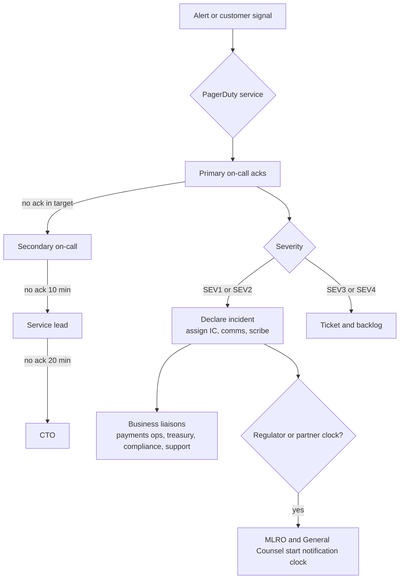
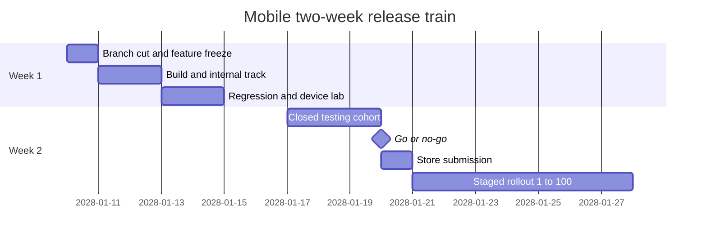
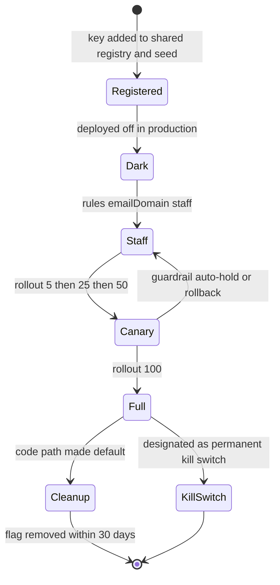
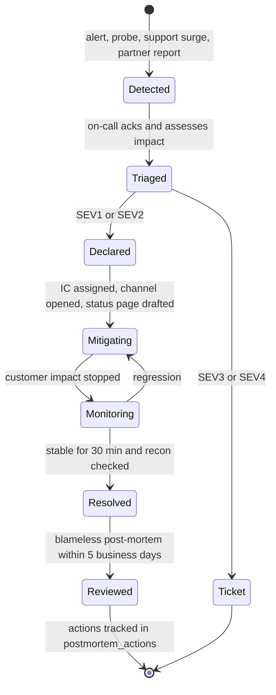

# BI-Rem — Operational Handbook

| Item                | Value                                                                                                                                                                                                                                                                                                                                                                                                                                   |
| ------------------- | --------------------------------------------------------------------------------------------------------------------------------------------------------------------------------------------------------------------------------------------------------------------------------------------------------------------------------------------------------------------------------------------------------------------------------------- |
| Document            | `docs/08-operational-handbook.md` — how BI-Rem is run in production from the first `INTERNAL` transfer (2027-11-15) onward: operating model, access, releases, routines, incidents, runbooks, alerts, capacity, cost, vendors and continuity                                                                                                                                                                                            |
| Applies from        | Phase 12 go-live window **2027-11-01 → 2027-12-10** (BAU after hypercare exit); extended to the second cell `af1` in Phase 13 (**2028-01-03 → 2028-06-30**)                                                                                                                                                                                                                                                                             |
| Service levels      | 99.9 % availability · RPO 15 min · RTO 60 min · 100,000 transfers/day and 1,000,000 users by 2028-06-30 ([`schedule.json`](./roadmap/schedule.json))                                                                                                                                                                                                                                                                                    |
| Owner               | COO (accountable); DevOps/SRE Lead (custodian of §3–§8); Program Manager until BAU transition                                                                                                                                                                                                                                                                                                                                           |
| Does **not** repeat | Environment catalogue, variables, secret stores and Neon branching → [environment management](./architecture/environment-management.md); signal map, Phase 1 SLO PromQL, base dashboards → [monitoring framework](./architecture/monitoring-framework.md); hosting topology → [infrastructure architecture](./architecture/infrastructure-architecture.md); control baseline → [security baseline](./architecture/security-baseline.md) |
| Related             | [Go-live checklist](./07-go-live-checklist.md) · [Risk register](./06-risk-register.md) · [Phase 12 plan](./phases/phase-12-go-live.md) · [Phase 13 plan](./phases/phase-13-pan-african-expansion.md)                                                                                                                                                                                                                                   |

Rules that hold everywhere in this handbook: every mutating action is audited (`AuditLog` with actor, before/after, correlation id); money-affecting changes need two people (maker ≠ checker) and step-up MFA; nothing is fixed by hand in the database — corrections are journals, flags, or migrations; every alert has an owner and a runbook.

---

## 1. Operating principles

1. **Configuration over deployment.** Corridors, fees, limits, margins, rules, providers and launch stages change through audited admin flows, not code pushes ([Phase 3](./phases/phase-03-connectivity.md), [Phase 13 country packs](./phases/phase-13-pan-african-expansion.md)).
2. **The ledger is the source of truth.** Balances, P&L and dashboards are reconciled to `ledger_entries`; a mismatch is a break with an owner, never a silent adjustment ([Phase 5](./phases/phase-05-domestic-transfers.md)).
3. **Fail safe, not open.** On ambiguity a transfer goes `HELD` (not `FAILED`, not `COMPLETED`); on screening failure the decision is HOLD; on Redis nonce loss biometrics fail closed.
4. **Kill switches before heroics.** Each money path has a switch an on-call engineer can flip within 30 s with a second confirmer.
5. **Evidence by default.** Drills, approvals and incidents produce rows (`dr_drills`, `go_live_decisions`, `incidents`, `control_evidence`) that feed SOC 2 and regulator requests.

---

## 2. Operating model

### 2.1 Teams and service ownership

| Team (post go-live)  | Members (baseline from `schedule.json` plus business hires)                      | Owns                                                                                         | PagerDuty service          |
| -------------------- | -------------------------------------------------------------------------------- | -------------------------------------------------------------------------------------------- | -------------------------- |
| Platform / SRE       | DevOps/SRE Lead (1), Solution Architect (1), platform backend engineers (2 of 4) | Fly/Neon/Upstash/Cloudflare/AWS, CI/CD, DR, observability, connectivity, analytics pipelines | `platform`                 |
| Payments engineering | Core backend engineers (2 of 4), QA (2)                                          | Wallet engine, transfer saga, ledger, international, FX engine code                          | `payments`                 |
| Payments operations  | Payments ops analysts (2–3, launch hire)                                         | HELD/UNKNOWN resolution, DLQ, recon breaks, provider liaison                                 | `payments` (business line) |
| Treasury operations  | Treasury Ops Lead + ≥ 2 `treasury_approver` holders across time zones            | Float, nostros, rebalancing, FX margins, EOD close review                                    | `birem-treasury`           |
| Finance operations   | Finance Lead + finance ops                                                       | Recon sign-off, settlement approval, manual journals, P&L                                    | business hours             |
| Compliance           | MLRO, deputy MLRO, Compliance Analyst, compliance officers                       | Alerts, cases, SAR/STR, screening lists, regulator liaison                                   | `compliance`               |
| Partner operations   | Head of Partnerships, partner ops                                                | KYB, settlements, partner API keys, webhooks                                                 | `partner-api`              |
| Mobile               | Mobile engineers (2), one cross-trained frontend engineer                        | App releases, OTA, push, store accounts                                                      | `mobile`                   |
| Customer operations  | Head of Customer Operations, support agents (en/fr/pt; sw from Phase 13)         | Support desk, macros, complaints, CSAT                                                       | business hours             |
| Security             | Security Engineer (0.5 FTE) + CTO                                                | Findings, secrets, access reviews, incident forensics                                        | escalation on all services |

### 2.2 RACI

R = responsible, A = accountable, C = consulted, I = informed.

| Activity                             | COO | CTO / Architect | DevOps/SRE | Payments eng | Payments ops | Treasury | Finance | MLRO / Compliance | Security | Customer ops | Partner ops | PM  |
| ------------------------------------ | :-: | :-------------: | :--------: | :----------: | :----------: | :------: | :-----: | :---------------: | :------: | :----------: | :---------: | :-: |
| Production deploy (API, portals)     |  I  |        A        |     R      |      R       |      I       |    I     |    I    |         I         |    C     |      I       |      I      |  I  |
| Mobile store release / OTA           |  I  |        A        |     C      |      I       |      I       |    I     |    I    |         C         |    C     |      I       |      I      |  R  |
| Feature-flag ramp / launch stage     |  A  |        C        |     R      |      C       |      C       |    C     |    I    |         C         |    I     |      I       |      I      |  R  |
| Incident command (SEV1/SEV2)         |  A  |        C        |     R      |      R       |      R       |    C     |    I    |         C         |    C     |      R       |      C      |  I  |
| HELD / UNKNOWN resolution            |  I  |        I        |     I      |      C       |      R       |    C     |    A    |         C         |    I     |      I       |      I      |  I  |
| Daily reconciliation and breaks      |  I  |        I        |     I      |      C       |      R       |    C     |    A    |         I         |    I     |      I       |      C      |  I  |
| Settlement approval and payout files |  I  |        I        |     I      |      I       |      C       |    C     |   A/R   |         I         |    I     |      I       |      R      |  I  |
| Liquidity rebalancing                |  I  |        I        |     I      |      I       |      C       |    R     |    A    |         I         |    I     |      I       |      I      |  I  |
| FX margin change                     |  C  |        I        |     I      |      I       |      I       |    R     |    A    |         C         |    I     |      I       |      I      |  I  |
| AML rule publish                     |  I  |        C        |     I      |      C       |      I       |    I     |    I    |        A/R        |    C     |      I       |      I      |  I  |
| SAR/STR filing                       |  I  |        I        |     I      |      I       |      I       |    I     |    I    |        A/R        |    I     |      I       |      I      |  I  |
| Secret rotation                      |  I  |        A        |     R      |      C       |      I       |    I     |    I    |         I         |    C     |      I       |      I      |  I  |
| Access review                        |  I  |        A        |     R      |      I       |      I       |    I     |    I    |         C         |    R     |      I       |      I      |  I  |
| DR drill / restore drill             |  A  |        C        |     R      |      C       |      I       |    I     |    I    |         I         |    C     |      I       |      I      |  R  |
| Regulator notification               |  A  |        C        |     C      |      I       |      I       |    I     |    C    |         R         |    C     |      I       |      I      |  I  |
| Vendor onboarding / review           |  A  |        C        |     C      |      I       |      I       |    C     |    R    |         C         |    R     |      I       |      C      |  R  |

### 2.3 On-call rota and escalation

| Service               | Rotation pool (depth)                                | Hours                                                                | Primary ack target           | Escalation (if not acked)                                               |
| --------------------- | ---------------------------------------------------- | -------------------------------------------------------------------- | ---------------------------- | ----------------------------------------------------------------------- |
| `platform`            | DevOps/SRE, Architect, 4 backend engineers (6)       | 24×7, weekly shift Mon 09:00 WAT                                     | 5 min (SEV1) / 15 min (SEV2) | Secondary → DevOps/SRE Lead (+10 min) → CTO (+20 min)                   |
| `payments`            | 2 core backend + 2 payments ops (4)                  | Eng 24×7; ops 06:00–24:00 WAT                                        | 5 / 15 min                   | Secondary → Backend Lead → CTO; Finance Lead informed for ledger alerts |
| `birem-treasury`      | 3 treasury approvers                                 | 24×7 for CRITICAL thresholds, business hours otherwise               | 15 min                       | Treasury Ops Lead → CFO                                                 |
| `compliance`          | Compliance Analyst, MLRO, deputy MLRO, 1 backend (4) | Business hours + paging for SLA breach, list staleness, SAR deadline | 30 min (paged)               | MLRO → General Counsel                                                  |
| `partner-api`         | 2 core backend + partner ops (3)                     | Business hours; 24×7 for payout/settlement failures                  | 15 min                       | Head of Partnerships → CTO                                              |
| `mobile`              | 2 mobile + 1 frontend (3)                            | Business hours; paging for crash-free < 99.3 % and push outage       | 30 min                       | Mobile Lead → Security (for RASP/pinning) → CTO                         |
| `af1` cell (Phase 13) | Platform pool + AWS-skilled contractor until W9      | 24×7                                                                 | 5 / 15 min                   | DevOps/SRE Lead → CTO                                                   |

Rules: maximum one primary week in four per person; no one is primary on two services at once; holiday cover published 4 weeks ahead (2027-12-20 → 2028-01-03 covered in the go-live roster, [checklist RBK-06](./07-go-live-checklist.md)); a handover note (open incidents, risky changes, silenced alerts) is posted in `#oncall` at every shift change; hypercare adds the command-centre shifts of [Phase 12 §3.12](./phases/phase-12-go-live.md#312-hypercare).



### 2.4 Severity definitions (SEV1–SEV4)

SEV1–SEV4 are the handbook names of the `incident_severity` values `P1`–`P4` stored by the Ops module ([Phase 12 §5](./phases/phase-12-go-live.md#5-data-model--migrations)). Severity is set on customer and money impact, not on technical cause; when in doubt, declare higher and downgrade.

| Sev      | Definition (any one applies)                                                                                                                                   | Examples                                                                                                     | Ack                                | Status page / first update | Update cadence | Mitigation target | Resolution target | Post-mortem                                   |
| -------- | -------------------------------------------------------------------------------------------------------------------------------------------------------------- | ------------------------------------------------------------------------------------------------------------ | ---------------------------------- | -------------------------- | -------------- | ----------------- | ----------------- | --------------------------------------------- |
| **SEV1** | Customer money at risk; platform or a whole market unable to move money; ledger imbalance; duplicate payouts; confirmed data breach; sanctions control failure | API down; Neon primary lost; `LedgerUnbalanced`; double payout; PII leak; CONFIRMED_MATCH transfer completed | **5 min**                          | 15 min                     | Every 15 min   | ≤ 60 min (RTO)    | ≤ 4 h             | Mandatory, ≤ 5 business days, exec review     |
| **SEV2** | Major degradation with workaround or limited scope: one provider/corridor down, SLO fast-burn, HELD over SLO, webhook backlog, KYC provider down               | MTN MoMo CM circuit open; FX publication stale > 5 min; partner webhooks failing                             | **15 min**                         | 30 min                     | Every 30 min   | ≤ 4 h             | ≤ 24 h            | Mandatory, ≤ 5 business days                  |
| **SEV3** | Minor impact: single feature impaired, internal tooling, slow-burn SLO, single-customer issue with systemic suspicion                                          | Receipt render failures; report late; one admin screen 500                                                   | 1 h (hypercare) / 4 business hours | If customer-visible        | Daily          | ≤ 2 business days | ≤ 5 business days | Optional (required if repeated 3× in 30 days) |
| **SEV4** | No customer impact; cosmetic; near-miss                                                                                                                        | Typo in template; noisy alert                                                                                | Next business day                  | No                         | Weekly         | —                 | ≤ 30 days         | No (near-miss note)                           |

Automatic upgrades: any SEV2 exceeding its mitigation target becomes SEV1; any incident involving regulator-reportable data or sanctions becomes at least SEV2 with the MLRO paged.

---

## 3. Environments & access management

Environments (`local`, `preview`, `staging`, `production`, plus Phase 9 `sandbox` and Phase 13 `af1`/`af1-staging`), their variables, secret stores and Neon branches are defined in [environment management](./architecture/environment-management.md). This section governs **who** can reach production and how.

### 3.1 Access tiers and just-in-time (JIT) access

| Tier             | What it grants                                                                                                                         | How granted                                                                                                               | Max duration         | Approval                          | Evidence                                        |
| ---------------- | -------------------------------------------------------------------------------------------------------------------------------------- | ------------------------------------------------------------------------------------------------------------------------- | -------------------- | --------------------------------- | ----------------------------------------------- |
| T0 Observe       | Grafana, Sentry, status, read-only admin dashboards                                                                                    | Standing, by role                                                                                                         | Standing             | Line manager                      | Quarterly review                                |
| T1 Operate       | Admin portal roles (`SUPPORT_AGENT`, `OPS_ADMIN`, `TREASURY_OPS`, `COMPLIANCE_OFFICER`, …)                                             | Standing, RBAC in admin portal, MFA enforced                                                                              | Standing             | Role owner + Security             | `user_roles` audit, quarterly review            |
| T2 Inspect infra | `flyctl logs/status`, Neon read replica, Upstash read, ClickHouse `analytics_ro`                                                       | JIT request linked to incident id or ticket                                                                               | 4 h                  | On-call lead                      | Grant log + `AuditLog`                          |
| T3 Change infra  | `fly secrets set`, `flyctl ssh console`, `db-migrate.yml`, Neon console write, Cloudflare/Vercel config, AWS power-user permission set | JIT via GitHub Environment reviewer or AWS IAM Identity Center permission set; must reference `change_ref` or incident id | 1 h (renewable once) | Second engineer (two-person rule) | GitHub deployment record, CloudTrail, Fly audit |
| T4 Break-glass   | Backup AWS account, KMS key administration, Neon project owner, store owner accounts, Cloudflare super-admin, domain registrar         | Sealed credentials held by two officers (CTO + COO), hardware MFA                                                         | Single use           | Two officers, IC informed         | Post-use rotation + review within 24 h          |

Rules: no standing T3/T4 access for anyone, including founders; production database writes happen only through the API, `db-migrate.yml` or approved scripts run by `birem_migrate`; SSH into production machines is T3 and logged; customer data exports require `analytics:export:pii` with watermarking ([Phase 10](./phases/phase-10-reporting-bi.md)).

### 3.2 Break-glass procedure

1. Declare or attach to an incident (SEV1/SEV2) and state the reason in `#incident-<ref>`.
2. Two officers retrieve the sealed credential (password manager vault with dual control); one operates, one observes on a call.
3. Perform only the stated action; scribe records commands and timestamps in the incident timeline.
4. Within 24 h: rotate the break-glass credential, review CloudTrail / provider audit log for the window, attach evidence to `control_evidence`, and close with a Security sign-off.

### 3.3 Access reviews

| Review                     | Frequency                         | Scope                                                                                                                                                         | Owner                             |
| -------------------------- | --------------------------------- | ------------------------------------------------------------------------------------------------------------------------------------------------------------- | --------------------------------- |
| Joiner/mover/leaver        | Within 1 business day of HR event | All systems in the SSO directory; admin portal roles; PagerDuty                                                                                               | Security Engineer                 |
| Privileged access          | Monthly                           | T3/T4 grants, GitHub org owners, Fly org admins, AWS admin permission sets, Neon owners                                                                       | DevOps/SRE Lead                   |
| Full access review (SOC 2) | Quarterly                         | GitHub, Fly, Neon, AWS (both accounts), Vercel, Cloudflare, Upstash, PagerDuty, Grafana, ClickHouse, EAS, App Store Connect, Play Console, admin portal roles | Security Engineer + system owners |
| Segregation of duties      | Quarterly                         | No user holds write + approve on margins, fees, settlements; no `compliance_analyst` + `mlro`; requester ≠ approver on stage advances                         | Compliance Analyst                |
| Partner credentials        | Quarterly                         | Partner API keys unused > 90 days, OAuth clients, webhook subscriptions                                                                                       | Partner ops                       |

---

## 4. Release management

### 4.1 Release trains

| Deployable                                                                       | Cadence                                                                  | Window                        | Path                                                                                                                              | Gate                                                                                    |
| -------------------------------------------------------------------------------- | ------------------------------------------------------------------------ | ----------------------------- | --------------------------------------------------------------------------------------------------------------------------------- | --------------------------------------------------------------------------------------- |
| `apps/api` (http + worker groups, `cdg`; `ams` restart; `af1` ECS from Phase 13) | Merge to `main` deploys staging continuously; **production Tue and Thu** | 09:00–12:00 WAT               | `release.yml` release PR → tag `v*` → `deploy-api.yml` production (same digest as staging, required reviewers, 10-min wait timer) | CI `ci-ok`, staging smoke, 24 h staging soak during freeze periods, error budget ≥ 25 % |
| `apps/web`, `apps/admin`, `apps/partner`                                         | Same as API, can ship independently                                      | 09:00–12:00 WAT               | Vercel preview per PR → promote to production                                                                                     | Playwright green on preview; API compatibility (additive only)                          |
| `apps/mobile` binaries                                                           | **Two-week train**                                                       | Go/no-go Thursday of week 2   | EAS build → internal → closed → production staged rollout                                                                         | Phase 11 release checklist; crash-free ≥ 99.5 % on test tracks                          |
| Mobile OTA (EAS Update)                                                          | As needed, JS/asset-only fixes                                           | Business hours                | `mobile-ota.yml` with path checks                                                                                                 | Two approvals; ADR-0035 eligibility                                                     |
| Database migrations                                                              | With the API release that needs them                                     | Same window                   | `release_command` (expand only) or `db-migrate.yml` with typed confirmation                                                       | Expand → migrate → contract; contract only after snapshot                               |
| Configuration (fees, margins, rules, corridors, flags)                           | Any business day                                                         | 08:00–18:00 local market time | Admin portal maker-checker                                                                                                        | Simulation evidence where the editor offers it                                          |

No production deploys: Friday after 12:00 WAT, weekends, public holidays in ≥ 2 live markets, the last two business days of a month, within 60 min of the Phase 7 EOD close or a Phase 9 settlement run, during an open SEV1/SEV2, or when the monthly error budget is < 25 % (emergency fixes excepted).



### 4.2 Change classes and approval

| Class                                 | Examples                                                                                                                                                                                          | Approval                                                                                                                     | Record                                                            |
| ------------------------------------- | ------------------------------------------------------------------------------------------------------------------------------------------------------------------------------------------------- | ---------------------------------------------------------------------------------------------------------------------------- | ----------------------------------------------------------------- |
| **Standard** (pre-approved, scripted) | Flag ramp step per an approved plan (`flag-ramp.yml`); fee/margin/rule version through maker-checker; partition creation; credential rotation via vault wizard; scaling within the capacity model | Built-in maker-checker; no CAB                                                                                               | Audit log + `change_requests` row created by the tool             |
| **Normal**                            | API/portal release; new migration; Cloudflare ruleset change; new provider connection; corridor promotion; infrastructure (Terraform) change                                                      | Weekly CAB (Tuesday 10:00 WAT: DevOps/SRE Lead, Architect, Payments eng lead, Compliance, PM) or async two-reviewer approval | `change_requests` with risk, rollback plan, test evidence         |
| **Emergency**                         | Hotfix during SEV1/SEV2; kill switch; secret revoke                                                                                                                                               | Incident commander + one reviewer                                                                                            | Retrospective `change_requests` within 24 h; reviewed at next CAB |

Freeze windows (`launch.freeze.until`, holiday freeze, month-end) are enforced by the `go-live-gates` job: a production run without an approved `change_ref` fails during a freeze.

### 4.3 Feature-flag lifecycle



- Every flag key lives in the `@bi-rem/shared` registry and the seed; the admin UI lists only registry keys (drift test T1.14).
- Ramp steps run through `flag-ramp.yml` with guardrails (`flag-guardrails.yml`): auto-hold on error rate, latency, HELD rate or fraud-rate breach; each step is a `change_requests` row.
- Money-affecting flags (`platform.maintenance-mode`, `ledger.postings.frozen`, `wallet.engine.enabled`, `wallet.connector.<key>.enabled`, `intl.corridor.<k>.enabled`, `fx.quotes.enabled`, `aml.realtime.enforce`, `connectivity.webhooks.ingress.enabled`) need two-person confirmation and step-up MFA.
- Launch flags are written only by `LaunchService` during stage advances; direct edits are blocked during the launch.
- Release flags are removed within 30 days (two trains) of reaching 100 %; the weekly flag report lists stale flags to the CAB. Kill switches are permanent and exercised quarterly.

### 4.4 Zero-downtime deploy procedures

**API (`apps/api`, Fly `bi-rem-api`; ECS in `af1`)**

1. Confirm preconditions: CI `ci-ok` green on the tag, staging deployed with the same digest and smoke-tested, no open SEV1/SEV2, error budget ≥ 25 %, change window open.
2. Migrations follow **expand → migrate → contract**: the release carries only additive (expand) DDL applied by `release_command`; code tolerates both schemas; contract migrations ship in a later release after a named Neon snapshot.
3. `deploy-api.yml` (production environment, required reviewer, 10-min wait) deploys by digest: **worker canary** (one machine) → wait for queue drain gate (saga steps idle or leased < 60 s, cross-border drain gate from [Phase 6](./phases/phase-06-international.md)) → remaining workers → **http canary** → rolling http (`max_unavailable=0.33`), health check on `/health/ready`.
4. `infra/scripts/smoke-test.sh` runs against `https://api.bi-rem.africa`; failure triggers automatic redeploy of the previous digest.
5. Restart the warm `ams` machine on the new digest; in `af1`, ECS rolling update with the migration one-off task first.
6. Watch for 30 min: 5xx ratio, p95, saga step latency, HELD rate, outbox pending. Record the digest in the deploy summary (rollback source).

**Portals (`apps/web`, `apps/admin`, `apps/partner`)**

1. PR preview on Vercel against staging data; Playwright green; admin previews behind Vercel Authentication.
2. API changes are additive; portals never depend on an API version not yet in production.
3. Merge → production deployment; Vercel atomic switch (no downtime); purge Cloudflare cache for `status.bi-rem.africa` if the status route changed.
4. Rollback = "promote previous deployment" (≤ 2 min).

**Mobile (`apps/mobile`)**

1. Backend supports the current and two previous app versions; breaking API changes require a new endpoint version.
2. Store releases: Play staged rollout 1 % → 10 % → 50 % → 100 % over ≥ 7 days; iOS phased release; halt on crash-free < 99.3 % or ANR > 0.3 %.
3. OTA only for JS/asset changes eligible under ADR-0035, two approvals, rollout with `fallbackToCacheTimeout`; auto-rollback after launch crashes.
4. `mobile.min-version.*` soft prompt for non-security fixes; hard minimum only for security, with four-eyes and impact analysis.

### 4.5 Rollback summary

Detailed timings are in [Phase 12 §10.4](./phases/phase-12-go-live.md#104-rollback-procedure); the most used:

| Scenario                       | Action                                                                                     | Time to effect                 |
| ------------------------------ | ------------------------------------------------------------------------------------------ | ------------------------------ |
| Bad API release                | `flyctl deploy --app bi-rem-api --image <previous digest>` (automatic on smoke failure)    | 2–4 min                        |
| Bad portal release             | Vercel promote previous deployment                                                         | ≤ 2 min                        |
| Flag misbehaving               | Flag off / rollout down via Kill Switch Panel                                              | ≤ 30 s                         |
| Launch step wrong for a market | `POST /v1/launch/markets/:marketKey/rollback`                                              | < 5 s apply, ≤ 30 s propagate  |
| Bad migration                  | Forward-fix; under freeze maintenance mode + PITR branch + `down.sql` via `db-migrate.yml` | 15–30 min; PITR ≤ 60 min       |
| Bad mobile build               | Play halt / iOS pause / `eas update:republish`                                             | Minutes (OTA) to hours (store) |

---

## 5. Operational routines

Times are WAT (UTC+1) unless marked UTC. "Origin" is the phase plan that defines the procedure in detail.

### 5.1 Daily

| Time         | Routine                                                                                                                                                                                                | Owner                                      | Origin                                                                                      |
| ------------ | ------------------------------------------------------------------------------------------------------------------------------------------------------------------------------------------------------ | ------------------------------------------ | ------------------------------------------------------------------------------------------- |
| Continuous   | Liquidity positions refresh every 5 min; acknowledge threshold events; convert forecaster auto-proposals into rebalancing orders                                                                       | Treasury on-call                           | [P7](./phases/phase-07-fx-treasury.md)                                                      |
| Continuous   | Float snapshots every 5 min; respond to low-float alerts with top-up                                                                                                                                   | Treasury ops                               | [P4](./phases/phase-04-wallet-connectors.md)                                                |
| Every 15 min | Store status sync (App Store Connect / Play) into release registry                                                                                                                                     | Automated; Mobile on-call reviews failures | [P11](./phases/phase-11-mobile.md)                                                          |
| 06:00 UTC    | Pipeline and cell health check: CDC slot lag, retained WAL, ingest DLQ, tie-out status, `kpi_daily` completeness, per-cell SLO burn, clearing backlog, control-plane replica lag, egress-guard events  | Platform on-call                           | [P10](./phases/phase-10-reporting-bi.md), [P13](./phases/phase-13-pan-african-expansion.md) |
| 07:00        | Review nightly `recon.nightly` (trial balance, projection, float vs ledger, stuck transfers, orphan legs); assign every OPEN break, resolve within 24 h                                                | Payments ops + Finance                     | [P5](./phases/phase-05-domestic-transfers.md)                                               |
| 07:00        | Review EOD close per currency (posted, reconciliation delta ≤ 1 minor unit)                                                                                                                            | Finance ops                                | [P7](./phases/phase-07-fx-treasury.md)                                                      |
| 07:30        | Watchlist freshness check and quarantined-version review                                                                                                                                               | Compliance Analyst                         | [P8](./phases/phase-08-aml-compliance.md)                                                   |
| 08:00        | Compliance queue stand-up and SLA review; held-transfer review with release/block under four-eyes                                                                                                      | Compliance Analyst                         | [P8](./phases/phase-08-aml-compliance.md)                                                   |
| 08:00        | Hypercare launch stand-up with auto-generated launch report (during hypercare)                                                                                                                         | Command-centre lead                        | [P12](./phases/phase-12-go-live.md)                                                         |
| 08:30        | Daily markup review; review active manual rate overrides and forced publications                                                                                                                       | Treasury ops                               | [P6](./phases/phase-06-international.md), [P7](./phases/phase-07-fx-treasury.md)            |
| 09:00        | Import bank statements (SFTP pull or upload); match or explain unmatched lines; resolve `BANK_STATEMENT` breaks                                                                                        | Treasury ops                               | [P7](./phases/phase-07-fx-treasury.md)                                                      |
| 09:00        | Partner statement reconciliation, break resolution with correction journals; settlement batch close/regenerate/redeliver                                                                               | Finance ops                                | [P6](./phases/phase-06-international.md)                                                    |
| 09:00        | Nostro pre-funding respecting partner cut-offs (draft → approve → sent → received → reconciled); PAPSS/member-bank and aggregator balances (Phase 13)                                                  | Treasury ops                               | [P6](./phases/phase-06-international.md), [P13](./phases/phase-13-pan-african-expansion.md) |
| 09:30        | Pilot merchant/agent liability reconciliation; `float:reconcile` and `AGENT_FLOAT` breaks                                                                                                              | Partner ops + Finance                      | [P5](./phases/phase-05-domestic-transfers.md), [P9](./phases/phase-09-partner-merchant.md)  |
| 10:00 UTC    | Tie-out mismatch triage with finance (explain or escalate)                                                                                                                                             | Finance + Platform on-call                 | [P10](./phases/phase-10-reporting-bi.md)                                                    |
| 10:00        | DLQ report review (wallet, intl, connectivity, webhooks); replay or discard with reason                                                                                                                | Payments ops                               | [P3](./phases/phase-03-connectivity.md), [P4](./phases/phase-04-wallet-connectors.md)       |
| 10:00        | Triage outbox FAILED rows and notifications FAILED via `/v1/notifications/queue`                                                                                                                       | Platform on-call                           | [P1](./phases/phase-01-foundation.md)                                                       |
| 11:00        | Bank cut-off calendar check; RJCT and card decline-rate review per rail                                                                                                                                | Payments ops                               | [P13](./phases/phase-13-pan-african-expansion.md)                                           |
| 12:00 UTC    | Inter-region netting: on-call requests, treasury approves settlement between cell nostros                                                                                                              | Treasury + Platform                        | [P13](./phases/phase-13-pan-african-expansion.md)                                           |
| 17:00        | Daily report of operator resolutions (UNKNOWN/HELD) to compliance                                                                                                                                      | Payments ops                               | [P4](./phases/phase-04-wallet-connectors.md)                                                |
| 17:00        | Finance review of treasury daily and operational daily report deliveries                                                                                                                               | Finance Lead                               | [P10](./phases/phase-10-reporting-bi.md)                                                    |
| Nightly      | KYC expiry sweep; OTP purge; raw provider payload purge (90 d); retention crons; partition jobs; `push:cleanup`; quote/reservation expiry sweepers; `recon.nightly`; EOD close; `backup.yml` 02:30 UTC | Automated; failures page platform          | [P1](./phases/phase-01-foundation.md)–[P12](./phases/phase-12-go-live.md)                   |

### 5.2 Weekly

| Day | Routine                                                                                                                                                                          | Owner                     | Origin                                            |
| --- | -------------------------------------------------------------------------------------------------------------------------------------------------------------------------------- | ------------------------- | ------------------------------------------------- |
| Mon | Security scan review (`security.yml` Mondays 04:17 UTC: CodeQL, dependency review, gitleaks, `pnpm audit`, Trivy) and Dependabot grouped updates merged through the normal train | Security Engineer         | [P1](./phases/phase-01-foundation.md)             |
| Mon | On-call handover; review silenced alerts and stale flags                                                                                                                         | DevOps/SRE Lead           | —                                                 |
| Mon | Weekly executive pack review (footnotes, freshness); schedule failure review                                                                                                     | Program Manager           | [P10](./phases/phase-10-reporting-bi.md)          |
| Tue | CAB (normal changes), freeze audit (every bypass listed as a `change_requests` row)                                                                                              | DevOps/SRE Lead           | [P12](./phases/phase-12-go-live.md)               |
| Tue | Rule performance review (FPR, hit counts, shadow candidates); PEP/EDD review list                                                                                                | Compliance Analyst + MLRO | [P8](./phases/phase-08-aml-compliance.md)         |
| Wed | `backup-verify.yml` result review (restore into `verify-<date>` branch)                                                                                                          | DevOps/SRE                | [P12](./phases/phase-12-go-live.md)               |
| Wed | Mobile health review (crash-free, ANR, push delivery, attestation failures, version distribution); `devices:retire`                                                              | Mobile Lead               | [P11](./phases/phase-11-mobile.md)                |
| Thu | SLO burn and alert-hygiene tuning (target < 5 % false positives)                                                                                                                 | DevOps/SRE                | [P12](./phases/phase-12-go-live.md)               |
| Thu | Open-position report and position-limit breaches; weekly treasury review                                                                                                         | Treasury Ops Lead         | [P7](./phases/phase-07-fx-treasury.md)            |
| Fri | Export anomaly review (volumes by requester); ClickHouse cost and storage review                                                                                                 | Security + Platform       | [P10](./phases/phase-10-reporting-bi.md)          |
| Fri | Country launch board review; conformance and bank-harness results; residency report-mode events; licence renewal horizon (Phase 13)                                              | Head of Expansion         | [P13](./phases/phase-13-pan-african-expansion.md) |
| Fri | Webhook delivery and canary review; partner endpoint health                                                                                                                      | Partner ops               | [P9](./phases/phase-09-partner-merchant.md)       |

### 5.3 Monthly

| Routine                                                                                                                                                        | Owner                     | Origin                                                                                                                                |
| -------------------------------------------------------------------------------------------------------------------------------------------------------------- | ------------------------- | ------------------------------------------------------------------------------------------------------------------------------------- |
| SLO review and error-budget report; rollout freeze if < 25 % remaining                                                                                         | COO + DevOps/SRE          | [P12](./phases/phase-12-go-live.md)                                                                                                   |
| Opening float journal at month start from `provider_balance_snapshots` (MANUAL, four-eyes)                                                                     | Finance Lead              | [P5](./phases/phase-05-domestic-transfers.md)                                                                                         |
| Month-end revenue pack after the month close; regulator returns (BEAC declaration/statistics, BNA, BM, CBN IMTO, BoG, CBK, BoU/BoT/BNR, SARB BOP) per calendar | Finance + Compliance      | [P6](./phases/phase-06-international.md), [P10](./phases/phase-10-reporting-bi.md), [P13](./phases/phase-13-pan-african-expansion.md) |
| SAR register review and SAR access-log review                                                                                                                  | MLRO                      | [P8](./phases/phase-08-aml-compliance.md)                                                                                             |
| Retention dry-run review and legal-hold register check; artefact expiry check                                                                                  | Compliance Analyst        | [P8](./phases/phase-08-aml-compliance.md), [P10](./phases/phase-10-reporting-bi.md)                                                   |
| Agent retier job; monthly commission statements with WHT lines; report of commission plan changes and float adjustments to compliance                          | Partner ops + Finance     | [P9](./phases/phase-09-partner-merchant.md)                                                                                           |
| Marketing spend entry with maker-checker by the 5th business day (CAC input); metric catalogue review                                                          | Finance + PM              | [P10](./phases/phase-10-reporting-bi.md)                                                                                              |
| Vendor cost review (KYC check counts vs Smile ID/Sumsub/Veriff invoices; SMS delivery by operator; AWS, Fly, Neon, ClickHouse)                                 | Finance Lead + DevOps/SRE | [P2](./phases/phase-02-customer-kyc.md), [P13](./phases/phase-13-pan-african-expansion.md)                                            |
| Non-disruptive DR test (`dr-test.yml` promotes a standby clone, smoke + ledger invariants)                                                                     | DevOps/SRE                | [P12](./phases/phase-12-go-live.md)                                                                                                   |
| Partition maintenance check (`fx_rates`, `transfer_tracking_events`, attestation partition drop); privileged access review                                     | DevOps/SRE                | [P6](./phases/phase-06-international.md), [P11](./phases/phase-11-mobile.md)                                                          |
| Residency audit (mis-homed query per cell, egress events, KMS key usage); bank participant directory refresh; card chargeback review                           | Compliance + Payments ops | [P13](./phases/phase-13-pan-african-expansion.md)                                                                                     |
| Access review of `analytics:export:pii` holders                                                                                                                | Security Engineer         | [P10](./phases/phase-10-reporting-bi.md)                                                                                              |

### 5.4 Quarterly, semi-annual and annual

| Frequency   | Routine                                                                                                                                                                                                  | Owner                            | Origin                                                                                                                         |
| ----------- | -------------------------------------------------------------------------------------------------------------------------------------------------------------------------------------------------------- | -------------------------------- | ------------------------------------------------------------------------------------------------------------------------------ |
| Quarterly   | Manual restore drill incl. object storage and Redis into an isolated environment; restore drill of one ClickHouse table; CDC re-snapshot drill on staging                                                | DevOps/SRE                       | [P1](./phases/phase-01-foundation.md), [P10](./phases/phase-10-reporting-bi.md), [P12](./phases/phase-12-go-live.md)           |
| Quarterly   | Full access review (§3.3); SoD review                                                                                                                                                                    | Security Engineer                | [P12](./phases/phase-12-go-live.md)                                                                                            |
| Quarterly   | Typology calibration with backtests; publication column-list review with security and compliance                                                                                                         | MLRO; Architect                  | [P8](./phases/phase-08-aml-compliance.md), [P10](./phases/phase-10-reporting-bi.md)                                            |
| Quarterly   | Game day (rotating scenario); kill-switch exercise; alert hygiene audit                                                                                                                                  | DevOps/SRE                       | [P12](./phases/phase-12-go-live.md), [P13](./phases/phase-13-pan-african-expansion.md)                                         |
| Quarterly   | ASV external scan; market-data API key rotation; residency report to the DPO; playbook retrospective                                                                                                     | Security / Treasury / Compliance | [P7](./phases/phase-07-fx-treasury.md), [P12](./phases/phase-12-go-live.md), [P13](./phases/phase-13-pan-african-expansion.md) |
| Quarterly   | Board pack generation (T-5 dry run, T-2 final, Object Lock)                                                                                                                                              | CFO + PM                         | [P10](./phases/phase-10-reporting-bi.md)                                                                                       |
| Semi-annual | Region evacuation drill (Phase 13); BCP review (also after any SEV1)                                                                                                                                     | DevOps/SRE; COO                  | [P12](./phases/phase-12-go-live.md), [P13](./phases/phase-13-pan-african-expansion.md)                                         |
| Annual      | External pentest; PCI SAQ A (A-EP from Phase 13) re-attestation; SOC 2 audit (Type I 2028-01-15, then Type II); policy re-approval; insurance renewal; OpenSanctions licence; vendor assessment renewals | Security / Compliance / CFO      | [P8](./phases/phase-08-aml-compliance.md), [P12](./phases/phase-12-go-live.md)                                                 |

### 5.5 Key and credential rotation calendar

Phase 1 platform secrets (JWT, `ENCRYPTION_KEY`, Neon role passwords, Redis, SMTP, Fly/Vercel tokens) follow the schedule in [environment management §4.1](./architecture/environment-management.md#41-rotation-schedule). Later phases add:

| Credential                                                          | Interval                                                        | Mechanism                                 | Origin                                            |
| ------------------------------------------------------------------- | --------------------------------------------------------------- | ----------------------------------------- | ------------------------------------------------- |
| Provider API credentials (vault)                                    | 90/180/365-day max age per policy; 14-day warning; 24 h overlap | Rotation wizard; nightly `dueAt` job      | [P3](./phases/phase-03-connectivity.md)           |
| Fallback IAM access key (if OIDC not used)                          | 90 days                                                         | Vault rotation calendar                   | [P3](./phases/phase-03-connectivity.md)           |
| mTLS certificates                                                   | On expiry alerts at 30/14/7/1 days                              | Certificate uploader                      | [P3](./phases/phase-03-connectivity.md)           |
| Daraja security credential / certificate                            | Per Safaricom expiry                                            | Runbook                                   | [P4](./phases/phase-04-wallet-connectors.md)      |
| `INTL_QUOTE_SIGNING_KEY`, `INTL_TRACKING_TOKEN_KEY`, SFTP keys      | Annual or on exposure                                           | Per-environment with host-key pins        | [P6](./phases/phase-06-international.md)          |
| `FX_QUOTE_KEY` (versioned), market data keys, bank SFTP credentials | Quarterly (market data), annual (`FX_QUOTE_KEY`)                | Key versioning, verification              | [P7](./phases/phase-07-fx-treasury.md)            |
| OAuth `oauth-signing-es256`                                         | 90 days, two active kids, 24 h overlap                          | KMS; JWKS `max-age=3600`                  | [P9](./phases/phase-09-partner-merchant.md)       |
| ClickHouse credentials                                              | 180 days                                                        | Rotation runbook                          | [P10](./phases/phase-10-reporting-bi.md)          |
| Mobile certificate pins, APNs/FCM, store API keys                   | Per pin calendar; annual for store keys                         | Signed remote pin set; backup key offline | [P11](./phases/phase-11-mobile.md)                |
| Per-country KMS keys, bank PGP keys (Phase 13)                      | Annual automatic rotation                                       | KMS rotation, rotation policies           | [P13](./phases/phase-13-pan-african-expansion.md) |

---

## 6. Incident management

### 6.1 Lifecycle



Declaration: anyone can declare via the admin portal quick form (Operations → Incidents) or `/incident` in Slack; the record (`incidents`) auto-creates `#incident-<ref>`, a PagerDuty incident on the chosen service, and a status-page draft from `incident_comms_templates`.

### 6.2 Roles

| Role                    | Who                                                                         | Responsibilities                                                          |
| ----------------------- | --------------------------------------------------------------------------- | ------------------------------------------------------------------------- |
| Incident Commander (IC) | Holder of `INCIDENT_COMMANDER` (on-call lead or DevOps/SRE Lead)            | Owns decisions, severity, kill switches, escalation; does not debug       |
| Operations lead         | Primary on-call of the affected service                                     | Diagnosis and mitigation; proposes actions to IC                          |
| Comms lead              | Head of Customer Operations or delegate                                     | Status page, customer banners, support macros, partner notices on cadence |
| Scribe                  | Any engineer not operating                                                  | Timeline in `incident_events`, commands run, decisions and timestamps     |
| Business liaison        | Payments ops / treasury / finance as relevant                               | HELD handling, liquidity, ledger checks, customer refunds                 |
| Regulatory liaison      | MLRO (AML/sanctions) or Compliance Analyst + General Counsel (data, outage) | Starts notification clocks; drafts regulator notice                       |

### 6.3 Communication cadence and clocks

| Audience                   | SEV1                                                                                | SEV2                                          | Channel                                                                               |
| -------------------------- | ----------------------------------------------------------------------------------- | --------------------------------------------- | ------------------------------------------------------------------------------------- |
| Internal                   | Every 15 min                                                                        | Every 30 min                                  | `#incident-<ref>`, exec summary to COO/CTO hourly                                     |
| Customers                  | Status page within 15 min, then every 30 min; in-app banner if a market is affected | Status page within 30 min if customer-visible | `status.bi-rem.africa` (en/fr/pt), in-app/portal banner, SMS only for funds-affecting |
| Partners                   | Within 30 min, then hourly; `platform.status` webhook                               | Within 1 h if their traffic is affected       | Partner portal, webhook, e-mail per Phase 9 SLA                                       |
| Regulators / sponsor banks | Assess within 1 h; notify per clock                                                 | Assess within 4 h                             | Counsel-approved letter                                                               |

Regulator clocks: personal-data breach **72 h** default, **24 h** where NDPA (Nigeria) or CBK (Kenya) require; major operational incidents per sponsor-bank and licence terms (recorded per market in `regulatory.<cc>` gates); sanctions breaches immediately to the MLRO with filing per the regulator profile. The clock starts at awareness, recorded in the incident timeline.

### 6.4 Communication templates

All templates are stored in `incident_comms_templates`, pre-approved by counsel, localized en/fr/pt; text below is the English master. Never mention investigations, alerts or compliance holds in customer text (tipping-off).

**Status page — investigating**

```text
Title: [Service] delays in [market/corridor]
We are investigating delays affecting [transfers to <provider> / sign-in / card top-ups] in [market].
Money already sent is safe and will either complete or be refunded automatically.
Next update by [HH:MM WAT].
```

**Status page — identified / monitoring**

```text
We have identified the cause and applied a fix. Transfers are completing again; some transfers
started between [HH:MM] and [HH:MM WAT] may take up to [N] hours to finish or be refunded.
We are monitoring. Next update by [HH:MM WAT].
```

**Status page — resolved**

```text
This incident is resolved as of [HH:MM WAT]. All affected transfers have completed or been refunded.
We are sorry for the inconvenience. A summary will be shared with partners within 5 business days.
```

**Partner notice**

```text
Subject: BI-Rem incident [INC-ref] — [SEV] — [status]
Impact: [endpoints / corridors / settlement], window [start–end UTC], affected volume [n].
Your action: [none / retry with same Idempotency-Key / expect delayed webhooks — replay available].
Next update: [time]. Contact: partner-support escalation line per your SLA.
```

**Regulator initial notification (counsel to finalise)**

```text
Institution / partner licence: [name, licence no.]; Incident ref: [INC-ref]; Awareness time: [UTC].
Nature: [operational outage / data incident / control failure]; Systems and markets affected: [...].
Customers and value affected (estimate): [n customers, USD-equivalent range].
Containment actions taken: [...]. Customer communication: [...]. Next report: [date/time].
Contact: MLRO / Compliance Officer [name, phone].
```

### 6.5 Post-mortem template

Blameless; due within 5 business days for SEV1/SEV2; reviewed at the weekly ops review; actions tracked in `postmortem_actions` with owner and due date (SEV1 actions ≤ 30 days).

```markdown
# Post-mortem INC-<ref> — <title>

Severity: SEV<n> · Markets: <cc list> · Services: <...> · IC: <role> · Author: <role>
Detected: <UTC> by <alert/customer/partner> · Mitigated: <UTC> · Resolved: <UTC>
Time to acknowledge / mitigate / resolve: <m> / <m> / <m>

## Customer and financial impact

Transfers affected <n> (completed late <n>, refunded <n>, HELD <n>), value <currency amounts>,
support contacts <n>, SLO budget consumed <x>, regulator/partner notifications <yes/no + refs>.

## Timeline (UTC)

| Time | Event | Source |

## Root cause and contributing factors

## What went well / what went badly / where we got lucky

## Detection and response review (alerts, runbook accuracy, escalation)

## Ledger and reconciliation confirmation (journals, breaks, trial balance)

## Actions

| # | Action | Type (prevent/detect/mitigate/process) | Owner | Due | Link |
```

---

## 7. Runbook index

Runbooks live in `docs/runbooks/*.md` on the Phase 12 template (trigger, severity guidance, impact, pre-checks, steps, verification, rollback, comms, owner, last-tested) and are synced into the admin portal by `ops:runbooks:sync` so alerts link to them. The table lists the production catalogue; the twelve marked ★ are written out below as the canonical procedures.

| ID      | Runbook file                                                                                                                                                                            | Trigger                                                 | Owner                         | Origin                                                                                                                                 |
| ------- | --------------------------------------------------------------------------------------------------------------------------------------------------------------------------------------- | ------------------------------------------------------- | ----------------------------- | -------------------------------------------------------------------------------------------------------------------------------------- |
| ★ RB-01 | `api-down.md`                                                                                                                                                                           | Readiness failing, 5xx burst, probes red                | Platform on-call              | [P1](./phases/phase-01-foundation.md), [P12](./phases/phase-12-go-live.md)                                                             |
| ★ RB-02 | `dr-failover.md`, `backup-restore.md`                                                                                                                                                   | Neon primary lost, regional outage, logical corruption  | DevOps/SRE                    | [P12](./phases/phase-12-go-live.md)                                                                                                    |
| ★ RB-03 | `provider-outage.md`                                                                                                                                                                    | Connection DOWN, circuit open, provider errors          | Payments on-call              | [P3](./phases/phase-03-connectivity.md), [P4](./phases/phase-04-wallet-connectors.md)                                                  |
| ★ RB-04 | `stuck-transfers-reversal.md`                                                                                                                                                           | UNKNOWN > 2 %, HELD over SLO, stuck preset              | Payments ops                  | [P4](./phases/phase-04-wallet-connectors.md), [P5](./phases/phase-05-domestic-transfers.md), [P6](./phases/phase-06-international.md)  |
| ★ RB-05 | `webhook-backlog.md`                                                                                                                                                                    | DLQ depth, ingress rejections, partner webhooks failing | Platform / Partner on-call    | [P2](./phases/phase-02-customer-kyc.md), [P3](./phases/phase-03-connectivity.md), [P9](./phases/phase-09-partner-merchant.md)          |
| ★ RB-06 | `redis-loss.md`                                                                                                                                                                         | Redis unreachable or flushed                            | Platform on-call              | [P4](./phases/phase-04-wallet-connectors.md), [P5](./phases/phase-05-domestic-transfers.md), [P8](./phases/phase-08-aml-compliance.md) |
| ★ RB-07 | `secret-compromise.md`                                                                                                                                                                  | Leaked secret, gitleaks hit, suspicious key use         | Security Engineer             | [P1](./phases/phase-01-foundation.md), [P3](./phases/phase-03-connectivity.md), [P9](./phases/phase-09-partner-merchant.md)            |
| ★ RB-08 | `fx-feed-failure.md`                                                                                                                                                                    | Publication stale, source degraded, deviation rejects   | Treasury on-call + Platform   | [P6](./phases/phase-06-international.md), [P7](./phases/phase-07-fx-treasury.md)                                                       |
| ★ RB-09 | `liquidity-breach.md`                                                                                                                                                                   | Threshold CRITICAL, liquidity-low refusals, float low   | Treasury on-call              | [P4](./phases/phase-04-wallet-connectors.md), [P6](./phases/phase-06-international.md), [P7](./phases/phase-07-fx-treasury.md)         |
| ★ RB-10 | `fraud-wave.md`                                                                                                                                                                         | CRITICAL fraud alerts, ATO spike, card-funding fraud    | MLRO + Security               | [P8](./phases/phase-08-aml-compliance.md), [P13](./phases/phase-13-pan-african-expansion.md)                                           |
| ★ RB-11 | `kyc-provider-outage.md`                                                                                                                                                                | KYC provider errors > 10 %, webhook stall               | Platform on-call + Compliance | [P2](./phases/phase-02-customer-kyc.md)                                                                                                |
| ★ RB-12 | `mobile-release-rollback.md`                                                                                                                                                            | Crash-free < 99.3 %, ANR spike, bad OTA                 | Mobile on-call                | [P11](./phases/phase-11-mobile.md)                                                                                                     |
| RB-13   | `rollback-api.md`, `rollback-portal.md`, `rollback-flags.md`, `rollback-launch-stage.md`                                                                                                | Bad release or stage                                    | DevOps/SRE                    | [P12](./phases/phase-12-go-live.md)                                                                                                    |
| RB-14   | `ledger-freeze.md`, `projection-rebuild.md`                                                                                                                                             | `LedgerUnbalanced`, projection drift                    | Payments eng + Finance        | [P5](./phases/phase-05-domestic-transfers.md)                                                                                          |
| RB-15   | `recon-break.md`                                                                                                                                                                        | ReconBreakOpen, FLOAT_MISMATCH, STATUS_MISMATCH         | Finance ops                   | [P5](./phases/phase-05-domestic-transfers.md), [P6](./phases/phase-06-international.md)                                                |
| RB-16   | `duplicate-payout.md`                                                                                                                                                                   | Duplicate provider reference, recon DUPLICATE           | Payments eng                  | [P4](./phases/phase-04-wallet-connectors.md), [P6](./phases/phase-06-international.md)                                                 |
| RB-17   | `corridor-pause.md`, `corridor-promote.md`                                                                                                                                              | Corridor unsafe or promotion                            | Payments ops                  | [P6](./phases/phase-06-international.md)                                                                                               |
| RB-18   | `settlement-file-rejected.md`, `sftp-outage.md`                                                                                                                                         | SFTP delivery failed, partner rejection                 | Finance ops                   | [P6](./phases/phase-06-international.md), [P9](./phases/phase-09-partner-merchant.md)                                                  |
| RB-19   | `eod-close-failure.md`                                                                                                                                                                  | EOD FAILED                                              | Finance + Platform            | [P7](./phases/phase-07-fx-treasury.md)                                                                                                 |
| RB-20   | `kms-outage.md`, `rewrap.md`                                                                                                                                                            | KMS errors / latency                                    | Platform on-call              | [P3](./phases/phase-03-connectivity.md)                                                                                                |
| RB-21   | `certificate-renewal.md`                                                                                                                                                                | Certificate expiry alerts                               | Platform on-call              | [P3](./phases/phase-03-connectivity.md)                                                                                                |
| RB-22   | `ingress-flood.md`                                                                                                                                                                      | Ingress rejection spikes                                | Security + Platform           | [P3](./phases/phase-03-connectivity.md)                                                                                                |
| RB-23   | `watchlist-stale.md`                                                                                                                                                                    | List ingestion failed > 24 h                            | Compliance Analyst            | [P8](./phases/phase-08-aml-compliance.md)                                                                                              |
| RB-24   | `sar-deadline-at-risk.md`, `fiu-portal-outage.md`                                                                                                                                       | SAR deadline alarms                                     | MLRO                          | [P8](./phases/phase-08-aml-compliance.md)                                                                                              |
| RB-25   | `aml-decision-latency.md`                                                                                                                                                               | AmlDecisionLatencyHigh                                  | Payments eng + Compliance     | [P8](./phases/phase-08-aml-compliance.md)                                                                                              |
| RB-26   | `payout-file-returned.md`, `bank-recall.md`                                                                                                                                             | Bank returns                                            | Finance ops                   | [P9](./phases/phase-09-partner-merchant.md)                                                                                            |
| RB-27   | `partner-credential-compromise.md`                                                                                                                                                      | Partner reports leaked key                              | Partner ops + Security        | [P9](./phases/phase-09-partner-merchant.md)                                                                                            |
| RB-28   | `cdc-slot-lag.md`, `clickhouse-outage.md`, `wrong-figure-published.md`                                                                                                                  | Analytics pipeline alerts                               | Platform on-call              | [P10](./phases/phase-10-reporting-bi.md)                                                                                               |
| RB-29   | `push-incident.md`, `pin-rotation.md`, `lost-device.md`                                                                                                                                 | Push outage, pin expiry, lost phone                     | Mobile on-call                | [P11](./phases/phase-11-mobile.md)                                                                                                     |
| RB-30   | `queue-backlog.md`                                                                                                                                                                      | `outbox_pending_total` > 1,000, oldest job > 15 min     | Platform on-call              | [P1](./phases/phase-01-foundation.md), [P4](./phases/phase-04-wallet-connectors.md)                                                    |
| RB-31   | `maintenance-mode.md`                                                                                                                                                                   | Whole platform must stop accepting money                | IC                            | [P12](./phases/phase-12-go-live.md)                                                                                                    |
| RB-32   | `region-evacuation.md`, `clearing-stuck.md`, `cutoff-missed.md`, `rjct-storm.md`, `card-decline-spike.md`, `vault-outage.md`, `ussd-outage.md`, `country-pause.md`, `licence-expiry.md` | Phase 13 rails and cells                                | Platform / Rails squad        | [P13](./phases/phase-13-pan-african-expansion.md)                                                                                      |

Conventions in the runbooks below: `$API=https://api.bi-rem.africa`; admin portal paths are written _Operations → …_; every flag change uses the Kill Switch Panel (or `PATCH /v1/admin/feature-flags/:key`) with a second confirmer; every step is noted by the scribe.

### 7.1 RB-01 — API down

- **Trigger**: `/health/ready` non-200 for 2 min on any machine; 5xx ratio > 1 % for 5 min; synthetic probes failing from ≥ 2 of 4 vantage points; Cloudflare origin errors.
- **Severity**: SEV1 if all markets affected or > 5 % 5xx; SEV2 if partial.

1. Ack, declare incident, open `#incident-<ref>`; comms lead posts "investigating" within 15 min.
2. Scope: `curl -s $API/health/ready | jq` (which indicator is down: database, redis, object storage, KMS?); Cloudflare dashboard (origin vs edge errors); Fly status page and Neon status page.
3. Fleet state: `flyctl status --app bi-rem-api` (machines, region, health) and `flyctl logs --app bi-rem-api --region cdg` (crash loops, OOM, migration failure).
4. **Recent deploy?** `flyctl releases --app bi-rem-api --image` — if the incident started within 60 min of a release, roll back immediately: `flyctl deploy --app bi-rem-api --image <previous digest>` (digest from the deploy summary); then `infra/scripts/smoke-test.sh $API`.
5. **Dependency down?** Database → RB-02; Redis → RB-06 (API degrades but must stay up; if not, that is a bug to fix forward); KMS → `kms-outage.md`.
6. **Capacity?** Concurrency at hard limit (200) or event-loop lag: `flyctl scale count 6 --app bi-rem-api --process-group http --region cdg` within the capacity model (max 8); enable Cloudflare rate-limit tightening for abusive sources.
7. **Machine fault?** `flyctl machine restart <id> --app bi-rem-api` for unhealthy machines, one at a time.
8. **Region fault** (Fly `cdg` unreachable > 15 min with no ETA): IC decides DR failover at T+20 min → RB-02 step B. Target RTO ≤ 60 min.
9. If money integrity is in doubt at any point: `platform.maintenance-mode=true` (two-person) — mutations return 503 `MAINTENANCE`, workers drain.

- **Verify**: readiness green on all machines via Cloudflare; probes green from African vantage points; one staff transfer per market completes; outbox pending draining; `recon.stuckTransfers` sweep run.
- **After**: HELD transfers from the window reviewed (RB-04); post-mortem.

### 7.2 RB-02 — Neon failover / restore

Decide the scenario first: **(A)** Neon compute restart or brief endpoint incident → wait/restart; **(B)** primary region or project lost → standby promotion; **(C)** logical corruption (bad migration, bad script, accidental delete) → PITR, never failover (the standby has replicated the corruption).

**A — compute incident (≤ 15 min)**

1. Check Neon console (endpoint state, compute CU, connections > 80 %).
2. Restart the compute endpoint from the console if hung; confirm `DATABASE_POOL_URL` connections recover; if PgBouncer saturated, reduce worker concurrency via `WORKER_QUEUES` restart of the worker group.
3. Escalate to B if not recovered in 15 min and Neon reports a regional incident.

**B — standby promotion (`infra/scripts/dr-failover.sh --confirm`)**, IC + DevOps, RPO ≤ 15 min, RTO ≤ 60 min (target 35):

1. Declare SEV1; `platform.maintenance-mode=true`.
2. Record replication state on the standby (`SELECT * FROM pg_stat_subscription;` latest LSN/time) for the RPO measurement.
3. Disable the subscription and promote `bi-rem-standby` (`aws-eu-west-2`) to writable; sequences advanced by +10,000.
4. Point `ams` machines at the standby: `fly secrets set DATABASE_URL=… DATABASE_POOL_URL=… DIRECT_URL=… --app bi-rem-api --stage`, then restart `ams` machines and scale `ams` to 3.
5. Cloudflare pool weights `api-ams` 100 / `api-cdg` 0; confirm health monitor green.
6. `smoke-test.sh $API`; run ledger invariant job; first staff transfer.
7. Set setting `dr.active-region=ams`; maintenance mode off; status page "monitoring"; notify partners.
8. Failback later in a maintenance window with `dr-failback.sh` (fresh snapshot, reverse replication).

**C — point-in-time restore**

1. `platform.maintenance-mode=true` if writes would compound the damage; stop the offending job.
2. Identify T = last good timestamp from `audit_logs` / migration log.
3. Neon console → Branches → create branch from `main` at time T−1 min (PITR window 30 days).
4. Compare affected tables between branch and `main`; prefer **surgical repair** (export affected rows from the branch, apply as audited forward-fix migration or ledger journals) over full restore.
5. Full restore only with CTO approval: promote the PITR branch as primary endpoint, redeploy, reconcile everything after T from provider statements and the outbox; log as a `dr_drills`-format record.
6. For dump-based restore (Neon unavailable entirely): `infra/scripts/db-restore.sh` of the newest Object-Locked dump from `s3://bi-rem-backups/production` into a fresh project or RDS; RPO is then up to 24 h — only as last resort.

- **Verify**: `prisma migrate status` clean; trial balance zero per currency; row counts for 12 key tables plausible; recon re-run for the window.

### 7.3 RB-03 — Provider outage or degradation

- **Trigger**: Connection DOWN > 2 min (production); circuit open > 10 min; provider error rate > 20 %/5 min; UNKNOWN > 2 %/15 min; customer banner "Payments to <provider> are delayed" auto-shown after 5 min DOWN.
- **Severity**: SEV2 (SEV1 if the provider carries > 50 % of a market's volume and no fallback route).

1. Confirm in _Operations → Connectivity → Status board_; run the eight-step test console on the connection (DNS/TCP/TLS/MTLS/AUTH/SYNTHETIC/WEBHOOK_LOOPBACK/EGRESS_IP) to locate the failing layer.
2. Check provider status page and escalation contact (partner escalation matrix); open a ticket with the provider including our egress IP and correlation ids.
3. If our side (expired cert, rotated secret, IP allow-list): fix via vault rotation / certificate uploader / allow-listing handbook; re-run test console.
4. Contain: leave the breaker to protect queues; if traffic still leaks errors, `wallet.connector.<key>.enabled=false`; for cross-border, set the corridor route unhealthy so routing falls back to the alternate route, or corridor → `PAUSED` (in-flight transfers park `HELD`).
5. Communicate: status component `DEGRADED`, partner notice if partner payouts use the provider, support macro "delayed, funds safe".
6. Recovery: provider confirms; breaker half-open probes succeed; re-enable connector or corridor; watch error rate 30 min.
7. Clean-up: run status lookups for all UNKNOWN legs in the window (RB-04); replay DLQ jobs grouped by error code; confirm float vs ledger in the next recon.

### 7.4 RB-04 — Stuck transactions and reversal

- **Trigger**: Phase 4 explorer "stuck" preset (pending > 15 min), UNKNOWN > 2 %, `SagaHeldHigh`, `StuckTransfers`, held over SLA (intl), customer report.

1. _Operations → Transactions → stuck preset_; group by provider and state (`SUBMITTED`, `UNKNOWN`, `AWAITING_LEG`, `HELD`).
2. For each leg: **Refresh status** (provider status lookup) — never retry submission on UNKNOWN before a status lookup (double-payout control for providers without idempotency, e.g. Daraja).
3. Outcome mapping: provider says SUCCESS → resolve leg SUCCEEDED with provider transaction id as evidence; FAILED → resolve FAILED (saga compensates, refund posted automatically); no record → wait one more poll cycle, then resolve FAILED with provider written confirmation.
4. Resolutions above the four-eyes threshold require a second operator; reason code and evidence attachment mandatory.
5. `HELD` transfers: _Saga inspector_ → **release** (continue) or **refund** with evidence and second approver; cross-border HELD follows the same path plus corridor checks.
6. **Reversal of a COMPLETED transfer** (customer error, fraud, merchant agreement within 24 h): `customers` reversal action with reason code and recent MFA inside the policy window → REVERSAL journal; external leg reversal via the connector where supported, otherwise manual provider request tracked as a break.
7. Confirm ledger: transfer timeline shows terminal state; journals balanced; customer notified (sender and recipient).

- **Verify**: stuck preset empty or explained; daily resolution report to compliance includes every action.

### 7.5 RB-05 — Webhook backlog

- **Trigger**: DLQ depth > 0 for 10 min (`connectivity:webhooks:dlq`), > 25 (wallet); ingress rejections > 5/min per endpoint; signature failures > 10/min (KYC) or > 50/5 min (wallet); `webhook_first_attempt_success` < 95 % (partner outbound); KYC webhook backlog.
- **Inbound (providers → BI-Rem)**

1. _Operations → Webhooks → delivery log_: classify by status (REJECTED / UNROUTED / FAILED) and reject reason.
2. REJECTED with signature errors after a secret change → check credential versions ACTIVE/RETIRING and scheme config quirks; extend overlap by issuing a new version if the provider still signs with the old secret.
3. Suspected forgery (REJECTED from unknown IPs) → pause the endpoint, rotate secret, security review (RB-07).
4. UNROUTED/FAILED due to handler bug → fix forward; then **replay** stored deliveries from the portal (idempotent on external id; replays of processed events return `duplicate=true`).
5. Flood → per-endpoint throttling; disable the endpoint; last resort `connectivity.webhooks.ingress.enabled=false` (503 Retry-After — providers retry).
6. Missing events → polling fallback (15-min KYC polling; Phase 4 status polling) closes gaps.

- **Outbound (BI-Rem → partners)**

1. Identify failing subscriptions (endpoint 5xx/timeouts); auto-disable at 410 or sustained failure notifies the partner.
2. Check dispatcher queue isolation from saga queues; scale worker concurrency if our side is slow.
3. After partner fix: re-enable and replay from the delivery log; explain ordering and retry policy.

- **Verify**: DLQ zero; delivery p95 back under target; no state regressions (terminal states never regress).

### 7.6 RB-06 — Redis loss

- **Trigger**: `/health/ready` Redis indicator down; BullMQ errors; Upstash incident; accidental flush.
- **Severity**: SEV2 (SEV1 if transfers cannot be submitted).

1. Confirm in Upstash console; if regional primary failed, fail over to the global read replica (`eu-west-1`) and update `REDIS_URL` via `fly secrets set --stage` + rolling restart.
2. Expected degradation: API stays up; quotes fall back to Postgres publication cache; limits use the Postgres mirror and `FOR UPDATE` wallet guard; biometric login fails closed (PIN + OTP still works).
3. Restart workers (`flyctl apps restart bi-rem-api` or per worker machine) so BullMQ reconnects.
4. Run recovery jobs in order: `wallet:recover` (re-enqueue in-flight wallet legs from DB state), saga resume from `transfers` state, outbox relay (rebuilds events), schedule reconciler (recreates repeatable jobs incl. report schedules), FX publication cache warm from `fx_rate_publications`, limit counter rebuild from Postgres, Phase 8 velocity rebuild from transfers (alert on rebuild).
5. Verify `noeviction` policy and memory < 70 %; upsize if memory pressure caused the loss.

- **Verify**: queue depths normal; no saga stuck > 15 min; limit refusals rate normal; velocity rebuild complete; stuck preset reviewed (RB-04).

### 7.7 RB-07 — Secret compromise

- **Trigger**: gitleaks/GitHub secret scanning hit (`brk_`/`brs_`/`whsec_` patterns), secret in logs, suspicious use (unknown IP, off-hours), partner report, lost device of an engineer.
- **Severity**: SEV1 if the secret can move money or read Restricted data; otherwise SEV2.

1. Declare; Security Engineer leads; scribe notes awareness time (regulator clock may start).
2. Classify: platform secret (JWT, `ENCRYPTION_KEY`, DB role, Redis, SMTP, Fly/Vercel tokens), provider credential (vault), partner API key/OAuth secret, signing key (`FX_QUOTE_KEY`, quote/tracking keys, OAuth ES256), cloud credential (AWS, KMS), mobile signing/store key.
3. Revoke first, then rotate:
   - Platform: rotate per [environment management §4.1](./architecture/environment-management.md#41-rotation-schedule) with `fly secrets set … --stage` and one rolling deploy; on JWT/refresh exposure run `UPDATE refresh_tokens SET revoked_at = now() WHERE revoked_at IS NULL` (forces re-login).
   - Provider credential: set version REVOKED in the vault (breaker opens for the connection, on-call paged), create a new ACTIVE version with the provider, purge cached tokens.
   - Partner key/OAuth client: revoke in admin; secret fails within 60 s; notify partner; review payouts in the window.
   - Signing keys: introduce new key version, retire the old one immediately (quotes re-signed; outstanding locks honoured only if verifiable).
   - AWS/KMS: disable access key / revoke role sessions; review CloudTrail; KMS key policy unchanged unless key admin was exposed (break-glass).
   - Mobile: rotate EAS/App Store Connect/Play keys; code-signing certificate rotation per Phase 11 procedure.
4. Investigate: `audit_logs` and provider logs for the exposure window; Loki searches by key fingerprint; list actions performed.
5. If customer data or funds affected: MLRO + General Counsel decide notifications (72 h / 24 h clocks).

- **Verify**: old secret rejected (test call), new secret in use, gitleaks clean, fingerprints archived; post-mortem with prevention action.

### 7.8 RB-08 — FX rate feed failure

- **Trigger**: publication age > `maxAgeSeconds` (page); `fx.source.degraded`; composition degraded 15 min; `fx-sources-canary` format change; FX_RATE_STALE served; quote error rate > 1 %.
- **Severity**: SEV2 (SEV1 if below-cost quotes were served).

1. _Operations → FX → Sources_: identify which sources (OXR, currencylayer, central-bank fixings, LP quotes) are failing; composition continues on remaining sources (weighted median).
2. Single source bad (wild ticks, format change): **disable the source**; confirm deviation guard excluded outliers; note in the daily treasury log.
3. All market sources down: pegged pairs (XAF, XOF vs EUR) unaffected; floating pairs serve last-good until the age guard trips, then quotes return "rate temporarily unavailable" (Phase 6 fallback table behaviour); post status banner.
4. Prolonged outage (> 30 min) on a corridor with demand: treasury proposes a **manual override** (validity ≤ 24 h) → second `treasury_approver` approves with MFA → publication; monitor P&L impact.
5. Wrong rate published or below-cost quotes > 0: `fx.quotes.enabled=false` is automatic on below-cost detection; otherwise **freeze publication** (time-boxed); identify affected quotes via `fx_conversions`; Finance decides goodwill/refund per policy.
6. Recovery: sources healthy, unfreeze, verify publication p95 < 60 s, revoke manual overrides.

- **Verify**: zero FX_RATE_STALE outside drills; Explain view reproduces matrices; incident noted in compliance review of overrides.

### 7.9 RB-09 — Liquidity breach

- **Trigger**: threshold CRITICAL on a settlement account, float or nostro; forecast shortfall < 12 h; `CORRIDOR_LIQUIDITY_LOW` refusals; Phase 4 float-below-threshold; corridor auto-paused.
- **Severity**: SEV2 (SEV1 if a market cannot pay out and customers are being debited).

1. _Treasury Dashboard_: available balance vs thresholds, as-of time and source (statement vs provider balance), in-flight legs, runway hours per currency.
2. Validate the reading (stale statement? pending inbound settlement?) before moving money.
3. Use the auto-proposal or create a rebalancing order: FLOAT_TRANSFER (provider wallet to wallet), BANK_TRANSFER (instruction PDF, executed at bank portal, marked submitted with bank reference), or FX_TRADE with a liquidity provider; four-eyes, senior approver above **USD 25,000**.
4. Nostro top-up for cross-border: pre-funding instruction respecting partner cut-offs and holiday calendars.
5. Protect customers while waiting: liquidity-low refusal stays active (customers see "temporarily unavailable"); if refusals are not enough, reduce daily market cap or pause the corridor (`PAUSED`, in-flight `HELD`).
6. Settlement: confirm order legs settle against statement lines; SETTLING past value date + 1 BD opens a break.

- **Verify**: balance above MIN threshold; corridor resumed; break log clean; weekly review of threshold sizing (launch float ≥ 3× expected daily external volume).

### 7.10 RB-10 — Suspected fraud wave

- **Trigger**: CRITICAL fraud alerts cluster (account takeover, new-device + new-beneficiary + max send); spike in card-funding chargebacks or 3DS failures (Phase 13); agent cash-in anomalies; partner or provider fraud report; support surge "I did not send this".
- **Severity**: SEV1 (funds at risk); MLRO and Security co-lead with the IC.

1. Quantify in _Compliance → Alerts (FRAUD queue)_ and the Operational Dashboard: affected customers, corridors, devices, IP/ASN, beneficiaries.
2. Immediate protective actions (each audited, protective freeze via approvals where required): freeze implicated wallets; block implicated devices (Phase 11 device block); revoke sessions; hold pending transfers to implicated beneficiaries.
3. Tighten controls: publish an emergency rule version (simulation still mandatory, approved by MLRO or compliance supervisor) — e.g. lower first-transfer caps, longer new-beneficiary cool-off, step-up MFA on all sends in the affected market; tighten velocity limits; for card rails lower per-card caps or pause AFT funding.
4. If the pattern is a corridor or partner: corridor `PAUSED` or partner suspended (with MFA and reason).
5. Recovery of funds: recall requests to providers/partners for in-flight payouts; reversal where policy allows; chargeback handling via Phase 5 reversal and Phase 8 case.
6. Customer comms: neutral security wording ("we paused your account to protect it"), never disclose investigations; identity re-verification path.
7. Compliance: open cases, assess STR/SAR per jurisdiction (deadline tracking), law-enforcement liaison via counsel.

- **Verify**: alert rate back to baseline for 24 h; rule changes reviewed after 7 days (bulk release of false positives with reason `RULE_DEFECT`); post-mortem with typology update.

### 7.11 RB-11 — KYC provider outage

- **Trigger**: KYC provider error rate > 10 %/5 min (page); circuit open; webhook stream stalled; liveness failures spike.
- **Severity**: SEV2 (onboarding degraded; money movement unaffected).

1. _Provider Health_ dashboard: which provider (Smile ID, Sumsub, Veriff), which check type (ID lookup, document, liveness).
2. Within 30 s: flip `kyc.provider.<key>` off → routing falls back (Smile ID → Sumsub; Veriff as liveness option); if all are failing: `kyc.manual-review-only=true` routes applications to the manual queue.
3. Check reviewer capacity and SLA (4 h LOW/MEDIUM, 24 h HIGH); call in additional reviewers; set customer copy "verification may take up to 24 h".
4. For ID-authority lookups (NIN/BVN, Ghana Card) failing at source: document-verification fallback is automatic; do not disable the provider for those alone.
5. Recovery: re-enable provider; replay failed deliveries from `/kyc/provider-events`; polling fallback catches missed webhooks; monitor applications stuck in `PROVIDER_PROCESSING`.

- **Verify**: queue oldest age < SLA; no application double-decided (idempotency on external id); vendor incident noted for monthly vendor review.

### 7.12 RB-12 — Mobile release rollback

- **Trigger**: crash-free sessions < 99.3 %; new crash type > 50 events/h; ANR > 0.3 %; functional regression; bad OTA.
- **Severity**: SEV2 (SEV1 if transfers fail or security control broken).

1. Identify scope in Sentry: platform, app version, OTA update group, device class (low-end Android often first).
2. Bad OTA: `eas update:republish --group <previous good group id>` on the production branch (restores the previous bundle; 95 % of active devices within ~10 min); the embedded fallback and auto-rollback after launch crashes cover devices that cannot fetch.
3. Bad store binary: **Play Console** → halt staged rollout; **App Store Connect** → pause phased release; keep users on the previous version.
4. Server-side mitigation while users update: disable the affected feature flag (`mobile.*`), or soft prompt via `mobile.min-version.*` once a fixed version is live; hard minimum only for security issues, with four-eyes.
5. Hotfix train: branch from the release tag, minimal fix, expedited review request if needed, staged rollout restart from 1 %.
6. Support: macro for affected users (update/reinstall guidance); portal remains the fallback channel.

- **Verify**: crash-free ≥ 99.5 % for 24 h on the fixed build; `mobile_app_releases` updated; release-train retro.

---

## 8. Monitoring & alert catalogue

Base PromQL, dashboards and Phase 1 thresholds are in the [monitoring framework](./architecture/monitoring-framework.md#5-slos-and-alerting). This catalogue is the production set after Phase 12, de-duplicated across phases; where a later phase tightened a Phase 1 threshold, the later value applies. SEV is the default severity; "page" = PagerDuty high urgency, "ticket" = Slack + ticket.

|  #  | Alert                                                       | Condition                                                                        |        SEV         | Route                          | Runbook                    | Origin                                                                                 |
| :-: | ----------------------------------------------------------- | -------------------------------------------------------------------------------- | :----------------: | ------------------------------ | -------------------------- | -------------------------------------------------------------------------------------- |
|  1  | SLO fast burn                                               | Any of the seven SLOs burning 2 % of monthly budget in 1 h                       |       SEV1/2       | page (service owning SLO)      | RB-01 / service runbook    | [P12](./phases/phase-12-go-live.md)                                                    |
|  2  | SLO slow burn                                               | 5 % of budget in 6 h                                                             |        SEV3        | ticket                         | service runbook            | [P12](./phases/phase-12-go-live.md)                                                    |
|  3  | Readiness failing                                           | `/health/ready` non-200 > 2 min on any machine                                   |        SEV1        | page `platform`                | RB-01                      | [P1](./phases/phase-01-foundation.md)                                                  |
|  4  | API 5xx ratio                                               | > 1 % for 5 min                                                                  |        SEV2        | page `platform`                | RB-01                      | [P1](./phases/phase-01-foundation.md)                                                  |
|  5  | API latency                                                 | p95 > 500 ms for 10 min                                                          |        SEV3        | ticket                         | RB-01                      | [P1](./phases/phase-01-foundation.md)                                                  |
|  6  | Synthetic probe failure                                     | 2 of 4 vantage points failing; p95 > 1.5 s from Africa                           |        SEV2        | page `platform`                | RB-01                      | [P12](./phases/phase-12-go-live.md)                                                    |
|  7  | Business anomaly                                            | Transfers/min < 40 % of weekday-hour median for 10 min                           |        SEV2        | page `payments`                | RB-03 / RB-01              | [P12](./phases/phase-12-go-live.md)                                                    |
|  8  | Outbox backlog                                              | PENDING older than 5 min, or `outbox_pending_total` > 1,000                      |        SEV2        | page `platform`                | RB-30                      | [P1](./phases/phase-01-foundation.md), [P12](./phases/phase-12-go-live.md)             |
|  9  | Audit write errors                                          | > 0                                                                              |        SEV2        | page `platform`                | RB-30                      | [P1](./phases/phase-01-foundation.md)                                                  |
| 10  | Neon connections                                            | > 80 % of max                                                                    |        SEV2        | page `platform`                | RB-02                      | [P1](./phases/phase-01-foundation.md)                                                  |
| 11  | Fly restarts                                                | > 3/h per app                                                                    |        SEV3        | ticket                         | RB-01                      | [P1](./phases/phase-01-foundation.md)                                                  |
| 12  | Replication lag to standby                                  | > 5 min warning, > 10 min                                                        |    SEV3 / SEV2     | ticket / page                  | RB-02                      | [P12](./phases/phase-12-go-live.md)                                                    |
| 13  | Backup age                                                  | Newest verified backup > 26 h; `backup_verifications` FAIL                       |        SEV2        | page `platform`                | RB-02                      | [P12](./phases/phase-12-go-live.md)                                                    |
| 14  | Certificate expiry                                          | < 14 days (platform), < 7 days mTLS (page)                                       |    SEV3 / SEV2     | ticket / page                  | RB-21                      | [P1](./phases/phase-01-foundation.md), [P3](./phases/phase-03-connectivity.md)         |
| 15  | Notifications failed                                        | > 20/h                                                                           |        SEV3        | ticket                         | RB-30                      | [P1](./phases/phase-01-foundation.md)                                                  |
| 16  | KYC provider errors                                         | > 10 %/5 min                                                                     |        SEV2        | page `platform`                | RB-11                      | [P2](./phases/phase-02-customer-kyc.md)                                                |
| 17  | Verification queue age                                      | Oldest > SLA (ticket); > 2× SLA (page)                                           |    SEV3 / SEV2     | `compliance`                   | RB-11                      | [P2](./phases/phase-02-customer-kyc.md)                                                |
| 18  | KYC webhook signature failures                              | > 10/min                                                                         |        SEV2        | page                           | RB-05                      | [P2](./phases/phase-02-customer-kyc.md)                                                |
| 19  | ClamAV down / doc-scan lag                                  | Down (page when enforced); lag > 5 min                                           |    SEV2 / SEV3     | `platform`                     | `clamav-outage.md`         | [P2](./phases/phase-02-customer-kyc.md)                                                |
| 20  | OTP failure spike / auto-approve anomaly                    | Deviation from baseline                                                          |        SEV2        | `platform` + `compliance`      | RB-10                      | [P2](./phases/phase-02-customer-kyc.md)                                                |
| 21  | Connection DOWN                                             | > 2 min, PRODUCTION                                                              |        SEV2        | page `payments`                | RB-03                      | [P3](./phases/phase-03-connectivity.md)                                                |
| 22  | Vault decrypt errors                                        | > 0 in 5 min                                                                     |        SEV1        | page `platform`                | RB-20                      | [P3](./phases/phase-03-connectivity.md)                                                |
| 23  | KMS latency                                                 | p95 > 500 ms                                                                     |        SEV3        | ticket                         | RB-20                      | [P3](./phases/phase-03-connectivity.md)                                                |
| 24  | Ingress rejections                                          | > 5/min per endpoint                                                             |        SEV3        | ticket (security channel)      | RB-22                      | [P3](./phases/phase-03-connectivity.md)                                                |
| 25  | Connectivity DLQ                                            | Depth > 0 for 10 min                                                             |        SEV2        | page                           | RB-05                      | [P3](./phases/phase-03-connectivity.md)                                                |
| 26  | Retiring credential                                         | > 48 h past overlap                                                              |        SEV3        | ticket                         | RB-07                      | [P3](./phases/phase-03-connectivity.md)                                                |
| 27  | Wallet DLQ depth                                            | > 25                                                                             |        SEV2        | page `payments`                | RB-04                      | [P4](./phases/phase-04-wallet-connectors.md)                                           |
| 28  | UNKNOWN rate                                                | > 2 % for 15 min                                                                 |        SEV2        | page `payments`                | RB-04                      | [P4](./phases/phase-04-wallet-connectors.md)                                           |
| 29  | Provider error rate                                         | > 20 %/5 min                                                                     |        SEV2        | page `payments`                | RB-03                      | [P4](./phases/phase-04-wallet-connectors.md)                                           |
| 30  | Circuit open                                                | > 10 min                                                                         |        SEV2        | page `payments`                | RB-03                      | [P4](./phases/phase-04-wallet-connectors.md)                                           |
| 31  | Wallet webhook signature failures                           | > 50/5 min                                                                       |        SEV2        | page                           | RB-05                      | [P4](./phases/phase-04-wallet-connectors.md)                                           |
| 32  | Oldest pending wallet job                                   | > 15 min                                                                         |        SEV2        | page `payments`                | RB-04                      | [P4](./phases/phase-04-wallet-connectors.md)                                           |
| 33  | Float below threshold                                       | Per provider account                                                             |        SEV2        | `birem-treasury`               | RB-09                      | [P4](./phases/phase-04-wallet-connectors.md)                                           |
| 34  | Worker count                                                | < 2 machines                                                                     |        SEV2        | page `platform`                | RB-01                      | [P4](./phases/phase-04-wallet-connectors.md)                                           |
| 35  | Redis memory                                                | > 70 %                                                                           |        SEV3        | ticket                         | RB-06                      | [P4](./phases/phase-04-wallet-connectors.md)                                           |
| 36  | LedgerUnbalanced                                            | `birem_ledger_unbalanced_total` > 0                                              |        SEV1        | page `payments` + Finance      | RB-14                      | [P5](./phases/phase-05-domestic-transfers.md)                                          |
| 37  | ReconBreakOpen                                              | OPEN break > 24 h                                                                |        SEV3        | ticket Finance                 | RB-15                      | [P5](./phases/phase-05-domestic-transfers.md)                                          |
| 38  | TransfersSLOBreach                                          | Internal p95 > 3 s or external p95 > 20 s                                        |        SEV2        | page `payments`                | RB-03                      | [P5](./phases/phase-05-domestic-transfers.md)                                          |
| 39  | SagaHeldHigh / StuckTransfers                               | HELD > 0.5 % SLO; stuck sweep finds items                                        |        SEV2        | `payments`                     | RB-04                      | [P5](./phases/phase-05-domestic-transfers.md)                                          |
| 40  | SagaQueueBacklog                                            | `transfers:saga` depth above threshold                                           |        SEV2        | page                           | RB-30                      | [P5](./phases/phase-05-domestic-transfers.md)                                          |
| 41  | PartitionMissing                                            | Next month partition absent                                                      |        SEV2        | page `platform`                | `partition-create.md`      | [P3](./phases/phase-03-connectivity.md), [P5](./phases/phase-05-domestic-transfers.md) |
| 42  | Receipt render failures                                     | Sustained failures                                                               |        SEV3        | ticket                         | `receipts.md`              | [P5](./phases/phase-05-domestic-transfers.md)                                          |
| 43  | Intl rate stale / FX freeze                                 | Rate stale; freeze > 30 min                                                      |        SEV2        | page treasury                  | RB-08                      | [P6](./phases/phase-06-international.md)                                               |
| 44  | Corridor liquidity low                                      | Nostro below minReserve / projected outflow                                      |        SEV2        | `birem-treasury`               | RB-09                      | [P6](./phases/phase-06-international.md)                                               |
| 45  | Intl HELD over SLA                                          | HELD older than corridor SLA                                                     |        SEV2        | `payments`                     | RB-04                      | [P6](./phases/phase-06-international.md)                                               |
| 46  | SFTP delivery failed                                        | Settlement file not delivered                                                    |        SEV2        | Finance + `platform`           | RB-18                      | [P6](./phases/phase-06-international.md)                                               |
| 47  | Recon match rate                                            | < 99 % (target ≥ 99.5 %)                                                         |        SEV3        | ticket Finance                 | RB-15                      | [P6](./phases/phase-06-international.md)                                               |
| 48  | Quote error rate / saga DLQ                                 | > 1 %; intl DLQ > 0                                                              |        SEV2        | page `payments`                | RB-08 / RB-05              | [P6](./phases/phase-06-international.md)                                               |
| 49  | FX publication age                                          | > `maxAgeSeconds`                                                                |        SEV2        | page treasury + `platform`     | RB-08                      | [P7](./phases/phase-07-fx-treasury.md)                                                 |
| 50  | Below-cost quotes                                           | > 0                                                                              |        SEV1        | page treasury                  | RB-08                      | [P7](./phases/phase-07-fx-treasury.md)                                                 |
| 51  | Composition degraded                                        | 15 min                                                                           |        SEV2        | page treasury                  | RB-08                      | [P7](./phases/phase-07-fx-treasury.md)                                                 |
| 52  | Liquidity threshold CRITICAL / forecast shortfall           | CRITICAL; shortfall < 12 h                                                       |    SEV2 / SEV3     | `birem-treasury`               | RB-09                      | [P7](./phases/phase-07-fx-treasury.md)                                                 |
| 53  | SETTLING past value date                                    | + 1 business day                                                                 |        SEV3        | Treasury ticket                | RB-09                      | [P7](./phases/phase-07-fx-treasury.md)                                                 |
| 54  | Statement missing                                           | Past cut-off + 2 h                                                               |        SEV3        | Treasury ticket                | RB-15                      | [P7](./phases/phase-07-fx-treasury.md)                                                 |
| 55  | EOD close FAILED                                            | Any currency                                                                     |        SEV2        | page Finance + `platform`      | RB-19                      | [P7](./phases/phase-07-fx-treasury.md)                                                 |
| 56  | Open FX position over limit                                 | Net open position > limit                                                        |        SEV2        | `birem-treasury`               | `position-limit-breach.md` | [P7](./phases/phase-07-fx-treasury.md)                                                 |
| 57  | AmlDecisionLatencyHigh                                      | Real-time decision p95 > 150 ms or budget 400 ms breached                        |        SEV2        | page `payments` + `compliance` | RB-25                      | [P8](./phases/phase-08-aml-compliance.md)                                              |
| 58  | WatchlistStale                                              | Active list version > 24 h past expected update                                  |        SEV2        | page `compliance`              | RB-23                      | [P8](./phases/phase-08-aml-compliance.md)                                              |
| 59  | AlertSlaBreach                                              | Triage SLA breached                                                              |        SEV3        | page `compliance` (2 min)      | daily queue routine        | [P8](./phases/phase-08-aml-compliance.md)                                              |
| 60  | SarDeadline at 50 % / 90 % / breached                       | Deadline alarms                                                                  | SEV3 / SEV2 / SEV1 | MLRO page                      | RB-24                      | [P8](./phases/phase-08-aml-compliance.md)                                              |
| 61  | RulesetHashMismatch                                         | Running ruleset ≠ approved hash                                                  |        SEV1        | page `compliance` + Security   | `ruleset-integrity.md`     | [P8](./phases/phase-08-aml-compliance.md)                                              |
| 62  | Partner API 5xx / OAuth failures                            | 5xx > 1 %; token failures > 50/min                                               |        SEV2        | page `partner-api`             | RB-27 / RB-01              | [P9](./phases/phase-09-partner-merchant.md)                                            |
| 63  | Partner webhook first-attempt success                       | < 95 %                                                                           |        SEV3        | ticket                         | RB-05                      | [P9](./phases/phase-09-partner-merchant.md)                                            |
| 64  | Settlement run failed / invariant violation                 | > 0 / > 0                                                                        |    SEV2 / SEV1     | page `partner-api` + Finance   | `settlement-day.md`        | [P9](./phases/phase-09-partner-merchant.md)                                            |
| 65  | Payout file rejected                                        | Bank rejection                                                                   |        SEV2        | Finance                        | RB-26                      | [P9](./phases/phase-09-partner-merchant.md)                                            |
| 66  | Commission accrual lag / agent float critical / KYB SLA     | p95 > 60 s; float CRITICAL; KYB > 2 BD                                           |        SEV3        | partner ops                    | `float-critical.md`        | [P9](./phases/phase-09-partner-merchant.md)                                            |
| 67  | Sandbox down                                                | > 10 min                                                                         |        SEV3        | ticket                         | `sandbox-reset.md`         | [P9](./phases/phase-09-partner-merchant.md)                                            |
| 68  | CDC slot lag / retained WAL                                 | > 5 min warn, > 15 min page; > 5 GB / > 20 GB (auto slot drop at 20 GB)          |    SEV3 / SEV2     | `platform`                     | RB-28                      | [P10](./phases/phase-10-reporting-bi.md)                                               |
| 69  | Pipe stopped / ingest lag / analytics DLQ                   | Stopped; > 60 s; > 50                                                            |    SEV2 / SEV3     | `platform`                     | RB-28                      | [P10](./phases/phase-10-reporting-bi.md)                                               |
| 70  | Tie-out mismatch / `kpi_daily` incomplete                   | Unresolved > 24 h; incomplete at 06:00 UTC                                       |        SEV3        | Finance + `platform`           | `tie-out-mismatch.md`      | [P10](./phases/phase-10-reporting-bi.md)                                               |
| 71  | Scheduled report late / delivery failures / render failures | > 15 min; > 5 %; > 3/h                                                           |        SEV3        | ticket                         | `late-report.md`           | [P10](./phases/phase-10-reporting-bi.md)                                               |
| 72  | Mobile crash-free                                           | < 99.3 % or new crash type                                                       |        SEV2        | page `mobile`                  | RB-12                      | [P11](./phases/phase-11-mobile.md)                                                     |
| 73  | Push delivery                                               | First-attempt < 95 %; invalid tokens > 5 %; FCM/APNs auth failures               |        SEV2        | page `mobile`                  | RB-29                      | [P11](./phases/phase-11-mobile.md)                                                     |
| 74  | Biometric / attestation / pinning                           | Verify failures > 10 %; attestation ERROR > 2 %; pinning failures > 0.5 %        |        SEV2        | `mobile` + Security            | RB-29                      | [P11](./phases/phase-11-mobile.md)                                                     |
| 75  | Mobile config latency                                       | `/v1/mobile/config` p95 > 200 ms                                                 |        SEV3        | ticket                         | RB-06                      | [P11](./phases/phase-11-mobile.md)                                                     |
| 76  | Cross-cell egress event                                     | Any blocked or detected cross-cell data access                                   |        SEV1        | page `platform` + DPO          | `residency-violation.md`   | [P13](./phases/phase-13-pan-african-expansion.md)                                      |
| 77  | Clearing leg stuck / netting break                          | > 10 min; any break                                                              |        SEV2        | page `platform` + Treasury     | RB-32                      | [P13](./phases/phase-13-pan-african-expansion.md)                                      |
| 78  | Rail health                                                 | RJCT > 5 % per rail; OCT approval < 90 %; XSD validation failure; cut-off missed |        SEV2        | `payments`                     | RB-32                      | [P13](./phases/phase-13-pan-african-expansion.md)                                      |
| 79  | Replica lag (af1)                                           | Aurora replica > 30 s; control-plane replica > 60 s                              |        SEV2        | `af1`                          | RB-32                      | [P13](./phases/phase-13-pan-african-expansion.md)                                      |
| 80  | Licence renewal due                                         | Horizon per `licences`                                                           |        SEV4        | Compliance ticket              | `licence-expiry.md`        | [P13](./phases/phase-13-pan-african-expansion.md)                                      |

Alert hygiene: every rule has an owner, `runbook_url` and a tested path; false positives > 5 % in a month demote the rule to a ticket and open a tuning action — never silently delete; page only for SEV1/SEV2.

---

## 9. Capacity & cost management

### 9.1 Capacity model and scaling rules

The model is maintained in `docs/handbooks/capacity-model.md` ([Phase 12 §3.3](./phases/phase-12-go-live.md#33-load-testing-100k-txday-peak-modelling)); the operating rules are:

| Parameter              | Value at GA (eu1)                                                                                                                                                            | Trigger to act                                              |
| ---------------------- | ---------------------------------------------------------------------------------------------------------------------------------------------------------------------------- | ----------------------------------------------------------- |
| Design peak            | 100,000 tx/day → **12 tx/s** peak (2.9× mean peak hour); reads 25:1 → **300 rps steady, 900 rps burst, 1,200 rps stress**                                                    | —                                                           |
| Mix                    | 40 % W2W, 25 % cash-out, 15 % add-money, 12 % cross-border, 8 % merchant/agent; callbacks 2×, push 3×, partner webhooks 1×                                                   | Mix drift > 10 pp reviewed monthly                          |
| API http (Fly `cdg`)   | min 3 / max 8 shared-cpu-2x machines, soft/hard concurrency 150/200; `ams` warm min 1                                                                                        | Scale review at 70 % of stress breakpoint; alert at 60 %    |
| Workers                | Process groups per queue family (`wallet:*`, `transfers:saga`, `intl:*`, `fx:*`/`treasury:*`/`pnl:*` on `worker-fx`, `aml:*`/`screening:*`, `reports:*` on `worker-reports`) | Queue age > 2× SLA for 10 min                               |
| Neon                   | Autoscaling 2–8 CU; PgBouncer 200 server connections; Prisma pool 10 per instance; read replica for dashboards/recon                                                         | Compute at max for 30 min, connections > 80 %               |
| Redis (Upstash global) | `noeviction`; memory < 70 %                                                                                                                                                  | Upsize at 70 % sustained                                    |
| ClickHouse Cloud       | 2 replicas, autoscaling capped                                                                                                                                               | Monthly spend alert; query p95 > 500 ms                     |
| Phase 13 split         | `af1` (AWS af-south-1) takes ~40 % of 100k tx/day: ECS api-http 2–8 tasks, api-worker 2–6 tasks, Aurora r6g.large writer + reader                                            | k6 100k/day split 60/40 with p95 < 800 ms per cell (M13.10) |

Quarterly capacity review (Architect + DevOps/SRE) compares actual peak to the model, reruns `steady-300rps` on a production-shaped branch after any major release, and confirms headroom ≥ 3× current peak (monitoring framework KPI).

### 9.2 Run-rate cost envelope

Monthly recurring cost at **GA (single cell `eu1`, early volumes)**, summed from the recurring items of the phase plans (§14 of each). Assumptions: USD; internal salaries excluded; per-transaction provider/scheme fees excluded (they scale with revenue); pre-funding and float capital excluded (returnable capital: USD 50,000–150,000 nostros, USD 500–2,000 probe float, launch float ≥ 3× daily external volume); annual items divided by 12; ClickHouse autoscaling capped; volumes ramp toward 100k tx/day by 2028-06-30.

| Category                                                                                                                                                             |  Monthly low | Monthly high | Main drivers                                                 | Origin                                                                                                                                                                  |
| -------------------------------------------------------------------------------------------------------------------------------------------------------------------- | -----------: | -----------: | ------------------------------------------------------------ | ----------------------------------------------------------------------------------------------------------------------------------------------------------------------- |
| Core hosting (Fly, Neon incl. standby + 30-day PITR, Vercel, Upstash global, object storage, KMS, Cloudflare, AWS backup account)                                    |        3,700 |       11,300 | Neon autoscale and standby, Cloudflare LB/WAF, worker groups | [P1](./phases/phase-01-foundation.md)–[P12](./phases/phase-12-go-live.md)                                                                                               |
| Analytics (ClickHouse Cloud, ClickPipes, worker-reports) — included above                                                                                            |      (≈ 900) |    (≈ 2,400) | Exploratory query load                                       | [P10](./phases/phase-10-reporting-bi.md)                                                                                                                                |
| Observability & delivery tooling (GitHub, Sentry, Grafana Cloud, PagerDuty, synthetic monitoring, Expo EAS, Firebase Test Lab, BrowserStack, e-mail)                 |        1,800 |        6,900 | PagerDuty Business seats, Grafana retention, EAS plan        | [P1](./phases/phase-01-foundation.md), [P7](./phases/phase-07-fx-treasury.md), [P11](./phases/phase-11-mobile.md), [P12](./phases/phase-12-go-live.md)                  |
| Verification & messaging (Smile ID, Sumsub, Veriff, KYB, screening increment, SMS OTP and transfer SMS)                                                              |        7,200 |       27,200 | Onboarding volume; SMS rates USD 0.02–0.04                   | [P2](./phases/phase-02-customer-kyc.md), [P5](./phases/phase-05-domestic-transfers.md), [P9](./phases/phase-09-partner-merchant.md), [P11](./phases/phase-11-mobile.md) |
| Data feeds & banking (FX market data, OXR, currencylayer, partner bank fees, OpenSanctions licence)                                                                  |          950 |        3,950 | Vendor tiers                                                 | [P6](./phases/phase-06-international.md), [P7](./phases/phase-07-fx-treasury.md), [P8](./phases/phase-08-aml-compliance.md)                                             |
| Assurance (compliance automation platform, ASV scans, insurance)                                                                                                     |        3,000 |        9,000 | Insurance premiums USD 25,000–80,000/yr                      | [P12](./phases/phase-12-go-live.md)                                                                                                                                     |
| **Total at GA**                                                                                                                                                      | **≈ 16,700** | **≈ 58,300** |                                                              |                                                                                                                                                                         |
| Phase 13 increment (af1 production + staging, AWS support, global control plane, PCI vault, sponsor-bank/scheme access, SWIFT bureau, SEPA EMI, USSD, observability) |        7,300 |       22,200 | Second cell and new rails                                    | [P13](./phases/phase-13-pan-african-expansion.md)                                                                                                                       |
| **Total at programme exit (2028-06-30)**                                                                                                                             | **≈ 24,000** | **≈ 80,500** |                                                              |                                                                                                                                                                         |

At the 100,000 transfers/day target (≈ 3 M/month) this is **≈ USD 0.008–0.027 per transfer** for platform, tooling and verification combined, before per-transaction provider fees (aggregator payouts 0.5–1.5 % of value, card scheme fees USD 0.30–1.00 per OCT/AFT, collections 1.4–3.9 % for card funding). The upper end is dominated by KYC and SMS volume, which fall per transfer as repeat-customer share grows.

### 9.3 Cost controls

- Budget alerts per vendor (Fly, Neon, Vercel, Upstash, ClickHouse, AWS both accounts) at 80 % and 100 % of the monthly plan; owner DevOps/SRE, reviewed in the monthly vendor cost review.
- Unit-cost KPIs on the Executive Dashboard: infra cost per transfer, KYC cost per approved customer (from `kyc_checks` counts), SMS cost per transfer (target < 1 SMS once push-before-SMS ≥ 95 %).
- Levers in order: remove idle staging/simulator machines out of hours; Neon autoscale ceiling and replica routing; ClickHouse cost guard and cache; SMS → push primary with 60 s fallback; vendor tier renegotiation at volume milestones; defer Veriff commercial contract until volume justifies (R2.12).
- Any change that raises run-rate by > USD 2,000/month needs CFO approval via a `change_requests` row.

---

## 10. Vendor management

### 10.1 Tiering and review

| Tier                                            | Definition                                       | Examples                                                                                                                                                                                                                                                                                                    | Review                                                                                        | Exit / fallback plan                                                                                                                                                                                     |
| ----------------------------------------------- | ------------------------------------------------ | ----------------------------------------------------------------------------------------------------------------------------------------------------------------------------------------------------------------------------------------------------------------------------------------------------------- | --------------------------------------------------------------------------------------------- | -------------------------------------------------------------------------------------------------------------------------------------------------------------------------------------------------------- |
| **Tier 1 — critical, money or availability**    | Outage stops money movement or the platform      | Fly.io, Neon, Upstash, Cloudflare, AWS (backup, KMS; af1 from Phase 13), Vercel, mobile-money providers (MTN MoMo, M-Pesa Daraja, Airtel, Orange, Moov), CEMAC sponsor bank / partner EMI, payout aggregators, card processors (Paystack, Flutterwave), Phase 13 sponsor banks, TerraPay/Onafriq, PCI vault | Quarterly SLA and incident review; annual security assessment (SOC 2/ISO report, AoC for PCI) | Documented in BCP appendix: ECS path for Fly, standby project + RDS dump for Neon, registrar DNS for Cloudflare, Fly Redis for Upstash, alternate routes per corridor, manual payout via partner portals |
| **Tier 2 — critical, compliance or onboarding** | Outage blocks onboarding or a compliance control | Smile ID, Sumsub, Veriff, OpenSanctions and list sources, FIU goAML portals, SMS gateways (primary + secondary), e-mail provider, FX market data (OXR, currencylayer)                                                                                                                                       | Semi-annual review; DPA and sub-processor list checked annually                               | Multi-provider routing (KYC), manual review queue, secondary SMS route, central-bank fixings + manual override (FX), manual list check                                                                   |
| **Tier 3 — supporting**                         | Degrades operations, not customers               | GitHub, Grafana Cloud, Sentry, PagerDuty, ClickHouse Cloud, Expo EAS, BrowserStack, Firebase, compliance automation platform                                                                                                                                                                                | Annual                                                                                        | Read-only mirror for GitHub; Fly metrics fallback; POSTGRES fallback for analytics                                                                                                                       |

The 12 critical vendors assessed for SOC 2 are a subset of Tier 1/Tier 2; each has a named owner (contract), a technical owner, a contact matrix with 24/7 escalation for Tier 1, data classification of what they hold, and the date of their latest assurance report in `control_evidence`.

### 10.2 Vendor lifecycle

1. **Selection**: security questionnaire, assurance report, data-residency position (NDPA, Kenya DPA etc.), DPA, sub-processors, exit terms; Security and Compliance sign-off.
2. **Onboarding**: credentials only through the Phase 3 vault; static egress IPs allow-listed; callbacks registered via `provider_callbacks`; conformance tests (wallet connectors, aggregators ≥ 95 %).
3. **Operation**: monthly cost review against invoices; SLA tracking from provider health probes (≥ 99 % probe success SLO); incidents logged with vendor reference.
4. **Change**: provider API/version changes detected by nightly sandbox contract runs (`provider-contract`, `fx-sources-canary`, `watchlist-contract`); format drift opens a ticket before it breaks production.
5. **Exit**: credential revoke, data deletion certificate, route removal, reconciliation of final balances (float/nostro returned).

---

## 11. Business continuity summary

The full plan is `docs/handbooks/bcp.md` with seven functional appendices ([Phase 12 §3.10](./phases/phase-12-go-live.md#310-business-continuity-plans)); reviewed semi-annually and after any SEV1.

### 11.1 Business impact analysis (summary)

| Business process                      | MTPD                                         | RTO            | RPO                         | Manual workaround                                                                                 |
| ------------------------------------- | -------------------------------------------- | -------------- | --------------------------- | ------------------------------------------------------------------------------------------------- |
| Domestic and cross-border transfers   | 4 h                                          | 60 min         | 15 min                      | Maintenance mode; HELD queue; manual payout via partner portals for confirmed high-priority cases |
| Wallet balance view / login           | 4 h                                          | 60 min         | 15 min                      | Portal fallback when app impaired; status page                                                    |
| Customer onboarding / KYC             | 24 h                                         | 4 h            | 15 min                      | Manual review queue; waitlist page                                                                |
| Sanctions screening and AML decisions | 1 h (transfers must not complete unscreened) | 60 min         | 15 min                      | Fail-to-HOLD; manual list check by compliance                                                     |
| Treasury / liquidity                  | 8 h                                          | 4 h            | 1 business day (statements) | Bank portals, manual balance entry flagged MANUAL                                                 |
| Settlement and payout files           | 1 business day                               | 8 h            | 1 business day              | Manual file generation from last good run; bank portal upload                                     |
| Regulatory reporting (STR/SAR)        | Per deadline                                 | 1 business day | 15 min                      | Manual FIU portal submission with evidence                                                        |
| Reporting & BI                        | 2 business days                              | 1 business day | 24 h                        | POSTGRES fallback; `kpi_daily` snapshots                                                          |
| Customer support                      | 8 h                                          | 4 h            | —                           | Alternate contact centre numbers; macros offline copy                                             |

### 11.2 Loss scenarios

| Scenario                                                                 | Response                                                                                                                                | Target                     |
| ------------------------------------------------------------------------ | --------------------------------------------------------------------------------------------------------------------------------------- | -------------------------- |
| Loss of Fly `cdg` region                                                 | DR failover to `ams` + Neon standby (RB-02 B)                                                                                           | RTO ≤ 60 min, RPO ≤ 15 min |
| Loss of Fly as a provider                                                | Terraform ECS path in `infra/terraform`, image already in ECR; DNS via Cloudflare                                                       | ≤ 4 h                      |
| Loss of Neon                                                             | Standby project promotion; last resort `pg_dump` into RDS                                                                               | ≤ 60 min / ≤ 24 h          |
| Loss of Cloudflare                                                       | DNS at registrar (TTL 300 s); direct Fly/Vercel hostnames documented                                                                    | ≤ 1 h                      |
| Loss of Upstash                                                          | Fly Redis fallback; API tolerates absent `REDIS_URL`; rebuild jobs (RB-06)                                                              | ≤ 1 h                      |
| Loss of GitHub                                                           | Read-only mirror on a second provider; deploy from GHCR/registry digests                                                                | Deploys within 4 h         |
| Loss of a payout partner or provider                                     | Phase 6 route fallback; corridor pause; manual payout procedure                                                                         | Per corridor SLA           |
| Loss of KYC vendors                                                      | Routing fallback; manual review (RB-11)                                                                                                 | Onboarding degraded ≤ 24 h |
| Key-person unavailability (single DevOps/SRE, single compliance analyst) | Named deputies who executed every DR/backup procedure in drills; break-glass held by two officers; runbooks as system of record (R12.8) | No single point of failure |
| Office / connectivity loss                                               | Fully remote-capable; PagerDuty mobile; command centre virtual                                                                          | Immediate                  |
| Loss of `af1` cell (Phase 13)                                            | Route 53 fail-away; region evacuation runbook; cross-region transfers HELD with `PEER_REGION_UNAVAILABLE` and auto-refund policy        | RTO ≤ 60 min               |

### 11.3 Exercises

| Exercise                             | Frequency                                                            | Last planned in programme                 |
| ------------------------------------ | -------------------------------------------------------------------- | ----------------------------------------- |
| DR drill (announced / unannounced)   | Twice before GA, then semi-annual; monthly non-disruptive clone test | 2027-11-19 (M12.3) and 2027-12-03 (M12.5) |
| Restore drill (DB + objects + Redis) | Quarterly                                                            | W2 and W5 of Phase 12                     |
| Executive BCP tabletop               | Annual and after any SEV1                                            | Phase 12 W4 (M12.4, 2027-11-26)           |
| Game day                             | Quarterly                                                            | Phase 12 W2–W5; Phase 13 from W12         |
| Region evacuation                    | Semi-annual                                                          | M13.10 (2028-05-19)                       |

---

## 12. Related documents

- [Master go-live checklist](./07-go-live-checklist.md) — gates, rubric, hypercare timeline and sign-offs that precede this handbook's BAU state.
- [Environment management](./architecture/environment-management.md) — environments, variables, secret stores, Neon branching, Phase 1 rotation schedule.
- [Monitoring framework](./architecture/monitoring-framework.md) — signal map, metrics, logs, base SLOs and dashboards.
- [Infrastructure architecture](./architecture/infrastructure-architecture.md) · [Security baseline](./architecture/security-baseline.md) · [Database schema v1](./architecture/database-schema-v1.md).
- [Risk register](./06-risk-register.md) · [Dependency map](./03-dependency-map.md) · [Milestone tracker](./02-milestone-tracker.md) · [Implementation roadmap](./00-implementation-roadmap.md).
- Phase plans: [P1](./phases/phase-01-foundation.md) · [P2](./phases/phase-02-customer-kyc.md) · [P3](./phases/phase-03-connectivity.md) · [P4](./phases/phase-04-wallet-connectors.md) · [P5](./phases/phase-05-domestic-transfers.md) · [P6](./phases/phase-06-international.md) · [P7](./phases/phase-07-fx-treasury.md) · [P8](./phases/phase-08-aml-compliance.md) · [P9](./phases/phase-09-partner-merchant.md) · [P10](./phases/phase-10-reporting-bi.md) · [P11](./phases/phase-11-mobile.md) · [P12](./phases/phase-12-go-live.md) · [P13](./phases/phase-13-pan-african-expansion.md).
