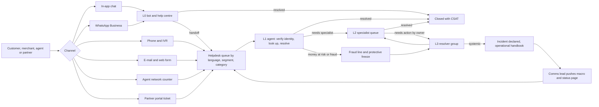
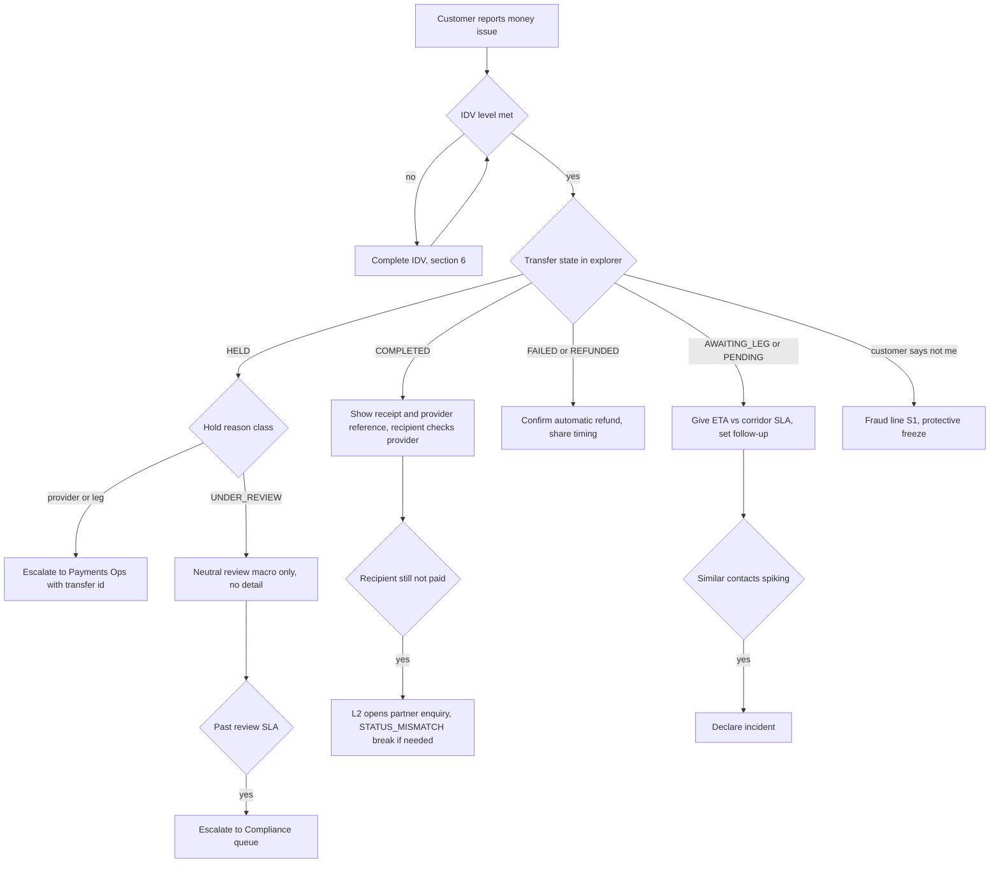

# BI-Rem — Customer & Partner Support Handbook

| Item                | Value                                                                                                                                                                                                                                                                                                                                                                                                                                                                                                                                               |
| ------------------- | --------------------------------------------------------------------------------------------------------------------------------------------------------------------------------------------------------------------------------------------------------------------------------------------------------------------------------------------------------------------------------------------------------------------------------------------------------------------------------------------------------------------------------------------------- |
| Document            | `docs/09-support-handbook.md` — how BI-Rem supports retail customers, merchants, agents and API partners: support model, channels, SLAs, ticket taxonomy, identity verification, scenario playbooks, escalation, macros, knowledge base, quality and fraud awareness                                                                                                                                                                                                                                                                                |
| Applies from        | First registered customers at Phase 2 exit (**2027-02-19**, e-mail only) → first real money at Phase 5 exit (**2027-05-28**, GH) → full model at Phase 12 go-live (**2027-11-01 → 2027-12-10**) → 7 new markets and `sw` locale in Phase 13 (**2028-01-03 → 2028-06-30**)                                                                                                                                                                                                                                                                           |
| Scale it must serve | 1,000,000 users · 100,000 transfers/day · 20 countries · 50 providers by 2028-06-30 ([`schedule.json`](./roadmap/schedule.json))                                                                                                                                                                                                                                                                                                                                                                                                                    |
| Owner               | Head of Customer Operations (accountable) · Compliance Analyst / MLRO (identity verification, tipping-off, complaints regulation) · Head of Partnerships (merchant, agent, partner segments)                                                                                                                                                                                                                                                                                                                                                        |
| Does **not** repeat | Incident lifecycle, severities, status-page templates and on-call → [operational handbook §6](./08-operational-handbook.md); go-live gates → [go-live checklist](./07-go-live-checklist.md); risk scoring → [risk register](./06-risk-register.md); access-control baseline → [security baseline](./architecture/security-baseline.md)                                                                                                                                                                                                              |
| Phase sources       | Support scenarios are taken from §15 of every phase plan, chiefly [P1](./phases/phase-01-foundation.md), [P2](./phases/phase-02-customer-kyc.md), [P4](./phases/phase-04-wallet-connectors.md), [P5](./phases/phase-05-domestic-transfers.md), [P6](./phases/phase-06-international.md), [P7](./phases/phase-07-fx-treasury.md), [P8](./phases/phase-08-aml-compliance.md), [P9](./phases/phase-09-partner-merchant.md), [P11](./phases/phase-11-mobile.md), [P12](./phases/phase-12-go-live.md), [P13](./phases/phase-13-pan-african-expansion.md) |

Rules that hold everywhere in this handbook:

1. **Verify before you serve.** No account-specific information is disclosed and no account action is taken before the identity-verification level in §6 is met.
2. **Never ask for secrets.** Agents never ask for, accept or type a password, PIN, OTP, TOTP code, recovery code, full card number (PAN), CVV or private key — not even "to check it". Any such value pasted into a ticket is redacted and the ticket flagged.
3. **No tipping-off.** When a transfer or account shows `UNDER_REVIEW`, support says only what the neutral template says (§10). Support never confirms, hints at or speculates about compliance reviews, alerts, cases, screening hits or reports to authorities ([Phase 8](./phases/phase-08-aml-compliance.md)).
4. **Support does not move money.** Refunds, reversals, releases and manual journals are executed by Payments Ops / Treasury / Finance under four-eyes; support raises the request with evidence.
5. **Every action is evidence.** Every admin-portal action carries the ticket reference in its reason field (`ticket:<id>`), so the audit trail (`audit_logs`) links the customer contact to the change.

---

## 1. Support model

### 1.1 Tiers

| Tier                     | Who                                                                                                                                               | Scope                                                                                                                                                          | Admin portal role                                                                                                                                                                 | Typical resolution share                                        |
| ------------------------ | ------------------------------------------------------------------------------------------------------------------------------------------------- | -------------------------------------------------------------------------------------------------------------------------------------------------------------- | --------------------------------------------------------------------------------------------------------------------------------------------------------------------------------- | --------------------------------------------------------------- |
| **L0 — self-service**    | Help centre, in-app status/timeline, WhatsApp and in-app bot, USSD menu (Phase 13), receipt verification page `/r/:verifyCode`                    | Status of a transfer, limits (`GET /v1/limits/me`), fees quote, KYC level and next steps, "freeze my account" self-service, password reset, device sign-out    | —                                                                                                                                                                                 | Target 40 % of contacts deflected by launch, 55 % by 2028-06-30 |
| **L1 — frontline**       | Customer agents (en/fr/pt; sw from Phase 13), merchant & agent helpline agents                                                                    | Identity verification, lookups, explanations, lockout clearing, notification resend, receipt regeneration, ticket triage, escalation                           | `SUPPORT_AGENT` (Phase 1/2: `customers:search`, `customers:read`, `users:unlock`, `mfa:reset` gated by §6 IDV-3)                                                                  | 75–80 % of human-handled tickets closed at L1                   |
| **L2 — specialists**     | Senior agents per queue: Transfers & Funding, KYC & Account, Merchant & Agent, Partner technical support, Complaints & Disputes                   | Complex investigations across Phase 4/5/6 timelines, dispute files, refund/reversal requests (maker), partner API/webhook diagnosis, complaint final responses | `SUPPORT_AGENT` + proposed `SUPPORT_SPECIALIST` (adds `transactions:read` on leg detail, `notifications:resend`, receipt regenerate, refund/reversal **request** — never approve) | 15–20 %                                                         |
| **L3 — resolver groups** | Payments Ops, Treasury Ops, Finance Ops, Compliance (MLRO, officers), Partner Ops, Security, Platform/Payments engineering, DPO / General Counsel | Resolve `HELD`/`UNKNOWN` legs, reversals, reconciliation breaks, holds and freezes, fraud cases, code defects, data-subject and regulator requests             | Their own roles (`TREASURY_OPS`, `COMPLIANCE_OFFICER`, `mlro`, `OPS_ADMIN`, …) per [operational handbook §2](./08-operational-handbook.md)                                        | ≤ 5 %                                                           |

Support never holds a role that can approve its own request: `SUPPORT_*` roles are excluded from every approver permission (`transactions:reverse`, `aml:*:approve`, `fx:margins:approve`, `connections:approve`), enforced by the RBAC separation test from [Phase 7](./phases/phase-07-fx-treasury.md) and [Phase 8](./phases/phase-08-aml-compliance.md).

### 1.2 Contact flow

### 1.3 Staffing model and cost (planning ranges)

Assumptions: human-handled contacts = transfers/day × contact rate (BAU target ≤ 1.5 per 100 transfers; Phase 12 alerts above 3 per 100) × 1.4 for non-transfer contacts (login, KYC, app) × (1 − L0 deflection); average handle time 8 min; 45 handled contacts per productive agent-day; 30 % shrinkage (training, leave, QA, breaks); 7-day coverage. Fully loaded in-house L1 cost **USD 700–1,400 per agent-month** in Accra, Nairobi, Douala or Dakar; outsourced BPO seat **USD 1,200–2,200 per month**. Excludes the Head of Customer Operations.

| Stage                                        | Dates                   | Volume assumption                                 | L1 FTE                | L2 FTE | Team leads / QA / WFM | Monthly people cost (USD) |
| -------------------------------------------- | ----------------------- | ------------------------------------------------- | --------------------- | ------ | --------------------- | ------------------------- |
| Registration only (Phase 2 exit)             | 2027-02-19 → 2027-05-27 | < 2,000 registrations/week, no money              | 1–2 (shared with ops) | —      | —                     | 1,400–2,800               |
| Domestic pilot GH/KE (Phase 5)               | 2027-05-28 → 2027-07-22 | 200–2,000 transfers/day                           | 3–4                   | 1      | 1 lead                | 5,000–10,000              |
| Cross-border, partners, mobile (Phases 6–11) | 2027-07-23 → 2027-10-31 | 2,000–8,000 transfers/day, 5 pilot partners       | 6–9                   | 2–3    | 1 lead, 1 QA          | 11,000–22,000             |
| Go-live and hypercare (Phase 12)             | 2027-11-01 → 2027-12-10 | 5,000–15,000 transfers/day, hypercare surge × 1.5 | 10–16                 | 3–4    | 2 leads, 1 QA, 1 WFM  | 19,000–38,000             |
| Expansion exit (Phase 13)                    | by 2028-06-30           | 100,000 transfers/day, 1 M users, 55 % deflection | 35–50                 | 8–12   | 6 leads, 3 QA, 2 WFM  | 70,000–140,000            |

Tooling per seat (assumptions): helpdesk suite USD 55–115/agent-month; WhatsApp Business Platform via a BSP USD 0.01–0.08 per business-initiated template message by market (user-initiated service replies within the 24 h window are free or near-free under current Meta pricing, to be re-checked at contract); cloud telephony USD 0.02–0.10 per minute plus local DIDs USD 5–30/month per market; QA/WFM add-on USD 20–60/agent-month. At the Phase 13 exit headcount this is **USD 5,000–15,000/month** for tooling, excluding message and minute volumes.

---

## 2. Channels, hours and languages

### 2.1 Channel catalogue

| Channel                                                                          | Audience                                      | Available from                                              | Hours (local market time)                                                                         | Identity basis                                                                                                      | Notes                                                                                                                                  |
| -------------------------------------------------------------------------------- | --------------------------------------------- | ----------------------------------------------------------- | ------------------------------------------------------------------------------------------------- | ------------------------------------------------------------------------------------------------------------------- | -------------------------------------------------------------------------------------------------------------------------------------- |
| **In-app chat** (customer portal and mobile app)                                 | Retail                                        | Portal: 2027-05-28 (Phase 5); mobile: 2027-10-15 (Phase 11) | Bot 24/7; humans 07:00–22:00, 7 days                                                              | Authenticated session — counts as factor 1 of IDV-1 (§6)                                                            | Preferred channel; ticket carries user id, app version, device id, locale automatically                                                |
| **WhatsApp Business** (one verified number per market, green-tick where granted) | Retail, agents                                | 2027-05-28 GH; all live markets by 2027-11-01               | Bot 24/7; humans 07:00–22:00, 7 days                                                              | Registered MSISDN match is **not** sufficient alone (SIM swap); OTP challenge in-thread via a BI-Rem link for IDV-2 | Phase 12 channel degradation ladder: in-app → WhatsApp → SMS broadcast. Only numbers listed in-app and on the help centre are official |
| **Phone / IVR** (local DID per market, toll-free where economic)                 | Retail, merchants, agents                     | 2027-05-28 GH/KE; per market at `PILOT` stage               | 08:00–20:00 Mon–Sat; **24/7 fraud and lost-phone line** from 2027-11-15 (`INTERNAL` stage)        | IVR collects registered phone and transfer reference; agent completes IDV                                           | IVR option 1 is always "I think someone else is using my account" → fraud line                                                         |
| **E-mail and web form** (`support@` per locale)                                  | All                                           | 2027-02-19 (Phase 2 exit)                                   | Intake 24/7; worked 08:00–20:00, 7 days                                                           | Registered e-mail is factor 1 only                                                                                  | Attachments scanned (ClamAV, Phase 2 pipeline) before an agent opens them                                                              |
| **Agent network counter** (Phase 9 agents)                                       | Retail customers in person; agents themselves | 2027-10-01 (Phase 9 exit)                                   | Agent opening hours; agent helpline 07:00–21:00, 7 days                                           | Agent verifies physical ID against the app profile; never handles customer credentials                              | Agents can raise a ticket on the customer's behalf from the agent operator app; cash-in disputes go to §8.9                            |
| **Partner portal ticket + partner support channel**                              | Merchants, agent networks, API partners       | 2027-09-03 (M9.2, onboarding)                               | 08:00–18:00 WAT/EAT Mon–Fri; **24/7 for payout or settlement failures** (PagerDuty `partner-api`) | Partner-realm login with MFA; API issues reference `x-request-id`                                                   | SLA per partner agreement (§3.3)                                                                                                       |
| **USSD** (Phase 13, Africa's Talking)                                            | Retail, KE/UG first                           | 2028-04-21 (M13.8)                                          | 24/7 menu, no human                                                                               | PIN on USSD session                                                                                                 | Menu offers "Call me back" which opens a phone ticket                                                                                  |
| **Social media** (public pages)                                                  | All                                           | 2027-11-01                                                  | Monitored 08:00–20:00                                                                             | None — never service an account in public                                                                           | Public reply template: move to in-app or official WhatsApp; never ask for details publicly                                             |

### 2.2 Languages and market coverage

| Locale | Markets                                                                         | Live from                          | Coverage rule                                        |
| ------ | ------------------------------------------------------------------------------- | ---------------------------------- | ---------------------------------------------------- |
| `en`   | GH, NG, KE, UG, TZ, RW, ZA, diaspora (UK, US)                                   | 2027-02-19                         | All channels                                         |
| `fr`   | SN, CI, CM, GA, TD, CG, CF, GQ (French fallback), RW (secondary), diaspora (FR) | 2027-02-19 (SN/CI KYC)             | All channels; CEMAC corridors from Phase 6           |
| `pt`   | AO, MZ, CV, GW, ST, diaspora (PT)                                               | 2027-06-25 (M6.4 catalogue)        | All channels; GW served in `pt` with `fr` fallback   |
| `sw`   | KE, UG, TZ (secondary for RW)                                                   | 2028-04-07 (M13.7 locale complete) | In-app, WhatsApp, phone in KE/TZ; e-mail best effort |

Routing uses the account `locale`, then `Accept-Language`, then the market default. A ticket is never answered in a language the customer did not use unless they ask. Machine translation may assist L1 for reading only; outgoing text uses approved macros or is written by a fluent agent.

---

## 3. Customer segments and service levels

### 3.1 Priority definitions

| Priority          | Definition                                                             | Examples                                                                                                                                                                                | Maps to incident severity ([operational handbook §6](./08-operational-handbook.md)) |
| ----------------- | ---------------------------------------------------------------------- | --------------------------------------------------------------------------------------------------------------------------------------------------------------------------------------- | ----------------------------------------------------------------------------------- |
| **S1 — Critical** | Money or account at risk **now**, or many customers blocked            | Account takeover in progress; "I did not send this"; agent with customer at the counter and float/cash-in failing; partner payouts failing in production; surge of identical complaints | Systemic S1 → P1/P2 declared by L2/L3                                               |
| **S2 — High**     | Customer cannot transact or funds are pending beyond the published SLA | Transfer `HELD` or pending > corridor SLA; funding debited but wallet not credited; merchant settlement missed; partner webhooks failing                                                | P3 if more than one customer affected                                               |
| **S3 — Normal**   | Single issue with workaround, or explanation needed                    | Fee/rate question; KYC resubmission guidance; receipt request; limit question                                                                                                           | —                                                                                   |
| **S4 — Low**      | Information, feedback, feature request                                 | "When will you support country X?"; app suggestion                                                                                                                                      | —                                                                                   |

Priority is set by impact × urgency; the helpdesk proposes it from category (§4) and the agent may only raise it, never lower it below the category floor.

| Impact ↓ / Urgency →                         | Money moving or at risk now | Blocked, funds pending | Inconvenienced | Informational |
| -------------------------------------------- | --------------------------- | ---------------------- | -------------- | ------------- |
| **Many customers / a market / a partner**    | S1                          | S1                     | S2             | S3            |
| **One customer, balance or payout affected** | S1                          | S2                     | S3             | S4            |
| **One customer, no money affected**          | S2                          | S3                     | S3             | S4            |

### 3.2 Service levels by segment

First response = first human reply (bot acknowledgements do not count). Resolution = customer issue resolved or, where an L3 owner holds it, a committed ETA given and kept. Hours: S1 is 24/7 for all segments; other priorities run in channel hours (§2.1).

| Segment                                            | S1 first response / containment                                    | S2 first response / resolution | S3 first response / resolution   | S4 first response / resolution     | Update cadence while open                                                             |
| -------------------------------------------------- | ------------------------------------------------------------------ | ------------------------------ | -------------------------------- | ---------------------------------- | ------------------------------------------------------------------------------------- |
| **Retail customer**                                | 15 min / protective action (freeze, device sign-out) within 30 min | 1 h / 24 h                     | 4 business h / 3 business days   | 1 business day / 5 business days   | S1 hourly, S2 daily                                                                   |
| **Merchant** (Phase 5 pilots, Phase 9 self-serve)  | 15 min / 4 h                                                       | 30 min / 8 h                   | 4 business h / 2 business days   | 1 business day / 5 business days   | S1 hourly, S2 every 4 h                                                               |
| **Agent** (Phase 5 pilot agents, Phase 9 networks) | 10 min when a customer is at the counter / 2 h                     | 30 min / 8 h                   | 4 business h / 2 business days   | 1 business day / 5 business days   | S1 every 30 min                                                                       |
| **API partner** (Phase 9, per agreement)           | 15 min 24/7, updates every 30 min / workaround 4 h                 | 1 business h / 1 business day  | 1 business day / 3 business days | 2 business days / 10 business days | Per partner SLA; incident reference and `platform.status` webhook for systemic issues |

Complaints (any expression of dissatisfaction requiring a response) follow the complaint clock in §11.3 in addition to these SLAs. During hypercare (14 days per market from `PILOT`, [Phase 12](./phases/phase-12-go-live.md)) S1 first response tightens to 5 min and the support backlog must stay under 24 h — a hypercare exit criterion.

### 3.3 Partner SLA alignment

Partner agreements (Phase 9) publish: API availability inherited from the platform SLO (99.9 %), webhook retry policy and ordering caveat, settlement calendar and cut-offs, support hours and the escalation ladder (partner support → partner ops lead → Head of Partnerships). Service credits, if any, are a commercial decision recorded per agreement; support never promises credits.

---

## 4. Ticket taxonomy

Every ticket carries **category**, **subcategory**, **market**, **segment**, **priority**, **linked object** (user id, transfer id or tracking reference, partner id, case-free) and **resolution code**. Subcategories map to the phase that owns the underlying process so that Phase 10 reporting can attribute contact drivers.

| Code  | Category               | Subcategories (examples)                                                                                                                                                                                              | Floor priority                          | Owning process                                                                                                     |
| ----- | ---------------------- | --------------------------------------------------------------------------------------------------------------------------------------------------------------------------------------------------------------------- | --------------------------------------- | ------------------------------------------------------------------------------------------------------------------ |
| `ACC` | Account & access       | `ACC-REG` cannot register / waitlist; `ACC-LOCK` locked after 5 failed logins; `ACC-MFA` lost TOTP or phone; `ACC-SESS` signed out unexpectedly; `ACC-BIO` biometric not working; `ACC-DEV` device management         | S3 (`ACC-MFA` S2)                       | [P1](./phases/phase-01-foundation.md), [P2](./phases/phase-02-customer-kyc.md), [P11](./phases/phase-11-mobile.md) |
| `KYC` | Verification           | `KYC-OTP` SMS OTP not received; `KYC-DOC` document rejected; `KYC-LIV` liveness failing; `KYC-STK` stuck in review; `KYC-EXP` level expired or downgraded; `KYC-CHG` change locked identity field                     | S3                                      | [P2](./phases/phase-02-customer-kyc.md)                                                                            |
| `FND` | Add money / funding    | `FND-PEND` approved on phone, wallet not credited; `FND-STK` STK/requesttopay prompt not received; `FND-CARD` card funding declined or 3DS (Phase 13); `FND-SEPA` SEPA credit not visible (Phase 13)                  | S2                                      | [P5](./phases/phase-05-domestic-transfers.md), [P13](./phases/phase-13-pan-african-expansion.md)                   |
| `TRF` | Domestic transfer      | `TRF-PEND` pending / `AWAITING_LEG`; `TRF-HELD` held; `TRF-FAIL` failed, refund question; `TRF-WRONG` wrong recipient; `TRF-DUP` tapped twice; `TRF-LIM` limit refusal                                                | S2 (`TRF-WRONG` S2, `TRF-LIM` S3)       | [P4](./phases/phase-04-wallet-connectors.md), [P5](./phases/phase-05-domestic-transfers.md)                        |
| `INT` | International transfer | `INT-WHERE` where is my money; `INT-NRCV` recipient did not receive; `INT-QEXP` quote expired; `INT-LIQ` corridor temporarily unavailable; `INT-DOCS` purpose / source of funds questions; `INT-CXL` cancel           | S2                                      | [P6](./phases/phase-06-international.md)                                                                           |
| `FEE` | Fees & FX              | `FEE-WRONG` fee looks wrong; `FEE-TAX` E-Levy / excise; `FEE-FX` rate complaint; `FEE-CMP` "worse than Google"                                                                                                        | S3                                      | [P5](./phases/phase-05-domestic-transfers.md), [P7](./phases/phase-07-fx-treasury.md)                              |
| `MER` | Merchant               | `MER-PAY` customer paid, not visible; `MER-STL` settlement amount or delay; `MER-REF` refund to customer; `MER-KYB` onboarding pending                                                                                | S2                                      | [P5](./phases/phase-05-domestic-transfers.md), [P9](./phases/phase-09-partner-merchant.md)                         |
| `AGT` | Agent                  | `AGT-FLT` float balance wrong or critical; `AGT-CIN` cash-in not credited; `AGT-COUT` cash-out OTP locked; `AGT-COM` commission dispute                                                                               | S2 (`AGT-CIN` with customer present S1) | [P5](./phases/phase-05-domestic-transfers.md), [P9](./phases/phase-09-partner-merchant.md)                         |
| `PAR` | API partner            | `PAR-KEY` key or OAuth failure; `PAR-WH` webhook not received; `PAR-SBX` sandbox vs live confusion; `PAR-PAY` payout batch stuck; `PAR-RL` rate limited                                                               | S2 (`PAR-PAY` production S1)            | [P9](./phases/phase-09-partner-merchant.md)                                                                        |
| `FRD` | Fraud & security       | `FRD-ATO` someone else in my account; `FRD-NOTME` I did not send this; `FRD-SCAM` I was tricked into sending; `FRD-PHISH` suspicious message; `FRD-LOST` lost or stolen phone; `FRD-AGENT` suspicious agent behaviour | **S1** (`FRD-PHISH` S3)                 | [P8](./phases/phase-08-aml-compliance.md), [P11](./phases/phase-11-mobile.md)                                      |
| `DSP` | Dispute & complaint    | `DSP-CHG` chargeback (Phase 13 cards); `DSP-MER` merchant dispute; `DSP-SVC` service complaint; `DSP-REG` complaint threatening regulator escalation                                                                  | S2                                      | §11.3                                                                                                              |
| `PRV` | Privacy & data rights  | `PRV-DSAR` copy of my data; `PRV-ERASE` delete my account; `PRV-RECT` correct my data; `PRV-LOC` where is my data stored (Phase 13)                                                                                   | S3 with legal clock                     | [P2](./phases/phase-02-customer-kyc.md), [P13](./phases/phase-13-pan-african-expansion.md)                         |
| `LEG` | Legal & authorities    | `LEG-REG` regulator request; `LEG-LE` law-enforcement request; `LEG-COURT` court order; `LEG-SPON` sponsor bank / partner bank request                                                                                | S2, routed directly to L3               | [P8](./phases/phase-08-aml-compliance.md), [P12](./phases/phase-12-go-live.md)                                     |
| `APP` | App & channel          | `APP-UPD` force-update screen; `APP-PUSH` no push notifications; `APP-NOTSEC` "device not secure"; `APP-MAINT` maintenance or read-only mode; `APP-STORE` not available in my store                                   | S3                                      | [P11](./phases/phase-11-mobile.md), [P12](./phases/phase-12-go-live.md)                                            |
| `FBK` | Feedback               | `FBK-FEAT`, `FBK-PRAISE`, `FBK-PILOT` pilot feedback                                                                                                                                                                  | S4                                      | Product                                                                                                            |

Resolution codes: `RESOLVED_EXPLAINED`, `RESOLVED_ACTION_SUPPORT`, `RESOLVED_ACTION_L3`, `REFUNDED`, `REVERSED`, `NO_FAULT_FOUND`, `DUPLICATE`, `CUSTOMER_UNRESPONSIVE` (after 3 contacts over 7 days), `TRANSFERRED_TO_COMPLAINT`, `CLOSED_NEUTRAL` (compliance-held, see §8.5 — no detail recorded in the ticket).

---

## 5. Tooling

### 5.1 Tool stack

| Tool                                                                                 | Purpose                                                                                                          | Decision and data rules                                                                                                                                                                                                                                                                                                                                                                                                                                |
| ------------------------------------------------------------------------------------ | ---------------------------------------------------------------------------------------------------------------- | ------------------------------------------------------------------------------------------------------------------------------------------------------------------------------------------------------------------------------------------------------------------------------------------------------------------------------------------------------------------------------------------------------------------------------------------------------ |
| **Helpdesk** (omnichannel: chat, WhatsApp, e-mail, voice, web form, partner tickets) | Ticketing, routing, SLA timers, macros, CSAT, QA sampling                                                        | Short-list Zendesk Suite and Freshdesk Omni; selection criteria: native WhatsApp BSP, EU or African data residency, SSO + SCIM to Google Workspace, sandbox, API and sidebar apps, redaction rules. Decision owner Head of Customer Operations by **2027-04-23** (M5.1) so the GH pilot launches with it. Tickets store **references** (user id, transfer reference, partner id), never document images, full ID numbers, account numbers or card data |
| **BI-Rem sidebar app** inside the helpdesk                                           | Shows a masked customer summary, KYC level, last 10 transfers with status, open `UNDER_REVIEW` flag, device list | Calls the admin API with the agent's own SSO identity (no shared token); rendered, not stored in the ticket; every lookup audited                                                                                                                                                                                                                                                                                                                      |
| **Admin portal** (`apps/admin`)                                                      | System of record for lookups and actions (§5.2)                                                                  | MFA enforced (`auth.mfa.enforce-admin`); support roles see masked PII; Restricted fields need explicit reveal with reason, which is audited                                                                                                                                                                                                                                                                                                            |
| **Telephony / IVR**                                                                  | Local numbers per market, call recording, callback                                                               | Recording notice played; recordings retained 13 months unless attached to a complaint or legal hold; card numbers must never be read out (PCI SAQ A scope, [Phase 12](./phases/phase-12-go-live.md))                                                                                                                                                                                                                                                   |
| **Knowledge base** (internal) and **help centre** (public)                           | §9                                                                                                               | Single source in the helpdesk KB with public/internal visibility; public articles also rendered in-app                                                                                                                                                                                                                                                                                                                                                 |
| **Status page** `status.bi-rem.africa`                                               | Customer-facing incident status                                                                                  | Driven by the comms lead ([operational handbook §6.4](./08-operational-handbook.md)); support links it, never improvises incident text                                                                                                                                                                                                                                                                                                                 |
| **WFM and QA**                                                                       | Forecast, schedule, QA scorecards                                                                                | Forecast from Phase 10 transfer volumes per market and hour                                                                                                                                                                                                                                                                                                                                                                                            |

### 5.2 Admin portal lookups support uses

| Need                       | Where (admin portal)                                                                                             | Phase                                         | Support may                                                                                                                                                          |
| -------------------------- | ---------------------------------------------------------------------------------------------------------------- | --------------------------------------------- | -------------------------------------------------------------------------------------------------------------------------------------------------------------------- |
| Find a customer            | Customer search (`customers:search`, trigram + exact phone/e-mail match) → Customer 360 `/customers/[id]`        | [P2](./phases/phase-02-customer-kyc.md)       | View profile (masked), KYC tab, beneficiaries (last 4 only), Security tab (devices, MFA status), Notes, Timeline                                                     |
| Account state              | `/users/[id]`: status, `locked_until`, sessions, roles                                                           | [P1](./phases/phase-01-foundation.md)         | Unlock lockout (`users:unlock`) after IDV-2; suspend on fraud report                                                                                                 |
| KYC status                 | KYC tab and KYC review workspace (read-only for support)                                                         | [P2](./phases/phase-02-customer-kyc.md)       | See status, customer-facing reason codes (`DOC_BLURRY`, `DOC_EXPIRED`, `FACE_MISMATCH`, `NAME_MISMATCH`), ETA; **not** decide, preview documents or see risk factors |
| Transfer status            | Transfers explorer and saga inspector (timeline, `transfer_events`, fee lines, receipt)                          | [P5](./phases/phase-05-domestic-transfers.md) | Read; regenerate receipt; resend notification; raise refund/reversal request                                                                                         |
| Provider leg detail        | Wallet transaction explorer `/wallet/transactions/:id` with events timeline; webhook events                      | [P4](./phases/phase-04-wallet-connectors.md)  | L2 read only; resolve/refresh is Payments Ops                                                                                                                        |
| Cross-border tracking      | Cross-border explorer, lookup by tracking reference, timeline, payout leg                                        | [P6](./phases/phase-06-international.md)      | Read; give ETA vs corridor SLA                                                                                                                                       |
| Rate explanation           | FX Explain view (quote id → publication id → inputs)                                                             | [P7](./phases/phase-07-fx-treasury.md)        | L2 read                                                                                                                                                              |
| Merchant / agent / partner | `/partners/:id` 360 (profile, KYB timeline, balances, settlements, credentials metadata, webhooks, usage, audit) | [P9](./phases/phase-09-partner-merchant.md)   | Read; replay webhook (L2 partner tech support with `outbound-webhooks:replay`)                                                                                       |
| Notifications              | `/v1/notifications/queue` and per-user notification log with `lastError`                                         | [P1](./phases/phase-01-foundation.md)         | Resend; check delivery status and SMS fallback                                                                                                                       |
| Devices                    | Mobile operations console: devices per user, sign-out, block                                                     | [P11](./phases/phase-11-mobile.md)            | Sign out a device after IDV-2; block after IDV-2 on lost-phone report                                                                                                |
| Audit trail                | Audit explorer: filter by actor, action, resource, correlation id, before/after diff                             | [P1](./phases/phase-01-foundation.md)         | Trace "what changed and who did it" — e.g. password changed, beneficiary added, device enrolled — when a customer disputes an action                                 |
| Incidents                  | Operations → Incidents, quick declare form                                                                       | [P12](./phases/phase-12-go-live.md)           | Declare from a complaint surge (§7.3)                                                                                                                                |

### 5.3 Using the audit trail in support

- **Disputed actions.** For "I never added this beneficiary" or "I did not change my phone", filter the audit explorer by `actor = user`, `action in (beneficiaries.create, profile.update, mfa.enrol, devices.register)`, compare IP, user agent and device id with the customer's usual pattern, and attach the correlation ids to the ticket — not the raw IPs.
- **Our own actions.** Every support mutation carries `ticket:<id>` in the reason; QA reviews the agent's audit rows against the ticket weekly (§11.1).
- **Denied actions.** A `DENIED` outcome on a support account (e.g. an attempt to reveal a field without permission) is reviewed by Security within one business day.

---

## 6. Identity verification before servicing

Support must reach the required level **before** disclosing account-specific information or acting. Levels are cumulative.

| Level                | Needed for                                                                                                                                                                | Factors (all of)                                                                                                                                                                                                                              | Channel notes                                                                                                                                                         |
| -------------------- | ------------------------------------------------------------------------------------------------------------------------------------------------------------------------- | --------------------------------------------------------------------------------------------------------------------------------------------------------------------------------------------------------------------------------------------- | --------------------------------------------------------------------------------------------------------------------------------------------------------------------- |
| **IDV-0**            | General information: fees in general, corridors, how KYC works, opening hours                                                                                             | None                                                                                                                                                                                                                                          | Any channel, including social media                                                                                                                                   |
| **IDV-1**            | Status of the customer's own transfers, KYC status, limits, explaining a fee line                                                                                         | (a) authenticated in-app session **or** contact from the registered e-mail/phone; **and** (b) two knowledge items from: full name as registered, date of birth, last transfer amount and date, a beneficiary name, transfer reference         | In-app chat satisfies (a) automatically; WhatsApp/phone need (b) even when the number matches                                                                         |
| **IDV-2**            | Account actions: unlock lockout, sign out or block a device, resend receipts to a new address, raise refund/reversal request, update notification preferences             | IDV-1 **plus** a possession check on the registered channel: in-app push confirmation ("Is this you contacting support?") or a one-time link sent by SMS/e-mail that the customer opens — the agent never hears a code                        | If the customer reports the phone lost, use the e-mail link; if both are unavailable go to IDV-3                                                                      |
| **IDV-3**            | High-risk changes: MFA reset, registered phone number change, e-mail change, recovery after suspected takeover, unfreezing after a protective freeze, beneficiary restore | IDV-2 (or documented impossibility) **plus** biometric re-verification: a KYC `PROFILE_CHANGE` / re-verification session (selfie + liveness against the KYC portrait, [Phase 2](./phases/phase-02-customer-kyc.md)) completed by the customer | A 24 h cooling-off applies after a phone number change: new beneficiaries and outbound transfers above LEVEL_1 limits are blocked; sender notified on the old channel |
| **IDV-P** (partners) | Partner account changes, credentials, bank account changes                                                                                                                | Partner-realm login with MFA, request from a member with the relevant partner role; bank account change subject to the 24 h cooling-off ([Phase 9](./phases/phase-09-partner-merchant.md))                                                    | Never accept partner changes by e-mail alone                                                                                                                          |

Rules:

1. Knowledge items are checked by the agent against the masked view; the agent never reads them out first ("Is your date of birth 12 March?" is forbidden).
2. Three failed IDV attempts in 24 h lock support servicing for that account to IDV-3 and create an `FRD-ATO` review ticket.
3. Third parties (family, employers, "my cousin's account") are never served without the account holder present and verified, except a documented power of attorney or court order handled by Legal (§8.13).
4. An agent at a counter (Phase 9) verifies a physical ID against the customer profile name and photo shown in the agent app; the agent never logs into the customer's account.
5. The IDV result is recorded on the ticket as a level and method (`IDV-2/push`), never the answers.

---

## 7. Escalation

### 7.1 Escalation matrix

| From  | To                                                        | Trigger                                                                                                                           | How                                                                                  | Response target                                                     |
| ----- | --------------------------------------------------------- | --------------------------------------------------------------------------------------------------------------------------------- | ------------------------------------------------------------------------------------ | ------------------------------------------------------------------- |
| L1    | L2 queue (per specialism)                                 | Outside L1 permissions; investigation across systems; complaint; partner technical                                                | Helpdesk escalate with checklist completed (IDV level, references, what was checked) | Per §3.2 of the ticket's priority                                   |
| L1/L2 | **Fraud line** (L2 fraud desk + Compliance fraud on-call) | Any `FRD-*` S1                                                                                                                    | Phone bridge or helpdesk S1 + page `compliance` service                              | Ack 15 min, protective action 30 min                                |
| L2    | **Payments Ops**                                          | Transfer `HELD`, leg `UNKNOWN`, funding debited not credited, refund/reversal request, duplicate suspicion                        | Helpdesk → Payments Ops queue with transfer id; S1 pages `payments`                  | 1 h (business line), S1 page ack 15 min                             |
| L2    | **Treasury Ops**                                          | Corridor `CORRIDOR_LIQUIDITY_LOW`, agent float critical during network issue, rate unavailable for > 15 min                       | Treasury channel; CRITICAL pages `birem-treasury`                                    | 30 min                                                              |
| L2    | **Finance Ops**                                           | Merchant or partner settlement dispute, statement totals, fee-line refund                                                         | Finance queue                                                                        | 1 business day                                                      |
| L2    | **Compliance**                                            | Customer asks about review > SLA; tipping-off risk; suspected money mule; regulator mention; travel-rule profile completion issue | Compliance queue (restricted); never in a public channel                             | 4 business h; SLA breach on held transfers pages compliance on-call |
| L2    | **Partner Ops**                                           | KYB delays beyond 2 business days; partner suspension; credential compromise                                                      | Partner ops queue; S1 pages `partner-api`                                            | 1 business h; S1 15 min                                             |
| L2    | **Security**                                              | Suspected agent or staff social engineering; leaked API key; phishing campaign; support account anomaly                           | Security channel + `platform` page for active compromise                             | 30 min                                                              |
| L2/L3 | **Engineering (incident)**                                | ≥ 5 similar contacts in 30 min, or ≥ 3 per 100 transfers in a market over 1 h, or any money-correctness doubt                     | Operations → Incidents quick form, linked to PagerDuty service                       | Per [operational handbook §6](./08-operational-handbook.md)         |
| L2    | **DPO / General Counsel**                                 | DSAR, erasure, rectification beyond simple profile edits; law-enforcement or court request; data breach suspicion                 | Privacy queue; breach suspicion → incident with regulatory liaison                   | 1 business day; breach clock per operational handbook §6.3          |
| Any   | **Head of Customer Operations**                           | VIP / media / regulator-sensitive complaint, threat of legal action, repeated SLA breach                                          | Direct + ticket tag `exec-attention`                                                 | Same business day                                                   |

### 7.2 Escalation flow for money issues

### 7.3 Surge detection

A support lead declares an incident (Operations → Incidents) when any of the following occurs, without waiting for engineering alerts: ≥ 5 contacts in 30 minutes with the same subcategory and market; ≥ 3 support contacts per 100 transfers in a market over an hour (the Phase 12 launch alert threshold); any report of a duplicated or missing transfer reference after a DR failover; any report of a fake BI-Rem WhatsApp number or SMS campaign. The comms lead then pushes the incident macro to the helpdesk so agents answer consistently.

---

## 8. Playbooks

Each playbook gives **checks** (in order), **decision**, **actions**, **customer message** (macro id from §10) and **escalation**. Paths refer to §5.2.

### 8.1 Failed or pending transfer

_Scenarios: funding approved on phone but wallet not credited; money left the wallet but recipient did not receive; transfer `HELD`; funding pending because the customer has not authorised; transfer refused because a corridor or feature is disabled; sender asks where cross-border money is._

1. IDV-1. Find the transfer by reference, tracking ref (`/transfers/track/:reference`, Phase 6 tracking ref) or from the Customer 360 timeline.
2. Read the **timeline** (`transfer_events`) and, for external legs, the leg state in the wallet transaction explorer.
3. Decide:
   - `AWAITING_LEG` / provider pending, within SLA → macro `TRF_PENDING` with ETA (domestic external p95 20 s target, so a domestic leg pending > 15 min is unusual; cross-border payout target p95 < 15 min per corridor SLA). Set a follow-up at the SLA.
   - Funding pending and `customerActionRequired` → macro `FND_AUTHORISE`: the customer must approve on their phone; reminder fires at 2 min, auto-fail at 15 min with reservation release.
   - `FAILED` with `transfer.refunded` → macro `TRF_REFUNDED` with refund time (wallet refunds are immediate; provider reversals per provider).
   - `HELD` with a provider/leg reason → escalate to Payments Ops (S2); macro `TRF_HELD_CHECKING` ("we are checking this transfer with the provider"). Customer told within 24 h; Payments Ops resolves with provider evidence and four-eyes.
   - `HELD` with `UNDER_REVIEW` → §8.5 neutral handling only.
   - `503 feature-disabled` / corridor `PAUSED` → link status page; macro `SVC_PAUSED`; transfers parked `HELD` during a corridor pause complete or refund when resumed.
   - Cross-border `CORRIDOR_LIQUIDITY_LOW` → macro `INT_UNAVAILABLE`: temporary, suggest smaller amount or later; Treasury is pre-funding.
   - Quote expired before confirm → explain the lock window and countdown; check the customer's device clock is not the cause (the app uses server-time countdown).
4. Recipient says not received but status `PAID_OUT`/`COMPLETED` → share the provider transaction id from the leg (not internal ids) so the recipient checks with their wallet provider; if still disputed after 24 h, L2 opens a partner enquiry and Payments Ops raises a `STATUS_MISMATCH` break.
5. Never re-send a transfer on the customer's behalf; never tell a customer to "try again" while the original is pending (idempotency protects against duplicates but customers misread two attempts).

### 8.2 Wrong recipient or reversal request

1. IDV-2. Confirm the transfer, recipient as entered, and time since completion.
2. Explain the rules: completed mobile-money transfers are **not** automatically reversible; BI-Rem can request recovery from the recipient's provider; merchant payments can be reversed within **24 h with merchant agreement** ([Phase 5](./phases/phase-05-domestic-transfers.md)).
3. If not completed and the pull leg is not yet submitted → the customer can cancel in-app (`/transfers/:id/cancel`); cross-border cancel is allowed only before the pull leg is submitted.
4. If completed → L2 raises a **reversal request** with reason code `CUSTOMER_ERROR`, evidence (screenshot of entered number, customer statement) and the ticket id. Payments Ops contacts the provider; a reversal posts a `REVERSAL` journal under four-eyes with recent MFA. Macro `TRF_RECOVERY_REQUESTED` — never promise recovery.
5. If the customer says they were tricked into sending (`FRD-SCAM`) → also run §8.5 fraud steps (the recipient may be a mule).
6. Close only when Payments Ops confirms recovered or not recoverable; final message uses `TRF_RECOVERY_RESULT`.

### 8.3 KYC rejected or stuck

_Scenarios: SMS OTP not received or 3-per-day cap reached; document rejected (`DOC_BLURRY`, `DOC_EXPIRED`, `FACE_MISMATCH`, `NAME_MISMATCH`) or flagged `INFECTED`; liveness failing on low-end Android; application stuck in `PENDING_REVIEW` or `PROVIDER_PROCESSING`; level expired after the nightly sweep; locked identity field change; waitlist because registration is not open in the country._

1. IDV-1 (for registration problems before an account exists, IDV-0 plus the phone number).
2. Check the KYC tab: status, reason code, policy version, last check per provider, SLA.
3. Decide:
   - OTP not delivered → check notification log for the OTP SMS and operator; advise waiting for the resend cooldown; DND/operator filtering suspected → L2 checks per-operator delivery rate and the secondary SMS route; cap reached → retry after 24 h (no override).
   - Rejected with reason code → macro `KYC_RESUBMIT` with the reason-specific tip (lighting, all four corners, document validity, name exactly as on ID).
   - `INFECTED` → ask for a fresh photo taken in-app, not a forwarded file.
   - Liveness failing → device guidance; offer "continue on another device"; L2 can request a resubmission on the fallback provider route; persistent failure → manual review route.
   - Stuck beyond ETA (compliance SLA 4 h LOW/MEDIUM, 24 h HIGH) → escalate to the compliance review queue; customer macro `KYC_IN_REVIEW` with the ETA. A provider ID-authority lookup (NIN/BVN, Ghana Card) may "take up to 24 h".
   - Expired / downgraded → macro `KYC_REVERIFY` with the in-app path.
   - Change to name, date of birth or ID number → customer submits a `PROFILE_CHANGE` application; support cannot edit locked fields.
   - Waitlist → `auth.registration.open` is off or the rollout percentage has not reached them; macro `REG_WAITLIST`; no manual bypass.
4. Support never sees document images (watermarked previews are reviewer-only) and never asks for documents by e-mail or WhatsApp.

### 8.4 Account locked or MFA device lost

_Scenarios: locked 15 minutes after 5 failed logins or MFA codes; lost TOTP device; fingerprint stopped working after a phone update; unexpected sign-out (refresh-token reuse revoked the family, or password change signed out other devices); operator lost TOTP device._

1. Lockout only → tell the customer it clears automatically after 15 minutes; after IDV-2 an L1 agent may clear it (`POST /v1/users/:id/unlock`) — always with the reset-password suggestion if the customer did not cause the failures.
2. Lost authenticator → first try a **recovery code**; otherwise **IDV-3** then `mfa:reset` and forced re-enrolment at next login.
3. Biometric invalidated (key invalidated by an enrolment change, [Phase 11](./phases/phase-11-mobile.md)) → log in with PIN, then re-enrol biometrics; no support action needed.
4. Unexpected sign-out → check audit for `auth.refresh.reuse_detected` or `auth.password.changed`; if the customer did not change the password, treat as §8.5.
5. Admin operators (realm `ADMIN`) are never handled by customer support: route to the IT/Security service desk; admin MFA reset needs `mfa:reset`, recent MFA of the resetter and a documented reason.

### 8.5 Suspected fraud or account takeover

_Scenarios: "I did not send this"; new device + new beneficiary + max send; SIM swap; lost or stolen phone; customer paused "for security"; suspicious "you're in the pilot" message; suspected agent fraud._

1. **Contain first, verify second.** If the caller says their account is being used now, any agent may trigger the protective path even before full IDV: suspend sessions (sign out all devices) and place a protective freeze request — protective actions cannot move money out, so they are safe to apply on a weak signal. Then complete IDV.
2. Page the fraud desk (S1). Compliance fraud on-call reviews within the fraud SLA (1 h, [Phase 8](./phases/phase-08-aml-compliance.md)); `CRITICAL` fraud alerts may already have frozen the wallet automatically.
3. Collect: time the customer last used the app, whether they shared any code or installed a screen-sharing app, whether their SIM stopped working (SIM swap), and list of transfers they do not recognise. Record on the ticket; Compliance links to the case (support cannot see the case).
4. Lost phone → sign out and block the device (Mobile operations console), keys and sessions revoked; new-device alert will fire on re-enrolment.
5. Recovery → IDV-3 re-verification, new password, MFA re-enrolment, unfreeze through Compliance approval (four-eyes). Support communicates only the outcome.
6. Transfers already completed to a fraudster → reversal/recovery request as §8.2 with reason `FRAUD_REPORTED`; Payments Ops and Compliance own outcomes.
7. Phishing report → collect the sender number/URL (screenshot), forward to Security, macro `FRD_PHISH_THANKS`; never click links.
8. **Neutral holds.** If the account or transfer shows `UNDER_REVIEW` and the customer did not report fraud, this is a compliance matter: use macro `REVIEW_NEUTRAL` only — "being reviewed, usually up to 2 hours, we will notify you". Do not say fraud, AML, sanctions, suspicious, flagged, police or report. If the review is past SLA, escalate to Compliance queue; close the ticket with `CLOSED_NEUTRAL` when the customer is notified by the platform.
9. Travel-rule profile completion → the customer is asked to complete profile fields for a cross-border transfer; explain the regulator requirement (macro `INT_PROFILE`); the transfer resumes automatically.

### 8.6 Dispute

1. Classify: merchant dispute (customer vs merchant), service complaint, card chargeback (Phase 13 card funding), commission dispute (agent), settlement dispute (partner).
2. Merchant dispute → check `LIABILITY:MERCHANT` entry and `merchant.payment_received` notification; within 24 h and with merchant agreement → reversal request; otherwise mediate and record both statements.
3. Card chargeback → Finance/Payments receive the scheme notice; support informs the customer of the scheme timeline, never the merchant's or issuer's internal data; a Phase 8 case may be opened.
4. Any dispute not resolved at first contact becomes a **complaint** (§11.3) with the complaint clock.

### 8.7 FX rate complaint

_Scenarios: rate shown vs received; "Google shows a better rate"; "rate temporarily unavailable"; partner asks for a better rate._

1. IDV-1. Open the transfer → `fx_conversions` → quote id, publication id, lock vs confirmation time; L2 can open the **Explain** view ([Phase 7](./phases/phase-07-fx-treasury.md)).
2. Locked quote honoured → macro `FX_EXPLAIN`: shows rate, margin disclosure, fee and receive amount from the receipt; the same customer rate appears in the quote, receipt and settlement.
3. Re-quoted (lock expired) → show both quotes and times.
4. Mid-market comparison → explain the margin disclosure, the mid reference and total cost %; point to the public rates history page.
5. "Rate temporarily unavailable" → publication stale or frozen; status page; retry later.
6. Defect confirmed (rate applied ≠ locked rate) → escalate to Treasury Ops (S2); goodwill only through Finance approval; incident if more than one customer affected.
7. Partner rate requests → Partner Ops (segment margin schedules are maker-checker approved; support never quotes discounts).

### 8.8 Merchant settlement query

1. IDV-P (partner portal) or merchant owner verified by phone with IDV-2 against the partner member record.
2. Check the settlement run for the cycle: statement lines, fee schedule/MDR, refunds, reserve, adjustments ([Phase 9](./phases/phase-09-partner-merchant.md)).
3. "Customer paid, not visible" → check payment request status and the transfer (`AWAITING_LEG` means the provider has not confirmed); share timing.
4. Amount disputed → L2 compares with the statement; if an error is confirmed, Finance raises a four-eyes adjustment.
5. Payout missing → payout file status and bank reference; returned funds (bank recall) → instruction `RETURNED`, bank account disabled pending re-verification, partner notified.
6. Settlement run `FAILED` → Finance owns; support gives the partner the ETA from Finance.

### 8.9 Agent float issue

_Scenarios: float balance looks wrong; float critical; customer gave cash but wallet not credited; cash-out OTP entered wrong three times; commission dispute; agent cannot confirm a cash-out in agent mode._

1. Agent identity via the agent operator app login (partner realm) or helpline with IDV-2 against the operator record.
2. Float wrong → compare float movements vs ledger, pending top-up pull in `UNKNOWN`, network transfers, open `AGENT_FLOAT` reconciliation breaks.
3. Float critical → guide the top-up (funding request), alert is already with the network; escalate to Treasury only for platform-side delays.
4. Cash-in not credited (S1 if the customer is present) → trace the cash-in transfer, OTP confirmation status and operator id; if the transfer did not complete, the agent must not hand back or re-take cash before support confirms state; dispute between agent and customer → Partner Ops and Compliance (agent fraud controls).
5. Cash-out OTP locked after three wrong entries → transfer is cancelled and funds released to the customer; customer restarts; **no override** of the OTP lockout.
6. Commission dispute → explain the plan version from `commission_accruals`; formal disputes to Partner Ops with the monthly statement.
7. Agent mode not available in the app → Phase 9 flag or permission; check the operator's role in the partner team.

### 8.10 Partner API or webhook issue

_Scenarios: API key stopped working; webhook not received; sandbox vs live confusion; payout batch stuck; rate limited; suspected leaked key; OAuth token failing after rotation._

1. Ask for `x-request-id`, timestamp, environment host and key prefix (never the secret). Check key status (revoked/expired), IP allow-list, scope after member role change, `lastUsedIp`, and the audit log.
2. Sandbox vs live → environment header, key prefix, host and dashboard banner; reset the sandbox partner if requested.
3. Webhook missing → event exists, subscription active and matching type, attempts and responses; replay; explain the documented retry policy, ordering caveat and signature timestamp tolerance; auto-disabled subscription after 410 → partner re-enables.
4. Payout batch stuck → per-item statuses, `UNKNOWN` legs, partner balance reservation; escalate to Payments Ops.
5. Rate limited → show tier and `RateLimit-*` headers; tier overrides only via Partner Ops approval.
6. Suspected leaked key → revoke immediately (partner can self-revoke; Partner Ops can revoke), rotate, review usage in the window, notify Compliance if payouts occurred — S1.
7. Systemic (many partners) → incident; `platform.status` webhook and status page.

### 8.11 Data-subject access and erasure requests

1. Accept requests from any channel; IDV-2 minimum (IDV-3 for erasure). Log `PRV-*` with the **statutory clock** — default 30 days, shorter or longer per country as recorded by counsel in the regulator profile (NDPA, Kenya DPA, Ghana DPA, Senegal and Côte d'Ivoire laws; South Africa POPIA and others in Phase 13).
2. Route to the Privacy queue (DPO). Support does not export data itself.
3. Access request → DPO produces the export pack; delivered through the authenticated portal with a 15-minute signed URL, never by e-mail attachment.
4. Erasure → the admin **Anonymise** action (`customers:anonymise`) pseudonymises profile fields and crypto-shreds documents outside retention while keeping AML records for the legal period (10 years under Phase 8 retention policies). A legal hold or open case blocks anonymisation silently — support uses macro `PRV_ERASE_PARTIAL`, which explains legal retention without revealing any case.
5. Rectification → simple fields by the customer in-app; identity fields via `PROFILE_CHANGE`.
6. "Where is my data stored?" (Phase 13 cells `eu1`/`af1`) → macro `PRV_LOCATION` with the published data-location notice.

### 8.12 Regulator or law-enforcement request

1. Support never answers a regulator, police officer, FIU or court directly, whatever the channel or urgency claimed, and never confirms whether a person is a customer.
2. Record the requester's name, organisation, contact and reference; tell them the request will be handled by the legal/compliance team; route to `LEG-*` (General Counsel + MLRO).
3. Compliance opens a `REGULATOR_REQUEST` case, applies a legal hold and produces the export pack ([Phase 8](./phases/phase-08-aml-compliance.md)); sponsor banks and partners requesting originator information are served via travel-rule payload retrieval by Compliance.
4. Customer is not told about a law-enforcement or FIU request (tipping-off); a subsequent customer question gets `REVIEW_NEUTRAL` only.

### 8.13 Other recurring scenarios

| Scenario                                                                       | Handling                                                                                                                                                                         |
| ------------------------------------------------------------------------------ | -------------------------------------------------------------------------------------------------------------------------------------------------------------------------------- |
| Customer blocked by a limit                                                    | Show `/limits/me` data (remaining, next reset in the country's time zone); point to KYC upgrade; temporary overrides only via compliance supervisor — support never promises one |
| Fee looks wrong (incl. E-Levy / excise)                                        | Compare `transfer_fee_lines` with the schedule active at creation; explain the exemption threshold; if the schedule was wrong, Finance refunds via fee-line reversal (four-eyes) |
| Customer wants a receipt                                                       | `GET /transfers/:id/receipt` signed URL; regenerate if missing (idempotent); verification at `/r/<code>`                                                                         |
| Pilot caps lower than advertised / cannot access while a friend can            | Explain pilot or soft-launch cohort (stable user-id hash), `FEATURE_DISABLED`; no manual cohort moves                                                                            |
| Maintenance or read-only screen                                                | Link status page with expected end time; no workaround                                                                                                                           |
| App says "update required" with no store access                                | Hard-minimum rationale, APK size, data-saver tips; portal remains available                                                                                                      |
| "App says my device is not secure" (custom ROM)                                | RASP degrade explanation and limits; offer portal; allow-list only after IDV-3 and Security approval if a false positive                                                         |
| Push notifications not arriving (Xiaomi/Tecno)                                 | Battery optimisation guidance per OEM; SMS fallback confirms delivery                                                                                                            |
| Duplicate device entries after reinstall                                       | Old install retires automatically after 180 days; L1 can retire manually after IDV-2                                                                                             |
| Beneficiary validation error / 50-active cap / accidental delete               | Explain NUBAN, M-Pesa, Wave/Orange/MTN prefix rules; cap is fixed; restore within 30 days after IDV-3                                                                            |
| Customer received suspicious "you're in the pilot" message                     | Phishing variant of launch comms; genuine messages are also in the in-app inbox and never link to login — `FRD_PHISH_THANKS`                                                     |
| Recipient's provider charged a cash-out fee                                    | Per-route recipient fee disclosure; receive amount is guaranteed at wallet credit                                                                                                |
| Why purpose and source of funds are required                                   | Regulator requirement per corridor; help article                                                                                                                                 |
| Cross-region account not found / cannot log in after moving country (Phase 13) | L2 checks the locate result and re-homing status; macro explains data location; never creates a second account                                                                   |
| Bank payout pending for hours (Phase 13)                                       | Rail status, ISO status/reason (`AC01`/`AC04` invalid or closed account → refund timeline and correct details), bank cut-off calendar                                            |
| Card not eligible for instant push / card funding declined (Phase 13)          | Explain eligibility result or acquirer response; offer other rails; **never request the card number**                                                                            |
| Name-enquiry mismatch blocks a send (Phase 13)                                 | Explain, ask the customer to verify with the recipient; override policy owned by Compliance                                                                                      |
| USSD PIN locked (Phase 13)                                                     | Unlock via portal/app or support after IDV-2                                                                                                                                     |
| Low in-app CSAT with complaint text during hypercare                           | Auto-ticket S3 tagged `hypercare`; reaches the daily launch report                                                                                                               |
| Brief outage then duplicated or missing transfer reference after DR failover   | S2, escalate to Payments Ops with all references; reconciliation confirmation sent to the customer                                                                               |

---

## 9. Knowledge base

### 9.1 Structure

| Space                                                                      | Audience                          | Sections                                                                                                                                                                                                                                                                   | Owner                                                                     | Review                                                                  |
| -------------------------------------------------------------------------- | --------------------------------- | -------------------------------------------------------------------------------------------------------------------------------------------------------------------------------------------------------------------------------------------------------------------------- | ------------------------------------------------------------------------- | ----------------------------------------------------------------------- |
| **Help centre** (public; rendered in portal `/help`, app and WhatsApp bot) | Customers, merchants, agents      | Getting started · Verify your identity (per country) · Add money (per provider) · Send money (domestic, international per corridor) · Fees, limits and rates · Track a transfer · Security and scams · Your data and privacy · Merchants · Agents · Status and maintenance | Content owner per section; legal review for fees, disclosures and privacy | Quarterly, and on every fee schedule, corridor or policy version change |
| **Developer docs** `developers.bi-rem.app`                                 | API partners                      | Authentication, sandbox magic MSISDNs, webhooks and signatures, errors, rate limits, versioning                                                                                                                                                                            | Partner technical support + Backend lead                                  | Every API version                                                       |
| **Internal KB**                                                            | L1–L3                             | Playbooks (§8, one article each), macros (§10), product facts per market (providers, cut-offs, limits per KYC level, corridor SLAs), system states glossary (`AWAITING_LEG`, `HELD`, `UNKNOWN`, `UNDER_REVIEW`, `PAID_OUT`), escalation directory, known issues            | Support team leads                                                        | Monthly; known-issues page updated in real time during incidents        |
| **Restricted KB**                                                          | Fraud desk, L2 compliance liaison | Fraud typologies and scripts, social-engineering cases                                                                                                                                                                                                                     | Compliance + Security                                                     | Quarterly                                                               |

### 9.2 Article standard

Every article has: audience, markets, locale versions (en/fr/pt; sw from Phase 13), owning phase/process, last verified date, linked macro ids, and a "what support may and may not say" box. Articles that state numbers (limits, fees, SLAs, cut-offs) pull them from configuration exports, not hand-typed copies, and are regenerated when the underlying policy version changes. Translations are reviewed by a fluent reviewer before publication (localisation review budget in [Phase 11](./phases/phase-11-mobile.md) and [Phase 12](./phases/phase-12-go-live.md)).

---

## 10. Macros and templates

Macros are stored in the helpdesk with ids, locale variants and placeholders `{{…}}`. Compliance reviews every macro touching holds, fraud or data rights for tipping-off; the English master is approved first and translations second. Examples:

### `TRF_PENDING` — transfer pending with provider

- **en**: Hello {{first_name}}, your transfer {{reference}} of {{amount}} is with {{provider}} and is being processed. Most transfers like this complete within {{eta}}. Your money is safe: if it cannot be delivered, it is refunded to your BI-Rem wallet automatically. We will message you as soon as it completes.
- **fr** : Bonjour {{first_name}}, votre transfert {{reference}} de {{amount}} est en cours de traitement chez {{provider}}. La plupart des transferts de ce type aboutissent en {{eta}}. Votre argent est en sécurité : s'il ne peut pas être livré, il sera remboursé automatiquement sur votre portefeuille BI-Rem. Nous vous informerons dès qu'il sera terminé.
- **pt**: Olá {{first_name}}, a sua transferência {{reference}} de {{amount}} está a ser processada pela {{provider}}. A maioria das transferências deste tipo fica concluída em {{eta}}. O seu dinheiro está seguro: se não puder ser entregue, será reembolsado automaticamente na sua carteira BI-Rem. Vamos avisá-lo assim que estiver concluída.

### `TRF_REFUNDED` — failed and refunded

- **en**: Your transfer {{reference}} could not be delivered by {{provider}}. We have refunded {{amount}} (including fees) to your BI-Rem wallet on {{refund_time}}. You can try again or choose another recipient method.
- **fr** : Votre transfert {{reference}} n'a pas pu être livré par {{provider}}. Nous avons remboursé {{amount}} (frais inclus) sur votre portefeuille BI-Rem le {{refund_time}}. Vous pouvez réessayer ou choisir un autre moyen de réception.
- **pt**: A sua transferência {{reference}} não pôde ser entregue pela {{provider}}. Reembolsámos {{amount}} (incluindo taxas) na sua carteira BI-Rem em {{refund_time}}. Pode tentar novamente ou escolher outro método de receção.

### `REVIEW_NEUTRAL` — transfer or account under review (tipping-off safe)

- **en**: Thank you for your patience. Your transfer is being reviewed. This usually takes up to 2 hours and we will notify you as soon as it is complete. There is nothing you need to do right now.
- **fr** : Merci de votre patience. Votre transfert est en cours de vérification. Cela prend généralement jusqu'à 2 heures et nous vous informerons dès que ce sera terminé. Vous n'avez rien à faire pour le moment.
- **pt**: Obrigado pela sua paciência. A sua transferência está a ser analisada. Normalmente demora até 2 horas e iremos notificá-lo assim que estiver concluída. Não precisa de fazer nada neste momento.
- **Agent note (internal only)**: do not add reasons, do not speculate, do not mention compliance, fraud, sanctions or authorities. If asked "why", repeat that reviews are routine for the safety of all customers.

### `KYC_RESUBMIT` — document rejected

- **en**: We could not verify your {{document_type}} because {{reason_plain}}. Please submit it again from the app: place the document on a dark, flat surface, make sure all four corners are visible and avoid glare. It usually takes a few minutes.
- **fr** : Nous n'avons pas pu vérifier votre {{document_type}} car {{reason_plain}}. Veuillez le soumettre à nouveau depuis l'application : posez le document sur une surface plane et sombre, vérifiez que les quatre coins sont visibles et évitez les reflets. Cela ne prend généralement que quelques minutes.
- **pt**: Não foi possível verificar o seu {{document_type}} porque {{reason_plain}}. Envie-o novamente pela aplicação: coloque o documento numa superfície plana e escura, garanta que os quatro cantos estão visíveis e evite reflexos. Normalmente demora apenas alguns minutos.

### `ACC_LOCKED` — account locked

- **en**: For your security, sign-in is paused for 15 minutes after several incorrect attempts. After that you can sign in again or reset your password from the sign-in screen. BI-Rem will never ask you for your password, PIN or codes.
- **fr** : Pour votre sécurité, la connexion est suspendue pendant 15 minutes après plusieurs tentatives incorrectes. Vous pourrez ensuite vous reconnecter ou réinitialiser votre mot de passe depuis l'écran de connexion. BI-Rem ne vous demandera jamais votre mot de passe, votre code PIN ou vos codes.
- **pt**: Por segurança, o início de sessão fica suspenso durante 15 minutos após várias tentativas incorretas. Depois disso, pode voltar a entrar ou redefinir a sua palavra-passe no ecrã de início de sessão. A BI-Rem nunca lhe pedirá a palavra-passe, o PIN ou códigos.

### `FRD_PROTECT` — protective action taken

- **en**: We have signed out all devices and paused outgoing transfers on your account to protect your money. Our security team will contact you within {{sla}}. Please do not share any codes with anyone, including people claiming to be from BI-Rem.
- **fr** : Nous avons déconnecté tous les appareils et suspendu les transferts sortants de votre compte pour protéger votre argent. Notre équipe sécurité vous contactera sous {{sla}}. Ne communiquez aucun code à personne, y compris à des personnes se présentant comme employés de BI-Rem.
- **pt**: Terminámos a sessão em todos os dispositivos e suspendemos as transferências de saída da sua conta para proteger o seu dinheiro. A nossa equipa de segurança irá contactá-lo dentro de {{sla}}. Não partilhe códigos com ninguém, incluindo pessoas que digam ser da BI-Rem.

### `FX_EXPLAIN` — rate explanation

- **en**: Your transfer {{reference}} used the rate locked at {{quote_time}}: 1 {{send_ccy}} = {{customer_rate}} {{recv_ccy}}. This rate includes our margin of {{margin_pct}} over the mid-market reference of {{mid_rate}}, plus a fee of {{fee}}. Your recipient receives {{recv_amount}}, as shown before you confirmed and on your receipt.
- **fr** : Votre transfert {{reference}} a utilisé le taux bloqué à {{quote_time}} : 1 {{send_ccy}} = {{customer_rate}} {{recv_ccy}}. Ce taux inclut notre marge de {{margin_pct}} par rapport au taux de référence du marché de {{mid_rate}}, plus des frais de {{fee}}. Votre bénéficiaire reçoit {{recv_amount}}, comme indiqué avant votre confirmation et sur votre reçu.
- **pt**: A sua transferência {{reference}} usou a taxa fixada às {{quote_time}}: 1 {{send_ccy}} = {{customer_rate}} {{recv_ccy}}. Esta taxa inclui a nossa margem de {{margin_pct}} sobre a taxa de referência de mercado de {{mid_rate}}, mais uma taxa de {{fee}}. O seu beneficiário recebe {{recv_amount}}, tal como indicado antes da confirmação e no seu recibo.

### `PRV_ACK` — data request acknowledged

- **en**: We have received your request regarding your personal data ({{request_type}}) on {{date}}, reference {{ticket}}. Our data protection team will respond by {{due_date}}. We will deliver any copy of your data through your secure BI-Rem account, never as an e-mail attachment.
- **fr** : Nous avons bien reçu votre demande relative à vos données personnelles ({{request_type}}) le {{date}}, référence {{ticket}}. Notre équipe de protection des données vous répondra au plus tard le {{due_date}}. Toute copie de vos données vous sera remise via votre compte BI-Rem sécurisé, jamais en pièce jointe d'un e-mail.
- **pt**: Recebemos o seu pedido relativo aos seus dados pessoais ({{request_type}}) em {{date}}, referência {{ticket}}. A nossa equipa de proteção de dados responderá até {{due_date}}. Qualquer cópia dos seus dados será entregue através da sua conta BI-Rem segura, nunca como anexo de e-mail.

Other macro ids referenced in §8 (`FND_AUTHORISE`, `TRF_HELD_CHECKING`, `SVC_PAUSED`, `INT_UNAVAILABLE`, `TRF_RECOVERY_REQUESTED`, `TRF_RECOVERY_RESULT`, `KYC_IN_REVIEW`, `KYC_REVERIFY`, `REG_WAITLIST`, `FRD_PHISH_THANKS`, `INT_PROFILE`, `PRV_ERASE_PARTIAL`, `PRV_LOCATION`) follow the same structure and are maintained in the helpdesk; incident macros are generated from `incident_comms_templates` by the comms lead.

---

## 11. Quality, CSAT and complaints

### 11.1 Quality assurance

| Element                                                                                | Rule                                                                                                                                                                                                                                                                                                         |
| -------------------------------------------------------------------------------------- | ------------------------------------------------------------------------------------------------------------------------------------------------------------------------------------------------------------------------------------------------------------------------------------------------------------ |
| Sampling                                                                               | 5 tickets per L1 agent per week, 3 per L2; **100 %** of `FRD-*`, `PRV-*`, `LEG-*`, complaints and S1 tickets; all tickets with CSAT ≤ 2                                                                                                                                                                      |
| Scorecard (100 points)                                                                 | Identity verification correct for the action (20) · correct diagnosis using the right lookup (20) · accurate, policy-compliant answer (20) · tone, clarity, language quality (15) · correct category, priority, resolution code (10) · audit reason contains ticket id (5) · follow-up commitments kept (10) |
| **Critical fails** (score 0, coaching within 24 h, repeated → removal of admin access) | Action without the required IDV level; asking for or recording a password, PIN, OTP or PAN; any tipping-off statement; promising a refund, reversal or release that an L3 owner has not confirmed; disclosing another person's data; serving a third party                                                   |
| Calibration                                                                            | Weekly 30-minute calibration per queue with QA, team leads and a Compliance representative monthly                                                                                                                                                                                                           |
| Targets                                                                                | QA average ≥ 85; critical-fail rate < 0.5 % of sampled tickets                                                                                                                                                                                                                                               |

### 11.2 CSAT and voice of customer

- **Post-resolution survey** (1–5) on every closed ticket in the customer's language; target **≥ 4.2** (the Phase 12 pilot exit threshold) and alarm below 4.0 rolling 24 h per market.
- **In-app CSAT micro-survey** after the third completed transfer during hypercare ([Phase 12](./phases/phase-12-go-live.md)); low scores with free text create an S3 ticket.
- **Top contact drivers** (by subcategory per 100 transfers) reported weekly to Product, Payments and Compliance; each top-5 driver gets an owner and a deflection or fix action.

### 11.3 Complaints

A complaint is any expression of dissatisfaction about BI-Rem's service that needs a response. Every complaint gets: acknowledgement within 1 business day, a named owner, a final response within **10 business days** (internal standard), and escalation information to the relevant authority where the licence or consumer-protection rule requires it. Country-specific deadlines and wording (central bank or partner-licence complaint rules) are recorded by counsel in the market's `regulatory.<cc>` gate pack ([Phase 12](./phases/phase-12-go-live.md)) and override the internal standard when stricter. Complaints are reported monthly by category, market and outcome to the COO and, through Compliance, to partners and regulators that require it.

---

## 12. Support KPIs

| KPI                           | Definition                                                         | Target (BAU after hypercare)                           | Source                          |
| ----------------------------- | ------------------------------------------------------------------ | ------------------------------------------------------ | ------------------------------- |
| Contacts per 100 transfers    | Human-handled contacts ÷ completed transfers × 100, per market     | ≤ 1.5 (alert > 3, the Phase 12 launch threshold)       | Helpdesk + Phase 10 `kpi_daily` |
| L0 deflection rate            | Bot/help-centre sessions resolved without handoff ÷ all sessions   | ≥ 40 % at go-live, ≥ 55 % by 2028-06-30                | Helpdesk                        |
| First response SLA attainment | Tickets meeting §3.2 first response                                | ≥ 95 % (S1: 100 % reviewed)                            | Helpdesk                        |
| Resolution SLA attainment     | Tickets meeting §3.2 resolution                                    | ≥ 90 %                                                 | Helpdesk                        |
| First-contact resolution      | Resolved in the first interaction without escalation               | ≥ 70 % L1                                              | Helpdesk                        |
| Backlog age                   | Open tickets older than 24 h (excluding those held by L3 with ETA) | 0 during hypercare; < 2 % BAU                          | Helpdesk                        |
| CSAT                          | Average post-resolution score                                      | ≥ 4.2 / 5                                              | Helpdesk                        |
| QA score / critical fails     | §11.1                                                              | ≥ 85 / < 0.5 %                                         | QA tool                         |
| Fraud response                | `FRD-*` S1 protective action within 30 min                         | 100 %                                                  | Helpdesk + audit                |
| Held-transfer customer update | Customers with a `HELD` transfer informed within 24 h              | 100 %                                                  | Payments Ops + helpdesk         |
| Complaint closure             | Final response within 10 business days (or stricter local rule)    | ≥ 95 %                                                 | Complaints register             |
| DSAR on time                  | Data requests answered within statutory clock                      | 100 %                                                  | Privacy queue                   |
| Partner ticket SLA            | Partner tickets meeting agreement                                  | ≥ 95 %                                                 | Partner portal tickets          |
| Cost per contact              | Support people + tooling cost ÷ handled contacts                   | USD 1.20–2.50 at Phase 13 scale (assumption from §1.3) | Finance                         |

---

## 13. Fraud and social-engineering awareness

Support agents are a target: fraudsters impersonate customers to take over accounts, and impersonate BI-Rem to defraud customers. Mandatory training before first shift and every 6 months; fraud desk staff complete the Phase 8 compliance training module.

### 13.1 Attacks against support

| Pattern                                     | Red flags                                                                                                                            | Response                                                                                                             |
| ------------------------------------------- | ------------------------------------------------------------------------------------------------------------------------------------ | -------------------------------------------------------------------------------------------------------------------- |
| **SIM swap then "help me reset"**           | Customer's own number, but they say the app "stopped working" and want MFA reset or phone change urgently; recent `ACC-MFA` attempts | IDV-3 is mandatory; never accept a call from the registered number as proof; check audit for recent device enrolment |
| **Urgency and authority**                   | "I am a police officer / regulator / BI-Rem director, I need this now"                                                               | §8.12: never disclose; route to Legal; report to Security                                                            |
| **Knowledge harvesting**                    | Caller fishes: "is my date of birth correct?", asks agent to read details                                                            | Agent never reads details first; three failed IDV → IDV-3 lock                                                       |
| **Sympathy and pressure**                   | Medical emergency, crying, abuse when refused                                                                                        | Protective actions are allowed, account changes are not; escalate to a lead                                          |
| **Insider recruitment**                     | Approach on social media offering money for lookups or unlocks                                                                       | Report to Security immediately; all lookups are audited and reviewed                                                 |
| **Multiple accounts, same device or story** | Several "customers" with similar scripts contacting about different accounts                                                         | Tag tickets, alert fraud desk (mule ring signal for Phase 8)                                                         |

### 13.2 Scams against customers (what agents must recognise and say)

- **Fake support numbers** on social media and WhatsApp: only numbers listed in-app and in the help centre are official; BI-Rem agents never initiate WhatsApp conversations asking for codes.
- **OTP and PIN phishing**: "BI-Rem will never ask for your password, PIN or codes" is said in every security-related contact.
- **Screen-sharing app installation** requested by a "support agent": always a scam.
- **Refund or overpayment scams**: "I sent you money by mistake, send it back" — advise the customer to contact support instead of sending money; we check the ledger.
- **Fake pilot / launch messages** (Phase 12 launch comms): genuine messages also appear in the in-app inbox and never link to a login page.
- **Agent impersonation and fake agents** (Phase 9): genuine agents are listed in-app; customers should never give their phone or PIN to an agent.
- **Recruitment as money mules** ("earn by receiving transfers"): customers asked to receive and forward money should be told this may be illegal and their account may be restricted.

### 13.3 Conduct rules for support staff

1. Work only from managed devices with SSO and MFA; no customer data in personal messaging, screenshots or notes.
2. Never look up an account without a ticket; never look up friends, family, colleagues or public figures.
3. Never move a conversation to a personal phone or personal WhatsApp.
4. Report any approach, mistake or suspected compromise to Security the same day — reporting a mistake is never a disciplinary matter; hiding one is.

---

## 14. Readiness by phase

| Phase (dates from `schedule.json`)                                                       | Support capability that must be live at phase exit                                                                                                                            | Owner                                           |
| ---------------------------------------------------------------------------------------- | ----------------------------------------------------------------------------------------------------------------------------------------------------------------------------- | ----------------------------------------------- |
| [P1 Foundation](./phases/phase-01-foundation.md) 2026-11-16 → 2026-12-25                 | Audit explorer, user unlock, notification queue; internal-only support (staff accounts)                                                                                       | Head of Customer Operations (designate)         |
| [P2 Customer & KYC](./phases/phase-02-customer-kyc.md) 2026-12-28 → 2027-02-19           | E-mail support en/fr, Customer 360 read access, KYC macros, erasure procedure, SUPPORT_AGENT with `mfa:reset`                                                                 | Head of Customer Operations                     |
| [P3 Connectivity](./phases/phase-03-connectivity.md) 2027-01-25 → 2027-03-05             | "Payments to provider delayed" banner understood by support; status board read access for L2                                                                                  | L2 lead                                         |
| [P4 Wallet connectors](./phases/phase-04-wallet-connectors.md) 2027-03-08 → 2027-04-30   | L2 trained on transaction explorer, `UNKNOWN` and webhook events                                                                                                              | L2 lead                                         |
| [P5 Domestic transfers](./phases/phase-05-domestic-transfers.md) 2027-04-19 → 2027-05-28 | Helpdesk live (decision by 2027-04-23), in-app chat, WhatsApp and phone in GH, KE phone; macros for pending/HELD/refund/OTP lockout/limits; merchant and agent pilot helpline | Head of Customer Operations                     |
| [P6 International](./phases/phase-06-international.md) 2027-05-31 → 2027-07-23           | `pt` locale; tracking-ref lookup; corridor SLA tables; CEMAC and Lusophone macros; HELD script                                                                                | Head of Customer Operations                     |
| [P7 FX & treasury](./phases/phase-07-fx-treasury.md) 2027-06-28 → 2027-08-06             | FX Explain access for L2; rate complaint playbook                                                                                                                             | L2 lead + Treasury                              |
| [P8 AML & compliance](./phases/phase-08-aml-compliance.md) 2027-07-26 → 2027-09-17       | Neutral `UNDER_REVIEW` handling, tipping-off review of all macros signed, fraud desk and fraud line, compliance liaison                                                       | MLRO + Head of Customer Operations              |
| [P9 Partner & merchant](./phases/phase-09-partner-merchant.md) 2027-08-23 → 2027-10-01   | Partner portal tickets, partner technical support (L2), agent helpline, settlement and webhook playbooks, PagerDuty `partner-api`                                             | Head of Partnerships                            |
| [P10 Reporting & BI](./phases/phase-10-reporting-bi.md) 2027-09-20 → 2027-10-29          | Support KPIs from `kpi_daily`; statement export support; contact-driver dashboard                                                                                             | Head of Customer Operations                     |
| [P11 Mobile](./phases/phase-11-mobile.md) 2027-08-09 → 2027-10-15                        | App support macros (biometrics, push, force update, RASP), device console, lost-phone procedure                                                                               | Mobile Lead + Support                           |
| [P12 Go-live](./phases/phase-12-go-live.md) 2027-11-01 → 2027-12-10                      | 24/7 fraud line, hypercare roster (06:00–24:00 WAT shifts), surge detection, CSAT ≥ 4.2 tracking, help-centre launch articles en/fr/pt, Head of Customer Operations sign-off  | Head of Customer Operations                     |
| [P13 Expansion](./phases/phase-13-pan-african-expansion.md) 2028-01-03 → 2028-06-30      | `sw` locale, per-country help articles and complaint rules for KE, GH, NG, UG, RW, TZ, ZA, USSD callback, card and bank-rail playbooks, cross-cell lookup                     | Head of Customer Operations + Head of Expansion |

---

## 15. Ownership and review

| Section                                       | Owner                                  | Review cadence                                      |
| --------------------------------------------- | -------------------------------------- | --------------------------------------------------- |
| §1–§5, §9, §12, §14                           | Head of Customer Operations            | Quarterly and at each phase exit                    |
| §6 Identity verification, §13 Fraud awareness | Compliance Analyst + Security Engineer | Semi-annual and after any account-takeover incident |
| §8.5, §8.11, §8.12, §10 compliance macros     | MLRO + DPO                             | Every macro change; quarterly tipping-off review    |
| §8.8–§8.10 partner segments                   | Head of Partnerships                   | Each partner agreement template change              |
| §11.3 Complaints                              | General Counsel                        | Per market at `regulatory.<cc>` gate                |

Changes to this handbook follow the docs workflow in the [documentation index](./README.md): edit, run `node docs/roadmap/tools/check-docs.mjs`, review by the section owner.
