# Database schema v1 — Phase 1

> Source of truth: [`packages/db/prisma/schema.prisma`](../../packages/db/prisma/schema.prisma) and
> the migration [`packages/db/prisma/migrations/20261116000000_init/migration.sql`](../../packages/db/prisma/migrations/20261116000000_init/migration.sql).
> CI (`ci.yml` → `prisma` job) fails when the migrations stop reproducing the schema, so this
> document is kept in step with the schema by hand and reviewed with every schema change.
> Operational notes (Neon endpoints, branching, pool sizing) are in
> [`packages/db/README.md`](../../packages/db/README.md) and
> [`environment-management.md`](./environment-management.md).

## 1. Conventions

| Rule                  | Implementation                                                                                                                                                                              |
| --------------------- | ------------------------------------------------------------------------------------------------------------------------------------------------------------------------------------------- |
| Identifiers           | `uuid` primary keys generated in Postgres (`gen_random_uuid()`, `pgcrypto`); join tables use composite keys.                                                                                |
| Time                  | Every timestamp is `timestamptz(6)`; `created_at` defaults to `now()`, `updated_at` is maintained by Prisma `@updatedAt`.                                                                   |
| Naming                | Models are PascalCase in Prisma, tables and columns are `snake_case` via `@@map` / `@map`; enums are mapped to Postgres enum types.                                                         |
| Case-insensitive text | `users.email` is `citext` (extension enabled in the init migration) so lookups are case-insensitive without a functional index.                                                             |
| Money                 | Not present in v1 (no balances or transfers yet). Convention for later phases: `BIGINT` minor units + ISO-4217 `currency` column, never floats.                                             |
| Soft delete           | `users.deleted_at` + `status = DELETED`; rows are never hard-deleted by the application. Other tables are append-only or pruned by retention jobs.                                          |
| Secrets at rest       | `users.mfa_secret` and `settings.value` (when `is_secret`) are AES-256-GCM encrypted by the API (`CryptoService`, `ENCRYPTION_KEY`); refresh tokens and API keys store a SHA-256 hash only. |
| Datasource            | `prisma.config.ts` supplies the URL (`DIRECT_URL` → `DATABASE_URL` → offline placeholder) so `validate`, `generate` and `migrate diff` run without a database.                              |

Enums: `user_realm` (CUSTOMER, ADMIN), `user_status` (PENDING, ACTIVE, SUSPENDED, LOCKED, DELETED),
`audit_actor_type` (USER, SYSTEM, API_KEY), `audit_outcome` (SUCCESS, FAILURE, DENIED),
`notification_channel` (EMAIL, SMS, PUSH, IN_APP), `notification_status` (PENDING, QUEUED, SENT,
DELIVERED, FAILED, CANCELLED), `outbox_status` (PENDING, PUBLISHED, FAILED).

## 2. Entity-relationship diagram

```mermaid
erDiagram
  users ||--o{ user_roles : "has"
  roles ||--o{ user_roles : "granted to"
  users o|--o{ user_roles : "assigned_by"
  roles ||--o{ role_permissions : "grants"
  permissions ||--o{ role_permissions : "granted via"
  users ||--o{ refresh_tokens : "owns"
  refresh_tokens o|--o| refresh_tokens : "replaced_by"
  users ||--o{ api_keys : "created_by"
  users o|--o{ audit_logs : "actor"
  users ||--o{ notifications : "receives"
  users ||--o{ notification_preferences : "sets"
  notification_templates }o..o{ notifications : "template_key (by key, not FK)"

  users {
    uuid id PK
    user_realm realm
    citext email "unique per realm"
    varchar(32) phone "unique, nullable"
    text password_hash "argon2id"
    user_status status
    varchar(100) first_name
    varchar(100) last_name
    varchar(10) locale
    char(2) country_code
    boolean mfa_enabled
    text mfa_secret "encrypted, nullable"
    timestamptz last_login_at
    int failed_login_attempts
    timestamptz locked_until
    timestamptz email_verified_at
    timestamptz phone_verified_at
    timestamptz created_at
    timestamptz updated_at
    timestamptz deleted_at "soft delete"
  }

  roles {
    uuid id PK
    varchar(64) name UK
    text description
    boolean is_system
    timestamptz created_at
    timestamptz updated_at
  }

  permissions {
    uuid id PK
    varchar(128) key UK "resource:action"
    text description
    timestamptz created_at
    timestamptz updated_at
  }

  user_roles {
    uuid user_id PK,FK
    uuid role_id PK,FK
    timestamptz assigned_at
    uuid assigned_by_id FK "nullable"
  }

  role_permissions {
    uuid role_id PK,FK
    uuid permission_id PK,FK
    timestamptz created_at
  }

  refresh_tokens {
    uuid id PK
    varchar(128) token_hash UK "sha256"
    uuid user_id FK
    timestamptz expires_at
    timestamptz revoked_at
    uuid replaced_by_token_id UK,FK "rotation chain"
    varchar(45) ip
    varchar(512) user_agent
    timestamptz created_at
  }

  api_keys {
    uuid id PK
    varchar(100) name
    varchar(128) key_hash UK
    varchar(16) prefix
    text[] scopes "permission keys"
    timestamptz expires_at
    timestamptz last_used_at
    timestamptz revoked_at
    uuid created_by_id FK
    timestamptz created_at
    timestamptz updated_at
  }

  audit_logs {
    uuid id PK
    uuid actor_user_id FK "nullable"
    audit_actor_type actor_type
    varchar(128) action
    varchar(64) resource_type
    varchar(128) resource_id
    audit_outcome outcome
    jsonb before
    jsonb after
    jsonb metadata
    varchar(45) ip
    varchar(512) user_agent
    varchar(128) correlation_id
    timestamptz created_at
  }

  notifications {
    uuid id PK
    uuid user_id FK
    notification_channel channel
    varchar(64) template_key
    varchar(320) recipient
    jsonb payload
    notification_status status
    int attempts
    text last_error
    timestamptz sent_at
    timestamptz delivered_at
    timestamptz read_at "IN_APP only"
    timestamptz created_at
    timestamptz updated_at
  }

  notification_templates {
    uuid id PK
    varchar(64) key "unique with channel+locale"
    notification_channel channel
    varchar(10) locale
    varchar(255) subject
    text body "{{variable}} placeholders"
    jsonb variables
    boolean is_active
    timestamptz created_at
    timestamptz updated_at
  }

  notification_preferences {
    uuid id PK
    uuid user_id FK "unique with channel"
    notification_channel channel
    boolean enabled
    timestamptz created_at
    timestamptz updated_at
  }

  feature_flags {
    uuid id PK
    varchar(64) key UK
    boolean enabled
    int rollout_percentage "0-100"
    jsonb rules
    text description
    timestamptz created_at
    timestamptz updated_at
  }

  settings {
    uuid id PK
    varchar(128) key UK
    jsonb value "encrypted when is_secret"
    boolean is_secret
    text description
    timestamptz created_at
    timestamptz updated_at
  }

  outbox {
    uuid id PK
    varchar(64) aggregate_type
    varchar(128) aggregate_id
    varchar(128) event_type
    jsonb payload
    outbox_status status
    int attempts
    text last_error
    timestamptz published_at
    timestamptz created_at
  }
```

`feature_flags`, `settings`, `notification_templates` and `outbox` have no foreign keys by design:
configuration tables are referenced by key, and the outbox must stay writable even when the
aggregate it describes is later deleted.

## 3. Tables

### 3.1 Identity and access

| Table              | Purpose and rules                                                                                                                                                                                                                                                                                                                                                                                               | Written by                                                                    |
| ------------------ | --------------------------------------------------------------------------------------------------------------------------------------------------------------------------------------------------------------------------------------------------------------------------------------------------------------------------------------------------------------------------------------------------------------- | ----------------------------------------------------------------------------- |
| `users`            | One row per person or service identity in either realm. `(realm, email)` is unique, so the same e-mail may hold a customer and an admin account. `status` drives login (`ACTIVE` only), `failed_login_attempts` / `locked_until` implement lockout (default 5 attempts, 15 min, tunable through `settings`), `mfa_*` hold TOTP state. `country_code` is ISO-3166-1 alpha-2, `locale` BCP-47 (`en`, `fr`, `pt`). | `AuthService` (register, login, MFA, reset), `UsersService` (admin lifecycle) |
| `roles`            | Named permission bundles. `is_system` rows (seeded: SUPER_ADMIN, ADMIN, COMPLIANCE_OFFICER, SUPPORT_AGENT, TREASURY_MANAGER, VIEWER, CUSTOMER) cannot be renamed or deleted from the admin UI.                                                                                                                                                                                                                  | Seed, `RolesService`                                                          |
| `permissions`      | Catalogue of `resource:action` keys. The canonical list lives in `@bi-rem/shared` (`PERMISSION_KEYS`); the seed upserts it so API guards and the table agree.                                                                                                                                                                                                                                                   | Seed                                                                          |
| `user_roles`       | User ⟷ role assignment with `assigned_at` / `assigned_by_id` for accountability. Cascade on user or role deletion.                                                                                                                                                                                                                                                                                              | `UserRolesService`                                                            |
| `role_permissions` | Role ⟷ permission grants. Cascade on either side.                                                                                                                                                                                                                                                                                                                                                               | Seed, `RolesService`                                                          |
| `refresh_tokens`   | Opaque refresh tokens stored as SHA-256. Rotation sets `revoked_at` on the old row and links the successor through `replaced_by_token_id`; presenting a revoked token revokes the whole family (reuse detection). `ip` / `user_agent` support session listings.                                                                                                                                                 | `TokenService`                                                                |
| `api_keys`         | Admin service-account credentials. `prefix` lets operators identify a key without revealing it; `scopes` is a subset of the permission catalogue bounded by the creator's own permissions; `expires_at` / `revoked_at` end validity; `last_used_at` is touched on use.                                                                                                                                          | `ApiKeysService`                                                              |

### 3.2 Audit

| Table        | Purpose and rules                                                                                                                                                                                                                                                                                                                                                                                                                                                                                                      | Written by                               |
| ------------ | ---------------------------------------------------------------------------------------------------------------------------------------------------------------------------------------------------------------------------------------------------------------------------------------------------------------------------------------------------------------------------------------------------------------------------------------------------------------------------------------------------------------------- | ---------------------------------------- |
| `audit_logs` | Append-only. One row per non-GET request: `action` (`<controller>.<handler>` or `@Audit()` override), `resource_type` / `resource_id`, `outcome` (`SUCCESS`, `FAILURE`, `DENIED`), redacted `before` snapshot (set by the service in the request context) and `after` (request body, truncated at 8 000 characters), `ip`, `user_agent`, `correlation_id` (`x-request-id`). `actor_user_id` is nullable with `SET NULL` so history survives user deletion; `actor_type` distinguishes users, API keys and system jobs. | `AuditInterceptor` via `AuditLogService` |

### 3.3 Notifications

| Table                      | Purpose and rules                                                                                                                                                                                                                                                                                                                                                                                            | Written by                                           |
| -------------------------- | ------------------------------------------------------------------------------------------------------------------------------------------------------------------------------------------------------------------------------------------------------------------------------------------------------------------------------------------------------------------------------------------------------------ | ---------------------------------------------------- |
| `notifications`            | Every message the platform decided to send. `recipient` is the resolved address (e-mail, E.164 phone, push token or user id for IN_APP), `payload` the rendered variables, `status` follows `PENDING → QUEUED → SENT → DELIVERED` (or `FAILED` / `CANCELLED`), `attempts` / `last_error` record delivery retries (BullMQ: 5 attempts, exponential backoff from 30 s), `read_at` is used by the in-app inbox. | `NotificationService`, `NotificationProcessor`       |
| `notification_templates`   | Localised templates keyed by `(key, channel, locale)`; `body` uses `{{variable}}` placeholders validated against `variables`. Seeded keys: `welcome`, `password-reset`, `login-alert`, `mfa-code` in `en`, `fr`, `pt`. Lookup falls back to `en` when a locale is missing.                                                                                                                                   | Seed, admin portal (`notifications:templates:write`) |
| `notification_preferences` | Per-user, per-channel opt-in (`enabled`). Missing rows mean enabled.                                                                                                                                                                                                                                                                                                                                         | Customer portal via `NotificationsController`        |

### 3.4 Platform configuration

| Table           | Purpose and rules                                                                                                                                                                                                                           | Written by                            |
| --------------- | ------------------------------------------------------------------------------------------------------------------------------------------------------------------------------------------------------------------------------------------- | ------------------------------------- |
| `feature_flags` | Kill switches and progressive rollouts: `enabled`, `rollout_percentage` (applied to a stable hash of the user id) and JSON `rules` evaluated by `FeatureFlagsService`. Keys are catalogued in `@bi-rem/shared`.                             | Seed, admin portal (`flags:write`)    |
| `settings`      | Runtime settings editable from the admin portal (`auth.max-failed-login-attempts`, `auth.lockout-minutes`, …). Rows with `is_secret` are encrypted at rest and redacted from API responses unless the caller holds `settings:read-secrets`. | Seed, admin portal (`settings:write`) |

### 3.5 Integration

| Table    | Purpose and rules                                                                                                                                                                                                                                                                                                                                                                                                                                                                   | Written by                                    |
| -------- | ----------------------------------------------------------------------------------------------------------------------------------------------------------------------------------------------------------------------------------------------------------------------------------------------------------------------------------------------------------------------------------------------------------------------------------------------------------------------------------- | --------------------------------------------- |
| `outbox` | Transactional outbox: domain events (`user.registered`, `user.created`, `user.login_succeeded`, `user.suspended`, `user.reactivated`, `user.deleted`, …) are inserted in the same transaction as the business change. `OutboxRelay` polls every 10 s, publishes `PENDING` rows through the configured transport (logging transport in Phase 1) and marks them `PUBLISHED` or `FAILED` with `attempts` / `last_error`. At-least-once delivery; consumers must be idempotent on `id`. | Services (via `OutboxService`), `OutboxRelay` |

## 4. Indexing strategy

Indexes are declared in the schema and therefore carried by the migration. The table lists the
query each index serves; an index without a known query is not added (write amplification on
`audit_logs` and `notifications` matters more than speculative reads).

| Table                       | Index                                              | Serves                                                                                       |
| --------------------------- | -------------------------------------------------- | -------------------------------------------------------------------------------------------- |
| `users`                     | `UNIQUE (realm, email)`                            | Login and registration lookups; realm-scoped uniqueness.                                     |
|                             | `UNIQUE (phone)`                                   | Phone uniqueness (Phase 2 KYC and SMS login).                                                |
|                             | `(status)`, `(realm, status)`                      | Admin user lists filtered by status; dashboard counts.                                       |
|                             | `(deleted_at)`                                     | Excluding soft-deleted rows; future erasure job.                                             |
| `roles` / `permissions`     | `UNIQUE (name)`, `UNIQUE (key)`                    | Seed upserts, permission resolution by key.                                                  |
| `user_roles`                | PK `(user_id, role_id)`, `(role_id)`               | Permission resolution per user; "who has this role" in the admin portal.                     |
| `role_permissions`          | PK `(role_id, permission_id)`, `(permission_id)`   | Permission matrix; reverse lookup when a permission is removed.                              |
| `refresh_tokens`            | `UNIQUE (token_hash)`                              | Refresh/logout by presented token.                                                           |
|                             | `UNIQUE (replaced_by_token_id)`                    | Rotation chain integrity.                                                                    |
|                             | `(user_id)`, `(expires_at)`                        | Family revocation; retention sweep of expired tokens.                                        |
| `api_keys`                  | `UNIQUE (key_hash)`, `(prefix)`, `(created_by_id)` | Authentication by key; operator search by prefix; "keys I created".                          |
| `audit_logs`                | `(resource_type, resource_id)`                     | Audit explorer "history of this record".                                                     |
|                             | `(actor_user_id)`                                  | "What did this actor do".                                                                    |
|                             | `(created_at)`                                     | Time-range queries, pagination, retention/partitioning boundary.                             |
|                             | `(correlation_id)`                                 | Tracing one request across audit, logs and Sentry.                                           |
| `notifications`             | `(user_id, created_at)`                            | In-app inbox ordered by time.                                                                |
|                             | `(status, created_at)`                             | Queue recovery (re-enqueue stale `PENDING`/`QUEUED`), retention of delivered rows.           |
|                             | `(template_key)`                                   | Template usage stats before editing or disabling a template.                                 |
| `notification_templates`    | `UNIQUE (key, channel, locale)`                    | Template resolution per send.                                                                |
| `notification_preferences`  | `UNIQUE (user_id, channel)`                        | Preference lookup per send; upsert from the portal.                                          |
| `feature_flags`, `settings` | `UNIQUE (key)`                                     | Key/value lookups (both tables are small and cached in process).                             |
| `outbox`                    | `(status, created_at)`                             | Relay poll `WHERE status = 'PENDING' ORDER BY created_at` and retention of `PUBLISHED` rows. |
|                             | `(aggregate_type, aggregate_id)`                   | Replaying the event history of one aggregate.                                                |

Planned adjustments (not in v1): partial index `outbox (created_at) WHERE status = 'PENDING'`
once the table exceeds a few million rows; monthly range partitioning of `audit_logs` by
`created_at` in Phase 10 (Reporting & BI) when cold export starts; a BRIN index on
`audit_logs.created_at` as a cheaper alternative if partitioning is deferred.

## 5. Retention and growth

Retention is a policy of this phase. No pruning job ships in Phase 1 (volumes are small and
`audit_logs` is never pruned); the nightly `RetentionJob` that enforces the table below is Phase 2
work, while log and error retention are provider settings applied at project creation.

| Data                 | Retention                                                                                                    | Mechanism / status                                                                                 |
| -------------------- | ------------------------------------------------------------------------------------------------------------ | -------------------------------------------------------------------------------------------------- |
| `audit_logs`         | 7 years (BCEAO Instruction 008-05-2015, CBN record-keeping; KYC/AML minimum 5 years)                         | Never deleted. Partitioning + cold export to object storage planned for Phase 10.                  |
| `refresh_tokens`     | Deleted 30 days after `expires_at` or `revoked_at`                                                           | Nightly batch delete (5 000 rows per statement) using the `(expires_at)` index.                    |
| `notifications`      | 13 months; `payload` nulled after 90 days (may contain names)                                                | Nightly batch update/delete on `(status, created_at)`; counts exported as metrics before deletion. |
| `outbox`             | `PUBLISHED` deleted after 7 days; `FAILED` kept 90 days for replay                                           | Nightly batch delete on `(status, created_at)`.                                                    |
| `users`              | Soft delete only; hard erasure (GDPR / NDPA right to erasure) with KYC retention exceptions is a Phase 2 job | `status = DELETED`, `deleted_at` set; PII pseudonymisation job in Phase 2.                         |
| `api_keys`           | Revoked keys kept 1 year for audit correlation                                                               | Manual review; rows are small.                                                                     |
| Configuration tables | Indefinite                                                                                                   | Changes are captured in `audit_logs`.                                                              |
| Backups              | Neon PITR 7 days (default) → 30 days in production; nightly `pg_dump` kept 35 days off-platform              | Neon project setting; `infra/scripts/db-backup.sh` / `db-restore.sh`.                              |

Growth expectations at the roadmap target (1 M users, 100 k transactions/day) for the v1 tables:
`audit_logs` dominates (every mutating request; expect 5–20 M rows/year in Phase 1, far more once
transfers exist), followed by `notifications` and `outbox` (pruned). All other tables stay in the
low millions, so a single Neon compute with the pooled endpoint is sufficient through Phase 5;
partitioning `audit_logs` is the first scaling action.

## 6. Migration workflow

1. Edit `schema.prisma`, then `pnpm --filter @bi-rem/db migrate:dev --name <change>` against a
   local Postgres or a Neon branch (`DIRECT_URL`). Review the generated SQL for locking behaviour
   (`ALTER TABLE … ADD COLUMN` with defaults is instant on PG 11+; backfills go in a separate
   migration and run in batches).
2. Follow expand → migrate → contract: additive changes ship first, code reads both shapes,
   contraction ships after the data is migrated and the previous release is no longer deployable.
3. CI's `prisma` job validates, formats, proves migrations reproduce the schema and applies them
   from scratch.
4. Rehearse on a Neon branch of `main` (`neonctl branches create --parent main`) before release.
5. Production applies migrations through Fly's `release_command = migrate` (or `db-migrate.yml`
   for a manual run with `migrate status` first). Rollback is forward-only: a new migration that
   reverts the change, never `migrate reset`.
6. Seed (`pnpm db:seed`) is idempotent: it upserts permissions, reconciles system roles, creates the
   admin (and, outside production, the demo customer), templates, flags and settings.
