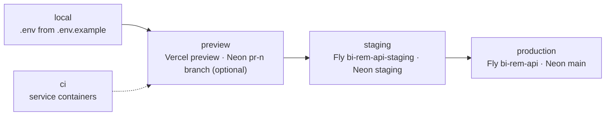
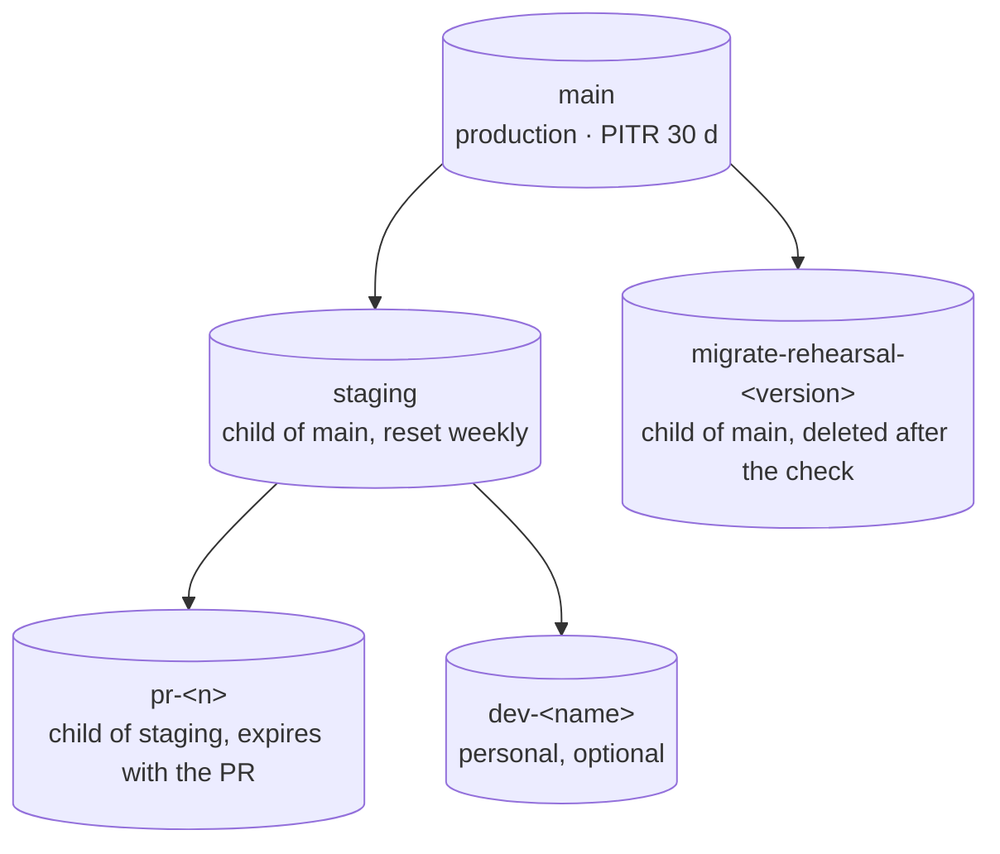

# Environment management — Phase 1

> How configuration and secrets reach each deployable, which environments exist, where their
> secrets live and how they rotate, and how Neon branching gives every environment its own
> database state. Companion to [`infrastructure-architecture.md`](./infrastructure-architecture.md)
> and the operator runbook [`infra/scripts/rotate-secrets.md`](../../infra/scripts/rotate-secrets.md).

## 1. Principles

1. **Validated at boot, documented in one place.** Every variable the code reads is declared in a
   Zod schema (`apps/api/src/config/env.ts`, `apps/web/src/env.ts`, `apps/admin/src/env.ts`) and
   listed in the root `.env.example`; each workspace's `.env.example` repeats the subset it reads.
   A missing or malformed value fails the process (API) or the build (portals) with the full list
   of problems, never a runtime surprise.
2. **No secrets in the repository or in `NEXT_PUBLIC_*`.** Example files hold placeholders that
   the API refuses in production (`validateEnv` rejects `change-me*` and the known example keys).
   `gitleaks` runs on every push (`security.yml`).
3. **Same artefact, different configuration.** The API image and the Next standalone output are
   built once; environments differ only by injected variables (`NEXT_PUBLIC_*` being the
   build-time exception, which is why Vercel builds per target).
4. **Least privilege per environment.** Deploy tokens, database roles and provider keys are
   distinct per environment and scoped to GitHub Environments with reviewers on `production`.

## 2. Environments

| Environment    | Purpose                                                                 | API                                                   | Portals                                                                                                | Database (Neon)                                                        | Redis                            | Mail                            |
| -------------- | ----------------------------------------------------------------------- | ----------------------------------------------------- | ------------------------------------------------------------------------------------------------------ | ---------------------------------------------------------------------- | -------------------------------- | ------------------------------- |
| **local**      | Developer machine                                                       | `pnpm dev` on :4000                                   | `pnpm dev` on :3000 / :3001                                                                            | `postgres:17-alpine` from docker-compose (or a personal Neon branch)   | `redis:7-alpine` (optional)      | Mailpit :1025 / UI :8025        |
| **ci**         | GitHub Actions `ci.yml` (unit, e2e, Prisma drift, build)                | Booted by the e2e suite                               | Built with staging `NEXT_PUBLIC_API_URL`                                                               | Postgres service container + shadow DB                                 | Redis service container          | none (notifications in-process) |
| **preview**    | One per pull request                                                    | Shared `bi-rem-api-staging` (per-PR Fly app optional) | Vercel preview deployments (`vercel-deploy.yml`, PR comment)                                           | Branch `staging`, or `pr-<n>` branch when a PR needs isolated data     | Staging Redis                    | Staging SMTP sandbox            |
| **staging**    | Integration, UAT, migration rehearsal; deployed on every push to `main` | Fly `bi-rem-api-staging` (`cdg`, 2 machines)          | Vercel production target of `bi-rem-web` / `bi-rem-admin` preview aliases on `*.staging.bi-rem.africa` | Branch `staging` (child of `main`, reset from production periodically) | Upstash / Fly Redis (staging)    | Provider sandbox or Mailpit     |
| **production** | Customers and operators; deployed from tags `v*` with approval          | Fly `bi-rem-api` (`cdg`, ≥ 2 machines)                | Vercel production (`app.bi-rem.africa`, `admin.bi-rem.africa`)                                         | Branch `main` (primary, PITR 30 days)                                  | Upstash / Fly Redis (production) | Provider (Resend/SES SMTP)      |

Promotion path: feature branch → PR (ci + previews) → `main` (staging deploy) → tag `v*`
(production deploy after GitHub Environment approval). The same image digest moves from staging
to production (`deploy-api.yml` → `fly-deploy.yml`).

## 3. Variable catalogue

### 3.1 API (`apps/api`, validated by `envSchema`)

| Variable                                                        | Required | Local default (`.env.example`) | Staging / production source                         | Notes                                                                                                        |
| --------------------------------------------------------------- | -------- | ------------------------------ | --------------------------------------------------- | ------------------------------------------------------------------------------------------------------------ |
| `NODE_ENV`                                                      | no       | `development`                  | `fly.toml [env]` = `production`                     | Enables CSP in Helmet, placeholder-secret refusal, demo-customer seed guard.                                 |
| `DATABASE_URL`                                                  | **yes**  | local Postgres                 | Fly secret (Neon **pooled** URL, `sslmode=require`) | Runtime URL unless `DATABASE_POOL_URL` is set.                                                               |
| `DATABASE_POOL_URL`                                             | no       | same as above                  | optional                                            | Explicit pooled endpoint; `databaseRuntimeUrl = DATABASE_POOL_URL ?? DATABASE_URL`.                          |
| `DIRECT_URL`                                                    | no       | commented out                  | Fly secret / GitHub Environment secret              | Neon direct endpoint for `prisma migrate` (release command, `db-migrate.yml`). Never used by the API itself. |
| `REDIS_URL`                                                     | no       | `redis://localhost:6379`       | Fly secret (`rediss://`)                            | Absent → in-process queue and permission cache with a boot warning.                                          |
| `API_PORT`, `API_BASE_URL`                                      | no       | 4000, `http://localhost:4000`  | `fly.toml` / secret                                 | `API_BASE_URL` appears in OpenAPI `servers` and in links.                                                    |
| `CORS_ORIGINS`                                                  | no       | both portals on localhost      | Fly secret                                          | Comma-separated allowlist; must include the Vercel preview origins used by staging.                          |
| `CUSTOMER_PORTAL_URL`, `ADMIN_PORTAL_URL`                       | no       | localhost                      | Fly secret                                          | Embedded in e-mails (password reset, welcome).                                                               |
| `APP_NAME`                                                      | no       | `BI-Rem`                       | —                                                   |                                                                                                              |
| `JWT_ACCESS_SECRET`, `JWT_REFRESH_SECRET`                       | **yes**  | placeholders                   | Fly secret                                          | ≥ 32 chars; placeholders refused in production.                                                              |
| `JWT_ACCESS_TTL`, `JWT_REFRESH_TTL`                             | no       | `15m`, `30d`                   | —                                                   | `<number>` followed by `s`, `m`, `h` or `d`.                                                                 |
| `ENCRYPTION_KEY`                                                | **yes**  | placeholder                    | Fly secret                                          | Exactly 32 bytes (base64 or hex). Rotating it requires re-encrypting `settings` and `users.mfa_secret`.      |
| `SMTP_HOST`, `SMTP_PORT`, `SMTP_USER`, `SMTP_PASS`, `SMTP_FROM` | no       | Mailpit                        | Fly secret                                          | Provider SMTP relay in hosted environments.                                                                  |
| `LOG_LEVEL`                                                     | no       | `debug`                        | `fly.toml` = `info`                                 | pino level.                                                                                                  |
| `SENTRY_DSN`                                                    | no       | empty                          | Fly secret                                          | Enables Sentry with release = `GIT_SHA`.                                                                     |
| `OTEL_EXPORTER_OTLP_ENDPOINT`                                   | no       | empty                          | Fly secret (optional)                               | Enables OpenTelemetry traces (`tracing.ts`).                                                                 |
| `GIT_SHA`                                                       | no       | empty                          | Docker build arg → image env                        | Release identifier for Sentry (`main.ts`) and the OCI `revision` label.                                      |
| `RUN_MIGRATIONS`                                                | no       | —                              | `fly.toml` = `false`                                | Entrypoint flag; migrations run through the `migrate` release command instead.                               |

### 3.2 Portals (`apps/web`, `apps/admin`, validated by `src/env.ts`)

| Variable                    | Scope       | Where set                             | Notes                                                                                       |
| --------------------------- | ----------- | ------------------------------------- | ------------------------------------------------------------------------------------------- |
| `NEXT_PUBLIC_API_URL`       | build-time  | Vercel env per target; CI `build` job | Inlined into the bundle; must match the API's `CORS_ORIGINS`.                               |
| `NEXT_PUBLIC_APP_NAME`      | build-time  | Vercel env                            |                                                                                             |
| `NEXT_PUBLIC_APP_URL`       | build-time  | Vercel production only                | Absolute URLs in metadata; previews rely on `VERCEL_URL`.                                   |
| `NEXT_PUBLIC_ENV` (admin)   | build-time  | Vercel env (`sandbox` / `production`) | Topbar environment badge.                                                                   |
| `API_INTERNAL_URL`          | server-only | Vercel env (optional)                 | Route handlers call the API through a private hostname when it differs from the public one. |
| `AUTH_COOKIE_SECURE`        | server-only | Vercel env (`true`)                   | Defaults to `true` when `NODE_ENV=production`.                                              |
| `HEALTH_TIMEOUT_MS` (admin) | server-only | Vercel env                            | Dashboard probe of `GET /health`.                                                           |
| `NODE_ENV`                  | server-only | set by Next                           |                                                                                             |

### 3.3 Data layer and seed (`packages/db`)

| Variable                                        | Used by            | Notes                                                                                             |
| ----------------------------------------------- | ------------------ | ------------------------------------------------------------------------------------------------- |
| `DIRECT_URL` → `DATABASE_URL`                   | `prisma.config.ts` | First one set wins; neither set → offline placeholder so `validate`/`generate` work without a DB. |
| `SEED_ADMIN_EMAIL`, `SEED_ADMIN_PASSWORD`       | `prisma/seed.ts`   | `SEED_ADMIN_PASSWORD` mandatory in production; force a change at first login.                     |
| `SEED_CUSTOMER_EMAIL`, `SEED_CUSTOMER_PASSWORD` | `prisma/seed.ts`   | Demo customer only when `NODE_ENV != production`.                                                 |

### 3.4 Pipeline secrets (GitHub)

| Secret                                                                              | Scope (GitHub Environment)      | Consumer                                                                       |
| ----------------------------------------------------------------------------------- | ------------------------------- | ------------------------------------------------------------------------------ |
| `FLY_API_TOKEN`                                                                     | `staging`, `production`         | `fly-deploy.yml` (deploy token per app)                                        |
| `DATABASE_URL`, `DIRECT_URL`                                                        | `staging`, `production`         | `db-migrate.yml`                                                               |
| `VERCEL_TOKEN`, `VERCEL_ORG_ID`, `VERCEL_PROJECT_ID_WEB`, `VERCEL_PROJECT_ID_ADMIN` | `preview`, `production`         | `vercel-deploy.yml`                                                            |
| `API_URL_STAGING`, `API_URL_PRODUCTION` (variables, not secrets)                    | repository / environment `vars` | Environment link and smoke-test base URL (`deploy-api.yml` → `fly-deploy.yml`) |
| `NEON_API_KEY`, `NEON_PROJECT_ID` (optional)                                        | repository                      | Neon branch per PR (see §5)                                                    |
| `GITLEAKS_LICENSE` (orgs only)                                                      | repository                      | `security.yml`                                                                 |
| `GITHUB_TOKEN`                                                                      | ephemeral                       | GHCR push, attestations, PR comments                                           |

## 4. Secret stores and handling

| Store                            | Holds                                                            | Access                                                                                                                                                   |
| -------------------------------- | ---------------------------------------------------------------- | -------------------------------------------------------------------------------------------------------------------------------------------------------- |
| Developer `.env` (git-ignored)   | Local placeholders only                                          | Must never equal staging/production values; `openssl rand -base64 48` for local secrets.                                                                 |
| Fly secrets (`fly secrets set`)  | All API secrets per app (`bi-rem-api-staging`, `bi-rem-api`)     | Encrypted at rest, injected as env at machine start; `fly secrets list` shows digests only. `--stage` batches several rotations into one rolling deploy. |
| Vercel environment variables     | Portal variables per target (Production / Preview / Development) | Marked "Sensitive" where supported; `vercel env pull` for local parity.                                                                                  |
| GitHub Environments              | Deploy tokens, database URLs for manual migrations               | `production` requires reviewers; `db-migrate.yml` additionally requires typing the environment name.                                                     |
| Neon console                     | Role passwords, API keys for branching                           | Per-environment roles (`birem_app`, `birem_migrate`); password rotation by creating a successor role.                                                    |
| AWS Secrets Manager (ECS option) | Same set as Fly when `infra/terraform` is used                   | `modules/secrets`; task definitions reference ARNs, never values.                                                                                        |

Handling rules enforced by code: pino redacts the `authorization`, `cookie`, `x-api-key` and
`set-cookie` headers; the audit interceptor redacts password/secret/token/key-like fields in
`before`/`after` (`modules/audit/redact.ts`) and truncates bodies at 8 000 characters; Sentry
`beforeSend` drops auth headers and cookies; secret `settings` are AES-256-GCM encrypted and
redacted from API responses unless the caller has `settings:read-secrets`.

### 4.1 Rotation schedule

Detailed procedures are in `infra/scripts/rotate-secrets.md`; the schedule is summarised here.

| Secret                          | Interval                      | Impact when rotated                                                                    |
| ------------------------------- | ----------------------------- | -------------------------------------------------------------------------------------- |
| `JWT_ACCESS_SECRET`             | 90 days                       | Access tokens (15 min) become invalid; clients refresh transparently.                  |
| `JWT_REFRESH_SECRET`            | 180 days (with access secret) | None today (refresh tokens are opaque, hashed in DB).                                  |
| `ENCRYPTION_KEY`                | 365 days or on exposure       | Requires re-encryption of secret settings and MFA secrets (Phase 2 task ships a tool). |
| Neon role password              | 180 days                      | Create successor role, swap secrets, rolling deploy, drop old role after 24 h.         |
| `REDIS_URL`                     | 180 days                      | Dual-password rotation on Upstash.                                                     |
| SMTP credentials                | 180 days                      | New provider key, swap, revoke.                                                        |
| `FLY_API_TOKEN`, `VERCEL_TOKEN` | 365 days (expiry)             | Update GitHub Environment secret; no workflow change.                                  |
| Seed admin password             | At first login                | Never reuse the seed value outside local development.                                  |

On suspected exposure: rotate, revoke derived credentials (`UPDATE refresh_tokens SET revoked_at = now()
WHERE revoked_at IS NULL`), review `audit_logs` for the window, record the incident per `SECURITY.md`.

## 5. Neon branching model

| Branch                        | Lifecycle                                                                                                                                                                                                                      | Connection strings                                                               |
| ----------------------------- | ------------------------------------------------------------------------------------------------------------------------------------------------------------------------------------------------------------------------------ | -------------------------------------------------------------------------------- |
| `main`                        | Permanent primary. Only `prisma migrate deploy` (Fly release command / `db-migrate.yml`) writes schema.                                                                                                                        | Fly `bi-rem-api` secrets: `DATABASE_URL` (pooled), `DIRECT_URL` (direct).        |
| `staging`                     | Permanent; reset from `main` (`neonctl branches reset --parent`) after each production release so staging data mirrors production shape without PII copies where policy forbids.                                               | Fly `bi-rem-api-staging` secrets.                                                |
| `pr-<n>`                      | Created by the Neon GitHub integration or `neondatabase/create-branch-action` when a PR is labelled `needs-db`; migrated and seeded by the workflow; deleted on PR close (`delete-branch-action`), `--expires` guards orphans. | Injected into the per-PR Fly app and the Vercel preview's `NEXT_PUBLIC_API_URL`. |
| `migrate-rehearsal-<version>` | Created from `main` before tagging a release; `prisma migrate deploy` + smoke queries run against it; deleted afterwards.                                                                                                      | Local `DIRECT_URL` of the operator running the rehearsal.                        |
| `dev-<name>`                  | Optional personal branch for developers who prefer Neon to docker-compose.                                                                                                                                                     | Local `.env` `DATABASE_URL` / `DIRECT_URL`.                                      |

Operational rules:

- The API always connects through the **pooled** endpoint (PgBouncer, transaction mode) with ≤ 10
  connections per instance; the Prisma CLI always uses the **direct** endpoint because `migrate`
  takes an advisory lock. Both strings carry `?sslmode=require`.
- Branches are copy-on-write: creating one is instant and costs only the delta, so rehearsal and
  preview branches are free to create and must be deleted, not kept.
- `citext` and `pgcrypto` are available on Neon; the init migration enables them, so a fresh branch
  needs no manual setup.
- Autosuspend is enabled on non-production branches (cold start a few hundred ms; the client uses a
  10 s connection timeout) and disabled on `main`.

## 6. Adding a variable

1. Add it to the Zod schema of the workspace that reads it (`env.ts`), with a default only when a
   safe one exists.
2. Document it in the root `.env.example` **and** the workspace `.env.example` (CODEOWNERS routes
   both to the platform owners).
3. If the API image needs it at build time, add a `--build-arg`; if Turborepo must hash it, add it
   to `turbo.json` `tasks.build.env` (root file — coordinate with the owners).
4. Set it in Fly (`fly secrets set` or `[env]` in `api.fly.toml` for non-secrets) and/or Vercel for
   each environment **before** merging the code that requires it; a missing required variable
   makes the release command or build fail, which is the intended fail-safe.
5. If it is a secret, add a row to `infra/scripts/rotate-secrets.md`.
