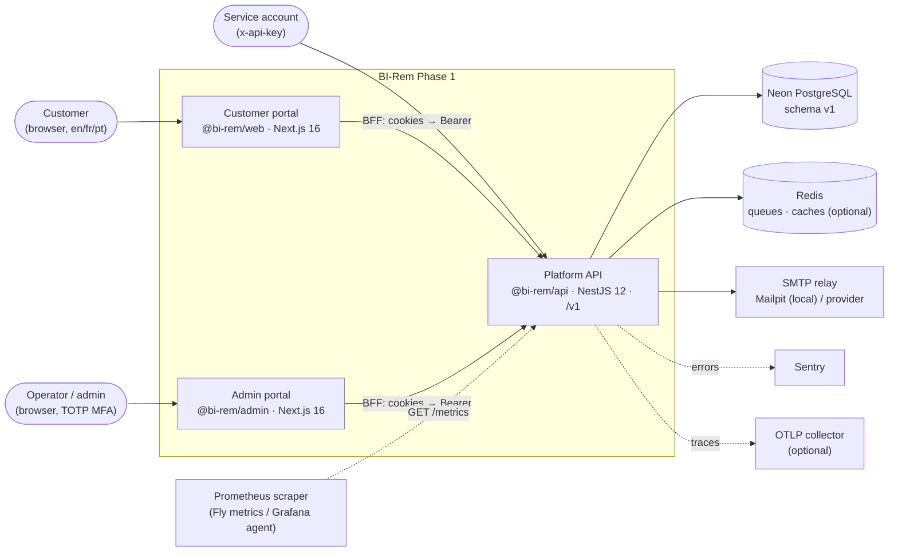
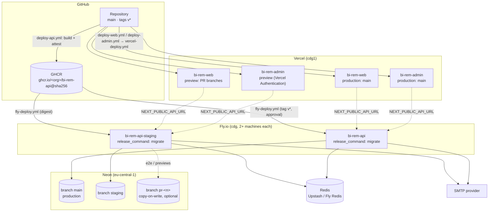
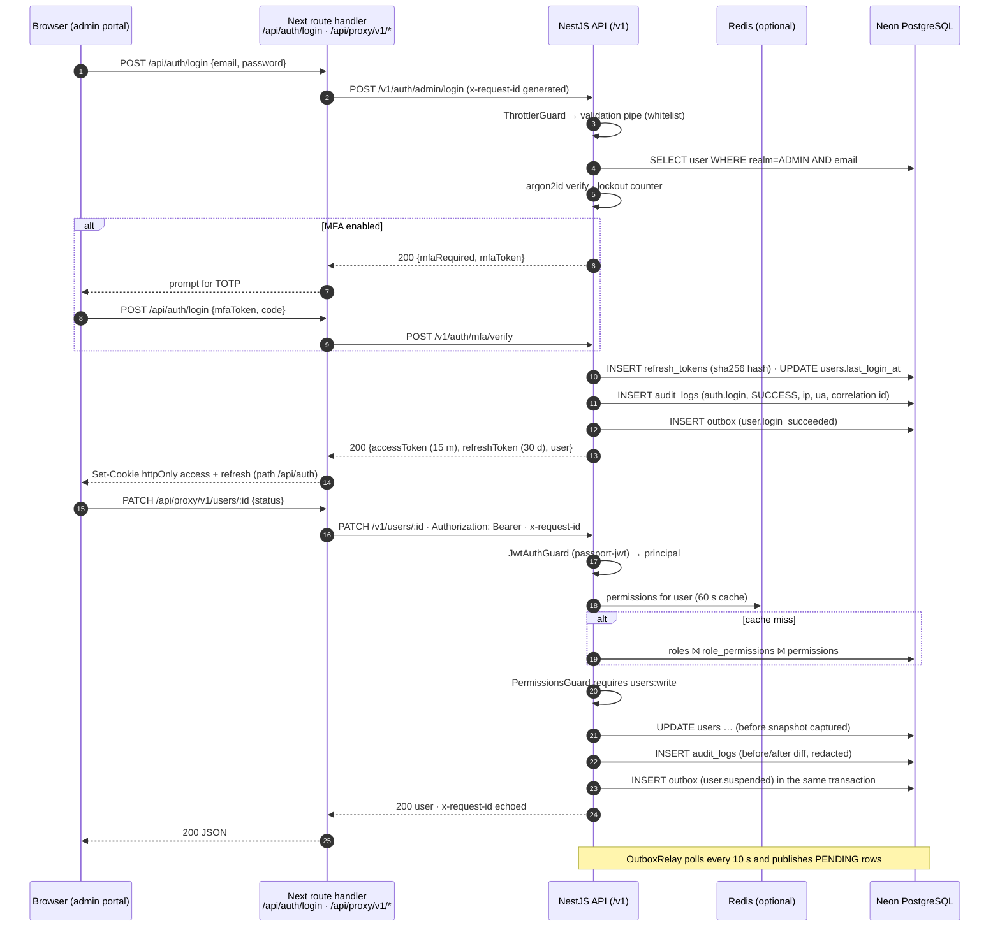
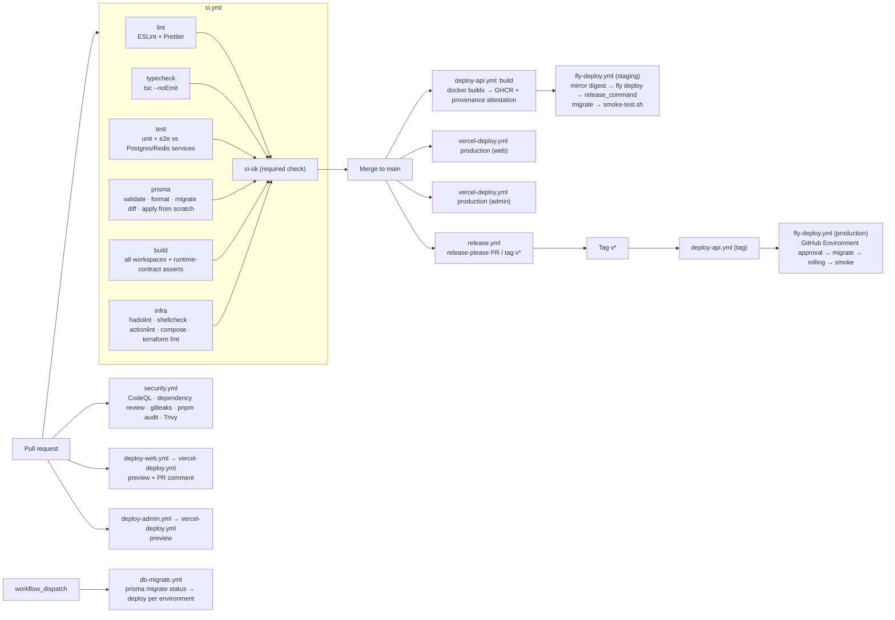

# Infrastructure architecture — Phase 1

> Scope: the runtime topology, hosting targets, request path and delivery pipeline that the Phase 1
> code base ships with. Every element below maps to a file in this repository; nothing here is
> aspirational. Related documents: [`environment-management.md`](./environment-management.md),
> [`monitoring-framework.md`](./monitoring-framework.md), [`security-baseline.md`](./security-baseline.md),
> [`database-schema-v1.md`](./database-schema-v1.md) and the build log in
> [`phase-1-implementation-notes.md`](./phase-1-implementation-notes.md).

## 1. System context

BI-Rem Phase 1 exposes two browser portals to two user populations and one API that both portals
call through a backend-for-frontend (BFF) layer. External systems in Phase 1 are limited to the
managed database, an optional Redis, an SMTP relay and the observability vendors; wallet, KYC and
FX providers arrive in later phases.

Key properties:

- **No token in the browser.** Portal route handlers under `app/api/auth/*` exchange credentials
  with the API and store the access/refresh pair in `httpOnly` cookies; `app/api/proxy/[...path]`
  forwards authenticated calls with the cookie converted to an `Authorization: Bearer` header.
- **One identity table, two realms.** `User.realm` (`CUSTOMER` | `ADMIN`) discriminates the two
  populations; the customer portal only calls `POST /v1/auth/login`, the admin portal only
  `POST /v1/auth/admin/login` (MFA-aware).
- **Redis is optional.** Without `REDIS_URL` the API runs in-process queues and caches and logs a
  warning; with it, notifications go through BullMQ and permission lookups are cached in Redis.

## 2. Containers and deployment topology

| Container          | Package         | Runtime target                                                 | Image / build                                                                             | Ports / health                                       |
| ------------------ | --------------- | -------------------------------------------------------------- | ----------------------------------------------------------------------------------------- | ---------------------------------------------------- |
| Platform API       | `@bi-rem/api`   | Fly.io app `bi-rem-api-staging` / `bi-rem-api` (`cdg` primary) | `infra/docker/api.Dockerfile` (multi-stage, `turbo prune`, non-root `birem`, tini) → GHCR | 4000; `/health/live`, `/health/ready`, `/metrics`    |
| Customer portal    | `@bi-rem/web`   | Vercel project `bi-rem-web` (`cdg1`)                           | `apps/web/vercel.json`; `infra/docker/web.Dockerfile` for self-hosting                    | 3000; Next standalone server                         |
| Admin portal       | `@bi-rem/admin` | Vercel project `bi-rem-admin` (`cdg1`), previews behind SSO    | `apps/admin/vercel.json`; `infra/docker/admin.Dockerfile`                                 | 3001; Next standalone server, `X-Robots-Tag` noindex |
| Database           | `@bi-rem/db`    | Neon project (eu-central-1), branches `main`/`staging`/`pr-*`  | Prisma 7 migrations applied by Fly `release_command = migrate` or `db-migrate.yml`        | 5432 pooled + direct endpoints                       |
| Queue / cache      | —               | Upstash or Fly Redis (production), `redis:7-alpine` locally    | —                                                                                         | 6379                                                 |
| Mail               | —               | Provider SMTP (staging/prod), Mailpit locally                  | `infra/docker/docker-compose.yml`                                                         | 1025 SMTP / 8025 UI                                  |
| Alternative target | all             | AWS ECS Fargate behind an ALB                                  | `infra/terraform/` (vpc, alb, ecs-service, secrets modules) — see `infra/aws/README.md`   | —                                                    |

### 2.1 Runtime characteristics

- **API machines** (`infra/fly/api.fly.toml`): `shared-cpu-2x`, 1 GB RAM, `min_machines_running = 2`,
  rolling strategy with `max_unavailable = 0.33`, request concurrency soft/hard 200/250, HTTP
  readiness check on `/health/ready` every 15 s and liveness on `/health/live` every 30 s.
  `release_command = "migrate"` runs `prisma migrate deploy` in a throw-away machine before the
  new release receives traffic.
- **Database access**: the API uses the pooled Neon endpoint (`DATABASE_POOL_URL`, PgBouncer
  transaction mode) with at most 10 connections per instance (`createPrismaClient` default,
  10 s connect timeout); the Prisma CLI uses the direct endpoint (`DIRECT_URL`) because
  `migrate` needs advisory locks.
- **Portals**: Vercel builds with `pnpm --filter @bi-rem/shared build && pnpm --filter @bi-rem/<app> build`;
  `turbo-ignore` skips builds when neither the app nor `@bi-rem/shared`/`@bi-rem/config` changed.
  Security headers (CSP, HSTS, frame denial, permissions policy) are emitted by `next.config.ts`.
- **Local stack** (`infra/docker/docker-compose.yml`): `postgres:17-alpine` (citext + pgcrypto via
  `postgres/init.sql`), `redis:7-alpine` (AOF, `noeviction`), Mailpit; the `apps` profile builds
  the three production images for a pre-push check.

## 3. Request flow

The sequence below is the admin login followed by a mutating, permission-guarded request. The
customer portal follows the same shape without the MFA step.

Cross-cutting behaviour on every request:

| Concern        | Implementation                                                                                                                                         |
| -------------- | ------------------------------------------------------------------------------------------------------------------------------------------------------ |
| Correlation id | `requestContextMiddleware` accepts or generates `x-request-id`, stores it in `AsyncLocalStorage`, pino and the audit row carry it, response echoes it. |
| Rate limiting  | `ThrottlerGuard` global (300 req/min per IP); credential endpoints are limited to 10 req/min, `/v1/auth/refresh` to 30 req/min.                        |
| Validation     | `ValidationPipe` with `whitelist` + `forbidNonWhitelisted`; errors are RFC 9457 problem details (`problem-details.filter.ts`).                         |
| Authentication | `JwtAuthGuard` unless `@Public()`; API keys via `x-api-key` for service accounts.                                                                      |
| Authorisation  | `PermissionsGuard` reads `@Permissions('resource:action')`; permissions resolved per user with a 60 s cache (memory or Redis).                         |
| Audit          | `AuditInterceptor` writes one `audit_logs` row for every non-GET request (success, failure or denied), bodies redacted and truncated at 8 000 chars.   |
| Metrics        | `MetricsInterceptor` observes `http_request_duration_seconds{method,route,status_code}`; `/metrics` also publishes outbox and queue gauges.            |
| Errors         | `LoggerErrorInterceptor` (pino) + Sentry `captureException` when `SENTRY_DSN` is set; secrets scrubbed in `beforeSend`.                                |

## 4. CI/CD flow

All automation lives in `.github/workflows`. The required branch-protection check is `CI / ci-ok`.

Guarantees encoded in the pipelines:

- **Reproducible schema.** The `prisma` job proves `prisma/migrations` reproduce `schema.prisma`
  exactly (`migrate diff` against a shadow database) and apply cleanly from scratch, so a drifted
  migration cannot merge.
- **Immutable artefacts.** The API image is built once per commit, pushed to GHCR with a build
  provenance attestation and deployed **by digest** to staging and then production; the Fly
  workflow records the pre-deploy release id so `fly releases rollback` is a one-liner.
- **Migrations before traffic.** `release_command = migrate` (Fly) or the `db-migrate.yml`
  workflow runs `prisma migrate deploy` with the direct Neon URL before the new machines start.
- **Smoke-tested rollouts.** `infra/scripts/smoke-test.sh` probes `/health/live`, `/health/ready`
  and `/health` for `"status":"ok"` and `GET /v1/users/me` for a 401 (guards wired) after each deploy.
- **Separate approval gates.** GitHub Environments `preview`, `staging` and `production` hold
  the deploy tokens; `production` requires reviewers.
- **Portals independent of the API.** `turbo-ignore` means an API-only change does not rebuild
  Vercel projects, and vice versa, matching the per-phase independent-deployability goal.

## 5. Availability, scaling and recovery

| Target (from `docs/roadmap/schedule.json`) | Phase 1 mechanism                                                                                                                                                                                                             |
| ------------------------------------------ | ----------------------------------------------------------------------------------------------------------------------------------------------------------------------------------------------------------------------------- |
| Availability 99.9 %                        | ≥ 2 API machines per environment, rolling deploys with `max_unavailable = 0.33`, readiness-gated traffic, Vercel edge for the portals, Neon multi-AZ storage.                                                                 |
| RPO 15 min                                 | Neon continuous WAL archiving with point-in-time restore (7 days on the default plan, extend to 30 in production); nightly off-platform `pg_dump` via `infra/scripts/db-backup.sh` as a second copy.                          |
| RTO 60 min                                 | `infra/scripts/db-restore.sh` restores a dump or a PITR branch; API rollback by digest (`fly releases rollback`); portals roll back by promoting a previous Vercel deployment. Procedure rehearsed in staging before go-live. |
| Horizontal scale                           | API is stateless (sessions are tokens; caches/queues in Redis), so `fly scale count` and Vercel scale independently; Neon pooler multiplexes connections (≤ 10 per API instance).                                             |
| Regional choice                            | `cdg` (Paris) primary for eu-central-1 Neon latency; `jnb` (Johannesburg) documented alternative in `infra/fly/README.md` with a Neon project in a nearby region.                                                             |

## 6. Repository map of the infrastructure

| Path                                  | Purpose                                                                                                                                                   |
| ------------------------------------- | --------------------------------------------------------------------------------------------------------------------------------------------------------- |
| `infra/docker/*.Dockerfile`           | Production images for api/web/admin (pruned pnpm workspaces, non-root, healthchecks).                                                                     |
| `infra/docker/docker-compose.yml`     | Local Postgres 17, Redis 7, Mailpit; `apps` profile for the production images.                                                                            |
| `infra/docker/api-entrypoint.sh`      | Maps the `migrate` command to `prisma migrate deploy`, otherwise starts the API.                                                                          |
| `infra/fly/api.fly.toml`, `README.md` | Fly app definition, secrets list, scaling and region notes, manual deploy/rollback.                                                                       |
| `apps/*/vercel.json`, `infra/vercel/` | Vercel project settings, environment-variable matrix, Neon-branch-per-preview recipe.                                                                     |
| `infra/scripts/`                      | `bootstrap.sh`, `deploy-api.sh`, `smoke-test.sh`, `db-backup.sh`, `db-restore.sh`, `rotate-secrets.md`.                                                   |
| `infra/terraform/`                    | ECS Fargate alternative (VPC, ALB, ECS service, Secrets Manager) with staging examples.                                                                   |
| `infra/ci/prisma.config.ts`           | Prisma config used by CI jobs against the service containers.                                                                                             |
| `.github/workflows/`                  | `ci.yml`, `security.yml`, `deploy-api.yml`, `fly-deploy.yml`, `deploy-web.yml`, `deploy-admin.yml`, `vercel-deploy.yml`, `db-migrate.yml`, `release.yml`. |
| `.github/actions/setup/action.yml`    | Composite action: Node 22 + pnpm 10 with store cache, used by every workflow.                                                                             |

## 7. Decisions and alternatives

| Decision                               | Why                                                                                                                                                      | Rejected alternative                                                                                       |
| -------------------------------------- | -------------------------------------------------------------------------------------------------------------------------------------------------------- | ---------------------------------------------------------------------------------------------------------- |
| Fly.io for the API, Vercel for portals | Container-native API with a release command for migrations and Prometheus scraping built in; Vercel gives per-PR previews and edge delivery for Next.js. | Everything on Vercel (API as serverless functions: cold starts, BullMQ worker needs a long-lived process). |
| Neon rather than self-managed Postgres | Branching for previews/migration rehearsal, PITR, pooled endpoint, zero operations for a 1-SRE team.                                                     | RDS (Terraform module kept as the ECS alternative) — more operations, no branching.                        |
| BFF cookies instead of browser tokens  | Removes token exfiltration via XSS, lets CSP stay strict, keeps the API stateless.                                                                       | SPA holding JWT in memory/localStorage.                                                                    |
| Deploy by image digest                 | The artefact tested in staging is byte-identical to what reaches production; provenance attestation proves its origin.                                   | Rebuilding on tag.                                                                                         |
| Transactional outbox                   | Events are committed with the business change; a broker can be attached later without touching call sites.                                               | Publishing directly to a broker from services (dual-write problem).                                        |
