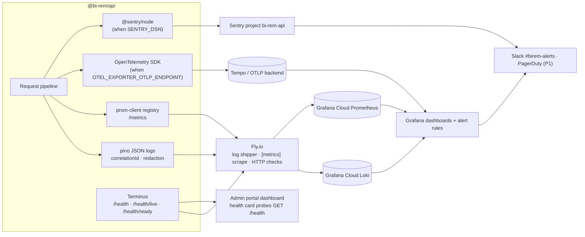

# Monitoring framework — Phase 1

> What the platform emits (metrics, logs, traces, errors, health), how it is collected, which
> alerts and SLOs it supports, and how those map to the programme's monitoring KPIs. Everything in
> §2–§4 is implemented in `apps/api/src/modules/monitoring`, `apps/api/src/tracing.ts` and the
> hosting configuration; §5–§7 (dashboards, alert rules, SLO reporting) are the operating model
> those signals are designed for, with their provisioning status stated explicitly.

## 1. Signal map

## 2. Metrics

Exposed by `GET /metrics` (public, `Cache-Control: no-store`, excluded from the `/v1` prefix and
from OpenAPI). The registry carries the default label `service="bi-rem-api"` and the
`prom-client` default Node.js collectors (`process_*`, `nodejs_eventloop_lag_seconds`,
`nodejs_heap_*`, `nodejs_gc_duration_seconds`).

| Metric                          | Type      | Labels                           | Source                                                                                                                                                                                    | Use                                                       |
| ------------------------------- | --------- | -------------------------------- | ----------------------------------------------------------------------------------------------------------------------------------------------------------------------------------------- | --------------------------------------------------------- |
| `http_request_duration_seconds` | histogram | `method`, `route`, `status_code` | `MetricsInterceptor` on every HTTP request (route template, not raw path)                                                                                                                 | Latency SLIs (p50/p95/p99), golden-signal dashboards      |
| `http_requests_total`           | counter   | `method`, `route`, `status_code` | same                                                                                                                                                                                      | Traffic and error-rate SLIs                               |
| `auth_login_total`              | counter   | `realm`, `outcome`               | `MetricsInterceptor` on `POST /v1/auth/login` and `/v1/auth/admin/login`; `outcome` ∈ `success`, `mfa_required`, `invalid_credentials`, `locked`, `throttled`, `invalid_request`, `error` | Credential-stuffing detection, lockout rate, MFA adoption |
| `outbox_pending_total`          | gauge     | —                                | Refreshed on scrape from `OutboxService.countPending()`                                                                                                                                   | Relay backlog alert                                       |
| `bullmq_queue_jobs`             | gauge     | `queue`, `state`                 | Refreshed on scrape from `NotificationService.queueStats()` (`waiting`, `active`, `failed`)                                                                                               | Notification delivery health                              |

Scrape configuration: `infra/fly/api.fly.toml` `[metrics] port = 4000, path = "/metrics"` makes
Fly scrape every machine and expose the series to Grafana Cloud through the Fly Prometheus
integration; the ECS alternative uses the Grafana agent sidecar described in `infra/aws/README.md`.
Histogram buckets run from 5 ms to 10 s, so both the 150 ms `/auth/me` target and the 800 ms alert
threshold fall on bucket edges.

## 3. Logs

- **Format.** `nestjs-pino` emits one JSON line per request (`req`, `res`, `responseTime`) plus
  application logs with `context`. `LOG_LEVEL` is `debug` locally and `info` in Fly.
- **Correlation.** `genReqId` reads or generates `x-request-id`; the same id is stored in
  `AsyncLocalStorage` (`RequestContext`), written to `audit_logs.correlation_id`, echoed in the
  response header and added to every log line as `correlationId`. One id therefore joins the
  browser request, API log, audit row and Sentry event.
- **Redaction.** `req.headers.authorization`, `req.headers.cookie`, `req.headers["x-api-key"]` and
  `res.headers["set-cookie"]` are replaced with `[REDACTED]`. Request bodies are never logged;
  the audit interceptor stores a redacted copy (`modules/audit/redact.ts`) instead, which is the
  place to look for "what was sent".
- **Errors.** `LoggerErrorInterceptor` attaches the thrown error to the request log; unhandled
  exceptions become RFC 9457 problem details with the correlation id in `instance`.
- **Shipping.** Fly streams machine stdout to its log pipeline; the Grafana Cloud integration (or
  `fly logs --json | vector`) forwards to Loki. Retention: 30 days staging, 90 days production
  (Grafana Cloud setting). Locally `pnpm dev` prints pretty logs; `docker compose --profile apps`
  prints JSON.

Query starters (LogQL): `{app="bi-rem-api"} | json | correlationId="<id>"`,
`{app="bi-rem-api"} | json | res_statusCode >= 500`, `{app="bi-rem-api"} | json | context="OutboxRelay"`.

## 4. Traces, errors and health

| Signal | Implementation                                                                                                                                                                                                                                                                                                                                                                                                                                |
| ------ | --------------------------------------------------------------------------------------------------------------------------------------------------------------------------------------------------------------------------------------------------------------------------------------------------------------------------------------------------------------------------------------------------------------------------------------------- |
| Traces | `tracing.ts` is imported first by `main.ts`; when `OTEL_EXPORTER_OTLP_ENDPOINT` is set it starts `NodeSDK` with auto-instrumentation for http/express/pg/ioredis (fs disabled, `/metrics` and `/health*` ignored), resource `service.name=bi-rem-api`, `service.version`, `deployment.environment.name`; graceful shutdown on SIGTERM/SIGINT. Off by default in Phase 1.                                                                      |
| Errors | `initSentry()` runs before Nest when `SENTRY_DSN` is set: `environment=NODE_ENV`, `release=GIT_SHA`, traces sample rate 10 % in production / 100 % elsewhere, `beforeSend` strips `authorization`, `x-api-key` and `cookie` headers. `captureException` is a no-op without a client.                                                                                                                                                          |
| Health | Terminus: `/health` (database, Redis, RSS < 1 GiB), `/health/live` (process up), `/health/ready` (database + Redis; Redis reports `configured: false` and healthy when `REDIS_URL` is unset). Fly uses `/health/ready` as the HTTP service check (15 s) and `/health/live` as the machine check (30 s); the Docker image declares a `HEALTHCHECK`; the admin dashboard health card probes `GET /health` server-side with `HEALTH_TIMEOUT_MS`. |
| Smoke  | `infra/scripts/smoke-test.sh` after every deploy: `/health/live`, `/health/ready`, `/health` must return `"status":"ok"`, `/v1/users/me` must return 401.                                                                                                                                                                                                                                                                                     |

## 5. SLOs and alerting

Service-level objectives for Phase 1 (API only; portals inherit Vercel's availability SLA). Error
budget is computed over 30 days from `http_requests_total`.

| SLI                          | SLO                                       | PromQL (recording rule)                                                                                                    |
| ---------------------------- | ----------------------------------------- | -------------------------------------------------------------------------------------------------------------------------- |
| Availability (non-5xx ratio) | 99.9 % / 30 d (roadmap `availability`)    | `1 - sum(rate(http_requests_total{status_code=~"5.."}[5m])) / sum(rate(http_requests_total[5m]))`                          |
| Login latency                | p95 < 300 ms at 100 rps (plan T1.19)      | `histogram_quantile(0.95, sum by (le) (rate(http_request_duration_seconds_bucket{route=~"/v1/auth/(admin/)?login"}[5m])))` |
| Authenticated read latency   | p95 < 150 ms for `GET /v1/auth/me`        | same expression filtered on `route="/v1/auth/me"`                                                                          |
| Audit query latency          | p95 < 500 ms for `GET /v1/audit`          | same expression filtered on `route="/v1/audit"`                                                                            |
| Readiness                    | `/health/ready` 200 ≥ 99.95 % of checks   | Fly check history / synthetic probe success ratio                                                                          |
| Notification delivery        | 99 % of EMAIL rows `SENT` within 5 min    | `bullmq_queue_jobs{state="waiting"}` trend + `notifications` table query (Phase 2 adds a delivery histogram)               |
| Event relay lag              | `outbox_pending_total` < 100 steady state | gauge                                                                                                                      |

Alert rules (Grafana-managed alerting; thresholds from the Phase 1 plan §3.15):

| Alert                  | Condition                                                     | Severity                             | Route             |
| ---------------------- | ------------------------------------------------------------- | ------------------------------------ | ----------------- |
| API error rate         | 5xx ratio > 2 % for 5 min                                     | P1                                   | PagerDuty + Slack |
| API latency            | p95 `http_request_duration_seconds` > 800 ms for 10 min       | P2                                   | Slack             |
| Readiness failing      | `/health/ready` non-200 for 2 min on any machine              | P1                                   | PagerDuty + Slack |
| Outbox backlog         | `outbox_pending_total` > 1 000 for 10 min                     | P2                                   | Slack             |
| Notification failures  | `bullmq_queue_jobs{state="failed"}` > 50                      | P2                                   | Slack             |
| Login abuse            | `rate(auth_login_total{outcome=~"invalid_credentials          | locked"}[5m])` > 5× the 1 h baseline | P2                | Slack (security channel) |
| Lockout spike          | `increase(auth_login_total{outcome="locked"}[15m])` > 20      | P3                                   | Slack             |
| Neon connections       | Neon metric `connections_used / max_connections` > 80 %       | P2                                   | Slack             |
| Neon storage / compute | Branch storage > 80 % of plan, compute at max size for 30 min | P3                                   | Slack             |
| Event-loop lag         | `nodejs_eventloop_lag_p99_seconds` > 0.5 for 5 min            | P3                                   | Slack             |
| Memory                 | `process_resident_memory_bytes` > 850 MB (machine has 1 GB)   | P3                                   | Slack             |
| Deploy smoke failed    | `fly-deploy.yml` smoke step failed                            | P1                                   | GitHub → Slack    |
| Sentry new issue       | First occurrence of a new error group in production           | P3                                   | Sentry → Slack    |
| Certificate expiry     | Fly / Vercel certificate < 14 days                            | P3                                   | Slack             |

## 6. Dashboards

| Dashboard                | Panels                                                                                                                                                      | Audience          |
| ------------------------ | ----------------------------------------------------------------------------------------------------------------------------------------------------------- | ----------------- |
| API Golden Signals       | RPS by route, error ratio, p50/p95/p99 latency, saturation (event-loop lag, heap, RSS), machines ready, deploy markers (release annotations from `GIT_SHA`) | On-call, backend  |
| Auth                     | `auth_login_total` by realm/outcome, lockouts, MFA challenges vs completions, refresh calls, 401/403 by route                                               | Security, support |
| Queues & Outbox          | `bullmq_queue_jobs` by state, `outbox_pending_total`, relay throughput (log-derived), oldest pending age (SQL panel on Neon)                                | Backend, ops      |
| Neon                     | Connections, compute CPU, storage, autosuspend events, slow queries (`log_min_duration_statement`)                                                          | Backend, DevOps   |
| Business (Phase 1 slice) | Registrations/day, active users, notifications sent by channel, admin actions/day (from `audit_logs`)                                                       | Product, PM       |
| Admin portal (in-app)    | Health card (`/health` components and latency), user counts, recent audit activity                                                                          | Operators         |

Dashboard JSON lives with the Grafana Cloud stack (export to `infra/grafana/` when the stack is
created so changes are reviewed as code).

## 7. KPI mapping

| Programme KPI (`docs/roadmap/schedule.json` / Phase 1 plan) | Signal                                                             | Target                               | Where it is measured                   |
| ----------------------------------------------------------- | ------------------------------------------------------------------ | ------------------------------------ | -------------------------------------- |
| Availability 99.9 %                                         | non-5xx ratio, readiness checks, synthetic probes                  | ≥ 99.9 % / 30 d                      | API Golden Signals; status page export |
| RPO 15 min                                                  | Neon PITR window, nightly `db-backup.sh` success                   | PITR enabled; backup age < 24 h      | Neon dashboard; backup workflow status |
| RTO 60 min                                                  | Time from incident declaration to restored readiness               | ≤ 60 min, rehearsed quarterly        | Incident notes; restore drill timing   |
| 100 k transactions/day (future load)                        | `http_requests_total` growth, Neon connections, queue depth        | headroom ≥ 3× current peak           | Golden Signals, Neon                   |
| 1 M users                                                   | `users` count by realm/status (SQL panel), registrations/day       | tracked                              | Business dashboard                     |
| Login p95 < 300 ms at 100 rps (T1.19)                       | `http_request_duration_seconds{route=~".*login"}`                  | p95 < 300 ms                         | Auth dashboard; weekly k6 run          |
| Error rate < 0.1 % under load (§9.1)                        | 5xx ratio during k6 runs                                           | < 0.1 %                              | k6 summary, Golden Signals             |
| Audit completeness (R1.12)                                  | audit rows per mutating request; write failures in logs            | 100 %, 0 failures                    | Loki query on `AuditLogService` errors |
| Notification deliverability                                 | `bullmq_queue_jobs{state="failed"}`, `notifications.status` ratios | failed < 1 %                         | Queues & Outbox                        |
| Security posture                                            | `auth_login_total` abuse rate, lockouts, Sentry security issues    | alerts quiet; anomalies investigated | Auth dashboard                         |
| Deployment automation                                       | `fly-deploy.yml` / `vercel-deploy.yml` success, smoke pass rate    | 100 % via GitHub, 0 manual deploys   | GitHub Actions history                 |

## 8. Provisioning status and gaps

| Item                                                  | Status           | Notes                                                                                                                                    |
| ----------------------------------------------------- | ---------------- | ---------------------------------------------------------------------------------------------------------------------------------------- |
| `/metrics`, `/health*`, pino, correlation id          | Implemented      | Unit-tested (`metrics.interceptor.spec.ts`); e2e covers the health endpoints.                                                            |
| `auth_login_total`                                    | Implemented      | Incremented by the metrics interceptor for both login routes.                                                                            |
| Sentry (API)                                          | Implemented      | Enabled by `SENTRY_DSN`; release from `GIT_SHA`.                                                                                         |
| Sentry (web, admin)                                   | Gap              | Portals have no Sentry SDK yet; add `@sentry/nextjs` with source-map upload in the Vercel build (Phase 2).                               |
| OpenTelemetry traces                                  | Implemented, off | Set `OTEL_EXPORTER_OTLP_ENDPOINT` to enable; no collector provisioned yet.                                                               |
| Fly metrics scrape and checks                         | Configured       | `api.fly.toml`.                                                                                                                          |
| Log shipping to Loki, Grafana dashboards, alert rules | Not provisioned  | Requires the Grafana Cloud stack; definitions above are the specification. Export JSON/Terraform to `infra/grafana/` when created.       |
| Synthetic uptime checks                               | Not provisioned  | Grafana synthetic monitoring on `/health/live`, web `/login`, admin `/login`.                                                            |
| `prisma_pool_*` metrics                               | Gap              | Prisma 7 driver adapters do not expose pool metrics directly; expose `pg` pool `totalCount/idleCount/waitingCount` as gauges in Phase 2. |
| Retention jobs with metrics                           | Gap              | See `database-schema-v1.md` §5.                                                                                                          |
