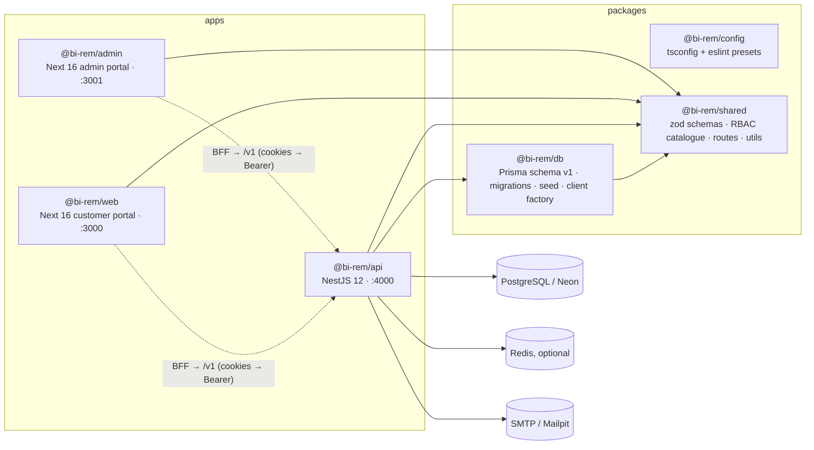

# Phase 1 — Implementation notes (Foundation & Platform Setup)

> Status: Phase 1 code complete and green from the repository root (`pnpm lint`, `pnpm typecheck`,
> `pnpm test`, `pnpm test:e2e`, `pnpm build`, `pnpm format:check`). This document records what was
> actually built, how the pieces fit together, how to run and deploy them, and what is deferred to
> Phase 2. The plan it implements is [`docs/phases/phase-01-foundation.md`](../phases/phase-01-foundation.md);
> contributor conventions are in [`CLAUDE.md`](../../CLAUDE.md).

## 1. What was built

| Area              | Delivered                                                                                                                                                                                                            |
| ----------------- | -------------------------------------------------------------------------------------------------------------------------------------------------------------------------------------------------------------------- |
| Monorepo          | pnpm 10 workspaces + Turborepo 2.11 task graph (`generate → build → lint/typecheck/test → test:e2e`), shared TypeScript 5.9 / ESLint 9 flat-config / Prettier 3 presets in `@bi-rem/config`.                         |
| Data layer        | `@bi-rem/db`: Prisma 7 schema v1 (14 models, 7 enums), `init` migration, idempotent seed (permissions, system roles, admin + demo customer, templates, flags, settings), `createPrismaClient()` on the `pg` adapter. |
| Shared contracts  | `@bi-rem/shared`: Zod 4 schemas for every DTO, RBAC catalogue (57 permissions, 7 system roles), API route constants, enums mirrored from the schema, money/phone/date utilities.                                     |
| API               | `@bi-rem/api` (NestJS 12): auth (JWT + refresh rotation + TOTP MFA), users, RBAC, audit log, notifications (BullMQ or in-process), feature flags, settings (field-level encryption), API keys, outbox, monitoring.   |
| Customer portal   | `@bi-rem/web` (Next.js 16): register/login/forgot/reset, dashboard, profile, security (password + MFA), notifications; i18n en/fr/pt; BFF route handlers own the httpOnly cookies.                                   |
| Admin portal      | `@bi-rem/admin` (Next.js 16): admin login (MFA-aware), dashboard with live health probe, users, roles/permission matrix, audit explorer with JSON diff, notification templates, settings/flags/API keys.             |
| Infra             | Dockerfiles (api, web, admin) with `turbo prune`, docker-compose (postgres 17, redis 7, mailpit + optional app profile), Fly.io config for the API, Vercel config for the portals, Terraform for an ECS alternative. |
| CI/CD             | `ci.yml` (lint, typecheck, test + e2e against services, Prisma drift check, build with runtime-contract assertions, infra lint), deploy workflows (Fly, Vercel), `db-migrate.yml`, `security.yml`, `release.yml`.    |
| Docs & governance | Per-phase plans for all 13 phases, roadmap `schedule.json`, README/SECURITY, CODEOWNERS, issue/PR templates, Dependabot.                                                                                             |

## 2. Module map



### 2.1 `@bi-rem/api` (`apps/api/src`)

| Path                                | Responsibility                                                                                                                                                                                        |
| ----------------------------------- | ----------------------------------------------------------------------------------------------------------------------------------------------------------------------------------------------------- |
| `main.ts`, `bootstrap.ts`           | Loads Sentry/OTel first, then `createApp()`: pino logger, helmet, CORS, global prefix `/v1` (health/metrics/docs excluded), `ValidationPipe` (whitelist + forbid unknown), Swagger at `/docs`.        |
| `config/env.ts`                     | Zod schema for every variable; `validateEnv()` fails fast with the full list of problems and refuses placeholder secrets in production.                                                               |
| `common/`                           | Request context (correlation id `x-request-id`), decorators (`@Public`, `@Permissions`, `@CurrentUser`, `@Audit`), RFC 9457 problem-details filter, pagination helpers.                               |
| `modules/auth`                      | Register/login per realm, Argon2id passwords, access + rotating refresh tokens (family revocation on reuse), TOTP MFA (`otplib`), password reset, throttling on public endpoints.                     |
| `modules/rbac`                      | Roles CRUD, permission catalogue (`@bi-rem/db` re-export of the shared catalogue ∪ table), user↔role assignment, `PermissionResolverService` (in-memory or Redis cache), global `PermissionsGuard`.   |
| `modules/users`                     | Self-service profile, admin user management (create/update/suspend/reactivate/unlock/soft-delete).                                                                                                    |
| `modules/audit`                     | `AuditInterceptor` writes an `AuditLog` row for every mutating request (actor, action, resource, redacted before/after diff, IP, UA, correlation id); query API.                                      |
| `modules/notifications`             | Templated e-mail / SMS / in-app notifications, user preferences, BullMQ queue when `REDIS_URL` is set (in-process dispatcher otherwise), queue stats.                                                 |
| `modules/feature-flags`, `settings` | Key/value configuration with percentage rollouts and rules; settings with AES-GCM field-level encryption (`CryptoModule`, `ENCRYPTION_KEY`) and a separate `settings:read-secrets` reveal permission. |
| `modules/api-keys`                  | Hashed service-account keys with scoped permissions (wildcards allowed, bounded by the creator's own permissions).                                                                                    |
| `modules/outbox`                    | Transactional outbox table + scheduled relay (`@nestjs/schedule`) with a pluggable transport (logging transport in Phase 1).                                                                          |
| `modules/monitoring`                | Terminus `/health`, `/health/live`, `/health/ready` (database + redis indicators), Prometheus `/metrics` (prom-client histogram per route), Sentry and OpenTelemetry bootstrap.                       |

### 2.2 Portals (`apps/web`, `apps/admin`)

- **BFF pattern.** The browser never holds a token: `/api/auth/*` route handlers call the API and store
  access/refresh tokens in httpOnly cookies (refresh cookie path-scoped to `/api/auth`); `/api/proxy/v1/*`
  forwards authenticated calls with the cookie turned into a Bearer header. Both proxies block the session
  endpoints and validate the path (`lib/server/proxy-path.ts` in web).
- **Shared contracts.** Clients build URLs from `API_ROUTES` in `@bi-rem/shared/constants` and validate
  responses with Zod schemas, so a controller change breaks the typecheck or a unit test rather than a page.
- **Permission-aware UI** (admin): `useCan` / `<Can>` / `<PermissionGate>` over the permissions returned by
  `GET /v1/auth/me`; sections map to the read permission that unlocks them (`lib/permissions.ts`).
- **Security headers** (CSP, HSTS, frame denial, `X-Robots-Tag: noindex` for admin) are set in `next.config.ts`;
  `src/env.ts` validates `NEXT_PUBLIC_*` at build time and server-only variables lazily.

### 2.3 Data (`packages/db`)

Schema v1 entities: `User`, `Role`, `Permission`, `UserRole`, `RolePermission`, `RefreshToken`, `AuditLog`,
`Notification`, `NotificationTemplate`, `NotificationPreference`, `FeatureFlag`, `Setting`, `ApiKey`, `Outbox`
with enums `UserRealm`, `UserStatus`, `AuditActorType`, `AuditOutcome`, `NotificationChannel`,
`NotificationStatus`, `OutboxStatus`. All ids are `uuid`, timestamps `timestamptz`, money is `BIGINT` minor
units + ISO-4217 currency. `prisma.config.ts` prefers `DIRECT_URL` (Neon direct endpoint) for the CLI and falls
back to an unresolvable placeholder so offline commands (`validate`, `generate`, `migrate diff`) work without a
database.

### 2.4 One RBAC catalogue

`packages/shared/src/constants/permissions.ts` is the single source of truth for permission keys and system
roles. `packages/db/src/permissions.ts` re-exports it (so the seed and the API keep importing from
`@bi-rem/db`), the API guards with the same keys, and both portals render their matrices from `PERMISSION_KEYS`.
Adding a permission is a one-file change followed by `pnpm db:seed`, which upserts keys and reconciles the
system roles' grants.

## 3. How to run

```bash
pnpm install
cp .env.example .env                                     # every variable is documented there
docker compose -f infra/docker/docker-compose.yml up -d  # postgres, redis, mailpit
pnpm db:generate && pnpm db:migrate:dev && pnpm db:seed  # seed builds @bi-rem/shared first (turbo)
pnpm dev                                                 # api :4000, web :3000, admin :3001
```

Default seed accounts (development only): `admin@bi-rem.local` / `ChangeMe123!` (SUPER_ADMIN, admin portal)
and `customer@bi-rem.local` / `Customer123!` (customer portal). Mailpit UI: http://localhost:8025. OpenAPI:
http://localhost:4000/docs.

Quality gates, all from the root (Turborepo orders `generate` and dependency builds automatically):

```bash
pnpm lint && pnpm format:check && pnpm typecheck && pnpm test && pnpm test:e2e && pnpm build
```

- Unit tests never need a database (Prisma and Redis are mocked). `pnpm test:e2e` boots the full Nest
  application through the testing module with `PrismaService` stubbed, so it also runs without a database
  and exercises the HTTP contract (prefix, problem details, health, guards). Database-backed end-to-end
  coverage runs in CI against the Postgres/Redis service containers.
- Without `REDIS_URL` the API logs a warning and uses in-process queues/caches (not durable, fine locally).
- The API refuses to start with a clear list of problems when the environment is invalid, and in production
  when any secret still has its `.env.example` value. It starts with an unreachable database (connections are
  lazy): `/health/live` answers 200, `/health/ready` answers 503 naming the failing indicator.

## 4. How to deploy

| Component | Target                                                                    | Mechanism                                                                                                                                                                                                                                                                                        |
| --------- | ------------------------------------------------------------------------- | ------------------------------------------------------------------------------------------------------------------------------------------------------------------------------------------------------------------------------------------------------------------------------------------------ |
| API       | Fly.io (`infra/fly/api.fly.toml`)                                         | `deploy-api.yml` builds `infra/docker/api.Dockerfile` (multi-stage, `turbo prune`, non-root, tini), pushes to GHCR with provenance, then `fly-deploy.yml` deploys by digest; `release_command = migrate` runs `prisma migrate deploy` before rollout. Smoke test: `infra/scripts/smoke-test.sh`. |
| Portals   | Vercel (`apps/*/vercel.json`)                                             | `deploy-web.yml` / `deploy-admin.yml` → `vercel-deploy.yml` (`vercel pull/build/deploy`, preview comment on PRs). `NEXT_PUBLIC_*` are build-time; `API_INTERNAL_URL`, `AUTH_COOKIE_SECURE` are runtime.                                                                                          |
| Database  | Neon (pooled `DATABASE_POOL_URL` at runtime, `DIRECT_URL` for migrations) | `db-migrate.yml` runs `prisma migrate status` → `deploy` against a chosen environment; CI's `prisma` job proves migrations reproduce `schema.prisma` and apply from scratch.                                                                                                                     |
| Alt.      | AWS ECS Fargate (`infra/terraform`)                                       | VPC, ALB, ECS service and Secrets Manager modules for teams that cannot use Fly; see `infra/aws/README.md`.                                                                                                                                                                                      |

Secrets never live in the repository: Fly secrets (`fly secrets set`), Vercel environment variables, GitHub
Environments for deploy tokens. `infra/scripts/rotate-secrets.md` documents rotation. The Docker images can be
validated locally with `docker compose --profile apps up --build`.

CI contract (`ci.yml`): required check `CI / ci-ok` aggregates lint (ESLint + Prettier, both blocking),
typecheck, test (+ e2e against Postgres/Redis services), Prisma drift, build (asserts `apps/api/dist/main.js`
and the Next standalone servers exist) and infra lint (hadolint, shellcheck, actionlint, compose config,
`docker build --check`, `terraform fmt`).

## 5. Integration fixes applied when making the monorepo green

- **Turbo graph**: `build`, `dev`, `lint`, `typecheck` and `test` now depend on the package's own `generate`
  and on `^build`; on a fresh checkout `pnpm lint`/`pnpm test` previously failed because `@bi-rem/db`'s
  generated client and `@bi-rem/shared`'s `dist` did not exist yet. A `seed` task was added so `pnpm db:seed`
  builds its dependencies first.
- **RBAC catalogue**: the 22-entry `PERMISSIONS` array in `@bi-rem/shared` diverged from the 57-key catalogue
  the API guards with; the shared package now holds the canonical catalogue and `@bi-rem/db` re-exports it.
  The admin portal's `API_ONLY_PERMISSIONS` workaround was removed.
- **Formatting**: `pnpm format` applied repo-wide; generated `next-env.d.ts` and hand-aligned root files
  (`CLAUDE.md`, `pnpm-workspace.yaml`, `docs/roadmap/schedule.json`) are Prettier-ignored; the CI Prettier step
  is now blocking.
- **Environment documentation**: the root `.env.example` lists every variable read by any workspace
  (portal URLs used in e-mails, `GIT_SHA`, `DIRECT_URL`, Next server-only variables, seed variables).

## 6. Known gaps for Phase 2

- **Database-backed e2e tests**: the e2e suite stubs Prisma; integration tests that exercise real SQL
  (migrations + seed + API flows) only exist as CI steps (`prisma migrate diff/deploy`) and should become a
  Testcontainers-based suite in Phase 2.
- **Notification providers**: e-mail goes through SMTP (Mailpit locally); the SMS provider is a logging stub
  and there is no push channel. Vendor integration (Africa's Talking / Twilio) is Phase 2.
- **Outbox transport**: the relay publishes to a logging transport; a real broker (SNS/SQS or Kafka) is deferred.
- **Customer self-service scope**: profile, security and notifications only — KYC, wallets and transfers start
  in Phase 2 (`customers:*`, `kyc:*`, `transfers:*` permissions exist in the catalogue but no endpoints yet).
- **Admin portal coverage**: no customer management screens (Phase 2), no audit export (`audit:export` is
  catalogued; the `GET /v1/audit/export` route is reserved in `API_ROUTES` but not implemented).
- **CSP hardening**: `script-src` still allows `'unsafe-inline'` (Next inline bootstrap); per-request nonces
  are a follow-up.
- **Observability**: OpenTelemetry tracing and Sentry are wired but no dashboards/alerts are provisioned;
  Prometheus scraping is configured only in `fly.toml`.
- **Docs**: the standalone architecture set now exists alongside this build log —
  [`infrastructure-architecture.md`](./infrastructure-architecture.md),
  [`database-schema-v1.md`](./database-schema-v1.md), [`environment-management.md`](./environment-management.md),
  [`monitoring-framework.md`](./monitoring-framework.md) and [`security-baseline.md`](./security-baseline.md).
  A formal ADR set and operational runbooks (deploy, rollback, lock account, on-call) are still to be written.
