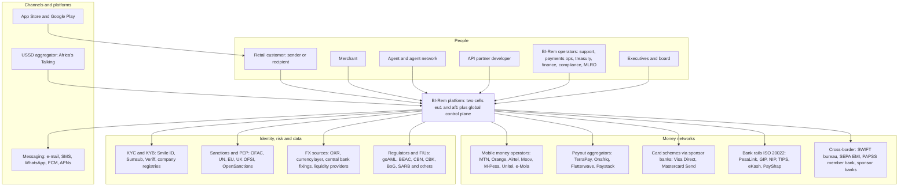
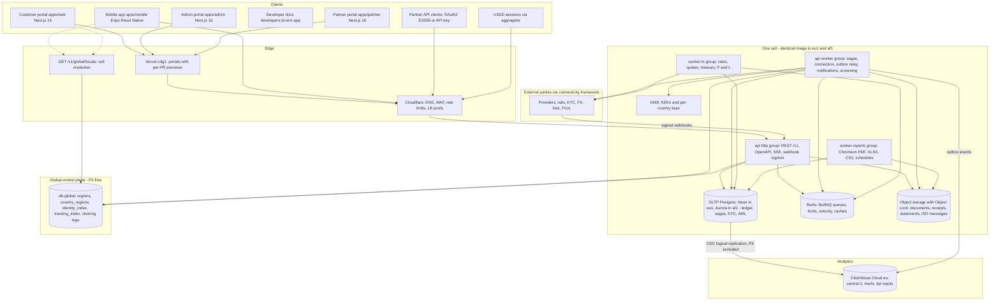
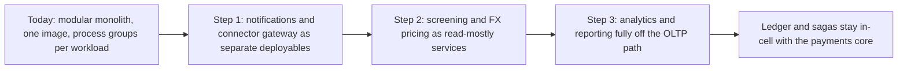
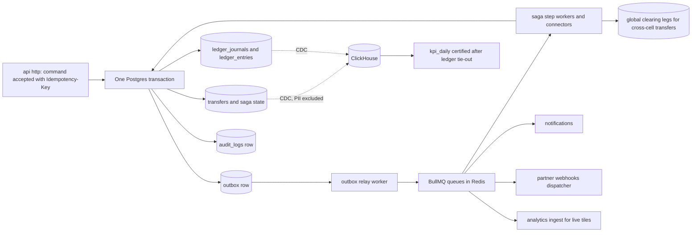
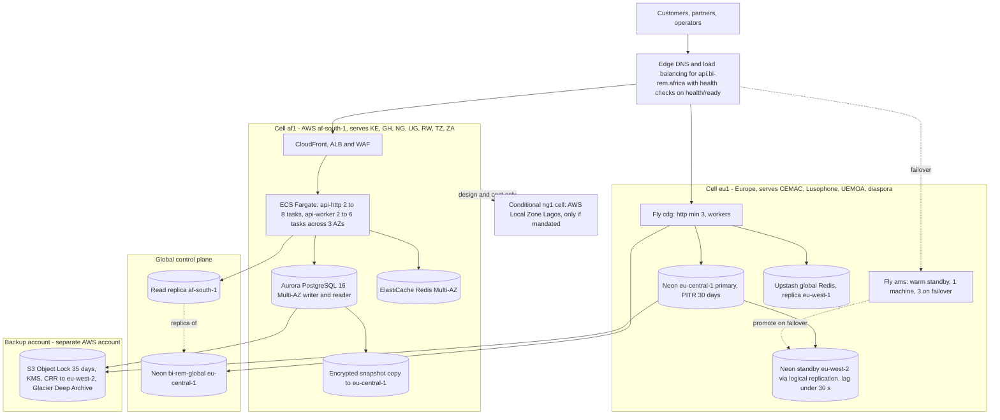
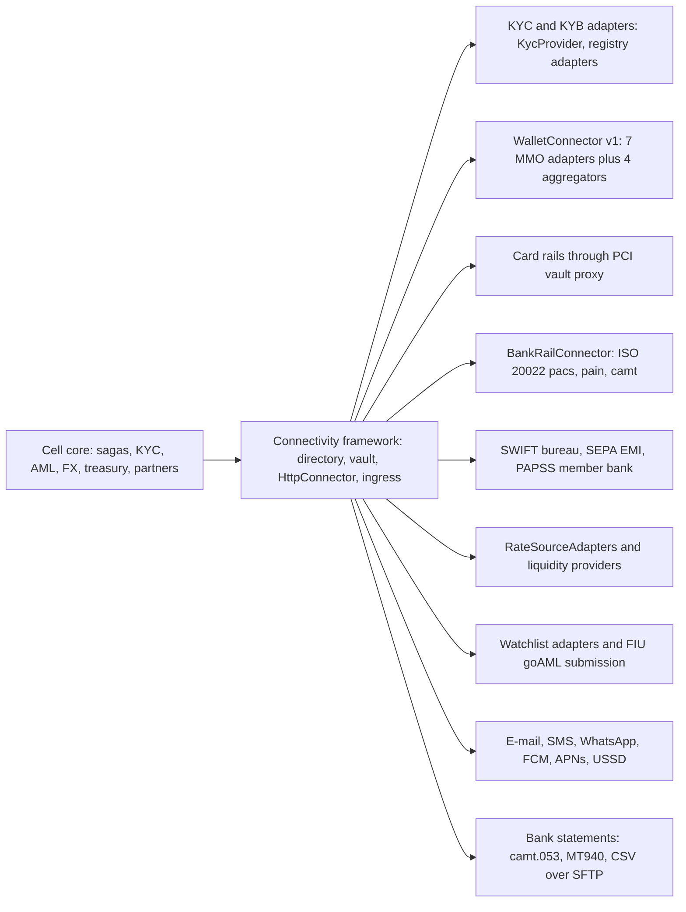
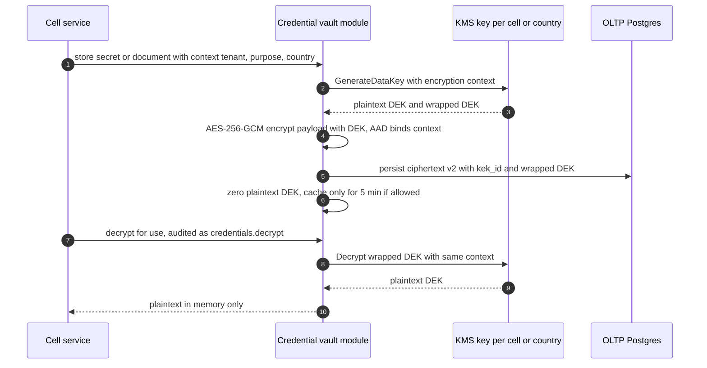

# Target architecture — BI-Rem at Phase 13 exit (2028-06-30)

| Item                          | Value                                                                                                                                                                                                                                                                                                                                                                                 |
| ----------------------------- | ------------------------------------------------------------------------------------------------------------------------------------------------------------------------------------------------------------------------------------------------------------------------------------------------------------------------------------------------------------------------------------- |
| Document                      | `docs/architecture/target-architecture.md` — the end-state platform after all 13 phases: context, containers, service decomposition and extraction roadmap, data architecture, multi-region topology, integration landscape, security architecture, non-functional requirements and technology radar                                                                                  |
| State described               | Production at the end of [Phase 13 — Pan-African Expansion](../phases/phase-13-pan-african-expansion.md) (**2028-01-03 → 2028-06-30**), built on the Phase 1 baseline ([Phase 1](../phases/phase-01-foundation.md), **2026-11-16 → 2026-12-25**)                                                                                                                                      |
| Target scale                  | 1,000,000 users · 100,000 transfers/day · 50 providers · 20 countries · 99.9 % availability · RPO 15 min · RTO 60 min ([`schedule.json`](../roadmap/schedule.json))                                                                                                                                                                                                                   |
| Owner                         | Solution Architect · reviewed at the Thursday architecture review and at each phase gate                                                                                                                                                                                                                                                                                              |
| Builds on (not repeated here) | [Infrastructure architecture](./infrastructure-architecture.md) (Phase 1 topology, CI/CD, request flow) · [Database schema v1](./database-schema-v1.md) · [Environment management](./environment-management.md) · [Monitoring framework](./monitoring-framework.md) · [Security baseline](./security-baseline.md) · [Phase 1 implementation notes](./phase-1-implementation-notes.md) |
| Related                       | [Implementation roadmap](../00-implementation-roadmap.md) · [Dependency map](../03-dependency-map.md) · [Risk register](../06-risk-register.md) · [Operational handbook](../08-operational-handbook.md) · [Support handbook](../09-support-handbook.md)                                                                                                                               |

**Architecture in one paragraph.** BI-Rem is a **cell-based modular monolith**: one NestJS 12 API image (`apps/api`) runs as an `http` group and several worker groups in **two symmetric production cells** — `eu1` (Fly.io `cdg` + Neon Postgres `eu-central-1`, warm standby `ams` + Neon `eu-west-2`) and `af1` (AWS `af-south-1`, ECS Fargate + Aurora PostgreSQL 16 Multi-AZ). Each customer is **homed** in exactly one cell; their ledger, documents and personal data live only there. A small **PII-free global control plane** (Neon `eu-central-1` with a read replica in `af-south-1`) holds the country→cell directory, HMAC identity and tracking indexes, and **inter-region clearing legs** netted daily. All external parties — 50 providers across mobile money, aggregators, cards, ISO 20022 bank rails, SWIFT, SEPA, PAPSS, KYC, FX and screening — are reached through the **Phase 3 connectivity framework** (vault-held credentials, `HttpConnector`, signed webhook ingress). Money correctness rests on a **double-entry ledger** inside each cell's OLTP database, written by **sagas** with idempotency at three levels; events leave through a **transactional outbox** into BullMQ, partner webhooks and a **ClickHouse** warehouse fed by CDC. Four portals (customer, admin, partner, developers) run on Vercel; the Expo mobile app and a USSD channel complete the customer surface.

---

## 1. Architectural drivers

| Driver                                                                     | Source                                    | Architectural consequence                                                                                                                                                                                                      |
| -------------------------------------------------------------------------- | ----------------------------------------- | ------------------------------------------------------------------------------------------------------------------------------------------------------------------------------------------------------------------------------ |
| Money must never be created, lost or duplicated                            | Phase 5 ledger, Phase 4 state machine     | Ledger in the same Postgres transaction as saga state; append-only tables (`birem_app` cannot `UPDATE`/`DELETE`); balanced-journal DB trigger; nightly trial balance; `HELD` instead of guessing                               |
| African data residency and latency                                         | R1.8, R1.9, R13.2; NDPA, Kenya DPA, POPIA | Cell homing (`af1` for East/West/Southern Africa wave markets), PII-free control plane, residency egress guard in enforce mode, conditional in-country `ng1` cell                                                              |
| 50 providers with uneven quality                                           | Phases 3, 4, 13                           | Integration as configuration (Provider Directory, connections, credentials), one `WalletConnector` / `BankRailConnector` interface, conformance suites and simulators, circuit breakers and bulkheads, two routes per corridor |
| Regulated in ~20 jurisdictions                                             | Phases 2, 6, 8, 12, 13                    | Country packs as versioned data, `regulator_profiles`, travel-rule payloads, 10-year retention with legal hold and Object Lock, four-eyes everywhere money or rules change                                                     |
| Small team (16.5 FTE baseline) shipping 13 independently deployable phases | `schedule.json` team block                | Modular monolith (one image, one pipeline), expand → migrate → contract migrations, feature flags as the release mechanism, managed services over self-hosting                                                                 |
| 99.9 % availability, RPO 15 min, RTO 60 min                                | Phase 12                                  | Two machines minimum per process group, warm standby region per cell, logical replication to standby, Object-Locked backups, quarterly DR drills                                                                               |

---

## 2. System context

---

## 3. Container view

**Process groups** (all from one image `ghcr.io/bi-rem/api`, selected by `PROCESS_ROLE` and `WORKER_QUEUES`):

| Group                | Introduced  | Queues / responsibilities                                                                                                                                                                                                                                                                                      | Minimum in production per cell |
| -------------------- | ----------- | -------------------------------------------------------------------------------------------------------------------------------------------------------------------------------------------------------------------------------------------------------------------------------------------------------------- | ------------------------------ |
| `http`               | Phase 1     | REST `/v1`, `/health`, `/metrics`, webhook ingress (`hooks.*`), SSE streams, partner API, `locate`                                                                                                                                                                                                             | 3 (`eu1` cdg), 2 (`af1`)       |
| `worker`             | Phase 2     | `connectivity:*`, `wallet:*`, `transfers:saga`, `intl:*`, `aml:*`, `screening:*`, `tm:*`, `sar:*`, `commission:*`, `settlement:*`, `payouts:*`, `webhooks:outbound`, `kyb:*`, `float:*`, `notifications`, `notifications:push`, `outbox-relay`, `region:*`, `rails:*`, `country:pack-apply`, `ussd:session-gc` | 3 + 2 AML-dedicated            |
| `worker-fx`          | Phase 7     | `fx:*`, `treasury:*`, `pnl:*`                                                                                                                                                                                                                                                                                  | 1 (2 at scale)                 |
| `worker-reports`     | Phase 10    | `reports:render`, `reports:deliver`, `exports:run` (Chromium, egress restricted)                                                                                                                                                                                                                               | 2                              |
| `bi-rem-sandbox` app | Phase 9     | Partner sandbox, same image with `SANDBOX_MODE=true`, own Neon branch and Redis                                                                                                                                                                                                                                | 1 http + 1 worker              |
| Simulators           | Phases 3–13 | `bi-rem-simulator`, `rail-sim`, `fx-sim`, `kyb-sim`, `watchlist-sim`, `fiu-sim` — staging only, refused by `APP_ENV=production`                                                                                                                                                                                | 0 in production                |

---

## 4. Service decomposition

### 4.1 Bounded contexts as modules (end state)

The API remains one deployable with **enforced module boundaries**: each module owns its tables (Prisma models grouped by module), exposes a service interface inside the process, and publishes domain events through the outbox; no module reads another module's tables directly except through read models declared in this table.

| Bounded context          | Modules (`apps/api/src/modules/*`) and packages                                                                                       | Owns (key tables)                                                                                                                                                      | Phase       |
| ------------------------ | ------------------------------------------------------------------------------------------------------------------------------------- | ---------------------------------------------------------------------------------------------------------------------------------------------------------------------- | ----------- |
| Identity & access        | `auth`, `users`, `rbac`, `api-keys`, `oauth`, `devices`, `mfa`                                                                        | `users`, `roles`, `permissions`, `refresh_tokens`, `api_keys`, `oauth_clients`, `devices`, `device_keys`, `mfa_devices`                                                | 1, 2, 9, 11 |
| Platform services        | `audit`, `notifications`, `flags`, `settings`, `outbox`, `health`, `metrics`, `ops` (incidents, launch, status page)                  | `audit_logs`, `notifications*`, `feature_flags`, `settings`, `outbox`, `incidents`, `go_live_gates`, `runbooks`                                                        | 1, 12       |
| Customer & KYC           | `customers`, `kyc`, `documents`, `risk`, `beneficiaries`, `consents`                                                                  | `customer_profiles`, `kyc_*`, `beneficiaries`, `risk_*`, `consent_records`                                                                                             | 2           |
| Connectivity             | `connectivity` + `packages/connectivity` (vault, `HttpConnector`, webhook ingress, health, test console)                              | `providers`, `provider_connections`, `provider_credentials`, `vault_keys`, `webhook_*`, `connection_health*`                                                           | 3           |
| Wallet & rail connectors | `wallet-engine` + `packages/connector-sdk`, `connectors/*` (7 MMOs, aggregators), `rails` + `@bi-rem/iso20022`, `cards`               | `wallet_transactions`, `wallet_transaction_events`, `idempotency_keys`, `dead_letter_jobs`, `bank_*`, `iso20022_messages`, `card_tokens`, `card_transactions`          | 4, 13       |
| Ledger                   | `ledger`                                                                                                                              | `ledger_accounts`, `ledger_journals`, `ledger_entries` (partitioned), `ledger_account_daily_balances`                                                                  | 5           |
| Payments                 | `wallets`, `fees`, `limits`, `transfers` (saga orchestrator + `SagaStepRegistry`), `merchants`, `agents`, `receipts`, `recon`         | `wallets`, `transfers`, `transfer_events`, `fee_schedules*`, `limit_*`, `receipts`, `reconciliation_*`                                                                 | 5           |
| International            | `intl` (corridors, routing, quotes, `CrossBorderSaga`, nostro, settlement, regulatory reports, tracking)                              | `corridors`, `corridor_routes`, `intl_quotes`, `nostro_*`, `settlement_*`, `regulatory_reports*`, `transfer_tracking_events`                                           | 6           |
| FX & treasury            | `fx` (sources, composition, margins, publication, quotes), `treasury` (settlement accounts, liquidity, rebalancing, FX trades), `pnl` | `fx_*`, `settlement_accounts`, `liquidity_*`, `rebalancing_*`, `transfer_profitability`, `eod_closes`, `pnl_daily`                                                     | 7           |
| Compliance               | `aml` (rule DSL, decisions, velocity), `screening`, `cases`, `approvals`, `sar`, `travel-rule`, `retention`                           | `watchlist*`, `screening_*`, `aml_*`, `sar_*`, `travel_rule_payloads`, `legal_holds`                                                                                   | 8           |
| Partners                 | `partners`, `kyb`, `partner-api`, `commissions`, `settlements`, `float`, `outbound-webhooks`, `payment-requests`                      | `partners*`, `commission_*`, `settlement_runs*`, `payout_*`, `partner_webhook_*`                                                                                       | 9           |
| Analytics & reporting    | `analytics`, `reports` + `packages/metrics` (`@bi-rem/metrics`), `packages/db/clickhouse`                                             | `metric_catalog`, `kpi_daily`, `report_*`, `analytics_*`                                                                                                               | 10          |
| Mobile backend           | `mobile` (remote config, releases, attestation, push tokens)                                                                          | `push_tokens`, `device_attestations`, `mobile_app_releases`, `mobile_configs`                                                                                          | 11          |
| Regions & expansion      | `regions`, `global` + `@bi-rem/db-global`, `country-launch`, `ussd`                                                                   | Cell: `regions`, `country_launches`, `licences`, `region_migrations`, `ussd_sessions`; global: `country_regions`, `identity_index`, `tracking_index`, `inter_region_*` | 13          |

Boundary rules enforced in CI from Phase 13 onward (dependency-cruiser rule set, Radar §10 _Trial_): `ledger` depends on nothing but `audit` and `outbox`; only `transfers`, `intl`, `fx`, `treasury`, `partners`, `recon` may call `LedgerService.post`; connectors never import payments modules; compliance modules are called through `ScreeningService` / `AmlDecisionService` interfaces only; SAR content is reachable only inside `sar`.

### 4.2 Extraction roadmap (post-programme)

The programme deliberately ships **no new network service boundaries** beyond what already exists (portals, worker groups, ClickHouse, sandbox app), because every extraction adds a failure mode to money paths and the team is 16.5 FTE. Extraction is decided per candidate when its trigger fires, not on a calendar.

| Candidate                                                                              | Why it is a candidate                                                                                           | Trigger to extract                                                                                                | Shape after extraction                                                                                                                                                                              | Earliest window | Decision                                                                      |
| -------------------------------------------------------------------------------------- | --------------------------------------------------------------------------------------------------------------- | ----------------------------------------------------------------------------------------------------------------- | --------------------------------------------------------------------------------------------------------------------------------------------------------------------------------------------------- | --------------- | ----------------------------------------------------------------------------- |
| **Notifications fan-out** (e-mail, SMS, WhatsApp, push)                                | Stateless, bursty (2 pushes × 1.3 devices per transfer), different scaling and vendor SLAs                      | Push volume > 50 pushes/s sustained or vendor incidents affecting worker saturation                               | Separate deployable consuming `notifications*` queues; templates and dedup stay in the cell DB                                                                                                      | 2028-Q3         | **Likely first**                                                              |
| **Connector gateway** (`packages/connectivity` + `connector-sdk` + connectors + rails) | 50 providers, static egress IPs, mTLS certificates, per-provider bulkheads, release cadence driven by providers | ≥ 2 provider-driven hotfixes per month blocking core releases, or a provider demands a dedicated egress perimeter | Per-cell gateway service with its own static IPs; core calls it through the existing `WalletConnector`/`BankRailConnector` contract over private networking; vault decrypt stays inside the gateway | 2028-Q3–Q4      | **Prepare now**: contract and conformance suites already make this mechanical |
| **Screening** (watchlist index + fuzzy matcher)                                        | CPU/memory-heavy (list index ~150 MB), latency-critical (p95 < 300 ms), shared by onboarding, KYB, payouts      | AML decision p95 > 150 ms at load, or a regulator/partner requires a separately accredited screening component    | Per-cell screening service with in-memory index; `ScreeningService` interface unchanged                                                                                                             | 2028-Q4         | Assess                                                                        |
| **FX pricing**                                                                         | Read-mostly from Redis, could serve partners and rates pages directly                                           | External partner rate API > 500 rps or need for an independent pricing SLA                                        | Pricing read service per cell; margins, maker-checker and journals stay in the core                                                                                                                 | 2029            | Assess                                                                        |
| **Analytics & reporting**                                                              | Already separated in data (ClickHouse) and compute (`worker-reports`)                                           | —                                                                                                                 | No further work; keep CDC contract tests                                                                                                                                                            | Done (Phase 10) | Adopted                                                                       |
| **Ledger + transfer sagas**                                                            | Highest correctness risk; the saga step and the journal share one database transaction                          | Only if a non-API consumer must post journals synchronously                                                       | Stays an in-cell module (`@bi-rem/ledger` package boundary); never a remote call on the money path                                                                                                  | —               | **Hold**                                                                      |
| **Compliance case management & SAR**                                                   | Restricted data domain                                                                                          | Regulator requires physical separation of SAR data                                                                | Separate database schema and role first; service only if required                                                                                                                                   | —               | Hold (schema isolation suffices)                                              |

Pre-conditions for any extraction: the module boundary rules above are green for two releases; the extracted component has its own SLO, runbook and on-call owner; idempotency keys cross the new boundary unchanged; the cell-residency egress guard treats the new service as cell-local.

---

## 5. Data architecture

### 5.1 Stores

| Store                    | Technology (eu1 / af1)                                                                                                                                                                                                                                                 | Holds                                                                                                                                                                                        | Classification                                                               | Consistency, backup, retention                                                                                       |
| ------------------------ | ---------------------------------------------------------------------------------------------------------------------------------------------------------------------------------------------------------------------------------------------------------------------- | -------------------------------------------------------------------------------------------------------------------------------------------------------------------------------------------- | ---------------------------------------------------------------------------- | -------------------------------------------------------------------------------------------------------------------- |
| **Cell OLTP**            | Neon Postgres 17 `eu-central-1` (pooled + direct endpoints, PITR 30 days, standby project `eu-west-2` via logical replication) / Aurora PostgreSQL 16 Multi-AZ `af-south-1` (writer + reader, RDS Proxy, 35-day backups, cross-region snapshot copy to `eu-central-1`) | All transactional state: identity, KYC, beneficiaries, wallets, **ledger**, transfers, corridors, FX, compliance, partners, regions                                                          | Restricted PII encrypted at field level (envelope, §8.2); hashes for lookups | Strongly consistent; nightly Object-Locked `pg_dump` (35 days, KMS, CRR) + weekly restore verification; RPO ≤ 15 min |
| **Ledger** (inside OLTP) | `ledger_entries` monthly partitions, `ledger_account_daily_balances`                                                                                                                                                                                                   | Double-entry journals per currency; wallet balances are projections                                                                                                                          | Confidential                                                                 | Append-only role grants; DB trigger for balanced journals; trial balance nightly; retention 10 years                 |
| **Global control plane** | Neon `eu-central-1` project `bi-rem-global` + read replica in `af-south-1`                                                                                                                                                                                             | `regions`, `country_regions`, `identity_index` (HMAC of phone/e-mail → cell), `tracking_index`, `inter_region_clearing_legs`, `inter_region_settlements`                                     | **No PII** by design (D3)                                                    | Few writes; clients cache 24 h; outage degrades to cached routing                                                    |
| **Queues & hot state**   | Upstash Redis global (eu1) / ElastiCache Redis 7 Multi-AZ (af1); key prefix `birem:<region>:`                                                                                                                                                                          | BullMQ queues with DLQs, limit counters, velocity windows, FX publication cache, nonces, permission cache                                                                                    | Internal; no PII values in keys                                              | `noeviction`; rebuildable from Postgres (limits, velocity, publications); never the system of record                 |
| **Object storage**       | S3-compatible with Object Lock (eu1) / S3 `af-south-1` with Object Lock                                                                                                                                                                                                | KYC documents (per-document DEK), receipts (7 years), settlement files (7 years), compliance artefacts (10 years), ISO 20022 messages, statements, board packs (10 years), reports (90 days) | Restricted / Confidential                                                    | Versioning, SSE + envelope encryption, lifecycle to cold tier after 90 days; separate write-once IAM keys            |
| **Warehouse**            | ClickHouse Cloud `eu-central-1` (2 replicas) fed by ClickPipes CDC from each cell; regional `af1` ClickHouse option if residency requires                                                                                                                              | Marts, aggregates, `kpi_daily` inputs; certified figures tie out to `pnl_daily`                                                                                                              | **PII excluded** by publication column lists + `publication-pii-guard` CI    | Lag p95 < 10 s; re-snapshot runbook ≤ 6 h; TTLs per table                                                            |
| **Audit**                | `audit_logs` in the cell OLTP, shipped logs to Loki (400-day retention for audit/auth streams)                                                                                                                                                                         | Every mutating request: actor, action, resource, before/after diff, IP, user agent, correlation id                                                                                           | Confidential                                                                 | Runtime role cannot `UPDATE`/`DELETE`; retained 7 years                                                              |

### 5.2 Data flow

Principles:

1. **State change, ledger posting, outbox event and audit row commit together** or not at all; anything external happens after commit, driven by the outbox.
2. **Idempotency at three levels**: API edge (`Idempotency-Key`, `idempotency_keys`), saga step (step id + attempt), provider edge (provider-side reference such as `OriginatorConversationID`, UETR, `EndToEndId`).
3. **Money is `BIGINT` minor units + ISO-4217 currency**; FX rates are scaled integers with a DB check that `amount_quote = round(amount_base × rate)`; no floats anywhere.
4. **Time is `timestamptz`**; business dates (`value_date`, limit windows) are computed in the country's time zone from the policy.
5. **Corrections are journals**, never edits.

### 5.3 Event streaming

The event backbone is the **transactional outbox → BullMQ** pattern from Phase 1, extended per phase (`wallet.transaction.*`, `transfer.*`, `intl.transfer.*`, `fx.*`, `treasury.*`, `aml.*`, `partner.*`, `kyc.*`, `region.*`). Consumers: saga workers, notifications, partner webhooks (signed, retried, sequenced per subscription), Phase 10 analytics ingest (Redis counters for live tiles), Phase 8 AML signals. A log-based broker (Kafka-compatible) is **not** in the target state; ADR-0013 (Phase 4) records the trigger criteria: sustained > 300 events/s per cell, a need for consumer replay beyond DLQ replay, or a second independent consumer team. Until then, replay is served by outbox retention (`PUBLISHED` kept 30 days), DLQ replay and CDC into ClickHouse.

### 5.4 Residency and partitioning

- **Home cell** per customer (`users.region_code`, NOT NULL from M13.6); partners and merchants are homed with their country; corridors carry the cell that owns each leg.
- **Cross-cell transfers** never share a database: the sending cell completes its leg into a per-cell clearing account, writes an `inter_region_clearing_legs` row keyed by tracking reference, and the receiving cell pays out; nets settle daily via Phase 6 pre-funding instructions approved by Treasury.
- **Egress guard**: a cell process refuses connections to another cell's data stores (report mode → enforce mode at M13.10).
- **Re-homing** (residency change, evacuation drill): export → import → re-derive balances from entries → switch directory → 30-day legal hold → purge.

---

## 6. Multi-region topology

| Failure                                         | eu1 response                                                                                 | af1 response                                                                                                         | Target / evidence                                                              |
| ----------------------------------------------- | -------------------------------------------------------------------------------------------- | -------------------------------------------------------------------------------------------------------------------- | ------------------------------------------------------------------------------ |
| Machine or task loss                            | Fly rolling replacement, `min_machines_running` 3                                            | ECS service replaces task; ALB health checks                                                                         | No customer impact                                                             |
| AZ loss                                         | Fly region-level (cdg is multi-host)                                                         | Aurora Multi-AZ failover, tasks across 3 AZs                                                                         | Aurora failover RTO < 2 min (M13.5 drill)                                      |
| Region loss                                     | `dr-failover.sh`: promote Neon standby `eu-west-2`, scale `ams` to 3, shift edge pool weight | Restore from cross-region snapshot in `eu-central-1` or re-home evacuation (500-customer rehearsal each way, M13.10) | RPO ≤ 15 min, RTO ≤ 60 min (Phase 12 drills #1 and #2; Phase 13 game days)     |
| Control-plane loss                              | Cached routing (24 h); new registrations queue                                               | Same                                                                                                                 | Locate p99 < 30 ms in normal operation; degraded but transacting during outage |
| Peer cell unavailable for a cross-cell transfer | Transfer `HELD` with `PEER_REGION_UNAVAILABLE`, auto-refund policy                           | Same                                                                                                                 | Clearing nightly recon blocks settlement on mismatch                           |

Edge note: Phase 12 introduces Cloudflare load-balancer pools (`api-cdg` 100 / `api-ams` 0) and Phase 13 specifies Route 53 latency and failover records for the same hostname. The target keeps **one authority per hostname**: Cloudflare stays authoritative for `bi-rem.africa` (WAF, rate limits and the Phase 12 pools, extended with an `api-af1` pool and geo steering), while Route 53 health-checked records are used inside AWS for `af1` regional endpoints. This is open item **AQ-1** in §11.

---

## 7. Integration landscape

All integrations follow one pattern: provider registered in the **Provider Directory**, per-environment **connection** with endpoints and auth scheme, credentials in the **vault** (envelope-encrypted, versioned, rotated with overlap), outbound through `HttpConnector` (timeouts, retries, circuit breaker, bulkhead, static egress IP), inbound through **webhook ingress** (one of nine signature schemes, replay protection, delivery log, router), and conformance-tested against a simulator in CI ([Phase 3](../phases/phase-03-connectivity.md), [Phase 4](../phases/phase-04-wallet-connectors.md)).

| Domain                      | Integrations (end state)                                                                                                                                                   | Interface / standard                                                                                                                                     | Phase        | Notable constraints                                                                                                |
| --------------------------- | -------------------------------------------------------------------------------------------------------------------------------------------------------------------------- | -------------------------------------------------------------------------------------------------------------------------------------------------------- | ------------ | ------------------------------------------------------------------------------------------------------------------ |
| **KYC / KYB**               | Smile Identity, Sumsub, Veriff (liveness, documents, ID-authority lookups NIN/BVN, Ghana Card); company registries (NG CAC, KE BRS); native SDKs on mobile                 | `KycProvider` interface, webhooks with HMAC, polling fallback every 15 min                                                                               | 2, 9, 11     | Provider routing per country and level; manual-review fallback; DPAs per vendor                                    |
| **Mobile money**            | MTN MoMo (GH, CI, CM, UG…), Orange Money (CI, SN, CM, GW), Airtel Money (UG, TZ, KE), Moov Money, M-Pesa Daraja (KE, TZ), Unitel Money (AO), e-Mola (MZ)                   | `WalletConnector` v1: validate, balance, transfer, status, reversal, statement; capability matrix; `UNKNOWN` state with mandatory status lookup          | 4, 13        | Static IP allow-lists; unsigned callbacks confirmed by status lookup; Unitel/e-Mola leave `EXPERIMENTAL` in M13.11 |
| **Payout aggregators**      | TerraPay, Onafriq, Flutterwave, Paystack; `@bi-rem/connector-aggregator-payout` for CV/ST bank payout                                                                      | `WalletConnector` with cost routing from Phase 7 publications                                                                                            | 6, 13        | Two routes per corridor; fees 0.5–1.5 % of value (TerraPay/Onafriq)                                                |
| **Cards**                   | Visa Direct OCT and AFT, Mastercard Send, via sponsor banks; 3DS2 on funding                                                                                               | PCI vault (VGS or Basis Theory) hosted fields + outbound proxy; BI-Rem stores tokens only (`card_tokens`)                                                | 13           | PCI DSS SAQ A-EP; PAN never in logs or DB (semgrep + runtime canary)                                               |
| **Bank rails**              | PesaLink (KE), GIP (GH), NIP (NG), TIPS (TZ), eKash (RW), PayShap (ZA) via sponsor bank APIs or SFTP                                                                       | `BankRailConnector` + `@bi-rem/iso20022` (pacs.008/002, pain.001, camt.053/054), profiles per scheme, XSD validation in CI, name enquiry where supported | 13           | Cut-off calendars; tolerant parsing, strict building                                                               |
| **Cross-border rails**      | SWIFT via service bureau (MT103 / pacs.008 CBPR+, gpi UETR); SEPA SCT / SCT Inst via EU sponsor EMI (virtual IBANs); PAPSS indirect via member bank (NG/GH/KE)             | ISO 20022; camt.053 into `settlement_statements`                                                                                                         | 13           | PAPSS production depends on member-bank certification (R13.11)                                                     |
| **Settlement & statements** | Partner SFTP (Phase 6 daily files), bank statements camt.053 / MT940 / CSV (Phase 7), payout files pain.001 / bank CSV / MoMo push (Phase 9)                               | SFTP with SSH keys and pinned host keys in the vault                                                                                                     | 6, 7, 9      | Object Lock 7 years; per-partner parsers with golden files                                                         |
| **FX**                      | Open Exchange Rates, currencylayer, central bank fixings (BoG, CBK, BCEAO; BEAC peg), liquidity providers                                                                  | `RateSourceAdapter`, `FxRateProvider` (Phase 6 ↔ Phase 7 contract)                                                                                       | 6, 7         | Weighted median with deviation and staleness guards; pegged XOF/XAF handling                                       |
| **Screening & reporting**   | OFAC SDN + Consolidated, UN, EU FSF, UK OFSI, OpenSanctions PEP; FIU goAML (NG, KE, GH) and country formats (BEAC, BNA, BM, CBN IMTO, SARB BOP)                            | Watchlist adapters with versioning and diff; in-house fuzzy matcher; goAML XML validated against XSD                                                     | 6, 8, 10, 13 | 10-year retention; SAR confidentiality                                                                             |
| **Messaging & channels**    | Resend or Postmark (e-mail), SMS gateways with secondary route, WhatsApp Business (support), FCM HTTP v1 and APNs (push), Africa's Talking (USSD), HMS (decision ADR-0053) | Notifications module templates in en/fr/pt/sw; dedup per key                                                                                             | 1, 2, 11, 13 | Push primary with 60 s SMS fallback for money events                                                               |

---

## 8. Security architecture

### 8.1 Zero-trust principles applied

| Principle                                    | Implementation                                                                                                                                                                                                                                                                                                                 |
| -------------------------------------------- | ------------------------------------------------------------------------------------------------------------------------------------------------------------------------------------------------------------------------------------------------------------------------------------------------------------------------------ |
| **Verify every request**                     | JWT per realm (`CUSTOMER`, `ADMIN`, `PARTNER`) with `rgn` claim checked by the cell (HTTP 421 `REGION_MOVED` on mismatch); `PermissionsGuard` on every route; API keys with scopes bounded by the creator; OAuth2 client credentials with ES256 JWTs (two active `kid`s, 90-day rotation) for partners                         |
| **Bind identity to devices**                 | Mobile biometric keys in Secure Enclave / StrongBox, single-use server nonce; device attestation (Play Integrity, App Attest); refresh tokens bound to `device_id` (NOT NULL from M13.4)                                                                                                                                       |
| **Least privilege and separation of duties** | RBAC `resource:action`; maker ≠ checker enforced at API and DB for journals, fees, margins, rules, approvals, settlements, corridor activation; no role holds write + approve except `SUPER_ADMIN`; step-up MFA for money-affecting actions and kill switches                                                                  |
| **Assume breach of a single layer**          | Envelope encryption so a leaked bucket or backup yields ciphertext; append-only audit and ledger grants; Object Lock on evidence; residency egress guard                                                                                                                                                                       |
| **Network as a secondary control**           | Cloudflare WAF and rate limits; Authenticated Origin Pulls; Fly private networking / AWS private subnets and VPC endpoints; AWS Network Firewall egress allow-list in `af1`; static egress IPs allow-listed by providers; SSRF guards on provider base URLs and partner webhook targets (IPv4/IPv6 ranges, metadata endpoints) |

### 8.2 Keys and encryption

| Key / secret                                                                                          | Where                                                  | Rotation                                                                  |
| ----------------------------------------------------------------------------------------------------- | ------------------------------------------------------ | ------------------------------------------------------------------------- |
| KEKs for provider credentials (`alias/bi-rem/connectivity/<env>`)                                     | AWS KMS `eu-central-1`; per-cell CMK in `af-south-1`   | Annual automatic; re-wrap job for deliberate replacement                  |
| Per-document DEKs (KYC documents, receipts, compliance artefacts)                                     | Wrapped in DB rows; crypto-shredding for erasure       | Per object                                                                |
| Per-country key aliases (Phase 13)                                                                    | KMS per cell                                           | Annual; usage audited monthly in residency audit                          |
| JWT signing secrets, `ENCRYPTION_KEY`, `ID_HASH_KEY`, `OTP_PEPPER`                                    | Fly secrets / AWS Secrets Manager                      | Rotation calendar ([operational handbook](../08-operational-handbook.md)) |
| OAuth ES256 signing key                                                                               | KMS, JWKS published with `Cache-Control: max-age=3600` | 90 days, two active `kid`s, 24 h overlap                                  |
| mTLS client certificates, SFTP keys, PGP keys for banks                                               | Vault `provider_certificates` / `provider_credentials` | Expiry alerts at 30/14/7/1 days                                           |
| Mobile certificate pins                                                                               | Signed remote pin set; backup pin key offline          | Pin rotation runbook                                                      |
| Quote and tracking signing keys (`FX_QUOTE_KEY`, `INTL_QUOTE_SIGNING_KEY`, `INTL_TRACKING_TOKEN_KEY`) | Secrets per environment, key versioning                | Annual or on suspicion                                                    |

Secrets lifecycle: Phase 1 environment secrets → Phase 3 vault for every provider credential (env schema contains **no** provider key, CI allow-list test) → AWS Secrets Manager for `af1` platform secrets; production secrets are never equal to staging or examples; Fly secrets limited to platform values and `FLY_API_TOKEN`.

### 8.3 Compliance scope

| Framework       | Scope at target                                                                                           | Evidence                                                                                                                              |
| --------------- | --------------------------------------------------------------------------------------------------------- | ------------------------------------------------------------------------------------------------------------------------------------- |
| PCI DSS v4.0.1  | SAQ A (Phase 12, hosted card funding pages) → **SAQ A-EP** (Phase 13, hosted fields via vault, card push) | QSA review, quarterly ASV scans on public hostnames, `pci-pan-scan` in CI                                                             |
| SOC 2           | Type I (audit date 2028-01-15) → Type II evidence covering `af1`                                          | Compliance automation platform with ~70 controls and 14 policies                                                                      |
| Data protection | NDPA, Kenya DPA, Ghana DPA, POPIA, Senegal and Côte d'Ivoire laws, CEMAC states and others                | DPIAs per phase, registrations (NDPC, ODPC, DPC-GH, PDPO, PDPC-TZ, NCSA, Information Regulator), residency audit quarterly to the DPO |
| AML/CFT         | FATF R.10, R.11, R.16; national FIU rules                                                                 | Phase 8 control plane, 10-year retention, travel-rule payloads                                                                        |

The detailed control baseline remains in the [security baseline](./security-baseline.md); this section records only what changes by the end state.

---

## 9. Non-functional requirements vs target scale

Throughput assumptions: 100,000 transfers/day averages **1.2 transfers/s**; peak hour assumed at 12 % of daily volume (payday, month-end) → **3.3 transfers/s**, with 5× short bursts → **~17 transfers/s**; each transfer generates 15–30 API requests (quote, confirm, status, tracking, webhooks, polling), which is why the API is sized and tested at **300 rps steady** with a **≥ 1,200 rps** graceful-degradation breakpoint.

| Quality                          | Target                                                                                                              | Measured by / evidence                                                                                        | Phase          |
| -------------------------------- | ------------------------------------------------------------------------------------------------------------------- | ------------------------------------------------------------------------------------------------------------- | -------------- |
| Availability                     | 99.9 % monthly per cell (≈ 43 min error budget); global `locate` SLO                                                | SLO 1 burn-rate alerts, synthetic probes from Lagos, Nairobi, Dakar, Paris; trailing-30-day evidence at M12.6 | 12, 13         |
| Recovery                         | RPO ≤ 15 min, RTO ≤ 60 min per cell                                                                                 | `dr_drills` (announced and unannounced), quarterly game days, region evacuation rehearsal                     | 12, 13         |
| Users                            | 1,000,000 registered                                                                                                | Perf branch with ≥ 1 M users, 25 M transfers, 300 M ledger entries                                            | 12             |
| Transfers                        | 100,000/day across cells (60/40 split)                                                                              | k6 100k-transfers/day profile sustained 2 h with p95 < 800 ms per cell (M13.10)                               | 13             |
| API latency                      | `POST /v1/transfers` p95 ≤ 600 ms; quotes ≤ 250 ms; `wallets/me` ≤ 150 ms; error rate < 0.1 %                       | k6 steady-300rps                                                                                              | 12             |
| End-to-end transfer time         | Internal W2W p95 ≤ 3 s; external domestic leg p95 ≤ 20 s; cross-border payout p95 < 15 min                          | Phase 5 72 h evidence; Phase 6 canary week                                                                    | 5, 6           |
| Wallet engine                    | 100 TPS sustained, enqueue→submit p95 < 500 ms at 20 TPS                                                            | Phase 4 k6 profile                                                                                            | 4              |
| Compliance in the money path     | AML decision p95 < 150 ms, p99 < 400 ms; single-subject screening p95 < 300 ms                                      | Phase 8 5-day production evidence                                                                             | 8              |
| FX                               | Quote p95 < 50 ms from cache; tick → publication p95 < 60 s; zero quotes below cost                                 | Phase 7 canary week                                                                                           | 7              |
| Webhook ingress                  | Ack p95 < 200 ms at 300 rps                                                                                         | Phase 3 k6                                                                                                    | 3              |
| Partner API                      | Read p95 < 150 ms, write p95 < 400 ms, error ratio < 0.5 %; webhook first-attempt success ≥ 99.5 %                  | Phase 9 canary week                                                                                           | 9              |
| Analytics freshness              | CDC lag p95 < 10 s, p99 < 60 s; event → Operational Dashboard tile < 30 s; dashboard query p95 < 500 ms             | Phase 10 production evidence                                                                                  | 10             |
| Mobile                           | Cold start < 2.0 s on Tecno Spark 10C; biometric login p95 < 1.2 s; push p95 < 30 s; crash-free ≥ 99.5 %            | Phase 11 launch evidence                                                                                      | 11             |
| Cross-continent latency          | Nairobi → `af1` p95 < 120 ms (vs ~210 ms to `eu1`); `locate` p99 < 30 ms                                            | M13.2 measurements                                                                                            | 13             |
| Providers and countries          | 50 providers in the directory (≥ 30 `LIVE` at M13.12); 20 countries (18 `LIVE` at M13.12)                           | Phase 3 directory, `country_launches`                                                                         | 13             |
| Onboarding a new country         | Rehearsal pack (Zambia) to `SANDBOX` in ≤ 10 engineering days with zero API deploys                                 | M13.12 CI evidence                                                                                            | 13             |
| Onboarding a new wallet provider | < 30 minutes from scaffold to green conformance                                                                     | Phase 4 timed challenge                                                                                       | 4              |
| Data retention                   | Audit 7 years; receipts and settlement files 7 years; AML/compliance 10 years with legal hold; board packs 10 years | Object Lock delete-attempt tests                                                                              | 1, 5, 6, 8, 10 |
| Security                         | Pentest 0 Critical / 0 High open; PCI SAQ A-EP attested; residency guard enforce with zero violations for 4 weeks   | Phase 12 retest letter, Phase 13 pen test and QSA                                                             | 12, 13         |

**Cost envelope at scale** (from [`infrastructure.csv`](../roadmap/infrastructure.csv), stage `scale`): platform run-rate **USD 11,800–35,400 per month** for both cells, control plane, warehouse, edge, observability and tooling. Assumptions: list prices current at planning time, `af1` production on 2 × `db.r6g.large` Aurora and 4–14 Fargate tasks, ClickHouse autoscaling capped; excludes per-transaction scheme, provider and aggregator fees (volume-driven, budgeted separately in [`budget.csv`](../roadmap/budget.csv)) and the conditional `ng1` cell (USD 4,000–8,000 per month plus ~20 person-weeks if mandated).

---

## 10. Technology radar (end state)

| Ring       | Technology                                                                                                                             | Rationale                                                                      |
| ---------- | -------------------------------------------------------------------------------------------------------------------------------------- | ------------------------------------------------------------------------------ |
| **Adopt**  | NestJS 12 modular monolith on Node 22, TypeScript ^5.9                                                                                 | One image, one pipeline; proven through 13 phases                              |
| Adopt      | Prisma 7.10 + `@prisma/adapter-pg`, PostgreSQL (Neon in `eu1`, Aurora 16 in `af1`)                                                     | Postgres-compatible everywhere; same migrations in both cells                  |
| Adopt      | Double-entry ledger in-cell, sagas with compensation, transactional outbox                                                             | Correctness core of the platform                                               |
| Adopt      | BullMQ + Redis (Upstash, ElastiCache) with per-queue DLQs                                                                              | Sufficient below ADR-0013 broker triggers                                      |
| Adopt      | Next.js 16 App Router + React 19 + Tailwind 4 + TanStack Query 5 on Vercel                                                             | Four portals, per-PR previews                                                  |
| Adopt      | Expo / React Native with EAS (build, submit, update), Hermes                                                                           | One code base for Android and iOS; OTA policy ADR-governed                     |
| Adopt      | AWS KMS envelope encryption, credential vault, Object Lock                                                                             | Key custody and evidence immutability                                          |
| Adopt      | ClickHouse Cloud + logical-replication CDC + `@bi-rem/metrics` semantic layer                                                          | Analytics off the OLTP path with certified numbers                             |
| Adopt      | Cloudflare edge (DNS, WAF, rate limiting), Grafana Cloud (Prometheus, Loki), Sentry, PagerDuty                                         | Operated with SLO burn-rate paging                                             |
| Adopt      | Terraform for AWS, Cloudflare, PagerDuty; GitHub Actions with OIDC                                                                     | No long-lived cloud keys in CI                                                 |
| Adopt      | ISO 20022 as canonical bank-rail model (`@bi-rem/iso20022`)                                                                            | Native for PesaLink, TIPS, PayShap, PAPSS, CBPR+                               |
| Adopt      | Testing stack: Jest 30 + supertest, Testcontainers, Vitest, Playwright, k6, conformance suites + simulators, fast-check property tests | Evidence for every success criterion                                           |
| **Trial**  | AWS ECS Fargate + RDS Proxy for `af1`                                                                                                  | New to the team in Phase 13; AWS contractor and game days mitigate (R13.5)     |
| Trial      | PCI vault (VGS or Basis Theory) hosted fields and outbound proxy                                                                       | Keeps BI-Rem at SAQ A-EP                                                       |
| Trial      | Africa's Talking USSD; WhatsApp Business Platform for support                                                                          | New channels with limited history                                              |
| Trial      | Module-boundary enforcement in CI (dependency-cruiser rules of §4.1)                                                                   | Prerequisite for any extraction                                                |
| Trial      | OpenTelemetry traces across saga steps and legs with tracking-ref attributes                                                           | Phase 6 adoption, extend to all money paths                                    |
| **Assess** | Kafka-compatible managed broker (MSK, Confluent, Redpanda)                                                                             | Only when ADR-0013 triggers fire                                               |
| Assess     | Connector gateway and notifications as separate deployables (§4.2)                                                                     | Post-programme extraction candidates                                           |
| Assess     | Passkeys / WebAuthn for customer and partner portals                                                                                   | Phishing-resistant login beyond TOTP                                           |
| Assess     | In-country `ng1` cell (AWS Local Zone Lagos)                                                                                           | Only if CBN/NDPC mandate in-country hosting (R13.2)                            |
| Assess     | Direct PAPSS participation; HMS push for GMS-less devices (ADR-0053)                                                                   | Stepping stones documented                                                     |
| Assess     | Regional ClickHouse in `af1`                                                                                                           | If warehouse residency is required                                             |
| **Hold**   | TypeScript 7.x, Prisma 8 RC                                                                                                            | Pinned stack per `CLAUDE.md`; revisit post-programme                           |
| Hold       | Globally replicated multi-master SQL (CockroachDB, Spanner-style)                                                                      | Rejected in Phase 13 D1: cross-continent write quorum and residency complexity |
| Hold       | Microservice per module; self-managed Kubernetes or service mesh                                                                       | Team size and failure-mode cost outweigh benefit                               |
| Hold       | Storing PANs in-house; direct card-scheme membership                                                                                   | PCI Level 1 scope, 9–18 month membership                                       |
| Hold       | Floating-point money, mutable ledger rows, hand fixes in production databases                                                          | Violates core invariants                                                       |
| Hold       | Legacy SWIFT MT for new rails                                                                                                          | ISO 20022 is canonical (Phase 13 D6)                                           |

---

## 11. Open architecture items

| Id   | Item                                                                                                                                                                                                                                                                                                 | Proposed resolution                                                                                                                                                                                                                                                                                                                                                                       | Owner                                | Decide by                        |
| ---- | ---------------------------------------------------------------------------------------------------------------------------------------------------------------------------------------------------------------------------------------------------------------------------------------------------- | ----------------------------------------------------------------------------------------------------------------------------------------------------------------------------------------------------------------------------------------------------------------------------------------------------------------------------------------------------------------------------------------- | ------------------------------------ | -------------------------------- |
| AQ-1 | Edge authority for `api.bi-rem.africa`: Phase 12 Cloudflare LB pools vs Phase 13 Route 53 latency/failover records                                                                                                                                                                                   | Cloudflare authoritative with an `api-af1` pool and geo steering; Route 53 only for AWS-internal regional records; record in ADR-0045 addendum                                                                                                                                                                                                                                            | Solution Architect + DevOps/SRE Lead | M13.2 (2028-01-28)               |
| AQ-2 | ADR number collisions: Phase 1 records ADR-0007..0009 (audit interceptor, release-please, Vercel CLI) while Phase 2 uses ADR-0007..0009 (KYC provider, document encryption, search); Phase 10 uses ADR-0033..0036 while Phase 11 uses ADR-0033..0037 (Phase 12 cites mobile ADR-0035 for OTA policy) | Phase 1 keeps ADR-0001..0006 (the set M1.1 records) and moves its three later decisions to the free block ADR-0042..0044; Phase 2 keeps ADR-0007..0009; Phase 11 keeps ADR-0033..0037 (design freeze 2027-08-13, cited by Phase 12); Phase 10 moves to the free block ADR-0038..0041 before M10.1 (2027-09-24); one ADR register in `docs/architecture/adr/` becomes the single allocator | Solution Architect                   | 2026-11-20 (M1.1) and 2027-09-24 |
| AQ-3 | Two public apex domains in plans (`bi-rem.app` for portals, hooks and developers; `bi-rem.africa` for API edge and status)                                                                                                                                                                           | Keep both: `bi-rem.africa` customer-facing and API, `bi-rem.app` partner/developer/hooks; publish the hostname inventory with TLS and allow-list owners                                                                                                                                                                                                                                   | DevOps/SRE Lead                      | M12.1 (2027-11-05)               |
| AQ-4 | Warehouse residency for `af1` data in `eu-central-1` ClickHouse                                                                                                                                                                                                                                      | PII excluded by column lists; counsel opinion per country; regional ClickHouse option costed                                                                                                                                                                                                                                                                                              | Architect + DPO                      | M13.10 (2028-05-19)              |
| AQ-5 | First extraction candidate after programme exit                                                                                                                                                                                                                                                      | Notifications fan-out (§4.2), decision at the post-programme architecture review                                                                                                                                                                                                                                                                                                          | Solution Architect                   | 2028-07 review                   |

---

## 12. Architecture decision index

| Phase                                             | ADRs                                                       | Topics                                                                                                                                                                                                                               |
| ------------------------------------------------- | ---------------------------------------------------------- | ------------------------------------------------------------------------------------------------------------------------------------------------------------------------------------------------------------------------------------ |
| [1](../phases/phase-01-foundation.md)             | ADR-0001..0009 (0007..0009 collide with Phase 2, see AQ-2) | Single `User` table with realm, BFF cookies, rotating refresh tokens, Prisma + Neon, Fly/Vercel/Neon hosting, transactional outbox, audit interceptor, release-please, Vercel CLI builds                                             |
| [2](../phases/phase-02-customer-kyc.md)           | ADR-0007..0009 (see AQ-2)                                  | KYC provider abstraction, document encryption, customer search                                                                                                                                                                       |
| [3](../phases/phase-03-connectivity.md)           | ADR-0010..0011                                             | Credential vault with envelope encryption and KMS; provider registry, webhook ingress and outbound resilience                                                                                                                        |
| [4](../phases/phase-04-wallet-connectors.md)      | ADR-0012..0014                                             | Connector abstraction; queue and idempotency (with broker trigger criteria); webhook ingestion                                                                                                                                       |
| [5](../phases/phase-05-domestic-transfers.md)     | ADR-0015..0017                                             | Double-entry ledger, transfer saga and compensation, fee engine                                                                                                                                                                      |
| [6](../phases/phase-06-international.md)          | ADR-0018..0020                                             | Corridors and routing, FX quote locking and shadow mode, settlement files and reconciliation                                                                                                                                         |
| [7](../phases/phase-07-fx-treasury.md)            | ADR-0021..0024                                             | FX journals and position accounting, rate sources and composition, margin schedules with maker-checker, treasury rebalancing and settlement reconciliation                                                                           |
| [8](../phases/phase-08-aml-compliance.md)         | ADR-0025..0028                                             | Rule DSL and evaluation engine, watchlist ingestion and fuzzy matching, case management and four-eyes approvals, SAR/STR workflow with retention and legal hold                                                                      |
| [9](../phases/phase-09-partner-merchant.md)       | ADR-0029..0032                                             | Partner organisations and tenant isolation, partner API authentication and sandbox, outbound webhooks, commission engine and settlement cycles                                                                                       |
| [10](../phases/phase-10-reporting-bi.md)          | ADR-0033..0036 (see AQ-2)                                  | ClickHouse Cloud analytics store, CDC from Neon, semantic layer `@bi-rem/metrics`, report rendering and distribution                                                                                                                 |
| [11](../phases/phase-11-mobile.md)                | ADR-0033..0037 (see AQ-2)                                  | Expo managed workflow and EAS, hardware-bound biometrics, OTA update policy, mobile security controls, offline tolerance model                                                                                                       |
| [13](../phases/phase-13-pan-african-expansion.md) | ADR-0045..0053                                             | Multi-region cells, global control plane, inter-region clearing, card rails via sponsor bank and PCI vault, ISO 20022 library, country-as-configuration, PAPSS indirect participation, residency classes and re-homing, HMS go/no-go |
