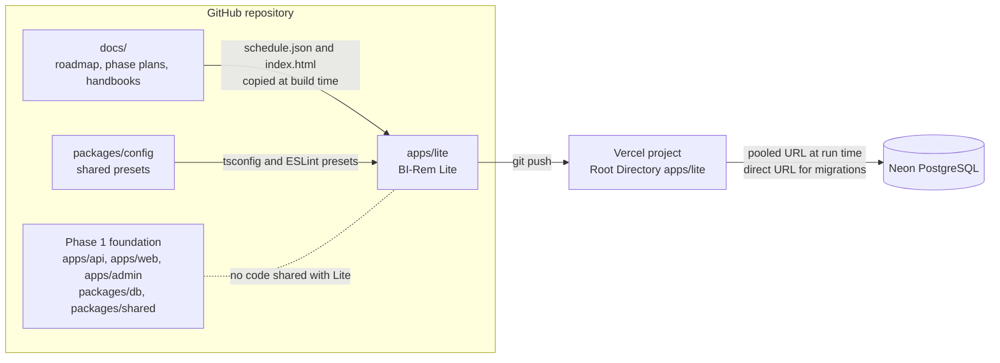
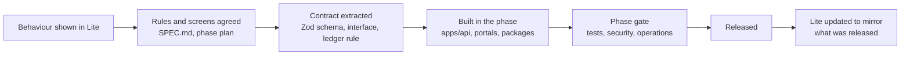

# BI-Rem Lite — the programme at small scale

| Item            | Value                                                                                                                                                                                                          |
| --------------- | -------------------------------------------------------------------------------------------------------------------------------------------------------------------------------------------------------------- |
| What            | One Next.js application, [`apps/lite`](../../apps/lite/README.md), that reflects all 13 phases of the BI-Rem programme end to end and deploys on a GitHub repository, one Vercel project and one Neon database |
| What it is not  | The production platform. The roadmap in this folder stays the plan; Lite does not shorten it, replace a phase or remove a gate                                                                                 |
| Specification   | [`apps/lite/SPEC.md`](../../apps/lite/SPEC.md) — binding scope, phase by phase, and the money-movement rules                                                                                                   |
| How it is built | [`apps/lite/ARCHITECTURE.md`](../../apps/lite/ARCHITECTURE.md)                                                                                                                                                 |
| How to deploy   | [`apps/lite/DEPLOY.md`](../../apps/lite/DEPLOY.md)                                                                                                                                                             |
| Last audit      | 2026-11-10 — the traceability table in [§4](#4-traceability-phase--capability--evidence) records what was verified, how, and what is open                                                                      |
| Owner           | Solution Architect (content), DevOps/SRE Lead (deployment and CI)                                                                                                                                              |

---

## 1. What Lite is

BI-Rem Lite is a working product in miniature, not a mock-up:

- **Real inside.** Sign-in with sessions and optional two-factor authentication, PostgreSQL, a
  double-entry ledger where every transfer is one database transaction, permissions enforced on
  the server, an append-only audit log, a public REST API with API keys.
- **Simulated outside.** Mobile-money operators and KYC vendors are deterministic simulators
  behind the same interfaces the full platform will use; the sanctions and PEP list is
  fictional; FX rates are illustrative; nothing is reported to a regulator. Every simulated
  element is labelled as such in the interface.
- **Small on purpose.** No Redis, no queue, no object storage, no separate API service. It runs
  on Vercel Hobby and Neon Free.

It exists so that the programme can be **seen and exercised today** — by the steering committee,
partners, compliance and prospective operators — while the 13 phases deliver the
production-grade platform between 2026-11-16 and 2028-06-30.

## 2. Where it sits

- Lite is **self-contained**: its own Prisma schema, its own database, no dependency on
  `@bi-rem/db`, `@bi-rem/shared` or `apps/api`. The Phase 1 foundation is untouched by it.
- The only things Lite takes from the rest of the repository are the shared TypeScript and
  ESLint presets (`packages/config`) and the roadmap data (`docs/roadmap/schedule.json` and
  `docs/roadmap/index.html`), which `apps/lite/scripts/sync-roadmap.mjs` copies into the app
  before every build. The public `/roadmap` page of Lite therefore always shows the dates of
  [`schedule.json`](../roadmap/schedule.json); a unit test fails when the copies drift.

## 3. How each phase appears in Lite

Dates are those of [`schedule.json`](../roadmap/schedule.json) for the **full** platform. Lite
implements a small-scale counterpart of every phase now; the right-hand column is what only the
phase itself delivers.

| #   | Phase plan                                                              | Window                  | In Lite today                                                                                                                                                                       | Delivered only by the phase                                                      |
| --- | ----------------------------------------------------------------------- | ----------------------- | ----------------------------------------------------------------------------------------------------------------------------------------------------------------------------------- | -------------------------------------------------------------------------------- |
| 1   | [Foundation & Platform Setup](../phases/phase-01-foundation.md)         | 2026-11-16 → 2026-12-25 | Sign-up, sign-in, lockout, six roles with a permission map, append-only audit log, in-app notifications, health endpoint, status page                                               | NestJS API, Redis queues, e-mail and SMS delivery, SSO, observability stack      |
| 2   | [Customer Management & KYC](../phases/phase-02-customer-kyc.md)         | 2026-12-28 → 2027-02-19 | Profile, optional TOTP, KYC cases with document upload, three simulated vendors behind one interface, tiers with limits, beneficiaries, risk profile, review queue, customer search | Live vendor integrations, liveness, OCR, document retention policy               |
| 3   | [Connectivity Management Framework](../phases/phase-03-connectivity.md) | 2027-01-25 → 2027-03-05 | Provider directory in the database, encrypted write-only credentials, webhook secrets, rotation with versions, connectivity tests and health history                                | KMS or HSM-backed keys, mTLS, IP allow-lists, automated health probes            |
| 4   | [Wallet Connector Engine](../phases/phase-04-wallet-connectors.md)      | 2027-03-08 → 2027-04-30 | One connector interface, adapter registry, deterministic simulator for seven operators, generic HTTP adapter, signed inbound webhooks with replay protection, idempotency keys      | Certified operator adapters, operator sandboxes, retries and reconciliation jobs |
| 5   | [Domestic Transfers](../phases/phase-05-domestic-transfers.md)          | 2027-04-19 → 2027-05-28 | Wallet to wallet, merchant and agent; fee rules; double-entry ledger; tier limits; history, tracking, printable and PDF receipts                                                    | Bill payments, QR, scheduled transfers, production throughput                    |
| 6   | [International Remittance](../phases/phase-06-international.md)         | 2027-05-31 → 2027-07-23 | Corridors between CEMAC, Angola, Mozambique, Cabo Verde, Guinea-Bissau and São Tomé; 15-minute locked quotes; cross-currency and cross-network execution; reconciliation view       | Bank payouts, cash pick-up, diaspora pay-in, settlement with real counterparties |
| 7   | [FX & Treasury Management](../phases/phase-07-fx-treasury.md)           | 2027-06-28 → 2027-08-06 | FX table with margins and audited manual overrides, float per currency with thresholds and alerts, profit analytics                                                                 | Live rate feeds, hedging, automated rebalancing                                  |
| 8   | [AML, Fraud & Compliance](../phases/phase-08-aml-compliance.md)         | 2027-07-26 → 2027-09-17 | Rule engine, fuzzy screening on a fictional list, automatic holds with reserved funds, alerts, cases, notes, release or reject, SAR workflow                                        | Licensed screening data, regulator filing, machine-learning fraud scoring        |
| 9   | [Partner & Merchant Portal](../phases/phase-09-partner-merchant.md)     | 2027-08-23 → 2027-10-01 | Self-serve and administrator onboarding, partner portal, commissions, settlements, API keys, signed webhooks, public REST API                                                       | Sub-accounts, hosted checkout, SDKs, webhook retry queue                         |
| 10  | [Reporting & Business Intelligence](../phases/phase-10-reporting-bi.md) | 2027-09-20 → 2027-10-29 | Five dashboards computed live from PostgreSQL, the KPI set, CSV, Excel and PDF exports                                                                                              | Data warehouse, scheduled reports, regulator report packs                        |
| 11  | [Mobile Applications](../phases/phase-11-mobile.md)                     | 2027-08-09 → 2027-10-15 | Mobile-first responsive interface, installable web app                                                                                                                              | Native iOS and Android apps, biometrics, push notifications, offline mode        |
| 12  | [Production Go-Live](../phases/phase-12-go-live.md)                     | 2027-11-01 → 2027-12-10 | Health endpoint, status page, security headers, database-backed rate limiting, CI job, deploy guide, link to the go-live checklist                                                  | Multi-region infrastructure, penetration test, DR drills, on-call, the go/no-go  |
| 13  | [Pan-African Expansion](../phases/phase-13-pan-african-expansion.md)    | 2028-01-03 → 2028-06-30 | Country registry with an on/off switch, seven planned markets seeded as disabled, registry of nine planned rails                                                                    | Licences, local partners and live connectors per market                          |

## 4. Traceability: phase → capability → evidence

Audit of 2026-11-10, on the working tree as it stood at 13:24 UTC that day. Each capability named in the specification was exercised against a
**production build** of Lite (the build made by the deployment rehearsal of
[`DEPLOY.md` §14](../../apps/lite/DEPLOY.md#14-what-was-rehearsed-and-what-was-not): `next start`,
production rate limits, a database migrated and seeded by `vercel-build`), driving the real
interface with a browser, calling the HTTP API, and reading the rows written to PostgreSQL.
Where a capability is a property of the code rather than a behaviour, the source was read.

Status: **Verified** — works as specified. **Completed in audit** — was missing or partial and
was finished during the audit. Open observations are listed in [§5](#5-open-observations); none
of them makes a listed capability fail.

Paths are relative to `apps/lite/`.

### Phase 1 — Foundation

| Capability                      | Route / file                                                                     | Verified how                                                                                                                                                                | Status   |
| ------------------------------- | -------------------------------------------------------------------------------- | --------------------------------------------------------------------------------------------------------------------------------------------------------------------------- | -------- |
| Register, sign in, sign out     | `/register`, `/login`, `src/app/(auth)/actions.ts`, `src/server/auth/service.ts` | Registered a customer in the browser (wallet in the local currency created), signed out (session row revoked, `/app` redirects to `/login`), signed in again                | Verified |
| Password hashing with scrypt    | `src/server/crypto.ts`                                                           | Stored hash has the form `scrypt$16384$8$1$<salt>$<hash>`; no plaintext                                                                                                     | Verified |
| Signed session cookie           | `src/server/auth/token.ts`, `src/server/auth/session.ts`                         | Cookie `birem_session` is httpOnly, SameSite=Lax, Secure in production, a JWT signed HS256                                                                                  | Verified |
| Lockout after 5 failures        | `src/server/auth/service.ts`                                                     | Five wrong passwords: "locked for 15 minutes"; the correct password is then refused; an unknown e-mail gets the same generic message                                        | Verified |
| Six roles with a permission map | `src/server/rbac.ts`, `src/proxy.ts`, area layouts                               | Each role lands in its own area and is redirected out of the others; a support agent is turned away from audit log, settings, staff and treasury, and gets 403 on an export | Verified |
| Audit row on every mutation     | `src/server/audit.ts`, `src/lib/server-action.ts`                                | A profile change wrote a row with actor, role, action, before/after, IP, user agent and request id; every later mutation in the audit did the same                          | Verified |
| Audit log is append-only        | `prisma/migrations/*/migration.sql` (triggers)                                   | `UPDATE` and `DELETE` on `audit_logs` are rejected by the database: "table audit_logs is append-only"                                                                       | Verified |
| In-app notifications            | `/app/notifications`, `src/server/notifications.ts`                              | Unread badge, list, "mark all as read" (77 unread → 0)                                                                                                                      | Verified |
| Health endpoint and status page | `/api/health`, `/status`                                                         | 200 with the database check; status page "All systems operational"                                                                                                          | Verified |

### Phase 2 — Customer & KYC

| Capability                             | Route / file                                        | Verified how                                                                                                                                                    | Status   |
| -------------------------------------- | --------------------------------------------------- | --------------------------------------------------------------------------------------------------------------------------------------------------------------- | -------- |
| Registration opens a wallet            | `/register`, `src/server/wallets.ts`                | New customer in Cameroon has exactly one XAF wallet                                                                                                             | Verified |
| Optional TOTP two-factor               | `/app/security`, `src/server/auth/totp.ts`          | Enrolled two accounts; password alone then stays on `/login` asking for the code; `000000` is refused; the secret is stored encrypted                           | Verified |
| Profile                                | `/app/profile`                                      | Edited city and occupation; values persisted and audited                                                                                                        | Verified |
| KYC case with document upload          | `/app/kyc`, `src/server/kyc/service.ts`             | Submitted ID type, number, country and a document: stored as `bytea`, `sha256` column equals the hash of the file; a 1 MB + 10 byte file is refused             | Verified |
| Simulated vendors behind `KycProvider` | `src/server/kyc/vendors.ts`                         | One interface, three vendors (Veriff, Sumsub, Smile Identity), all flagged simulated; the interface says "Simulated" and "no real identity check was performed" | Verified |
| KYC tiers with limits                  | `src/server/kyc/limits.ts`, `/app/send`             | Tier 0: international is disabled. Tier 1: 900 000 XAF refused, "exceeds your per-transfer limit of about 1 000.00 USD", nothing created                        | Verified |
| Beneficiaries                          | `/app/beneficiaries`, `src/server/beneficiaries.ts` | Added (account validated), hidden from another customer, removed                                                                                                | Verified |
| Own documents only                     | `/app/kyc/documents/[id]`                           | Owner 200, another customer 404                                                                                                                                 | Verified |
| Risk profile (score and level)         | `/admin/customers/[id]`, `src/server/users.ts`      | Customer 360° shows the score, the level and the factors                                                                                                        | Verified |
| Verification queue                     | `/admin/kyc`, `/admin/kyc/[id]`                     | Compliance approved the case from the queue: tier 1, customer notified                                                                                          | Verified |
| Customer search                        | `/admin/customers?q=`                               | Search by e-mail fragment returns the customer and filters out the others                                                                                       | Verified |

### Phase 3 — Connectivity

| Capability                                  | Route / file                                                                     | Verified how                                                                                                                                                 | Status   |
| ------------------------------------------- | -------------------------------------------------------------------------------- | ------------------------------------------------------------------------------------------------------------------------------------------------------------ | -------- |
| Provider directory in the database          | `/admin/providers`, `/admin/providers/new`, `src/server/connectors/providers.ts` | Created a provider for Cabo Verde from the back office; it is one row and appears on `/status` without a deploy                                              | Verified |
| Base URL, callback URL, environment, status | `/admin/providers/[id]`                                                          | Edited the callback URL, switched to maintenance and back, created a second provider as HTTP / production; every change audited                              | Verified |
| Credentials encrypted, never returned       | `src/server/crypto.ts`, table `provider_secrets`                                 | Saved credentials: the row holds an AES-256-GCM envelope; the value appears neither in the page after reload, nor in the audit log, nor in the configuration | Verified |
| Webhook secret                              | `/admin/providers/[id]`                                                          | Generated: shown once, stored encrypted, not shown after reload                                                                                              | Verified |
| Secret rotation with versioning             | table `provider_secrets`                                                         | Second save: version 2 current, version 1 retired, `credentials_version` = 2; same for the webhook secret                                                    | Verified |
| Connectivity test and health history        | `/admin/providers`, table `provider_health_checks`                               | "Healthy · 64 ms · Simulated", one history row; an unreachable HTTP gateway is reported "Down — host name could not be resolved"                             | Verified |
| No credential in code                       | `src/`, `prisma/`, `scripts/`                                                    | Search for secret-looking literals: only the development fallback of `src/server/env.ts`, which is refused in production                                     | Verified |

### Phase 4 — Wallet connectors

| Capability                                    | Route / file                                                          | Verified how                                                                                                                                                  | Status   |
| --------------------------------------------- | --------------------------------------------------------------------- | ------------------------------------------------------------------------------------------------------------------------------------------------------------- | -------- |
| One `WalletConnector` interface               | `src/server/connectors/types.ts`                                      | `validateAccount`, `getBalance`, `transfer`, `getStatus`, `reverse`, `getStatement` (plus `ping`); both adapters implement it                                 | Verified |
| Adapter registry                              | `src/server/connectors/registry.ts`                                   | Maps the `adapter` column to a class; used by the transfers and the connectivity test above                                                                   | Verified |
| Simulator for the seven operators             | `src/server/connectors/simulator.ts`, `src/server/seed/reference.ts`  | MTN MoMo, Orange Money, Airtel Money, Moov Money, M-Pesa, Unitel Money and e-Mola are seeded on the simulator, sandbox; outcomes follow the account suffix    | Verified |
| Generic HTTP connector, marked untested       | `src/server/connectors/http.ts`                                       | Selectable as "Generic HTTP (production)"; the interface warns it has not been exercised against a real operator. It never has been                           | Verified |
| Signed inbound webhook with replay protection | `/api/webhooks/providers/[code]`, `src/server/connectors/webhooks.ts` | Unsigned, wrong secret, stale timestamp and tampered body: 401. Unknown provider: 404. Valid: the pending payout completes. Replay: `DUPLICATE`, applied once | Verified |
| Idempotency keys                              | `src/server/transfers/engine.ts`, `/api/v1/transfers`                 | Same key twice: the original transfer is returned (`Idempotent-Replayed: true`), one row, one debit; same key with another body: 409                          | Verified |
| Adding a provider is one database row         | `/admin/providers/new`                                                | The provider created in phase 3 is offered by `GET /api/v1/providers?country=CV` immediately                                                                  | Verified |

### Phase 5 — Domestic transfers

| Capability                                  | Route / file                                                          | Verified how                                                                                                                                                                                          | Status   |
| ------------------------------------------- | --------------------------------------------------------------------- | ----------------------------------------------------------------------------------------------------------------------------------------------------------------------------------------------------- | -------- |
| Wallet to wallet, merchant, agent           | `/app/send`, `src/server/transfers/engine.ts`                         | Three transfers in the browser; for each: sender debited amount + fee, recipient credited the amount, checked to the minor unit in the ledger                                                         | Verified |
| Configurable fee rules                      | `/admin/fees`, `src/server/fees.ts`                                   | Set a rule to 100 + 200 bps, minimum 150, cap 1 000: quotes of 20 000, 100 000 and 1 000 XAF charged 500, 1 000 and 150; rule restored; changes audited                                               | Verified |
| Double-entry ledger                         | `src/server/ledger.ts`, constraint trigger                            | Every journal sums to zero per currency (180 journals, 560 entries at the time), no wallet below zero, stored balances equal the entries; the database refuses an overdraft and an unbalanced journal | Verified |
| Fees and commission in the same transaction | `src/server/transfers/engine.ts`                                      | Merchant payment: one journal credits fee revenue and commission payable; the commission row (30 bps) is linked to the transfer                                                                       | Verified |
| History, tracking timeline, receipts        | `/app/transfers`, `/app/transfers/[id]`, `…/receipt`, `…/receipt/pdf` | Filtered history lists the transfer; timeline Created → Completed; printable receipt; PDF served as `application/pdf`                                                                                 | Verified |
| Notifications and audit trail               | `src/server/notifications.ts`, `src/server/audit.ts`                  | Sender and recipient notified; audit row for the transfer                                                                                                                                             | Verified |
| A customer only sees their own transfers    | `src/server/transfers/queries.ts`                                     | Another customer gets "not found" on the transfer, the receipt and the wallet statement, and 404 on the PDF                                                                                           | Verified |

### Phase 6 — International

| Capability                              | Route / file                                                 | Verified how                                                                                                                                               | Status   |
| --------------------------------------- | ------------------------------------------------------------ | ---------------------------------------------------------------------------------------------------------------------------------------------------------- | -------- |
| Corridors                               | `src/server/countries.ts`, `/app/send`                       | From Cameroon the wizard offers GA, TD, CG, CF, GQ, AO, MZ, CV, GW and ST, and none of the planned markets                                                 | Verified |
| Quote with a rate locked for 15 minutes | `src/server/fx.ts`, table `quotes`                           | Quote row expires 900 s after creation; countdown shown; mid rate, margin and customer rate stored                                                         | Verified |
| Purpose of transfer and source of funds | `/app/send`                                                  | The wizard does not advance without them; both are stored on the transfer                                                                                  | Verified |
| Cross-currency execution                | `src/server/transfers/engine.ts`                             | CM → AO: debit equals the quoted total, recipient credited the quoted AOA amount, two legs each balanced in its currency, FX margin credited to FX revenue | Verified |
| Cross-network execution                 | `src/server/connectors/*`                                    | XAF wallet → M-Pesa mobile money in Mozambique through the connector, provider reference stored                                                            | Verified |
| An expired quote is refused             | `src/server/transfers/engine.ts`                             | Quote aged past its expiry: "price has expired", balance unchanged                                                                                         | Verified |
| Reconciliation view                     | `/admin/reconciliation` (→ `/admin/treasury#reconciliation`) | Ledger against provider statements, per currency                                                                                                           | Verified |

### Phase 7 — FX & treasury

| Capability                                | Route / file                                     | Verified how                                                                                                                                                   | Status   |
| ----------------------------------------- | ------------------------------------------------ | -------------------------------------------------------------------------------------------------------------------------------------------------------------- | -------- |
| FX table and manual override with audit   | `/admin/fx`, `src/server/fx.ts`                  | Treasury raised the XAF/AOA margin with a reason: row marked "Manual override", audit action `fx_rate.override`, and the next quote paid out less, to the cent | Verified |
| Treasury dashboard, thresholds and alerts | `/admin/treasury`, `src/server/treasury.ts`      | Threshold raised above the STN float: low-liquidity alert; float funded with one balanced adjustment journal: alert cleared                                    | Verified |
| Profit analytics                          | `/admin/treasury`, `/admin/reports?view=revenue` | Fees and FX margin by day and by pair or corridor; totals agree with the transfers                                                                             | Verified |

### Phase 8 — AML & fraud

| Capability                         | Route / file                                              | Verified how                                                                                                                                                                                                                                                                                                 | Status   |
| ---------------------------------- | --------------------------------------------------------- | ------------------------------------------------------------------------------------------------------------------------------------------------------------------------------------------------------------------------------------------------------------------------------------------------------------ | -------- |
| Rule engine                        | `src/server/aml/engine.ts`, `/admin/compliance?tab=rules` | Nine rules across amount threshold, velocity by count and by value, structuring, new-account high value, high-risk corridor and list match, editable in the back office; the audit's own transfers raised the velocity rule; every family has an integration test in `tests/integration/payouts-aml.test.ts` | Verified |
| Fuzzy sanctions and PEP screening  | `src/server/aml/names.ts`                                 | A reordered, misspelt name ("SANCTIONOV Viktor Dmeo") matched the fictional list at 99 %; the list is labelled as fictional demo data. See observation 1 in §5                                                                                                                                               | Verified |
| Automatic hold with funds reserved | `src/server/transfers/engine.ts`                          | Transfer created `ON_HOLD` and not sent to the operator; the total moved from the wallet to the suspense account                                                                                                                                                                                             | Verified |
| Alerts → cases                     | `/admin/compliance?tab=alerts`                            | An open alert escalated to a case; another dismissed with a reason                                                                                                                                                                                                                                           | Verified |
| Case notes                         | `/admin/compliance/cases/[id]`                            | Note added and shown                                                                                                                                                                                                                                                                                         | Verified |
| Release or reject                  | `src/server/aml/cases.ts`                                 | Reject: funds returned by a compensating journal, customer sees "not approved". Release: recipient credited, suspense emptied for that transfer                                                                                                                                                              | Verified |
| SAR workflow                       | `/admin/compliance?tab=sars`                              | Draft saved on the case, then marked filed with a reference; the interface says nothing is transmitted to a regulator                                                                                                                                                                                        | Verified |
| Risk score                         | `src/server/users.ts`                                     | Score, level and factors reflect open alerts and rejected transfers                                                                                                                                                                                                                                          | Verified |

### Phase 9 — Partner & merchant

| Capability                                  | Route / file                                           | Verified how                                                                                                                                                                              | Status   |
| ------------------------------------------- | ------------------------------------------------------ | ----------------------------------------------------------------------------------------------------------------------------------------------------------------------------------------- | -------- |
| Self-serve application                      | `/apply`, `/admin/partners/[id]`                       | Application pending → approved by the administrator with a commission rate → the applicant signs in to the partner portal                                                                 | Verified |
| Onboarding by an administrator              | `/admin/partners/new`                                  | Agent created active, with a wallet and its own login                                                                                                                                     | Verified |
| Partner dashboard                           | `/partner`                                             | Shows the payment code, balances and activity                                                                                                                                             | Verified |
| Commission rules accrued per transfer       | `src/server/partners/service.ts`                       | The merchant payment of phase 5 accrued 30 bps, listed in `/partner/commissions`                                                                                                          | Verified |
| Settlements                                 | `/admin/partners/[id]`, `/partner/settlements`         | Treasury ran a settlement: one balanced journal, commissions marked paid, partner wallet credited the same amount                                                                         | Verified |
| API keys, shown once and hashed             | `/partner/api-keys`                                    | The key is displayed once; the database holds a prefix and the SHA-256 only                                                                                                               | Verified |
| Webhook endpoints, signed deliveries logged | `/partner/webhooks`, `src/server/partners/webhooks.ts` | Private address refused; endpoint added, secret shown once; a signed test delivery is logged. A delivery that succeeds, and a retry, are covered by the partner walk-through              | Verified |
| Public REST API with API keys               | `/api/v1/*`, `/partner/docs`                           | Index and OpenAPI 3.1; 401 without or with a wrong key (problem+json); 403 when the key lacks the scope; rates, providers, quote, transfer, list, read; another partner's transfer is 404 | Verified |

### Phase 10 — Reporting & BI

| Capability                    | Route / file                                                          | Verified how                                                                                                                                                  | Status   |
| ----------------------------- | --------------------------------------------------------------------- | ------------------------------------------------------------------------------------------------------------------------------------------------------------- | -------- |
| Five dashboards computed live | `/admin`, `/admin/reports?view=…`, `src/server/reports/dashboards.ts` | Executive, operational, revenue, compliance and treasury views render from PostgreSQL                                                                         | Verified |
| KPIs                          | `/admin`                                                              | Volume, value, revenue, failed rate, provider performance, country activity, FX profit by corridor, DAU and MAU; figures moved with the audit's own transfers | Verified |
| CSV, Excel and PDF exports    | `/api/exports/[name]`, `src/server/reports/exports.ts`                | All 24 export links (8 reports × 3 formats) return a well-formed file as an attachment; each export is audited; a role without `reports:export` gets 403      | Verified |

### Phase 11 — Mobile

| Capability                           | Route / file                               | Verified how                                                                                                                   | Status   |
| ------------------------------------ | ------------------------------------------ | ------------------------------------------------------------------------------------------------------------------------------ | -------- |
| Mobile-first responsive interface    | `src/components/**`, `src/app/globals.css` | 26 pages of the four areas at 390 × 844: no horizontal overflow                                                                | Verified |
| Installable web app                  | `src/app/manifest.ts`, `public/icons/`     | Manifest with name, `standalone`, theme colour `#0B6E4F`, four icons that resolve. No service worker: it does not work offline | Verified |
| Native apps stated as a roadmap item | public and area footers                    | "Native iOS and Android apps are on the roadmap (phase 11)"                                                                    | Verified |

### Phase 12 — Go-live

| Capability                                       | Route / file                                          | Verified how                                                                                                                                                            | Status             |
| ------------------------------------------------ | ----------------------------------------------------- | ----------------------------------------------------------------------------------------------------------------------------------------------------------------------- | ------------------ |
| Health endpoint with a database check            | `/api/health`                                         | 200 with the check and `no-store`; the handler answers 503 when `SELECT 1` fails                                                                                        | Verified           |
| Public status page                               | `/status`                                             | Database, providers, build and availability target                                                                                                                      | Verified           |
| Security headers                                 | `next.config.ts`                                      | CSP with `frame-ancestors 'none'`, HSTS, `nosniff`, `X-Frame-Options: DENY`, referrer and permissions policies on pages, API and static files                           | Verified           |
| Rate limiting on authentication, in the database | `src/server/rate-limit.ts`                            | Past the limit: "Too many attempts"; the counters are rows of `rate_limit_buckets`, per e-mail and per address                                                          | Verified           |
| Correlation id                                   | `src/proxy.ts`                                        | `x-request-id` accepted and echoed, generated when absent, recorded on audit rows                                                                                       | Verified           |
| CI job                                           | `.github/workflows/ci.yml`, job `lite`                | Dedicated job: Vercel's install command, migrations on PostgreSQL 16, lint, typecheck, tests, deployment rehearsal, bundle check, end-to-end suite; required by `ci-ok` | Completed in audit |
| Deploy guide                                     | `DEPLOY.md`                                           | Written from a rehearsal of the install and build on a clean copy of the repository                                                                                     | Completed in audit |
| Link to the go-live checklist                    | `/status` ("Go-live"), `src/app/status/build-info.ts` | The interface had no link to the deploy guide or the [go-live checklist](../07-go-live-checklist.md); the status page now links both, at the deployed commit            | Completed in audit |

### Phase 13 — Expansion

| Capability                             | Route / file                                  | Verified how                                                                                                                                                | Status   |
| -------------------------------------- | --------------------------------------------- | ----------------------------------------------------------------------------------------------------------------------------------------------------------- | -------- |
| Country registry with an on/off switch | `/admin/countries`, `src/server/countries.ts` | 18 countries; NG, GH, KE, UG, TZ, RW and ZA seeded disabled. Nigeria switched on by the administrator: offered at registration; switched off: gone; audited | Verified |
| Rails registry                         | `/admin/providers` ("Planned rails")          | Visa Direct, Mastercard Send, TerraPay, Onafriq, Flutterwave, Paystack, ISO 20022, SWIFT and SEPA listed as planned, "none of them is connected"            | Verified |

### Roadmap in the app

| Capability                      | Route / file                                          | Verified how                                                                                                                                            | Status   |
| ------------------------------- | ----------------------------------------------------- | ------------------------------------------------------------------------------------------------------------------------------------------------------- | -------- |
| `/roadmap` from `schedule.json` | `src/app/roadmap/page.tsx`, `src/data/lite-phases.ts` | 13 phases, each with the start and end date of `schedule.json`, a status and what Lite does; the copy is byte-identical to `docs/roadmap/schedule.json` | Verified |
| Full interactive roadmap        | `/roadmap-full.html`                                  | Served as a static file; its phase links point into the app, none to a missing document                                                                 | Verified |

### Summary

| Phase     | Capabilities | Verified | Completed in audit |
| --------- | ------------ | -------- | ------------------ |
| 1         | 9            | 9        | 0                  |
| 2         | 11           | 11       | 0                  |
| 3         | 7            | 7        | 0                  |
| 4         | 7            | 7        | 0                  |
| 5         | 7            | 7        | 0                  |
| 6         | 7            | 7        | 0                  |
| 7         | 3            | 3        | 0                  |
| 8         | 8            | 8        | 0                  |
| 9         | 8            | 8        | 0                  |
| 10        | 3            | 3        | 0                  |
| 11        | 3            | 3        | 0                  |
| 12        | 8            | 5        | 3                  |
| 13        | 2            | 2        | 0                  |
| Roadmap   | 2            | 2        | 0                  |
| **Total** | **85**       | **82**   | **3**              |

Independent evidence from the repository's own suites, run on the same day on a copy installed
with Vercel's install command: unit and integration tests on real PostgreSQL (`pnpm --filter
@bi-rem/lite test`), the Playwright end-to-end suite on a production build (46 tests) and the
four area walk-throughs (370 checks) all passed.

## 5. Open observations

Found during the audit. None of them made a capability of §4 fail. Items 1–6 were fixed in the
final gate that followed the audit; items 7–9 remain open.

| #   | Area              | Observation                                                                                                                                                                                                                                                                                                                         | Status                                                                                                                                                                                                                                                                           |
| --- | ----------------- | ----------------------------------------------------------------------------------------------------------------------------------------------------------------------------------------------------------------------------------------------------------------------------------------------------------------------------------- | -------------------------------------------------------------------------------------------------------------------------------------------------------------------------------------------------------------------------------------------------------------------------------- |
| 1   | AML screening     | The demo customer "Paul Ondo" matched the fictional PEP alias "Paula E. Governadora" at 89 %, one point above the threshold of 88, which produced seventeen of the eighteen open PEP alerts in the demo data.                                                                                                                       | **Fixed.** The name score is now held down by the weakest token pair (`src/server/aml/names.ts`), so a shared first name is not a match; the pair scores 66. The seed has one deliberate open PEP alert again. Regression tests in `tests/unit/domain.test.ts`.                  |
| 2   | Deployment safety | The seed decided "production" from `NODE_ENV` or `VERCEL_ENV=production`, so a Vercel **preview** build without `NODE_ENV=production` could seed the administrator and demo staff with the public demo password.                                                                                                                    | **Fixed.** Every Vercel build and deployment except `vercel dev` gets the production rules (`src/server/env.ts`): secrets mandatory, `SEED_ADMIN_PASSWORD` mandatory, demo data opt-in. See [`DEPLOY.md` §7](../../apps/lite/DEPLOY.md#7-preview-deployments-and-neon-branches). |
| 3   | Key rotation      | Rotating `ENCRYPTION_KEY` worked, but nothing re-encrypted existing secrets, so old keys had to stay in `ENCRYPTION_KEYS_PREVIOUS` indefinitely.                                                                                                                                                                                    | **Fixed.** The seed step re-encrypts provider credentials, webhook secrets and two-factor secrets with the current key on every deploy (`src/server/secrets-rotation.ts`) and says when the old key can be removed.                                                              |
| 4   | Logs              | A replayed provider webhook was handled correctly (`DUPLICATE`) but Prisma logged the unique-constraint violation at error level each time.                                                                                                                                                                                         | **Fixed.** The event insert (and the two-factor replay guard) use `ON CONFLICT DO NOTHING`; a replay is a zero-row insert, not a failed statement.                                                                                                                               |
| 5   | Build             | pnpm 10 ran no install script, so Prisma downloaded its schema engine during `prisma migrate deploy` in every fresh build.                                                                                                                                                                                                          | **Fixed.** `prisma`, `@prisma/engines` and `esbuild` are allow-listed in the root `pnpm-workspace.yaml` (`onlyBuiltDependencies`).                                                                                                                                               |
| 6   | Tests             | The walk-throughs used fixed database names and a fixed build directory, so two runs on one machine collided.                                                                                                                                                                                                                       | **Fixed.** `E2E_WALKTHROUGH_PORT`, `E2E_WALKTHROUGH_DATABASE` and `NEXT_DIST_DIR` select them.                                                                                                                                                                                   |
| 7   | Monitoring        | Inside the three signed-in areas a missing or foreign object renders the "not found" page with HTTP 200, because pages stream. Route handlers (PDF, documents, API) return a real 404.                                                                                                                                              | Open, accepted for Lite; recorded in [`ARCHITECTURE.md` §10](../../apps/lite/ARCHITECTURE.md#10-known-gaps). To change it, resolve the object before streaming on detail pages.                                                                                                  |
| 8   | Known limits      | The gaps recorded in [`ARCHITECTURE.md` §10](../../apps/lite/ARCHITECTURE.md#10-known-gaps) remain the reference list — for example no TOTP recovery codes, partner webhooks sent once without a retry queue, no service worker, a generic HTTP connector that has never met a real operator, and a CSP that allows inline scripts. | Tracked there.                                                                                                                                                                                                                                                                   |
| 9   | Deployment        | Nothing has been built on Vercel or connected to Neon from the environment the audit ran in.                                                                                                                                                                                                                                        | Open. Do the first deployment with [`DEPLOY.md`](../../apps/lite/DEPLOY.md) open and correct it where the dashboards differ.                                                                                                                                                     |

## 6. Limits of the small-scale version

| Dimension       | BI-Rem Lite                                                                                        | Full platform (roadmap)                                                                                                      |
| --------------- | -------------------------------------------------------------------------------------------------- | ---------------------------------------------------------------------------------------------------------------------------- |
| Scale           | One function region, one database, a few requests per second; never load-tested                    | 1,000,000 users, 100,000 transfers/day, 50 providers, 20 countries ([`schedule.json`](../roadmap/schedule.json))             |
| Availability    | No SLA, no uptime history; depends on the free tiers of two vendors                                | 99.9 %, RPO 15 min, RTO 60 min, multi-region ([target architecture](../architecture/target-architecture.md))                 |
| Operators       | Deterministic simulator; a generic HTTP adapter that has never met an operator                     | Certified adapters per operator with sandboxes, retries, reconciliation ([Phase 4](../phases/phase-04-wallet-connectors.md)) |
| KYC             | Decision derived from the ID number; documents stored in PostgreSQL                                | Licensed vendors, liveness, retention and deletion policy ([Phase 2](../phases/phase-02-customer-kyc.md))                    |
| Screening       | Fuzzy match on a seeded fictional list                                                             | Licensed sanctions and PEP data, ongoing rescreening, regulator filing ([Phase 8](../phases/phase-08-aml-compliance.md))     |
| FX and treasury | Illustrative rates, manual overrides, float as ledger accounts                                     | Live feeds, hedging, real settlement accounts ([Phase 7](../phases/phase-07-fx-treasury.md))                                 |
| Background work | None: everything happens inside the request; partner webhooks are attempted once                   | Queues, retries, outbox, scheduled jobs                                                                                      |
| Architecture    | One Next.js application, server actions and route handlers                                         | NestJS API, customer and admin portals, mobile apps, extracted services                                                      |
| Security        | Application-level controls; one encryption key in an environment variable; CSP with inline scripts | KMS or HSM, penetration test, SOC processes ([security baseline](../architecture/security-baseline.md))                      |
| Observability   | Health endpoint, status page, platform logs                                                        | Metrics, traces, SLOs, alerting, on-call ([monitoring framework](../architecture/monitoring-framework.md))                   |
| Mobile          | Responsive, installable web app without offline mode                                               | Native iOS and Android apps ([Phase 11](../phases/phase-11-mobile.md))                                                       |
| Languages       | English                                                                                            | English, French, Portuguese                                                                                                  |
| Regulatory      | No licence, no operator contract, no regulator reporting — a demonstration                         | Licences and partnerships per market, [go-live checklist](../07-go-live-checklist.md)                                        |
| Money           | No real funds move                                                                                 | Real funds, safeguarded                                                                                                      |

What is **not** reduced in Lite, because it would teach the wrong thing: the money-movement
rules (one transaction per transfer, row locks in a stable order, balanced journals per currency,
no negative wallet, idempotency per sender, screening before the debit, reversals as new
journals), server-side authorisation on every action and route, and an audit row for every
mutation.

## 7. How a feature graduates from Lite to the full platform

Lite is where a behaviour is shown and argued about; the phase is where it is built to
production standards. Nothing is promoted by copying Lite's code into the platform.

1. **Agree on the behaviour in Lite.** A flow that product, compliance or a partner wants to
   change is changed in Lite first — it is cheap there — and `SPEC.md` is updated with the
   decision.
2. **Carry the contract, not the implementation.** What moves to the platform is the part that
   is independent of scale: the Zod schemas and enums (to `packages/shared`), the data model
   decisions (to `packages/db` as a migration), the interfaces (`WalletConnector`,
   `KycProvider`), the ledger and money-movement rules, the permission names, and the test
   scenarios. Lite's server actions, inline processing and simulators stay in Lite.
3. **Build it in the phase that owns it**, in `apps/api` and the portals, to the phase plan's
   sections: architecture, data model, API surface, security, test plan, production-readiness
   checklist. The table in §3 says which phase owns what.
4. **Reuse Lite's scenarios as acceptance tests.** The golden path and the walk-throughs under
   `apps/lite/tests/e2e` describe the expected behaviour step by step; the phase's own
   end-to-end tests should cover the same stories against the real stack.
5. **Pass the phase gate** ([milestone tracker](../02-milestone-tracker.md)). A feature is
   "done" when the gate says so, not when Lite shows it.
6. **Keep Lite honest afterwards.** When the platform's behaviour differs from Lite's, update
   Lite or mark the difference on its `/roadmap` page ("Still on the roadmap"). When a phase
   replaces a simulator with a real integration, Lite keeps the simulator and says so.

Rules of thumb:

- A change to money movement, limits, screening or permissions is made in `SPEC.md` first, then
  in Lite, with a test.
- Lite never gains infrastructure the platform is meant to provide (queues, object storage,
  separate services). If a behaviour cannot be shown without it, it is described on `/roadmap`
  rather than faked.
- Lite's database is not a migration source for the platform: no data moves from one to the
  other.

## 8. Keeping this document current

- Re-run the audit of §4 when `SPEC.md` changes or before Lite is shown to a new audience: the
  end-to-end suite and the walk-throughs are the fast way, the table says what else to look at.
- Dates in §3 come from [`schedule.json`](../roadmap/schedule.json); change them there first.
  `pnpm docs:check` validates the links and the diagrams of this file.
- Conventions for the workspace are in [`CLAUDE.md`](../../CLAUDE.md).
