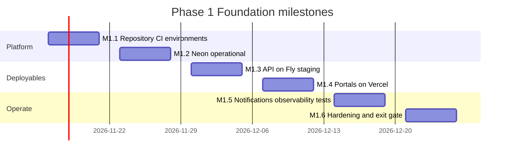
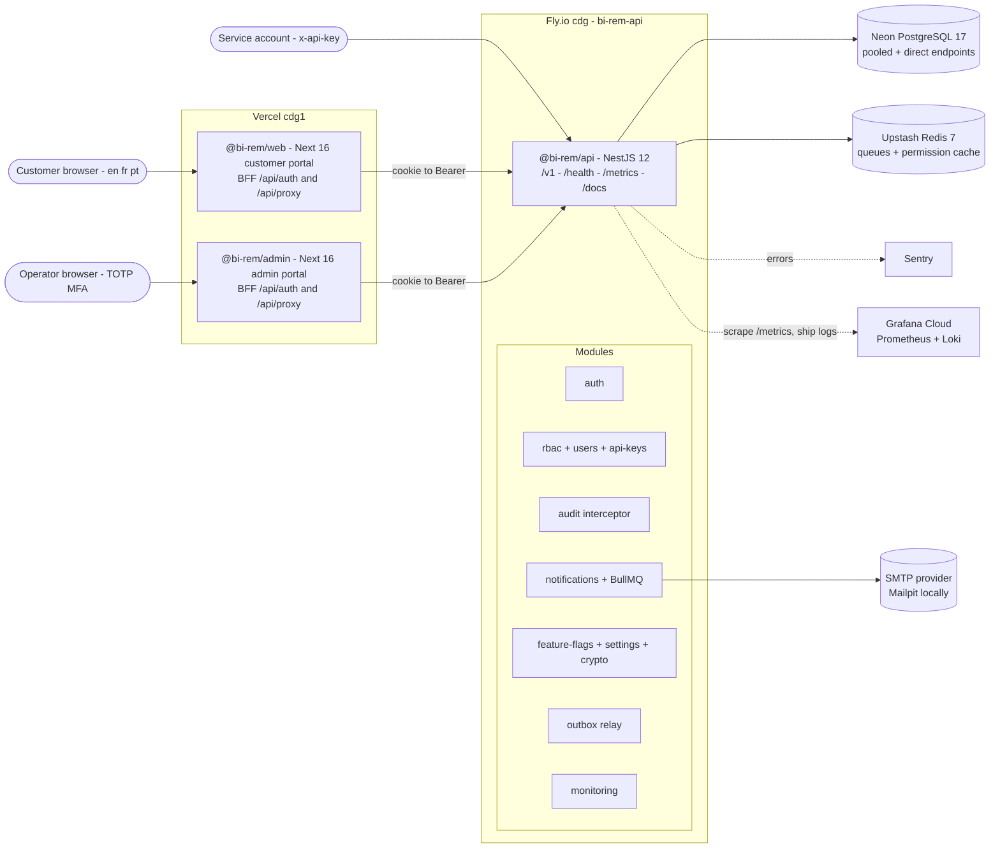
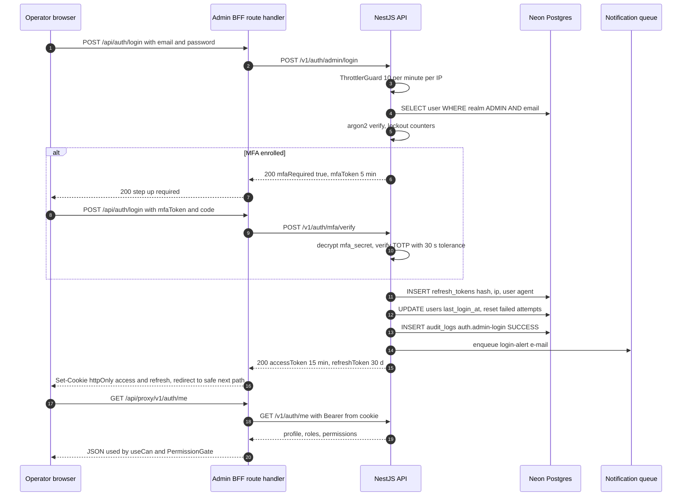
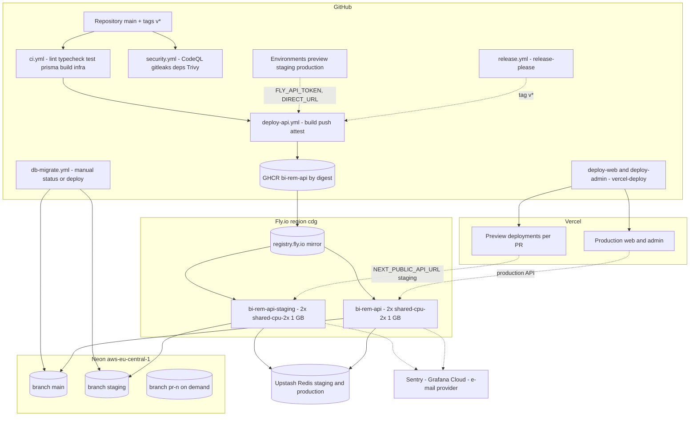
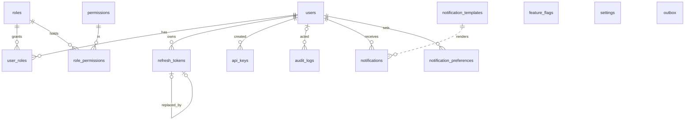
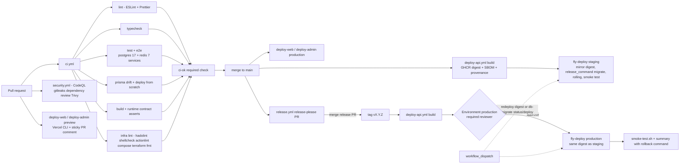

# Phase 1 — Foundation & Platform Setup

| Field           | Value                                                                                                                                                                                                                      |
| --------------- | -------------------------------------------------------------------------------------------------------------------------------------------------------------------------------------------------------------------------- |
| **Phase**       | 1 of 13 — `foundation`                                                                                                                                                                                                     |
| **Dates**       | 2026-11-16 → 2026-12-25                                                                                                                                                                                                    |
| **Duration**    | 6 weeks (W1 = 2026-11-16 … W6 = 2026-12-21 → 2026-12-25)                                                                                                                                                                   |
| **Team**        | `core` — 1 solution architect, 4 backend, 3 frontend, 2 QA, 1 DevOps/SRE, 1 program manager, 1 product designer, 0.5 security engineer; compliance analyst consulted; mobile engineers review the API contract only        |
| **Depends on**  | — (program start)                                                                                                                                                                                                          |
| **Unlocks**     | Phase 2 Customer Management & KYC (2026-12-28), Phase 3 Connectivity Management Framework (2027-01-25), and transitively every later phase                                                                                  |
| **Repository**  | `apps/api`, `apps/web`, `apps/admin`, `packages/db`, `packages/shared`, `packages/config`, `infra/`, `.github/`                                                                                                            |
| **Plan status** | Rewritten 2026-11-09 against the live repository. The Phase 1 code base is **implemented and green** from the root (`pnpm lint`, `typecheck`, `test`, `test:e2e`, `build`); the six phase weeks provision, verify, harden and sign off |

> Legend used throughout: **[REAL]** = exists in this repository today and is described as built; **[PLANNED]** = still to be done inside the phase window (mostly environment provisioning, verification and hardening, since the code is ahead of the calendar).

---

## 1. Overview

### 1.1 Objective

Phase 1 builds the platform every later BI-Rem phase deploys onto. It moves no money. Its output is a monorepo with one build/test/deploy convention, a shared identity and access layer for two realms (customers and operators), append-only auditing from the first request (a record-keeping prerequisite for an e-money / remittance licensee in WAEMU, Nigeria, Kenya and Ghana), a notification spine, baseline observability, and a GitHub-driven deployment path to Vercel (portals), Fly.io (API) and Neon (PostgreSQL).

The phase is complete when a customer can register and log in on the customer portal, an operator can log in (with TOTP) on the admin portal, both paths read and write a Neon database through Prisma, and all three deployables reached their environments through GitHub Actions without anyone running a command by hand.

### 1.2 Repository state at the time of writing

| Area                      | State      | What exists                                                                                                                                                                                                                                                                                                                                                                                                                                                    |
| ------------------------- | ---------- | -------------------------------------------------------------------------------------------------------------------------------------------------------------------------------------------------------------------------------------------------------------------------------------------------------------------------------------------------------------------------------------------------------------------------------------------------------------- |
| Monorepo & toolchain      | **[REAL]** | pnpm 10.28 workspaces (`apps/*`, `packages/*`), Turborepo 2.11 graph (`generate → build → lint/typecheck/test → test:e2e`, plus `seed`), TypeScript 5.9, ESLint 9 flat config and Prettier 3 presets in `@bi-rem/config`, root scripts `db:generate`, `db:migrate`, `db:migrate:dev`, `db:seed`, `format:check`.                                                                                                                                          |
| `@bi-rem/db`              | **[REAL]** | Prisma 7 schema v1 — 14 models, 7 enums, generator `prisma-client` (ESM `.ts` output in `generated/client`); `prisma.config.ts` (`DIRECT_URL ?? DATABASE_URL ?? offline placeholder`); migration `20261116000000_init` (prefixed with `citext` + `pgcrypto`); idempotent seed (57 permissions, 7 system roles, bootstrap admin, demo customer, templates `welcome`/`password-reset`/`login-alert`/`mfa-code` in en/fr/pt, flags, settings); `createPrismaClient()` on `@prisma/adapter-pg`. |
| `@bi-rem/shared`          | **[REAL]** | Zod 4 schemas for every DTO (`auth`, `user`, `rbac`, `audit`, `notification`, `settings`, `common`), canonical RBAC catalogue (`PERMISSIONS`, `SYSTEM_ROLES`), `API_ROUTES`/`OPS_ROUTES`/`HTTP_HEADERS`/`PAGINATION`, feature-flag and setting key registries, countries, currencies, locales, money/phone/ids/dates utilities with Vitest tests.                                                                                                             |
| `@bi-rem/api`             | **[REAL]** | NestJS 12 application: `auth`, `users`, `rbac`, `api-keys`, `audit`, `notifications`, `feature-flags`, `settings`, `crypto`, `outbox`, `monitoring` modules; Zod-validated env; pino logging; RFC 9457 problem details; Swagger at `/docs`; guards ordered throttle → JWT → permissions; Jest unit tests and an e2e suite that boots the whole Nest app with Prisma stubbed.                                                                              |
| `@bi-rem/web`             | **[REAL]** | Next.js 16 customer portal: `(public)` register / login / forgot / reset, `(dashboard)` dashboard / profile / security / notifications; BFF route handlers under `/api/auth/*` and `/api/proxy/[...path]`; httpOnly cookies; i18n en/fr/pt; security headers in `next.config.ts`; Vitest tests.                                                                                                                                                              |
| `@bi-rem/admin`           | **[REAL]** | Next.js 16 admin portal: MFA-aware login, shell with sidebar/command palette/env badge, dashboard (stat tiles + live `/health` card + phase tiles), users list/detail/create/status actions, roles with permission matrix, audit explorer with JSON diff, notification template editor, settings view with feature-flag / settings / API-key panels; `useCan`/`<Can>`/`<PermissionGate>`.                                                                   |
| `infra/`                  | **[REAL]** | `docker/` (api/web/admin Dockerfiles, compose with Postgres 17, Redis 7, Mailpit and an `apps` profile, `postgres/init.sql`, runtime `prisma.config.ts`, `api-entrypoint.sh`), `fly/api.fly.toml`, `vercel/README.md` + `apps/*/vercel.json`, `scripts/` (`bootstrap.sh`, `db-backup.sh`, `db-restore.sh`, `deploy-api.sh`, `smoke-test.sh`, `rotate-secrets.md`), `terraform/` ECS Fargate alternative (vpc, alb, ecs-service, secrets modules), `ci/prisma.config.ts`. |
| `.github/`                | **[REAL]** | Workflows `ci.yml`, `security.yml`, `deploy-api.yml` + `fly-deploy.yml`, `deploy-web.yml` / `deploy-admin.yml` + `vercel-deploy.yml`, `db-migrate.yml`, `release.yml`; composite action `actions/setup`; CODEOWNERS, Dependabot, issue and PR templates.                                                                                                                                                                                                      |
| `docs/architecture`       | **[REAL]** | `infrastructure-architecture.md`, `database-schema-v1.md`, `environment-management.md`, `monitoring-framework.md`, `security-baseline.md`, `phase-1-implementation-notes.md`.                                                                                                                                                                                                                                                                                 |
| Hosted environments       | **[PLANNED]** | No Neon project, Fly apps, Vercel projects, GitHub Environments or secrets exist yet. Every workflow is written against them (`vars.FLY_APP_STAGING`, `secrets.VERCEL_PROJECT_ID_WEB`, `secrets.DIRECT_URL`, …) and will go live in W1–W4.                                                                                                                                                                                                                 |
| Known code gaps           | **[PLANNED]** | Database-backed e2e suite; SMS provider is a logging stub; outbox transport is a log sink; `GET /v1/audit/export` reserved but not implemented; CSP `script-src` still `'unsafe-inline'`; dashboards/alerts not provisioned; ADRs and runbooks (deploy, rollback, lock account, on-call) not yet written; feature-flag key drift between seed and API (see §3.12).                                                                                          |

### 1.3 In scope

- Monorepo conventions, shared TypeScript/ESLint config, shared Zod contracts.
- NestJS 12 API with the eleven modules above and the cross-cutting pipeline (request context, throttling, JWT auth, permissions guard, audit interceptor, metrics interceptor, problem-details filter).
- Prisma 7 schema v1, `init` migration, seed; Neon project with `main` (production), `staging` and ephemeral `pr-<n>` branches.
- Customer and admin portal skeletons with authentication, shells, and the admin CRUD screens for users, roles, audit, templates, flags, settings and API keys.
- Authentication (password + JWT access / opaque rotating refresh tokens, TOTP MFA, password reset, invitations), RBAC, audit logging, notifications (EMAIL live, SMS stub behind a flag, IN_APP), feature flags with percentage rollout and rules, encrypted settings, API keys, transactional outbox, monitoring (`/health*`, `/metrics`, pino, Sentry, OpenTelemetry).
- Docker images and compose stack, Fly.io and Vercel configuration, deployment and backup scripts, GitHub Actions CI/CD with `preview`, `staging`, `production` environments, release automation.
- Security baseline: helmet, CORS allowlist, rate limiting, secret hygiene, CodeQL, gitleaks, dependency review, Trivy image scan, SBOM and provenance attestations.
- Provisioning, verification, performance and security testing, runbooks, UAT and sign-off for all of the above.

### 1.4 Out of scope (deferred to the named phase)

- Customer profiles, KYC, document capture, tiers and limits, beneficiaries, SMS OTP — **Phase 2**.
- Provider connectivity framework, circuit breakers, connector registry — **Phase 3**; wallet connectors — **Phase 4**.
- Ledger, balances, transfers, FX, fees — **Phases 5–7**. No money columns exist in schema v1 by design.
- AML/sanctions screening, transaction monitoring, audit WORM export — **Phase 8** (the `audit:export` permission and route constant are reserved now).
- Partner/merchant portals — **Phase 9**; reporting warehouse — **Phase 10**; mobile apps — **Phase 11**; production launch programme and data-residency moves — **Phases 12–13**.
- Real message broker behind the outbox, SMS/push vendors, per-request CSP nonces, audit hash-chaining — explicitly listed as handover items in §15.

### 1.5 Independent deployability strategy

Phase 1 defines the mechanics every later phase inherits:

| Mechanism                    | How Phase 1 implements it                                                                                                                                                                                                                                                                                                                                                              |
| ---------------------------- | -------------------------------------------------------------------------------------------------------------------------------------------------------------------------------------------------------------------------------------------------------------------------------------------------------------------------------------------------------------------------------------- |
| Feature flags                | `FeatureFlag` table + `FeatureFlagsService.isEnabled(key, context)` with `enabled`, `rolloutPercentage` (SHA-256 bucket of `flag:subject`, so a user is not in the first 10 % of every flag) and JSON `rules` matched on realm/country; defaults from `FEATURE_FLAG_DEFAULTS` when a row is missing. Registration is already gated (`auth.registration.open`). Later phases add a flag per feature and ship dark. |
| Kill switches                | `platform.maintenance-mode` flag (seeded, off) and `platform.maintenance-message` setting; `auth.registration.open` doubles as a registration kill switch; `notifications.sms` keeps the SMS channel off until a vendor exists; `fly deploy --image <previous>` is the API-level kill switch recorded in every deploy summary.                                                            |
| Expand / contract migrations | Fly `release_command = "migrate"` runs `prisma migrate deploy` while the previous release is still serving, so every migration must be backward compatible with N-1 code. CI's `prisma` job proves the migrations folder reproduces `schema.prisma` and applies from scratch. Destructive steps are separate, later migrations (§5.3).                                                   |
| Dark launch                  | Admin screens render behind `<PermissionGate>`; new API modules are mounted but their permissions are granted to no system role until enabled; Vercel preview deployments talk to the staging API so a feature can be exercised end-to-end before production.                                                                                                                             |
| Rolling, digest-pinned deploys | One image per commit (`ghcr.io/<owner>/bi-rem-api@sha256:…`), mirrored byte-for-byte to `registry.fly.io`; rolling strategy with `max_unavailable = 0.33` and `min_machines_running = 2`; smoke test after every deploy.                                                                                                                                                             |
| "Deployable alone"           | Phase 1 is the only phase with no upstream; being deployable alone means: a clean clone passes `pnpm install && pnpm lint && pnpm typecheck && pnpm test && pnpm build`, `docker compose --profile apps up` yields a working local stack, and `main` auto-deploys to staging with production gated behind a tag and a required reviewer.                                                  |

---

## 2. Milestones

All dates derive from `docs/roadmap/schedule.json` (`start` 2026-11-16, `weekLengthDays` 7). Week N starts on Monday `2026-11-16 + 7·(N−1)` days; milestone dates are that week's Friday (W6 ends on the phase `end`, 2026-12-25). Because the code base is already implemented, each milestone pairs **verification of what exists** with **provisioning of what does not**.

| ID       | Week | Target date | Deliverable                                                        | Acceptance criteria                                                                                                                                                                                                                                                                                                                                                                                                                                                                                                                                                                   | Owner role               |
| -------- | ---- | ----------- | ------------------------------------------------------------------ | ------------------------------------------------------------------------------------------------------------------------------------------------------------------------------------------------------------------------------------------------------------------------------------------------------------------------------------------------------------------------------------------------------------------------------------------------------------------------------------------------------------------------------------------------------------------------------------- | ------------------------ |
| **M1.1** | W1   | 2026-11-20  | GitHub repository live with CI gates and environments               | Repository pushed; branch protection on `main` requires `CI / ci-ok`, 1 review and linear history; GitHub Environments `preview`, `staging`, `production` created (production with required reviewers); CODEOWNERS enforced; Dependabot and `security.yml` first runs green; clean clone passes all root scripts; flag-key drift (§3.12) fixed in `@bi-rem/shared` + seed; ADR-0001…0006 recorded (§4.4).                                                                         | DevOps/SRE + Architect   |
| **M1.2** | W2   | 2026-11-27  | Neon database operational                                           | Neon project `bi-rem` (region `aws-eu-central-1`, Postgres 17) with branches `main` and `staging`; roles `birem_app` (runtime) and `birem_migrate`; `DIRECT_URL`/`DATABASE_URL`/`DATABASE_POOL_URL` stored as environment secrets; `db-migrate.yml` `status` then `deploy` applies `20261116000000_init` to both branches with the step summary attached; `pnpm db:seed` run against staging; `infra/scripts/db-backup.sh --upload` produces a verified dump; PITR branch restore rehearsed with `db-restore.sh`. | Backend Lead + DevOps    |
| **M1.3** | W3   | 2026-12-04  | API on Fly staging from `main`                                      | Fly apps `bi-rem-api-staging` and `bi-rem-api` created in `cdg`; secrets set (`DATABASE_URL`, `DIRECT_URL`, `DATABASE_POOL_URL`, `REDIS_URL`, `JWT_*`, `ENCRYPTION_KEY`, `SMTP_*`, `SENTRY_DSN`); `deploy-api.yml` builds, attests and deploys the digest; `release_command` applies migrations; `smoke-test.sh` passes; `GET /v1/auth/me` round-trips with a seeded admin; `admin.mfa.enforce-admin` enforced at admin login; Upstash Redis attached and `/health/ready` reports both indicators `up`.          | Backend Lead             |
| **M1.4** | W4   | 2026-12-11  | Portals on Vercel with preview and production targets                | Vercel projects `bi-rem-web` and `bi-rem-admin` (root dirs `apps/web`, `apps/admin`, region `cdg1`); `VERCEL_*` secrets in `preview` and `production` environments; every PR gets a sticky preview comment per portal; `main` deploys production; admin preview protected by Vercel Authentication; custom domains `app.`/`admin.`/`api.` on the chosen apex (Q1) with TLS; customer register → login → profile and admin login → TOTP → users list work on staging end-to-end.                               | Frontend Lead + DevOps   |
| **M1.5** | W5   | 2026-12-18  | Notifications, observability and database-backed tests               | Transactional e-mail provider (Resend or Postmark, Q1 domain) wired through `SMTP_*` on staging with SPF/DKIM/DMARC; Mailpit stays local; Sentry projects for api/web/admin receiving events; Grafana Cloud (or Fly Metrics) scraping `/metrics` with the dashboards and alert rules of §11; log shipping to Loki/Better Stack; Testcontainers-based API integration suite (migrations + seed + auth/RBAC/audit flows) green in CI; k6 login profile p95 < 300 ms at 100 rps on staging. | QA Lead + DevOps         |
| **M1.6** | W6   | 2026-12-25  | Hardening, first production release and phase exit                 | ZAP baseline on staging with no High; CodeQL/gitleaks/dependency-review/Trivy gates enforced on `main`; `release.yml` cuts `v0.1.0`, `deploy-api.yml` production run approved and smoke-tested; portals promoted to production; runbooks (deploy, rollback, rotate secrets, lock account, on-call) published; production-readiness checklist §11 signed; §12 criteria demonstrated in a recorded UAT session; handover notes to Phases 2 and 3 accepted.                                    | Program Manager          |



---

## 3. Deliverables

Each deliverable from the phase brief, its current state, and its definition of done (DoD).

### 3.1 Monorepo setup — **[REAL]**

pnpm workspaces + Turborepo as described in §1.2. `turbo.json` makes `build`, `dev`, `lint`, `typecheck`, `test` depend on `^build`, `^generate` and the package's own `generate`, which is why a fresh clone works without a manual `prisma generate`. `globalEnv` carries `NODE_ENV`, `CI`; `build` declares `DATABASE_URL`, `NEXT_PUBLIC_API_URL`, `NEXT_PUBLIC_APP_NAME` so cache keys change with them. Remote cache is optional (`TURBO_TOKEN`/`TURBO_TEAM`).
**DoD:** clean clone on Node 22 / pnpm 10 passes every root script; `pnpm format:check` is blocking in CI; `packages/config` presets are the only tsconfig/eslint sources.

### 3.2 Next.js frontend — **[REAL]**

Two Next.js 16 apps on React 19 and Tailwind 4, App Router, Server Components by default, `output: 'standalone'`, `typedRoutes`, `transpilePackages: ['@bi-rem/shared']`. Both implement the BFF pattern (§4.2) and validate `NEXT_PUBLIC_*` in `src/env.ts` at build time (imported by `next.config.ts`).
**DoD:** register/login/forgot/reset + dashboard/profile/security/notifications (web) and login/dashboard/users/roles/audit/templates/settings (admin) render on Vercel preview and production; Vitest suites green; CSP, HSTS, frame denial and `X-Robots-Tag: noindex` (admin) present in response headers.

### 3.3 NestJS backend — **[REAL]**

`apps/api` boots via `main.ts` (loads OpenTelemetry when `OTEL_EXPORTER_OTLP_ENDPOINT` is set and Sentry when `SENTRY_DSN` is set, before any Nest import) then `bootstrap.ts → createApp()`: pino logger with header redaction and `x-request-id` correlation, `trust proxy`, helmet (CSP only in production), CORS allowlist from `CORS_ORIGINS` with `x-request-id` exposed, global prefix `/v1` excluding `health*`, `metrics`, `docs`, `docs-json`, `ValidationPipe` (`whitelist`, `forbidNonWhitelisted`, `transform`, no implicit conversion) producing field-level problem details, Swagger with bearer and `x-api-key` security schemes, shutdown hooks. Global providers: `ProblemDetailsFilter`, guards `ThrottlerGuard` (300 req/min default) → `JwtAuthGuard` → `PermissionsGuard`.
**DoD:** `/docs-json` lists every §6 endpoint; e2e suite passes; API runs on Fly staging and production with `/health/ready` green.

### 3.4 Prisma ORM — **[REAL]**

Prisma 7.10 with the `prisma-client` generator (ESM, `.ts`), `@prisma/adapter-pg` + `pg` so the same client talks to local Postgres and Neon; `createPrismaClient(url?, { maxConnections, idleTimeoutMs, connectionTimeoutMs })` maps `?schema=` to `search_path`. The API's `PrismaService` uses `databaseRuntimeUrl` (`DATABASE_POOL_URL ?? DATABASE_URL`); the CLI uses `DIRECT_URL`.
**DoD:** CI `prisma` job proves `migrate diff --from-migrations --to-schema --exit-code` is clean and `migrate deploy` + `migrate status` succeed from scratch; `migration_lock.toml` provider is `postgresql`.

### 3.5 Neon PostgreSQL — **[PLANNED]** (code ready)

Project `bi-rem` in `aws-eu-central-1` (closest Neon region to the Fly primary `cdg`), Postgres 17 to match `postgres:17-alpine` in CI and compose. Branches: `main` (production), `staging`, and `pr-<n>` created on demand for PRs that need isolated data. Two roles: `birem_app` (DML only) for the runtime, `birem_migrate` (DDL) for `release_command` and `db-migrate.yml`. Pooled endpoint (`-pooler`, PgBouncer transaction mode) in `DATABASE_POOL_URL`; direct endpoint in `DIRECT_URL`. Extensions `citext` and `pgcrypto` are created by the `init` migration (both available on Neon).
**DoD:** M1.2 criteria; PITR window ≥ 7 days; weekly `db-backup.sh` dump to object storage verified by a restore into a scratch branch.

### 3.6 GitHub repository setup — **[REAL]** files, **[PLANNED]** settings

CODEOWNERS, PR template, issue forms (bug, feature, `phase_task`), Dependabot (weekly, grouped), composite `setup` action. Repository settings to apply in M1.1: branch protection on `main` (required check `CI / ci-ok`, 1 approving review, dismiss stale reviews, linear history, no force-push), Environments `preview` / `staging` / `production` (production: required reviewers, deployment branches `main` and tags `v*`), secrets per §10.3, `RELEASE_PLEASE_TOKEN` fine-grained PAT so a release tag can trigger `deploy-api.yml`.
**DoD:** settings screenshot archived in `docs/architecture/`; a PR without green CI cannot merge; a production deployment waits for approval.

### 3.7 Vercel deployments — **[REAL]** workflows, **[PLANNED]** projects

`apps/web/vercel.json` and `apps/admin/vercel.json` (framework `nextjs`, `installCommand: pnpm install --frozen-lockfile`, `buildCommand` builds `@bi-rem/shared` then the app, region `cdg1`). `vercel-deploy.yml` runs `vercel pull → vercel build → vercel deploy --prebuilt` on GitHub runners so deployments are gated by this repository's checks, skips via `turbo-ignore` when the workspace did not change, and posts a sticky PR comment. Setting `VERCEL_GIT_INTEGRATION=true` hands over to Vercel's Git integration instead.
**DoD:** M1.4 criteria; preview deployments carry `NEXT_PUBLIC_API_URL=https://api.staging.<apex>`; production carries the production API URL; `API_INTERNAL_URL` and `AUTH_COOKIE_SECURE=true` set as runtime variables.

### 3.8 Docker configuration — **[REAL]**

`api.Dockerfile`: `pruner` (`turbo prune @bi-rem/api --docker`) → `installer` (frozen install, `turbo run build --filter=@bi-rem/api`, `pnpm install --prod`) → `runner` (`node:22-alpine`, `tini`, Prisma CLI 7.10.1 for `migrate deploy`, non-root `birem` uid 1001, `HEALTHCHECK` on `/health/live`, OCI labels incl. `revision=GIT_SHA`). Entrypoint commands: `start` (optionally `RUN_MIGRATIONS=true`), `migrate`, `seed` (refused — seed runs from a checkout), passthrough. `web.Dockerfile` / `admin.Dockerfile` build the Next standalone output with build-time `NEXT_PUBLIC_*` args. Compose: `postgres:17-alpine` (`C.UTF-8`, `log_min_duration_statement=250ms`), `redis:7-alpine` (AOF, `noeviction`), `axllent/mailpit`, and an `apps` profile running the three images read-only with `no-new-privileges`.
**DoD:** `docker compose --profile apps up --build` yields a working stack on `localhost:3000/3001/4000`; hadolint, `docker build --check`, Trivy (no fixed CRITICAL) pass in CI.

### 3.9 Environment management — **[REAL]**

`apps/api/src/config/env.ts` (Zod): every variable typed, durations parsed (`15m`, `30d`), `ENCRYPTION_KEY` must decode to exactly 32 bytes (base64 or hex), `JWT_ACCESS_SECRET ≠ JWT_REFRESH_SECRET`, and in production placeholder/low-entropy secrets are refused with a full list of problems. Portals validate `NEXT_PUBLIC_*` at build time and server variables lazily (`getServerEnv` throws in the browser). Root and per-workspace `.env.example` document every variable; `docs/architecture/environment-management.md` describes environments, secret locations and rotation; `infra/scripts/rotate-secrets.md` is the rotation runbook.
**DoD:** every variable read anywhere appears in `.env.example`; API refuses to start with `change-me*` values when `NODE_ENV=production` (unit-tested in `env.spec.ts`); secrets live only in Fly secrets, Vercel env and GitHub Environments.

### 3.10 CI/CD pipelines — **[REAL]**

See §10. `ci.yml` (lint, typecheck, test + e2e against Postgres/Redis service containers, Prisma drift, build with runtime-contract assertions, infra lint) aggregated by `ci-ok`; `security.yml` (CodeQL, dependency review, gitleaks, `pnpm audit` report, Trivy); `deploy-api.yml` → `fly-deploy.yml`; `deploy-web.yml` / `deploy-admin.yml` → `vercel-deploy.yml`; `db-migrate.yml`; `release.yml` (release-please).
**DoD:** push to `main` deploys staging API and production portals; `v*` tag deploys production API after approval; every deployment summary includes image digest, previous image and the rollback command.

### 3.11 Authentication framework — **[REAL]**

`AuthModule`: Argon2id (`PasswordService`), JWT access tokens (`iss = bi-rem-api`, 15 min) signed with `JWT_ACCESS_SECRET`; opaque refresh tokens (30 d) stored as SHA-256 hashes with rotation (`replacedByTokenId`) and **family revocation on reuse** (bounded walk of 500); purpose tokens (`mfa` 5 min, `password_reset` 1 h, `invite` 24 h) signed with `JWT_REFRESH_SECRET`; TOTP via `otplib` with the secret AES-256-GCM encrypted at rest; lockout after `auth.max-failed-login-attempts` (5) for `auth.lockout-minutes` (15) read from `Setting`; registration gated by `auth.registration.open`; enumeration-safe `202` on reset requests; credential endpoints throttled at 10/min/IP, refresh at 30/min; `user.registered` outbox event and `welcome` e-mail on registration; `login-alert` e-mail on new sign-ins. Realms: `POST /auth/login` (CUSTOMER by default, `realm` in body) and `POST /auth/admin/login` (ADMIN). Both portals keep tokens in httpOnly cookies via BFF handlers.
**DoD (remaining):** admin login enforces MFA enrolment when `auth.mfa.enforce-admin` is on (today MFA is enforced only for users who enrolled); DB-backed integration tests for rotation/reuse/lockout; k6 profile met.

### 3.12 RBAC framework — **[REAL]**

Canonical catalogue in `@bi-rem/shared/constants/permissions.ts` (57 `resource:action` keys across 19 resources, incl. forward-looking `kyc:*`, `transactions:*`, `treasury:*`, `transfers:*`, `beneficiaries:*`), re-exported by `@bi-rem/db` so seed and API import one source. Seven system roles bound to realms: `SUPER_ADMIN`, `ADMIN`, `COMPLIANCE_OFFICER`, `SUPPORT_AGENT`, `TREASURY_MANAGER`, `VIEWER` (ADMIN realm) and `CUSTOMER`. `PermissionsGuard` enforces `@Permissions()` (AND) and `@AnyPermission()` (OR); `SUPER_ADMIN` bypasses; API keys are checked against `scopes` which may hold `resource:*` or `*`, bounded at creation by the creator's own permissions; denied mutating calls are written to the audit log with outcome `DENIED`. `PermissionResolverService` caches per user in memory or Redis.
**Gap found during this review (fix in M1.1):** the seed writes flags `customer.registration`, `customer.mfa-required`, `admin.mfa-required`, `notifications.login-alert`, `platform.maintenance-mode`, while `@bi-rem/shared` registers `auth.registration.open`, `auth.mfa.enforce-admin`, … and `AuthService` evaluates `auth.registration.open`. The API currently works only because `FEATURE_FLAG_DEFAULTS` fills the gap. Reconcile on the shared registry, update `seed-data/platform-defaults.ts`, and add a Vitest test asserting every seeded key is in `FEATURE_FLAG_KEYS`.
**DoD:** test above; admin permission matrix shows all 57 keys; `roles:assign` cannot grant `SUPER_ADMIN` to oneself (service check + test).

### 3.13 Audit logging framework — **[REAL]**

`AuditInterceptor` (global via `AuditModule`) records every non-GET/HEAD/OPTIONS request unless `@AuditSkip()`: action from `@Audit()` or derived `controller.handler`, resource type, resource id (from `RequestContext.setResourceId`, the `idParam` or the response body), outcome `SUCCESS` / `FAILURE` / `DENIED` from the status, actor user id and type (`USER` / `API_KEY` / `SYSTEM`), `before` (snapshot stored by the service in the request context) and `after` (redacted body: keys matching password/secret/token/key/otp/credential become `[REDACTED]`, truncated at 8 000 chars), metadata (`method`, `route`, `path`, `statusCode`, `durationMs`, `params`, error message), IP, user agent and the `x-request-id` correlation id. Write failures are logged, never thrown. `GET /v1/audit` supports filtering by actor, action, resource, outcome, date range and correlation id; the admin explorer renders a JSON diff of `before`/`after`.
**DoD:** every mutating endpoint in §6 produces exactly one row (asserted by the DB-backed suite); `audit_logs` has no UPDATE/DELETE grants for `birem_app`; retention job defined (§5.5).

### 3.14 Notification framework — **[REAL]** (SMS vendor **[PLANNED]** for Phase 2)

`NotificationService.send({ userId, channel, templateKey, variables })` resolves the user's locale (fallback `notifications.default-locale`), renders `NotificationTemplate` (`{{variable}}` placeholders validated against `variables`), honours `NotificationPreference`, persists a `Notification` row and enqueues it. Queue: BullMQ on `REDIS_URL` when present (durable, retries with backoff), otherwise an in-process dispatcher with a boot-time warning. Providers: `EmailProvider` (nodemailer SMTP — Mailpit locally), `LoggingSmsProvider` (stub, masks recipients, never logs bodies), `InAppProvider`. Admin can list/upsert templates and inspect queue stats; customers read in-app notifications and manage preferences.
**DoD:** staging sends real e-mail through the chosen provider with DKIM-aligned `SMTP_FROM`; failed deliveries surface as `FAILED` with `lastError`; `notifications.sms` stays `false` until Phase 2.

### 3.15 Monitoring framework — **[REAL]** signals, **[PLANNED]** dashboards/alerts

Terminus `GET /health` (aggregate), `/health/live` (process), `/health/ready` (`PrismaIndicator`, `RedisIndicator`); `MetricsInterceptor` + `prom-client` default metrics and an HTTP duration histogram labelled by route/method/status at `GET /metrics`; pino JSON logs with correlation id, redaction and health/metrics noise suppressed; Sentry (`beforeSend` strips auth headers/cookies, release = `GIT_SHA`); OpenTelemetry auto-instrumentation to an OTLP endpoint. Fly scrapes `/metrics` (`[metrics]` block) and runs HTTP checks on `/health/ready` and `/health/live`.
**DoD:** Grafana dashboards "API golden signals", "Auth funnel", "Queue & outbox"; alert rules in §11 wired to the on-call channel; Sentry projects receiving events from all three apps; log retention 30 days.

### 3.16 Outputs

| Output                      | Where                                                                                                                                                          | State                                  |
| --------------------------- | -------------------------------------------------------------------------------------------------------------------------------------------------------------- | -------------------------------------- |
| Infrastructure architecture | `docs/architecture/infrastructure-architecture.md`, `environment-management.md`, `monitoring-framework.md`, `security-baseline.md`, `infra/aws/README.md`      | **[REAL]**; ADRs to add (§4.4)         |
| Database schema v1          | `packages/db/prisma/schema.prisma`, `prisma/migrations/20261116000000_init`, `docs/architecture/database-schema-v1.md`                                         | **[REAL]**                             |
| Deployment scripts          | `infra/scripts/*`, `infra/docker/*`, `infra/fly/api.fly.toml`, `apps/*/vercel.json`, `infra/terraform/*`, `.github/workflows/*`                                 | **[REAL]**                             |
| Admin portal skeleton       | `apps/admin`                                                                                                                                                    | **[REAL]**                             |
| Customer portal skeleton    | `apps/web`                                                                                                                                                      | **[REAL]**                             |

---

## 4. Architecture

### 4.1 Component / container view



**Why this shape.** Two portals share one API and one `User` table discriminated by `realm`; this keeps RBAC, audit and notifications single-sourced while letting the admin portal be deployed, protected and scaled separately (different Vercel project, `noindex`, Vercel Authentication on previews, future IP allow-list). The API is a single Nest process in Phase 1 — modules are the seams later phases split along (notifications worker, connectors) once `PROCESS_ROLE` arrives in Phase 2.

### 4.2 Key flow — admin login with TOTP through the BFF



Refresh (`POST /v1/auth/refresh`) rotates the token: the presented hash is marked revoked and linked to its successor; presenting an already-rotated token revokes the entire family and audits `auth.refresh` as `FAILURE`. The refresh cookie is path-scoped to `/api/auth` so it never travels with proxied API calls.

### 4.3 Deployment / infrastructure delta



New in this phase (everything — there is no prior infrastructure): one GitHub repository with three Environments; two Fly apps (4 machines total); one Neon project with two long-lived branches; two Vercel projects; two Upstash Redis databases; Sentry and Grafana Cloud workspaces; a transactional e-mail account; DNS records for the apex chosen in Q1. The Terraform ECS skeleton in `infra/terraform` is a documented alternative for a customer-owned AWS account and is **not** applied in Phase 1.

### 4.4 Design decisions and alternatives rejected

| ID       | Decision                                                                                             | Alternatives rejected                                                                                                                                    | Rationale                                                                                                                                                                                                                    |
| -------- | ---------------------------------------------------------------------------------------------------- | -------------------------------------------------------------------------------------------------------------------------------------------------------- | ---------------------------------------------------------------------------------------------------------------------------------------------------------------------------------------------------------------------------- |
| ADR-0001 | Single `User` table with `realm` discriminator; e-mail unique per realm                              | Separate `customers` / `operators` tables; separate auth services                                                                                        | One auth, RBAC, audit and notification code path; realm scoping of permissions and login endpoints provides the isolation that matters. Phase 2 adds `CustomerProfile` 1:1 rather than splitting identity.                      |
| ADR-0002 | BFF with httpOnly cookies in each portal; tokens never reach browser JS                              | SPA storing JWT in memory/localStorage calling the API directly with CORS                                                                                | Removes token exfiltration via XSS, keeps CSP strict, lets `connect-src` stay `'self'` + API origin, and gives a server-side place to rotate refresh tokens.                                                                    |
| ADR-0003 | Opaque, hashed, rotating refresh tokens with family revocation                                       | Long-lived JWT refresh tokens; sliding sessions in Redis                                                                                                 | Revocation and reuse detection are mandatory for a financial admin surface; a DB row per session also powers "sign out other devices" and audit.                                                                             |
| ADR-0004 | Prisma 7 + `@prisma/adapter-pg` against Neon; pooled URL at runtime, direct URL for DDL               | Drizzle; Prisma Accelerate; Neon serverless HTTP driver                                                                                                  | Same client for local Postgres and Neon; the `pg` adapter avoids PgBouncer prepared-statement issues; migrations stay plain SQL files reviewable in PRs.                                                                      |
| ADR-0005 | Fly.io for the API, Vercel for portals, Neon for Postgres; Terraform/ECS as a documented alternative | Everything on AWS from day one; Kubernetes                                                                                                               | Fastest path to automated deploys for a 6-week phase; release commands, rolling deploys and metrics scraping come built in; ECS path preserved for data-residency demands in Phase 13.                                        |
| ADR-0006 | Transactional outbox with a polling relay and pluggable transport (log sink in Phase 1)             | Direct publish to a broker in request handlers; CDC (Debezium)                                                                                           | Atomicity with the business write, no broker to operate yet; `FOR UPDATE SKIP LOCKED` lets multiple API machines relay safely; Phase 2 swaps the transport.                                                                 |
| ADR-0007 | Audit via a global interceptor + request-context snapshots, not database triggers                   | Postgres triggers writing to `audit_logs`; application code calling `audit.record()` by hand                                                             | Captures actor, IP, correlation id and outcome that triggers cannot see; one place to redact; services can enrich with `before`. Tamper-evidence (hash chain / WORM) deferred to Phase 8 (Q4).                                 |
| ADR-0008 | release-please over changesets/git-cliff                                                            | Manual tags; changesets                                                                                                                                  | Single-version private monorepo, Conventional Commits already mandated, generated `vX.Y.Z` tag is exactly what `deploy-api.yml` keys production on.                                                                           |
| ADR-0009 | Vercel CLI builds on GitHub runners rather than Vercel Git integration                               | Vercel Git integration                                                                                                                                   | Deployments are gated by this repository's checks and environments, secrets stay in GitHub Environments, and the switch is a single repository variable if the team prefers Vercel's integration later.                       |

---

## 5. Data Model & Migrations

### 5.1 Schema v1 (as shipped)

The complete schema is `packages/db/prisma/schema.prisma`; the excerpt below reproduces the identity, audit, configuration and outbox models verbatim in shape (field names, types, maps and indexes) so the plan and the code cannot disagree.

```prisma
generator client {
  provider               = "prisma-client"
  output                 = "../generated/client"
  runtime                = "nodejs"
  moduleFormat           = "esm"
  generatedFileExtension = "ts"
  importFileExtension    = "js"
}

datasource db {
  provider = "postgresql"
}

enum UserRealm {
  CUSTOMER
  ADMIN

  @@map("user_realm")
}

enum UserStatus {
  PENDING
  ACTIVE
  SUSPENDED
  LOCKED
  DELETED

  @@map("user_status")
}

enum AuditActorType {
  USER
  SYSTEM
  API_KEY

  @@map("audit_actor_type")
}

enum AuditOutcome {
  SUCCESS
  FAILURE
  DENIED

  @@map("audit_outcome")
}

enum NotificationChannel {
  EMAIL
  SMS
  PUSH
  IN_APP

  @@map("notification_channel")
}

enum NotificationStatus {
  PENDING
  QUEUED
  SENT
  DELIVERED
  FAILED
  CANCELLED

  @@map("notification_status")
}

enum OutboxStatus {
  PENDING
  PUBLISHED
  FAILED

  @@map("outbox_status")
}

/// Two realms share this table; e-mail uniqueness is scoped per realm.
model User {
  id                  String     @id @default(dbgenerated("gen_random_uuid()")) @db.Uuid
  realm               UserRealm
  email               String     @db.Citext
  phone               String?    @unique @db.VarChar(32)
  passwordHash        String     @map("password_hash")
  status              UserStatus @default(PENDING)
  firstName           String     @map("first_name") @db.VarChar(100)
  lastName            String     @map("last_name") @db.VarChar(100)
  locale              String     @default("en") @db.VarChar(10)
  countryCode         String     @map("country_code") @db.Char(2)
  mfaEnabled          Boolean    @default(false) @map("mfa_enabled")
  /// AES-256-GCM encrypted with ENCRYPTION_KEY; never plaintext.
  mfaSecret           String?    @map("mfa_secret")
  lastLoginAt         DateTime?  @map("last_login_at") @db.Timestamptz(6)
  failedLoginAttempts Int        @default(0) @map("failed_login_attempts")
  lockedUntil         DateTime?  @map("locked_until") @db.Timestamptz(6)
  emailVerifiedAt     DateTime?  @map("email_verified_at") @db.Timestamptz(6)
  phoneVerifiedAt     DateTime?  @map("phone_verified_at") @db.Timestamptz(6)
  createdAt           DateTime   @default(now()) @map("created_at") @db.Timestamptz(6)
  updatedAt           DateTime   @updatedAt @map("updated_at") @db.Timestamptz(6)
  deletedAt           DateTime?  @map("deleted_at") @db.Timestamptz(6)

  roles                   UserRole[]
  refreshTokens           RefreshToken[]
  auditLogs               AuditLog[]               @relation("AuditLogActor")
  notifications           Notification[]
  notificationPreferences NotificationPreference[]
  apiKeysCreated          ApiKey[]                 @relation("ApiKeyCreatedBy")
  roleAssignmentsMade     UserRole[]               @relation("UserRoleAssignedBy")

  @@unique([realm, email])
  @@index([status])
  @@index([realm, status])
  @@index([deletedAt])
  @@map("users")
}

model Role {
  id          String   @id @default(dbgenerated("gen_random_uuid()")) @db.Uuid
  name        String   @unique @db.VarChar(64)
  description String?
  isSystem    Boolean  @default(false) @map("is_system")
  createdAt   DateTime @default(now()) @map("created_at") @db.Timestamptz(6)
  updatedAt   DateTime @updatedAt @map("updated_at") @db.Timestamptz(6)
  users       UserRole[]
  permissions RolePermission[]
  @@map("roles")
}

/// Keys follow `resource:action` (e.g. `users:read`).
model Permission {
  id          String   @id @default(dbgenerated("gen_random_uuid()")) @db.Uuid
  key         String   @unique @db.VarChar(128)
  description String?
  createdAt   DateTime @default(now()) @map("created_at") @db.Timestamptz(6)
  updatedAt   DateTime @updatedAt @map("updated_at") @db.Timestamptz(6)
  roles RolePermission[]
  @@map("permissions")
}

model UserRole {
  userId       String   @map("user_id") @db.Uuid
  roleId       String   @map("role_id") @db.Uuid
  assignedAt   DateTime @default(now()) @map("assigned_at") @db.Timestamptz(6)
  assignedById String?  @map("assigned_by_id") @db.Uuid
  user       User  @relation(fields: [userId], references: [id], onDelete: Cascade)
  role       Role  @relation(fields: [roleId], references: [id], onDelete: Cascade)
  assignedBy User? @relation("UserRoleAssignedBy", fields: [assignedById], references: [id], onDelete: SetNull)
  @@id([userId, roleId])
  @@index([roleId])
  @@map("user_roles")
}

model RolePermission {
  roleId       String   @map("role_id") @db.Uuid
  permissionId String   @map("permission_id") @db.Uuid
  createdAt    DateTime @default(now()) @map("created_at") @db.Timestamptz(6)
  role       Role       @relation(fields: [roleId], references: [id], onDelete: Cascade)
  permission Permission @relation(fields: [permissionId], references: [id], onDelete: Cascade)
  @@id([roleId, permissionId])
  @@index([permissionId])
  @@map("role_permissions")
}

/// Hashed (SHA-256); rotation links successor via replacedByTokenId so reuse is detectable.
model RefreshToken {
  id                String    @id @default(dbgenerated("gen_random_uuid()")) @db.Uuid
  tokenHash         String    @unique @map("token_hash") @db.VarChar(128)
  userId            String    @map("user_id") @db.Uuid
  expiresAt         DateTime  @map("expires_at") @db.Timestamptz(6)
  revokedAt         DateTime? @map("revoked_at") @db.Timestamptz(6)
  replacedByTokenId String?   @unique @map("replaced_by_token_id") @db.Uuid
  ip                String?   @db.VarChar(45)
  userAgent         String?   @map("user_agent") @db.VarChar(512)
  createdAt         DateTime  @default(now()) @map("created_at") @db.Timestamptz(6)
  user       User          @relation(fields: [userId], references: [id], onDelete: Cascade)
  replacedBy RefreshToken? @relation("RefreshTokenRotation", fields: [replacedByTokenId], references: [id], onDelete: SetNull)
  replaces   RefreshToken? @relation("RefreshTokenRotation")
  @@index([userId])
  @@index([expiresAt])
  @@map("refresh_tokens")
}

model ApiKey {
  id          String    @id @default(dbgenerated("gen_random_uuid()")) @db.Uuid
  name        String    @db.VarChar(100)
  keyHash     String    @unique @map("key_hash") @db.VarChar(128)
  prefix      String    @db.VarChar(16)
  scopes      String[]  @default([])
  expiresAt   DateTime? @map("expires_at") @db.Timestamptz(6)
  lastUsedAt  DateTime? @map("last_used_at") @db.Timestamptz(6)
  revokedAt   DateTime? @map("revoked_at") @db.Timestamptz(6)
  createdById String    @map("created_by_id") @db.Uuid
  createdAt   DateTime  @default(now()) @map("created_at") @db.Timestamptz(6)
  updatedAt   DateTime  @updatedAt @map("updated_at") @db.Timestamptz(6)
  createdBy User @relation("ApiKeyCreatedBy", fields: [createdById], references: [id], onDelete: Restrict)
  @@index([prefix])
  @@index([createdById])
  @@map("api_keys")
}

/// Append-only; written by AuditInterceptor for every mutating request.
model AuditLog {
  id            String         @id @default(dbgenerated("gen_random_uuid()")) @db.Uuid
  actorUserId   String?        @map("actor_user_id") @db.Uuid
  actorType     AuditActorType @default(USER) @map("actor_type")
  action        String         @db.VarChar(128)
  resourceType  String         @map("resource_type") @db.VarChar(64)
  resourceId    String?        @map("resource_id") @db.VarChar(128)
  outcome       AuditOutcome
  before        Json?
  after         Json?
  metadata      Json?
  ip            String?        @db.VarChar(45)
  userAgent     String?        @map("user_agent") @db.VarChar(512)
  correlationId String?        @map("correlation_id") @db.VarChar(128)
  createdAt     DateTime       @default(now()) @map("created_at") @db.Timestamptz(6)
  actorUser User? @relation("AuditLogActor", fields: [actorUserId], references: [id], onDelete: SetNull)
  @@index([resourceType, resourceId])
  @@index([actorUserId])
  @@index([createdAt])
  @@index([correlationId])
  @@map("audit_logs")
}

model FeatureFlag {
  id                String   @id @default(dbgenerated("gen_random_uuid()")) @db.Uuid
  key               String   @unique @db.VarChar(64)
  enabled           Boolean  @default(false)
  /// 0-100, applied to a stable hash of flag key + subject id.
  rolloutPercentage Int      @default(100) @map("rollout_percentage")
  rules             Json     @default("[]")
  description       String?
  createdAt         DateTime @default(now()) @map("created_at") @db.Timestamptz(6)
  updatedAt         DateTime @updatedAt @map("updated_at") @db.Timestamptz(6)
  @@map("feature_flags")
}

/// Secret values are AES-256-GCM encrypted by the API and redacted without settings:read-secrets.
model Setting {
  id          String   @id @default(dbgenerated("gen_random_uuid()")) @db.Uuid
  key         String   @unique @db.VarChar(128)
  value       Json
  isSecret    Boolean  @default(false) @map("is_secret")
  description String?
  createdAt   DateTime @default(now()) @map("created_at") @db.Timestamptz(6)
  updatedAt   DateTime @updatedAt @map("updated_at") @db.Timestamptz(6)
  @@map("settings")
}

/// Written in the same transaction as the business change; relayed at least once.
model Outbox {
  id            String       @id @default(dbgenerated("gen_random_uuid()")) @db.Uuid
  aggregateType String       @map("aggregate_type") @db.VarChar(64)
  aggregateId   String       @map("aggregate_id") @db.VarChar(128)
  eventType     String       @map("event_type") @db.VarChar(128)
  payload       Json
  status        OutboxStatus @default(PENDING)
  attempts      Int          @default(0)
  lastError     String?      @map("last_error")
  publishedAt   DateTime?    @map("published_at") @db.Timestamptz(6)
  createdAt     DateTime     @default(now()) @map("created_at") @db.Timestamptz(6)
  @@index([status, createdAt])
  @@index([aggregateType, aggregateId])
  @@map("outbox")
}
```

`Notification` (`user_id`, `channel`, `template_key`, `recipient`, `payload`, `status`, `attempts`, `last_error`, `sent_at`, `delivered_at`, `read_at`; indexes on `(user_id, created_at)`, `(status, created_at)`, `template_key`), `NotificationTemplate` (`@@unique([key, channel, locale])`, `subject`, `body`, `variables`, `is_active`) and `NotificationPreference` (`@@unique([userId, channel])`) complete the 14 models. There are deliberately **no money columns** in v1; the CLAUDE.md convention (`BIGINT` minor units + ISO-4217 `currency`) is enforced from Phase 5 and already provided as `@bi-rem/shared` `money.ts` helpers.

### 5.2 Entity relationships



### 5.3 Migration plan — expand → migrate → contract

Phase 1 is greenfield, so the `init` migration is the whole "expand" and nothing is contracted. The **policy** it establishes for every later migration (enforced by `release_command` semantics and CI):

1. **Expand** (release N): additive DDL only — new tables, nullable columns, new enum values, new indexes created `CONCURRENTLY` via a hand-edited migration where the table is large. Code in release N tolerates both shapes.
2. **Migrate** (release N or a job): backfill in batches of ≤ 5 000 rows keyed by primary key, idempotent, re-runnable, written as a script under `packages/db/prisma/backfills/` and executed through a `db-migrate.yml`-style audited workflow — never inside `migrate deploy`.
3. **Contract** (release N+1 or later): drop old columns / `NOT NULL` tightening only after every running release reads the new shape; always a separate migration folder so it can be delayed independently.

Rules enforced by `ci.yml → prisma`: `prisma validate`, `prisma format --check`, `migrate diff --from-migrations --to-schema --exit-code` (fails on drift), `migrate deploy` on an empty database, `migration_lock.toml` provider check. Rule enforced by review: every migration folder includes a `README.md` stating which of the three steps it is and which release it is compatible with.

### 5.4 Example SQL

Excerpt of the shipped `init` migration and the pattern a Phase 2 expand/contract pair will follow:

```sql
-- packages/db/prisma/migrations/20261116000000_init/migration.sql (excerpt, as shipped)
CREATE EXTENSION IF NOT EXISTS "citext";
CREATE EXTENSION IF NOT EXISTS "pgcrypto";

CREATE TYPE "user_realm" AS ENUM ('CUSTOMER', 'ADMIN');
CREATE TYPE "user_status" AS ENUM ('PENDING', 'ACTIVE', 'SUSPENDED', 'LOCKED', 'DELETED');
CREATE TYPE "audit_outcome" AS ENUM ('SUCCESS', 'FAILURE', 'DENIED');

CREATE TABLE "users" (
  "id"                    UUID         NOT NULL DEFAULT gen_random_uuid(),
  "realm"                 "user_realm" NOT NULL,
  "email"                 CITEXT       NOT NULL,
  "phone"                 VARCHAR(32),
  "password_hash"         TEXT         NOT NULL,
  "status"                "user_status" NOT NULL DEFAULT 'PENDING',
  "first_name"            VARCHAR(100) NOT NULL,
  "last_name"             VARCHAR(100) NOT NULL,
  "locale"                VARCHAR(10)  NOT NULL DEFAULT 'en',
  "country_code"          CHAR(2)      NOT NULL,
  "mfa_enabled"           BOOLEAN      NOT NULL DEFAULT false,
  "mfa_secret"            TEXT,
  "last_login_at"         TIMESTAMPTZ(6),
  "failed_login_attempts" INTEGER      NOT NULL DEFAULT 0,
  "locked_until"          TIMESTAMPTZ(6),
  "email_verified_at"     TIMESTAMPTZ(6),
  "phone_verified_at"     TIMESTAMPTZ(6),
  "created_at"            TIMESTAMPTZ(6) NOT NULL DEFAULT CURRENT_TIMESTAMP,
  "updated_at"            TIMESTAMPTZ(6) NOT NULL,
  "deleted_at"            TIMESTAMPTZ(6),
  CONSTRAINT "users_pkey" PRIMARY KEY ("id")
);
CREATE UNIQUE INDEX "users_phone_key"       ON "users"("phone");
CREATE UNIQUE INDEX "users_realm_email_key" ON "users"("realm", "email");
CREATE INDEX "users_realm_status_idx"       ON "users"("realm", "status");

CREATE TABLE "audit_logs" (
  "id"             UUID NOT NULL DEFAULT gen_random_uuid(),
  "actor_user_id"  UUID,
  "actor_type"     "audit_actor_type" NOT NULL DEFAULT 'USER',
  "action"         VARCHAR(128) NOT NULL,
  "resource_type"  VARCHAR(64)  NOT NULL,
  "resource_id"    VARCHAR(128),
  "outcome"        "audit_outcome" NOT NULL,
  "before"         JSONB,
  "after"          JSONB,
  "metadata"       JSONB,
  "ip"             VARCHAR(45),
  "user_agent"     VARCHAR(512),
  "correlation_id" VARCHAR(128),
  "created_at"     TIMESTAMPTZ(6) NOT NULL DEFAULT CURRENT_TIMESTAMP,
  CONSTRAINT "audit_logs_pkey" PRIMARY KEY ("id")
);
CREATE INDEX "audit_logs_created_at_idx"     ON "audit_logs"("created_at");
CREATE INDEX "audit_logs_correlation_id_idx" ON "audit_logs"("correlation_id");

-- Least privilege applied in M1.2 (outside Prisma, once per Neon branch):
REVOKE UPDATE, DELETE ON "audit_logs" FROM birem_app;
GRANT  SELECT, INSERT  ON "audit_logs" TO   birem_app;

-- Pattern for later phases: EXPAND (release N) ...
ALTER TABLE "users" ADD COLUMN "email_nullable_tmp" CITEXT;        -- additive, nullable
-- ... MIGRATE (batched backfill job, idempotent) ...
UPDATE "users" SET "email_nullable_tmp" = "email"
 WHERE "id" IN (SELECT "id" FROM "users" WHERE "email_nullable_tmp" IS NULL ORDER BY "id" LIMIT 5000);
-- ... CONTRACT (release N+1, separate migration folder):
ALTER TABLE "users" DROP COLUMN "email";
ALTER TABLE "users" RENAME COLUMN "email_nullable_tmp" TO "email";
```

### 5.5 Backfill, rollback and retention

| Topic                 | Approach                                                                                                                                                                                                                                                                                                                                                                                                      |
| --------------------- | ------------------------------------------------------------------------------------------------------------------------------------------------------------------------------------------------------------------------------------------------------------------------------------------------------------------------------------------------------------------------------------------------------------- |
| Backfill (Phase 1)    | None required beyond the seed. `pnpm db:seed` is idempotent (upserts by natural key, reconciles system-role grants) and is the mechanism for shipping new permissions, templates, flags and settings in later phases.                                                                                                                                                                                         |
| Rollback — code       | `flyctl deploy --image <previous digest>`; the previous image is recorded in every deploy summary. Portals: Vercel "promote previous deployment" or re-run `deploy-*.yml` with `workflow_dispatch` on the previous commit.                                                                                                                                                                                     |
| Rollback — schema     | Expand migrations are compatible with N-1 code, so code rollback alone suffices. For a destructive mistake: Neon PITR — `neon branches create --parent main --timestamp <T>` then switch `DATABASE_URL`, or `infra/scripts/db-restore.sh` from the latest `db-backup.sh` dump into a fresh branch. A `down.sql` is written for `init` (drops in reverse order) and stored next to the migration for completeness. |
| Retention             | `audit_logs` 7 years (regulatory record-keeping; partition by month from Phase 8); `refresh_tokens` deleted 30 days after `expires_at`/`revoked_at`; `outbox` `PUBLISHED` rows deleted after 30 days, `FAILED` kept until triaged; `notifications` payload nulled after 90 days, rows deleted after 13 months; `users.deleted_at` soft delete only (erasure with KYC/AML exceptions designed in Phase 2). Retention jobs are `@nestjs/schedule` crons added in M1.5 and audited as `SYSTEM` actor. |
| Backups               | Neon PITR (7 days Launch, up to 30 Scale) plus weekly logical dumps (`pg_dump` custom format + SHA-256) to object storage via `db-backup.sh --upload`; restore drill in M1.2 and quarterly thereafter. Target RPO 15 min / RTO 60 min per `schedule.json`.                                                                                                                                                      |

---

## 6. API & Integration Surface

### 6.1 Endpoints (all under `/v1` unless marked ops; auth = JWT bearer or `x-api-key` unless `Public`)

| Method | Path                                  | Permission                       | Audited as                             | Description                                                                 |
| ------ | ------------------------------------- | -------------------------------- | -------------------------------------- | --------------------------------------------------------------------------- |
| POST   | `/auth/register`                      | Public (flag `auth.registration.open`) | `auth.register`                   | Create CUSTOMER account, assign `CUSTOMER` role, emit `user.registered`, welcome e-mail, return tokens |
| POST   | `/auth/login`                         | Public, 10/min/IP                | `auth.login`                           | Password login, realm in body (default CUSTOMER); may return `mfaRequired` |
| POST   | `/auth/admin/login`                   | Public, 10/min/IP                | `auth.admin-login`                     | Password login for ADMIN realm; may return `mfaRequired`                   |
| POST   | `/auth/mfa/verify`                    | Public, 10/min/IP                | `auth.mfa.verify`                      | Exchange `mfaToken` + TOTP code for tokens                                 |
| POST   | `/auth/refresh`                       | Public, 30/min/IP                | `auth.refresh`                         | Rotate refresh token; reuse revokes the family                              |
| POST   | `/auth/logout`                        | Authenticated                    | `auth.logout`                          | Revoke current session, a given token, or all devices                      |
| GET    | `/auth/me`                            | Authenticated                    | —                                      | Profile, roles and effective permissions                                   |
| POST   | `/auth/password/reset/request`        | Public, 10/min/IP                | `auth.password.reset-request`          | Always `202`; e-mails a reset link                                          |
| POST   | `/auth/password/reset/confirm`        | Public, 10/min/IP                | `auth.password.reset-confirm`          | Set password with reset or invitation token                                |
| POST   | `/auth/password/change`               | Authenticated                    | `auth.password.change`                 | Change password, sign out other devices                                    |
| POST   | `/auth/mfa/setup`                     | Authenticated                    | `auth.mfa.setup`                       | Returns secret + `otpauth://` URI once                                      |
| POST   | `/auth/mfa/enable`                    | Authenticated                    | `auth.mfa.enable`                      | Confirm enrolment with a code                                               |
| POST   | `/auth/mfa/disable`                   | Authenticated                    | `auth.mfa.disable`                     | Requires password + current code                                            |
| GET    | `/users/me`                           | Authenticated                    | —                                      | Own profile                                                                 |
| PATCH  | `/users/me`                           | Authenticated                    | `users.profile.update`                 | Update own name/locale/phone                                                |
| GET    | `/users`                              | `users:read`                     | —                                      | Paginated list, filters by realm/status/search                              |
| GET    | `/users/:id`                          | `users:read`                     | —                                      | User detail                                                                 |
| POST   | `/users`                              | `users:write`                    | `users.create`                         | Create ADMIN user; sends invitation (`invite` token, 24 h)                  |
| PATCH  | `/users/:id`                          | `users:write`                    | `users.update`                         | Update user                                                                 |
| POST   | `/users/:id/suspend`                  | `users:suspend`                  | `users.suspend`                        | Status → SUSPENDED, revoke sessions                                         |
| POST   | `/users/:id/reactivate`               | `users:suspend`                  | `users.reactivate`                     | Status → ACTIVE                                                             |
| POST   | `/users/:id/unlock`                   | `users:unlock`                   | `users.unlock`                         | Clear lockout / reset MFA                                                   |
| DELETE | `/users/:id`                          | `users:delete`                   | `users.delete`                         | Soft delete                                                                 |
| GET    | `/users/:id/roles`                    | `users:read`                     | —                                      | Roles of a user                                                             |
| PUT    | `/users/:id/roles`                    | `roles:assign`                   | `users.roles.replace`                  | Replace role set                                                            |
| POST   | `/users/:id/roles/:roleId`            | `roles:assign`                   | `users.roles.assign`                   | Add a role                                                                  |
| DELETE | `/users/:id/roles/:roleId`            | `roles:assign`                   | `users.roles.unassign`                 | Remove a role                                                               |
| GET    | `/roles`, `/roles/:id`                | `roles:read`                     | —                                      | Roles with permissions                                                      |
| POST   | `/roles`                              | `roles:write`                    | `roles.create`                         | Create custom role                                                          |
| PATCH  | `/roles/:id`                          | `roles:write`                    | `roles.update`                         | Rename/describe/set permissions (system roles immutable)                    |
| DELETE | `/roles/:id`                          | `roles:delete`                   | `roles.delete`                         | Delete custom role                                                          |
| GET    | `/permissions`                        | `permissions:read`               | —                                      | Permission catalogue                                                        |
| GET    | `/api-keys`, `/api-keys/:id`          | `api-keys:read`                  | —                                      | Metadata only                                                               |
| POST   | `/api-keys`                           | `api-keys:write`                 | `api-keys.create`                      | Returns raw key once; scopes ⊆ creator's permissions                        |
| DELETE | `/api-keys/:id`                       | `api-keys:revoke`                | `api-keys.revoke`                      | Revoke                                                                      |
| GET    | `/audit`, `/audit/:id`                | `audit:read`                     | —                                      | Query / detail (`GET /audit/export` reserved, Phase 8)                      |
| GET    | `/notifications/me`                   | Authenticated                    | —                                      | Own in-app notifications                                                    |
| POST   | `/notifications/me/:id/read`          | Authenticated                    | `notifications.read`                   | Mark read                                                                   |
| GET    | `/notifications/preferences`          | Authenticated                    | —                                      | Own channel preferences                                                     |
| PUT    | `/notifications/preferences`          | Authenticated                    | `notifications.preferences.update`     | Update preferences                                                          |
| GET    | `/notifications/templates`            | `notification-templates:read`    | —                                      | Templates by key/channel/locale                                             |
| PUT    | `/notifications/templates`            | `notification-templates:write`   | `notification-templates.upsert`        | Upsert template                                                             |
| GET    | `/notifications/queue`                | `system:read`                    | —                                      | Queue depth, failures, mode (bullmq / in-process)                           |
| GET    | `/notifications`                      | `notifications:read`             | —                                      | Delivery history                                                            |
| POST   | `/notifications`                      | `notifications:send`             | `notifications.send`                   | Ad-hoc send                                                                 |
| GET    | `/feature-flags/evaluate`             | Authenticated                    | —                                      | All flags evaluated for the caller                                          |
| GET    | `/feature-flags`, `/feature-flags/:key` | `feature-flags:read`           | —                                      | Flag definitions                                                            |
| PUT    | `/feature-flags/:key`                 | `feature-flags:write`            | `feature-flags.upsert`                 | Upsert flag (`enabled`, `rolloutPercentage`, `rules`)                       |
| DELETE | `/feature-flags/:key`                 | `feature-flags:delete`           | `feature-flags.delete`                 | Delete flag                                                                 |
| GET    | `/settings`, `/settings/:key`         | `settings:read`                  | —                                      | Settings, secrets redacted                                                  |
| GET    | `/settings/:key/reveal`               | `settings:read-secrets`          | — (read; reveal audited in M1.3)       | Decrypt a secret value                                                      |
| PUT    | `/settings/:key`                      | `settings:write`                 | `settings.upsert`                      | Upsert (encrypts when `isSecret`)                                           |
| DELETE | `/settings/:key`                      | `settings:write`                 | `settings.delete`                      | Delete                                                                      |
| GET    | `/health`, `/health/live`, `/health/ready` | Public (ops, unprefixed)    | —                                      | Terminus reports; `ready` checks Prisma + Redis                             |
| GET    | `/metrics`                            | Public (ops, unprefixed)         | —                                      | Prometheus exposition (restrict at the edge in M1.5)                        |
| GET    | `/docs`, `/docs-json`                 | Public (ops, unprefixed)         | —                                      | Swagger UI / OpenAPI 3                                                      |

Conventions: pagination `page`/`pageSize` (default 20, max 100); errors are RFC 9457 problem documents with stable `code` and `errors[]` field details; `x-request-id` echoed on every response; `Accept-Language` selects template locale.

### 6.2 Events (outbox) and webhooks

| Event              | Emitted by                   | Payload                                  | Consumers in Phase 1          |
| ------------------ | ---------------------------- | ---------------------------------------- | ----------------------------- |
| `user.registered`  | `AuthService.register` (tx)  | `userId`, `realm`, `countryCode`         | `LogOutboxTransport` (log)    |
| `user.suspended` / `user.reactivated` / `user.deleted` | `UsersService` (M1.3 adds) | `userId`, `actorUserId`, `reason` | log                      |
| `auth.password.changed` | `AuthService`           | `userId`                                 | log                           |

Relay: every 10 s, batches of 100 with `FOR UPDATE SKIP LOCKED`, up to 10 attempts then `FAILED`. No inbound webhooks exist in Phase 1 (provider webhooks arrive in Phases 2–4 and need the raw-body middleware noted in §15).

### 6.3 External providers

| Provider                 | Purpose                            | Auth                                   | Sandbox / free tier                                  | Limits & failure modes                                                                                                   |
| ------------------------ | ---------------------------------- | -------------------------------------- | ---------------------------------------------------- | ------------------------------------------------------------------------------------------------------------------------ |
| Neon                     | PostgreSQL                         | Role password in URL (`sslmode=require`) | Free/Launch plan for dev; `pr-n` branches            | Pooler ≤ 10k connections but transaction mode (no `LISTEN`, no session state); cold-start 300–500 ms on scale-to-zero (disable autosuspend for production) |
| Fly.io                   | API hosting                        | `FLY_API_TOKEN` (deploy token, 1 y)    | Pay-as-you-go                                        | `release_command` failure aborts deploy; regional outage = full outage (R1.8)                                             |
| Vercel                   | Portals                            | `VERCEL_TOKEN`, org + project ids      | Hobby for previews, Pro for team/production         | Build minutes; `NEXT_PUBLIC_*` baked per target                                                                           |
| Upstash Redis            | BullMQ, permission cache            | `rediss://` URL with password          | Free 10k cmd/day for staging                         | Latency from `cdg` ~1–3 ms in `eu-central-1`; API degrades to in-process mode if unset, must not in production (readiness fails) |
| Resend or Postmark (Q1)  | Transactional e-mail via SMTP      | SMTP user/pass (`SMTP_*`)              | Sandbox domain / test API keys                       | Needs SPF/DKIM/DMARC on the apex; rate limits ~10 rps; bounces not consumed in Phase 1                                    |
| Sentry                   | Errors                             | DSN                                    | Developer plan                                       | Quota-based dropping; PII scrubbing on                                                                                    |
| Grafana Cloud            | Metrics, logs                      | Agent token                            | Free 10k series / 50 GB logs                         | Series cardinality — route labels only, never ids                                                                         |
| GitHub                   | SCM, Actions, GHCR, Environments   | `GITHUB_TOKEN`, `RELEASE_PLEASE_TOKEN` | Free for public, Team for private                    | Token-created tags do not trigger workflows (hence the PAT)                                                               |

---

## 7. Portal Changes

### 7.1 Admin portal (`apps/admin`) — **[REAL]**

| Route / component                           | Behaviour                                                                                                                                                                                           | Permission gate              |
| ------------------------------------------- | --------------------------------------------------------------------------------------------------------------------------------------------------------------------------------------------------- | ---------------------------- |
| `/login` (`login-form.tsx`)                 | E-mail + password → BFF `/api/auth/login` → `/v1/auth/admin/login`; renders the TOTP step when `mfaRequired`; `safeNextPath` prevents open redirects                                                | —                            |
| `(app)/layout.tsx`, `shell/*`               | Sidebar grouped Overview / Identity & access / Operations / Platform, greyed "upcoming" items (KYC queue P2, Providers P3, Transactions P4, Treasury P5, Compliance P6), command palette, env badge, theme toggle, user menu | per section (`lib/permissions.ts`) |
| `/dashboard`                                | Stat tiles (users by realm/status, audit events 24 h, queue depth), live health card polling `/health`, phase tiles                                                                                 | `dashboard`                  |
| `/users`, `/users/[id]`                     | Paginated table with filters, create-user dialog (invitation flow), detail view with roles editor and status actions (suspend / reactivate / unlock / delete)                                        | `users:read` / `users:write` |
| `/roles`                                    | Roles list, role form dialog, 57-key permission matrix grouped by resource; system roles read-only                                                                                                  | `roles:read`                 |
| `/audit`                                    | Filterable explorer (actor, action, resource, outcome, date, correlation id), detail drawer with JSON diff of before/after                                                                          | `audit:read`                 |
| `/notifications/templates`                  | Template list by key/channel/locale, editor dialog with placeholder validation                                                                                                                       | `notification-templates:read` |
| `/settings`                                 | Tabs: Settings (reveal requires `settings:read-secrets`), Feature flags (toggle, rollout %, rules JSON), API keys (create shows key once, revoke)                                                   | `settings:read` etc.         |
| `src/proxy.ts`                              | Next 16 request proxy: redirects unauthenticated visitors from protected paths to `/login?next=`; authenticated users away from `/login`                                                             | —                            |
| `api/proxy/[...path]`                       | Forwards `/api/proxy/v1/*` to `API_INTERNAL_URL` with the cookie turned into `Authorization: Bearer`; blocks session endpoints and validates the path                                              | —                            |

**[PLANNED] in-phase:** forced MFA enrolment screen when `auth.mfa.enforce-admin` is on and the user has none; "sign out other devices" button on the user menu; audit export button hidden behind `admin.audit.export` (API in Phase 8).

### 7.2 Customer portal (`apps/web`) — **[REAL]**

| Route / component                   | Behaviour                                                                                                                                           |
| ----------------------------------- | --------------------------------------------------------------------------------------------------------------------------------------------------- |
| `(public)/` landing, `public-header` | Marketing-free landing with locale switcher (en/fr/pt via `src/i18n`), links to register/login                                                    |
| `/register`                         | First/last name, e-mail, phone (E.164 validated by `@bi-rem/shared` `phone.ts`), country, locale, password (policy from `password.validator.ts`); BFF `/api/auth/register`; disabled when `auth.registration.open` is off (403 surfaced as a banner) |
| `/login`, `/forgot-password`, `/reset-password` | Enumeration-safe messaging; reset token from e-mail link                                                                                 |
| `(dashboard)/dashboard`             | Placeholder tiles with `<Money>` component demonstrating minor-unit formatting; "coming in Phase 5" copy                                            |
| `/profile`                          | View/edit own profile via `PATCH /v1/users/me`                                                                                                      |
| `/security`                         | Change password; TOTP enrolment (QR from `otpauthUri`), disable MFA; active sessions list is **[PLANNED]** (needs `GET /auth/sessions`, M1.3)       |
| `/notifications`                    | In-app notifications list, mark read, channel preferences                                                                                           |
| `src/proxy.ts`, `api/proxy`         | Same BFF protections as admin                                                                                                                       |

### 7.3 Mobile

Not in scope (Phase 11). The mobile team reviews the OpenAPI document in W5 to confirm the auth contract (`mfaToken` challenge, refresh rotation, problem details) is usable from native clients without cookies.

---

## 8. Security & Compliance

### 8.1 Threats specific to this phase and controls

| Threat                                              | Control (state)                                                                                                                                                                                                                 |
| --------------------------------------------------- | ------------------------------------------------------------------------------------------------------------------------------------------------------------------------------------------------------------------------------- |
| Credential stuffing / brute force                   | Argon2id; per-IP throttle 10/min on credential endpoints; lockout 5 attempts / 15 min from settings; audit of failures; `login-alert` e-mail **[REAL]**; ZAP + k6 abuse test **[PLANNED]**                                      |
| Token theft via XSS                                 | httpOnly, `Secure`, `SameSite=Lax` cookies set by BFF; refresh cookie path `/api/auth`; CSP `default-src 'self'`, `frame-ancestors 'none'` **[REAL]**; per-request nonces to drop `'unsafe-inline'` **[PLANNED → Phase 2]**      |
| Refresh token replay                                | Hashed storage, rotation, family revocation **[REAL]**                                                                                                                                                                         |
| Cross-realm confusion                               | `realm` in login DTO / dedicated `/auth/admin/login`; `@@unique([realm, email])`; admin BFF only calls the admin login; JWT carries realm; guards check realm on admin routes **[REAL]**; e2e assertion that a CUSTOMER token is rejected by admin screens **[PLANNED]** |
| Privilege escalation                                | `PermissionsGuard`, SUPER_ADMIN-only bypass, API-key scopes bounded by creator, system roles immutable, denied mutations audited **[REAL]**; prevent self-grant of SUPER_ADMIN **[PLANNED, M1.3]**                                |
| Secrets in git / CI / images                        | gitleaks on every push; `.env.example` placeholders refused in production; Fly/Vercel/GitHub Environments only; image has no `.env`; `pnpm audit`, Dependabot **[REAL]**                                                        |
| Supply chain                                        | Frozen lockfile, pinned Node/pnpm, CodeQL, dependency-review (fail high, deny GPL-3/AGPL/SSPL), Trivy image scan, SBOM + SLSA provenance attestation on GHCR **[REAL]**                                                        |
| PII leakage through logs / errors                   | pino redaction of auth/cookie/API-key headers, no body logging, audit redaction + truncation, Sentry `beforeSend` scrub **[REAL]**                                                                                              |
| Availability                                        | Throttler 300/min; `min_machines_running = 2`; health-gated rolling deploys; Redis optional for readiness in dev but required in prod; `noeviction` Redis **[REAL]**; alerts **[PLANNED]**                                      |
| Insider misuse of admin                             | Every mutation audited with actor/IP/UA; `settings:read-secrets` separate permission; invitation flow (no shared passwords) **[REAL]**; four-eyes on role changes **[Phase 8]**                                                 |
| Metrics / docs exposure                             | `/metrics` and `/docs` public in-process **[REAL]**; restrict `/metrics` to the scraper (Fly private network or token) and disable `/docs` in production unless `DOCS_ENABLED` **[PLANNED, M1.5]**                              |

### 8.2 Data classification

| Class        | Examples                                                              | Handling                                                                                       |
| ------------ | --------------------------------------------------------------------- | ---------------------------------------------------------------------------------------------- |
| Secret       | Password hashes, `mfa_secret`, refresh/API-key hashes, secret settings | Hash or AES-256-GCM; never in logs/responses; `ENCRYPTION_KEY` outside the database            |
| Confidential | E-mail, phone, name, country, IP, user agent, audit payloads           | TLS in transit, Neon encryption at rest, access via `users:read` / `audit:read`, retention §5.5 |
| Internal     | Roles, permissions, flags, templates, metrics                          | Authenticated access; `/metrics` restricted at the edge                                        |
| Public       | OpenAPI document (non-production), health liveness                     | —                                                                                              |

### 8.3 Regulatory notes

Phase 1 handles only identity PII — no KYC documents, no transactions — so no licence-specific obligation is triggered yet; it lays the groundwork regulators will inspect later: immutable audit trail (BCEAO Instruction on e-money record-keeping, CBN PSB/IMTO guidelines, CBK NPS regulations, BoG PSP directive all require ≥ 5–7 years of transaction and access records → 7-year audit retention), MFA for privileged access, least privilege, secret rotation (`rotate-secrets.md`), and a data-protection posture compatible with GDPR (EU hosting), Nigeria NDPA, Kenya DPA 2019 and Ghana DPA 2012 (lawful basis captured at registration — consent text and version field **[PLANNED, M1.4]**). Data residency for Nigeria/Kenya is tracked as R1.9 and resolved in Phase 13 using the ECS/Terraform path.

---

## 9. Test Plan

### 9.1 Pyramid

| Layer         | Tooling (state)                                                                                                     | Scope                                                                                                                                                                                                             |
| ------------- | ------------------------------------------------------------------------------------------------------------------- | ----------------------------------------------------------------------------------------------------------------------------------------------------------------------------------------------------------------- |
| Unit          | Jest 30 (`apps/api`), Vitest (`web`, `admin`, `shared`, `db`) **[REAL]**                                             | `env.spec`, `crypto.service.spec`, `auth.service.spec`, `users.service.spec`, `permissions.guard.spec`, `audit.interceptor.spec`, `audit-log.service.spec`, `feature-flags.service.spec`, `template-renderer.spec`, `metrics.interceptor.spec`, `problem-details.filter.spec`, `api-keys.service.spec`, `user-roles.service.spec`; portal `api`, `routes`, `schemas`, `handlers`, `proxy-path`, `json-diff`, `permissions`, i18n message parity; shared schema/utility tests; db `permissions`/`migration`/`client` tests |
| Integration   | Testcontainers Postgres 17 + Redis 7 **[PLANNED, M1.5]**                                                            | Migrations + seed + real Prisma: register/login/refresh rotation/reuse revocation/lockout/MFA, RBAC decisions, audit row per mutation, flag rollout buckets, outbox relay, notification queue                     |
| Contract      | OpenAPI snapshot test on `/docs-json` + Zod schema parity in `@bi-rem/shared` **[REAL partial]**                     | Portals validate every response with shared Zod schemas; add a CI diff of `docs-json` against a committed snapshot **[PLANNED]**                                                                                  |
| E2E (API)     | Jest e2e booting the Nest app with Prisma stubbed **[REAL]**; CI runs it against service containers                 | Prefix, problem details, health, guards, validation, metrics, docs                                                                                                                                                 |
| E2E (browser) | Playwright against Vercel preview + Fly staging **[PLANNED, M1.4]**                                                 | Customer: register → login → profile → MFA enrol → login with TOTP → logout. Admin: login → TOTP → create user → assign role → audit shows rows → feature flag toggle                                             |
| Performance   | k6 **[PLANNED, M1.5]**                                                                                              | Login 100 rps for 5 min p95 < 300 ms, error rate < 0.1 %; `GET /audit` with 1M rows p95 < 500 ms; refresh storm 300 rps                                                                                            |
| Security      | CodeQL, gitleaks, dependency-review, Trivy **[REAL]**; ZAP baseline + authenticated scan **[PLANNED, M1.6]**          | OWASP top 10 on both portals and API; header checks; cookie flags                                                                                                                                                  |
| UAT           | Scripted session with PM, compliance analyst, product designer **[PLANNED, M1.6]**                                   | §12 criteria, recorded                                                                                                                                                                                             |

### 9.2 Concrete test cases mapped to success criteria

| ID    | Criterion                           | Test                                                                                                                                                                                  | Layer        | Expected                                                                                   |
| ----- | ----------------------------------- | ------------------------------------------------------------------------------------------------------------------------------------------------------------------------------------- | ------------ | ------------------------------------------------------------------------------------------ |
| T1.1  | User authentication works           | Register on `/register` (staging), confirm welcome e-mail arrives, log in, `GET /api/proxy/v1/auth/me` returns realm CUSTOMER with `CUSTOMER` role                                   | Browser e2e  | 200s; cookies httpOnly/Secure; audit rows `auth.register`, `auth.login`                    |
| T1.2  | User authentication works           | Wrong password ×5 → 6th attempt returns locked problem; wait/unlock → success                                                                                                          | Integration  | `users.locked_until` set; audit `auth.login` FAILURE ×5                                    |
| T1.3  | User authentication works           | Refresh with token A → B; present A again → 401 and all family tokens revoked                                                                                                          | Integration  | `revoked_at` set on A and B                                                                |
| T1.4  | Admin authentication works          | Seeded admin logs in on `/login` (admin), receives `mfaRequired`, enters TOTP, lands on dashboard; health card shows `ok`                                                               | Browser e2e  | audit `auth.admin-login`, `auth.mfa.verify` SUCCESS                                        |
| T1.5  | Admin authentication works          | CUSTOMER credentials on `/v1/auth/admin/login` → 401; CUSTOMER access token on `GET /v1/users` → 403 and audit `DENIED` on a mutation attempt                                            | Integration  | Realm isolation                                                                            |
| T1.6  | Admin authentication works          | `VIEWER` role toggles a feature flag → 403; `ADMIN` → 200 with audit `feature-flags.upsert` and before/after diff visible in the explorer                                              | Browser e2e  | RBAC + audit                                                                               |
| T1.7  | Neon database operational           | `db-migrate.yml status` on staging and production shows `Database schema is up to date`; `/health/ready` on both Fly apps reports `database: up`                                      | Ops          | Step summaries archived                                                                    |
| T1.8  | Neon database operational           | `db-backup.sh` dump restored into a scratch branch; row counts match                                                                                                                   | Ops          | Restore drill log                                                                          |
| T1.9  | Deployment automated from GitHub    | Merge a PR → `ci-ok` green → `deploy-api.yml` staging run → smoke test → portals deployed; PR had two preview comments                                                                 | Pipeline     | Run links in release notes                                                                 |
| T1.10 | Deployment automated from GitHub    | `release.yml` opens release PR; merging tags `v0.1.0`; production job waits for reviewer; approve → rolling deploy → smoke test passes; summary lists previous image                   | Pipeline     | Approval recorded in Environment history                                                   |
| T1.11 | Deployment automated from GitHub    | Re-run `deploy-api.yml` with the previous digest → rollback completes < 10 min                                                                                                          | Pipeline     | Rollback runbook validated                                                                 |
| T1.12 | Cross-cutting                       | Every §6 mutating endpoint invoked once → exactly one `audit_logs` row each; GETs produce none                                                                                          | Integration  | Audit coverage                                                                             |
| T1.13 | Cross-cutting                       | Start API with `JWT_ACCESS_SECRET=change-me…` and `NODE_ENV=production` → exits with named problem                                                                                       | Unit         | `env.spec.ts`                                                                              |
| T1.14 | Cross-cutting                       | Seeded flag keys ⊆ `FEATURE_FLAG_KEYS`                                                                                                                                                 | Unit         | Guards the §3.12 drift                                                                     |

### 9.3 Provider sandbox / simulator approach

Mailpit (local, CI) replaces SMTP; the staging e-mail provider uses its sandbox domain until DNS is ready. SMS is the logging stub (bodies never logged). Redis is a service container in CI and Upstash free tier in staging. Neon `pr-<n>` branches give PRs isolated data when a migration or seed change needs it (created via `neonctl branches create --parent staging --name pr-<n>` in a workflow step gated on the `needs-db-branch` label — **[PLANNED]**).

### 9.4 Test data strategy

Seed accounts are development-only (`admin@bi-rem.local`, `customer@bi-rem.local`); staging uses `SEED_ADMIN_EMAIL`/`SEED_ADMIN_PASSWORD` from Environment secrets and forces a password change at first login; production is seeded with permissions/roles/templates/flags/settings only (`SEED_SKIP_DEMO_USERS=true`, **[PLANNED]** switch in `seed.ts`). Synthetic users for performance tests are generated by a k6 setup script with `+2250700000000`-style E.164 numbers in a reserved range and e-mails on `@loadtest.invalid`, then deleted by `DELETE FROM users WHERE email LIKE '%@loadtest.invalid'` on a scratch branch only. No production data is ever copied to lower environments.

### 9.5 Exit criteria

All §9.2 tests pass; unit coverage ≥ 80 % lines on `apps/api/src/modules/{auth,rbac,audit}`; zero High findings open in CodeQL, Trivy, ZAP; k6 thresholds met; UAT recording and sign-offs in §11 complete.

---

## 10. CI/CD Pipeline

### 10.1 Flow



### 10.2 Workflows (as implemented) and in-phase changes

| Workflow            | Trigger                                  | Jobs / gates                                                                                                                                                                             | In-phase change **[PLANNED]**                                                                                      |
| ------------------- | ---------------------------------------- | ---------------------------------------------------------------------------------------------------------------------------------------------------------------------------------------- | ------------------------------------------------------------------------------------------------------------------- |
| `ci.yml`            | push `main`, PR, merge group             | `lint`, `typecheck`, `test` (unit + e2e, services), `prisma`, `build`, `infra`, aggregated by `ci-ok`; concurrency cancels superseded runs; turbo cache per job                          | Add Testcontainers integration job; OpenAPI snapshot diff; coverage threshold                                       |
| `security.yml`      | push, PR, Mondays 04:17 UTC, manual      | CodeQL (`security-and-quality`), dependency review (fail high, licence denylist), gitleaks, `pnpm audit` report, Trivy on built image (SARIF + fail on fixed CRITICAL)                   | Make Trivy and gitleaks required checks on `main`                                                                   |
| `deploy-api.yml`    | push `main`, tag `v*`, manual            | `build` (buildx, GHCR, `provenance: mode=max`, `sbom: true`, attestation) → `resolve` → `staging` (push main) / `production` (tag) via `fly-deploy.yml`                                   | Wire `FLY_API_TOKEN`, `vars.FLY_APP_*`, `vars.API_URL_*`; add ECR mirror step when `AWS_ROLE_TO_ASSUME` is set     |
| `fly-deploy.yml`    | reusable                                 | Mirror digest to `registry.fly.io`, record previous release, `flyctl deploy --image` (release_command `migrate`), `smoke-test.sh`, summary with rollback command                          | Post deploy summary to the ops channel                                                                              |
| `deploy-web.yml` / `deploy-admin.yml` | PR (same-repo, non-Dependabot), push `main`, manual | `preview` and `production` via `vercel-deploy.yml`: `turbo-ignore` skip, `vercel pull/build/deploy --prebuilt`, sticky PR comment                                | Create Vercel projects/secrets; decide `VERCEL_GIT_INTEGRATION`                                                     |
| `db-migrate.yml`    | manual                                   | `status` or `deploy` on `staging`/`production` with typed confirmation; production inherits required reviewers; step summary with actor and run link                                     | Used in M1.2 for first apply; add `backfill` action in Phase 2                                                      |
| `release.yml`       | push `main`, manual                      | release-please (`node`, pre-1.0 minor bumps), summary                                                                                                                                    | Configure `RELEASE_PLEASE_TOKEN`                                                                                    |

### 10.3 Secrets and variables per environment

| Scope        | Names                                                                                                                                                                  |
| ------------ | ---------------------------------------------------------------------------------------------------------------------------------------------------------------------- |
| Repository   | `GITLEAKS_LICENSE` (orgs), `RELEASE_PLEASE_TOKEN`, optional `TURBO_TOKEN` + var `TURBO_TEAM`, vars `FLY_APP_STAGING`, `FLY_APP_PRODUCTION`, `API_URL_STAGING`, `API_URL_PRODUCTION`, `VERCEL_GIT_INTEGRATION` |
| `preview`    | `VERCEL_TOKEN`, `VERCEL_ORG_ID`, `VERCEL_PROJECT_ID_WEB`, `VERCEL_PROJECT_ID_ADMIN`                                                                                   |
| `staging`    | `FLY_API_TOKEN` (staging app), `DIRECT_URL`, `DATABASE_URL`, `SEED_ADMIN_EMAIL`, `SEED_ADMIN_PASSWORD`                                                                  |
| `production` | `FLY_API_TOKEN` (production app), `DIRECT_URL`, `DATABASE_URL`, `VERCEL_*` (production project ids) — required reviewers: solution architect + DevOps                    |
| Fly secrets  | `DATABASE_URL`, `DATABASE_POOL_URL`, `DIRECT_URL`, `REDIS_URL`, `JWT_ACCESS_SECRET`, `JWT_REFRESH_SECRET`, `ENCRYPTION_KEY`, `SMTP_HOST/PORT/USER/PASS/FROM`, `SENTRY_DSN`, `OTEL_EXPORTER_OTLP_ENDPOINT`, `CORS_ORIGINS`, `CUSTOMER_PORTAL_URL`, `ADMIN_PORTAL_URL`, `API_BASE_URL` |
| Vercel env   | Build: `NEXT_PUBLIC_API_URL`, `NEXT_PUBLIC_APP_NAME`, `NEXT_PUBLIC_APP_URL`, `NEXT_PUBLIC_ENV` (admin badge). Runtime: `API_INTERNAL_URL`, `AUTH_COOKIE_SECURE=true`       |

### 10.4 Rollout strategy

- **API:** every `main` commit → staging automatically; production only from a release tag after human approval, deploying the identical digest that ran on staging. Rolling with `max_unavailable 0.33` over 2 machines means one machine at a time; health check on `/health/ready` gates each step.
- **Portals:** previews per PR; production on `main` (fast rollback = promote previous). Canary by percentage is achieved at the feature level with `rolloutPercentage` on flags (e.g. `portal.new-dashboard` at 10 % of customers), not at the infrastructure level in Phase 1.
- **Database:** migrations run in `release_command` before traffic shifts; expand-only in the same release as code.

### 10.5 Rollback procedure

1. Confirm the failing signal (smoke test, alert, Sentry spike) and open an incident note.
2. API: copy the rollback command from the latest deploy summary — `flyctl deploy --app bi-rem-api --config infra/fly/api.fly.toml --image <previous> --yes` — or re-run `deploy-api.yml` via `workflow_dispatch` with `image=<previous digest>`.
3. Portals: Vercel dashboard → promote the previous production deployment, or re-run `deploy-*.yml` on the previous commit with `environment=production`.
4. Schema: nothing to do for expand migrations; for a destructive migration restore via Neon PITR branch or `db-restore.sh`, then point `DATABASE_URL`/`DIRECT_URL` at the restored branch and redeploy.
5. Flags: disable the offending flag via admin portal (`PUT /v1/feature-flags/:key`) — takes effect on the next evaluation, no deploy.
6. Record the rollback in the audit log (the API calls are audited) and in the incident note; open a fix-forward PR.

---

## 11. Production Readiness Checklist

**Observability**

- [ ] Grafana dashboards: API golden signals (rate, errors, p50/p95/p99 by route), auth funnel (register, login, MFA, lockouts), queue & outbox (depth, failures, relay lag), Neon (connections, CPU, storage)
- [ ] Alerts: `/health/ready` failing > 2 min; 5xx ratio > 1 % for 5 min; p95 > 500 ms for 10 min; `outbox` `PENDING` older than 5 min; `notifications` `FAILED` > 20/h; audit write errors > 0; Neon connection usage > 80 %; Fly machine restarts > 3/h
- [ ] Sentry projects for api/web/admin with release tagging (`GIT_SHA`) and alert on new issue
- [ ] Logs shipped (Fly → Loki/Better Stack) with 30-day retention, correlation id searchable
- [ ] `/metrics` restricted to the scraper; `/docs` disabled in production or behind `DOCS_ENABLED`

**Reliability**

- [ ] 2 machines per Fly app, `auto_stop_machines = off`, Neon autosuspend disabled in production
- [ ] Redis required for readiness in production (`REDIS_URL` set, `RedisIndicator` up)
- [ ] Rolling deploy verified twice on staging; rollback drill (T1.11) completed
- [ ] k6 thresholds met (T-perf); connection pool sized (`maxConnections` ≤ Neon pooler limit / machines)
- [ ] Backup: weekly `db-backup.sh` scheduled; PITR window confirmed; restore drill logged

**Security**

- [ ] All production secrets generated with `openssl rand`, none equal to staging or examples; rotation calendar from `rotate-secrets.md` entered
- [ ] Branch protection, required checks, Environment reviewers configured; CODEOWNERS covers `infra/`, `.github/`, `packages/db/prisma`
- [ ] CodeQL, gitleaks, dependency review, Trivy green; ZAP baseline with no High
- [ ] Admin portal: `noindex`, Vercel Authentication on previews, MFA enforced for ADMIN realm, seed admin password changed
- [ ] CORS origins limited to the two portal domains; cookies `Secure` (`AUTH_COOKIE_SECURE=true`)
- [ ] `audit_logs` grants exclude UPDATE/DELETE for the runtime role

**Data**

- [ ] `init` migration applied to `main` and `staging`; `migrate status` clean; `down.sql` stored
- [ ] Seed applied without demo users in production; permission catalogue count = 57; 7 system roles present
- [ ] Retention crons enabled (refresh tokens, outbox, notifications)
- [ ] Flag keys reconciled between `@bi-rem/shared` and seed (T1.14)

**Compliance**

- [ ] Audit retention 7 years documented; data classification (§8.2) and processing register entry filed
- [ ] Consent text and version captured at registration; privacy notice linked from both portals
- [ ] Data-residency position recorded (R1.9) with the Phase 13 plan

**Operations**

- [ ] Runbooks: deploy, rollback, rotate secrets, lock/unlock account, reset MFA, on-call escalation, Neon branch restore
- [ ] On-call rota for the holiday period 2026-12-21 → 2027-01-03 (phase end coincides with holidays)
- [ ] Status page decision (Q5) recorded
- [ ] Cost alerts on Fly, Neon, Vercel, Upstash

**Documentation**

- [ ] `docs/architecture/*` updated to final hosted topology; ADR-0001…0009 committed under `docs/architecture/adr/`
- [ ] `README.md` quick start verified on a fresh machine; `.env.example` complete
- [ ] OpenAPI snapshot committed; Postman/Bruno collection exported from `/docs-json`

**Sign-offs**

- [ ] Solution architect — architecture and ADRs
- [ ] Backend lead — API, schema, migrations
- [ ] Frontend lead — portals
- [ ] QA lead — §9 exit criteria
- [ ] DevOps/SRE — environments, pipelines, runbooks
- [ ] Security engineer — §8 controls, scan results
- [ ] Compliance analyst — audit/retention posture
- [ ] Program manager — phase exit, handover to Phases 2 and 3

---

## 12. Success Criteria Verification

| Criterion                         | How demonstrated                                                                                                                                                                                                 | Evidence artifact                                                                                                                      |
| --------------------------------- | ---------------------------------------------------------------------------------------------------------------------------------------------------------------------------------------------------------------- | -------------------------------------------------------------------------------------------------------------------------------------- |
| User authentication works         | Live on production portal: register, receive welcome e-mail, log in, view profile, enrol TOTP, log out, log in with TOTP, refresh rotation observed in `refresh_tokens`; lockout after 5 failures               | UAT recording (M1.6); Playwright report; `audit_logs` query export for the session's correlation ids                                   |
| Admin authentication works        | Operator logs in with password + TOTP on the admin portal, sees dashboard health `ok`, creates a user, assigns a role, toggles a flag; `VIEWER` is refused; CUSTOMER credentials refused on admin login         | UAT recording; audit explorer screenshots with before/after diff; integration test T1.5/T1.6 results                                   |
| Neon database operational         | `db-migrate.yml` status summaries for `staging` and `production`; `/health/ready` JSON from both Fly apps; Neon console showing branches, roles and PITR; restore drill log                                      | Workflow run links; health responses; restore drill document                                                                           |
| Deployment automated from GitHub  | PR → preview comments → merge → staging deploy → release PR → tag → approved production deploy → smoke test; rollback re-run; no manual `flyctl`/`vercel` commands in the history                               | Actions run links for `ci.yml`, `deploy-api.yml`, `deploy-web.yml`, `deploy-admin.yml`, `release.yml`; Environment deployment history |

---

## 13. Risks & Mitigations

| ID    | Risk                                                                                                                                                           | Likelihood | Impact | Mitigation                                                                                                                                                                                                                   | Owner              |
| ----- | -------------------------------------------------------------------------------------------------------------------------------------------------------------- | ---------- | ------ | ---------------------------------------------------------------------------------------------------------------------------------------------------------------------------------------------------------------------------- | ------------------ |
| R1.1  | Neon pooled endpoint (PgBouncer transaction mode) misbehaves with Prisma driver adapter (prepared statements, `SET search_path`, long transactions in relay)  | Med        | High   | Runtime uses `DATABASE_POOL_URL` but relay/migrations use direct URL; Testcontainers suite plus a staging soak in M1.3; fall back to direct endpoint with `maxConnections` sized per machine                                 | Backend Lead       |
| R1.2  | Very recent majors (NestJS 12, Next 16, React 19, Tailwind 4, Prisma 7, Zod 4) expose ecosystem gaps during provisioning (Vercel build, OTel, Playwright)      | Med        | Med    | Everything already builds and tests locally and in CI; pin versions; Dependabot grouped; keep `transpilePackages`; budget 2 PW contingency                                                                                   | Solution Architect |
| R1.3  | Flag-key drift (seed vs shared registry) ships to production and a kill switch does not kill                                                                   | High       | Med    | Fix in M1.1 with the unit test T1.14; admin UI lists only registry keys                                                                                                                                                      | Backend Lead       |
| R1.4  | Secrets or PII leak via logs, Sentry or Vercel preview URLs                                                                                                     | Low        | High   | Redaction in pino/audit/Sentry already in place; gitleaks; Vercel Authentication on admin previews; previews point to staging data only                                                                                       | Security Engineer  |
| R1.5  | GitHub Actions / Vercel / Fly outage blocks the production release in W6 (holiday week)                                                                         | Low        | Med    | `deploy-api.sh` and `vercel` CLI manual paths documented; schedule release for 2026-12-22, keep 2026-12-23 as buffer                                                                                                        | DevOps/SRE         |
| R1.6  | Neon Launch plan limits (PITR 7 days, no IP allow-list) insufficient for compliance expectations                                                                | Med        | Low    | Start on Launch; upgrade to Scale when Phase 2 adds Restricted data; weekly logical backups cover retention                                                                                                                 | DevOps/SRE         |
| R1.7  | Cross-realm confusion: customer token accepted on an admin path                                                                                                  | Low        | High   | Dedicated admin login endpoint, realm in JWT, guard checks, T1.5 integration test, Playwright negative test                                                                                                                 | Backend Lead       |
| R1.8  | Single region (`cdg` + `eu-central-1`): regional outage is a full outage; latency 90–180 ms to West/East Africa                                                  | Med        | Med    | Accept for Phase 1 (no transactions); Fly `jnb` and ECS path documented; measure RUM latency from pilot countries in M1.5 to inform Phase 13                                                                                 | Solution Architect |
| R1.9  | Data-residency requirements (Nigeria NDPA, Kenya DPA) conflict with EU hosting                                                                                  | Med        | High   | No Restricted data in Phase 1; `infra/terraform` ECS path and Neon region choice per country planned in Phase 13; counsel question Q2                                                                                       | Program Manager    |
| R1.10 | E-mail deliverability (domain, SPF/DKIM/DMARC) not ready → password reset and welcome flows fail in staging/production                                           | Med        | Med    | Q1 decision in W1; provider sandbox domain until DNS lands; Mailpit locally; reset flow also testable via admin-issued invitation                                                                                            | DevOps/SRE         |
| R1.11 | Audit interceptor adds latency or drops rows under load                                                                                                          | Med        | High   | Writes are fire-and-forget with error logging; k6 measures overhead; alert on audit write errors; move to outbox-backed audit writer if p95 impact > 20 ms                                                                  | Backend Lead       |
| R1.12 | Admin MFA enforcement flag catalogued but not enforced → operators without MFA in production                                                                    | Med        | High   | M1.3 implements enforcement at `/auth/admin/login` and the enrolment screen; production checklist item                                                                                                                       | Backend Lead       |
| R1.13 | Holiday period reduces reviewer availability for the production approval gate                                                                                    | High       | Low    | Two named reviewers plus a backup; approval SLA 4 h documented                                                                                                                                                               | Program Manager    |

---

## 14. Effort & Cost Drivers

### 14.1 Effort (person-weeks, 6-week phase)

Assumption: the code base shown in §1.2 exists on day one; effort below covers the phase window — provisioning, the gaps listed as **[PLANNED]**, verification, hardening and sign-off — at ~80 % allocation to leave room for Phase 2 design work starting late in W5.

| Role                        | PW       | Basis                                                                                                                                                                                                                 |
| --------------------------- | -------- | --------------------------------------------------------------------------------------------------------------------------------------------------------------------------------------------------------------------- |
| Backend engineers (4)       | 16       | Flag reconciliation and admin MFA enforcement (2), Testcontainers suite (4), retention crons and `/metrics`/`/docs` hardening (2), outbox events + sessions endpoint (2), Neon roles/grants + backfill tooling (2), staging soak and fixes (4) |
| Frontend engineers (3)      | 10       | MFA enrolment enforcement screen, sessions list, consent capture (3), Playwright suites for both portals (4), Vercel provisioning and domain cut-over support (1), RUM/Sentry wiring (2)                              |
| QA engineers (2)            | 8        | Test harness and fixtures (2), integration + browser e2e authoring (3), k6 and ZAP (2), UAT script and exit (1)                                                                                                     |
| DevOps / SRE                | 5        | GitHub settings and Environments, Neon, Fly, Vercel, Upstash, DNS/e-mail, Grafana/Sentry, alerts, runbooks, release drills                                                                                            |
| Solution architect          | 4        | ADRs, reviews, Neon/Fly sizing, Phase 2/3 handover                                                                                                                                                                   |
| Program manager             | 4        | Vendor accounts, approvals, milestone tracking, UAT, sign-offs                                                                                                                                                        |
| Product designer            | 2.5      | Admin MFA/enrolment and consent flows, dashboard polish, design tokens handover                                                                                                                                       |
| Compliance analyst          | 1.5      | Retention and classification review, consent text, audit posture, UAT                                                                                                                                                |
| Security engineer (0.5 FTE) | 2.5      | Threat model review, ZAP, secret rotation setup, scan triage                                                                                                                                                          |
| Mobile engineers            | 0.5      | OpenAPI contract review for Phase 11                                                                                                                                                                                  |
| **Total**                   | **54**   | 10 % contingency (≈ 5 PW) held at programme level for R1.1/R1.2                                                                                                                                                       |

### 14.2 External costs (USD, ranges)

| Item                                           | Low        | High       | Recurring | Assumptions                                                                                      |
| ---------------------------------------------- | ---------- | ---------- | --------- | ------------------------------------------------------------------------------------------------ |
| Neon (Launch → Scale)                          | 19         | 69         | monthly   | One project, 2–3 branches, < 10 GB; Scale needed only if PITR > 7 days is required in Phase 1    |
| Fly.io API machines                            | 60         | 140        | monthly   | 4 × shared-cpu-2x 1 GB (2 staging, 2 production) + egress + release VMs                           |
| Vercel Pro                                     | 40         | 100        | monthly   | 2–5 seats, two projects, preview builds                                                           |
| Upstash Redis                                  | 0          | 50         | monthly   | Free tier staging, pay-as-you-go production                                                       |
| GitHub Team                                    | 50         | 110        | monthly   | ~12–15 seats at $4; Actions minutes within included quota (private repo, ubuntu runners)           |
| Sentry Team                                    | 26         | 80         | monthly   | Three projects, low volume                                                                        |
| Grafana Cloud                                  | 0          | 49         | monthly   | Free tier likely sufficient in Phase 1                                                            |
| Transactional e-mail (Resend/Postmark)         | 0          | 20         | monthly   | < 10k e-mails/month                                                                               |
| Domain + DNS (Cloudflare)                      | 20         | 60         | one-off   | Apex + certificates handled by Vercel/Fly                                                         |
| gitleaks organisation licence                  | 0          | 0          | —         | Free for personal accounts; org licence if the repo moves to an organisation (quote on request)   |
| External security review (light, optional)     | 3,000      | 8,000      | one-off   | 2–3 days on auth/BFF; full pen-test budgeted in Phase 2                                           |
| **Phase total (6 weeks, ~1.5 months recurring)** | **≈ 3,350** | **≈ 9,000** |         | Recurring items counted for 1.5 months; internal salaries excluded                                |

---

## 15. Dependencies & Handover

### 15.1 Needs from earlier phases

None — Phase 1 is the programme start. External prerequisites to unblock W1: GitHub organisation or account with Actions enabled; billing accounts for Neon, Fly, Vercel, Upstash, Sentry; the production apex domain (Q1); named production reviewers.

### 15.2 Hands to later phases

| Phase                          | What Phase 1 provides                                                                                                                                                                                                                                 | Interface                                                                                     |
| ------------------------------ | ----------------------------------------------------------------------------------------------------------------------------------------------------------------------------------------------------------------------------------------------------- | --------------------------------------------------------------------------------------------- |
| **2 — Customer & KYC**         | `User` with `realm`, `status`, `phone`, `mfaEnabled`, `phoneVerifiedAt`, `lockedUntil`; refresh-token rotation; RBAC with `customers:*`, `kyc:*` keys already catalogued; `AuditInterceptor`; flags with rollout and rules; `Setting`; `Outbox` + relay; notifications with SMS stub behind `notifications.sms`; Testcontainers harness; compose stack | Prisma models, `@bi-rem/shared`, `NotificationProvider`, `OutboxTransport`                    |
| **3 — Connectivity**           | `ApiKey` scopes for provider callbacks, `x-request-id` propagation, metrics interceptor pattern, `RedisModule`, `ProblemDetailsFilter` error codes, Fly multi-process layout                                                                           | `apps/api/src/common/*`, `MonitoringModule`                                                   |
| **4 — Wallet Connectors**      | Outbox events and relay, settings encryption for provider credentials (`settings:read-secrets`)                                                                                                                                                       | `OutboxService.publish(event, tx)`, `CryptoService`                                           |
| **5–7 — Money movement**       | Money conventions (`money.ts`, BIGINT minor units + currency), `transactions:*`, `treasury:*`, `transfers:*` permissions, audit `before`/`after` snapshots                                                                                           | `@bi-rem/shared/utils/money`, `RequestContext.setAuditBefore`                                 |
| **8 — AML & Compliance**       | 7-year audit retention and `audit:export` reservation; `DENIED` outcome recording; `COMPLIANCE_OFFICER` role                                                                                                                                         | `audit_logs`, `API_ROUTES.audit.export`                                                       |
| **9 — Partner & Merchant**     | Realm pattern (add `PARTNER` to `UserRealm` as an expand migration), API-key service accounts                                                                                                                                                         | `UserRealm`, `ApiKeysModule`                                                                  |
| **10 — Reporting & BI**        | Outbox event stream, Prometheus metrics, correlation ids                                                                                                                                                                                              | `outbox`, `/metrics`                                                                          |
| **11 — Mobile**                | Cookie-less auth contract (`mfaToken` challenge, bearer + refresh rotation), problem details, OpenAPI                                                                                                                                                | `/docs-json`                                                                                  |
| **12 — Go-Live**               | Release process (release-please, environments, approvals), rollback runbook, readiness checklist template                                                                                                                                             | `.github/workflows/*`, §11                                                                    |
| **13 — Expansion**             | ECS/Terraform alternative, Fly region guidance (`jnb`), per-country flag rules                                                                                                                                                                       | `infra/terraform`, `infra/fly/README.md`                                                      |

### 15.3 Known gaps carried forward (explicit)

- Outbox transport is a log sink; broker (SNS/SQS or Kafka) in Phase 2–3.
- SMS provider stub; Africa's Talking / Twilio adapters in Phase 2.
- `GET /v1/audit/export` not implemented (Phase 8).
- CSP `script-src 'unsafe-inline'` until per-request nonces (Phase 2 hardening).
- Raw-body middleware for webhook HMAC and `PROCESS_ROLE` split (api / worker) needed before Phase 2 providers.
- `users.email` must become nullable for phone-first registration (Phase 2 W1 expand migration).

### 15.4 Open questions

| #   | Question                                                                                                                                 | Owner                       | Needed by |
| --- | ---------------------------------------------------------------------------------------------------------------------------------------- | --------------------------- | --------- |
| Q1  | Production apex domain and DNS/e-mail provider (blocks SPF/DKIM, Vercel domains, `CORS_ORIGINS`)                                         | Program Manager             | W1        |
| Q2  | First licensed entity jurisdiction (WAEMU/BCEAO vs Nigeria/CBN) — drives record-keeping primacy and default `countryCode`               | PM / Compliance             | W3        |
| Q3  | Admin portal network restriction in production (Vercel firewall IP allow-list, VPN, or application-only)                                  | Security Engineer           | W4        |
| Q4  | Audit tamper-evidence: hash chain in Phase 1 or WORM export in Phase 8                                                                   | Solution Architect / Compliance | W5    |
| Q5  | Public status page from Phase 1 or Phase 12                                                                                              | DevOps / PM                 | W5        |
| Q6  | Upstash vs Fly-managed Redis given TLS latency from `cdg`                                                                                | DevOps                      | W3        |
| Q7  | Keep Vercel CLI deployments (ADR-0009) or switch to Vercel Git integration once the team is comfortable                                  | Frontend Lead               | W4        |
| Q8  | Neon plan: stay on Launch for Phase 1 or move to Scale now for 30-day PITR and IP allow-list                                              | DevOps / Compliance         | W2        |
