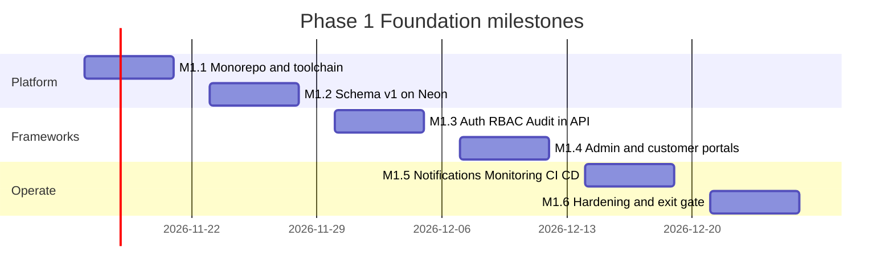
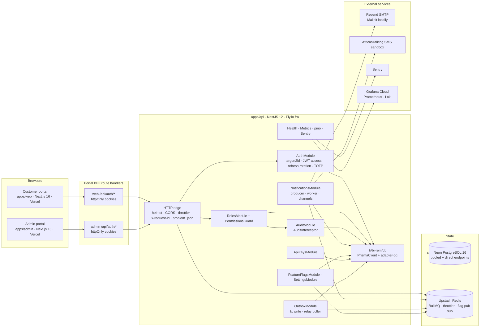
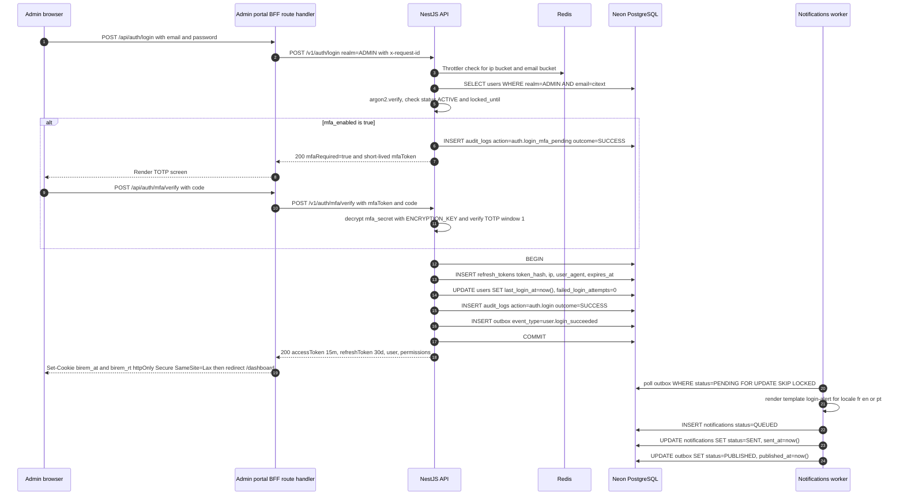
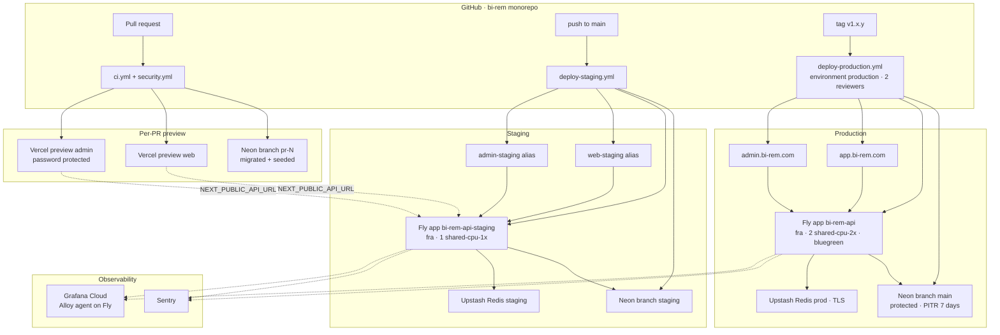
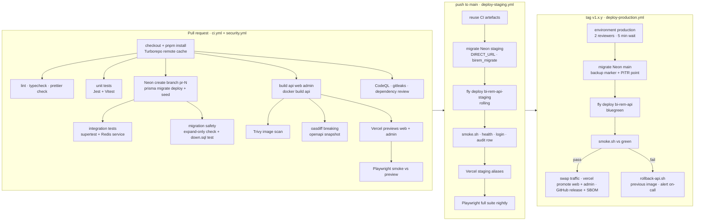

# Phase 1 — Foundation & Platform Setup

| Field           | Value                                                                                                                                                            |
| --------------- | ---------------------------------------------------------------------------------------------------------------------------------------------------------------- |
| **Phase**       | 1 of 13 — `foundation`                                                                                                                                           |
| **Dates**       | 2026-11-16 → 2026-12-25                                                                                                                                          |
| **Duration**    | 6 weeks (W1 2026-11-16 … W6 2026-12-21)                                                                                                                          |
| **Team**        | `core` — 1 solution architect, 4 backend, 3 frontend, 1 DevOps/SRE, 2 QA, 1 PM, 1 product designer, 0.5 security engineer, compliance analyst (consulting)       |
| **Depends on**  | — (program start)                                                                                                                                                |
| **Unlocks**     | Phase 2 Customer Management & KYC (2026-12-28), Phase 3 Connectivity Management Framework (2027-01-25); transitively every later phase                           |
| **Repository**  | `apps/api`, `apps/web`, `apps/admin`, `packages/db`, `packages/shared`, `packages/config`, `infra/`, `.github/workflows`                                         |
| **Plan status** | Written 2026-11-09 against the live repository; sections flag **[REAL]** where code already exists and **[PLANNED]** where it is still to be built in this phase |

---

## 1. Overview

### 1.1 Objective

Phase 1 builds the platform that every subsequent BI-Rem phase deploys onto. Nothing in this phase moves money. Its job is to make the next twelve phases cheap and safe: a monorepo with one build/test/deploy convention, a hardened identity and access layer shared by customers and operators, append-only auditing from day one (a regulatory prerequisite for an e-money issuer / remittance operator in WAEMU, Nigeria, Kenya and Ghana), a notification spine, observability, and a GitHub-driven deployment path to Vercel (portals), Fly.io (API) and Neon (PostgreSQL).

The phase succeeds when a customer can register and log in on the customer portal, an operator can log in (with TOTP) on the admin portal, both hit a Neon database through Prisma, and every one of those paths was deployed by a GitHub Actions workflow without a human running a command.

### 1.2 Current repository state (what is REAL today)

At the time of writing the repository `wouapit999` contains:

| Path                                                                                                                                    | State         | Notes                                                                                                                                                                                                                                                                                                                                                                                                                                                                      |
| --------------------------------------------------------------------------------------------------------------------------------------- | ------------- | -------------------------------------------------------------------------------------------------------------------------------------------------------------------------------------------------------------------------------------------------------------------------------------------------------------------------------------------------------------------------------------------------------------------------------------------------------------------------- |
| `package.json`, `pnpm-workspace.yaml`, `turbo.json`, `tsconfig.base.json`, `.nvmrc` (22.23.4), `.npmrc`, `.editorconfig`, `.prettierrc` | **[REAL]**    | pnpm 10.28 workspaces `apps/*`, `packages/*`; Turborepo 2.11 tasks `generate`, `build`, `dev`, `lint`, `typecheck`, `test`, `test:e2e`, `clean`; root scripts `db:generate`, `db:migrate`, `db:migrate:dev`, `db:seed`.                                                                                                                                                                                                                                                    |
| `.env.example`                                                                                                                          | **[REAL]**    | Documents `DATABASE_URL`, `DATABASE_POOL_URL`, `REDIS_URL`, `API_PORT`, `CORS_ORIGINS`, `JWT_ACCESS_SECRET`, `JWT_REFRESH_SECRET`, `JWT_ACCESS_TTL=15m`, `JWT_REFRESH_TTL=30d`, `ENCRYPTION_KEY`, `SMTP_*`, `LOG_LEVEL`, `SENTRY_DSN`, `OTEL_EXPORTER_OTLP_ENDPOINT`, `NEXT_PUBLIC_API_URL`, `NEXT_PUBLIC_APP_NAME`.                                                                                                                                                       |
| `packages/db/prisma/schema.prisma`                                                                                                      | **[REAL]**    | Schema v1: 14 models (`User`, `Role`, `Permission`, `UserRole`, `RolePermission`, `RefreshToken`, `ApiKey`, `AuditLog`, `Notification`, `NotificationTemplate`, `NotificationPreference`, `FeatureFlag`, `Setting`, `Outbox`) and 7 enums (`UserRealm`, `UserStatus`, `AuditActorType`, `AuditOutcome`, `NotificationChannel`, `NotificationStatus`, `OutboxStatus`). Generator `prisma-client` → `packages/db/generated/client` (ESM, `.ts`).                             |
| `packages/db/prisma.config.ts`                                                                                                          | **[REAL]**    | Prisma 7 config; datasource URL from `DIRECT_URL ?? DATABASE_URL`; seed `tsx prisma/seed.ts`; migrations in `prisma/migrations`.                                                                                                                                                                                                                                                                                                                                           |
| `packages/db/prisma/migrations/20261116000000_init/migration.sql`                                                                       | **[REAL]**    | Initial migration generated by `prisma migrate diff --from-empty`, prefixed with `CREATE EXTENSION IF NOT EXISTS "citext"` and `"pgcrypto"`.                                                                                                                                                                                                                                                                                                                               |
| `packages/db/package.json`                                                                                                              | **[REAL]**    | `@bi-rem/db` exports `.`, `./permissions`, `./client`; deps `@prisma/client ^7.10`, `@prisma/adapter-pg`, `pg`, `argon2`; scripts `generate`, `migrate:dev`, `migrate:deploy`, `migrate:status`, `seed`, `test` (Vitest).                                                                                                                                                                                                                                                  |
| `packages/db/src/index.ts`, `src/permissions.ts`                                                                                        | **[REAL]**    | `createPrismaClient(url?, options)` wired to `@prisma/adapter-pg` (`maxConnections`, `idleTimeoutMs`, `connectionTimeoutMs`, `?schema=` → `search_path`), `DatabaseConfigurationError`; `PERMISSIONS` catalogue (~60 `resource:action` keys incl. forward-looking `kyc:*`, `transfers:*`, `treasury:*`), `SYSTEM_ROLES` (`SUPER_ADMIN`, `ADMIN`, `COMPLIANCE_OFFICER`, `SUPPORT_AGENT`, `TREASURY_MANAGER`, `VIEWER`, `CUSTOMER`) each bound to a realm.                   |
| `packages/db/prisma/seed.ts`, `prisma/seed-data/*`                                                                                      | **[REAL]**    | Idempotent upsert seed (permissions, system roles with reconciled permission sets, bootstrap admin `admin@bi-rem.local`, demo customer `customer@bi-rem.local`, templates `welcome`, `password-reset`, `login-alert`, `mfa-code` in `en`/`fr`/`pt` for EMAIL + SMS, feature flags, settings). Argon2id parameters documented to match the API.                                                                                                                             |
| `packages/db/test/*`                                                                                                                    | **[REAL]**    | Vitest: `permissions.test.ts`, `migration.test.ts` (every CLAUDE.md table present in `init`), `client.test.ts`; no database required. `README.md`, `eslint.config.js`, `tsconfig*.json`, `vitest.config.ts`, `.env.example` present.                                                                                                                                                                                                                                       |
| `packages/shared/src`                                                                                                                   | **[REAL]**    | Zod schemas (`auth`, `user`, `rbac`, `audit`, `notification`, `settings`, `common`), constants (`API_PREFIX='/v1'`, `OPS_ROUTES`, `API_ROUTES`, `HTTP_HEADERS` incl. `x-request-id`, `x-api-key`, `x-bi-rem-realm`, `idempotency-key`; `PAGINATION` default 20 / max 100; `FEATURE_FLAG_KEYS`, `SETTING_KEYS`, `PERMISSIONS`, countries, currencies, locales `en/fr/pt`), utils (`money.ts` BIGINT minor units, `phone.ts` E.164, `ids.ts`, `dates.ts`) with Vitest tests. |
| `packages/config`                                                                                                                       | **[REAL]**    | `tsconfig/{base,library,nest,nextjs}.json`, `eslint/{base,nest,next}.js`.                                                                                                                                                                                                                                                                                                                                                                                                  |
| `apps/api`, `apps/web`, `apps/admin`                                                                                                    | **[PLANNED]** | Directories exist, empty.                                                                                                                                                                                                                                                                                                                                                                                                                                                  |
| `infra/docker`, `infra/scripts`                                                                                                         | **[PLANNED]** | Directories exist, empty. `infra/fly.toml` and `infra/vercel/*.json` to be added.                                                                                                                                                                                                                                                                                                                                                                                          |
| `.github/workflows`                                                                                                                     | **[PLANNED]** | Directory exists, empty.                                                                                                                                                                                                                                                                                                                                                                                                                                                   |
| `docs/architecture`                                                                                                                     | **[PLANNED]** | Referenced by `.env.example` (`environment-management.md`); to be written in M1.1/M1.6.                                                                                                                                                                                                                                                                                                                                                                                    |

Everything below plans the remainder on top of that real foundation and does not re-design what already exists.

### 1.3 In scope

- Monorepo conventions, shared TS/ESLint config (`@bi-rem/config`), shared Zod schemas and DTO types (`@bi-rem/shared`).
- NestJS 12 API with modules: `auth`, `users`, `roles`, `permissions`, `api-keys`, `audit`, `notifications`, `feature-flags`, `settings`, `outbox`, `health`, `metrics`.
- Prisma 7 schema v1 + migrations + seed; Neon project with `main`, `staging` and per-PR branches.
- Customer portal (`apps/web`) and admin portal (`apps/admin`) skeletons: authentication screens, shell layout, navigation, a handful of admin CRUD screens (users, roles, audit log, feature flags, settings, notification templates, API keys).
- Authentication (password + JWT access/refresh with rotation, email verification, password reset, TOTP MFA), RBAC (`Role` ⟷ `Permission`, `@Permissions()` guard), audit logging interceptor, notification framework (BullMQ queue, EMAIL adapter live, SMS adapter behind flag with Africa's Talking sandbox, IN_APP), monitoring (pino, Prometheus `/metrics`, Terminus `/health`, Sentry, Grafana Cloud), feature flags and settings, transactional outbox.
- Docker images (API), docker-compose for local dev (Postgres 16, Redis 7, Mailpit), deploy scripts, Fly.io config, Vercel project config, GitHub Actions CI/CD with preview / staging / production environments.
- Security baseline: helmet, CORS allowlist, rate limiting, secret management, CodeQL, gitleaks, dependency review, container scan.

### 1.4 Out of scope (deferred to the named phase)

- Customer KYC, document capture, tiers, limits → Phase 2.
- Provider connectivity, connector SDK, wallet integrations → Phases 3–4.
- Ledger, wallets, transfers, FX, treasury → Phases 5–7. Phase 1 introduces **no money tables**; the BIGINT-minor-units convention is only exercised by a shared `Money` Zod schema in `@bi-rem/shared` so later phases inherit it.
- AML screening, fraud rules → Phase 8. Partner/merchant portal → Phase 9. BI → Phase 10. Mobile apps → Phase 11 (Phase 1 keeps the auth API mobile-ready: Bearer tokens, refresh rotation, device metadata on `refresh_tokens`).
- Production go-live checklist execution, DR drills, pen test → Phase 12. Phase 1 produces the _checklist_ and the _tooling_, not the go-live.
- In-country data residency → Phase 13 (Phase 1 picks a single EU region, see §4.4).

### 1.5 Independent deployability strategy

"Deployable alone" for Phase 1 means: every commit on `main` is deployed to staging automatically, every tag `v1.*` is deployable to production, and the deployed system is useful on its own (users can register, log in, operators can administer users/roles and read audit logs) even though no later phase exists.

| Mechanism                        | Phase 1 implementation                                                                                                                                                                                                                                                                                                                                                                                                                                                                                                                                                                                                                                                                                                                                                                                                                                                                                                                                                                                                                                                                                                                                                                                                                                                                    |
| -------------------------------- | ----------------------------------------------------------------------------------------------------------------------------------------------------------------------------------------------------------------------------------------------------------------------------------------------------------------------------------------------------------------------------------------------------------------------------------------------------------------------------------------------------------------------------------------------------------------------------------------------------------------------------------------------------------------------------------------------------------------------------------------------------------------------------------------------------------------------------------------------------------------------------------------------------------------------------------------------------------------------------------------------------------------------------------------------------------------------------------------------------------------------------------------------------------------------------------------------------------------------------------------------------------------------------------------- |
| **Feature flags**                | `feature_flags` table **[REAL]** + `FeatureFlagsModule` **[PLANNED]** evaluating `enabled`, `rolloutPercentage` (stable hash of user id mod 100) and `rules` (JSON array of `{attribute, op, value}` over realm, countryCode, roles, email domain). Flags are read-through-cached in-process for 30 s and invalidated by a Redis pub/sub message on write. Flag keys are typed in `@bi-rem/shared` (`FEATURE_FLAG_KEYS`, **[REAL]**): `auth.registration.open` (kill switch, default true), `auth.mfa.totp`, `auth.mfa.enforce-admin` (default true), `auth.password-reset`, `notifications.email`, `notifications.sms` (false), `notifications.push` (false), `admin.audit.export` (false), `admin.users.impersonation` (false), `portal.maintenance-banner`, `portal.new-dashboard`. Planned addition for Phase 1: `auth.admin-login` (admin login kill switch). **Reconciliation item (M1.2):** `packages/db/prisma/seed-data/platform-defaults.ts` currently seeds a different key set (`customer.registration`, `customer.mfa-required`, `admin.mfa-required`, `notifications.sms`, `notifications.login-alert`, `platform.maintenance-mode`); the seed must be changed to import `FEATURE_FLAG_KEYS`/`FEATURE_FLAG_DEFAULTS` from `@bi-rem/shared` so there is one source of truth. |
| **Expand / contract migrations** | Every migration after `init` must be backward compatible with the previously deployed API version: add nullable columns or new tables first (expand), deploy code that writes both, backfill, then drop/rename in a later migration (contract). Enforced by a `prisma migrate diff` check in CI that fails on `DROP COLUMN`/`DROP TABLE`/`ALTER COLUMN ... TYPE` unless the migration directory contains a `CONTRACT.md` sign-off.                                                                                                                                                                                                                                                                                                                                                                                                                                                                                                                                                                                                                                                                                                                                                                                                                                                        |
| **Dark launch**                  | Admin screens for features not yet released are mounted behind flags and hidden from navigation; APIs for later phases are never deployed unflagged. For Phase 1 the customer dashboard shows a flag-controlled placeholder (`portal.new-dashboard`).                                                                                                                                                                                                                                                                                                                                                                                                                                                                                                                                                                                                                                                                                                                                                                                                                                                                                                                                                                                                                                     |
| **Kill switches**                | `auth.registration.open` **[REAL key]**, `auth.admin-login` (planned; does **not** affect already issued tokens; combined with the "revoke all sessions" admin action it is a full lock-out), `notifications.sms`, `notifications.email`. Each is evaluated on every request (cache ≤ 30 s).                                                                                                                                                                                                                                                                                                                                                                                                                                                                                                                                                                                                                                                                                                                                                                                                                                                                                                                                                                                              |
| **Rollback**                     | API: Fly `bluegreen` strategy, previous image kept, `fly deploy --image <previous>` in < 2 min. Portals: Vercel instant rollback to previous deployment. DB: migrations are additive in Phase 1; `down.sql` is maintained per migration and Neon PITR (7 days on Launch plan) is the last resort.                                                                                                                                                                                                                                                                                                                                                                                                                                                                                                                                                                                                                                                                                                                                                                                                                                                                                                                                                                                         |
| **Contract stability**           | OpenAPI document snapshot (`apps/api/openapi.json`) is checked in; CI fails on breaking changes (`oasdiff breaking`). Shared Zod schemas in `@bi-rem/shared` are the single source of truth for web/admin DTOs.                                                                                                                                                                                                                                                                                                                                                                                                                                                                                                                                                                                                                                                                                                                                                                                                                                                                                                                                                                                                                                                                           |

---

## 2. Milestones

All dates derive from `docs/roadmap/schedule.json` (`start` 2026-11-16, `weekLengthDays` 7). Week N starts on the Monday `2026-11-16 + 7·(N−1)` days; milestone dates are that week's Friday.

| ID       | Week | Target date | Deliverable                                            | Acceptance criteria                                                                                                                                                                                                                                                                                                                                                                                                                                                                                                                                                | Owner role                  |
| -------- | ---- | ----------- | ------------------------------------------------------ | ------------------------------------------------------------------------------------------------------------------------------------------------------------------------------------------------------------------------------------------------------------------------------------------------------------------------------------------------------------------------------------------------------------------------------------------------------------------------------------------------------------------------------------------------------------------ | --------------------------- |
| **M1.1** | W1   | 2026-11-20  | Monorepo & toolchain baseline                          | `pnpm install && pnpm lint && pnpm typecheck && pnpm build` green on a clean clone for `@bi-rem/config`, `@bi-rem/shared`, `@bi-rem/db`, and empty-shell `api`/`web`/`admin`; `ci.yml` runs on PR; branch protection on `main` (1 review, CI required); CODEOWNERS; Conventional Commits lint; `docs/architecture/environment-management.md` written.                                                                                                                                                                                                              | Solution architect + DevOps |
| **M1.2** | W2   | 2026-11-27  | Database schema v1 on Neon                             | Neon project `bi-rem` created in `aws-eu-central-1` with branches `main` (prod), `staging`; `pnpm db:migrate` applies `20261116000000_init` on both; `pnpm db:seed` loads permission catalogue, system roles, templates, flags, bootstrap admin; `@bi-rem/db` exports `createPrismaClient()` using `@prisma/adapter-pg`; Vitest tests for seed idempotency pass against a Neon PR branch created by CI.                                                                                                                                                            | Backend lead                |
| **M1.3** | W3   | 2026-12-04  | Auth, RBAC, audit frameworks in API                    | `POST /v1/auth/register                                                                                                                                                                                                                                                                                                                                                                                                                                                                                                                                            | login                       | refresh | logout`, `GET /v1/auth/me`, MFA enrol/verify, password reset, email verification implemented; `PermissionsGuard`+`@Permissions()`+`@Public()`; `AuditInterceptor`writes`audit_logs`for every mutating request incl. DENIED;`/health`, `/metrics`, `/docs`live on Fly staging; Jest + supertest integration suite ≥ 80 % line coverage on`auth`, `rbac`, `audit`. | Backend lead |
| **M1.4** | W4   | 2026-12-11  | Admin & customer portal skeletons                      | Admin: login + TOTP, shell, users list/detail, roles & permissions editor, audit log viewer, feature flags, settings, notification templates, API keys. Customer: register, verify email, login, forgot/reset password, dashboard placeholder, profile, security (password, MFA). Both deploy to Vercel previews on every PR and talk to the staging API through BFF route handlers with httpOnly cookies. Playwright smoke suite green.                                                                                                                           | Frontend lead               |
| **M1.5** | W5   | 2026-12-18  | Notifications, monitoring, Docker, CI/CD to production | BullMQ `notifications` queue + worker; EMAIL via Resend (staging/prod) and Mailpit (local); SMS adapter wired to Africa's Talking sandbox behind `notifications.sms`; outbox poller publishes `user.*` events; pino JSON logs shipped to Grafana Loki; Prometheus scraped by Grafana Cloud agent; Sentry on api/web/admin; Docker image < 250 MB, non-root, Trivy clean (no HIGH/CRITICAL); `deploy-staging.yml` on push to `main`; `deploy-production.yml` on tag with protected environment; first production deploy of `v1.0.0-rc.1` executed from GitHub only. | DevOps/SRE                  |
| **M1.6** | W6   | 2026-12-25  | Hardening & phase exit gate                            | ZAP baseline scan clean on staging; k6 login p95 < 300 ms at 100 rps; CodeQL/gitleaks/dependency-review gates enforced; `down.sql` for `init`; runbooks (deploy, rollback, rotate secrets, lock account, on-call); production readiness checklist §11 signed; success criteria §12 demonstrated in a recorded UAT session; handover notes for Phase 2 and 3 accepted.                                                                                                                                                                                              | PM + Solution architect     |



Weekly cadence: Monday planning (PM), daily 15-min stand-up, Thursday architecture review (architect + leads), Friday demo against the milestone acceptance criteria. Phase 2 (`customer-kyc`) starts 2026-12-28; Phase 3 (`connectivity`) starts 2027-01-25 and overlaps Phase 2, so the `platform` team's onboarding to this codebase happens in W6.

---

## 3. Deliverables

Each deliverable from the phase brief, with its definition of done (DoD).

### 3.1 Monorepo setup **[REAL — complete, minor additions]**

- DoD: `pnpm-workspace.yaml` (`apps/*`, `packages/*`), `turbo.json` pipeline with `^generate` dependency so the Prisma client exists before `build`/`lint`/`typecheck`/`test`; root scripts as in CLAUDE.md; `.nvmrc` 22.23.4; `.npmrc` hoists `*prisma*`, `*eslint*`, `*prettier*`; Prettier + EditorConfig. Additions: `packages/config` (`tsconfig.base.json` presets `node.json`, `nest.json`, `next.json`, `library.json`; `eslint` flat presets `base`, `nest`, `next`), `commitlint.config.ts` + Husky `commit-msg` hook, `CODEOWNERS` (`apps/api` → backend leads, `packages/db` → backend lead + architect, `.github` + `infra` → DevOps), `turbo.json` `remoteCache` enabled via Vercel Remote Cache.

### 3.2 Next.js frontend (customer portal `apps/web`, admin portal `apps/admin`) **[PLANNED]**

- DoD: Next.js 16 App Router, React 19, Tailwind 4, TanStack Query 5, Zod 4; `src/env.ts` Zod-validated (`NEXT_PUBLIC_API_URL`, `NEXT_PUBLIC_APP_NAME`, server-only `API_BASE_URL`, `SESSION_COOKIE_SECRET`); BFF route handlers `app/api/auth/[...action]/route.ts` proxying to the API and setting `httpOnly; Secure; SameSite=Lax` cookies `birem_at` (15 m) and `birem_rt` (30 d, path `/api/auth/refresh`); `middleware.ts` redirects unauthenticated users to `/login` and enforces `realm` claim (`CUSTOMER` in web, `ADMIN` in admin); shared UI primitives in `packages/shared/ui` (button, input, form field, data table, toast); Vitest unit tests; Playwright e2e; Lighthouse accessibility ≥ 90 on login pages; i18n scaffold (`en`, `fr`) using `next-intl` because the first markets (Senegal, Côte d'Ivoire, Nigeria, Ghana, Kenya) are split between French and English.

### 3.3 NestJS backend `apps/api` **[PLANNED]**

- DoD: NestJS 12, `nestjs-pino`, `@nestjs/swagger` at `/docs` (+ `openapi.json` snapshot), `@nestjs/terminus` at `/health`, `/health/live`, `/health/ready`, `@nestjs/throttler` backed by Redis storage, `@nestjs/config` + Zod `src/config/env.ts`, global `ValidationPipe({ whitelist: true, forbidNonWhitelisted: true, transform: true })`, global `HttpExceptionFilter` emitting RFC 9457 problem details with `correlationId`, `CorrelationIdMiddleware` (`x-request-id` accepted or generated, echoed, bound to pino child logger and `AsyncLocalStorage`), `AuditInterceptor`, `PermissionsGuard`, `JwtAuthGuard` as `APP_GUARD` with `@Public()` bypass, graceful shutdown hooks (drain BullMQ workers, close Prisma). Compiled to CJS via `nest build` if decorator metadata requires it (CLAUDE.md allows this). Module layout:

```
apps/api/src
├── main.ts                  bootstrap, helmet, CORS, swagger, pino, shutdown hooks
├── app.module.ts
├── config/env.ts            Zod schema + typed ConfigService
├── common/
│   ├── decorators/          @Public, @Permissions, @CurrentUser, @Realm
│   ├── guards/              JwtAuthGuard, PermissionsGuard, ApiKeyGuard, RealmGuard
│   ├── interceptors/        AuditInterceptor, TimeoutInterceptor
│   ├── filters/             HttpExceptionFilter (problem+json)
│   ├── middleware/          CorrelationIdMiddleware
│   └── prisma/              PrismaModule (wraps @bi-rem/db createPrismaClient)
└── modules/
    ├── auth/                controller, service, strategies (jwt-access, jwt-refresh), mfa.service, password.service
    ├── users/
    ├── roles/               roles + permissions catalogue
    ├── api-keys/
    ├── audit/               AuditService (write), AuditController (read), retention job
    ├── notifications/       NotificationsService, templates, queue producer, worker, channels/{email,sms,in-app}
    ├── feature-flags/
    ├── settings/
    ├── outbox/              OutboxService (write in tx), OutboxRelay (poller)
    ├── health/
    └── metrics/             prom-client registry, http histogram, queue gauges
```

### 3.4 Prisma ORM **[REAL — schema + init migration; client factory and seed PLANNED]**

- DoD: schema v1 as in §5 (unchanged); `packages/db/src/index.ts` exports `createPrismaClient({ connectionString, max })` using `PrismaPg` adapter and `PrismaClient` from `../generated/client/client.js`, plus `prisma` singleton for scripts; `src/permissions.ts` exports `PERMISSIONS` const (catalogue) and `SYSTEM_ROLES`; `prisma/seed.ts` idempotent (upsert by natural keys) and reads `SEED_ADMIN_EMAIL`/`SEED_ADMIN_PASSWORD` (required only in local/staging; in production the bootstrap admin is created by the `infra/scripts/bootstrap-admin.ts` one-off job with a printed one-time password and forced reset); `down.sql` alongside `init/migration.sql`; Vitest tests `seed.spec.ts`, `permissions.spec.ts`.

### 3.5 Neon PostgreSQL **[PLANNED]**

- DoD: Neon project `bi-rem` (Launch plan), region `aws-eu-central-1`, Postgres 16; branches `main` (production, protected, PITR 7 days), `staging` (reset from `main` weekly by workflow), `pr-<number>` (ephemeral, created by `ci.yml`, deleted on PR close); roles `birem_app` (DML only, **no** `UPDATE`/`DELETE` on `audit_logs`), `birem_migrate` (DDL, used only by `prisma migrate deploy`); pooled endpoint (`-pooler`) in `DATABASE_POOL_URL` for the API, direct endpoint in `DIRECT_URL` for migrations; autoscaling 0.25–2 CU, scale-to-zero disabled on `main`; Neon IP allow-list to Fly egress IPs (Scale plan feature — tracked as R1.6); `pg_stat_statements` enabled.

### 3.6 GitHub repository setup **[PARTIAL — repo exists]**

- DoD: branch protection on `main` (linear history, 1 approval, required checks `ci / lint`, `ci / typecheck`, `ci / test`, `ci / build`, `security / codeql`, `security / gitleaks`), tag protection `v*`, CODEOWNERS, PR template with "migration is expand-only" and "audit coverage" checkboxes, issue templates, Dependabot (`npm` weekly grouped, `github-actions` weekly, `docker`), GitHub Environments `preview`, `staging`, `production` (production: 2 required reviewers from `@bi-rem/release-managers`, wait timer 5 min, deployment branches `tags v*`), secrets scoped per environment, OIDC trust for Vercel (no long-lived Vercel token) where supported, `FLY_API_TOKEN` deploy-scoped token.

### 3.7 Vercel deployments **[PLANNED]**

- DoD: two Vercel projects `bi-rem-web` (root `apps/web`) and `bi-rem-admin` (root `apps/admin`), monorepo-aware builds (`pnpm turbo run build --filter=@bi-rem/web...`), Preview deployments per PR with comment links, `staging` aliases (`web-staging.bi-rem.app`, `admin-staging.bi-rem.app`), production domains (`app.bi-rem.com`, `admin.bi-rem.com` — placeholders until the domain is confirmed, Open Question Q1), Vercel Deployment Protection (password) on admin previews, environment variables per environment, Vercel Web Analytics + Speed Insights, `infra/vercel/web.json` and `infra/vercel/admin.json` checked in.

### 3.8 Docker configuration **[PLANNED]**

- DoD: `infra/docker/api.Dockerfile` multi-stage (`node:22-alpine` builder with `pnpm fetch` + `pnpm deploy --filter @bi-rem/api --prod`, distroless-style runtime `node:22-alpine` non-root `node` user, `HEALTHCHECK` on `/health/live`, `dumb-init`), image < 250 MB, SBOM via `syft`, Trivy scan gate; `infra/docker/docker-compose.yml` with `postgres:16-alpine` (citext available), `redis:7-alpine`, `axllent/mailpit`, optional `grafana/otel-lgtm` profile for local traces; `.dockerignore`.

### 3.9 Environment management **[PARTIAL — .env.example REAL]**

- DoD: `docs/architecture/environment-management.md` describing the four environments (local, preview, staging, production), who owns which secret, rotation cadence (JWT secrets 90 days, `ENCRYPTION_KEY` yearly with key versioning — `ENCRYPTION_KEY` becomes `ENCRYPTION_KEYS=v1:...,v2:...` with `ENCRYPTION_ACTIVE_KEY=v2`), per-app `.env.example`; Zod validation at boot in `apps/api/src/config/env.ts`, `apps/web/src/env.ts`, `apps/admin/src/env.ts` so a misconfigured deploy fails fast; secrets only in GitHub Environments, Vercel, Fly secrets; `infra/scripts/check-env.ts` compares `.env.example` keys to the Zod schema in CI.

### 3.10 CI/CD pipelines **[PLANNED]** — see §10

- DoD: `ci.yml`, `security.yml`, `preview-db.yml`, `deploy-staging.yml`, `deploy-production.yml`, `neon-cleanup.yml`, `staging-reset.yml`; median PR CI < 10 min with Turborepo remote cache; production deploy fully automated from tag incl. migrations, smoke test and automatic rollback.

### 3.11 Authentication framework **[PLANNED]**

- DoD: argon2id (`memoryCost 64 MiB, timeCost 3, parallelism 1`), password policy (min 12 chars, zxcvbn score ≥ 3, deny list of breached top-100k), per-realm email uniqueness (`@@unique([realm, email])` **[REAL]**), JWT access tokens (RS256? — decision: HS256 with 48-byte secret for Phase 1, RS256/JWKS deferred to Phase 11 when mobile and partners need offline verification; claims `sub`, `realm`, `sid`, `perm_v`, `iat`, `exp`, `jti`), opaque refresh tokens (256-bit random, stored SHA-256 in `refresh_tokens.token_hash`, rotation with reuse detection: presenting a token whose `replaced_by_token_id` is set revokes the whole family), lock-out (5 failures → `locked_until = now()+15 min`, exponential to 24 h, admin unlock), email verification (24 h signed token), password reset (1 h token, single use, revokes all sessions), TOTP MFA (RFC 6238, `otplib`, secret encrypted with `ENCRYPTION_KEY` AES-256-GCM, 8 recovery codes hashed), MFA mandatory for `ADMIN` realm when flag `auth.mfa.enforce-admin` is on, "log out everywhere" endpoint, API-key auth (`Authorization: ApiKey brk_live_...`, SHA-256 compared, `scopes` subset of permissions) for admin service accounts.

### 3.12 RBAC framework **[PLANNED — tables REAL]**

- DoD: permission catalogue **[REAL]** in `packages/db/src/permissions.ts` (mirrored in `@bi-rem/shared`): `users:read|write|suspend|unlock|delete`, `roles:read|write|assign|delete`, `permissions:read`, `audit:read|export`, `notifications:read|send|retry|cancel`, `notification-templates:read|write|delete`, `notification-preferences:read|write`, `feature-flags:read|write|delete`, `settings:read|read-secrets|write`, `api-keys:read|write|revoke`, `system:read|maintenance`, `profile:read|write`, plus forward-looking keys reserved for later phases (`customers:*`, `kyc:*`, `beneficiaries:*`, `transfers:*`, `transactions:*`, `treasury:*`, `reports:*`) that no Phase 1 route uses; system roles **[REAL]** `SUPER_ADMIN` (all), `ADMIN`, `COMPLIANCE_OFFICER`, `SUPPORT_AGENT`, `TREASURY_MANAGER` (dormant until Phase 7), `VIEWER` (read-only), each bound to realm `ADMIN`, and `CUSTOMER` (realm `CUSTOMER`, `profile:*` + `notification-preferences:*` only — customers are otherwise authorised by realm + ownership); `PermissionsGuard` resolves effective permissions from `user_roles → role_permissions` with a 60 s per-user cache keyed by `perm_v` claim (incremented on any role change so caches invalidate); `@Permissions('a', 'b')` is AND, `@AnyPermission()` is OR; DENIED outcomes audited; last `SUPER_ADMIN` cannot be demoted; system roles cannot be deleted (`is_system` **[REAL]**).

### 3.13 Audit logging framework **[PLANNED — table REAL]**

- DoD: `AuditInterceptor` wraps every non-GET request (and `GET /v1/audit/export`), builds `{ actorUserId | apiKeyId, actorType, action (e.g. users.update), resourceType, resourceId, before, after, metadata: { route, status }, ip, userAgent, correlationId, outcome }`; `before/after` provided by services through `AuditContext.record(before, after)` with redaction of `passwordHash`, `mfaSecret`, `tokenHash`, `keyHash`, `value` when `isSecret`; writes happen in the same Prisma transaction when the service exposes one, else immediately after the response; DB role `birem_app` lacks `UPDATE`/`DELETE` on `audit_logs`; monthly `pg_partman`-style range partitioning deferred to Phase 10 but the table name and indexes **[REAL]** already support it; admin viewer with filters (actor, action, resource, outcome, date range, correlation id) and CSV export (audited itself).

### 3.14 Notification framework **[PLANNED — tables REAL]**

- DoD: `NotificationsService.send({ userId, templateKey, channel?, variables })` resolves channel preference (`notification_preferences`), template (`notification_templates` by `key, channel, locale` with fallback `en`), renders `{{var}}` placeholders (Handlebars-light, HTML-escaped), persists `notifications` row (`PENDING`), enqueues BullMQ job `notifications:send` (attempts 5, exponential backoff 30 s → 1 h, DLQ `notifications:failed`), worker dispatches to `EmailChannel` (Nodemailer SMTP: Mailpit locally, Resend SMTP in staging/prod), `SmsChannel` (Africa's Talking REST, sandbox in all non-prod, disabled by flag), `InAppChannel` (row only, polled by portals); status transitions `PENDING → QUEUED → SENT → DELIVERED|FAILED`; provider webhooks for delivery receipts stubbed (`POST /v1/webhooks/notifications/:provider`, signature-verified); seeded templates **[REAL]**: `welcome`, `password-reset`, `login-alert`, `mfa-code` for EMAIL and SMS in `en`, `fr`, `pt` (`prisma/seed-data/notification-templates.ts`); planned additions `email-verify`, `account-locked`, `admin-invite`.

### 3.15 Monitoring framework **[PLANNED]**

- DoD: pino JSON logs with `requestId`, `userId` (hashed), `realm`, `route`, `durationMs`, PII redaction paths (`req.headers.authorization`, `*.password`, `*.email` partially masked); shipped from Fly via Grafana Alloy to Grafana Cloud Loki; `prom-client` default metrics + `http_server_requests_seconds` histogram (route, method, status), `auth_login_total{realm,outcome}`, `bullmq_queue_jobs{queue,state}`, `outbox_pending_total`, `prisma_pool_*`; Grafana Cloud dashboards "API Golden Signals", "Auth", "Queues"; alerts: error rate > 2 % 5 min, p95 > 800 ms 10 min, `/health/ready` failing 2 min, outbox pending > 1000, queue failed > 50, Neon connections > 80 %; Sentry for api/web/admin with release tagging from the Git SHA and source maps; uptime checks (Grafana synthetic) on `/health/live`, web `/login`, admin `/login`; OpenTelemetry traces optional via `OTEL_EXPORTER_OTLP_ENDPOINT` (off by default in Phase 1).

### 3.16 Outputs

| Output                      | Where                                                                                                                                                                                    |
| --------------------------- | ---------------------------------------------------------------------------------------------------------------------------------------------------------------------------------------- |
| Infrastructure architecture | §4 of this document + `docs/architecture/infrastructure.md` (export of §4 diagrams) + `docs/architecture/environment-management.md`                                                      |
| Database schema v1          | `packages/db/prisma/schema.prisma` **[REAL]**, `prisma/migrations/20261116000000_init` **[REAL]**, ERD generated by `prisma-erd-generator` into `docs/architecture/erd-v1.svg`           |
| Deployment scripts          | `infra/scripts/{deploy-api.sh, migrate.sh, smoke.sh, rollback-api.sh, bootstrap-admin.ts, neon-branch.sh, check-env.ts}`, `infra/fly.toml`, `infra/vercel/*.json`, `.github/workflows/*` |
| Admin portal skeleton       | `apps/admin`                                                                                                                                                                             |
| Customer portal skeleton    | `apps/web`                                                                                                                                                                               |

---

## 4. Architecture

### 4.1 Component / container diagram (Phase 1 additions)



### 4.2 Key flow — admin login with MFA, refresh rotation, audit and notification



Refresh: `POST /api/auth/refresh` (BFF) → `POST /v1/auth/refresh` with the opaque token. The API hashes it, loads the row, rejects if `revoked_at` or `expires_at < now()`; if `replaced_by_token_id` is already set this is **reuse** → the whole family (walk `replaces` chain) is revoked, an `auth.refresh_reuse_detected` audit row with outcome `DENIED` is written and the user receives `login-alert`-style alert; otherwise a new row is inserted, the old row gets `replaced_by_token_id`, and the pair is returned.

### 4.3 Deployment / infrastructure delta



Infrastructure delta introduced by Phase 1 (nothing existed before):

| Resource              | Spec                                                                                                       | Environment(s)               |
| --------------------- | ---------------------------------------------------------------------------------------------------------- | ---------------------------- |
| Neon project `bi-rem` | Launch plan, PG16, `aws-eu-central-1`, branches `main`/`staging`/`pr-*`, autoscale 0.25–2 CU, PITR 7 d     | all                          |
| Fly.io apps           | `bi-rem-api` (2 × shared-cpu-2x, 1 GB, `fra`, bluegreen), `bi-rem-api-staging` (1 × shared-cpu-1x, 512 MB) | staging, production          |
| Upstash Redis         | Regional `eu-central-1`, TLS, 2 databases                                                                  | staging, production          |
| Vercel                | Pro team, projects `bi-rem-web`, `bi-rem-admin`, Remote Cache                                              | preview, staging, production |
| GitHub                | Team plan, Actions, Environments, Dependabot, CodeQL                                                       | —                            |
| Resend                | Domain `bi-rem.com` verified (SPF, DKIM, DMARC)                                                            | staging, production          |
| Africa's Talking      | Sandbox app + API key (prod app creation deferred)                                                         | staging                      |
| Sentry                | Team plan, 3 projects                                                                                      | staging, production          |
| Grafana Cloud         | Free/Pro, Alloy agent sidecar process in the API image                                                     | staging, production          |
| Local                 | docker-compose Postgres 16, Redis 7, Mailpit                                                               | local                        |

### 4.4 Design decisions and alternatives rejected

| #   | Decision                                                                    | Alternatives rejected                                                        | Rationale                                                                                                                                                                                                                                                                                         |
| --- | --------------------------------------------------------------------------- | ---------------------------------------------------------------------------- | ------------------------------------------------------------------------------------------------------------------------------------------------------------------------------------------------------------------------------------------------------------------------------------------------- |
| D1  | **Single `users` table with `realm` discriminator** (CLAUDE.md, **[REAL]**) | Separate `customers` / `admins` tables; separate identity provider for staff | One auth code path, one audit actor model; per-realm uniqueness via `@@unique([realm, email])`. Phase 2 adds `Customer` profile 1:1 to `User` instead of duplicating identity.                                                                                                                    |
| D2  | **API on Fly.io (Docker), portals on Vercel**                               | Everything on Vercel (API as serverless functions); AWS ECS; Render          | NestJS + BullMQ workers + outbox poller need long-lived processes and Redis connections, which serverless penalises; Fly `fra` sits ~10 ms from Neon `eu-central-1`; Docker keeps a path to AWS/GCP in Phase 13 for in-country residency. Vercel is the best Next.js host and the brief names it. |
| D3  | **Neon `aws-eu-central-1`**                                                 | `eu-west-2` London; AWS RDS in `af-south-1` Cape Town                        | Neon has no African region; Frankfurt pairs with Fly `fra`; GDPR-adequate for EU diaspora senders; in-country residency (e.g. Nigeria NDPA, Kenya DPA) is Phase 13 scope and may require a different engine (see R1.9).                                                                           |
| D4  | **BFF route handlers + httpOnly cookies in the portals**                    | SPA storing JWT in `localStorage`; API setting cross-site cookies            | XSS cannot exfiltrate tokens; no `SameSite=None` cross-site cookies; the API stays a pure Bearer API usable by mobile (Phase 11) and partners (Phase 9). Cost: a thin proxy per portal.                                                                                                           |
| D5  | **HS256 JWT, 15-min access + opaque rotating refresh**                      | RS256 with JWKS now; long-lived sessions in Redis                            | Single verifier in Phase 1; rotation + reuse detection gives revocation within 15 min; RS256/JWKS is a drop-in change when mobile or partners need to verify offline.                                                                                                                             |
| D6  | **Permissions as `resource:action` strings, roles as sets** (CLAUDE.md)     | Casbin/OPA; attribute-based policies                                         | Simple, auditable, explainable to regulators; ownership checks (customer may only read own data) are coded in services, not in the permission layer. ABAC revisited in Phase 9 (partners).                                                                                                        |
| D7  | **Audit via interceptor + explicit `before/after` from services**           | DB triggers writing JSON diffs; CDC via logical replication                  | Interceptor captures actor, IP, UA, correlation id that triggers never see; services provide semantic diffs; DB role lacks UPDATE/DELETE so application bugs cannot alter history.                                                                                                                |
| D8  | **Transactional outbox + poller into BullMQ**                               | Publish directly to BullMQ from services; Kafka/NATS now                     | Atomicity with the business write; no new broker to operate in Phase 1; relay can target NATS/Kafka in Phase 4 when connectors need fan-out.                                                                                                                                                      |
| D9  | **Feature flags in Postgres with Redis invalidation**                       | LaunchDarkly / Flagsmith                                                     | Flags must be auditable like any other admin mutation and must work offline in CI; cost zero; vendor flags reconsidered in Phase 12 if targeting rules grow.                                                                                                                                      |
| D10 | **Prisma 7 with `@prisma/adapter-pg`** (CLAUDE.md, **[REAL]**)              | Prisma Accelerate; Drizzle; raw `pg`                                         | Works identically on local Postgres and Neon pooled endpoint; typed client; Prisma 8 RC explicitly excluded.                                                                                                                                                                                      |
| D11 | **Africa's Talking for SMS, Resend for email**                              | Twilio; AWS SES/SNS                                                          | Africa's Talking covers Kenya, Nigeria, Ghana, Senegal, Côte d'Ivoire, Uganda, Tanzania, Rwanda natively with a free sandbox; Twilio kept as fallback adapter in Phase 13. Resend has a simple SMTP + REST API and webhooks; SES considered if volumes exceed 100k/month.                         |
| D12 | **Grafana Cloud + Sentry**                                                  | Datadog; New Relic; self-hosted LGTM                                         | Cost at Phase 1 scale is near zero; Prometheus/Loki are vendor neutral; Datadog revisited at go-live (Phase 12).                                                                                                                                                                                  |

---

## 5. Data Model & Migrations

### 5.1 Schema v1 **[REAL]**

The full schema is in `packages/db/prisma/schema.prisma`. The excerpt below reproduces the identity, audit and platform-configuration models exactly as checked in, so that later phases extend rather than re-define them. All models follow CLAUDE.md: `uuid` ids via `gen_random_uuid()`, `timestamptz(6)`, `snake_case` via `@@map`/`@map`. Phase 1 holds no money columns; the BIGINT-minor-units + `currency` convention is codified in `@bi-rem/shared` (`MoneySchema = z.object({ amountMinor: z.bigint(), currency: z.string().length(3) })`) and first used by Phase 5.

```prisma
generator client {
  provider               = "prisma-client"
  output                 = "../generated/client"
  runtime                = "nodejs"
  moduleFormat           = "esm"
  generatedFileExtension = "ts"
  importFileExtension    = "js"
}

datasource db {
  provider = "postgresql"
}

enum UserRealm   { CUSTOMER ADMIN                              @@map("user_realm") }
enum UserStatus  { PENDING ACTIVE SUSPENDED LOCKED DELETED      @@map("user_status") }
enum AuditActorType { USER SYSTEM API_KEY                       @@map("audit_actor_type") }
enum AuditOutcome   { SUCCESS FAILURE DENIED                    @@map("audit_outcome") }
enum NotificationChannel { EMAIL SMS PUSH IN_APP                @@map("notification_channel") }
enum NotificationStatus  { PENDING QUEUED SENT DELIVERED FAILED CANCELLED @@map("notification_status") }
enum OutboxStatus { PENDING PUBLISHED FAILED                    @@map("outbox_status") }

model User {
  id                  String     @id @default(dbgenerated("gen_random_uuid()")) @db.Uuid
  realm               UserRealm
  email               String     @db.Citext
  phone               String?    @unique @db.VarChar(32)
  passwordHash        String     @map("password_hash")
  status              UserStatus @default(PENDING)
  firstName           String     @map("first_name") @db.VarChar(100)
  lastName            String     @map("last_name") @db.VarChar(100)
  locale              String     @default("en") @db.VarChar(10)
  countryCode         String     @map("country_code") @db.Char(2)
  mfaEnabled          Boolean    @default(false) @map("mfa_enabled")
  mfaSecret           String?    @map("mfa_secret")
  lastLoginAt         DateTime?  @map("last_login_at") @db.Timestamptz(6)
  failedLoginAttempts Int        @default(0) @map("failed_login_attempts")
  lockedUntil         DateTime?  @map("locked_until") @db.Timestamptz(6)
  emailVerifiedAt     DateTime?  @map("email_verified_at") @db.Timestamptz(6)
  phoneVerifiedAt     DateTime?  @map("phone_verified_at") @db.Timestamptz(6)
  createdAt           DateTime   @default(now()) @map("created_at") @db.Timestamptz(6)
  updatedAt           DateTime   @updatedAt @map("updated_at") @db.Timestamptz(6)
  deletedAt           DateTime?  @map("deleted_at") @db.Timestamptz(6)

  roles                   UserRole[]
  refreshTokens           RefreshToken[]
  auditLogs               AuditLog[]               @relation("AuditLogActor")
  notifications           Notification[]
  notificationPreferences NotificationPreference[]
  apiKeysCreated          ApiKey[]                 @relation("ApiKeyCreatedBy")
  roleAssignmentsMade     UserRole[]               @relation("UserRoleAssignedBy")

  @@unique([realm, email])
  @@index([status])
  @@index([realm, status])
  @@index([deletedAt])
  @@map("users")
}

model Role {
  id          String   @id @default(dbgenerated("gen_random_uuid()")) @db.Uuid
  name        String   @unique @db.VarChar(64)
  description String?
  isSystem    Boolean  @default(false) @map("is_system")
  createdAt   DateTime @default(now()) @map("created_at") @db.Timestamptz(6)
  updatedAt   DateTime @updatedAt @map("updated_at") @db.Timestamptz(6)
  users       UserRole[]
  permissions RolePermission[]
  @@map("roles")
}

model Permission {
  id          String   @id @default(dbgenerated("gen_random_uuid()")) @db.Uuid
  key         String   @unique @db.VarChar(128)
  description String?
  createdAt   DateTime @default(now()) @map("created_at") @db.Timestamptz(6)
  updatedAt   DateTime @updatedAt @map("updated_at") @db.Timestamptz(6)
  roles RolePermission[]
  @@map("permissions")
}

model UserRole {
  userId       String   @map("user_id") @db.Uuid
  roleId       String   @map("role_id") @db.Uuid
  assignedAt   DateTime @default(now()) @map("assigned_at") @db.Timestamptz(6)
  assignedById String?  @map("assigned_by_id") @db.Uuid
  user       User  @relation(fields: [userId], references: [id], onDelete: Cascade)
  role       Role  @relation(fields: [roleId], references: [id], onDelete: Cascade)
  assignedBy User? @relation("UserRoleAssignedBy", fields: [assignedById], references: [id], onDelete: SetNull)
  @@id([userId, roleId])
  @@index([roleId])
  @@map("user_roles")
}

model RolePermission {
  roleId       String   @map("role_id") @db.Uuid
  permissionId String   @map("permission_id") @db.Uuid
  createdAt    DateTime @default(now()) @map("created_at") @db.Timestamptz(6)
  role       Role       @relation(fields: [roleId], references: [id], onDelete: Cascade)
  permission Permission @relation(fields: [permissionId], references: [id], onDelete: Cascade)
  @@id([roleId, permissionId])
  @@index([permissionId])
  @@map("role_permissions")
}

model RefreshToken {
  id                String    @id @default(dbgenerated("gen_random_uuid()")) @db.Uuid
  tokenHash         String    @unique @map("token_hash") @db.VarChar(128)
  userId            String    @map("user_id") @db.Uuid
  expiresAt         DateTime  @map("expires_at") @db.Timestamptz(6)
  revokedAt         DateTime? @map("revoked_at") @db.Timestamptz(6)
  replacedByTokenId String?   @unique @map("replaced_by_token_id") @db.Uuid
  ip                String?   @db.VarChar(45)
  userAgent         String?   @map("user_agent") @db.VarChar(512)
  createdAt         DateTime  @default(now()) @map("created_at") @db.Timestamptz(6)
  user       User          @relation(fields: [userId], references: [id], onDelete: Cascade)
  replacedBy RefreshToken? @relation("RefreshTokenRotation", fields: [replacedByTokenId], references: [id], onDelete: SetNull)
  replaces   RefreshToken? @relation("RefreshTokenRotation")
  @@index([userId])
  @@index([expiresAt])
  @@map("refresh_tokens")
}

model ApiKey {
  id          String    @id @default(dbgenerated("gen_random_uuid()")) @db.Uuid
  name        String    @db.VarChar(100)
  keyHash     String    @unique @map("key_hash") @db.VarChar(128)
  prefix      String    @db.VarChar(16)
  scopes      String[]  @default([])
  expiresAt   DateTime? @map("expires_at") @db.Timestamptz(6)
  lastUsedAt  DateTime? @map("last_used_at") @db.Timestamptz(6)
  revokedAt   DateTime? @map("revoked_at") @db.Timestamptz(6)
  createdById String    @map("created_by_id") @db.Uuid
  createdAt   DateTime  @default(now()) @map("created_at") @db.Timestamptz(6)
  updatedAt   DateTime  @updatedAt @map("updated_at") @db.Timestamptz(6)
  createdBy User @relation("ApiKeyCreatedBy", fields: [createdById], references: [id], onDelete: Restrict)
  @@index([prefix])
  @@index([createdById])
  @@map("api_keys")
}

model AuditLog {
  id            String         @id @default(dbgenerated("gen_random_uuid()")) @db.Uuid
  actorUserId   String?        @map("actor_user_id") @db.Uuid
  actorType     AuditActorType @default(USER) @map("actor_type")
  action        String         @db.VarChar(128)
  resourceType  String         @map("resource_type") @db.VarChar(64)
  resourceId    String?        @map("resource_id") @db.VarChar(128)
  outcome       AuditOutcome
  before        Json?
  after         Json?
  metadata      Json?
  ip            String?        @db.VarChar(45)
  userAgent     String?        @map("user_agent") @db.VarChar(512)
  correlationId String?        @map("correlation_id") @db.VarChar(128)
  createdAt     DateTime       @default(now()) @map("created_at") @db.Timestamptz(6)
  actorUser User? @relation("AuditLogActor", fields: [actorUserId], references: [id], onDelete: SetNull)
  @@index([resourceType, resourceId])
  @@index([actorUserId])
  @@index([createdAt])
  @@index([correlationId])
  @@map("audit_logs")
}

model FeatureFlag {
  id                String   @id @default(dbgenerated("gen_random_uuid()")) @db.Uuid
  key               String   @unique @db.VarChar(64)
  enabled           Boolean  @default(false)
  rolloutPercentage Int      @default(100) @map("rollout_percentage")
  rules             Json     @default("[]")
  description       String?
  createdAt         DateTime @default(now()) @map("created_at") @db.Timestamptz(6)
  updatedAt         DateTime @updatedAt @map("updated_at") @db.Timestamptz(6)
  @@map("feature_flags")
}

model Outbox {
  id            String       @id @default(dbgenerated("gen_random_uuid()")) @db.Uuid
  aggregateType String       @map("aggregate_type") @db.VarChar(64)
  aggregateId   String       @map("aggregate_id") @db.VarChar(128)
  eventType     String       @map("event_type") @db.VarChar(128)
  payload       Json
  status        OutboxStatus @default(PENDING)
  attempts      Int          @default(0)
  lastError     String?      @map("last_error")
  publishedAt   DateTime?    @map("published_at") @db.Timestamptz(6)
  createdAt     DateTime     @default(now()) @map("created_at") @db.Timestamptz(6)
  @@index([status, createdAt])
  @@index([aggregateType, aggregateId])
  @@map("outbox")
}
```

`Notification`, `NotificationTemplate` (`@@unique([key, channel, locale])`), `NotificationPreference` (`@@unique([userId, channel])`) and `Setting` (`key` unique, `value Json`, `isSecret`) are also in the checked-in schema and unchanged by this plan.

### 5.2 Tables introduced by Phase 1

`users`, `roles`, `permissions`, `user_roles`, `role_permissions`, `refresh_tokens`, `api_keys`, `audit_logs`, `notifications`, `notification_templates`, `notification_preferences`, `feature_flags`, `settings`, `outbox` (14 tables, 7 enum types, extensions `citext`, `pgcrypto`).

### 5.3 Planned additions within Phase 1 (migration 2)

Two small, additive changes are planned for W3 once auth is implemented; they are **expand-only** and ship as `20261201000000_auth_tokens`:

| Change                                                                                            | Why                                                                         |
| ------------------------------------------------------------------------------------------------- | --------------------------------------------------------------------------- |
| New table `verification_tokens` (`id uuid`, `user_id`, `purpose` enum `EMAIL_VERIFY               | PASSWORD_RESET                                                              | MFA_CHALLENGE`, `token_hash varchar(128) unique`, `expires_at`, `consumed_at`, `created_at`) | Keeps one-time tokens out of `refresh_tokens`; auditable consumption. |
| New column `users.mfa_recovery_codes text[]` (hashed) and `users.password_changed_at timestamptz` | Recovery codes for TOTP; password age for the 90-day admin rotation policy. |

Everything else needed by Phase 1 fits the existing schema.

### 5.4 Migration plan — expand → migrate → contract

| Step               | Phase 1 `init`                                                                                                                                                                                                                                                                                                                          | General rule for every later migration                                                                                                                                                                                                                |
| ------------------ | --------------------------------------------------------------------------------------------------------------------------------------------------------------------------------------------------------------------------------------------------------------------------------------------------------------------------------------- | ----------------------------------------------------------------------------------------------------------------------------------------------------------------------------------------------------------------------------------------------------- |
| **Expand**         | `20261116000000_init` creates everything; it is applied to an empty database so no compatibility concern.                                                                                                                                                                                                                               | New tables/columns only; new columns nullable or with defaults; new indexes `CREATE INDEX CONCURRENTLY` via `-- prisma: no-transaction` custom SQL when the table is large.                                                                           |
| **Migrate (data)** | `prisma db seed` → permission catalogue (upsert on `key`), system roles (upsert on `name`), `role_permissions` (idempotent set reconciliation), templates (upsert on `key, channel, locale`), flags (upsert on `key`, never overwriting `enabled` once present), settings defaults, bootstrap admin (only when `SEED_ADMIN_EMAIL` set). | Backfill scripts under `packages/db/prisma/backfills/<migration>.ts`, batched 1 000 rows, resumable by `id` cursor, run by `deploy-*.yml` after `migrate deploy`.                                                                                     |
| **Contract**       | None.                                                                                                                                                                                                                                                                                                                                   | A later tagged release drops/renames once metrics show no reads of the old column (`pg_stat_user_columns` not available → use application metric `legacy_column_reads_total`). Requires `CONTRACT.md` in the migration folder and architect approval. |

Execution order in every deployment (`infra/scripts/migrate.sh`): `prisma migrate status` → `prisma migrate deploy` (uses `DIRECT_URL`, role `birem_migrate`) → backfills → deploy application → smoke test. Migrations run **before** the new application version, which is why they must be backward compatible with the running version.

### 5.5 Example SQL (excerpt of `init` plus role hardening applied by `infra/scripts/db-roles.sql`)

```sql
-- From packages/db/prisma/migrations/20261116000000_init/migration.sql
CREATE EXTENSION IF NOT EXISTS "citext";
CREATE EXTENSION IF NOT EXISTS "pgcrypto";

CREATE TYPE "user_realm" AS ENUM ('CUSTOMER', 'ADMIN');
CREATE TYPE "user_status" AS ENUM ('PENDING', 'ACTIVE', 'SUSPENDED', 'LOCKED', 'DELETED');
CREATE TYPE "audit_outcome" AS ENUM ('SUCCESS', 'FAILURE', 'DENIED');

CREATE TABLE "users" (
    "id"                    UUID NOT NULL DEFAULT gen_random_uuid(),
    "realm"                 "user_realm" NOT NULL,
    "email"                 CITEXT NOT NULL,
    "phone"                 VARCHAR(32),
    "password_hash"         TEXT NOT NULL,
    "status"                "user_status" NOT NULL DEFAULT 'PENDING',
    "first_name"            VARCHAR(100) NOT NULL,
    "last_name"             VARCHAR(100) NOT NULL,
    "locale"                VARCHAR(10) NOT NULL DEFAULT 'en',
    "country_code"          CHAR(2) NOT NULL,
    "mfa_enabled"           BOOLEAN NOT NULL DEFAULT false,
    "mfa_secret"            TEXT,
    "last_login_at"         TIMESTAMPTZ(6),
    "failed_login_attempts" INTEGER NOT NULL DEFAULT 0,
    "locked_until"          TIMESTAMPTZ(6),
    "email_verified_at"     TIMESTAMPTZ(6),
    "phone_verified_at"     TIMESTAMPTZ(6),
    "created_at"            TIMESTAMPTZ(6) NOT NULL DEFAULT CURRENT_TIMESTAMP,
    "updated_at"            TIMESTAMPTZ(6) NOT NULL,
    "deleted_at"            TIMESTAMPTZ(6),
    CONSTRAINT "users_pkey" PRIMARY KEY ("id")
);
CREATE UNIQUE INDEX "users_realm_email_key" ON "users"("realm", "email");

CREATE TABLE "audit_logs" (
    "id"             UUID NOT NULL DEFAULT gen_random_uuid(),
    "actor_user_id"  UUID,
    "actor_type"     "audit_actor_type" NOT NULL DEFAULT 'USER',
    "action"         VARCHAR(128) NOT NULL,
    "resource_type"  VARCHAR(64) NOT NULL,
    "resource_id"    VARCHAR(128),
    "outcome"        "audit_outcome" NOT NULL,
    "before"         JSONB,
    "after"          JSONB,
    "metadata"       JSONB,
    "ip"             VARCHAR(45),
    "user_agent"     VARCHAR(512),
    "correlation_id" VARCHAR(128),
    "created_at"     TIMESTAMPTZ(6) NOT NULL DEFAULT CURRENT_TIMESTAMP,
    CONSTRAINT "audit_logs_pkey" PRIMARY KEY ("id")
);
CREATE INDEX "audit_logs_created_at_idx" ON "audit_logs"("created_at");

-- infra/scripts/db-roles.sql — run once per Neon branch by the DevOps engineer, not by Prisma.
CREATE ROLE birem_migrate LOGIN PASSWORD :'migrate_pw';
CREATE ROLE birem_app     LOGIN PASSWORD :'app_pw';
GRANT ALL ON SCHEMA public TO birem_migrate;
GRANT USAGE ON SCHEMA public TO birem_app;
GRANT SELECT, INSERT, UPDATE, DELETE ON ALL TABLES IN SCHEMA public TO birem_app;
REVOKE UPDATE, DELETE ON audit_logs FROM birem_app;      -- append-only audit trail
ALTER DEFAULT PRIVILEGES FOR ROLE birem_migrate IN SCHEMA public
  GRANT SELECT, INSERT, UPDATE, DELETE ON TABLES TO birem_app;

-- Planned migration 20261201000000_auth_tokens (expand-only)
CREATE TYPE "verification_purpose" AS ENUM ('EMAIL_VERIFY', 'PASSWORD_RESET', 'MFA_CHALLENGE');
CREATE TABLE "verification_tokens" (
    "id"          UUID NOT NULL DEFAULT gen_random_uuid(),
    "user_id"     UUID NOT NULL REFERENCES "users"("id") ON DELETE CASCADE,
    "purpose"     "verification_purpose" NOT NULL,
    "token_hash"  VARCHAR(128) NOT NULL,
    "expires_at"  TIMESTAMPTZ(6) NOT NULL,
    "consumed_at" TIMESTAMPTZ(6),
    "created_at"  TIMESTAMPTZ(6) NOT NULL DEFAULT CURRENT_TIMESTAMP,
    CONSTRAINT "verification_tokens_pkey" PRIMARY KEY ("id")
);
CREATE UNIQUE INDEX "verification_tokens_token_hash_key" ON "verification_tokens"("token_hash");
CREATE INDEX "verification_tokens_user_id_purpose_idx" ON "verification_tokens"("user_id", "purpose");
ALTER TABLE "users" ADD COLUMN "mfa_recovery_codes" TEXT[] NOT NULL DEFAULT '{}';
ALTER TABLE "users" ADD COLUMN "password_changed_at" TIMESTAMPTZ(6);
```

### 5.6 Backfill & rollback strategy

- **Backfill**: Phase 1 has no legacy data; the only data step is the seed. Seed is idempotent and runs in CI on every PR branch, in staging on every deploy, and in production only on first deploy (`SEED_MODE=catalogue` in production seeds permissions/roles/templates/flags but never users).
- **Rollback of code**: see §10.4. Because migrations are expand-only, the previous API image runs correctly against the newer schema.
- **Rollback of schema**: `prisma/migrations/<name>/down.sql` is hand-written and tested in CI (`migrate deploy` → apply `down.sql` → `migrate diff` must equal previous state). Applying `down.sql` requires an incident ticket and architect approval; the normal response to a bad migration is a forward fix.
- **Disaster**: Neon PITR (7 days, Launch plan) restores a branch to a timestamp; restore drill scheduled in M1.6 and repeated in Phase 12. RPO target from `schedule.json` (15 min) is met by Neon's continuous WAL; RTO 60 min is met by `fly deploy` + `DATABASE_URL` switch (runbook `docs/runbooks/db-restore.md`).

### 5.7 Data retention (Phase 1 policy, enforced by `RetentionJob` nightly 02:00 UTC)

| Table                 | Retention                                                                                                                           | Mechanism                                                                                   |
| --------------------- | ----------------------------------------------------------------------------------------------------------------------------------- | ------------------------------------------------------------------------------------------- |
| `audit_logs`          | 7 years (BCEAO Instruction 008-05-2015 and CBN record-keeping expectations; also KYC/AML record minimum of 5 years)                 | Never deleted in Phase 1; monthly partitioning + cold export to object storage in Phase 10. |
| `refresh_tokens`      | Deleted 30 days after `expires_at` or `revoked_at`                                                                                  | Nightly `DELETE ... WHERE expires_at < now() - interval '30 days'` in batches of 5 000.     |
| `verification_tokens` | Deleted 7 days after `expires_at`                                                                                                   | Nightly batch delete.                                                                       |
| `notifications`       | 13 months; `payload` nulled after 90 days (may contain PII such as names)                                                           | Nightly update/delete batches; counts kept in metrics.                                      |
| `outbox`              | `PUBLISHED` rows deleted after 7 days; `FAILED` kept 90 days for replay                                                             | Nightly batch delete.                                                                       |
| `users`               | Soft delete only (`deleted_at`); hard erasure process (GDPR/NDPA right to erasure) defined in Phase 2 with KYC retention exceptions | `status = DELETED`, PII pseudonymised by Phase 2 job.                                       |
| pino logs (Loki)      | 30 days staging, 90 days production                                                                                                 | Grafana Cloud retention setting.                                                            |
| Sentry events         | 90 days                                                                                                                             | Plan default.                                                                               |

---

## 6. API & Integration Surface

### 6.1 Endpoints (all under `/v1` unless noted; `—` = public, `auth` = any authenticated user of the stated realm)

| Method              | Path                                                        | Permission / access                                                                                 | Description                                                                                                         |
| ------------------- | ----------------------------------------------------------- | --------------------------------------------------------------------------------------------------- | ------------------------------------------------------------------------------------------------------------------- |
| GET                 | `/health`, `/health/live`, `/health/ready`                  | — (no prefix)                                                                                       | Terminus; `ready` checks Prisma `SELECT 1`, Redis `PING`, pending migrations = 0.                                   |
| GET                 | `/metrics`                                                  | — (no prefix, Fly private network + basic auth)                                                     | Prometheus exposition.                                                                                              |
| GET                 | `/docs`, `/docs-json`                                       | — (no prefix; disabled in production unless `DOCS_ENABLED=true`)                                    | Swagger UI / OpenAPI 3.1.                                                                                           |
| POST                | `/auth/register`                                            | — (flag `auth.registration.open`)                                                                   | Create `CUSTOMER` user (PENDING), send `welcome`.                                                                   |
| POST                | `/auth/verify-email`                                        | —                                                                                                   | Consume `EMAIL_VERIFY` token → `ACTIVE`.                                                                            |
| POST                | `/auth/login`                                               | — (`realm` in body; flag `auth.admin-login` for ADMIN)                                              | Password login; returns tokens or `mfaRequired`.                                                                    |
| POST                | `/auth/mfa/verify`                                          | — (needs `mfaToken`)                                                                                | Complete MFA challenge, returns tokens.                                                                             |
| POST                | `/auth/refresh`                                             | — (refresh token)                                                                                   | Rotate refresh token, new access token.                                                                             |
| POST                | `/auth/logout`                                              | auth                                                                                                | Revoke presented refresh token.                                                                                     |
| POST                | `/auth/logout-all`                                          | auth                                                                                                | Revoke all refresh tokens of the actor.                                                                             |
| GET                 | `/auth/me`                                                  | auth                                                                                                | Profile, roles, effective permissions, flags for actor.                                                             |
| POST                | `/auth/password/reset/request`                              | — (flag `auth.password-reset`)                                                                      | Always 202; sends `password-reset` if user exists.                                                                  |
| POST                | `/auth/password/reset/confirm`                              | —                                                                                                   | Consume token, set password, revoke all sessions.                                                                   |
| POST                | `/auth/password/change`                                     | auth                                                                                                | Requires current password; revokes other sessions.                                                                  |
| POST                | `/auth/mfa/setup`                                           | auth (flag `auth.mfa.totp`)                                                                         | Returns otpauth URI + QR; secret stored encrypted, `mfaEnabled=false` until enabled.                                |
| POST                | `/auth/mfa/enable`                                          | auth                                                                                                | Verifies first code, enables MFA, returns recovery codes once.                                                      |
| POST                | `/auth/mfa/disable`                                         | auth (+ current password; another user's MFA is reset by `SUPER_ADMIN` via `DELETE /users/:id/mfa`) | Disable MFA.                                                                                                        |
| GET                 | `/users`                                                    | `users:read`                                                                                        | Paginated list, filters `realm`, `status`, `q`, `countryCode`.                                                      |
| GET                 | `/users/me`                                                 | auth                                                                                                | Own profile (`profile:read`).                                                                                       |
| GET                 | `/users/:id`                                                | `users:read`                                                                                        | User detail with roles.                                                                                             |
| POST                | `/users`                                                    | `users:write`                                                                                       | Create ADMIN-realm user (invite flow → `admin.user_invited`).                                                       |
| PATCH               | `/users/me`                                                 | auth (`profile:write`)                                                                              | Update own limited profile fields.                                                                                  |
| PATCH               | `/users/:id`                                                | `users:write`                                                                                       | Update profile fields.                                                                                              |
| PATCH               | `/users/:id/status`                                         | `users:suspend` (SUSPENDED/ACTIVE) or `users:unlock` (clear lock)                                   | Status transitions with mandatory `reason`; revoke sessions on suspend.                                             |
| PUT                 | `/users/:id/roles`                                          | `roles:assign`                                                                                      | Replace role set (realm-compatible roles only); bumps `perm_v`.                                                     |
| DELETE              | `/users/:id/mfa`                                            | `users:write` + `SUPER_ADMIN`                                                                       | Reset another admin's MFA.                                                                                          |
| DELETE              | `/users/:id/sessions`                                       | `users:write`                                                                                       | Revoke all sessions of a user.                                                                                      |
| GET                 | `/roles`                                                    | `roles:read`                                                                                        | Roles with permission counts.                                                                                       |
| POST                | `/roles`                                                    | `roles:write`                                                                                       | Create role.                                                                                                        |
| PATCH               | `/roles/:id`                                                | `roles:write`                                                                                       | Rename/describe (not system roles).                                                                                 |
| DELETE              | `/roles/:id`                                                | `roles:delete`                                                                                      | Delete non-system role with no members.                                                                             |
| PUT                 | `/roles/:id/permissions`                                    | `roles:write`                                                                                       | Replace permission set.                                                                                             |
| GET                 | `/permissions`                                              | `permissions:read`                                                                                  | Permission catalogue.                                                                                               |
| GET                 | `/audit`                                                    | `audit:read`                                                                                        | Paginated, filters `actorUserId`, `action`, `resourceType`, `resourceId`, `outcome`, `from`, `to`, `correlationId`. |
| GET                 | `/audit/:id`                                                | `audit:read`                                                                                        | Single entry incl. diff.                                                                                            |
| GET                 | `/audit/export`                                             | `audit:export` (+ flag `admin.audit.export`)                                                        | CSV stream (max 100k rows), audited.                                                                                |
| GET                 | `/notifications`                                            | auth                                                                                                | Own IN_APP notifications, `unreadOnly`.                                                                             |
| POST                | `/notifications/:id/read`, `/notifications/read-all`        | auth (owner)                                                                                        | Mark read.                                                                                                          |
| GET / PUT           | `/notifications/preferences`                                | auth                                                                                                | Channel preferences.                                                                                                |
| GET                 | `/notifications/templates`                                  | `notification-templates:read`                                                                       | List templates.                                                                                                     |
| POST / PUT / DELETE | `/notifications/templates`, `/notifications/templates/:key` | `notification-templates:write` / `notification-templates:delete`                                    | Manage templates per `key, channel, locale`; `PUT` validates placeholders.                                          |
| POST                | `/notifications/templates/:key/preview`                     | `notification-templates:read`                                                                       | Render with sample variables.                                                                                       |
| POST                | `/notifications/send`                                       | `notifications:send`                                                                                | Send a template to a user (test sends go to the actor).                                                             |
| GET                 | `/notifications/:id`                                        | `notifications:read` or owner                                                                       | Delivery detail.                                                                                                    |
| POST                | `/notifications/:id/retry`, `/notifications/:id/cancel`     | `notifications:retry` / `notifications:cancel`                                                      | Replay a FAILED job / cancel a PENDING one.                                                                         |
| GET                 | `/feature-flags`                                            | `feature-flags:read`                                                                                | All flags.                                                                                                          |
| PUT                 | `/feature-flags/:key`                                       | `feature-flags:write`                                                                               | Upsert flag (enabled, rollout, rules).                                                                              |
| GET                 | `/feature-flags/evaluate`                                   | auth                                                                                                | Flags evaluated for actor (used by portals).                                                                        |
| GET                 | `/settings`                                                 | `settings:read` (`settings:read-secrets` reveals secret values)                                     | Settings; secret values redacted by default.                                                                        |
| PUT                 | `/settings/:key`                                            | `settings:write`                                                                                    | Upsert; encrypts when `isSecret`.                                                                                   |
| GET                 | `/api-keys`                                                 | `api-keys:read`                                                                                     | List (prefix, scopes, lastUsedAt).                                                                                  |
| POST                | `/api-keys`                                                 | `api-keys:write`                                                                                    | Create; raw key returned once; presented by clients in `x-api-key`.                                                 |
| POST                | `/api-keys/:id/rotate`                                      | `api-keys:write`                                                                                    | Issue a new secret, old one valid for a 24 h grace period.                                                          |
| DELETE              | `/api-keys/:id`                                             | `api-keys:revoke`                                                                                   | Revoke.                                                                                                             |
| GET                 | `/system/info`                                              | `system:read`                                                                                       | Version, git SHA, migration status, queue depths.                                                                   |
| POST                | `/system/maintenance`                                       | `system:maintenance`                                                                                | Toggle maintenance mode (mutations return 503, `portal.maintenance-banner` shown).                                  |
| POST                | `/webhooks/notifications/:provider`                         | — (HMAC signature)                                                                                  | Delivery receipts from Resend / Africa's Talking (stub in Phase 1).                                                 |

Paths above are the `API_ROUTES` constants in `@bi-rem/shared` **[REAL]** where present; `/auth/logout-all`, `/users/:id/sessions`, `/users/:id/mfa`, `/system/*` and `/webhooks/*` are planned additions to that file. Conventions: pagination `?page=1&pageSize=20` (max 100, `PAGINATION` in `@bi-rem/shared`) returning `{ data, meta: { page, pageSize, total } }`; errors as `application/problem+json` `{ type, title, status, detail, instance, correlationId, errors[] }`; all request/response DTOs mirrored as Zod schemas in `@bi-rem/shared` and generated into `openapi.json`.

### 6.2 Events (outbox `event_type`) and queues

| Event                                                                | Producer                       | Consumer in Phase 1                                                                      | Later consumers                     |
| -------------------------------------------------------------------- | ------------------------------ | ---------------------------------------------------------------------------------------- | ----------------------------------- |
| `user.registered`                                                    | AuthService                    | NotificationsWorker → `welcome`                                                          | Phase 2 KYC onboarding, Phase 10 BI |
| `user.email_verified`                                                | AuthService                    | — (metrics)                                                                              | Phase 2                             |
| `user.login_succeeded`                                               | AuthService                    | NotificationsWorker → `login-alert` when new device (`user_agent`/`ip` not seen in 30 d) | Phase 8 fraud                       |
| `user.login_failed`, `user.locked`                                   | AuthService                    | `login-alert` email (locked variant)                                                     | Phase 8                             |
| `user.password_reset_requested`, `user.password_changed`             | AuthService                    | emails                                                                                   | —                                   |
| `user.mfa_enabled`, `user.mfa_disabled`                              | AuthService                    | `mfa-code` / `login-alert` email                                                         | Phase 8                             |
| `user.suspended`, `user.reactivated`                                 | UsersService                   | —                                                                                        | Phase 2/8                           |
| `user.roles_changed`, `role.permissions_changed`                     | RolesService                   | permission-cache invalidation (Redis pub/sub `rbac:invalidate`)                          | —                                   |
| `feature_flag.changed`, `setting.changed`                            | FlagsService / SettingsService | cache invalidation (`flags:invalidate`)                                                  | —                                   |
| `notification.requested`, `notification.sent`, `notification.failed` | NotificationsService / Worker  | metrics                                                                                  | Phase 10                            |
| `api_key.created`, `api_key.revoked`                                 | ApiKeysService                 | —                                                                                        | Phase 9                             |

BullMQ queues: `notifications` (concurrency 10, attempts 5, backoff exponential 30 s), `notifications:failed` (DLQ, manual replay from admin), `outbox-relay` (repeatable every 2 s, poller claims 100 rows `FOR UPDATE SKIP LOCKED`), `retention` (cron `0 2 * * *`). Workers run **in the same Fly machine** in Phase 1 (`WORKER_ENABLED=true`); a dedicated worker process group is planned in Phase 4 when connector traffic arrives.

### 6.3 External provider integration details

| Provider             | Purpose                            | Auth                                                                                                                         | Endpoints / mechanism                                                                                                                                                                                                                 | Sandbox                                            | Rate limits (as documented by provider at planning time; re-verify in M1.5)                         | Failure modes & handling                                                                                                                                                                                                                                                                                                          |
| -------------------- | ---------------------------------- | ---------------------------------------------------------------------------------------------------------------------------- | ------------------------------------------------------------------------------------------------------------------------------------------------------------------------------------------------------------------------------------- | -------------------------------------------------- | --------------------------------------------------------------------------------------------------- | --------------------------------------------------------------------------------------------------------------------------------------------------------------------------------------------------------------------------------------------------------------------------------------------------------------------------------- |
| **Neon**             | PostgreSQL                         | Connection strings (`DATABASE_POOL_URL` pooled, `DIRECT_URL` direct) with role passwords; Neon API key for branch automation | PgBouncer pooled endpoint (transaction mode) for the API; direct endpoint for `migrate`; Neon API `POST /projects/{id}/branches`, `DELETE .../branches/{id}` via `neondatabase/create-branch-action@v5` and `delete-branch-action@v3` | Branches are the sandbox                           | Launch plan: compute autoscale up to 4 CU, 10 branches default (raise via support), API 700 req/min | Cold start after scale-to-zero (disabled on `main`); pooled endpoint does not support `LISTEN/NOTIFY` or prepared statements across transactions (Prisma adapter handles this); connection cap ~ 10 000 via pooler but 100 direct → app pool `max=10` per machine; on `ECONNRESET` Prisma retried once by `PrismaModule` wrapper. |
| **Fly.io**           | API hosting                        | `FLY_API_TOKEN` (deploy token scoped to the two apps)                                                                        | `flyctl deploy --config infra/fly.toml --strategy bluegreen`, `fly secrets set`, Machines API for rollback                                                                                                                            | Staging app                                        | Deploys ~1/min per app                                                                              | Image pull failure → deploy aborts, previous machines untouched; health-check failure → bluegreen never swaps; region outage → R1.8 (single region in Phase 1).                                                                                                                                                                   |
| **Vercel**           | Portals                            | GitHub integration (OIDC) or `VERCEL_TOKEN` for CLI promotion                                                                | Git-triggered builds; `vercel promote` for production alias; Deployment Protection                                                                                                                                                    | Previews                                           | Pro: 6 000 build minutes/month, 100 concurrent builds                                               | Build failure leaves previous deployment live; env drift caught by Zod `env.ts` at build.                                                                                                                                                                                                                                         |
| **Upstash Redis**    | BullMQ, throttler storage, pub/sub | `REDIS_URL` (`rediss://` TLS)                                                                                                | Standard Redis protocol                                                                                                                                                                                                               | Separate staging DB                                | Pay-as-you-go 10k commands/day free, then per-100k; max 1 000 concurrent connections                | Connection loss → BullMQ reconnects, throttler fails **open** (logs + metric `throttler_backend_errors_total`) so logins are not blocked by Redis; flag cache keeps last value.                                                                                                                                                   |
| **Resend**           | Transactional email                | API key `re_...` as SMTP password (`smtp.resend.com:465`) or REST `POST https://api.resend.com/emails`                       | SMTP via Nodemailer in Phase 1; webhook `email.delivered`/`email.bounced` signed with Svix                                                                                                                                            | Test domain `onboarding@resend.dev`, test API keys | Free 100/day, Pro 50k/month; 10 req/s API                                                           | 4xx → mark `FAILED` no retry; 5xx/timeout → BullMQ retry; bounce webhook → `FAILED` + user flag for Phase 2 contactability.                                                                                                                                                                                                       |
| **Africa's Talking** | SMS (framework only in Phase 1)    | `apiKey` header + `username` (`sandbox`)                                                                                     | `POST https://api.sandbox.africastalking.com/version1/messaging` (form-encoded `to`, `message`, `from`); delivery reports via callback URL                                                                                            | Full sandbox with simulator UI                     | Sandbox unlimited; production ~ 1 000 msgs/min per shortcode                                        | Per-recipient status in response (`Success`, `InvalidPhoneNumber`, `InsufficientBalance`); non-retryable statuses → `FAILED`; network → retry; whole channel behind `notifications.sms`.                                                                                                                                          |
| **Sentry**           | Error tracking                     | DSN per project                                                                                                              | `@sentry/nestjs`, `@sentry/nextjs`; source-map upload with `SENTRY_AUTH_TOKEN` in CI                                                                                                                                                  | —                                                  | Team plan 50k errors/month                                                                          | Sampling at 100 % errors, 10 % traces; PII scrubbing (`sendDefaultPii=false`).                                                                                                                                                                                                                                                    |
| **Grafana Cloud**    | Metrics, logs, dashboards, alerts  | Alloy agent with stack API key                                                                                               | Prometheus remote write; Loki push from Alloy tailing Fly machine logs (`fly logs` shipper)                                                                                                                                           | Free tier                                          | 10k series, 50 GB logs free                                                                         | Agent down → metrics gap; alert "no data" on `up{job="bi-rem-api"}`.                                                                                                                                                                                                                                                              |
| **GitHub**           | SCM, CI/CD, security scanning      | GitHub App / `GITHUB_TOKEN`; environment secrets                                                                             | Actions, Environments, CodeQL, Dependabot, secret scanning                                                                                                                                                                            | —                                                  | Actions 3 000 min/month Team plan (Linux)                                                           | Runner outage → deploy delayed; manual `fly deploy` runbook exists but must be logged as an exception.                                                                                                                                                                                                                            |

---

## 7. Portal Changes

### 7.1 Admin portal `apps/admin` (port 3001)

| Route                                                        | Screen / component                                                                                                                                       | Permission to view                                                                    | Notes                                                                                      |
| ------------------------------------------------------------ | -------------------------------------------------------------------------------------------------------------------------------------------------------- | ------------------------------------------------------------------------------------- | ------------------------------------------------------------------------------------------ |
| `/login`                                                     | Email + password form, realm fixed to `ADMIN`, flag `auth.admin-login` message when off                                                                  | —                                                                                     | Rate-limit feedback, lock-out message without user enumeration.                            |
| `/login/mfa`                                                 | 6-digit TOTP input, recovery-code link                                                                                                                   | —                                                                                     | 5-minute `mfaToken`.                                                                       |
| `/forgot-password`, `/reset-password`                        | Reset flow                                                                                                                                               | —                                                                                     |                                                                                            |
| `/` (dashboard)                                              | Cards: API health (`/system/info`), queue depths, outbox pending, logins last 24 h (from `/audit` aggregate), recent audit events                        | `system:read`                                                                         | Placeholder widgets for later phases hidden behind flags.                                  |
| `/users`                                                     | Data table (realm, status, country, roles, last login), filters, CSV export                                                                              | `users:read`                                                                          | Server components + TanStack Query for mutations.                                          |
| `/users/[id]`                                                | Profile, status actions (suspend/reactivate/unlock), role editor, sessions list with revoke, MFA reset, audit tab                                        | `users:read` (+ `users:write`, `users:suspend`, `users:unlock`, `roles:assign`)       | Every action shows a confirmation dialog with reason field → `audit_logs.metadata.reason`. |
| `/users/new`                                                 | Invite admin user                                                                                                                                        | `users:write`                                                                         |                                                                                            |
| `/roles`, `/roles/[id]`                                      | Role list; permission matrix grouped by resource                                                                                                         | `roles:read` / `roles:write`                                                          | System roles read-only badge.                                                              |
| `/audit`                                                     | Virtualised table, filters, detail drawer with before/after JSON diff, "copy correlation id", export (visible only when flag `admin.audit.export` is on) | `audit:read` / `audit:export`                                                         |                                                                                            |
| `/feature-flags`                                             | Flag list with toggle, rollout slider, rules JSON editor, change history (audit)                                                                         | `feature-flags:read` / `feature-flags:write`                                          | Kill switches highlighted.                                                                 |
| `/settings`                                                  | Key/value editor, secret values masked with "reveal requires `settings:read-secrets`"                                                                    | `settings:read` / `settings:read-secrets` / `settings:write`                          |                                                                                            |
| `/notifications/templates`, `/notifications/templates/[key]` | Template list per key/channel/locale (`en`/`fr`/`pt`), editor with placeholder validation, preview, "send test"                                          | `notification-templates:read` / `notification-templates:write` / `notifications:send` |                                                                                            |
| `/notifications/log`                                         | Delivery log, retry failed, cancel pending                                                                                                               | `notifications:read` / `notifications:retry` / `notifications:cancel`                 |                                                                                            |
| `/api-keys`                                                  | List, create (one-time reveal), rotate, revoke                                                                                                           | `api-keys:read` / `api-keys:write` / `api-keys:revoke`                                |                                                                                            |
| `/system`                                                    | Version, git SHA, migration status, health checks, links to Grafana/Sentry                                                                               | `system:read`                                                                         |                                                                                            |
| `/account`                                                   | Own profile, change password, MFA enrol (QR)                                                                                                             | auth                                                                                  |                                                                                            |

Shell: left navigation filtered by effective permissions returned from `/auth/me`; top bar with environment badge (`staging` in amber, `production` in red), correlation-id toast on errors, FR/EN switch.

### 7.2 Customer portal `apps/web` (port 3000)

| Route                                 | Screen                                                                                                                                                                                                                          | Notes                                                      |
| ------------------------------------- | ------------------------------------------------------------------------------------------------------------------------------------------------------------------------------------------------------------------------------- | ---------------------------------------------------------- |
| `/register`                           | Name, email, phone (E.164 with country picker defaulting from `Accept-Language`/IP country), country, password with strength meter, T&C consent checkbox (timestamped into `audit_logs` as `consent.terms_accepted`)            | Disabled with notice when `auth.registration.open` is off. |
| `/verify-email`                       | Token consumption, resend link                                                                                                                                                                                                  |                                                            |
| `/login`                              | Email + password; MFA step if enabled                                                                                                                                                                                           |                                                            |
| `/forgot-password`, `/reset-password` |                                                                                                                                                                                                                                 |                                                            |
| `/` (dashboard)                       | Flag-controlled placeholder: "Your wallet is coming soon" + profile completeness; slot components for Phase 2 (KYC status) and Phase 5 (balances); `portal.maintenance-banner` shows the `platform.maintenance-message` setting | `portal.new-dashboard`, `portal.maintenance-banner`        |
| `/profile`                            | Edit name, locale, phone (re-verification stub)                                                                                                                                                                                 |                                                            |
| `/security`                           | Change password, MFA enrol/disable, active sessions with revoke, login history (own audit events)                                                                                                                               |                                                            |
| `/notifications`                      | IN_APP list, preferences per channel                                                                                                                                                                                            |                                                            |

Shared across portals (`packages/shared/ui` + per-app `components/`): `AuthCard`, `OtpInput`, `PasswordStrength`, `DataTable` (TanStack Table), `JsonDiff`, `ConfirmDialog` (with reason), `EnvBadge`, `Toaster`. Accessibility: WCAG 2.1 AA target; keyboard-only path through login verified by Playwright + axe.

### 7.3 Mobile

No mobile deliverable in Phase 1. The API is mobile-ready (Bearer tokens, `refresh_tokens.ip/user_agent` for device listing, PUSH channel enum reserved); Phase 11 adds device registration and push tokens.

---

## 8. Security & Compliance

### 8.1 Threat model (Phase 1 specific)

| Threat                                             | Vector                                            | Control(s)                                                                                                                                                                                                                                  |
| -------------------------------------------------- | ------------------------------------------------- | ------------------------------------------------------------------------------------------------------------------------------------------------------------------------------------------------------------------------------------------- |
| Credential stuffing / brute force on `/auth/login` | Bot traffic against customer and admin login      | `@nestjs/throttler` with Redis: 10 req/min per IP, 5 failures per email per 15 min; progressive lock-out; argon2id cost; no user enumeration (same response/timing for unknown email); Cloudflare/Vercel WAF rules considered for Phase 12. |
| Token theft via XSS                                | Portal vulnerability                              | httpOnly cookies (D4); strict CSP (`default-src 'self'`, nonce-based scripts) via Next middleware; React auto-escaping; DOMPurify for template preview.                                                                                     |
| Refresh-token replay                               | Stolen `birem_rt` cookie                          | Rotation with reuse detection revoking the family; `Secure`, `SameSite=Lax`, path-scoped cookie; 30-day cap.                                                                                                                                |
| Privilege escalation through role editing          | Compromised `ADMIN` grants itself `SUPER_ADMIN`   | Only `SUPER_ADMIN` may assign `SUPER_ADMIN`; last-super-admin protection; all role changes audited with `before/after`; alert on `roles.permissions_changed` for system roles.                                                              |
| Audit tampering                                    | Application bug or insider with DB access         | `birem_app` role cannot `UPDATE`/`DELETE` `audit_logs`; Neon role separation; periodic hash-chain (SHA-256 of previous row) deferred to Phase 8 — recorded as open question Q4.                                                             |
| Secret leakage                                     | `.env` committed, logs, Sentry                    | `.gitignore` **[REAL]**, gitleaks in CI, pino redaction, Sentry `sendDefaultPii=false`, secrets only in GitHub Environments / Vercel / Fly; `ENCRYPTION_KEY` never logged, loaded once at boot.                                             |
| Supply chain                                       | Malicious npm dependency, Action tag hijack       | pnpm lockfile **[REAL]**, `minimumReleaseAge` 3 days in `.npmrc` (pnpm 10 feature), Dependabot grouped updates, `dependency-review-action`, Actions pinned by SHA, CodeQL, Trivy on image, SBOM attached to releases.                       |
| SSRF / header injection                            | Webhook callback URLs, `x-forwarded-for` spoofing | No user-controlled outbound URLs in Phase 1; `trust proxy` set to Fly's hop count; `x-request-id` sanitised to `[A-Za-z0-9-]{1,128}`.                                                                                                       |
| Account takeover via password reset                | Token guessing, email interception                | 256-bit tokens hashed at rest, 1 h TTL, single use, reset revokes all sessions and notifies user; MFA remains required after reset for admins.                                                                                              |
| Insider misuse of admin portal                     | Legitimate operator exporting PII                 | `audit:export` separate permission; export itself audited with row count; Deployment Protection on admin previews; admin portal domain restricted by Vercel firewall to office/VPN IPs in staging (production decision in Phase 12).        |
| Denial of wallet (cost)                            | Scraping Neon compute / Vercel bandwidth          | Neon autoscale ceiling 2 CU; Vercel spend limits; rate limiting; alert on cost anomalies (Grafana billing panels).                                                                                                                          |

### 8.2 Controls summary

- Transport: TLS 1.2+ everywhere (Vercel, Fly edge, Neon `sslmode=require`, Upstash `rediss://`); HSTS preload on portal domains.
- Headers: helmet defaults + CSP, `Referrer-Policy: strict-origin-when-cross-origin`, `Permissions-Policy` minimal.
- CORS: `CORS_ORIGINS` allowlist **[REAL env]**; credentials allowed only for portal origins.
- Secrets at rest: `mfa_secret`, `settings.value` when `isSecret`, recovery codes encrypted AES-256-GCM with key id prefix (`v1:` ) to allow rotation; passwords argon2id; tokens/API keys SHA-256.
- Password/MFA policy: documented in `docs/handbooks/security-baseline.md`; admin password max age 90 days (`password_changed_at`).
- Logging: structured, redacted, correlation id across portal → API → worker (`x-request-id` propagated into BullMQ job data).
- Vulnerability management: CodeQL (JS/TS) weekly + on PR, Trivy image scan gate HIGH/CRITICAL, `pnpm audit --prod` informational, Dependabot SLA (critical 48 h, high 7 d).
- Access management: GitHub org SSO + 2FA mandatory; Fly/Vercel/Neon/Upstash accounts behind SSO where available; least-privilege tokens; quarterly access review (first in Phase 12).

### 8.3 Data classification

| Class                   | Phase 1 data                                                                                                                                                                      | Handling                                                                                                          |
| ----------------------- | --------------------------------------------------------------------------------------------------------------------------------------------------------------------------------- | ----------------------------------------------------------------------------------------------------------------- |
| **Restricted / Secret** | `password_hash`, `mfa_secret`, `mfa_recovery_codes`, `token_hash`, `key_hash`, encrypted `settings.value`, JWT secrets, `ENCRYPTION_KEY`, provider API keys                       | Never in logs/API responses; encrypted or hashed at rest; access only via application.                            |
| **Confidential (PII)**  | `users.email`, `phone`, `first_name`, `last_name`, `country_code`, `locale`, `ip`, `user_agent`, `notifications.recipient/payload`, `audit_logs.before/after` when touching users | Masked in logs (`j***@example.com`), redacted in Sentry, exported only via audited endpoints, retention per §5.7. |
| **Internal**            | roles, permissions, flags, non-secret settings, templates, metrics                                                                                                                | Visible to authorised admins; no external exposure.                                                               |
| **Public**              | OpenAPI document (non-prod), health status                                                                                                                                        | —                                                                                                                 |

### 8.4 Regulatory notes

- BI-Rem will operate as (or on behalf of) licensed e-money / payment service providers; licensing itself is a business workstream, but Phase 1 lays technical prerequisites common to BCEAO (WAEMU, Instruction 008-05-2015 on e-money issuers), Central Bank of Nigeria (PSP licensing framework, 2021 regulatory framework for mobile money), Bank of Ghana (Payment Systems and Services Act 2019), Central Bank of Kenya (National Payment System Act and Regulations 2014): segregation of duties via RBAC, tamper-evident audit trail, user access reviews, incident logging, 5–10-year record keeping, MFA for privileged access.
- Data protection: Nigeria NDPA 2023, Kenya Data Protection Act 2019, Ghana Data Protection Act 2012, Senegal Loi 2008-12, Côte d'Ivoire Loi 2013-450, plus GDPR for EU-resident diaspora senders. Phase 1 implements consent capture at registration, data minimisation (no KYC data yet), encryption, access logging, and documents the EU hosting location in the privacy notice draft; cross-border transfer assessments and in-country residency are Phase 2 (DPIA) and Phase 13 (residency) items.
- PCI DSS: out of scope (no card data in Phase 1; cards, if ever, via tokenising PSP).
- ISO 27001 / SOC 2 alignment: controls here map to A.5 (policies), A.8 (asset/secret handling), A.9 (access control), A.12 (logging), A.14 (secure development). Evidence collection starts with this phase's CI artefacts.

---

## 9. Test Plan

### 9.1 Test pyramid for Phase 1

| Layer       | Tooling                                                                                                                                                   | Scope                                                                                                                                                                                         | Target                                                                                     |
| ----------- | --------------------------------------------------------------------------------------------------------------------------------------------------------- | --------------------------------------------------------------------------------------------------------------------------------------------------------------------------------------------- | ------------------------------------------------------------------------------------------ |
| Unit        | Jest 30 (`apps/api`), Vitest 4 (`packages/*`, `apps/web`, `apps/admin`)                                                                                   | Services, guards, interceptors, Zod schemas, template renderer, flag evaluator, token rotation logic, permission resolver                                                                     | ≥ 80 % lines in `auth`, `roles`, `audit`, `feature-flags`, `notifications`; ≥ 70 % overall |
| Integration | Jest + supertest against Nest app with real Prisma on a Postgres service container (CI) or Neon PR branch; Redis service                                  | Every endpoint in §6.1 happy path + auth/permission failures; audit row assertions; outbox row assertions; BullMQ worker with in-memory SMTP (Mailpit API)                                    | 100 % of endpoints have at least one integration test                                      |
| Contract    | `openapi.json` snapshot + `oasdiff breaking`; Zod schemas in `@bi-rem/shared` consumed by both portals; `openapi-typescript` client type-check in portals | API ↔ portal compatibility                                                                                                                                                                    | CI gate                                                                                    |
| E2E         | Playwright (Chromium, WebKit mobile viewport) against Vercel preview + staging API                                                                        | Customer register → verify → login → dashboard; admin login + TOTP → users → role change → audit visible; forgot/reset password; logout-all                                                   | Smoke suite < 5 min on every PR; full suite nightly on staging                             |
| Performance | k6 in `tests/perf/*.js`, run against staging from GitHub Actions weekly and before tag                                                                    | `POST /auth/login` 100 rps 5 min p95 < 300 ms, error rate < 0.1 %; `GET /auth/me` 300 rps p95 < 150 ms; `GET /audit` 50 rps p95 < 500 ms with 1 M rows seeded; refresh storm 1 000 concurrent | Thresholds enforced in k6                                                                  |
| Security    | ZAP baseline (preview), CodeQL, gitleaks, Trivy, `pnpm audit`, manual review of auth flows by security engineer (0.5 FTE)                                 | OWASP ASVS L2 subset for authentication and session management                                                                                                                                | No HIGH open at M1.6                                                                       |
| UAT         | Scripted sessions with PM, compliance analyst, 2 operators                                                                                                | Success criteria §12; admin workflows; FR/EN rendering                                                                                                                                        | Signed UAT report                                                                          |

### 9.2 Concrete test cases mapped to success criteria

| ID    | Layer       | Test case                                                                                                                                                                            | Success criterion                |
| ----- | ----------- | ------------------------------------------------------------------------------------------------------------------------------------------------------------------------------------ | -------------------------------- |
| T1.01 | Integration | `POST /v1/auth/register` creates PENDING customer, hashes password with argon2id, writes `audit_logs(auth.register, SUCCESS)` and `outbox(user.registered)`                          | User authentication works        |
| T1.02 | Integration | Registration with duplicate email in same realm → 409; same email in ADMIN realm allowed                                                                                             | User authentication works        |
| T1.03 | Integration | `POST /v1/auth/verify-email` with valid token → `ACTIVE`, `email_verified_at` set; expired token → 400; reuse → 400                                                                  | User authentication works        |
| T1.04 | Integration | Login with wrong password 5× → `LOCKED`, `locked_until` ≈ +15 min, `user.locked` event, `login-alert` email (locked variant) in Mailpit                                              | User authentication works        |
| T1.05 | Integration | Login returns access JWT with claims `sub, realm=CUSTOMER, sid, perm_v, exp ≤ 15 min`; refresh token stored hashed                                                                   | User authentication works        |
| T1.06 | Integration | Refresh rotation: old token reuse after rotation → 401, family revoked, audit `DENIED`                                                                                               | User authentication works        |
| T1.07 | E2E         | Customer registers on web preview, opens Mailpit link, logs in, sees dashboard placeholder; cookie flags `HttpOnly; Secure; SameSite=Lax`                                            | User authentication works        |
| T1.08 | Integration | Admin login without MFA when `auth.mfa.enforce-admin=true` (`FEATURE_FLAG_DEFAULTS` **[REAL]**) → forced enrolment response                                                          | Admin authentication works       |
| T1.09 | Integration | Admin login with MFA: wrong TOTP → 401 and failed attempt counted; correct code → tokens; recovery code works once                                                                   | Admin authentication works       |
| T1.10 | Integration | `GET /v1/users` with `SUPPORT_AGENT` → 200; `PUT /v1/users/:id/roles` with `SUPPORT_AGENT` → 403 + `audit_logs(outcome=DENIED)`                                                      | Admin authentication works       |
| T1.11 | Integration | Customer-realm token used on admin portal BFF → redirect to `/login`; `realm` claim enforced in middleware                                                                           | Admin authentication works       |
| T1.12 | E2E         | Admin logs in on admin preview with TOTP, suspends a customer with reason, audit log viewer shows diff and reason                                                                    | Admin authentication works       |
| T1.13 | Unit        | `PermissionsGuard` AND semantics, `@Public()` bypass, cache invalidation on `perm_v` change                                                                                          | Admin authentication works       |
| T1.14 | Integration | Flag `auth.admin-login=false` (planned key) → `POST /auth/login realm=ADMIN` 503 problem+json `type=…/feature-disabled`                                                              | Admin authentication works       |
| T1.15 | Integration | `pnpm db:migrate` on empty Neon PR branch applies `init` (+ `auth_tokens`), `prisma migrate status` clean; `down.sql` reverts to previous state                                      | Neon database operational        |
| T1.16 | Integration | Seed twice → identical row counts (idempotent); `SUPER_ADMIN` has every permission in catalogue                                                                                      | Neon database operational        |
| T1.17 | Integration | `GET /health/ready` returns 503 when `DATABASE_POOL_URL` points to unreachable host; 200 otherwise                                                                                   | Neon database operational        |
| T1.18 | Integration | Attempt `UPDATE audit_logs` as `birem_app` → permission denied                                                                                                                       | Neon database operational        |
| T1.19 | Performance | k6 login 100 rps on staging (Neon pooled) p95 < 300 ms                                                                                                                               | Neon database operational        |
| T1.20 | Pipeline    | PR opened → `ci.yml` creates Neon branch `pr-N`, migrates, runs integration tests, Vercel previews commented on PR; PR closed → branch deleted                                       | Deployment automated from GitHub |
| T1.21 | Pipeline    | Push to `main` → staging API deployed by `fly deploy`, migrations applied first, `smoke.sh` passes, web/admin staging aliases updated                                                | Deployment automated from GitHub |
| T1.22 | Pipeline    | Tag `v1.0.0-rc.1` → production workflow waits for 2 approvals, migrates, bluegreen deploys, smoke passes; forced smoke failure → automatic `rollback-api.sh` restores previous image | Deployment automated from GitHub |
| T1.23 | Pipeline    | Commit with a leaked secret → gitleaks fails CI; Dockerfile with HIGH CVE base → Trivy fails CI                                                                                      | Deployment automated from GitHub |
| T1.24 | Contract    | Removing a response field from `/auth/me` → `oasdiff breaking` fails CI                                                                                                              | Deployment automated from GitHub |
| T1.25 | Integration | Notification with `locale=fr` picks FR template, falls back to EN when missing; `{{var}}` HTML-escaped                                                                               | (framework quality)              |
| T1.26 | Integration | Outbox relay publishes 1 000 pending rows exactly once under two concurrent pollers (`SKIP LOCKED`)                                                                                  | (framework quality)              |
| T1.27 | Security    | ZAP baseline on preview: no HIGH; CSP present; cookies flagged                                                                                                                       | (framework quality)              |

### 9.3 Provider sandbox / simulator approach

- **Seeded accounts**: the real seed creates `admin@bi-rem.local` (`SUPER_ADMIN`) and `customer@bi-rem.local` (`CUSTOMER`) with documented default passwords for local use only; CI asserts these do not exist in production (§11 Data).
- **Database**: Neon ephemeral branch per PR (`pr-<n>`) created from `staging` so tests run against a Neon-shaped Postgres (pooler semantics, citext, PG16); local and fallback CI use `postgres:16-alpine` service container. Branch lifetime capped at 7 days by `neon-cleanup.yml`.
- **Email**: Mailpit (`localhost:8025`, REST API `/api/v1/messages`) in local and CI; Resend test keys + `onboarding@resend.dev` in staging; e2e tests read Mailpit via API to extract verification links.
- **SMS**: Africa's Talking sandbox (`username=sandbox`), simulator UI for inbound/DLR; in CI an `SmsChannel` fake records calls; contract test against sandbox runs nightly only.
- **Redis**: `redis:7-alpine` in CI; Upstash in staging.
- **Time**: `@sinonjs/fake-timers` for token expiry; DB `now()` not mocked — tests use short TTL env overrides (`JWT_ACCESS_TTL=2s`).

### 9.4 Test data strategy

- Factories in `packages/db/test/factories.ts` (`buildUser`, `buildAdmin`, `buildRole`) using `@faker-js/faker` seeded with `12345` for determinism; phone numbers in reserved ranges (`+2210000xxxxx`), emails under `@example.test`.
- Seed personas for staging and UAT: `super.admin@bi-rem.test (seed default `admin@bi-rem.local` locally)`, `ops.admin@…`, `compliance@…`, `support@…`, customers `amina.diallo@…` (SN, fr), `kwame.mensah@…` (GH, en), `chioma.okafor@…` (NG, en), `wanjiru.kamau@…` (KE, en) — fictional, no real PII.
- Large-volume fixture for audit-log performance: `infra/scripts/gen-audit-fixture.ts` inserts 1 M synthetic rows into the staging branch (then staging is reset weekly).
- Production never receives test users; `SEED_MODE=catalogue`.

### 9.5 Exit criteria

1. All T1.01–T1.27 pass in CI on the release candidate; no P1/P2 defects open.
2. Coverage thresholds met; `oasdiff` and migration-safety gates enforced on `main`.
3. k6 thresholds met on staging; ZAP baseline clean; CodeQL/Trivy no HIGH.
4. UAT report signed by PM and compliance analyst; recorded demo of §12.
5. Production readiness checklist §11 complete or with accepted exceptions logged in `docs/phases/phase-01-exceptions.md`.

---

## 10. CI/CD Pipeline

### 10.1 Pipeline flow



### 10.2 Workflow files in `.github/workflows` **[PLANNED]**

| File                    | Trigger                                                                                     | Jobs (needs)                                                                                                                                                                                                                                                                                                                                                                                                                   | Gates / environment                                                                                              |
| ----------------------- | ------------------------------------------------------------------------------------------- | ------------------------------------------------------------------------------------------------------------------------------------------------------------------------------------------------------------------------------------------------------------------------------------------------------------------------------------------------------------------------------------------------------------------------------ | ---------------------------------------------------------------------------------------------------------------- |
| `ci.yml`                | `pull_request`, `push` to `main`                                                            | `setup` (pnpm cache, turbo cache) → `lint`, `typecheck`, `unit`, `build` (uploads `dist`, `.next`, `openapi.json`, docker image to GHCR `ghcr.io/<org>/bi-rem-api:<sha>`) → `db-branch` (Neon create branch, migrate, seed) → `integration` (needs db-branch, Redis service) → `migration-safety` (needs db-branch) → `contract` (oasdiff vs `main` snapshot) → `e2e-smoke` (needs Vercel preview URLs from deployment status) | Required checks on `main`; concurrency group per PR cancels stale runs; `timeout-minutes: 25`.                   |
| `security.yml`          | `pull_request`, `schedule` weekly Mon 03:17 UTC                                             | `codeql` (javascript-typescript), `gitleaks`, `dependency-review` (PR only, fail on HIGH), `trivy` (image from `ci.yml` artefact, fail HIGH/CRITICAL, SARIF upload), `sbom` (syft, attached to release)                                                                                                                                                                                                                        | Required checks `codeql`, `gitleaks`.                                                                            |
| `neon-cleanup.yml`      | `pull_request` `closed`, `schedule` daily                                                   | Delete `pr-<n>` branch; delete branches older than 7 days                                                                                                                                                                                                                                                                                                                                                                      | —                                                                                                                |
| `deploy-staging.yml`    | `push` to `main` (after `ci.yml` success via `workflow_run`)                                | `migrate` (prisma migrate deploy on staging branch with `DIRECT_URL`) → `deploy-api` (`flyctl deploy --config infra/fly.toml --app bi-rem-api-staging --image ghcr.io/...:<sha>`) → `smoke` (`infra/scripts/smoke.sh https://api-staging.bi-rem.app`) → `promote-portals` (`vercel promote` latest `main` deployments to staging aliases) → `notify` (Slack)                                                                   | Environment `staging` (no reviewers, secrets scoped).                                                            |
| `deploy-production.yml` | `push` tags `v*`; `workflow_dispatch` with `image_sha` for hotfix/rollback                  | `approve` (environment protection) → `preflight` (tag on `main`, CI green for SHA, Trivy clean, `CHANGELOG.md` entry) → `migrate` (create Neon restore marker via API, `prisma migrate deploy`) → `deploy-api` (bluegreen) → `smoke` → `promote` (Vercel promote web + admin, GitHub Release with SBOM, Sentry release + deploy markers) ; `on-failure`: `rollback-api.sh` + PagerDuty/Slack                                   | Environment `production`: 2 reviewers from release-managers, 5-minute wait timer, deployment branches/tags `v*`. |
| `staging-reset.yml`     | `schedule` Sunday 01:00 UTC, `workflow_dispatch`                                            | Reset Neon `staging` branch from `main` (Neon API `reset_to_parent`), re-run migrations and seed personas, regenerate audit fixture                                                                                                                                                                                                                                                                                            | Environment `staging`.                                                                                           |
| `perf.yml`              | `schedule` weekly Wed 04:23 UTC, `workflow_dispatch`, pre-tag via `release-please` PR label | k6 scenarios against staging; results to Grafana Cloud k6                                                                                                                                                                                                                                                                                                                                                                      | Fails on threshold breach, informational only until M1.6, blocking after.                                        |
| `release-please.yml`    | `push` to `main`                                                                            | Maintains `CHANGELOG.md` and release PR; merging creates tag `v*`                                                                                                                                                                                                                                                                                                                                                              | —                                                                                                                |

Shared composite actions in `.github/actions/`: `setup-node-pnpm` (reads `.nvmrc`, `packageManager`), `neon-branch` (create/get branch and output `DATABASE_URL`/`DIRECT_URL`), `fly-deploy`, `smoke`.

Secrets per GitHub Environment: `NEON_API_KEY`, `NEON_PROJECT_ID`, `DATABASE_URL`/`DIRECT_URL` (staging/prod), `FLY_API_TOKEN`, `VERCEL_TOKEN`, `VERCEL_ORG_ID`, `VERCEL_PROJECT_ID_WEB/ADMIN`, `SENTRY_AUTH_TOKEN`, `GRAFANA_CLOUD_API_KEY`, `SLACK_WEBHOOK_URL`, `TURBO_TOKEN`/`TURBO_TEAM`. Runtime secrets (`JWT_*`, `ENCRYPTION_KEY`, `REDIS_URL`, `SMTP_*`, `AT_API_KEY`) live in Fly secrets and Vercel env, **not** in GitHub.

### 10.3 Rollout strategy

- **API**: Fly `bluegreen` in production (all green machines must pass `/health/ready` before swap, giving an all-or-nothing switch in seconds); `rolling` in staging. Canary by **percentage via feature flags**, not by traffic splitting: new behaviours ship dark and are enabled with `rolloutPercentage` (10 → 50 → 100 over hours/days) and `rules` (e.g. `realm=ADMIN` first, then `countryCode in [SN]`). Flag changes are audited and reversible in < 30 s (cache TTL).
- **Portals**: Vercel production promotion is atomic; "skew protection" enabled so in-flight sessions keep matching assets; for risky UI changes, the component is gated by the same flag evaluated via `/feature-flags/evaluate` at request time in Server Components.
- **Schema**: expand-only migrations run before code; contract migrations ship alone in their own release with no code change.
- **Release cadence**: staging continuously; production tags weekly during Phase 1 (`v1.0.0-rc.N`), `v1.0.0` at M1.6.

### 10.4 Rollback procedure (runbook `docs/runbooks/rollback.md`)

1. **Detect**: smoke failure (automatic), Grafana alert, Sentry spike, or operator report; incident channel opened with correlation ids.
2. **API**: `workflow_dispatch deploy-production.yml` with `image_sha=<previous>` (or `infra/scripts/rollback-api.sh bi-rem-api` which runs `fly releases` → `fly deploy --image <previous> --strategy immediate`). Target < 5 minutes. Previous image always retained in GHCR (last 20 tags).
3. **Portals**: Vercel dashboard or `vercel rollback <deployment-url>`; < 1 minute.
4. **Flags**: if the regression is behind a flag, disable the flag first (fastest path, no deploy).
5. **Schema**: do **not** roll back migrations automatically. Forward-fix preferred. If unavoidable: freeze writes (`maintenance_mode` setting → API returns 503 for mutations), apply `down.sql` via `migrate.sh --down <migration>`, redeploy previous image, lift freeze. Neon PITR to the pre-deploy marker is the last resort and loses data after the marker (RPO ≤ 15 min target).
6. **Verify**: `smoke.sh`, dashboards, a manual login in each realm; post-incident review within 48 h.

---

## 11. Production Readiness Checklist

### Observability

- [ ] pino JSON logs with correlation id shipped to Grafana Loki (staging + production), PII redaction verified with a sample login.
- [ ] `/metrics` scraped; dashboards "API Golden Signals", "Auth", "Queues & Outbox", "Neon" published.
- [ ] Alerts configured and routed (Slack `#birem-alerts`, PagerDuty for P1): error rate, latency, readiness, outbox backlog, queue failures, Neon connection saturation, cert expiry.
- [ ] Sentry projects for api/web/admin receive events with release + environment tags; source maps uploaded.
- [ ] Synthetic uptime checks on `/health/live`, web `/login`, admin `/login`.

### Reliability

- [ ] Fly production app runs 2 machines in `fra` with `bluegreen`; health checks tuned (interval 10 s, grace 30 s).
- [ ] Graceful shutdown drains BullMQ and closes Prisma within 20 s.
- [ ] Prisma pool sized (`max=10` per machine) below Neon direct limit; pooled endpoint used at runtime.
- [ ] Neon `main` branch: scale-to-zero disabled, autoscale ceiling set, PITR 7 days confirmed, restore drill executed and timed (< 60 min).
- [ ] Redis failure mode (throttler fail-open, queue reconnect) tested by killing Upstash connectivity in staging.
- [ ] Backlog replay procedure for `notifications:failed` DLQ tested.

### Security

- [ ] All CI security gates (CodeQL, gitleaks, dependency review, Trivy) required on `main`.
- [ ] Secrets inventory in `docs/architecture/environment-management.md` matches GitHub/Vercel/Fly; no secret in repo history (gitleaks full-history scan).
- [ ] JWT secrets and `ENCRYPTION_KEY` generated with `openssl rand -base64 48/32`, unique per environment, rotation runbook tested in staging.
- [ ] Admin MFA mandatory flag on in production; bootstrap admin forced to enrol at first login.
- [ ] ZAP baseline on staging clean; CSP and cookie flags verified in browser.
- [ ] DB roles `birem_app` / `birem_migrate` applied; `audit_logs` append-only verified (T1.18).
- [ ] Vercel Deployment Protection on admin previews; admin production domain access policy decided (Q3).

### Data

- [ ] `prisma migrate status` clean on production; `init` and `auth_tokens` applied; `down.sql` reviewed.
- [ ] Seed in `catalogue` mode executed; no test personas in production (`SELECT count(*) FROM users WHERE email LIKE '%@bi-rem.test' OR email LIKE '%@bi-rem.local'` = 0).
- [ ] Retention job scheduled and dry-run output reviewed.
- [ ] Data classification table §8.3 acknowledged by compliance analyst.

### Compliance

- [ ] Audit interceptor coverage report: 100 % of mutating routes produce an `audit_logs` row (automated test enumerating Nest routes).
- [ ] Privacy notice draft references EU hosting, data categories and retention; consent captured at registration.
- [ ] Record-keeping retention (7 years audit) documented against BCEAO/CBN/BoG/CBK expectations.
- [ ] Access list of production admins reviewed and signed.

### Operations

- [ ] Runbooks: deploy, rollback, rotate secrets, lock/unlock account, reset admin MFA, replay DLQ, Neon restore, on-call escalation.
- [ ] On-call rota for Phase 2–3 period agreed (DevOps + backend lead).
- [ ] Cost dashboard (Neon, Fly, Vercel, Upstash, Sentry, Grafana) with monthly budget alert.
- [ ] Status page decision made (Q5) and placeholder created.

### Documentation

- [ ] `docs/architecture/{infrastructure,environment-management,erd-v1}.md|svg` published.
- [ ] OpenAPI `openapi.json` published to internal docs site; `@bi-rem/shared` README.
- [ ] CONTRIBUTING with branch/commit conventions, PR template, local setup verified by a new joiner in < 1 hour.
- [ ] Phase 2 and Phase 3 handover notes (§15) accepted by their leads.

### Sign-offs

- [ ] Solution architect — architecture and migration safety.
- [ ] Backend lead — API and data layer.
- [ ] Frontend lead — portals.
- [ ] DevOps/SRE — infrastructure, CI/CD, observability.
- [ ] QA lead — exit criteria §9.5.
- [ ] Security engineer — §8 controls.
- [ ] Compliance analyst — §8.4 and retention.
- [ ] Program manager — milestones, budget, go/no-go to Phase 2.

---

## 12. Success Criteria Verification

| Criterion (brief)                     | How demonstrated                                                                                                                                                                                                                                                            | Evidence artifact                                                                                                                  |
| ------------------------------------- | --------------------------------------------------------------------------------------------------------------------------------------------------------------------------------------------------------------------------------------------------------------------------- | ---------------------------------------------------------------------------------------------------------------------------------- |
| **User authentication works**         | Live demo on staging: register customer on `web-staging`, receive verification email (Mailpit/Resend), log in, view dashboard; show `users`, `refresh_tokens`, `audit_logs`, `outbox` rows; attempt refresh-token reuse and show family revocation. CI results T1.01–T1.07. | Recorded UAT video; CI run URL for `v1.0.0`; `audit_logs` export for the demo correlation ids; Playwright report.                  |
| **Admin authentication works**        | Live demo: admin login on `admin-staging` with TOTP, denied action as `SUPPORT_AGENT` (403 + DENIED audit row), role change as `SUPER_ADMIN`, audit viewer diff; flag `auth.admin-login` kill switch toggled off and on. CI results T1.08–T1.14.                            | UAT video; screenshots of audit entries; Jest integration report; coverage report ≥ 80 % on `auth`/`roles`/`audit`.                |
| **Neon database operational**         | Neon console showing project, branches `main`/`staging`/`pr-*`, PITR; `prisma migrate status` output on production; `/health/ready` 200 from production; restore drill timing; k6 report T1.19.                                                                             | Neon console screenshots; `migrate status` log from `deploy-production.yml`; k6 summary in Grafana; restore drill note in runbook. |
| **Deployment automated from GitHub**  | Walk through a PR: CI checks, Neon branch comment, Vercel preview links; merge → staging deploy run; tag `v1.0.0` → production run with approvals, migration step, bluegreen swap, smoke; induced smoke failure on `v1.0.0-rc.3` showing automatic rollback.                | GitHub Actions run links; GitHub Release `v1.0.0` with SBOM; Fly release history; Vercel deployment list; rollback incident note.  |
| Deliverables present (brief "Output") | Repository tree review against §3; ERD; deployment scripts executed in pipelines.                                                                                                                                                                                           | `git ls-tree` of `v1.0.0`; `docs/architecture/*`; workflow files.                                                                  |

---

## 13. Risks & Mitigations

| ID    | Risk                                                                                                                                        | Likelihood                    | Impact                             | Mitigation                                                                                                                                                                                          | Owner                   |
| ----- | ------------------------------------------------------------------------------------------------------------------------------------------- | ----------------------------- | ---------------------------------- | --------------------------------------------------------------------------------------------------------------------------------------------------------------------------------------------------- | ----------------------- |
| R1.1  | Prisma 7 driver-adapter + Neon pooled endpoint incompatibilities (transaction-mode PgBouncer, prepared statements, `citext`) surface late   | Med                           | High — blocks M1.2/M1.3            | Spike in W1 against a real Neon branch; keep `DIRECT_URL` for migrations; integration tests run on Neon branches, not only local Postgres; fallback to Neon direct endpoint with smaller pool.      | Backend lead            |
| R1.2  | NestJS 12 / Next.js 16 / React 19 / Tailwind 4 being very recent majors causes ecosystem gaps (nestjs-pino, swagger, next-intl, Playwright) | Med                           | Med — schedule slip in M1.3/M1.4   | Pin exact versions in W1; allow CJS compile for API; keep a list of pinned workarounds in `docs/architecture/known-issues.md`; CLAUDE.md forbids downgrades, so budget 2 engineer-days contingency. | Solution architect      |
| R1.3  | Scope creep from later phases (KYC fields, wallet placeholders) into the Phase 1 schema                                                     | High                          | Med — schema churn, delayed exit   | Schema v1 frozen after `auth_tokens`; any new table needs the phase owner's doc; flags/placeholders instead of data.                                                                                | Solution architect / PM |
| R1.4  | Secrets or PII leak through logs, Sentry or Vercel previews                                                                                 | Low                           | High — regulatory and reputational | pino redaction tests, Sentry PII off, gitleaks, Deployment Protection on admin previews, synthetic PII only outside production.                                                                     | Security engineer       |
| R1.5  | GitHub Actions / Vercel / Fly outage blocks deployments during the phase                                                                    | Low                           | Med                                | Manual deploy runbook (`fly deploy` from laptop with deploy token, logged as exception); Turborepo cache fallback to local.                                                                         | DevOps                  |
| R1.6  | Neon Launch plan limits (branch count, no IP allow-list, 7-day PITR) insufficient                                                           | Med                           | Low–Med                            | Monitor branch count via `neon-cleanup.yml`; upgrade to Scale plan (~USD 69/month + usage) when IP allow-list is required before go-live.                                                           | DevOps                  |
| R1.7  | Cross-realm confusion: customer token accepted by admin BFF or vice versa                                                                   | Low                           | High                               | `realm` claim enforced in API guards **and** portal middleware; dedicated tests T1.11; separate cookie names per portal host.                                                                       | Backend lead            |
| R1.8  | Single Fly region (`fra`) and single Neon region → regional outage = full outage; latency for African users ~100–180 ms                     | High (latency) / Low (outage) | Med                                | Accept for Phase 1 (no production traffic); Fly `jnb` secondary region and Neon read replicas evaluated in Phase 12; Vercel edge mitigates portal latency.                                          | Solution architect      |
| R1.9  | Data residency requirements (Nigeria, Kenya) conflict with EU hosting before expansion                                                      | Med                           | High (Phase 13)                    | Document in privacy notice; design DB access through `@bi-rem/db` factory so per-region databases are possible; raise with legal in Phase 2 DPIA.                                                   | Compliance analyst      |
| R1.10 | Team ramp-up on Prisma 7 config model and pnpm/Turborepo conventions slows W1–W2                                                            | Med                           | Low                                | Pairing, `CONTRIBUTING.md`, recorded walkthrough, CLAUDE.md conventions enforced by lint.                                                                                                           | PM                      |
| R1.11 | Email deliverability (SPF/DKIM/DMARC not ready, domain not decided — Q1) blocks verification flow in staging                                | Med                           | Med                                | Use Resend test domain in staging until DNS ready; decide domain by W2; treat production email as go-live gate in Phase 12.                                                                         | DevOps / PM             |
| R1.12 | Audit interceptor adds latency or fails writes under load, risking either slow APIs or missing audit rows                                   | Med                           | High (compliance)                  | Write audit in same transaction where available; otherwise synchronous insert with 200 ms budget and metric `audit_write_failures_total` alerting at > 0; load-tested in T1.19.                     | Backend lead            |

---

## 14. Effort & Cost Drivers

### 14.1 Effort (person-weeks over the 6-week phase)

| Role               | Person-weeks | Basis                                                                                                                                                                                         |
| ------------------ | ------------ | --------------------------------------------------------------------------------------------------------------------------------------------------------------------------------------------- |
| Solution architect | 4.0          | 65 % allocation: D1–D12 decisions, schema freeze, migration-safety tooling, reviews, handover.                                                                                                |
| Backend engineers  | 16.0         | 4 engineers × ~65 %: `@bi-rem/db` factory/seed (1.5), auth (4), RBAC + users/roles (2.5), audit (1.5), notifications + outbox (3), flags/settings/api-keys/system (2), tests/hardening (1.5). |
| Frontend engineers | 10.0         | 3 engineers × ~55 %: shared UI + BFF auth pattern (2.5), admin screens (4.5), customer screens (2), e2e + a11y (1).                                                                           |
| DevOps / SRE       | 5.0          | ~85 %: Neon/Fly/Vercel/Upstash provisioning (1), Docker + compose (0.5), 8 workflows + composite actions (2), observability stack (1), runbooks + drills (0.5).                               |
| QA engineers       | 5.0          | 2 engineers × ~40 %: test strategy, integration/e2e suites, k6, ZAP, UAT facilitation.                                                                                                        |
| Program manager    | 3.0          | 50 %: planning, vendor accounts/contracts, UAT, sign-offs.                                                                                                                                    |
| Product designer   | 2.0          | 35 %: auth flows, admin shell, design tokens, FR/EN copy.                                                                                                                                     |
| Compliance analyst | 1.0          | Consulting: retention policy, classification, regulatory notes, UAT.                                                                                                                          |
| Security engineer  | 1.5          | 0.5 FTE × 6 weeks ≈ 3 available; 1.5 consumed on threat model, auth review, ZAP, CI gates (rest reserved).                                                                                    |
| Mobile engineers   | 0            | Not engaged until Phase 11 (invited to the W6 architecture walkthrough).                                                                                                                      |
| **Total**          | **47.5**     | Contingency 10 % (≈ 5 person-weeks) held at program level for R1.1/R1.2.                                                                                                                      |

### 14.2 External costs (USD; Phase 1 window and the recurring run-rate it establishes)

| Item                                                                             | Low       | High        | Recurring | Assumptions                                                                                                                                                                  |
| -------------------------------------------------------------------------------- | --------- | ----------- | --------- | ---------------------------------------------------------------------------------------------------------------------------------------------------------------------------- |
| Neon Postgres (Launch plan + compute/storage for `main`, `staging`, PR branches) | 19        | 90          | monthly   | Launch base USD 19; ~300 compute-hours and < 10 GB storage; Scale plan (USD 69 base) if IP allow-list needed.                                                                |
| Fly.io (2 × shared-cpu-2x 1 GB prod, 1 × shared-cpu-1x staging, bandwidth)       | 30        | 80          | monthly   | Published per-machine pricing; low egress in Phase 1.                                                                                                                        |
| Upstash Redis (2 databases, pay-as-you-go)                                       | 0         | 30          | monthly   | Mostly within free tier during Phase 1.                                                                                                                                      |
| Vercel Pro (team seats)                                                          | 60        | 120         | monthly   | USD 20/seat × 3–6 seats; previews within included build minutes.                                                                                                             |
| GitHub Team (15 seats) + Actions overage                                         | 60        | 150         | monthly   | USD 4/seat on the Team plan; CodeQL on a private repo may require GitHub Advanced Security — if so, budget moves to the high end; Actions beyond 3 000 min at USD 0.008/min. |
| Sentry Team                                                                      | 26        | 80          | monthly   | 50k errors; overage if noisy previews.                                                                                                                                       |
| Grafana Cloud                                                                    | 0         | 49          | monthly   | Free tier likely sufficient; Pro if logs > 50 GB.                                                                                                                            |
| Resend                                                                           | 0         | 20          | monthly   | Free 3 000/month → Pro USD 20.                                                                                                                                               |
| Africa's Talking sandbox                                                         | 0         | 0           | —         | Sandbox free; production SMS credits (~USD 0.01–0.05/SMS) not in Phase 1.                                                                                                    |
| Domain registration + DNS (`bi-rem.com`/`.app`, Cloudflare DNS)                  | 20        | 60          | yearly    | Depends on Q1.                                                                                                                                                               |
| Security tooling                                                                 | 0         | 0           | —         | CodeQL/gitleaks/Trivy/ZAP open source; commercial SAST/DAST deferred to Phase 12.                                                                                            |
| TOTP/email/SMS libraries, Playwright, k6                                         | 0         | 0           | —         | OSS.                                                                                                                                                                         |
| Contingency for vendor plan upgrades during phase                                | 0         | 300         | one-off   | e.g. Neon Scale, Vercel seats.                                                                                                                                               |
| **Phase 1 total (6 weeks ≈ 1.5 months)**                                         | **≈ 320** | **≈ 1 200** |           | Run-rate entering Phase 2: USD 200–620/month.                                                                                                                                |

Assumptions: prices are list prices as understood at planning time and must be re-quoted at contract; no enterprise agreements; staff costs excluded (effort above); no production traffic in Phase 1.

---

## 15. Dependencies & Handover

### 15.1 Needs from earlier phases

None — Phase 1 is the program start. External prerequisites to confirm in W1: GitHub organisation and billing owner, Neon/Fly/Vercel/Upstash/Sentry/Grafana/Resend/Africa's Talking accounts created under a shared engineering identity with SSO/2FA, domain decision (Q1), Slack channels `#birem-dev`, `#birem-alerts`, `#birem-releases`.

### 15.2 Hands to later phases

| Phase                                                     | What Phase 1 provides                                                                                                                                                                                                                                               | Expectation on the receiving phase                                                                                                                                                               |
| --------------------------------------------------------- | ------------------------------------------------------------------------------------------------------------------------------------------------------------------------------------------------------------------------------------------------------------------- | ------------------------------------------------------------------------------------------------------------------------------------------------------------------------------------------------ |
| 2 — Customer Management & KYC (starts 2026-12-28)         | `User` (realm CUSTOMER) as identity anchor; `Notification*` for KYC status messages; `AuditLog` for KYC decisions; `FeatureFlag` for tier rollout; portal shells with slots on customer dashboard and admin navigation; `verification_tokens` pattern for phone OTP | Add `Customer`, `KycDocument`, `KycTier` tables 1:1/1:n to `users` via expand-only migrations; use `@Permissions('kyc:review')` etc. and register them in the catalogue; DPIA + erasure process. |
| 3 — Connectivity Management Framework (starts 2027-01-25) | `Setting` (encrypted) for provider credentials; `ApiKey` for service accounts; `Outbox` + BullMQ for provider events; `/system` health pattern; Docker/Fly layout for a `worker` process group                                                                      | Introduce `Provider`, `Connection` tables; move workers to a separate Fly process group; reuse `ENCRYPTION_KEYS` versioning.                                                                     |
| 4–7                                                       | `Money` Zod schema (BIGINT minor units + currency); correlation id propagation; audit `before/after` diff convention for ledger postings                                                                                                                            | Ledger tables must be append-only like `audit_logs` (same DB-role pattern).                                                                                                                      |
| 8 — AML & Compliance                                      | `user.login_*`, `user.locked` events; audit export; IP/UA capture                                                                                                                                                                                                   | Hash-chain or WORM export of audit logs (Q4).                                                                                                                                                    |
| 9 — Partner Portal                                        | RBAC catalogue, `ApiKey` scopes, BFF auth pattern                                                                                                                                                                                                                   | Possibly a `PARTNER` realm value (enum expand).                                                                                                                                                  |
| 10 — Reporting                                            | `outbox` event stream, metrics naming, audit partitioning hook                                                                                                                                                                                                      | Partition `audit_logs` monthly, export to warehouse.                                                                                                                                             |
| 11 — Mobile                                               | Bearer token API, refresh rotation with device metadata, PUSH channel enum                                                                                                                                                                                          | Device registration table, RS256/JWKS migration.                                                                                                                                                 |
| 12 — Go-Live                                              | Production readiness checklist template (§11), runbooks, k6/ZAP suites, cost dashboard                                                                                                                                                                              | Full DR drill, pen test, multi-region decision (R1.8).                                                                                                                                           |
| 13 — Expansion                                            | `@bi-rem/db` factory abstraction, flag `rules` by `countryCode`, FR/EN i18n scaffold                                                                                                                                                                                | Residency (R1.9), Twilio fallback adapter, PT locale.                                                                                                                                            |

### 15.3 Open questions

| ID  | Question                                                                                                                                                            | Owner                           | Needed by         |
| --- | ------------------------------------------------------------------------------------------------------------------------------------------------------------------- | ------------------------------- | ----------------- |
| Q1  | Production domain(s) and DNS/email provider (`bi-rem.com` vs `.app`; Cloudflare DNS?) — blocks SPF/DKIM and Vercel domains                                          | PM                              | 2026-11-27 (M1.2) |
| Q2  | Will the first licensed entity be in WAEMU (BCEAO) or Nigeria (CBN)? Determines which record-keeping and MFA rules are primary and the first `countryCode` defaults | PM / Compliance                 | 2026-12-11 (M1.4) |
| Q3  | Admin portal network restriction in production (IP allow-list / VPN / Vercel firewall)                                                                              | Security engineer               | 2026-12-18 (M1.5) |
| Q4  | Audit log tamper-evidence: hash chain in Phase 1 or WORM export in Phase 8?                                                                                         | Solution architect / Compliance | 2026-12-04 (M1.3) |
| Q5  | Public status page (Instatus/Better Stack) from Phase 1 or Phase 12?                                                                                                | DevOps / PM                     | 2026-12-18 (M1.5) |
| Q6  | Confirm Upstash vs Fly-managed Redis given TLS latency from `fra`                                                                                                   | DevOps                          | 2026-11-27 (M1.2) |
| Q7  | Portuguese (`pt`) locale needed for Phase 13 markets (Mozambique, Angola, Cape Verde)? Affects template seeding now                                                 | Product designer                | 2026-12-11 (M1.4) |

### 15.4 Operational procedures established in Phase 1

Deploy to staging and production (GitHub-only), rollback API/portals, apply/undo migration, rotate JWT secrets and encryption keys, bootstrap/lock/unlock accounts, reset an admin's MFA, revoke all sessions for a user, replay the notifications DLQ, replay failed outbox rows, reset the staging Neon branch, Neon PITR restore, on-call escalation and incident review.

### 15.5 Support scenarios the foundation already handles

Customer cannot log in (locked after failures → unlock in admin, audit shows attempts); customer did not receive verification email (resend, delivery log, Mailpit/Resend status); admin lost TOTP device (recovery code or `SUPER_ADMIN` MFA reset, audited); suspected account takeover (revoke all sessions, force password reset, audit trail by correlation id); operator performed a wrong role change (audit before/after, revert, alert on system-role change); feature misbehaving after release (flag kill switch, then rollback); notification backlog (queue dashboards, DLQ replay); "who changed this setting and when" (audit viewer filter by resource).
