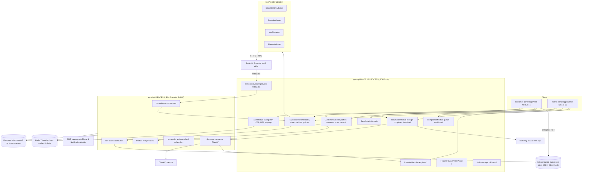
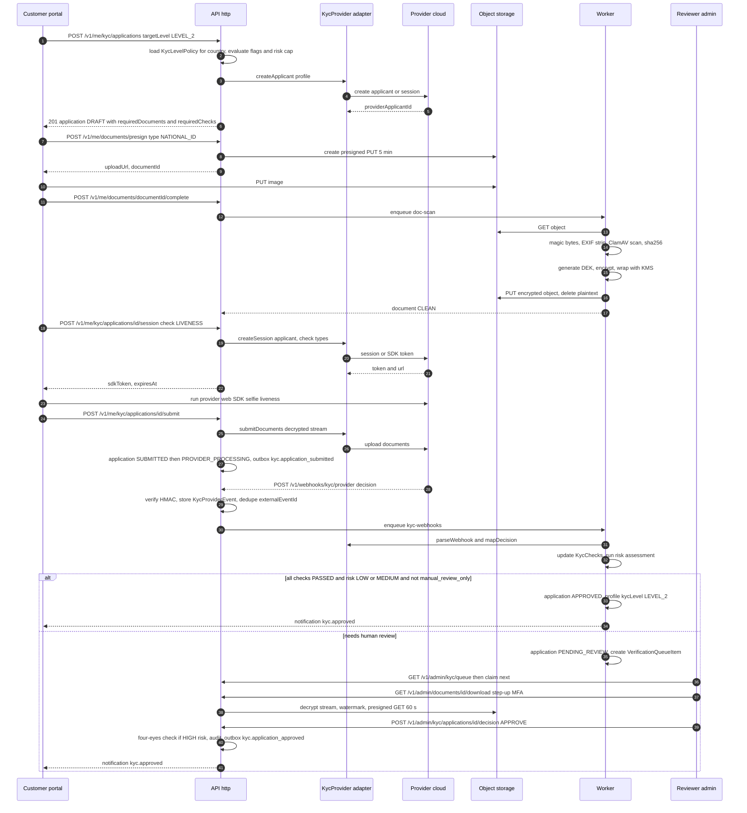
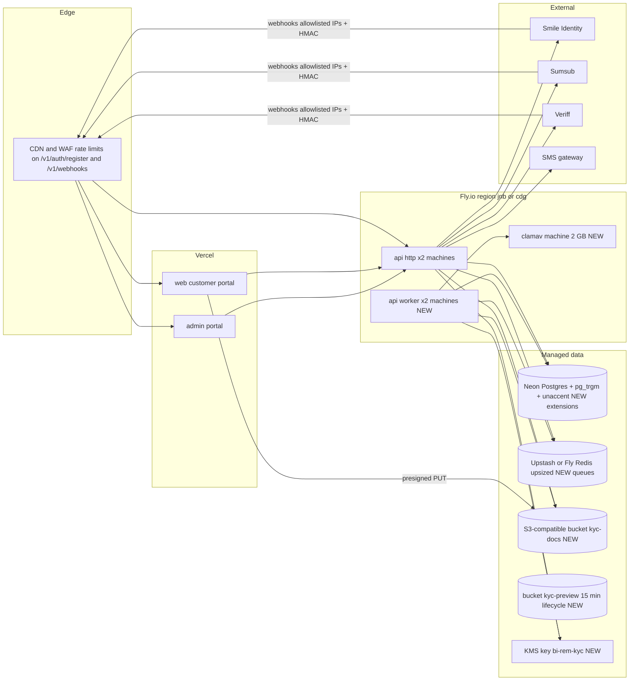
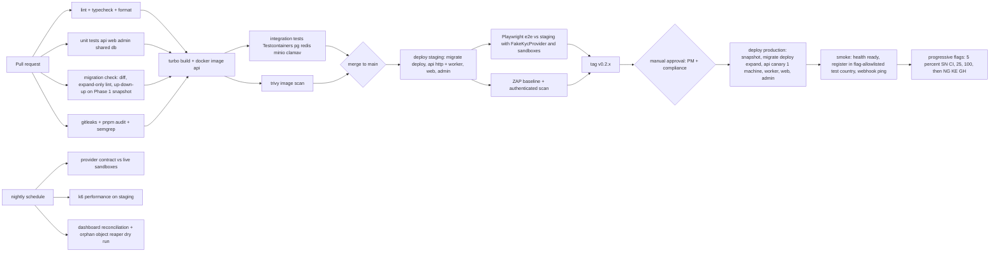

# Phase 2 — Customer Management & KYC

| Field                     | Value                                                                                                                                                   |
| ------------------------- | ------------------------------------------------------------------------------------------------------------------------------------------------------- |
| **Phase**                 | 2 of 13 — `customer-kyc`                                                                                                                                |
| **Dates**                 | 2026-12-28 → 2027-02-19                                                                                                                                 |
| **Duration**              | 8 weeks (W1 = 2026-12-28, W8 = 2027-02-15 … 2027-02-19)                                                                                                 |
| **Team**                  | `core` (4 backend, 3 frontend, 2 QA, 1 solution architect, 1 PM, 1 compliance analyst, 1 product designer, shared DevOps/SRE and 0.5 security engineer) |
| **Depends on**            | Phase 1 — Foundation & Platform Setup (ends 2026-12-25)                                                                                                 |
| **Unlocks**               | Phase 5 — Domestic Transfers (2027-04-19), Phase 8 — AML, Fraud & Compliance (2027-07-26), Phase 11 — Mobile Applications (2027-08-09)                  |
| **Runs in parallel with** | Phase 3 — Connectivity Management Framework (`platform` team, from 2027-01-25)                                                                          |

---

## 1. Overview

### 1.1 Objective

Phase 2 turns the Phase 1 identity/RBAC/notification skeleton into a working **customer onboarding and compliance platform**. At the end of the phase a sender in any pilot country can self-register on the customer portal (phone-first, OTP verified), enrol MFA, complete a tiered KYC application with document and liveness checks performed by an external provider, register beneficiaries, and be assigned a risk rating — while a compliance officer in the admin portal sees every application in a verification queue, reviews documents, approves/rejects/escalates, and monitors onboarding health on a compliance dashboard.

Phase 2 is the first phase that handles **Restricted** personal data (identity documents, biometrics, national ID numbers), so a large share of the effort is in storage encryption, access control, auditability and regulatory posture, not in UI.

### 1.2 In scope

| Area                    | Included                                                                                                                                                                                                                                                                                                                      |
| ----------------------- | ----------------------------------------------------------------------------------------------------------------------------------------------------------------------------------------------------------------------------------------------------------------------------------------------------------------------------- |
| Registration            | Phone-first self-registration (E.164) with SMS OTP, optional e-mail, consent capture, country selection, password (argon2), device/IP capture, abuse controls (throttling, enumeration-safe responses, disposable-number blocklist).                                                                                          |
| MFA                     | TOTP (RFC 6238) enrolment with QR + recovery codes; SMS OTP as fallback method; step-up MFA for sensitive actions (beneficiary add, phone change, document download in admin); admin-side MFA reset; `auth.mfa.enforced` flag for the ADMIN realm.                                                                            |
| Customer profiles       | 1:1 `CustomerProfile` on `User` (DOB, nationality, address, occupation, source of funds, expected volumes), consent records, customer notes (admin), customer timeline (audit + KYC events).                                                                                                                                  |
| KYC workflow            | `KycApplication` state machine; tiered levels (LEVEL_0..LEVEL_3) with per-country `KycLevelPolicy`; provider routing; `KycProvider` interface with **Smile Identity**, **Sumsub** and **Veriff** adapters plus a `MANUAL` provider; liveness + face match; expiry and periodic re-verification scheduling; resubmission loop. |
| Document uploads        | Presigned direct-to-bucket uploads to S3-compatible storage; server-side envelope encryption (per-document DEK, KMS-wrapped); ClamAV scanning worker; MIME/magic-byte validation; EXIF stripping; retention and legal-hold metadata; audited, short-lived admin download links.                                               |
| Beneficiary management  | CRUD for mobile-money / bank / cash-pickup beneficiaries with per-country field validation, encrypted account numbers, step-up MFA on add, soft delete, and a `BeneficiaryVerifier` hook that Phase 4 wires to wallet connectors.                                                                                             |
| Risk profile module     | Rule-based risk engine v1 (country, PEP self-declaration, occupation, source of funds, document quality, velocity of resubmissions, device signals), admin-editable rule weights, assessment history, rating-driven KYC level cap, hook point `screening.requested` for Phase 8 PEP/sanctions.                                |
| Compliance dashboard    | Funnel (registered → phone verified → KYC submitted → approved), SLA breaches, provider pass/fail rates and latency, rejection reasons, risk distribution, reviewer throughput.                                                                                                                                               |
| User verification queue | Priority queue of `PENDING_REVIEW` applications with assignment, SLA timers, four-eyes rule for HIGH risk, bulk actions, keyboard-driven review screen.                                                                                                                                                                       |
| Customer search engine  | Postgres-native search (`pg_trgm` + `unaccent` + `tsvector`) across name, phone, e-mail, national ID hash, beneficiary MSISDN, with faceting by country/KYC status/risk; p95 < 500 ms at 1M customers.                                                                                                                        |

### 1.3 Out of scope (explicitly deferred)

- Live PEP/sanctions screening and transaction monitoring — **Phase 8** (we only emit `screening.requested` and reserve the `pepFlag` / `sanctionsFlag` columns).
- Enforcing KYC-level transaction limits — limits are **stored** in `KycLevelPolicy` in Phase 2 and **enforced** by the transfer engine in Phase 5.
- Beneficiary name lookup against wallet/bank providers — the `BeneficiaryVerifier` interface ships with a `NoopVerifier`; Phase 4 supplies real connectors.
- Native mobile SDK integration (Smile ID / Sumsub mobile SDKs) — **Phase 11**; Phase 2 ships web SDK flows that the mobile team will reuse as web-views if needed.
- Business/merchant KYB — **Phase 9**.
- Elasticsearch/OpenSearch — rejected for this phase (see §4.4); revisit in Phase 10 if Postgres search is insufficient at scale.
- Biometric template storage on our side — never; liveness/face-match results are provider-side, we store only decisions and reference IDs.

### 1.4 Independent deployability strategy

"Deployable alone" for Phase 2 means: **the whole phase can be merged to `main` and deployed to production with every new behaviour dark, then lit progressively by country, without any Phase 3+ code present, and switched off again in under a minute without a rollback deploy.**

| Mechanism                                                                                 | How it is used in Phase 2                                                                                                                                                                                                                                                                                                                                                                                                                                                                                                                                       |
| ----------------------------------------------------------------------------------------- | --------------------------------------------------------------------------------------------------------------------------------------------------------------------------------------------------------------------------------------------------------------------------------------------------------------------------------------------------------------------------------------------------------------------------------------------------------------------------------------------------------------------------------------------------------------- |
| **Feature flags** (`FeatureFlag` table, Phase 1 service; evaluated per user hash + rules) | `customer.registration.enabled` (rules: `countryCode in [...]`, `rolloutPercentage`), `auth.mfa.enforced` (ADMIN realm first), `kyc.enabled`, `kyc.provider.smile_identity.enabled`, `kyc.provider.sumsub.enabled`, `kyc.provider.veriff.enabled`, `kyc.manual_review_only` (routes every application to the queue, bypassing providers — the ultimate provider kill switch), `documents.av_scan.enforced` (fail-closed vs fail-open when ClamAV is down), `beneficiaries.enabled`, `risk.engine.v1`, `admin.compliance_dashboard`, `admin.customer_search.v1`. |
| **Expand → migrate → contract**                                                           | All schema changes are additive in W1 (new tables, nullable columns, new enums). The one breaking change — making `users.email` nullable for phone-first registration — is done as expand (drop NOT NULL + partial unique index) in Phase 2 and the contract (remove the legacy `@@unique([realm, email])` constraint and `users.mfa_secret`) is scheduled for **Phase 3 W1** once no Phase 1 code path depends on them.                                                                                                                                        |
| **Dark launch**                                                                           | Provider adapters are deployed and health-checked against sandboxes in production (`/health/ready` includes `kyc-providers` indicator in _degraded-tolerant_ mode) two weeks before any real customer is routed to them. Webhook endpoints are live and verifying signatures from W4 even while flags are off.                                                                                                                                                                                                                                                  |
| **Kill switches**                                                                         | Per-provider flags; `kyc.manual_review_only`; `customer.registration.enabled=false` returns HTTP 503 with `Retry-After` and a friendly waitlist page; `documents.uploads.enabled` stops presigning. All flags are editable from the admin Settings/Flags screen (Phase 1) and cached 30 s in Redis, so worst-case propagation is 30 s.                                                                                                                                                                                                                          |
| **Worker isolation**                                                                      | KYC webhook processing, AV scanning, risk assessment and KYC expiry sweeps run in a separate `apps/api` process started with `PROCESS_ROLE=worker` (BullMQ consumers only). The HTTP API never blocks on providers; a worker outage degrades to "pending" states, never to request failures.                                                                                                                                                                                                                                                                    |
| **Backward-compatible APIs**                                                              | All new endpoints are new paths under `/v1`; Phase 1 `auth/login` gains an optional `mfaRequired` branch that Phase 1 clients ignore safely.                                                                                                                                                                                                                                                                                                                                                                                                                    |

---

## 2. Milestones

Phase start is Monday **2026-12-28**; week _n_ runs Monday to Friday, milestone dates are the Friday of the week.

| ID       | Week | Target date | Deliverable                                                                                                                               | Acceptance criteria                                                                                                                                                                                                                                                                                                           | Owner                        |
| -------- | ---- | ----------- | ----------------------------------------------------------------------------------------------------------------------------------------- | ----------------------------------------------------------------------------------------------------------------------------------------------------------------------------------------------------------------------------------------------------------------------------------------------------------------------------- | ---------------------------- |
| **M2.1** | W1   | 2027-01-01  | Design freeze, schema v2 _expand_ migration merged, `KycProvider` interface + ADRs, provider sandbox accounts live                        | `pnpm db:migrate:dev` applies `20261228_phase2_expand` on a Phase 1 DB with zero data loss; ADR-0007 (provider abstraction), ADR-0008 (document encryption), ADR-0009 (search engine choice) accepted; Smile ID, Sumsub, Veriff sandbox credentials in the secrets manager; Figma flows signed off by PM + compliance analyst | Solution Architect           |
| **M2.2** | W2   | 2027-01-08  | Registration + OTP + MFA (TOTP, SMS) in staging behind flags                                                                              | Playwright: register → verify OTP → login → TOTP enrol → login with TOTP → recovery code login all green; OTP brute-force test locks after 5 attempts; registration throttled at 5/min/IP and 3/day/phone; `auth.mfa.enforced` blocks ADMIN login without MFA                                                                 | Backend Lead                 |
| **M2.3** | W3   | 2027-01-15  | Customer profile API + portal screens; document upload pipeline (presign → upload → scan → encrypt-at-rest metadata)                      | Upload of a 5 MB JPEG completes < 3 s p95 from Lagos test node; EICAR file is quarantined (`INFECTED`) and the user is notified; every stored object has `dek_wrapped` + `sha256`; no plaintext PII in logs (pino redaction test)                                                                                             | Backend Lead                 |
| **M2.4** | W4   | 2027-01-22  | KYC state machine; Smile Identity + Sumsub adapters passing contract tests; webhook ingestion with signature verification and idempotency | Sandbox applications reach `APPROVED` and `REJECTED` via webhooks for both providers; replayed webhook is a no-op; invalid signature → 401 and alert; `KycProviderEvent` rows for every delivery                                                                                                                              | Backend Lead                 |
| **M2.5** | W5   | 2027-01-29  | Veriff adapter + liveness; tiered levels and per-country `KycLevelPolicy`; beneficiary management (API + portal)                          | Policy matrix for SN, CI, NG, KE, GH seeded; LEVEL_1 → LEVEL_2 upgrade triggers liveness session; beneficiary add requires step-up MFA; account numbers encrypted with last-4 only in reads                                                                                                                                   | Backend Lead / Frontend Lead |
| **M2.6** | W6   | 2027-02-05  | Admin: verification queue, review screen, compliance dashboard, customer search, risk profile module                                      | Reviewer can approve/reject/request-resubmission/escalate with mandatory reason codes; HIGH risk requires second approver; search p95 < 500 ms with 1M seeded customers; dashboard tiles match SQL ground truth ±0                                                                                                            | Frontend Lead                |
| **M2.7** | W7   | 2027-02-12  | Hardening: performance, security test, UAT with compliance analyst, runbooks                                                              | k6 profile passes (§9.5); ZAP baseline + manual pen-test findings ≥ High closed; UAT script 100% passed; runbooks for provider outage, AV outage, webhook backlog published                                                                                                                                                   | QA Lead / Security           |
| **M2.8** | W8   | 2027-02-19  | Production rollout to 100% of pilot countries; phase exit review; handover to Phases 3/5/8/11                                             | Flags at 100% for SN + CI, ≥ 25% for NG/KE/GH; success criteria table (§12) fully evidenced; sign-offs collected (§11)                                                                                                                                                                                                        | Program Manager              |

---

## 3. Deliverables

Each deliverable lists its **Definition of Done (DoD)**. A deliverable is done only when code, tests, OpenAPI docs, portal screens, runbook entries and audit coverage all exist.

### 3.1 Registration

- **What**: `POST /v1/auth/register` creates a `User` (realm `CUSTOMER`, status `PENDING`) + empty `CustomerProfile` + `ConsentRecord`s, issues an SMS OTP (`OtpCode`, purpose `REGISTRATION`), and on `POST /v1/auth/register/verify-otp` sets `phoneVerifiedAt`, status `ACTIVE`, emits `customer.registered`, and returns tokens.
- **DoD**:
  - Phone is the primary identifier; e-mail optional (schema expand §5). E.164 validation with `libphonenumber-js`, country inferred and cross-checked with chosen `countryCode`.
  - OTP: 6 digits, 5-minute TTL, hashed (argon2id) at rest, max 5 verification attempts then invalidated, resend cooldown 60 s, max 3 OTP per phone per day; same generic response whether phone exists or not.
  - Throttling via `@nestjs/throttler` with Redis storage: 5 req/min/IP on register, 10 req/min/IP on verify.
  - Blocklist of VoIP/disposable prefixes per country (config table `Setting` key `registration.blocked_prefixes`).
  - Password: argon2id (memory 64 MiB, iterations 3), min 10 chars, breached-password check against a local HIBP k-anonymity cache (optional flag).
  - Device fingerprint hash + IP + user agent captured into `AuditLog.metadata` for the risk engine.
  - Welcome notification via Phase 1 `Notification` pipeline (template `customer.welcome`, locales en/fr/pt).
  - Feature flag `customer.registration.enabled` with country rules; disabled → 503 + waitlist UI.

### 3.2 MFA Authentication

- **What**: `MfaDevice` model (TOTP, SMS_OTP), enrolment/confirmation endpoints, login step-up, recovery codes, admin reset. Login returns `{ mfaRequired: true, mfaToken }` (5-minute JWT with `amr: ["pwd"]`, scope `mfa`) when the user has any verified device or when `auth.mfa.enforced` applies to the realm; `POST /v1/auth/mfa/verify` exchanges `mfaToken` + code for the normal access/refresh pair with `amr: ["pwd","otp"]`.
- **DoD**:
  - TOTP secrets generated with 160-bit entropy, encrypted (AES-256-GCM, `ENCRYPTION_KEY` from Phase 1) in `mfa_devices.secret_encrypted`; `users.mfa_secret` no longer written (read-only compatibility until Phase 3 contract).
  - ±1 step window, replay protection (last used counter stored), 10 recovery codes (hashed), each single-use.
  - Step-up guard `@RequiresRecentMfa(300)` used by beneficiary add, phone change, password change, admin document download, admin KYC override.
  - Admin reset (`POST /v1/admin/customers/:id/mfa/reset`) requires permission `mfa:reset`, own recent MFA, and writes an audit row with reason.
  - Lockout: 5 failed MFA codes → 15-minute lock on the user (`lockedUntil`), notification sent.

### 3.3 Customer Profiles

- **What**: `CustomerProfile` 1:1 with `User`; self-service read/update of non-identity fields; admin full view with timeline, notes, documents, beneficiaries, risk, KYC history.
- **DoD**: Identity-bearing fields (legal name, DOB, nationality, ID number) become read-only for the customer once a KYC application is `SUBMITTED`; changes afterwards go through a `PROFILE_CHANGE` KYC application (re-verification). National ID number stored as HMAC-SHA256(`ID_HASH_KEY`) + last 4 digits; plaintext only in memory during provider submission. Consent versions (`terms`, `privacy`, `biometric_processing`, `marketing`) tracked with timestamp + IP; `biometric_processing` consent is mandatory before any liveness session (Kenya DPA 2019 / Nigeria NDPA 2023 sensitive-data requirement).

### 3.4 KYC Workflow

- **What**: `KycApplication` lifecycle `DRAFT → SUBMITTED → PROVIDER_PROCESSING → PENDING_REVIEW → APPROVED | REJECTED | RESUBMISSION_REQUIRED → (DRAFT) …`, with `EXPIRED` and `CANCELLED` terminal/side states. Tiered levels per country via `KycLevelPolicy` (required checks, required document types, provider routing, limits). Orchestrated by `KycOrchestratorService`; providers behind `KycProvider`.
- **DoD**:
  - Level model (configurable per country; defaults mirror the CBN three-tier and BoG tiered-KYC approach):
    - `LEVEL_0` — registered + phone verified only (no transactions in Phase 5).
    - `LEVEL_1` — basic: name, DOB, address, ID number verified against ID authority where available (Smile ID Enhanced KYC), no document image required.
    - `LEVEL_2` — standard: government ID document + selfie liveness + face match.
    - `LEVEL_3` — enhanced: LEVEL_2 + proof of address + source-of-funds declaration + manual review; mandatory for `HIGH` risk.
  - Routing rule evaluation: `KycLevelPolicy.providerRouting` JSON, e.g. `{"DOCUMENT":"SMILE_IDENTITY","LIVENESS":"SMILE_IDENTITY","FALLBACK":"SUMSUB"}`; fallback used automatically when the primary adapter circuit breaker is open or its flag is off.
  - Auto-decision when every required `KycCheck` is `PASSED` with provider confidence ≥ policy threshold and risk rating ≤ `MEDIUM`; otherwise `PENDING_REVIEW`. `kyc.manual_review_only` forces `PENDING_REVIEW`.
  - Expiry: `expiresAt` = decision + policy `validityDays` (default 730; 365 for `HIGH`); nightly sweep moves expired to `EXPIRED`, notifies, and downgrades `CustomerProfile.kycLevel`.
  - All transitions guarded by a single `KycStateMachine` (xstate-free, plain TypeScript map) with unit tests for every edge; illegal transitions throw `409 KYC_INVALID_TRANSITION`.
  - Every transition writes an `Outbox` event and an `AuditLog` row.

### 3.5 Document Uploads

- **What**: Presigned PUT to an S3-compatible bucket (`bi-rem-kyc-docs-{env}`), completion callback, async ClamAV scan, metadata and crypto envelope in `KycDocument`.
- **DoD**:
  - Allowed MIME: `image/jpeg`, `image/png`, `image/webp`, `application/pdf`; max 10 MB; magic-byte sniff on completion (`file-type`); EXIF/GPS stripped (`sharp`), PDFs flattened.
  - Object key `kyc/{customerId}/{documentId}/{sha256}.bin`; bucket has SSE enabled, public access blocked, versioning on, lifecycle rule moves to cold tier after 90 days, and Object Lock _governance_ mode for the retention period.
  - Application-layer envelope encryption: random 256-bit DEK per document, AES-256-GCM, DEK wrapped by KMS key `alias/bi-rem-kyc-{env}`; `dek_wrapped`, `iv`, `auth_tag` stored on the row. Decryption only in the worker (provider submission) and the admin download path (streams, never writes to disk).
  - Admin download: `GET /v1/admin/documents/:id/download` requires `documents:download` + recent MFA, returns a 60-second presigned GET to a **decrypted temporary copy** in a separate `bi-rem-kyc-preview-{env}` bucket with 15-minute lifecycle, watermarked with reviewer ID + timestamp.
  - Scan states `UPLOADING → SCANNING → CLEAN | INFECTED`; `INFECTED` objects are moved to `quarantine/` prefix and the customer is asked to re-upload; AV engine down → behaviour governed by `documents.av_scan.enforced`.

### 3.6 Beneficiary Management

- **What**: Customer-managed payee book. Types `MOBILE_MONEY` (MSISDN + wallet provider code), `BANK_ACCOUNT` (bank code + account number), `CASH_PICKUP` (name + ID type). Per-country validation schemas in `@bi-rem/shared` (e.g. NG NUBAN 10 digits with check digit, KE M-Pesa MSISDN `+2547…/+2541…`, SN Wave/Orange `+221 7…`).
- **DoD**: Account numbers encrypted (AES-256-GCM) with `account_number_last4` for display; duplicate detection per owner (same type + normalised identifier); step-up MFA on create and on changing identifier; soft delete with 30-day restore; `BeneficiaryVerifier` interface with `NoopVerifier` (status `ACTIVE`) and a `nameMatchScore` column ready for Phase 4; max 50 active beneficiaries per customer (setting); admin read-only view with `beneficiaries:read`. Emits `beneficiary.created|updated|deleted` for Phase 8 velocity rules.

### 3.7 Risk Profile Module

- **What**: Deterministic rule engine producing `RiskAssessment` (score 0–100, rating `LOW <40`, `MEDIUM 40–69`, `HIGH 70–89`, `PROHIBITED ≥90`) from weighted `RiskRule`s stored in DB and editable in admin (`risk:rules:write`).
- **DoD**: Rules v1: `country_risk` (configurable table), `pep_self_declared`, `occupation_category`, `source_of_funds`, `age_band`, `document_resubmissions`, `provider_fraud_signals` (Sumsub `rejectLabels`, Smile ID `Actions.Liveness_Check`), `device_country_mismatch`, `multiple_accounts_same_device`. Assessment triggered on `kyc.application_submitted`, `kyc.check_completed`, `customer.profile_updated`, and on demand; result caps the achievable KYC level (`PROHIBITED` → auto-reject + queue with reason `RISK_PROHIBITED`); rating change emits `risk.rating_changed`; full factor breakdown stored for explainability; ruleset version pinned on each assessment. Hook: for rating ≥ `MEDIUM`, emit `screening.requested` (consumed in Phase 8; Phase 2 consumer is a logging no-op).

### 3.8 Compliance Dashboard

- **What**: Admin page `/compliance` with tiles and charts fed by `GET /v1/admin/compliance/dashboard?from&to&country`.
- **DoD**: Metrics computed from materialised view `mv_kyc_daily_stats` refreshed every 5 minutes (`REFRESH MATERIALIZED VIEW CONCURRENTLY`): registrations, phone-verified, submitted, approved, rejected, resubmission, auto-decision rate, median time-to-decision, queue depth and oldest item age, SLA breaches, per-provider pass rate / p95 latency / error rate, top 10 rejection reasons, risk distribution, reviewer throughput. Numbers reconcile with raw SQL in a nightly job (`compliance.dashboard.reconcile`) that alerts on drift. Export to CSV.

### 3.9 User Verification Queue

- **What**: `VerificationQueueItem` per `PENDING_REVIEW` application; admin list `/kyc/queue` with filters, SLA countdowns, assignment, review workspace.
- **DoD**: Priority = f(risk rating, waiting time, resubmission count, level requested); SLA defaults 4 h (LOW/MEDIUM) and 24 h (HIGH, needs second reviewer); `FOR UPDATE SKIP LOCKED` claim semantics for "take next"; auto-release after 30 minutes idle; four-eyes: HIGH-risk approvals require a second reviewer with `kyc:review` who is not the first; `kyc:override` allows approving with failed checks but demands a reason ≥ 20 chars and emits `kyc.override_used` alert; reviewer sees documents (watermarked), provider raw result (redacted), risk factors, profile diff, previous applications; decision reason codes from a controlled vocabulary (`DOC_EXPIRED`, `DOC_BLURRY`, `FACE_MISMATCH`, `NAME_MISMATCH`, `UNDERAGE`, `SUSPECTED_FRAUD`, …).

### 3.10 Customer Search Engine

- **What**: `GET /v1/admin/customers?q=&country=&kycStatus=&risk=&cursor=` backed by Postgres.
- **DoD**: `customer_profiles.search_vector` (generated `tsvector` with `unaccent`) + `pg_trgm` GIN indexes on `display_name`, `users.phone`, `users.email`; exact-match fast path for E.164 phone, e-mail and ID-number hash; fuzzy name match ≥ 0.3 similarity; cursor pagination; p95 < 500 ms with 1M customers + 3M beneficiaries (k6 verified); search queries audited (`customers:search`) with the query string hashed, since searching for a person is itself a compliance-relevant access.

---

## 4. Architecture

### 4.1 Component / container diagram — Phase 2 additions



### 4.2 Sequence diagram — LEVEL_2 KYC with document, liveness and admin decision



### 4.3 Deployment / infrastructure delta



**Infra delta summary** (also §14): second Fly process group `worker`, ClamAV machine, S3-compatible buckets ×2 with SSE/Object Lock/lifecycle, KMS key + IAM role for the API, Postgres extensions `pg_trgm` and `unaccent`, Redis upsize (BullMQ queues `kyc-webhooks`, `doc-scan`, `risk-assess`, `kyc-expiry`), WAF rules for registration and webhook paths, provider API secrets in the secrets manager, outbound egress allowlist for provider hosts, Grafana dashboards + alert rules for KYC funnel and queue depth.

### 4.4 Design decisions and alternatives rejected

| Decision                     | Chosen                                                                                                                                      | Alternatives rejected                                                                | Why                                                                                                                                                                                                                                                                     |
| ---------------------------- | ------------------------------------------------------------------------------------------------------------------------------------------- | ------------------------------------------------------------------------------------ | ----------------------------------------------------------------------------------------------------------------------------------------------------------------------------------------------------------------------------------------------------------------------- |
| Provider abstraction         | `KycProvider` TypeScript interface, one NestJS adapter per vendor, normalised `KycDecision` + `KycCheckResult`, routing in `KycLevelPolicy` | Single vendor (Sumsub only); orchestration SaaS (e.g. Alloy/Persona as meta-layer)   | Pan-African coverage needs Smile ID's ID-authority lookups (NG BVN/NIN, KE, GH, ZA, UG), diaspora senders need Sumsub/Veriff document breadth; a meta-layer adds cost and a 4th data processor. Multiple adapters also give us commercial leverage and a live failover. |
| Primary provider per country | Smile Identity for African IDs, Sumsub for non-African documents, Veriff as liveness-heavy fallback                                         | Round-robin                                                                          | Deterministic routing is easier to explain to regulators and to reconcile invoices.                                                                                                                                                                                     |
| Document storage             | S3-compatible object storage with SSE **plus** application-layer envelope encryption (per-document DEK, KMS KEK)                            | SSE only; storing documents in Postgres `bytea`; encrypting with a single static key | Defence in depth: a leaked presigned URL or bucket misconfiguration yields ciphertext; per-document DEKs enable crypto-shredding for erasure requests; Postgres blobs would bloat backups and break RPO 15 min.                                                         |
| Upload path                  | Browser → presigned PUT direct to bucket → completion callback → worker scan/encrypt                                                        | Upload through the API                                                               | Keeps 10 MB bodies off the API machines and avoids a 5–10 s request; completion callback + worker gives us a natural quarantine state.                                                                                                                                  |
| AV scanning                  | ClamAV daemon on its own machine, called from worker via `clamd` TCP                                                                        | Vendor malware scanning API                                                          | Documents must not leave our boundary unencrypted except to the KYC provider; ClamAV is adequate for image/PDF payload threats and costs ~$40/month.                                                                                                                    |
| Search                       | Postgres `pg_trgm` + `unaccent` + generated `tsvector`                                                                                      | OpenSearch/Elasticsearch, Typesense, Meilisearch                                     | Avoids a new stateful system and a second copy of PII to secure; 1M customers is comfortably inside Postgres' capability; measured in §9. Revisit in Phase 10.                                                                                                          |
| MFA                          | TOTP primary, SMS OTP fallback, recovery codes; WebAuthn deferred                                                                           | SMS-only; WebAuthn now                                                               | SIM-swap risk is high in several pilot markets, so TOTP is pushed as primary; WebAuthn adoption on feature phones is low, deferred to Phase 11 (passkeys on mobile).                                                                                                    |
| Risk engine                  | Transparent weighted rules in DB with versioned rulesets                                                                                    | ML scoring; vendor risk score only                                                   | Regulators ask "why was this customer HIGH"; rules are explainable and editable by the compliance analyst without a deploy. ML can layer on in Phase 8.                                                                                                                 |
| State machine                | Hand-written transition table with exhaustive tests                                                                                         | xstate                                                                               | Fewer dependencies; transition table doubles as documentation for compliance.                                                                                                                                                                                           |
| Workers                      | Same `apps/api` image, different `PROCESS_ROLE`                                                                                             | Separate `apps/worker` package                                                       | One build, one set of DTOs/Prisma client; Fly process groups give independent scaling.                                                                                                                                                                                  |

---

## 5. Data Model & Migrations

### 5.1 Prisma model additions (schema v2)

All conventions from CLAUDE.md apply: `uuid` ids via `gen_random_uuid()`, `timestamptz(6)`, money as `BigInt` minor units + ISO-4217 `currency`, snake_case `@@map`/`@map`.

```prisma
// ---------------------------------------------------------------------------
// Phase 2 enums
// ---------------------------------------------------------------------------

enum KycLevel {
  LEVEL_0
  LEVEL_1
  LEVEL_2
  LEVEL_3

  @@map("kyc_level")
}

enum KycApplicationStatus {
  DRAFT
  SUBMITTED
  PROVIDER_PROCESSING
  PENDING_REVIEW
  APPROVED
  REJECTED
  RESUBMISSION_REQUIRED
  EXPIRED
  CANCELLED

  @@map("kyc_application_status")
}

enum KycApplicationKind {
  INITIAL
  UPGRADE
  PERIODIC_REVIEW
  PROFILE_CHANGE

  @@map("kyc_application_kind")
}

enum KycProviderKey {
  SMILE_IDENTITY
  SUMSUB
  VERIFF
  MANUAL

  @@map("kyc_provider_key")
}

enum KycCheckType {
  ID_NUMBER
  DOCUMENT
  LIVENESS
  FACE_MATCH
  ADDRESS
  PHONE
  EMAIL
  SOURCE_OF_FUNDS
  SANCTIONS_PEP

  @@map("kyc_check_type")
}

enum KycCheckStatus {
  PENDING
  SUBMITTED
  PASSED
  FAILED
  REVIEW
  ERROR
  CANCELLED

  @@map("kyc_check_status")
}

enum DocumentType {
  NATIONAL_ID
  PASSPORT
  DRIVERS_LICENCE
  VOTER_CARD
  RESIDENCE_PERMIT
  PROOF_OF_ADDRESS
  SELFIE
  SOURCE_OF_FUNDS
  OTHER

  @@map("document_type")
}

enum DocumentStatus {
  UPLOADING
  SCANNING
  CLEAN
  INFECTED
  VERIFIED
  REJECTED
  EXPIRED
  DELETED

  @@map("document_status")
}

enum BeneficiaryType {
  MOBILE_MONEY
  BANK_ACCOUNT
  CASH_PICKUP

  @@map("beneficiary_type")
}

enum BeneficiaryStatus {
  PENDING_VERIFICATION
  ACTIVE
  BLOCKED
  DELETED

  @@map("beneficiary_status")
}

enum RiskRating {
  LOW
  MEDIUM
  HIGH
  PROHIBITED

  @@map("risk_rating")
}

enum MfaMethod {
  TOTP
  SMS_OTP
  EMAIL_OTP

  @@map("mfa_method")
}

enum OtpPurpose {
  REGISTRATION
  LOGIN
  PHONE_CHANGE
  PASSWORD_RESET
  STEP_UP

  @@map("otp_purpose")
}

enum ReviewDecision {
  APPROVE
  REJECT
  REQUEST_RESUBMISSION
  ESCALATE
  SECOND_APPROVAL

  @@map("review_decision")
}

enum QueueItemStatus {
  OPEN
  ASSIGNED
  ESCALATED
  RESOLVED

  @@map("queue_item_status")
}

enum ConsentType {
  TERMS
  PRIVACY
  BIOMETRIC_PROCESSING
  MARKETING
  DATA_SHARING_PROVIDERS

  @@map("consent_type")
}

enum Gender {
  FEMALE
  MALE
  OTHER
  UNDISCLOSED

  @@map("gender")
}

// ---------------------------------------------------------------------------
// Customer profile
// ---------------------------------------------------------------------------

/// One profile per CUSTOMER-realm user. Identity fields become immutable for the customer
/// after the first KYC submission; later changes go through a PROFILE_CHANGE application.
model CustomerProfile {
  id                  String     @id @default(dbgenerated("gen_random_uuid()")) @db.Uuid
  userId              String     @unique @map("user_id") @db.Uuid
  displayName         String     @map("display_name") @db.VarChar(200)
  middleName          String?    @map("middle_name") @db.VarChar(100)
  dateOfBirth         DateTime?  @map("date_of_birth") @db.Date
  gender              Gender?
  /// ISO-3166-1 alpha-2.
  nationality         String?    @db.Char(2)
  /// HMAC-SHA256(ID_HASH_KEY, normalised id number). Never the plaintext.
  idNumberHash        String?    @map("id_number_hash") @db.VarChar(64)
  idNumberLast4       String?    @map("id_number_last4") @db.VarChar(4)
  idType              DocumentType? @map("id_type")
  occupationCode      String?    @map("occupation_code") @db.VarChar(32)
  sourceOfFundsCode   String?    @map("source_of_funds_code") @db.VarChar(32)
  pepSelfDeclared     Boolean    @default(false) @map("pep_self_declared")
  addressLine1        String?    @map("address_line1") @db.VarChar(200)
  addressLine2        String?    @map("address_line2") @db.VarChar(200)
  city                String?    @db.VarChar(100)
  region              String?    @db.VarChar(100)
  postalCode          String?    @map("postal_code") @db.VarChar(20)
  addressCountryCode  String?    @map("address_country_code") @db.Char(2)
  kycLevel            KycLevel   @default(LEVEL_0) @map("kyc_level")
  kycLevelGrantedAt   DateTime?  @map("kyc_level_granted_at") @db.Timestamptz(6)
  kycExpiresAt        DateTime?  @map("kyc_expires_at") @db.Timestamptz(6)
  riskRating          RiskRating @default(LOW) @map("risk_rating")
  riskScore           Int        @default(0) @map("risk_score")
  /// Reserved for Phase 8 screening results; Phase 2 never sets these to true.
  pepFlag             Boolean    @default(false) @map("pep_flag")
  sanctionsFlag       Boolean    @default(false) @map("sanctions_flag")
  expectedMonthlyVolumeMinor BigInt? @map("expected_monthly_volume_minor")
  expectedVolumeCurrency     String? @map("expected_volume_currency") @db.Char(3)
  identityLockedAt    DateTime?  @map("identity_locked_at") @db.Timestamptz(6)
  /// Generated tsvector maintained by trigger (see migration); Prisma treats it as opaque.
  searchVector        Unsupported("tsvector")? @map("search_vector")
  createdAt           DateTime   @default(now()) @map("created_at") @db.Timestamptz(6)
  updatedAt           DateTime   @updatedAt @map("updated_at") @db.Timestamptz(6)

  user            User                @relation(fields: [userId], references: [id], onDelete: Restrict)
  kycApplications KycApplication[]
  documents       KycDocument[]
  riskAssessments RiskAssessment[]
  consents        ConsentRecord[]
  notes           CustomerNote[]

  @@index([kycLevel, riskRating])
  @@index([idNumberHash])
  @@index([kycExpiresAt])
  @@map("customer_profiles")
}

model ConsentRecord {
  id         String      @id @default(dbgenerated("gen_random_uuid()")) @db.Uuid
  profileId  String      @map("profile_id") @db.Uuid
  type       ConsentType
  /// Document version the customer accepted, e.g. "privacy-2026-12".
  version    String      @db.VarChar(32)
  granted    Boolean
  ip         String?     @db.VarChar(45)
  userAgent  String?     @map("user_agent") @db.VarChar(512)
  recordedAt DateTime    @default(now()) @map("recorded_at") @db.Timestamptz(6)

  profile CustomerProfile @relation(fields: [profileId], references: [id], onDelete: Cascade)

  @@index([profileId, type, recordedAt])
  @@map("consent_records")
}

model CustomerNote {
  id        String    @id @default(dbgenerated("gen_random_uuid()")) @db.Uuid
  profileId String    @map("profile_id") @db.Uuid
  authorId  String    @map("author_id") @db.Uuid
  body      String
  pinned    Boolean   @default(false)
  createdAt DateTime  @default(now()) @map("created_at") @db.Timestamptz(6)
  updatedAt DateTime  @updatedAt @map("updated_at") @db.Timestamptz(6)
  deletedAt DateTime? @map("deleted_at") @db.Timestamptz(6)

  profile CustomerProfile @relation(fields: [profileId], references: [id], onDelete: Cascade)
  author  User            @relation("CustomerNoteAuthor", fields: [authorId], references: [id], onDelete: Restrict)

  @@index([profileId, createdAt])
  @@map("customer_notes")
}

// ---------------------------------------------------------------------------
// KYC policy & applications
// ---------------------------------------------------------------------------

/// Per-country, per-level requirements and limits. Limits are stored here in Phase 2 and
/// enforced by the transfer engine from Phase 5.
model KycLevelPolicy {
  id                  String   @id @default(dbgenerated("gen_random_uuid()")) @db.Uuid
  countryCode         String   @map("country_code") @db.Char(2)
  level               KycLevel
  /// JSON array of KycCheckType required at this level.
  requiredChecks      Json     @map("required_checks")
  /// JSON array of DocumentType accepted/required at this level.
  requiredDocuments   Json     @map("required_documents")
  /// JSON map check type -> KycProviderKey, plus FALLBACK.
  providerRouting     Json     @map("provider_routing")
  autoApproveMinScore Int      @default(80) @map("auto_approve_min_score")
  validityDays        Int      @default(730) @map("validity_days")
  singleTxnMaxMinor   BigInt   @map("single_txn_max_minor")
  dailyLimitMinor     BigInt   @map("daily_limit_minor")
  monthlyLimitMinor   BigInt   @map("monthly_limit_minor")
  balanceLimitMinor   BigInt?  @map("balance_limit_minor")
  currency            String   @db.Char(3)
  isActive            Boolean  @default(true) @map("is_active")
  version             Int      @default(1)
  createdAt           DateTime @default(now()) @map("created_at") @db.Timestamptz(6)
  updatedAt           DateTime @updatedAt @map("updated_at") @db.Timestamptz(6)

  @@unique([countryCode, level, version])
  @@index([countryCode, isActive])
  @@map("kyc_level_policies")
}

model KycApplication {
  id                  String               @id @default(dbgenerated("gen_random_uuid()")) @db.Uuid
  profileId           String               @map("profile_id") @db.Uuid
  kind                KycApplicationKind   @default(INITIAL)
  targetLevel         KycLevel             @map("target_level")
  status              KycApplicationStatus @default(DRAFT)
  policyId            String               @map("policy_id") @db.Uuid
  providerKey         KycProviderKey?      @map("provider_key")
  providerApplicantId String?              @map("provider_applicant_id") @db.VarChar(128)
  attempt             Int                  @default(1)
  submittedAt         DateTime?            @map("submitted_at") @db.Timestamptz(6)
  decidedAt           DateTime?            @map("decided_at") @db.Timestamptz(6)
  decidedById         String?              @map("decided_by_id") @db.Uuid
  autoDecided         Boolean              @default(false) @map("auto_decided")
  decisionReasonCodes String[]             @default([]) @map("decision_reason_codes")
  decisionNote        String?              @map("decision_note")
  expiresAt           DateTime?            @map("expires_at") @db.Timestamptz(6)
  riskRatingAtDecision RiskRating?         @map("risk_rating_at_decision")
  metadata            Json?
  createdAt           DateTime             @default(now()) @map("created_at") @db.Timestamptz(6)
  updatedAt           DateTime             @updatedAt @map("updated_at") @db.Timestamptz(6)

  profile   CustomerProfile        @relation(fields: [profileId], references: [id], onDelete: Restrict)
  decidedBy User?                  @relation("KycDecidedBy", fields: [decidedById], references: [id], onDelete: SetNull)
  checks    KycCheck[]
  documents KycDocument[]
  reviews   KycReview[]
  queueItem VerificationQueueItem?
  events    KycProviderEvent[]

  @@index([profileId, createdAt])
  @@index([status, submittedAt])
  @@index([providerKey, providerApplicantId])
  @@map("kyc_applications")
}

model KycCheck {
  id              String         @id @default(dbgenerated("gen_random_uuid()")) @db.Uuid
  applicationId   String         @map("application_id") @db.Uuid
  type            KycCheckType
  status          KycCheckStatus @default(PENDING)
  providerKey     KycProviderKey @map("provider_key")
  providerCheckId String?        @map("provider_check_id") @db.VarChar(128)
  /// 0-100 normalised confidence where the provider gives one.
  score           Int?
  /// Normalised, PII-minimised result (reason codes, matched fields booleans).
  result          Json?
  /// Raw provider payload, encrypted at the application layer; retained per §5.5.
  rawEncrypted    String?        @map("raw_encrypted")
  startedAt       DateTime?      @map("started_at") @db.Timestamptz(6)
  completedAt     DateTime?      @map("completed_at") @db.Timestamptz(6)
  createdAt       DateTime       @default(now()) @map("created_at") @db.Timestamptz(6)
  updatedAt       DateTime       @updatedAt @map("updated_at") @db.Timestamptz(6)

  application KycApplication @relation(fields: [applicationId], references: [id], onDelete: Cascade)

  @@index([applicationId, type])
  @@index([providerKey, providerCheckId])
  @@map("kyc_checks")
}

model KycDocument {
  id                 String         @id @default(dbgenerated("gen_random_uuid()")) @db.Uuid
  profileId          String         @map("profile_id") @db.Uuid
  applicationId      String?        @map("application_id") @db.Uuid
  type               DocumentType
  status             DocumentStatus @default(UPLOADING)
  bucket             String         @db.VarChar(128)
  storageKey         String         @unique @map("storage_key") @db.VarChar(512)
  mimeType           String         @map("mime_type") @db.VarChar(64)
  sizeBytes          Int            @map("size_bytes")
  sha256             String?        @db.Char(64)
  /// Envelope encryption: DEK wrapped by KMS key `kmsKeyId`; AES-256-GCM iv and tag.
  kmsKeyId           String?        @map("kms_key_id") @db.VarChar(256)
  dekWrapped         String?        @map("dek_wrapped")
  iv                 String?        @db.VarChar(64)
  authTag            String?        @map("auth_tag") @db.VarChar(64)
  issuingCountryCode String?        @map("issuing_country_code") @db.Char(2)
  documentNumberHash String?        @map("document_number_hash") @db.VarChar(64)
  documentExpiresAt  DateTime?      @map("document_expires_at") @db.Date
  scanEngine         String?        @map("scan_engine") @db.VarChar(64)
  scanResult         String?        @map("scan_result") @db.VarChar(256)
  scannedAt          DateTime?      @map("scanned_at") @db.Timestamptz(6)
  verifiedAt         DateTime?      @map("verified_at") @db.Timestamptz(6)
  rejectionReason    String?        @map("rejection_reason") @db.VarChar(64)
  retentionUntil     DateTime?      @map("retention_until") @db.Timestamptz(6)
  legalHold          Boolean        @default(false) @map("legal_hold")
  uploadedAt         DateTime       @default(now()) @map("uploaded_at") @db.Timestamptz(6)
  updatedAt          DateTime       @updatedAt @map("updated_at") @db.Timestamptz(6)
  deletedAt          DateTime?      @map("deleted_at") @db.Timestamptz(6)

  profile     CustomerProfile @relation(fields: [profileId], references: [id], onDelete: Restrict)
  application KycApplication? @relation(fields: [applicationId], references: [id], onDelete: SetNull)

  @@index([profileId, type])
  @@index([applicationId])
  @@index([status])
  @@index([retentionUntil])
  @@map("kyc_documents")
}

/// Raw inbound provider webhook deliveries. Idempotency key is (provider_key, external_event_id).
model KycProviderEvent {
  id              String         @id @default(dbgenerated("gen_random_uuid()")) @db.Uuid
  providerKey     KycProviderKey @map("provider_key")
  externalEventId String         @map("external_event_id") @db.VarChar(256)
  eventType       String         @map("event_type") @db.VarChar(128)
  applicationId   String?        @map("application_id") @db.Uuid
  signatureValid  Boolean        @map("signature_valid")
  /// Payload with PII fields redacted at ingestion; full payload retained encrypted 90 days.
  payload         Json
  payloadEncrypted String?       @map("payload_encrypted")
  receivedAt      DateTime       @default(now()) @map("received_at") @db.Timestamptz(6)
  processedAt     DateTime?      @map("processed_at") @db.Timestamptz(6)
  processingError String?        @map("processing_error")
  attempts        Int            @default(0)

  application KycApplication? @relation(fields: [applicationId], references: [id], onDelete: SetNull)

  @@unique([providerKey, externalEventId])
  @@index([applicationId])
  @@index([processedAt])
  @@map("kyc_provider_events")
}

model KycReview {
  id            String         @id @default(dbgenerated("gen_random_uuid()")) @db.Uuid
  applicationId String         @map("application_id") @db.Uuid
  reviewerId    String         @map("reviewer_id") @db.Uuid
  decision      ReviewDecision
  reasonCodes   String[]       @default([]) @map("reason_codes")
  note          String?
  /// Reviewer checklist answers (document legible, face matches, name matches, ...).
  checklist     Json?
  usedOverride  Boolean        @default(false) @map("used_override")
  createdAt     DateTime       @default(now()) @map("created_at") @db.Timestamptz(6)

  application KycApplication @relation(fields: [applicationId], references: [id], onDelete: Cascade)
  reviewer    User           @relation("KycReviewer", fields: [reviewerId], references: [id], onDelete: Restrict)

  @@index([applicationId, createdAt])
  @@index([reviewerId, createdAt])
  @@map("kyc_reviews")
}

model VerificationQueueItem {
  id              String          @id @default(dbgenerated("gen_random_uuid()")) @db.Uuid
  applicationId   String          @unique @map("application_id") @db.Uuid
  status          QueueItemStatus @default(OPEN)
  /// Higher is more urgent; recomputed by scheduler every 5 minutes.
  priority        Int             @default(0)
  requiresSecondReviewer Boolean  @default(false) @map("requires_second_reviewer")
  assignedToId    String?         @map("assigned_to_id") @db.Uuid
  assignedAt      DateTime?       @map("assigned_at") @db.Timestamptz(6)
  slaDueAt        DateTime        @map("sla_due_at") @db.Timestamptz(6)
  escalatedAt     DateTime?       @map("escalated_at") @db.Timestamptz(6)
  resolvedAt      DateTime?       @map("resolved_at") @db.Timestamptz(6)
  createdAt       DateTime        @default(now()) @map("created_at") @db.Timestamptz(6)
  updatedAt       DateTime        @updatedAt @map("updated_at") @db.Timestamptz(6)

  application KycApplication @relation(fields: [applicationId], references: [id], onDelete: Cascade)
  assignedTo  User?          @relation("QueueAssignee", fields: [assignedToId], references: [id], onDelete: SetNull)

  @@index([status, priority(sort: Desc), slaDueAt])
  @@index([assignedToId, status])
  @@map("verification_queue_items")
}

// ---------------------------------------------------------------------------
// Beneficiaries
// ---------------------------------------------------------------------------

model Beneficiary {
  id                     String            @id @default(dbgenerated("gen_random_uuid()")) @db.Uuid
  ownerUserId            String            @map("owner_user_id") @db.Uuid
  type                   BeneficiaryType
  status                 BeneficiaryStatus @default(ACTIVE)
  displayName            String            @map("display_name") @db.VarChar(200)
  firstName              String            @map("first_name") @db.VarChar(100)
  lastName               String            @map("last_name") @db.VarChar(100)
  countryCode            String            @map("country_code") @db.Char(2)
  currency               String            @db.Char(3)
  /// E.164 for MOBILE_MONEY and CASH_PICKUP contact.
  msisdn                 String?           @db.VarChar(32)
  /// Wallet or bank provider code; becomes a FK to Phase 4 provider catalogue.
  providerCode           String?           @map("provider_code") @db.VarChar(32)
  bankCode               String?           @map("bank_code") @db.VarChar(32)
  accountNumberEncrypted String?           @map("account_number_encrypted")
  accountNumberLast4     String?           @map("account_number_last4") @db.VarChar(4)
  /// Normalised identifier hash used for duplicate detection per owner.
  identifierHash         String            @map("identifier_hash") @db.VarChar(64)
  relationship           String?           @db.VarChar(32)
  nameMatchScore         Int?              @map("name_match_score")
  verifiedAt             DateTime?         @map("verified_at") @db.Timestamptz(6)
  lastUsedAt             DateTime?         @map("last_used_at") @db.Timestamptz(6)
  createdAt              DateTime          @default(now()) @map("created_at") @db.Timestamptz(6)
  updatedAt              DateTime          @updatedAt @map("updated_at") @db.Timestamptz(6)
  deletedAt              DateTime?         @map("deleted_at") @db.Timestamptz(6)

  owner User @relation("BeneficiaryOwner", fields: [ownerUserId], references: [id], onDelete: Restrict)

  @@unique([ownerUserId, identifierHash])
  @@index([ownerUserId, status])
  @@index([msisdn])
  @@map("beneficiaries")
}

// ---------------------------------------------------------------------------
// Risk
// ---------------------------------------------------------------------------

model RiskRule {
  id          String   @id @default(dbgenerated("gen_random_uuid()")) @db.Uuid
  key         String   @db.VarChar(64)
  name        String   @db.VarChar(128)
  description String?
  weight      Int
  /// Rule-specific parameters (e.g. country score table, occupation list).
  params      Json     @default("{}")
  enabled     Boolean  @default(true)
  rulesetVersion Int   @map("ruleset_version")
  createdAt   DateTime @default(now()) @map("created_at") @db.Timestamptz(6)
  updatedAt   DateTime @updatedAt @map("updated_at") @db.Timestamptz(6)

  @@unique([key, rulesetVersion])
  @@map("risk_rules")
}

model RiskAssessment {
  id             String     @id @default(dbgenerated("gen_random_uuid()")) @db.Uuid
  profileId      String     @map("profile_id") @db.Uuid
  score          Int
  rating         RiskRating
  rulesetVersion Int        @map("ruleset_version")
  /// Array of { ruleKey, weight, contribution, evidence }.
  factors        Json
  trigger        String     @db.VarChar(64)
  assessedById   String?    @map("assessed_by_id") @db.Uuid
  assessedAt     DateTime   @default(now()) @map("assessed_at") @db.Timestamptz(6)

  profile    CustomerProfile @relation(fields: [profileId], references: [id], onDelete: Cascade)
  assessedBy User?           @relation("RiskAssessedBy", fields: [assessedById], references: [id], onDelete: SetNull)

  @@index([profileId, assessedAt])
  @@index([rating, assessedAt])
  @@map("risk_assessments")
}

// ---------------------------------------------------------------------------
// MFA & OTP
// ---------------------------------------------------------------------------

model MfaDevice {
  id              String    @id @default(dbgenerated("gen_random_uuid()")) @db.Uuid
  userId          String    @map("user_id") @db.Uuid
  method          MfaMethod
  label           String?   @db.VarChar(64)
  /// TOTP secret, AES-256-GCM with ENCRYPTION_KEY. Null for SMS_OTP / EMAIL_OTP.
  secretEncrypted String?   @map("secret_encrypted")
  /// Destination for SMS_OTP / EMAIL_OTP.
  destination     String?   @db.VarChar(320)
  lastUsedCounter BigInt?   @map("last_used_counter")
  isPrimary       Boolean   @default(false) @map("is_primary")
  verifiedAt      DateTime? @map("verified_at") @db.Timestamptz(6)
  lastUsedAt      DateTime? @map("last_used_at") @db.Timestamptz(6)
  createdAt       DateTime  @default(now()) @map("created_at") @db.Timestamptz(6)
  revokedAt       DateTime? @map("revoked_at") @db.Timestamptz(6)

  user User @relation(fields: [userId], references: [id], onDelete: Cascade)

  @@index([userId, method])
  @@map("mfa_devices")
}

model MfaRecoveryCode {
  id        String    @id @default(dbgenerated("gen_random_uuid()")) @db.Uuid
  userId    String    @map("user_id") @db.Uuid
  codeHash  String    @unique @map("code_hash") @db.VarChar(128)
  usedAt    DateTime? @map("used_at") @db.Timestamptz(6)
  createdAt DateTime  @default(now()) @map("created_at") @db.Timestamptz(6)

  user User @relation(fields: [userId], references: [id], onDelete: Cascade)

  @@index([userId])
  @@map("mfa_recovery_codes")
}

/// Short-lived one-time codes. Rows are purged 24 h after expiry by the scheduler.
model OtpCode {
  id          String     @id @default(dbgenerated("gen_random_uuid()")) @db.Uuid
  userId      String?    @map("user_id") @db.Uuid
  destination String     @db.VarChar(320)
  purpose     OtpPurpose
  codeHash    String     @map("code_hash") @db.VarChar(128)
  attempts    Int        @default(0)
  expiresAt   DateTime   @map("expires_at") @db.Timestamptz(6)
  consumedAt  DateTime?  @map("consumed_at") @db.Timestamptz(6)
  ip          String?    @db.VarChar(45)
  createdAt   DateTime   @default(now()) @map("created_at") @db.Timestamptz(6)

  user User? @relation(fields: [userId], references: [id], onDelete: Cascade)

  @@index([destination, purpose, createdAt])
  @@index([expiresAt])
  @@map("otp_codes")
}
```

**Changes to Phase 1 models** (expand only):

```prisma
model User {
  // email becomes optional for phone-first customers; uniqueness enforced by a partial index
  // created in raw SQL (Prisma cannot express partial unique indexes).
  email            String?   @db.Citext
  lastMfaAt        DateTime? @map("last_mfa_at") @db.Timestamptz(6)
  // new back-relations
  customerProfile  CustomerProfile?
  mfaDevices       MfaDevice[]
  mfaRecoveryCodes MfaRecoveryCode[]
  otpCodes         OtpCode[]
  beneficiaries    Beneficiary[]           @relation("BeneficiaryOwner")
  kycDecisions     KycApplication[]        @relation("KycDecidedBy")
  kycReviews       KycReview[]             @relation("KycReviewer")
  queueAssignments VerificationQueueItem[] @relation("QueueAssignee")
  riskAssessments  RiskAssessment[]        @relation("RiskAssessedBy")
  customerNotes    CustomerNote[]          @relation("CustomerNoteAuthor")
  // @@unique([realm, email]) is REMOVED from the Prisma model and replaced by the partial
  // unique index below; users.mfa_secret is kept but deprecated (contract in Phase 3).
}
```

### 5.2 Migration plan (expand → migrate → contract)

| Step                  | When                                                            | Migration                                 | Content                                                                                                                                                                                                                                                                                                                                                                                | Reversible?                                                                                      |
| --------------------- | --------------------------------------------------------------- | ----------------------------------------- | -------------------------------------------------------------------------------------------------------------------------------------------------------------------------------------------------------------------------------------------------------------------------------------------------------------------------------------------------------------------------------------- | ------------------------------------------------------------------------------------------------ |
| **Expand 1**          | W1 (M2.1)                                                       | `20261228120000_phase2_expand`            | `CREATE EXTENSION IF NOT EXISTS pg_trgm, unaccent`; all new enums and tables; `users.email DROP NOT NULL`; `users.last_mfa_at`; partial unique index on `(realm, lower(email)) WHERE email IS NOT NULL AND deleted_at IS NULL`; keep old `users_realm_email_key` in place for now.                                                                                                     | Yes — drop new objects; `email SET NOT NULL` safe because no nulls exist yet.                    |
| **Expand 2**          | W3 (M2.3)                                                       | `20270111120000_phase2_search`            | `search_vector` generated column + trigger, GIN indexes (`CREATE INDEX CONCURRENTLY` run out-of-band via `prisma migrate diff` script because Prisma wraps migrations in a transaction), `mv_kyc_daily_stats` materialised view.                                                                                                                                                       | Yes — drop indexes/view.                                                                         |
| **Migrate (data)**    | W2–W3                                                           | Backfill job `scripts/backfill-phase2.ts` | For every existing CUSTOMER user: create `CustomerProfile` (displayName from first/last name, `LEVEL_0`), create `ConsentRecord`s as `granted=false` placeholders flagged `legacy`; for every user with `mfa_enabled=true`: create `MfaDevice(TOTP, secretEncrypted = users.mfa_secret, verifiedAt = now)`. Idempotent (upsert on `user_id`), batched 1,000 rows, resumable by cursor. | Yes — delete created rows (tracked by `metadata.backfill=true`).                                 |
| **Dual-write window** | W2 → Phase 3 W1                                                 | Code                                      | `AuthService` reads MFA from `mfa_devices` first, falls back to `users.mfa_secret`; never writes `mfa_secret`. Registration writes `email` only when provided.                                                                                                                                                                                                                         | n/a                                                                                              |
| **Contract**          | **Phase 3 W1 (2027-01-25)**, after one clean week in production | `20270125120000_phase2_contract`          | `ALTER TABLE users DROP CONSTRAINT users_realm_email_key`; `ALTER TABLE users DROP COLUMN mfa_secret`; drop `legacy` consent placeholders after re-consent campaign.                                                                                                                                                                                                                   | Only via restore of the pre-contract snapshot taken immediately before; hence the one-week soak. |

### 5.3 Example SQL

```sql
-- 20261228120000_phase2_expand (excerpt)
CREATE EXTENSION IF NOT EXISTS pg_trgm;
CREATE EXTENSION IF NOT EXISTS unaccent;

CREATE TYPE kyc_level AS ENUM ('LEVEL_0','LEVEL_1','LEVEL_2','LEVEL_3');
CREATE TYPE kyc_application_status AS ENUM
  ('DRAFT','SUBMITTED','PROVIDER_PROCESSING','PENDING_REVIEW','APPROVED','REJECTED',
   'RESUBMISSION_REQUIRED','EXPIRED','CANCELLED');
CREATE TYPE risk_rating AS ENUM ('LOW','MEDIUM','HIGH','PROHIBITED');

-- phone-first registration: e-mail becomes optional
ALTER TABLE users ALTER COLUMN email DROP NOT NULL;
ALTER TABLE users ADD COLUMN last_mfa_at timestamptz(6);
CREATE UNIQUE INDEX CONCURRENTLY IF NOT EXISTS users_realm_email_active_uidx
  ON users (realm, lower(email::text))
  WHERE email IS NOT NULL AND deleted_at IS NULL;

CREATE TABLE customer_profiles (
  id                  uuid PRIMARY KEY DEFAULT gen_random_uuid(),
  user_id             uuid NOT NULL UNIQUE REFERENCES users(id) ON DELETE RESTRICT,
  display_name        varchar(200) NOT NULL,
  date_of_birth       date,
  nationality         char(2),
  id_number_hash      varchar(64),
  id_number_last4     varchar(4),
  kyc_level           kyc_level NOT NULL DEFAULT 'LEVEL_0',
  kyc_expires_at      timestamptz(6),
  risk_rating         risk_rating NOT NULL DEFAULT 'LOW',
  risk_score          integer NOT NULL DEFAULT 0,
  pep_flag            boolean NOT NULL DEFAULT false,
  sanctions_flag      boolean NOT NULL DEFAULT false,
  expected_monthly_volume_minor bigint,
  expected_volume_currency      char(3),
  search_vector       tsvector,
  created_at          timestamptz(6) NOT NULL DEFAULT now(),
  updated_at          timestamptz(6) NOT NULL DEFAULT now()
  -- remaining columns omitted for brevity; see schema.prisma
);
CREATE INDEX customer_profiles_kyc_level_risk_rating_idx ON customer_profiles (kyc_level, risk_rating);
CREATE INDEX customer_profiles_id_number_hash_idx ON customer_profiles (id_number_hash);

CREATE TABLE kyc_level_policies (
  id                    uuid PRIMARY KEY DEFAULT gen_random_uuid(),
  country_code          char(2) NOT NULL,
  level                 kyc_level NOT NULL,
  required_checks       jsonb NOT NULL,
  required_documents    jsonb NOT NULL,
  provider_routing      jsonb NOT NULL,
  auto_approve_min_score integer NOT NULL DEFAULT 80,
  validity_days         integer NOT NULL DEFAULT 730,
  single_txn_max_minor  bigint NOT NULL,
  daily_limit_minor     bigint NOT NULL,
  monthly_limit_minor   bigint NOT NULL,
  balance_limit_minor   bigint,
  currency              char(3) NOT NULL,
  is_active             boolean NOT NULL DEFAULT true,
  version               integer NOT NULL DEFAULT 1,
  created_at            timestamptz(6) NOT NULL DEFAULT now(),
  updated_at            timestamptz(6) NOT NULL DEFAULT now(),
  UNIQUE (country_code, level, version)
);

-- 20270111120000_phase2_search (excerpt)
CREATE OR REPLACE FUNCTION customer_profiles_search_vector_update() RETURNS trigger AS $$
BEGIN
  NEW.search_vector :=
    setweight(to_tsvector('simple', unaccent(coalesce(NEW.display_name, ''))), 'A') ||
    setweight(to_tsvector('simple', unaccent(coalesce(NEW.city, ''))), 'C');
  RETURN NEW;
END $$ LANGUAGE plpgsql;

CREATE TRIGGER customer_profiles_search_vector_trg
  BEFORE INSERT OR UPDATE OF display_name, city ON customer_profiles
  FOR EACH ROW EXECUTE FUNCTION customer_profiles_search_vector_update();

-- run out-of-band (not inside the Prisma migration transaction)
CREATE INDEX CONCURRENTLY customer_profiles_search_vector_gin ON customer_profiles USING gin (search_vector);
CREATE INDEX CONCURRENTLY customer_profiles_display_name_trgm ON customer_profiles USING gin (display_name gin_trgm_ops);
CREATE INDEX CONCURRENTLY users_phone_trgm ON users USING gin (phone gin_trgm_ops);

CREATE MATERIALIZED VIEW mv_kyc_daily_stats AS
SELECT date_trunc('day', a.submitted_at AT TIME ZONE 'UTC')::date AS day,
       u.country_code,
       a.provider_key,
       count(*) FILTER (WHERE a.status = 'APPROVED')  AS approved,
       count(*) FILTER (WHERE a.status = 'REJECTED')  AS rejected,
       count(*) FILTER (WHERE a.status = 'RESUBMISSION_REQUIRED') AS resubmission,
       count(*) FILTER (WHERE a.auto_decided)         AS auto_decided,
       percentile_cont(0.5) WITHIN GROUP (ORDER BY extract(epoch FROM (a.decided_at - a.submitted_at))) AS median_ttd_s
FROM kyc_applications a
JOIN customer_profiles p ON p.id = a.profile_id
JOIN users u ON u.id = p.user_id
WHERE a.submitted_at IS NOT NULL
GROUP BY 1, 2, 3;
CREATE UNIQUE INDEX mv_kyc_daily_stats_uidx ON mv_kyc_daily_stats (day, country_code, provider_key);

-- verification queue "take next" (application code, shown for clarity)
UPDATE verification_queue_items q
SET status = 'ASSIGNED', assigned_to_id = $1, assigned_at = now()
WHERE q.id = (
  SELECT id FROM verification_queue_items
  WHERE status = 'OPEN'
  ORDER BY priority DESC, sla_due_at ASC
  FOR UPDATE SKIP LOCKED
  LIMIT 1
)
RETURNING *;

-- 20270125120000_phase2_contract (Phase 3 W1)
ALTER TABLE users DROP CONSTRAINT IF EXISTS users_realm_email_key;
ALTER TABLE users DROP COLUMN IF EXISTS mfa_secret;
```

### 5.4 Backfill & rollback strategy

- **Backfill** runs as a one-off Fly machine (`pnpm --filter @bi-rem/db exec tsx scripts/backfill-phase2.ts --batch 1000`), logs progress to `AuditLog` (`actorType=SYSTEM`, action `backfill.phase2`), is idempotent and resumable (cursor on `users.id`). Expected volume at this point is tiny (Phase 1 pilot admins + test customers) but the script is written for 1M rows because Phase 13 will replay it per new country.
- **Rollback (code)**: redeploy previous image; all Phase 2 tables are ignored by Phase 1 code; flags off. **Rollback (schema, expand steps)**: `prisma migrate resolve --rolled-back` + a hand-written down script per migration kept in `prisma/migrations/<name>/down.sql`; verified in CI by applying up → down → up on an empty DB and on a Phase 1 snapshot.
- **Rollback (contract)**: only by point-in-time restore (Neon branch/PITR) — therefore contract happens after a one-week soak and immediately after a named snapshot.
- **Object storage rollback**: never delete objects on rollback; `kyc_documents` rows are the source of truth and orphaned objects are reaped by a weekly reconciliation job once older than 7 days.

### 5.5 Data retention

| Data                                                                                        | Retention                                                                                                                                                                                      | Mechanism                                                                                                                                                                     |
| ------------------------------------------------------------------------------------------- | ---------------------------------------------------------------------------------------------------------------------------------------------------------------------------------------------- | ----------------------------------------------------------------------------------------------------------------------------------------------------------------------------- |
| Identity documents and selfies (`kyc_documents` objects)                                    | 5 years after relationship ends (common AML record-keeping minimum across pilot jurisdictions, e.g. CBN AML/CFT Regulations, Kenya POCAMLA, UEMOA AML directive), or longer under `legal_hold` | `retention_until` set at account closure; weekly job crypto-shreds DEKs (deletes `dek_wrapped`) then deletes objects; Object Lock governance mode prevents premature deletion |
| Raw provider payloads (`kyc_checks.raw_encrypted`, `kyc_provider_events.payload_encrypted`) | 90 days                                                                                                                                                                                        | nightly purge job; redacted summary kept with the application                                                                                                                 |
| `otp_codes`                                                                                 | 24 h after expiry                                                                                                                                                                              | hourly purge                                                                                                                                                                  |
| `kyc_provider_events` (redacted)                                                            | 2 years                                                                                                                                                                                        | monthly partition drop (table partitioned by `received_at` month from Phase 10; plain delete until then)                                                                      |
| `risk_assessments`, `kyc_reviews`, `kyc_applications`                                       | life of customer + 5 years                                                                                                                                                                     | never hard-deleted while customer exists; anonymised on erasure after retention                                                                                               |
| `audit_logs` for document downloads                                                         | 7 years                                                                                                                                                                                        | Phase 1 policy, unchanged                                                                                                                                                     |
| Customer notes                                                                              | life of customer                                                                                                                                                                               | soft delete                                                                                                                                                                   |

Erasure requests (NDPA/Kenya DPA/Ghana DPA data-subject rights) are handled by the admin "Anonymise customer" action (Phase 2 scope: marks profile, crypto-shreds documents outside retention, pseudonymises `display_name`, nulls contact fields; keeps hashes and decisions required by AML law and records the legal basis in `AuditLog`).

---

## 6. API & Integration Surface

### 6.1 Endpoint table (all under `/v1`)

Customer-realm endpoints (`/me/*`, `/auth/*`) require a `CUSTOMER` JWT unless marked `@Public()`; ownership is implied by the token. Admin endpoints require the listed permission (`PermissionsGuard`). `MFA↑` = `@RequiresRecentMfa`.

| Method | Path                                                | Permission / guard                                 | Description                                                           |
| ------ | --------------------------------------------------- | -------------------------------------------------- | --------------------------------------------------------------------- |
| POST   | `/auth/register`                                    | `@Public()`, throttle 5/min/IP                     | Create CUSTOMER user + profile, send OTP                              |
| POST   | `/auth/register/verify-otp`                         | `@Public()`, throttle 10/min/IP                    | Verify phone, activate, return tokens                                 |
| POST   | `/auth/otp/resend`                                  | `@Public()`, 60 s cooldown                         | Resend OTP for a purpose                                              |
| POST   | `/auth/login`                                       | `@Public()`                                        | Password login; returns tokens or `{mfaRequired, mfaToken}`           |
| POST   | `/auth/mfa/verify`                                  | `mfaToken` JWT                                     | Exchange MFA code for tokens                                          |
| POST   | `/auth/mfa/totp/setup`                              | CUSTOMER or ADMIN JWT                              | Create unverified TOTP device, return otpauth URI + QR                |
| POST   | `/auth/mfa/totp/confirm`                            | JWT                                                | Confirm first code, mark verified, return recovery codes              |
| POST   | `/auth/mfa/sms/enable`                              | JWT, MFA↑ if any device exists                     | Enable SMS OTP device on verified phone                               |
| GET    | `/auth/mfa/devices`                                 | JWT                                                | List devices (no secrets)                                             |
| DELETE | `/auth/mfa/devices/:id`                             | JWT, MFA↑                                          | Revoke device                                                         |
| POST   | `/auth/mfa/recovery-codes/regenerate`               | JWT, MFA↑                                          | Rotate recovery codes                                                 |
| POST   | `/auth/password/forgot`                             | `@Public()`                                        | Send reset OTP (generic response)                                     |
| POST   | `/auth/password/reset`                              | `@Public()`                                        | Reset with OTP                                                        |
| GET    | `/me/profile`                                       | CUSTOMER                                           | Profile + KYC summary + consents                                      |
| PATCH  | `/me/profile`                                       | CUSTOMER                                           | Update mutable fields (identity fields only while not locked)         |
| POST   | `/me/consents`                                      | CUSTOMER                                           | Record consent grant/withdrawal                                       |
| GET    | `/me/kyc`                                           | CUSTOMER                                           | Current level, policy requirements for next level, active application |
| POST   | `/me/kyc/applications`                              | CUSTOMER, flag `kyc.enabled`                       | Start application for `targetLevel`                                   |
| GET    | `/me/kyc/applications/:id`                          | CUSTOMER                                           | Status, checks, required docs                                         |
| POST   | `/me/kyc/applications/:id/session`                  | CUSTOMER                                           | Provider SDK token/URL for a check type                               |
| POST   | `/me/kyc/applications/:id/submit`                   | CUSTOMER                                           | Submit for processing                                                 |
| POST   | `/me/kyc/applications/:id/cancel`                   | CUSTOMER                                           | Cancel a DRAFT                                                        |
| POST   | `/me/documents/presign`                             | CUSTOMER, flag `documents.uploads.enabled`         | Presigned PUT for a document type                                     |
| POST   | `/me/documents/:id/complete`                        | CUSTOMER                                           | Finalise upload, enqueue scan                                         |
| GET    | `/me/documents`                                     | CUSTOMER                                           | List own documents (status only, no URLs)                             |
| DELETE | `/me/documents/:id`                                 | CUSTOMER                                           | Delete an unsubmitted document                                        |
| GET    | `/me/beneficiaries`                                 | CUSTOMER, flag `beneficiaries.enabled`             | List active beneficiaries                                             |
| POST   | `/me/beneficiaries`                                 | CUSTOMER, MFA↑                                     | Create beneficiary                                                    |
| GET    | `/me/beneficiaries/:id`                             | CUSTOMER                                           | Details (masked identifiers)                                          |
| PATCH  | `/me/beneficiaries/:id`                             | CUSTOMER, MFA↑ when identifier changes             | Update                                                                |
| DELETE | `/me/beneficiaries/:id`                             | CUSTOMER                                           | Soft delete                                                           |
| POST   | `/me/beneficiaries/:id/restore`                     | CUSTOMER                                           | Restore within 30 days                                                |
| POST   | `/webhooks/kyc/smile-identity`                      | `@Public()` + `SmileSignatureGuard` + IP allowlist | Smile ID job result callback                                          |
| POST   | `/webhooks/kyc/sumsub`                              | `@Public()` + `SumsubSignatureGuard`               | Sumsub applicant webhooks                                             |
| POST   | `/webhooks/kyc/veriff`                              | `@Public()` + `VeriffSignatureGuard`               | Veriff decision/event webhooks                                        |
| GET    | `/admin/customers`                                  | `customers:search`                                 | Search + facets, cursor paginated                                     |
| GET    | `/admin/customers/:id`                              | `customers:read`                                   | Full 360 view                                                         |
| PATCH  | `/admin/customers/:id`                              | `customers:write`, MFA↑                            | Admin edit (audited diff)                                             |
| POST   | `/admin/customers/:id/anonymise`                    | `customers:erase`, MFA↑                            | Data-subject erasure within legal limits                              |
| GET    | `/admin/customers/:id/timeline`                     | `customers:read`                                   | Merged audit + KYC + risk events                                      |
| POST   | `/admin/customers/:id/notes`                        | `customers:write`                                  | Add note                                                              |
| GET    | `/admin/customers/:id/documents`                    | `documents:read`                                   | Metadata list                                                         |
| GET    | `/admin/documents/:id/download`                     | `documents:download`, MFA↑                         | 60 s presigned, watermarked preview                                   |
| GET    | `/admin/customers/:id/beneficiaries`                | `beneficiaries:read`                               | Read-only list                                                        |
| POST   | `/admin/customers/:id/mfa/reset`                    | `mfa:reset`, MFA↑                                  | Revoke all devices, force re-enrol                                    |
| GET    | `/admin/kyc/applications`                           | `kyc:read`                                         | Filterable list                                                       |
| GET    | `/admin/kyc/applications/:id`                       | `kyc:read`                                         | Application, checks, redacted provider result                         |
| POST   | `/admin/kyc/applications/:id/decision`              | `kyc:review` (`kyc:override` for override)         | Approve / reject / request resubmission / escalate                    |
| POST   | `/admin/kyc/applications/:id/checks/:checkId/retry` | `kyc:review`                                       | Re-run a failed provider check                                        |
| GET    | `/admin/kyc/queue`                                  | `kyc:read`                                         | Queue with SLA + filters                                              |
| POST   | `/admin/kyc/queue/next`                             | `kyc:review`                                       | Claim next item (`SKIP LOCKED`)                                       |
| POST   | `/admin/kyc/queue/:id/assign`                       | `kyc:queue:assign`                                 | Assign to a reviewer                                                  |
| POST   | `/admin/kyc/queue/:id/release`                      | `kyc:review`                                       | Release own item                                                      |
| GET    | `/admin/kyc/policies`                               | `kyc:policies:read`                                | Policy matrix                                                         |
| PUT    | `/admin/kyc/policies/:countryCode/:level`           | `kyc:policies:write`, MFA↑                         | New policy version                                                    |
| GET    | `/admin/kyc/provider-events`                        | `kyc:read`                                         | Webhook deliveries, status, errors                                    |
| POST   | `/admin/kyc/provider-events/:id/replay`             | `kyc:review`                                       | Re-process a stuck event                                              |
| GET    | `/admin/risk/rules`                                 | `risk:read`                                        | Current ruleset                                                       |
| PUT    | `/admin/risk/rules`                                 | `risk:rules:write`, MFA↑                           | Publish new ruleset version                                           |
| POST   | `/admin/customers/:id/risk/reassess`                | `risk:write`                                       | On-demand assessment                                                  |
| GET    | `/admin/customers/:id/risk`                         | `risk:read`                                        | Assessment history with factors                                       |
| GET    | `/admin/compliance/dashboard`                       | `compliance:dashboard:read`                        | Aggregates for date range/country                                     |
| GET    | `/admin/compliance/dashboard/export`                | `compliance:dashboard:read`                        | CSV                                                                   |
| GET    | `/health/ready`                                     | `@Public()`                                        | Adds `object-storage`, `clamav`, `kyc-providers` indicators           |

New permission keys seeded in Phase 2: `customers:read`, `customers:write`, `customers:search`, `customers:erase`, `documents:read`, `documents:download`, `beneficiaries:read`, `kyc:read`, `kyc:review`, `kyc:override`, `kyc:queue:assign`, `kyc:policies:read`, `kyc:policies:write`, `risk:read`, `risk:write`, `risk:rules:write`, `compliance:dashboard:read`, `mfa:reset`. New system roles: `compliance_officer`, `compliance_supervisor` (adds `kyc:override`, `kyc:policies:write`, `risk:rules:write`), `customer_support` (`customers:read`, `customers:search`, `mfa:reset`).

### 6.2 Domain events (Outbox) and webhooks

| Event type                                                                                                         | Aggregate         | Payload (PII-minimised)                        | Consumers                                     |
| ------------------------------------------------------------------------------------------------------------------ | ----------------- | ---------------------------------------------- | --------------------------------------------- |
| `customer.registered`                                                                                              | `User`            | userId, countryCode, channel                   | notifications, Phase 8 velocity               |
| `customer.phone_verified`                                                                                          | `User`            | userId                                         | notifications                                 |
| `customer.profile_updated`                                                                                         | `CustomerProfile` | profileId, changedFields[]                     | risk-assess                                   |
| `kyc.application_submitted`                                                                                        | `KycApplication`  | applicationId, targetLevel, providerKey        | risk-assess, dashboard                        |
| `kyc.check_completed`                                                                                              | `KycCheck`        | checkId, type, status, score                   | orchestrator, risk-assess                     |
| `kyc.application_approved` / `kyc.application_rejected` / `kyc.resubmission_requested` / `kyc.application_expired` | `KycApplication`  | applicationId, level, reasonCodes, autoDecided | notifications, Phase 5 limits cache, Phase 11 |
| `kyc.level_changed`                                                                                                | `CustomerProfile` | profileId, from, to                            | Phase 5, Phase 8                              |
| `kyc.override_used`                                                                                                | `KycApplication`  | applicationId, reviewerId                      | alerting                                      |
| `document.uploaded` / `document.scan_completed` / `document.deleted`                                               | `KycDocument`     | documentId, type, status                       | orchestrator                                  |
| `beneficiary.created` / `beneficiary.updated` / `beneficiary.deleted`                                              | `Beneficiary`     | beneficiaryId, type, countryCode               | Phase 4 verifier, Phase 8                     |
| `risk.assessed` / `risk.rating_changed`                                                                            | `CustomerProfile` | profileId, score, rating, rulesetVersion       | orchestrator, Phase 8                         |
| `screening.requested`                                                                                              | `CustomerProfile` | profileId, reason                              | **Phase 8** (Phase 2: logging consumer)       |
| `mfa.enabled` / `mfa.disabled` / `mfa.reset_by_admin`                                                              | `User`            | userId, method                                 | notifications                                 |

Outbound webhooks to partners are **not** in Phase 2 scope (Phase 9).

### 6.3 `KycProvider` interface

```ts
export interface KycProvider {
  readonly key: KycProviderKey;
  supports(check: KycCheckType, countryCode: string): boolean;
  createApplicant(input: CreateApplicantInput): Promise<{ providerApplicantId: string }>;
  createSession(
    input: CreateSessionInput,
  ): Promise<{ token: string; url?: string; expiresAt: Date }>;
  submitDocument(input: SubmitDocumentInput): Promise<{ providerDocumentId?: string }>;
  submitIdNumber(input: SubmitIdNumberInput): Promise<KycCheckResult>; // sync where supported
  fetchResult(providerApplicantId: string): Promise<KycDecision>; // polling fallback
  verifyWebhook(raw: Buffer, headers: Record<string, string>): boolean;
  parseWebhook(raw: Buffer): ParsedProviderEvent; // externalEventId, type, applicantId
  mapDecision(event: ParsedProviderEvent): KycDecision; // normalised checks + reason codes
  cancel(providerApplicantId: string): Promise<void>;
  healthCheck(): Promise<ProviderHealth>;
}
```

Adapters are wrapped by `ResilientKycProvider` (timeouts 10 s, retries with jitter on 5xx/429, circuit breaker opening after 5 failures/30 s, metrics `kyc_provider_request_duration_seconds{provider,op}`), and selected by `KycProviderRegistry` according to `KycLevelPolicy.providerRouting` and feature flags.

### 6.4 External provider details

|                    | **Smile Identity**                                                                                                                                                 | **Sumsub**                                                                                                                                                                                                                              | **Veriff**                                                                                                           |
| ------------------ | ------------------------------------------------------------------------------------------------------------------------------------------------------------------ | --------------------------------------------------------------------------------------------------------------------------------------------------------------------------------------------------------------------------------------- | -------------------------------------------------------------------------------------------------------------------- |
| Role in BI-Rem     | Primary for African IDs: ID-number verification against ID authorities (NG NIN/BVN, KE, GH, ZA, UG, …), Document Verification, Biometric KYC, SmartSelfie liveness | Primary for non-African documents (diaspora senders), secondary fallback for African docs; broad document coverage, built-in AML screening (not used until Phase 8)                                                                     | Liveness-heavy fallback and re-verification for HIGH risk; strong video-based liveness                               |
| Auth               | `partner_id` + API key → HMAC-SHA256 signature over timestamp + partner id, sent in request body / headers                                                         | `X-App-Token`, `X-App-Access-Ts`, `X-App-Access-Sig` = HMAC-SHA256(ts + method + path + body)                                                                                                                                           | `X-AUTH-CLIENT` (API key) + `X-HMAC-SIGNATURE` = HMAC-SHA256(body)                                                   |
| Key endpoints used | job submission (ID lookup / doc verification / biometric), job status, web token for SDK, callbacks via `callback_url`                                             | `POST /resources/applicants`, `POST /resources/accessTokens` (WebSDK), `GET /resources/applicants/{id}/one`, `GET /resources/applicants/{id}/requiredIdDocsStatus`, webhooks `applicantReviewed`, `applicantPending`, `applicantOnHold` | `POST /v1/sessions`, `GET /v1/sessions/{id}/decision`, `PATCH /v1/sessions/{id}` (submit), webhooks decision + event |
| Sandbox            | Dedicated sandbox host with deterministic test IDs and test images                                                                                                 | Sandbox mode per app token (same host); test applicants with controllable outcomes                                                                                                                                                      | Sandbox integration key; test documents yielding approved/declined/resubmission                                      |
| Rate limits        | Contractual, not published; we design for 10 rps sustained, 20 burst, per partner id                                                                               | Published per endpoint family (hundreds/minute for applicant ops); 429 with `Retry-After`                                                                                                                                               | Per integration; 429 on bursts; we cap at 5 rps                                                                      |
| Typical latency    | ID lookups 1–10 s (authority dependent); doc/biometric async, seconds to minutes                                                                                   | WebSDK async; review minutes to hours when manual                                                                                                                                                                                       | Decision typically < 5 min, up to hours if manual                                                                    |
| Failure modes      | ID authority downtime per country (frequent), ambiguous `ResultCode`s, callback delays → we poll after 15 min; partial results                                     | `RED` with `rejectLabels` and `reviewRejectType` `RETRY` (resubmission) vs `FINAL`; applicant `onHold`; webhook retries up to days → idempotency essential                                                                              | `resubmission_requested`, `expired` (7-day session), `abandoned`; decision webhooks may arrive before event webhooks |
| Data residency     | Processing in provider cloud; DPA + SCC-equivalents; disclosed in privacy notice                                                                                   | EU hosting by default; DPA                                                                                                                                                                                                              | EU hosting; DPA                                                                                                      |
| Billing            | Per check, varies by product and country                                                                                                                           | Per verification, monthly minimum commitment                                                                                                                                                                                            | Per session, monthly minimum commitment                                                                              |
| Our safeguards     | Circuit breaker + per-country routing fallback; result code → reason code mapping table in `@bi-rem/shared`                                                        | Map levels in Sumsub dashboard 1:1 to `KycLevel`; store `inspectionId`; verify `X-Payload-Digest`                                                                                                                                       | Verify HMAC; store session id; polling fallback                                                                      |

Secrets (`SMILE_PARTNER_ID`, `SMILE_API_KEY`, `SUMSUB_APP_TOKEN`, `SUMSUB_SECRET_KEY`, `SUMSUB_WEBHOOK_SECRET`, `VERIFF_API_KEY`, `VERIFF_SHARED_SECRET`, `KYC_DOCS_BUCKET`, `KYC_PREVIEW_BUCKET`, `S3_ENDPOINT`, `S3_ACCESS_KEY_ID`, `S3_SECRET_ACCESS_KEY`, `KMS_KEY_ID`, `CLAMD_HOST`, `CLAMD_PORT`, `ID_HASH_KEY`, `OTP_PEPPER`) are validated in `apps/api/src/config/env.ts` with Zod and documented in `.env.example`; provider secrets are optional at boot when the corresponding flag is off so the API can start without them in environments that do not integrate.

---

## 7. Portal Changes

### 7.1 Customer portal (`apps/web`)

| Route                | Screen / component                                                                                                                                                                                                                           | Notes                                                                       |
| -------------------- | -------------------------------------------------------------------------------------------------------------------------------------------------------------------------------------------------------------------------------------------- | --------------------------------------------------------------------------- |
| `/register`          | Country + phone + password form, consent checkboxes (terms, privacy, biometric processing explained in plain language, fr/en/pt), OTP step with resend countdown                                                                             | Server Action posts to API; `"use client"` only for OTP input and countdown |
| `/login`             | Password → conditional MFA step (TOTP input, "use SMS instead", "use recovery code")                                                                                                                                                         | Handles `mfaRequired` branch                                                |
| `/settings/security` | MFA devices list, "Set up authenticator app" wizard (QR via `qrcode` SVG, manual key), recovery codes download, SMS fallback toggle, active sessions (Phase 1 refresh tokens)                                                                | Step-up MFA modal component `<StepUpMfa>` reused across portal              |
| `/profile`           | Personal details, address, occupation / source of funds selects, locked-identity banner once submitted                                                                                                                                       | Identity fields disabled after `identityLockedAt`                           |
| `/verify`            | KYC hub: current level badge, "what you unlock at the next level" (limits from policy), progress stepper (documents → selfie → review), status cards (`PENDING_REVIEW` with ETA, `RESUBMISSION_REQUIRED` with reason text), expiry countdown | Polls `GET /me/kyc` every 10 s while processing                             |
| `/verify/documents`  | Document type picker per policy, mobile-friendly capture/upload (`<input capture="environment">`), client-side resize to ≤ 2048 px, upload progress to presigned URL, scan status                                                            | Shows rejection guidance (blur, glare, cropped)                             |
| `/verify/liveness`   | Provider web SDK container (Smile ID / Sumsub / Veriff) loaded by provider key returned from `/session`; graceful fallback to "continue on another device" link                                                                              | SDK scripts loaded from provider CDN with SRI where supported; CSP updated  |
| `/beneficiaries`     | List with type icons and masked identifiers, add/edit drawer with per-country dynamic fields (provider select, NUBAN/M-Pesa validation), delete with 30-day restore toast                                                                    | Step-up MFA before create                                                   |
| Global               | `<WaitlistPage>` when `customer.registration.enabled` is off for the country; `<KycNudge>` banner on dashboard when `LEVEL_0/1`                                                                                                              |                                                                             |

### 7.2 Admin portal (`apps/admin`)

| Route                         | Screen / component                                                                                                                                                                                                                                                                                                                                          | Permission                   |
| ----------------------------- | ----------------------------------------------------------------------------------------------------------------------------------------------------------------------------------------------------------------------------------------------------------------------------------------------------------------------------------------------------------- | ---------------------------- |
| `/customers`                  | Search bar (debounced, exact-match hints for phone/e-mail), facets (country, KYC status, level, risk), results table with cursor pagination, saved filters                                                                                                                                                                                                  | `customers:search`           |
| `/customers/[id]`             | Customer 360: header (name, country, level badge, risk badge, status), tabs **Profile**, **KYC** (applications timeline), **Documents** (thumbnails blurred until click; download opens watermarked preview in new tab), **Beneficiaries**, **Risk** (score gauge, factor table, history chart), **Notes**, **Timeline**, **Security** (MFA devices, reset) | `customers:read` + per-tab   |
| `/kyc/queue`                  | Queue table with SLA countdown colour bands, priority, requested level, risk, assignee; "Take next" button; bulk assign (supervisor)                                                                                                                                                                                                                        | `kyc:read` / `kyc:review`    |
| `/kyc/review/[applicationId]` | Split-pane review workspace: left document viewer (zoom, rotate, side-by-side with selfie), right checklist + provider results (normalised, with raw redacted JSON toggle) + risk factors + profile diff; decision bar with reason-code multiselect, note, keyboard shortcuts (A/R/S/E); second-reviewer banner for HIGH                                    | `kyc:review`, `kyc:override` |
| `/kyc/policies`               | Matrix country × level editor with JSON-schema-validated forms, version history, diff view, "publish" with MFA step-up                                                                                                                                                                                                                                      | `kyc:policies:*`             |
| `/kyc/provider-events`        | Webhook log with status, signature validity, replay button                                                                                                                                                                                                                                                                                                  | `kyc:read`                   |
| `/risk/rules`                 | Rule list with weights sliders, params editors, simulation panel ("what would customer X score under this draft") , publish as new version                                                                                                                                                                                                                  | `risk:*`                     |
| `/compliance`                 | Dashboard: funnel chart, time-to-decision, queue depth sparkline, SLA breaches, provider health cards, rejection reasons bar chart, risk distribution donut, reviewer throughput table, CSV export; date and country filters                                                                                                                                | `compliance:dashboard:read`  |
| `/settings/flags` (Phase 1)   | New flags appear automatically; Phase 2 adds rule editor for `countryCode in`                                                                                                                                                                                                                                                                               | existing                     |

### 7.3 Mobile (Phase 11 preparation only)

No native app in Phase 2. Decisions taken now so Phase 11 does not need API changes: all `/me/*` endpoints are stateless JWT; `/me/kyc/applications/:id/session` returns a provider-agnostic `{providerKey, token, url}` that mobile SDKs accept; upload flow is presigned PUT (works from native); OTP and TOTP flows are the same. The product designer delivers mobile-first layouts for `/verify/*` so the same patterns carry over.

---

## 8. Security & Compliance

### 8.1 Threat model (phase-specific)

| #   | Threat                                            | Vector                                                      | Controls                                                                                                                                                                                                                                        |
| --- | ------------------------------------------------- | ----------------------------------------------------------- | ----------------------------------------------------------------------------------------------------------------------------------------------------------------------------------------------------------------------------------------------- |
| T1  | Synthetic / stolen identity onboarding            | Fraudster uses another person's ID photo or forged document | Provider document authenticity checks, face match + liveness, ID-authority lookup where available (Smile ID), risk rule `document_resubmissions`, `multiple_accounts_same_device`, HIGH-risk four-eyes review                                   |
| T2  | Liveness bypass (deepfake, replay, printed photo) | Attacks on web SDK                                          | Provider active/passive liveness (vendor-certified), Veriff fallback for suspicious cases, device fingerprint + IP geolocation vs country mismatch rule, re-verification trigger                                                                |
| T3  | SIM-swap takeover of SMS OTP                      | Attacker ports victim's number                              | TOTP promoted as primary MFA, SMS OTP rate-limited and bound to device fingerprint, phone change requires existing MFA + 24 h cool-down notice to old number/e-mail, high-value actions step-up                                                 |
| T4  | OTP brute force / enumeration                     | Scripted attempts on `/auth/register/verify-otp`            | 6-digit argon2id-hashed codes, 5 attempts then invalidation, per-IP and per-destination throttles, uniform response timing and messages, WAF rules                                                                                              |
| T5  | Account enumeration                               | Differences in register/forgot responses                    | Identical generic responses, constant-time compare, no "phone already registered" leak (we send an SMS to the existing owner instead)                                                                                                           |
| T6  | Document exfiltration via presigned URLs          | URL sharing or logging                                      | 5-min PUT URLs bound to content-type/length, 60-s GET URLs for previews only, preview bucket 15-min lifecycle, watermarking, URLs never logged (pino redaction of `url`, `uploadUrl`), objects encrypted so raw bucket access yields ciphertext |
| T7  | Insider abuse (admin browsing documents)          | Over-privileged staff                                       | Least-privilege roles, `documents:download` separated from `documents:read`, step-up MFA, every download audited and surfaced in a weekly access report, anomaly alert on > 50 downloads/day/reviewer                                           |
| T8  | IDOR on documents / beneficiaries / applications  | Guessing uuids                                              | All `/me/*` queries scoped by `userId` from JWT at the repository layer (`forUser(userId)` helpers), uuid v4 ids, e2e authorization tests per endpoint                                                                                          |
| T9  | Webhook spoofing / replay                         | Fake provider callbacks                                     | HMAC verification per provider, raw-body capture middleware, timestamp skew ≤ 5 min where available, idempotency on `(providerKey, externalEventId)`, IP allowlist for Smile ID, alert on signature failures                                    |
| T10 | Malware in uploads                                | Crafted PDF/image                                           | Magic-byte validation, size limits, ClamAV scan before any processing, image re-encode with `sharp`, PDF flatten; never serve originals to browsers                                                                                             |
| T11 | PII leakage via logs/metrics/errors               | Stack traces, request logging                               | pino `redact` paths for phone, email, idNumber, address, dob, codes; Prometheus labels never include ids; error responses carry correlation id only; log scanning test in CI                                                                    |
| T12 | SSRF via provider callback URLs                   | Attacker-controlled URL                                     | Callback URLs are constants per environment, never user-supplied                                                                                                                                                                                |
| T13 | Key compromise                                    | Leaked `ENCRYPTION_KEY` / KMS misuse                        | KMS-wrapped DEKs with key policy limited to API/worker roles, `ID_HASH_KEY` and `OTP_PEPPER` separate from `ENCRYPTION_KEY`, quarterly rotation runbook, envelope format carries key id for rotation                                            |
| T14 | Policy tampering (limits, routing)                | Malicious or mistaken admin edit                            | Policy/ruleset versioning, MFA step-up, audit diff, two-person rule for `kyc:policies:write` in production (`compliance_supervisor` only)                                                                                                       |

### 8.2 Data classification

| Class            | Examples                                                                                                 | Storage & handling                                                                                         |
| ---------------- | -------------------------------------------------------------------------------------------------------- | ---------------------------------------------------------------------------------------------------------- |
| **Restricted**   | Document images, selfies, national ID numbers, DOB, raw provider payloads, TOTP secrets, account numbers | Encrypted at application layer + at rest; no logging; access audited; export forbidden; retention per §5.5 |
| **Confidential** | Name, phone, e-mail, address, risk score/factors, KYC decisions, beneficiary names                       | Encrypted at rest (DB), TLS in transit, RBAC, audited mutations, pseudonymised in analytics                |
| **Internal**     | Policies, rules, queue metrics, dashboard aggregates                                                     | RBAC                                                                                                       |
| **Public**       | Country lists, document type labels                                                                      | —                                                                                                          |

### 8.3 Controls checklist

- Transport: TLS 1.2+ everywhere, HSTS, CSP updated for provider SDK origins, `frame-ancestors 'none'` on admin.
- Secrets: in Fly secrets / Vercel env, never in repo (`gitleaks` in CI), rotated on staff departure.
- Crypto: AES-256-GCM, argon2id, HMAC-SHA256, 160-bit TOTP secrets, CSPRNG for OTP/recovery codes.
- Access: new roles least-privilege, admin realm `auth.mfa.enforced=true` before go-live.
- Audit: Phase 1 interceptor covers all mutations; Phase 2 adds explicit audit on **reads** of documents and searches.
- Privacy: consent records, privacy notice listing processors (Smile ID, Sumsub, Veriff, SMS gateway, object storage), DPIA completed by compliance analyst before W6, DPAs signed with all three providers before any production routing, data-subject request runbook.

### 8.4 Regulatory notes (pilot countries; to be validated by counsel)

- **Nigeria**: CBN AML/CFT/CPF Regulations and the three-tier KYC framework (Tier 1 minimal, Tier 2, Tier 3 full) — `KycLevelPolicy` for NG mirrors the tiers; BVN/NIN verification via Smile ID; NDPA 2023 governs biometric (sensitive) data and requires explicit consent + DPIA; NDPC registration as data controller of major importance likely.
- **Kenya**: CBK National Payment System regulations and POCAMLA record-keeping; Data Protection Act 2019 (biometric data is sensitive; registration with ODPC; cross-border transfer safeguards for provider processing).
- **Ghana**: Bank of Ghana tiered KYC for e-money (minimum/medium/enhanced); Data Protection Act 843; Ghana Card as primary ID.
- **Senegal / Côte d'Ivoire (UEMOA)**: BCEAO instruction on e-money and AML/CFT uniform law; CDP (Senegal) / ARTCI (Côte d'Ivoire) data-protection authorities; French-language consent and notices required.
- Cross-cutting: FATF Recommendation 10 (CDD) and 17 (reliance on third parties) — document that reliance on providers does not transfer ultimate responsibility; retention ≥ 5 years; ability to produce CDD records to regulators within days (admin export).

---

## 9. Test Plan

### 9.1 Test pyramid

| Layer       | Tooling                                                                                                                           | Scope in Phase 2                                                                                                                                                                                 | Target                                                                  |
| ----------- | --------------------------------------------------------------------------------------------------------------------------------- | ------------------------------------------------------------------------------------------------------------------------------------------------------------------------------------------------ | ----------------------------------------------------------------------- |
| Unit        | Jest 30 (api), Vitest (web/admin/shared/db)                                                                                       | State machine transitions (every edge), risk engine scoring, OTP/TOTP logic, encryption envelope, per-country validators, provider result → reason-code mapping, policy routing                  | ≥ 85 % line coverage on `kyc/`, `risk/`, `auth/`, `documents/`          |
| Integration | Jest + Testcontainers (Postgres 16 + pg_trgm, Redis 7, MinIO, ClamAV) + supertest                                                 | Repository scoping (`forUser`), migrations up/down, search queries, queue `SKIP LOCKED`, worker consumers, presign/complete/scan pipeline with EICAR, outbox emission                            | All endpoints covered by at least one happy and one authz-negative test |
| Contract    | Recorded provider fixtures (nock) + nightly live sandbox run                                                                      | Each adapter: create applicant, session, webhook parse/verify, decision mapping for approved/rejected/resubmission/expired; schema drift detection via Zod on provider payloads                  | Nightly job green; drift alerts to `#kyc-alerts`                        |
| E2E         | Playwright (web + admin), run against staging                                                                                     | Register → OTP → login → TOTP → documents → liveness (provider sandbox) → auto-approve; manual path → queue → review → approve; beneficiary add with step-up; admin search; flags off → waitlist | 100 % of UAT script automated                                           |
| Performance | k6                                                                                                                                | §9.5 profile with 1M seeded customers, 2M documents metadata, 3M beneficiaries                                                                                                                   | Thresholds met two consecutive runs                                     |
| Security    | OWASP ZAP baseline + authenticated scan, `npm audit`/`pnpm audit`, `trivy` image scan, `gitleaks`, manual pen-test (external, W7) | OTP brute force, IDOR matrix, presigned URL misuse, webhook spoof/replay, upload fuzzing, CSP, log redaction                                                                                     | Zero High/Critical open at exit                                         |
| UAT         | Compliance analyst + PM with scripted scenarios                                                                                   | Review workflow, policy editing, dashboard accuracy, erasure request                                                                                                                             | Signed UAT report                                                       |

### 9.2 Concrete test cases mapped to success criteria

| ID    | Test case                                                                                                                       | Layer              | Success criterion                         |
| ----- | ------------------------------------------------------------------------------------------------------------------------------- | ------------------ | ----------------------------------------- |
| TC-01 | Register with SN number, receive OTP (Mailpit/SMS stub), verify, receive tokens, profile exists at LEVEL_0                      | E2E                | Onboarding end-to-end                     |
| TC-02 | Register with an already-registered phone → identical response, no new user, owner notified                                     | Integration        | Onboarding end-to-end (abuse)             |
| TC-03 | 6 wrong OTPs → code invalidated, 7th correct attempt rejected                                                                   | Integration        | Onboarding end-to-end (security)          |
| TC-04 | TOTP enrol, login requires code, recovery code works once                                                                       | E2E                | Onboarding end-to-end                     |
| TC-05 | `auth.mfa.enforced` on → admin without device forced to enrol before any admin route                                            | E2E                | KYC statuses managed from admin           |
| TC-06 | Presign → PUT 5 MB JPEG → complete → `CLEAN`, object encrypted, sha256 recorded, plaintext object absent                        | Integration        | Documents verified                        |
| TC-07 | Upload EICAR as PDF → `INFECTED`, quarantined, customer notified, cannot be attached to application                             | Integration        | Documents verified                        |
| TC-08 | Upload `.exe` renamed `.jpg` → rejected on magic bytes                                                                          | Integration        | Documents verified                        |
| TC-09 | LEVEL_2 application with Smile ID sandbox approved test ID → webhook → `APPROVED`, profile LEVEL_2, notification sent           | Contract + E2E     | Documents verified; Onboarding end-to-end |
| TC-10 | Same with Sumsub `RED/RETRY` → `RESUBMISSION_REQUIRED` with mapped reason codes, customer sees guidance                         | Contract + E2E     | Documents verified                        |
| TC-11 | Veriff `declined` → `PENDING_REVIEW` (never auto-reject on a single provider FINAL without review)                              | Contract           | KYC statuses managed from admin           |
| TC-12 | Replay identical webhook 3× → one `KycProviderEvent`, one state change                                                          | Integration        | Documents verified (integrity)            |
| TC-13 | Webhook with bad HMAC → 401, metric incremented, alert fired                                                                    | Integration        | Security                                  |
| TC-14 | Reviewer "take next" from two sessions concurrently → different items (`SKIP LOCKED`)                                           | Integration        | KYC statuses managed from admin           |
| TC-15 | HIGH-risk approval by one reviewer → status `PENDING_REVIEW` with `SECOND_APPROVAL` needed; same reviewer cannot second-approve | Integration + E2E  | KYC statuses managed from admin           |
| TC-16 | Override approve with failed check without reason → 400; with reason → approved, `kyc.override_used` emitted                    | Integration        | KYC statuses managed from admin           |
| TC-17 | Admin document download without recent MFA → 403 step-up; with MFA → 60 s URL, audit row with reviewer id                       | E2E                | Security / KYC from admin                 |
| TC-18 | Customer A requests document id of customer B → 404                                                                             | Integration        | Security                                  |
| TC-19 | Search "Mamadou Diop" with accent variants and partial phone → top result correct, p95 < 500 ms at 1M                           | Performance        | Customer search                           |
| TC-20 | Dashboard approved count for yesterday equals `SELECT count(*)` ground truth                                                    | Integration        | KYC from admin                            |
| TC-21 | Policy publish changes LEVEL_2 required docs → new applications pick up v2, in-flight keep v1                                   | Integration        | KYC from admin                            |
| TC-22 | Risk ruleset v2 reassess → factors explain score; rating change emits event                                                     | Unit + Integration | Risk                                      |
| TC-23 | Beneficiary add NG bank with invalid NUBAN check digit → 422; valid → encrypted, last4 only in GET                              | Integration        | Beneficiaries                             |
| TC-24 | Provider circuit open → routing falls back to `FALLBACK` provider; both off → `PENDING_REVIEW` manual                           | Integration        | Resilience                                |
| TC-25 | `customer.registration.enabled` rule `countryCode in [SN,CI]` → NG user sees waitlist, SN user registers                        | E2E                | Deployability                             |
| TC-26 | Erasure: anonymise closed customer past retention → documents crypto-shredded, decisions retained                               | Integration        | Compliance                                |

### 9.3 Provider sandbox / simulator approach

- Each adapter ships a **`FakeKycProvider`** (in-process) implementing `KycProvider` with scripted outcomes keyed by magic document numbers (`…0000` approve, `…1111` reject final, `…2222` resubmission, `…3333` timeout). Used by unit/integration/e2e in CI so the suite never depends on vendor uptime.
- **Recorded fixtures**: real sandbox responses captured once per vendor per scenario, stored under `apps/api/test/fixtures/kyc/<provider>/`, replayed with nock; a nightly `provider-contract` workflow re-runs against live sandboxes and diffs responses against the fixtures' Zod schemas.
- **Webhook simulator CLI** (`pnpm --filter @bi-rem/api kyc:simulate-webhook --provider sumsub --scenario approved --application <id>`) signs payloads with the configured sandbox secret for manual QA on staging.
- Staging routes to real sandboxes; a weekly manual "golden path" by QA on each vendor's web SDK.

### 9.4 Test data strategy

- Synthetic identities only — generated with `@faker-js/faker` locales `fr_SN`, `en_NG`, `en_KE`, `pt_PT`-adapted names; synthetic ID numbers validated only by format; provider sandbox test IDs for vendor flows.
- Seed script `pnpm db:seed --profile phase2-perf` creates 1M customers, 2M `kyc_documents` metadata rows (no objects), 3M beneficiaries, 200k applications across statuses, using `COPY` for speed (≈ 6 min on Neon).
- Sample document images: open-licence specimen IDs and generated images; never real documents in any environment.
- Production never receives test data; staging DB is reset weekly from seeds, never from production.

### 9.5 Performance profile (k6, staging sized like production)

| Scenario                                   | Load                                 | Threshold                                       |
| ------------------------------------------ | ------------------------------------ | ----------------------------------------------- |
| `POST /auth/register` + verify             | 50 rps for 10 min                    | p95 < 400 ms, error rate < 0.1 %                |
| `POST /auth/login` with MFA                | 100 rps                              | p95 < 300 ms                                    |
| `POST /me/documents/presign`               | 50 rps                               | p95 < 150 ms                                    |
| Worker `doc-scan`                          | 5 MB images, 20 concurrent           | p95 scan+encrypt < 4 s, queue lag < 60 s        |
| Webhook ingestion                          | 200 rps burst 60 s                   | 100 % accepted < 100 ms, processed within 2 min |
| `GET /admin/customers?q=`                  | 20 rps mixed queries at 1M customers | p95 < 500 ms                                    |
| `GET /admin/kyc/queue` + `POST queue/next` | 20 reviewers polling 5 s             | p95 < 300 ms, zero double-assignment            |
| `GET /admin/compliance/dashboard`          | 5 rps                                | p95 < 800 ms (MV-backed)                        |

### 9.6 Exit criteria

1. All milestones M2.1–M2.8 accepted.
2. CI green on `main`; coverage targets met; nightly contract job green 5 consecutive nights.
3. Zero open High/Critical security findings; pen-test report delivered.
4. k6 thresholds met on two consecutive runs on staging.
5. UAT signed by compliance analyst; DPIA and provider DPAs signed.
6. Runbooks (§11) published and exercised in a game day (provider outage + AV outage).
7. Success criteria evidence table (§12) complete.

---

## 10. CI/CD Pipeline

### 10.1 Pipeline



### 10.2 Workflow changes (`.github/workflows`)

| Workflow                | Trigger                                    | Jobs / gates added in Phase 2                                                                                                                                                                                                                                                                                                                                |
| ----------------------- | ------------------------------------------ | ------------------------------------------------------------------------------------------------------------------------------------------------------------------------------------------------------------------------------------------------------------------------------------------------------------------------------------------------------------ |
| `ci.yml`                | PR, push `main`                            | Adds `migration-check` job: `prisma migrate diff --from-migrations --to-schema-datamodel` must be empty; custom lint fails any migration containing `DROP COLUMN`/`DROP TABLE`/`SET NOT NULL` unless file name contains `_contract` and PR has label `contract-migration`; runs up → down → up against a Phase 1 snapshot dump stored as a workflow artifact |
| `integration.yml`       | PR (paths `apps/api/**`, `packages/db/**`) | Services via Testcontainers: `postgres:16`, `redis:7`, `minio/minio`, `clamav/clamav`; runs `pnpm --filter @bi-rem/api test:integration`                                                                                                                                                                                                                     |
| `e2e.yml`               | after `deploy-staging` success, nightly    | Playwright projects `web`, `admin`; secrets for sandbox providers; uploads traces on failure                                                                                                                                                                                                                                                                 |
| `provider-contract.yml` | nightly 02:00 UTC, manual                  | Matrix `[smile-identity, sumsub, veriff]`; live sandbox calls; Zod schema drift → fail + Slack                                                                                                                                                                                                                                                               |
| `security.yml`          | PR, nightly                                | `gitleaks`, `semgrep` (NestJS/TypeScript rulesets + custom rule banning `console.log` of request bodies), `trivy` on `ghcr.io/bi-rem/api`, ZAP baseline against staging nightly                                                                                                                                                                              |
| `perf.yml`              | nightly, manual                            | k6 cloud/CLI against staging with thresholds; stores summary JSON artifact; fails if thresholds breached two nights in a row                                                                                                                                                                                                                                 |
| `deploy-staging.yml`    | push `main`                                | `fly deploy` api with `--process-group http` and `worker`; `prisma migrate deploy` via release command; Vercel preview promote; seeds `KycLevelPolicy` for staging                                                                                                                                                                                           |
| `deploy-prod.yml`       | tag `v0.2.*`                               | Environment `production` with required reviewers (PM + compliance supervisor); steps: Neon snapshot/branch → `migrate deploy` → canary one `http` machine → smoke → remaining machines → `worker` → Vercel production; post-deploy job posts flag-state table to Slack                                                                                       |
| `data-jobs.yml`         | nightly                                    | Reconciliation, orphan reaper (dry run, report only), retention purge (`otp_codes`, raw payloads)                                                                                                                                                                                                                                                            |

Environments: `staging` (auto), `production` (protected; secrets for providers, KMS, buckets). OIDC federation from GitHub Actions to the cloud account for bucket/KMS smoke tests (no long-lived keys in GitHub).

### 10.3 Rollout strategy

1. **Dark deploy** (W4+): code in production, all Phase 2 flags off; webhooks accept and store events; providers health-checked.
2. **Internal canary** (W7): `customer.registration.enabled` rule `userIds in [staff test accounts]`; `kyc.enabled` same; full flow with sandbox-free "production sandbox" accounts agreed with vendors.
3. **Country canary** (W8 day 1–2): SN + CI at `rolloutPercentage=5`, `kyc.manual_review_only=true` for the first 100 applications so the compliance analyst observes provider quality before auto-decision is enabled.
4. **Ramp** (W8 day 3–4): 25 % → 100 % for SN/CI; `kyc.manual_review_only=false`; auto-approve threshold at policy default 80.
5. **Expand** (W8 day 5 and beyond): NG/KE/GH at 25 % with Smile ID ID-authority checks enabled; 100 % after 48 h without P1 incidents.
6. **Guardrails**: automatic flag rollback (worker job) if any of — provider error rate > 10 % for 5 min, auto-approve rate deviates > 20 points from the 7-day mean, queue oldest item > 2× SLA, p95 registration latency > 1 s — sets the relevant flag to off and pages on-call.

### 10.4 Rollback procedure

| Situation                                       | Action                                                                                            | Time to effect   |
| ----------------------------------------------- | ------------------------------------------------------------------------------------------------- | ---------------- |
| Provider misbehaving (false approvals, outages) | Flip `kyc.provider.<key>.enabled=false` (routing falls back) or `kyc.manual_review_only=true`     | ≤ 30 s           |
| Registration abuse / incident                   | `customer.registration.enabled=false` (waitlist page)                                             | ≤ 30 s           |
| Worker bug corrupting states                    | Scale `worker` group to 0 (`fly scale count worker=0`), fix forward; queued jobs persist in Redis | 1 min            |
| API regression                                  | `fly deploy --image <previous>` for `http` and `worker`; Vercel instant rollback for portals      | 3–5 min          |
| Bad expand migration                            | Apply `down.sql`, `prisma migrate resolve --rolled-back`, redeploy previous image                 | 10 min           |
| Bad contract migration (Phase 3)                | Restore Neon snapshot taken immediately before; replay outbox from snapshot time                  | ≤ 60 min (RTO)   |
| Object storage corruption                       | Objects versioned; restore previous versions by key from `kyc_documents.storage_key`              | depends on scope |

---

## 11. Production Readiness Checklist

### Observability

- [ ] Metrics: `birem_registrations_total{country,outcome}`, `birem_otp_attempts_total{purpose,outcome}`, `birem_kyc_applications_total{status,level,provider}`, `birem_kyc_time_to_decision_seconds` histogram, `birem_kyc_queue_depth`, `birem_kyc_queue_oldest_age_seconds`, `kyc_provider_request_duration_seconds{provider,op}`, `kyc_provider_circuit_state`, `birem_doc_scan_duration_seconds`, `birem_doc_scan_results_total{result}`, `birem_webhook_signature_failures_total{provider}`, BullMQ queue gauges.
- [ ] Grafana dashboards: _KYC Funnel_, _Provider Health_, _Queue & SLA_, _Document Pipeline_, _Auth & MFA_.
- [ ] Alerts: provider error rate > 10 %/5 min (page), queue oldest > SLA (ticket) / > 2× SLA (page), webhook signature failures > 10/min (page), ClamAV down (page if `av_scan.enforced`), doc-scan lag > 5 min (ticket), auto-approve rate anomaly (ticket), OTP failure spike (ticket), reviewer downloads > 50/day (security ticket).
- [ ] Structured logs with `correlationId`, `applicationId`, `providerKey`; pino redaction paths reviewed and tested.
- [ ] Distributed tracing spans around provider calls and worker jobs (OpenTelemetry exporter from Phase 1).

### Reliability

- [ ] `worker` process group ≥ 2 machines across 2 regions; `http` ≥ 2.
- [ ] Circuit breakers and timeouts configured per provider; fallback routing tested in game day.
- [ ] Webhook idempotency and replay endpoint verified; polling fallback for missed callbacks (15 min).
- [ ] BullMQ retries with backoff, dead-letter queues with admin visibility (`/kyc/provider-events`).
- [ ] Object storage bucket versioning and Object Lock enabled; cross-region replication for `kyc-docs` enabled or consciously deferred with sign-off.
- [ ] Load test thresholds (§9.5) met.

### Security

- [ ] Pen-test findings High/Critical closed; Medium with owners and dates.
- [ ] `auth.mfa.enforced=true` for ADMIN realm in production.
- [ ] KMS key policy restricts decrypt to api/worker roles; CloudTrail-equivalent logging on key usage.
- [ ] Buckets block public access; IAM scoped per bucket; presign TTLs verified.
- [ ] CSP/SRI for provider SDKs; dependency audit clean.
- [ ] Secrets rotated after staging testing; `ID_HASH_KEY`, `OTP_PEPPER` distinct from `ENCRYPTION_KEY`.
- [ ] Webhook IP allowlists and HMAC verification enabled in production configuration.

### Data

- [ ] Expand migrations applied; contract migration scheduled with snapshot step in Phase 3 plan.
- [ ] Backfill run and verified (counts of profiles = CUSTOMER users).
- [ ] `KycLevelPolicy` seeded for SN, CI, NG, KE, GH and reviewed by compliance.
- [ ] Retention jobs scheduled and dry-run output reviewed.
- [ ] PITR verified by restoring a staging branch and reading a `kyc_applications` row.
- [ ] Orphan object reconciliation report clean.

### Compliance

- [ ] DPIA completed and approved; privacy notice updated (processors, biometrics, retention).
- [ ] DPAs signed with Smile Identity, Sumsub, Veriff, SMS gateway, object storage vendor.
- [ ] Consent texts (fr/en/pt) approved by counsel; biometric consent mandatory before liveness verified in e2e.
- [ ] Tiered KYC limits per country approved by compliance and documented as policy versions.
- [ ] Record-keeping/export capability demonstrated (regulator request simulation).
- [ ] Reviewer reason-code vocabulary approved; four-eyes rule configuration verified.

### Operations

- [ ] Runbooks: _Provider outage / failover_, _ClamAV outage_, _Webhook backlog or signature failures_, _Stuck application / manual state fix_, _Reviewer MFA reset_, _Erasure request_, _Key rotation_, _Flag emergency off_, _Queue SLA breach escalation_.
- [ ] On-call rota includes a compliance escalation contact.
- [ ] Support macros for: OTP not received, document rejected, liveness failing on device, KYC pending too long, account locked after MFA failures, beneficiary validation error, "I registered but see a waitlist".
- [ ] Reviewer training session delivered; review workspace keyboard shortcuts documented.
- [ ] Vendor support contacts and escalation paths recorded.

### Documentation

- [ ] OpenAPI at `/docs` includes all Phase 2 endpoints with examples; `@bi-rem/shared` DTOs published.
- [ ] ADR-0007/0008/0009 merged; this document updated with as-built deviations.
- [ ] `.env.example` lists every new variable; `docs/architecture/kyc.md` describes state machine and routing.
- [ ] Customer help-centre articles for verification steps (fr/en/pt).

### Sign-offs

- [ ] Solution Architect — architecture & data model as built.
- [ ] Backend Lead / Frontend Lead — code complete, tests green.
- [ ] QA Lead — exit criteria §9.6.
- [ ] Security Engineer — threat model controls verified.
- [ ] Compliance Analyst — UAT, DPIA, policies, retention.
- [ ] DevOps/SRE — infra delta, alerts, runbooks, rollback rehearsed.
- [ ] Program Manager — milestones, budget, handover accepted by Phase 3/5/8/11 leads.

---

## 12. Success Criteria Verification

| Criterion (brief)                                               | How demonstrated                                                                                                                                                                                                                                       | Evidence artifact                                                                                                                                                                 |
| --------------------------------------------------------------- | ------------------------------------------------------------------------------------------------------------------------------------------------------------------------------------------------------------------------------------------------------ | --------------------------------------------------------------------------------------------------------------------------------------------------------------------------------- |
| **Customer onboarding completed end-to-end**                    | Live demo on production (staff canary account, then first real SN customer): register → OTP → login → TOTP → profile → LEVEL_2 application → documents → liveness → decision → notification; Playwright TC-01/04/09 green nightly                      | Playwright report + trace (`e2e.yml` artifact), demo recording, `AuditLog` extract for the demo user id, funnel dashboard screenshot showing ≥ 1 approved per pilot country       |
| **Documents verified**                                          | Documents reach `CLEAN` then `VERIFIED` via provider checks (`DOCUMENT`, `FACE_MATCH`, `LIVENESS` `PASSED`); EICAR and spoofed MIME rejected; objects encrypted (TC-06/07/08/09/10/12)                                                                 | Integration test report; `kyc_documents` sample rows (redacted) showing `dek_wrapped`, `sha256`, `scan_result`; provider sandbox job ids; nightly `provider-contract` run history |
| **KYC statuses managed from admin**                             | Compliance analyst UAT: claim from queue, review documents with step-up MFA, approve / reject / request resubmission / escalate, second approval on HIGH, override with reason, policy version publish, dashboard reconciles (TC-05/14/15/16/17/20/21) | Signed UAT report; `kyc_reviews` and `audit_logs` extracts for UAT session; dashboard reconciliation job output; screenshots of queue and review workspace                        |
| _Supporting_: tiered levels and limits configurable per country | Policy matrix seeded and edited in admin; new applications bind to current version                                                                                                                                                                     | `kyc_level_policies` export; admin policy history screenshot                                                                                                                      |
| _Supporting_: provider abstraction and failover                 | Game-day: disable Smile ID flag during live sandbox application → routed to Sumsub; both off → manual queue (TC-24)                                                                                                                                    | Game-day report, Grafana _Provider Health_ panel during exercise                                                                                                                  |
| _Supporting_: independent deployability                         | Production deploy with flags off produced zero customer-visible change; country-scoped ramp executed                                                                                                                                                   | Deploy logs, flag change audit trail, incident-free ramp record                                                                                                                   |

---

## 13. Risks & Mitigations

| ID    | Risk                                                                                                                                       | Likelihood | Impact | Mitigation                                                                                                                                                                   | Owner              |
| ----- | ------------------------------------------------------------------------------------------------------------------------------------------ | ---------- | ------ | ---------------------------------------------------------------------------------------------------------------------------------------------------------------------------- | ------------------ |
| R2.1  | Provider contract / DPA negotiations slip past W4, blocking production routing                                                             | Med        | High   | Start legal review W1 (sandbox agreements are click-through); sequence Smile ID first (covers pilot countries); `MANUAL` provider allows go-live with human review only      | Program Manager    |
| R2.2  | ID-authority lookups (NIN/BVN, Ghana Card) unreliable or slow in some countries                                                            | High       | Med    | Policy routing fallback to document verification; circuit breaker; display "verification may take up to 24 h" UX; polling fallback                                           | Backend Lead       |
| R2.3  | Liveness pass rates poor on low-end Android browsers in pilot markets                                                                      | Med        | High   | Early device-matrix testing in W5 with vendor SDKs; Veriff/Sumsub fallback; "continue on another device" link; collect device metrics on failures                            | Frontend Lead      |
| R2.4  | SMS OTP delivery failures (operator filtering, DND lists) block registration                                                               | Med        | High   | Phase 1 notification pipeline with secondary SMS route; voice-call OTP as stretch; resend with cooldown; clear status UI; monitor delivery rate per operator                 | Backend Lead       |
| R2.5  | Document encryption/decryption path leaks plaintext (temp files, logs) or breaks downloads                                                 | Low        | High   | Streaming-only decryption, no disk; redaction tests; security review of `DocumentsModule`; preview bucket lifecycle                                                          | Security Engineer  |
| R2.6  | Postgres search degrades beyond 1M customers or with heavy facets                                                                          | Low        | Med    | Measured in perf tests; GIN indexes; exact-match fast paths; Phase 10 decision point for OpenSearch                                                                          | Solution Architect |
| R2.7  | Reviewer capacity insufficient at launch → SLA breaches and customer churn                                                                 | Med        | Med    | Auto-decision for LOW/MEDIUM; priority queue; staffing plan agreed with compliance before W8; manual-only mode limited to first 100 applications                             | Compliance Analyst |
| R2.8  | Webhook replay/ordering bugs cause wrong states (e.g. approved then reverted)                                                              | Med        | High   | Idempotency on external id, monotonic state machine (terminal states never regress except via explicit admin action), replay tooling, contract tests for out-of-order events | Backend Lead       |
| R2.9  | Regulatory interpretation of tiered limits or biometric consent differs by country counsel                                                 | Med        | Med    | Limits and consent texts are data (policy versions, templates), not code; counsel review scheduled W3–W5; DPIA                                                               | Compliance Analyst |
| R2.10 | Phase 3 (platform team) starts 2027-01-25 and competes for DevOps/SRE time during our infra build-out (buckets, KMS, ClamAV, worker group) | High       | Med    | Infra delta provisioned by W3 (before Phase 3 start); Terraform/Fly config in `infra/`; DevOps allocation agreed in program plan                                             | DevOps/SRE         |
| R2.11 | Making `users.email` nullable breaks a Phase 1 admin code path (admin login is e-mail based)                                               | Low        | Med    | ADMIN realm keeps e-mail required at DTO level; integration tests on admin auth; contract migration delayed to Phase 3                                                       | Backend Lead       |
| R2.12 | Vendor pricing minimums exceed early-volume budget                                                                                         | Med        | Low    | Negotiate ramp pricing; route by cost where quality equal; monthly cost dashboard from `kyc_checks` counts                                                                   | Program Manager    |
| R2.13 | Deepfake/injection attacks defeat web-only liveness                                                                                        | Low        | High   | Vendor liveness certified (iBeta/ISO 30107-3 where available); risk rules on device/geo anomalies; re-verification triggers; Phase 11 native SDKs add stronger attestation   | Security Engineer  |

---

## 14. Effort & Cost Drivers

### 14.1 Effort (person-weeks, 8-week phase)

| Role                        | PW     | Basis                                                                                                                                                                                                                                                                          |
| --------------------------- | ------ | ------------------------------------------------------------------------------------------------------------------------------------------------------------------------------------------------------------------------------------------------------------------------------ |
| Backend engineers (4)       | 26     | Auth v2 + MFA (4), documents pipeline + crypto (4), KYC orchestrator + state machine + policies (5), three adapters + webhooks + resilience (6), beneficiaries (2), risk engine (2), search + dashboard queries + MV (3); ~80 % allocation leaves slack for Phase 1 bug-fixing |
| Frontend engineers (3)      | 18     | Customer portal register/login/MFA/profile/verify/beneficiaries (8), admin search/360/queue/review workspace/policies/rules/dashboard (10)                                                                                                                                     |
| QA engineers (2)            | 12     | Test harness (Testcontainers, FakeKycProvider, fixtures) (3), integration + e2e authoring (5), performance (2), UAT support + exit (2)                                                                                                                                         |
| Solution architect          | 4      | ADRs, data model, provider evaluation, reviews, game day                                                                                                                                                                                                                       |
| Program manager             | 6      | Vendor contracts, legal coordination, milestones, rollout, sign-offs                                                                                                                                                                                                           |
| Compliance analyst          | 5      | Policy matrix, reason codes, DPIA, consent texts, UAT, reviewer training                                                                                                                                                                                                       |
| Product designer            | 4      | Register/verify/liveness/beneficiary flows (mobile-first), review workspace, dashboard                                                                                                                                                                                         |
| DevOps / SRE                | 4      | Buckets/KMS/IAM, ClamAV, worker group, Redis sizing, pipelines, alerts, runbooks                                                                                                                                                                                               |
| Security engineer (0.5 FTE) | 2      | Threat model, crypto review, pen-test coordination, CSP                                                                                                                                                                                                                        |
| Mobile engineers            | 1      | API contract review for Phase 11, SDK feasibility notes                                                                                                                                                                                                                        |
| **Total**                   | **82** |                                                                                                                                                                                                                                                                                |

### 14.2 External costs (USD, ranges; assumptions below)

| Item                                                           | Low          | High         | Recurring       | Assumptions                                                                               |
| -------------------------------------------------------------- | ------------ | ------------ | --------------- | ----------------------------------------------------------------------------------------- |
| Smile Identity checks (ID lookup, doc verification, biometric) | 2,500        | 10,000       | monthly from W8 | 5k–10k checks/month at ~$0.25–$1.00 blended; sandbox free                                 |
| Sumsub subscription + per-verification                         | 1,500        | 4,000        | monthly         | monthly minimum commitment + ~$1–$2.50 per verification for diaspora volume               |
| Veriff per-session + minimum                                   | 1,000        | 3,000        | monthly         | low fallback volume; minimum commitment dominates                                         |
| SMS OTP delivery                                               | 1,000        | 4,000        | monthly         | 50k–100k SMS at $0.02–$0.05 across SN/CI/NG/KE/GH routes                                  |
| S3-compatible object storage + egress                          | 50           | 200          | monthly         | ≤ 500 GB in phase, versioning, two buckets                                                |
| KMS key + API calls                                            | 20           | 60           | monthly         | one CMK, ~1M wrap/unwrap calls                                                            |
| ClamAV machine (2 GB RAM)                                      | 30           | 80           | monthly         | single Fly machine, second in Phase 12                                                    |
| Worker process group (2 machines)                              | 60           | 150          | monthly         | shared-cpu-2x class                                                                       |
| Redis upsize for BullMQ                                        | 30           | 100          | monthly         | 1 GB → 2–4 GB                                                                             |
| Postgres compute bump during perf tests                        | 100          | 300          | one-off         | temporary Neon scale-up for 1M-row seeds                                                  |
| External penetration test (W7)                                 | 8,000        | 20,000       | one-off         | 5–8 days, web + API, focused scope                                                        |
| Legal / DPA / DPIA counsel (5 jurisdictions)                   | 5,000        | 15,000       | one-off         | regulatory review of tiers, consents, notices                                             |
| Specimen document / test image licences                        | 0            | 500          | one-off         | open-licence sets preferred                                                               |
| **Phase total (8 weeks, ~1.5 months recurring)**               | **≈ 23,000** | **≈ 73,000** |                 | recurring items counted for ~1.5 months of the phase; production volume costs begin in W8 |

Assumptions: pilot volume ≤ 10k onboarding per month during the phase; pricing per public rate cards and typical quotes, to be replaced by negotiated contracts; internal salaries excluded; infra figures are deltas over the Phase 1 baseline.

---

## 15. Dependencies & Handover

### 15.1 Needs from Phase 1 (verified against the repo)

- `User` (with `realm`, `status`, `phone`, `mfaEnabled`, `phoneVerifiedAt`, `lockedUntil`), `RefreshToken` rotation, `Role`/`Permission` RBAC with `PermissionsGuard` and `@Public()`, `AuditLog` interceptor, `FeatureFlag` service with `rolloutPercentage` + `rules`, `Setting` for runtime config, `Outbox` + relay, `Notification`/`NotificationTemplate` with SMS/e-mail channels and BullMQ, `prom-client` metrics, `nestjs-pino`, `@nestjs/throttler`, Zod env validation, `@prisma/adapter-pg` client factory in `@bi-rem/db`, `prisma.config.ts` migration wiring, docker-compose with Postgres/Redis/Mailpit.
- **Gaps to close in W1** (not present in schema v1): `users.email` nullable; permission catalogue extension (`packages/db/src/permissions.ts`); docker-compose additions (MinIO, ClamAV); a `PROCESS_ROLE` switch in `apps/api/src/main.ts`; raw-body middleware for webhook HMAC.

### 15.2 Hands to later phases

| Phase                             | What Phase 2 provides                                                                                                                                                                                                                | Interface                                                   |
| --------------------------------- | ------------------------------------------------------------------------------------------------------------------------------------------------------------------------------------------------------------------------------------ | ----------------------------------------------------------- |
| **3 — Connectivity**              | Contract migration slot (W1), `ResilientKycProvider` pattern (timeouts/circuit breaker/metrics) reusable for connector framework                                                                                                     | `packages/shared/resilience/*`, ADR-0007                    |
| **4 — Wallet Connectors**         | `Beneficiary.providerCode`, `BeneficiaryVerifier` interface and `nameMatchScore` column; `beneficiary.created` event                                                                                                                 | `apps/api/src/beneficiaries/verifier.ts`                    |
| **5 — Domestic Transfers**        | `CustomerProfile.kycLevel`, `KycLevelPolicy` limits (single/daily/monthly, currency), `kyc.level_changed` event, `RiskRating` for transaction rules, step-up MFA guard                                                               | Prisma models, `@bi-rem/shared` enums, `@RequiresRecentMfa` |
| **8 — AML/Fraud/Compliance**      | `screening.requested` event, `pepFlag`/`sanctionsFlag` columns, `RiskRule` engine and versioning, `KycCheckType.SANCTIONS_PEP` reserved, compliance dashboard shell, verification queue pattern for alerts, Sumsub AML module option | events + tables above                                       |
| **9 — Partner & Merchant**        | Reusable document upload/encryption pipeline for KYB documents, review workspace components                                                                                                                                          | `DocumentsModule`, admin `ReviewWorkspace`                  |
| **10 — Reporting & BI**           | `mv_kyc_daily_stats` and event stream; decision point on OpenSearch                                                                                                                                                                  | views + outbox                                              |
| **11 — Mobile**                   | Stateless `/me/*` API, provider session tokens compatible with native SDKs, presigned upload flow, OTP/TOTP flows, mobile-first designs                                                                                              | OpenAPI `/docs`                                             |
| **12 — Go-Live / 13 — Expansion** | Per-country `KycLevelPolicy`, provider routing, consent templates, backfill script reusable per new country                                                                                                                          | seeds + admin policies screen                               |

### 15.3 Open questions

1. Which object-storage vendor (AWS S3 vs Cloudflare R2 vs provider in-region) satisfies data-residency expectations in NG/KE — decide in ADR-0008 by W1; R2 lacks Object Lock parity, which may force S3.
2. Do pilot regulators accept provider-side biometric processing outside the country, or is in-country processing required (Kenya/Nigeria)? Counsel answer needed by W4; fallback is document-only LEVEL_2 with manual review in that country.
3. Sumsub vs Veriff: keep both in Phase 2 or defer Veriff to Phase 8 to save a minimum commitment? Default: implement adapter and contract tests, defer commercial contract until volume justifies (flag off).
4. Should LEVEL_1 be auto-granted from a successful ID-number lookup alone (CBN Tier 1 style) in NG/KE/GH? Proposed yes, subject to compliance sign-off on limits.
5. Reviewer staffing: how many compliance reviewers at launch and in which time zones? Needed to set SLA defaults and queue priorities realistically.
6. Contract migration timing: confirm Phase 3 team accepts the 2027-01-25 slot for `users` contract, or keep it with the core team in Phase 5 W1.
7. Voice-call OTP as SMS fallback — in scope if SMS delivery rates in CI/SN fall below 95 % during canary.
