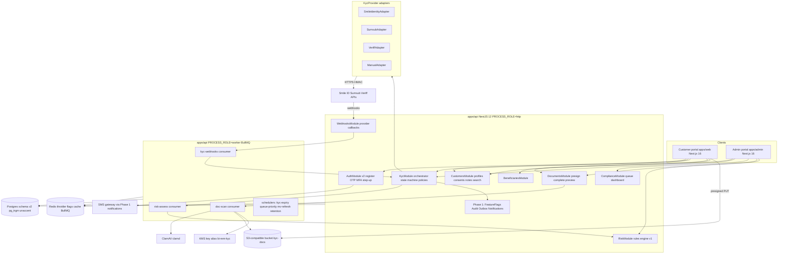
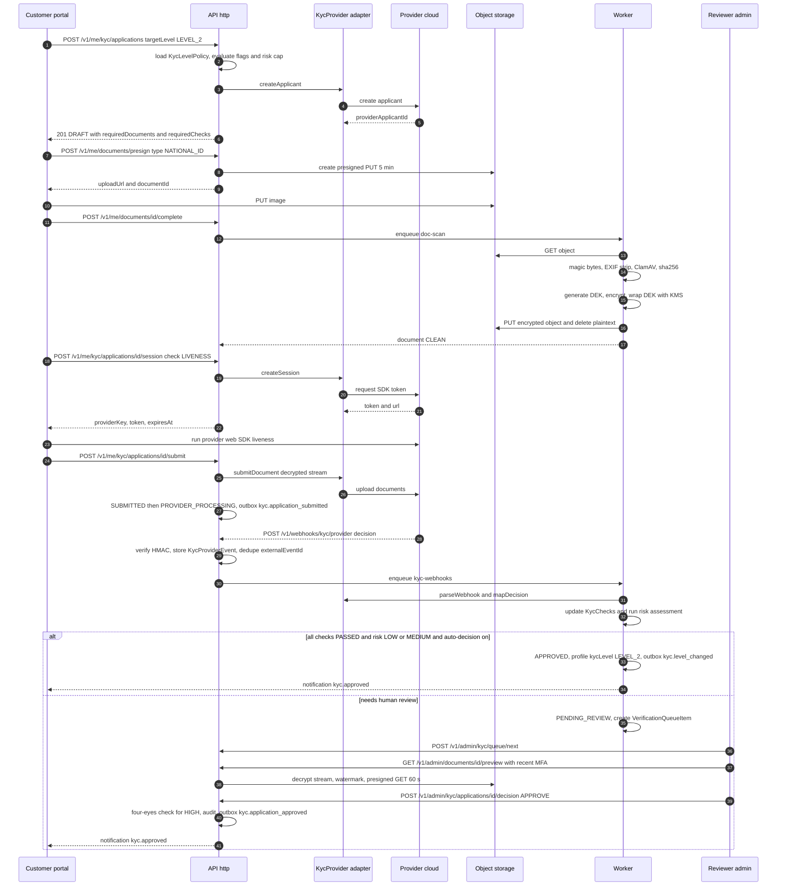
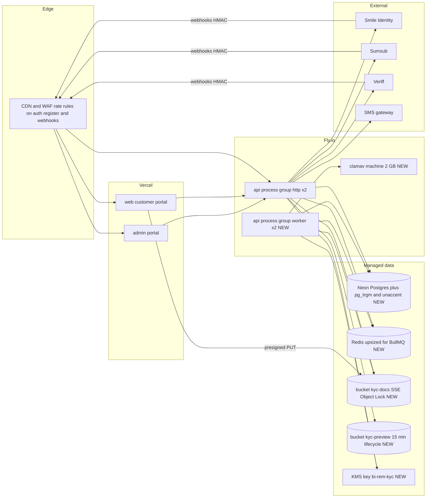
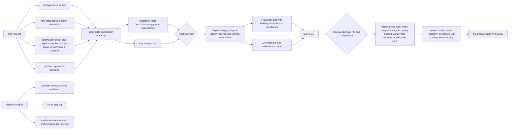

# Phase 2 — Customer Management & KYC

| Field                     | Value                                                                                                                                                                       |
| ------------------------- | --------------------------------------------------------------------------------------------------------------------------------------------------------------------------- |
| **Phase**                 | 2 of 13 — `customer-kyc`                                                                                                                                                    |
| **Dates**                 | 2026-12-28 → 2027-02-19                                                                                                                                                     |
| **Duration**              | 8 weeks (W1 starts Monday 2026-12-28; W8 ends Friday 2027-02-19)                                                                                                            |
| **Team**                  | `core` — 1 solution architect, 4 backend, 3 frontend, 2 QA, 1 PM, 1 compliance analyst, 1 product designer; shared DevOps/SRE (1) and security engineer (0.5)               |
| **Depends on**            | Phase 1 — Foundation & Platform Setup (ended 2026-12-25): `User`/RBAC/JWT/TOTP, `AuditLog` interceptor, `FeatureFlag`, `Setting`, `Outbox`, notifications (BullMQ), metrics |
| **Unlocks**               | Phase 5 — Domestic Transfers (2027-04-19), Phase 8 — AML, Fraud & Compliance (2027-07-26), Phase 11 — Mobile Applications (2027-08-09)                                      |
| **Runs in parallel with** | Phase 3 — Connectivity Management Framework (`platform` team, 2027-01-25 → 2027-03-05) — shares DevOps/SRE time from our W5                                                 |
| **Plan status**           | Written 2026-11-09 against the live repository (`packages/db/prisma/schema.prisma` v1, `apps/api/src/modules/*`, `.github/workflows/*`)                                     |

---

## 1. Overview

### 1.1 Objective

Phase 2 turns the Phase 1 identity skeleton (one `users` table with two realms, roles/permissions, TOTP, audit, notifications) into a working **customer onboarding and compliance platform**. At the end of the phase a sender in a pilot country (SN, CI, NG, KE, GH) can self-register on the customer portal phone-first, enrol MFA, complete a tiered KYC application whose document, ID-number and liveness checks are performed by an external provider behind a `KycProvider` interface, register beneficiaries, and carry a risk rating — while a compliance officer in the admin portal sees every application in a verification queue, reviews documents, approves/rejects/escalates with reason codes, edits per-country KYC policies, and watches onboarding health on a compliance dashboard.

This is the first phase that handles **Restricted** personal data (identity documents, selfies, national ID numbers), so a large share of the effort goes into encryption, access control, auditability and regulatory posture rather than UI.

### 1.2 In scope

| Area                    | Included                                                                                                                                                                                                                                                                                                          |
| ----------------------- | ----------------------------------------------------------------------------------------------------------------------------------------------------------------------------------------------------------------------------------------------------------------------------------------------------------------- |
| Registration            | Phone-first self-registration (E.164) with SMS OTP, optional e-mail, consent capture, password (argon2id, Phase 1 `PasswordService`), device/IP capture, abuse controls (Redis-backed throttling, enumeration-safe responses, blocked-prefix list).                                                               |
| MFA                     | Multi-device MFA (`MfaDevice`): TOTP (Phase 1 `MfaService`/otplib, migrated from `users.mfa_secret`), SMS OTP fallback, recovery codes; step-up guard `@RequiresRecentMfa` for sensitive actions; admin MFA reset; `auth.mfa.enforce-admin` (Phase 1 flag) honoured on `/auth/admin/login`.                       |
| Customer profiles       | 1:1 `CustomerProfile` on `User` (identity, address, occupation, source of funds, expected volumes), `ConsentRecord`s, admin `CustomerNote`s, merged customer timeline (audit + KYC + risk events).                                                                                                                |
| KYC workflow            | `KycApplication` state machine; levels `LEVEL_0..LEVEL_3` with per-country `KycLevelPolicy` (checks, documents, routing, validity, limits); `KycProvider` interface with **Smile Identity**, **Sumsub**, **Veriff** adapters plus `MANUAL`; liveness + face match; expiry and re-verification; resubmission loop. |
| Document uploads        | Presigned direct-to-bucket uploads to S3-compatible storage; ClamAV scan; magic-byte/MIME validation; EXIF stripping; per-document envelope encryption (DEK wrapped by KMS); retention and legal-hold metadata; audited, short-lived, watermarked admin previews.                                                 |
| Beneficiary management  | CRUD for `MOBILE_MONEY` / `BANK_ACCOUNT` / `CASH_PICKUP` payees with per-country validation, encrypted account numbers, step-up MFA on add, soft delete + restore, `BeneficiaryVerifier` hook (`NoopVerifier` now, Phase 4 wires connectors).                                                                     |
| Risk profile module     | Deterministic weighted `RiskRule`s (versioned, admin-editable) producing `RiskAssessment`s; rating caps achievable KYC level; `screening.requested` hook event for Phase 8 PEP/sanctions.                                                                                                                         |
| Compliance dashboard    | Funnel, time-to-decision, queue depth/SLA, provider pass rate/latency/errors, rejection reasons, risk distribution, reviewer throughput; backed by `mv_kyc_daily_stats`; CSV export.                                                                                                                              |
| User verification queue | Priority queue of `PENDING_REVIEW` applications with `SKIP LOCKED` claiming, SLA timers, assignment, four-eyes for HIGH risk, keyboard-driven review workspace.                                                                                                                                                   |
| Customer search engine  | Postgres-native (`pg_trgm` + `unaccent` + generated `tsvector`) search across name, phone, e-mail, ID-number hash and beneficiary MSISDN with facets; p95 < 500 ms at 1M customers.                                                                                                                               |

### 1.3 Out of scope (explicitly deferred)

- Live PEP/sanctions screening and transaction monitoring — **Phase 8**; Phase 2 emits `screening.requested`, reserves `pep_flag`/`sanctions_flag` and `KycCheckType.SANCTIONS_PEP`.
- Enforcement of KYC-level transaction limits — limits are **stored** in `KycLevelPolicy` now and **enforced** by Phase 5 `LimitService`.
- Beneficiary name lookup against wallet/bank providers — `BeneficiaryVerifier` ships with `NoopVerifier`; Phase 4 supplies `WalletBeneficiaryVerifier`.
- Native mobile SDKs — **Phase 11**; Phase 2 ships provider web SDK flows and a provider-agnostic session contract.
- Business/merchant KYB — **Phase 9** (reuses the document pipeline and review workspace).
- OpenSearch/Elasticsearch — rejected for now (§4.4); decision point in Phase 10.
- Storing biometric templates — never; only provider decisions and reference ids are stored.

### 1.4 Independent deployability strategy

"Deployable alone" for Phase 2 means: **the whole phase merges to `main` and deploys to production with every new behaviour dark, is lit progressively per country, needs no Phase 3+ code, and can be switched off again within 30 seconds without a rollback deploy.**

| Mechanism                           | Use in Phase 2                                                                                                                                                                                                                                                                                                                                                                                                                                                                                                                                                                                                                       |
| ----------------------------------- | ------------------------------------------------------------------------------------------------------------------------------------------------------------------------------------------------------------------------------------------------------------------------------------------------------------------------------------------------------------------------------------------------------------------------------------------------------------------------------------------------------------------------------------------------------------------------------------------------------------------------------------ |
| **Feature flags** (Phase 1 service) | Keys follow `FEATURE_FLAG_KEY_PATTERN` (`area.feature[.variant]`, kebab-case). Reused: `auth.registration.open` (gains `countryCode in [...]` rules + `rolloutPercentage`), `auth.mfa.enforce-admin`, `notifications.sms`. New: `auth.mfa.sms-fallback`, `kyc.enabled`, `kyc.auto-decision`, `kyc.manual-review-only` (routes every application to the queue — the ultimate provider kill switch), `kyc.provider.smile-identity`, `kyc.provider.sumsub`, `kyc.provider.veriff`, `documents.uploads`, `documents.av-scan.enforced`, `beneficiaries.enabled`, `risk.engine.v1`, `admin.compliance-dashboard`, `admin.customer-search`. |
| **Expand → migrate → contract**     | All W1 schema changes are additive. The one semantic change — `users.email` nullable for phone-first customers — is done as expand (drop NOT NULL + partial unique index) in Phase 2; the contract (drop `users_realm_email_key`, drop `users.mfa_secret`) is scheduled for **Phase 5 W1 (2027-04-19)**, the next `core`-team slot, after a production soak.                                                                                                                                                                                                                                                                         |
| **Dark launch**                     | Adapters deploy to production in W4 with flags off; `/health/ready` gains `object-storage`, `clamav`, `kyc-providers` indicators (degraded-tolerant); webhook endpoints verify signatures and store events from W4 even while nothing routes to providers.                                                                                                                                                                                                                                                                                                                                                                           |
| **Kill switches**                   | Per-provider flags; `kyc.manual-review-only`; `auth.registration.open=false` → HTTP 503 + `Retry-After` + waitlist page; `documents.uploads=false` stops presigning. Flags cached 30 s in Redis, editable in the Phase 1 admin Settings screen.                                                                                                                                                                                                                                                                                                                                                                                      |
| **Worker isolation**                | Webhook processing, AV scanning, risk assessment, expiry sweeps and MV refresh run in a second `apps/api` process started with `PROCESS_ROLE=worker` (BullMQ consumers only). The HTTP API never awaits a provider; a worker outage degrades to "pending", never to request failures.                                                                                                                                                                                                                                                                                                                                                |
| **Backward-compatible APIs**        | New paths only; `POST /v1/auth/login` gains an optional `{ mfaRequired, mfaToken }` branch that Phase 1 clients already handle (Phase 1 shipped `/auth/mfa/verify`).                                                                                                                                                                                                                                                                                                                                                                                                                                                                 |

---

## 2. Milestones

Phase start is Monday **2026-12-28**; milestone dates are the Friday of each week.

| ID       | Week | Target date | Deliverable                                                                                                                                | Acceptance criteria                                                                                                                                                                                                                                             | Owner                        |
| -------- | ---- | ----------- | ------------------------------------------------------------------------------------------------------------------------------------------ | --------------------------------------------------------------------------------------------------------------------------------------------------------------------------------------------------------------------------------------------------------------- | ---------------------------- |
| **M2.1** | W1   | 2027-01-01  | Design freeze; schema v2 _expand_ migration merged; `KycProvider` interface + ADR-0007/0008/0009; provider sandbox accounts; infra tickets | `pnpm db:migrate:dev` applies `20261228000000_phase2_expand` on a Phase 1 DB with zero data loss; ADRs accepted; Smile ID, Sumsub, Veriff sandbox credentials in Fly secrets; Figma flows signed off by PM + compliance analyst                                 | Solution Architect           |
| **M2.2** | W2   | 2027-01-08  | Registration + OTP + multi-device MFA (TOTP, SMS, recovery codes) in staging behind flags; backfill script                                 | Playwright: register → OTP → login → TOTP enrol → login with TOTP → recovery code all green; 6th wrong OTP invalidates code; throttles 5/min/IP and 3 OTP/day/phone; `auth.mfa.enforce-admin` blocks admin login without a verified device; backfill idempotent | Backend Lead                 |
| **M2.3** | W3   | 2027-01-15  | Customer profile API + portal screens; document pipeline (presign → upload → scan → encrypt); MinIO + ClamAV in compose and staging        | 5 MB JPEG upload completes < 3 s p95 from Lagos test node; EICAR → `INFECTED` + customer notified; every stored object has `dek_wrapped` + `sha256`; pino redaction test proves no PII in logs                                                                  | Backend Lead                 |
| **M2.4** | W4   | 2027-01-22  | KYC state machine + orchestrator; Smile Identity + Sumsub adapters passing contract tests; webhook ingestion; dark deploy to production    | Sandbox applications reach `APPROVED` and `REJECTED` via webhooks for both providers; replayed webhook is a no-op; bad signature → 401 + alert; `kyc_provider_events` row per delivery; production deploy with flags off causes zero customer-visible change    | Backend Lead                 |
| **M2.5** | W5   | 2027-01-29  | Veriff adapter + liveness; per-country `KycLevelPolicy` seeds; beneficiary management (API + portal); risk engine v1                       | Policies seeded for SN, CI, NG, KE, GH; LEVEL_1 → LEVEL_2 upgrade triggers a liveness session; beneficiary add requires step-up MFA; account numbers encrypted with last-4 only in reads; `PROHIBITED` rating auto-queues with `RISK_PROHIBITED`                | Backend Lead / Frontend Lead |
| **M2.6** | W6   | 2027-02-05  | Admin: customer search + 360 view, verification queue, review workspace, policy editor, risk rules, compliance dashboard                   | Reviewer can approve/reject/request resubmission/escalate with reason codes; HIGH risk needs second approver; concurrent "take next" never double-assigns; search p95 < 500 ms with 1M seeded customers; dashboard tiles equal SQL ground truth                 | Frontend Lead                |
| **M2.7** | W7   | 2027-02-12  | Hardening: k6, external pen-test, UAT with compliance analyst, DPIA, runbooks, game day                                                    | k6 thresholds (§9.5) met twice; pen-test High/Critical closed; UAT script 100 % passed; DPIA approved; runbooks for provider outage, AV outage, webhook backlog, stuck application published and exercised                                                      | QA Lead / Security Engineer  |
| **M2.8** | W8   | 2027-02-19  | Progressive production rollout; phase exit review; handover to Phases 3/4/5/8/11                                                           | `auth.registration.open` at 100 % for SN + CI and ≥ 25 % for NG/KE/GH; `kyc.manual-review-only` lifted after first 100 reviewed applications; §12 evidence complete; §11 sign-offs collected                                                                    | Program Manager              |

---

## 3. Deliverables

A deliverable is done only when code, tests, OpenAPI docs, portal screens, runbook entries and audit coverage all exist.

### 3.1 Registration

- **What**: `POST /v1/auth/register` (Phase 1 route, new DTO) creates a `User` (realm `CUSTOMER`, status `PENDING`) + empty `CustomerProfile` + `ConsentRecord`s and issues an SMS OTP (`OtpCode`, purpose `REGISTRATION`); `POST /v1/auth/register/verify-otp` sets `phoneVerifiedAt`, status `ACTIVE`, emits `customer.registered`, returns tokens.
- **DoD**: phone is the primary identifier (E.164 via `@bi-rem/shared` `phone.ts`), e-mail optional; OTP 6 digits, 5-minute TTL, argon2id-hashed with `OTP_PEPPER`, max 5 attempts then invalidated, resend cooldown 60 s, max 3 OTP/phone/day; `@nestjs/throttler` with Redis storage 5 req/min/IP on register and 10 on verify; identical response whether the phone exists or not (existing owner gets an SMS instead); `Setting` key `registration.blocked-prefixes` per country; device fingerprint hash + IP + UA into `AuditLog.metadata` for the risk engine; welcome notification template `customer.welcome` (en/fr/pt); `auth.registration.open` with country rules, disabled → 503 + waitlist UI.

### 3.2 MFA Authentication

- **What**: `MfaDevice` (TOTP, SMS_OTP) replaces the single `users.mfa_secret`; login returns `{ mfaRequired: true, mfaToken }` (5-minute JWT, `amr: ["pwd"]`, audience `mfa`) when the user has a verified device or the realm enforces MFA; `POST /v1/auth/mfa/verify` (Phase 1 route) exchanges `mfaToken` + code for the token pair with `amr: ["pwd","otp"]` and sets `users.last_mfa_at`.
- **DoD**: TOTP secrets 160-bit, encrypted with Phase 1 `CryptoService` (AES-256-GCM bound to user id) in `mfa_devices.secret_encrypted`; ±1 step window with `last_used_counter` replay protection; 10 single-use recovery codes (argon2id hashes); step-up guard `@RequiresRecentMfa(300)` on beneficiary add, phone change, password change, admin document download, KYC override, policy publish; admin reset `POST /v1/admin/customers/:id/mfa/reset` requires `mfa:reset` + recent MFA + reason; 5 failed codes → 15-minute `lockedUntil` + notification; `AuthService` reads `mfa_devices` first and falls back to `users.mfa_secret` until the Phase 5 contract.

### 3.3 Customer Profiles

- **What**: `CustomerProfile` 1:1 with `User`; self-service read/update; admin 360 view with timeline, notes, documents, beneficiaries, risk and KYC history.
- **DoD**: identity fields (legal name, DOB, nationality, ID number) lock for the customer at first `SUBMITTED` (`identity_locked_at`); later changes go through a `PROFILE_CHANGE` application; national ID stored as HMAC-SHA256(`ID_HASH_KEY`) + last 4, plaintext only in memory during provider submission; consents `TERMS`, `PRIVACY`, `BIOMETRIC_PROCESSING`, `DATA_SHARING_PROVIDERS`, `MARKETING` versioned with timestamp + IP; `BIOMETRIC_PROCESSING` mandatory before any liveness session (NDPA 2023, Kenya DPA 2019 sensitive-data rules).

### 3.4 KYC Workflow

- **What**: `KycApplication` lifecycle `DRAFT → SUBMITTED → PROVIDER_PROCESSING → PENDING_REVIEW → APPROVED | REJECTED | RESUBMISSION_REQUIRED (→ DRAFT)`, plus `EXPIRED` and `CANCELLED`; levels per country via `KycLevelPolicy`; `KycOrchestratorService` drives providers behind `KycProvider`.
- **DoD**:
  - Levels (defaults mirror CBN three-tier and BoG tiered KYC): `LEVEL_0` phone-verified only; `LEVEL_1` name/DOB/address + ID-number lookup where an authority exists (Smile ID Enhanced KYC), no document image; `LEVEL_2` government ID document + selfie liveness + face match; `LEVEL_3` `LEVEL_2` + proof of address + source-of-funds declaration + mandatory manual review (required for `HIGH` risk).
  - Routing from `KycLevelPolicy.provider_routing`, e.g. `{"ID_NUMBER":"SMILE_IDENTITY","DOCUMENT":"SMILE_IDENTITY","LIVENESS":"SMILE_IDENTITY","FALLBACK":"SUMSUB"}`; fallback used when the primary flag is off or its circuit breaker is open; both unavailable → `MANUAL`.
  - Auto-decision (`kyc.auto-decision`) when every required `KycCheck` is `PASSED`, provider score ≥ `auto_approve_min_score`, risk ≤ `MEDIUM`; otherwise `PENDING_REVIEW`. A single provider `FINAL` reject never auto-rejects — it queues for review.
  - Expiry `expires_at = decided_at + validity_days` (730 default, 365 for `HIGH`); nightly sweep → `EXPIRED`, notification, `kyc_level` downgrade, `kyc.level_changed`.
  - One `KycStateMachine` transition table with a unit test per edge; illegal transitions → `409 KYC_INVALID_TRANSITION`; every transition writes `Outbox` + `AuditLog`.

### 3.5 Document Uploads

- **What**: presigned PUT to `bi-rem-kyc-docs-{env}`, completion callback, async ClamAV scan, encryption and metadata in `KycDocument`.
- **DoD**: allowed `image/jpeg|png|webp`, `application/pdf`, ≤ 10 MB; magic-byte sniff (`file-type`), EXIF/GPS strip and re-encode (`sharp`), PDF flatten; key `kyc/{profileId}/{documentId}/{sha256}.bin`; bucket SSE on, public access blocked, versioning on, Object Lock governance for the retention period, lifecycle to cold tier after 90 days; envelope encryption with a random 256-bit DEK per document (AES-256-GCM) wrapped by KMS key `alias/bi-rem-kyc-{env}`; decryption only in the worker (provider submission) and the admin preview path (streams, never disk); admin preview = watermarked decrypted copy in `bi-rem-kyc-preview-{env}` (15-minute lifecycle) behind a 60-second presigned GET; scan states `UPLOADING → SCANNING → CLEAN | INFECTED`; `INFECTED` moved to `quarantine/` and the customer asked to re-upload; AV down → fail-closed unless `documents.av-scan.enforced=false`.

### 3.6 Beneficiary Management

- **What**: customer payee book; types `MOBILE_MONEY` (MSISDN + `provider_code`), `BANK_ACCOUNT` (bank code + account number), `CASH_PICKUP` (name + ID type); per-country validators in `@bi-rem/shared` (NG NUBAN check digit, KE M-Pesa prefixes, SN/CI Wave/Orange/MTN prefixes).
- **DoD**: account numbers AES-256-GCM encrypted with `account_number_last4` for display; duplicate detection via `(owner_user_id, identifier_hash)`; step-up MFA on create and identifier change; soft delete with 30-day restore; `BeneficiaryVerifier` interface + `NoopVerifier` (status `ACTIVE`, `name_match_score` null); max 50 active per customer (`Setting` `beneficiaries.max-active`); admin read-only view; events `beneficiary.created|updated|deleted` for Phase 4/8.

### 3.7 Risk Profile Module

- **What**: deterministic engine producing `RiskAssessment` (score 0–100; `LOW <40`, `MEDIUM 40–69`, `HIGH 70–89`, `PROHIBITED ≥90`) from weighted `RiskRule`s stored in DB, versioned as rulesets.
- **DoD**: rules v1 `country_risk`, `pep_self_declared`, `occupation_category`, `source_of_funds`, `age_band`, `document_resubmissions`, `provider_fraud_signals` (Sumsub `rejectLabels`, Smile ID liveness actions), `device_country_mismatch`, `multiple_accounts_same_device`; triggered by `kyc.application_submitted`, `kyc.check_completed`, `customer.profile_updated`, on demand (`risk:reassess`); rating caps the achievable level (`PROHIBITED` → auto-queue with `RISK_PROHIBITED`, no auto-approval); factor breakdown stored for explainability; ruleset version pinned per assessment; rating change emits `risk.rating_changed`; rating ≥ `MEDIUM` emits `screening.requested` (Phase 2 consumer logs only).

### 3.8 Compliance Dashboard

- **What**: admin `/compliance` fed by `GET /v1/admin/compliance/dashboard?from&to&country`.
- **DoD**: `mv_kyc_daily_stats` refreshed every 5 minutes (`REFRESH MATERIALIZED VIEW CONCURRENTLY`) for registrations, phone-verified, submitted, approved, rejected, resubmission, auto-decision rate, median time-to-decision, per-provider pass/p95 latency/error rate, top rejection reasons; live queries for queue depth, oldest item age, SLA breaches, risk distribution, reviewer throughput; nightly `compliance.dashboard.reconcile` job compares MV to raw SQL and alerts on drift; CSV export audited.

### 3.9 User Verification Queue

- **What**: `VerificationQueueItem` per `PENDING_REVIEW` application; admin `/kyc/queue` + `/kyc/review/[id]`.
- **DoD**: priority = f(risk rating, waiting time, resubmission count, target level), recomputed every 5 minutes; SLA 4 h (`LOW`/`MEDIUM`), 24 h (`HIGH`); "take next" via `FOR UPDATE SKIP LOCKED`; auto-release after 30 minutes idle; four-eyes: `HIGH` approvals need a second reviewer who is not the first; `kyc:override` approves with failed checks only with a reason ≥ 20 chars and emits `kyc.override_used`; reviewer sees watermarked documents, normalised provider results (raw JSON redacted), risk factors, profile diff, previous applications; reason codes from a controlled vocabulary (`DOC_EXPIRED`, `DOC_BLURRY`, `FACE_MISMATCH`, `NAME_MISMATCH`, `UNDERAGE`, `SUSPECTED_FRAUD`, `RISK_PROHIBITED`, …).

### 3.10 Customer Search Engine

- **What**: `GET /v1/admin/customers?q=&country=&kycLevel=&kycStatus=&risk=&cursor=`.
- **DoD**: `customer_profiles.search_vector` (trigger-maintained `tsvector` with `unaccent`) + `pg_trgm` GIN indexes on `display_name`, `users.phone`, `users.email`; exact-match fast paths for E.164, e-mail and ID-number hash; fuzzy name ≥ 0.3 similarity; cursor pagination; p95 < 500 ms at 1M customers + 3M beneficiaries (k6); every search audited (`customers:search`, query string hashed) because looking up a person is itself compliance-relevant.

---

## 4. Architecture

### 4.1 Component / container diagram — Phase 2 additions



### 4.2 Sequence diagram — LEVEL_2 KYC with document, liveness and admin decision



### 4.3 Deployment / infrastructure delta



**Infra delta summary**: second Fly process group `worker` (same image, `PROCESS_ROLE=worker`, 2 machines); ClamAV machine; two S3-compatible buckets with SSE/versioning/Object Lock/lifecycle; KMS key + IAM role scoped to api/worker; Postgres extensions `pg_trgm`, `unaccent`; Redis upsize (queues `kyc-webhooks`, `doc-scan`, `risk-assess`, `kyc-expiry`); WAF rules on `/v1/auth/register*` and `/v1/webhooks/*`; outbound egress allowlist for provider hosts; provider secrets in Fly secrets; Grafana dashboards + alert rules; local compose gains `minio` and `clamav` services.

### 4.4 Design decisions and alternatives rejected

| Decision             | Chosen                                                                                                                         | Rejected                                                           | Why                                                                                                                                                                                                                                  |
| -------------------- | ------------------------------------------------------------------------------------------------------------------------------ | ------------------------------------------------------------------ | ------------------------------------------------------------------------------------------------------------------------------------------------------------------------------------------------------------------------------------ |
| Provider abstraction | `KycProvider` interface, one NestJS adapter per vendor, normalised `KycDecision`/`KycCheckResult`, routing in `KycLevelPolicy` | Single vendor; orchestration SaaS (Alloy/Persona-style meta-layer) | African ID-authority lookups (NG BVN/NIN, KE, GH, ZA, UG) need Smile ID; diaspora documents need Sumsub/Veriff breadth; a meta-layer adds cost and a fourth processor. Multiple adapters give live failover and commercial leverage. |
| Routing              | Deterministic per country and check type, with one `FALLBACK`                                                                  | Round-robin / cost-based                                           | Explainable to regulators, reconcilable with invoices.                                                                                                                                                                               |
| Document storage     | S3-compatible object storage with SSE **plus** per-document envelope encryption (DEK wrapped by KMS)                           | SSE only; Postgres `bytea`; single static key                      | Defence in depth: a leaked presigned URL or bucket misconfiguration yields ciphertext; per-document DEKs allow crypto-shredding for erasure; blobs in Postgres would bloat backups and threaten RPO 15 min.                          |
| Upload path          | Browser → presigned PUT → completion callback → worker scan/encrypt                                                            | Upload through the API                                             | Keeps 10 MB bodies off API machines; completion + worker gives a natural quarantine state.                                                                                                                                           |
| AV scanning          | ClamAV daemon on its own machine, `clamd` TCP from the worker                                                                  | Vendor malware-scanning API                                        | Documents must not leave our boundary unencrypted except to the KYC provider; ClamAV is adequate for image/PDF threats at ~$40/month.                                                                                                |
| Search               | Postgres `pg_trgm` + `unaccent` + generated `tsvector`                                                                         | OpenSearch, Typesense, Meilisearch                                 | No new stateful system, no second copy of PII; 1M customers is well within Postgres; measured in §9.5; revisit in Phase 10.                                                                                                          |
| MFA                  | TOTP primary, SMS OTP fallback, recovery codes; multi-device table                                                             | SMS-only; WebAuthn now                                             | SIM-swap risk is high in pilot markets; passkeys deferred to Phase 11 where platform authenticators exist.                                                                                                                           |
| Risk engine          | Transparent weighted rules in DB, versioned rulesets                                                                           | ML scoring; vendor score only                                      | Regulators ask "why HIGH"; rules are explainable and editable by the compliance analyst without a deploy. ML layers on in Phase 8.                                                                                                   |
| State machine        | Hand-written transition table + exhaustive tests                                                                               | xstate                                                             | Fewer dependencies; the table doubles as compliance documentation.                                                                                                                                                                   |
| Workers              | Same `apps/api` image, `PROCESS_ROLE` switch                                                                                   | Separate `apps/worker` package                                     | One build, shared DTOs/Prisma client; Fly process groups scale independently.                                                                                                                                                        |
| Contract timing      | Users contract in Phase 5 W1 (core team)                                                                                       | Contract in Phase 2 W8 or Phase 3 W1                               | Phase 2 code reaches 100 % of pilot traffic only in W8; Phase 3 is another team. Phase 5 W1 is the next core slot and already carries the beneficiary `provider_id` contract.                                                        |

---

## 5. Data Model & Migrations

### 5.1 Prisma model additions (schema v2)

Conventions from CLAUDE.md apply: uuid ids via `gen_random_uuid()`, `timestamptz(6)`, money as `BigInt` minor units + ISO-4217 `currency`, snake_case `@@map`/`@map`.

```prisma
// ---------------------------------------------------------------------------
// Phase 2 enums
// ---------------------------------------------------------------------------

enum KycLevel {
  LEVEL_0
  LEVEL_1
  LEVEL_2
  LEVEL_3

  @@map("kyc_level")
}

enum KycApplicationStatus {
  DRAFT
  SUBMITTED
  PROVIDER_PROCESSING
  PENDING_REVIEW
  APPROVED
  REJECTED
  RESUBMISSION_REQUIRED
  EXPIRED
  CANCELLED

  @@map("kyc_application_status")
}

enum KycApplicationKind {
  INITIAL
  UPGRADE
  PERIODIC_REVIEW
  PROFILE_CHANGE

  @@map("kyc_application_kind")
}

enum KycProviderKey {
  SMILE_IDENTITY
  SUMSUB
  VERIFF
  MANUAL

  @@map("kyc_provider_key")
}

enum KycCheckType {
  ID_NUMBER
  DOCUMENT
  LIVENESS
  FACE_MATCH
  ADDRESS
  SOURCE_OF_FUNDS
  SANCTIONS_PEP

  @@map("kyc_check_type")
}

enum KycCheckStatus {
  PENDING
  SUBMITTED
  PASSED
  FAILED
  REVIEW
  ERROR
  CANCELLED

  @@map("kyc_check_status")
}

enum DocumentType {
  NATIONAL_ID
  PASSPORT
  DRIVERS_LICENCE
  VOTER_CARD
  RESIDENCE_PERMIT
  PROOF_OF_ADDRESS
  SELFIE
  SOURCE_OF_FUNDS
  OTHER

  @@map("document_type")
}

enum DocumentStatus {
  UPLOADING
  SCANNING
  CLEAN
  INFECTED
  VERIFIED
  REJECTED
  EXPIRED
  DELETED

  @@map("document_status")
}

enum BeneficiaryType {
  MOBILE_MONEY
  BANK_ACCOUNT
  CASH_PICKUP

  @@map("beneficiary_type")
}

enum BeneficiaryStatus {
  PENDING_VERIFICATION
  ACTIVE
  BLOCKED
  DELETED

  @@map("beneficiary_status")
}

enum RiskRating {
  LOW
  MEDIUM
  HIGH
  PROHIBITED

  @@map("risk_rating")
}

enum MfaMethod {
  TOTP
  SMS_OTP

  @@map("mfa_method")
}

enum OtpPurpose {
  REGISTRATION
  LOGIN
  PHONE_CHANGE
  PASSWORD_RESET
  STEP_UP

  @@map("otp_purpose")
}

enum ReviewDecision {
  APPROVE
  REJECT
  REQUEST_RESUBMISSION
  ESCALATE
  SECOND_APPROVAL

  @@map("review_decision")
}

enum QueueItemStatus {
  OPEN
  ASSIGNED
  ESCALATED
  RESOLVED

  @@map("queue_item_status")
}

enum ConsentType {
  TERMS
  PRIVACY
  BIOMETRIC_PROCESSING
  DATA_SHARING_PROVIDERS
  MARKETING

  @@map("consent_type")
}

// ---------------------------------------------------------------------------
// Customer profile
// ---------------------------------------------------------------------------

/// One profile per CUSTOMER-realm user. Identity fields are immutable for the customer
/// after the first KYC submission; later changes go through a PROFILE_CHANGE application.
model CustomerProfile {
  id                         String                   @id @default(dbgenerated("gen_random_uuid()")) @db.Uuid
  userId                     String                   @unique @map("user_id") @db.Uuid
  displayName                String                   @map("display_name") @db.VarChar(200)
  middleName                 String?                  @map("middle_name") @db.VarChar(100)
  dateOfBirth                DateTime?                @map("date_of_birth") @db.Date
  /// ISO-3166-1 alpha-2.
  nationality                String?                  @db.Char(2)
  idType                     DocumentType?            @map("id_type")
  /// HMAC-SHA256(ID_HASH_KEY, normalised id number). Never the plaintext.
  idNumberHash               String?                  @map("id_number_hash") @db.VarChar(64)
  idNumberLast4              String?                  @map("id_number_last4") @db.VarChar(4)
  occupationCode             String?                  @map("occupation_code") @db.VarChar(32)
  sourceOfFundsCode          String?                  @map("source_of_funds_code") @db.VarChar(32)
  pepSelfDeclared            Boolean                  @default(false) @map("pep_self_declared")
  addressLine1               String?                  @map("address_line1") @db.VarChar(200)
  addressLine2               String?                  @map("address_line2") @db.VarChar(200)
  city                       String?                  @db.VarChar(100)
  region                     String?                  @db.VarChar(100)
  postalCode                 String?                  @map("postal_code") @db.VarChar(20)
  addressCountryCode         String?                  @map("address_country_code") @db.Char(2)
  kycLevel                   KycLevel                 @default(LEVEL_0) @map("kyc_level")
  kycLevelGrantedAt          DateTime?                @map("kyc_level_granted_at") @db.Timestamptz(6)
  kycExpiresAt               DateTime?                @map("kyc_expires_at") @db.Timestamptz(6)
  riskRating                 RiskRating               @default(LOW) @map("risk_rating")
  riskScore                  Int                      @default(0) @map("risk_score")
  /// Reserved for Phase 8 screening results; Phase 2 never sets these to true.
  pepFlag                    Boolean                  @default(false) @map("pep_flag")
  sanctionsFlag              Boolean                  @default(false) @map("sanctions_flag")
  expectedMonthlyVolumeMinor BigInt?                  @map("expected_monthly_volume_minor")
  expectedVolumeCurrency     String?                  @map("expected_volume_currency") @db.Char(3)
  identityLockedAt           DateTime?                @map("identity_locked_at") @db.Timestamptz(6)
  /// Maintained by trigger (see migration); Prisma treats it as opaque.
  searchVector               Unsupported("tsvector")? @map("search_vector")
  createdAt                  DateTime                 @default(now()) @map("created_at") @db.Timestamptz(6)
  updatedAt                  DateTime                 @updatedAt @map("updated_at") @db.Timestamptz(6)

  user            User             @relation(fields: [userId], references: [id], onDelete: Restrict)
  kycApplications KycApplication[]
  documents       KycDocument[]
  riskAssessments RiskAssessment[]
  consents        ConsentRecord[]
  notes           CustomerNote[]

  @@index([kycLevel, riskRating])
  @@index([idNumberHash])
  @@index([kycExpiresAt])
  @@map("customer_profiles")
}

model ConsentRecord {
  id         String      @id @default(dbgenerated("gen_random_uuid()")) @db.Uuid
  profileId  String      @map("profile_id") @db.Uuid
  type       ConsentType
  /// Document version accepted, e.g. "privacy-2026-12".
  version    String      @db.VarChar(32)
  granted    Boolean
  ip         String?     @db.VarChar(45)
  userAgent  String?     @map("user_agent") @db.VarChar(512)
  recordedAt DateTime    @default(now()) @map("recorded_at") @db.Timestamptz(6)

  profile CustomerProfile @relation(fields: [profileId], references: [id], onDelete: Cascade)

  @@index([profileId, type, recordedAt])
  @@map("consent_records")
}

model CustomerNote {
  id        String    @id @default(dbgenerated("gen_random_uuid()")) @db.Uuid
  profileId String    @map("profile_id") @db.Uuid
  authorId  String    @map("author_id") @db.Uuid
  body      String
  pinned    Boolean   @default(false)
  createdAt DateTime  @default(now()) @map("created_at") @db.Timestamptz(6)
  updatedAt DateTime  @updatedAt @map("updated_at") @db.Timestamptz(6)
  deletedAt DateTime? @map("deleted_at") @db.Timestamptz(6)

  profile CustomerProfile @relation(fields: [profileId], references: [id], onDelete: Cascade)
  author  User            @relation("CustomerNoteAuthor", fields: [authorId], references: [id], onDelete: Restrict)

  @@index([profileId, createdAt])
  @@map("customer_notes")
}

// ---------------------------------------------------------------------------
// KYC policy, applications, checks, documents, reviews, queue
// ---------------------------------------------------------------------------

/// Per-country, per-level requirements and limits. Limits are stored here in Phase 2 and
/// enforced by the Phase 5 LimitService. New versions never mutate old rows.
model KycLevelPolicy {
  id                  String   @id @default(dbgenerated("gen_random_uuid()")) @db.Uuid
  countryCode         String   @map("country_code") @db.Char(2)
  level               KycLevel
  /// JSON array of KycCheckType required at this level.
  requiredChecks      Json     @map("required_checks")
  /// JSON array of DocumentType accepted at this level.
  requiredDocuments   Json     @map("required_documents")
  /// JSON map KycCheckType -> KycProviderKey, plus "FALLBACK".
  providerRouting     Json     @map("provider_routing")
  autoApproveMinScore Int      @default(80) @map("auto_approve_min_score")
  validityDays        Int      @default(730) @map("validity_days")
  singleTxnMaxMinor   BigInt   @map("single_txn_max_minor")
  dailyLimitMinor     BigInt   @map("daily_limit_minor")
  monthlyLimitMinor   BigInt   @map("monthly_limit_minor")
  balanceLimitMinor   BigInt?  @map("balance_limit_minor")
  currency            String   @db.Char(3)
  isActive            Boolean  @default(true) @map("is_active")
  version             Int      @default(1)
  publishedById       String?  @map("published_by_id") @db.Uuid
  createdAt           DateTime @default(now()) @map("created_at") @db.Timestamptz(6)
  updatedAt           DateTime @updatedAt @map("updated_at") @db.Timestamptz(6)

  applications KycApplication[]

  @@unique([countryCode, level, version])
  @@index([countryCode, isActive])
  @@map("kyc_level_policies")
}

model KycApplication {
  id                   String               @id @default(dbgenerated("gen_random_uuid()")) @db.Uuid
  profileId            String               @map("profile_id") @db.Uuid
  kind                 KycApplicationKind   @default(INITIAL)
  targetLevel          KycLevel             @map("target_level")
  status               KycApplicationStatus @default(DRAFT)
  policyId             String               @map("policy_id") @db.Uuid
  providerKey          KycProviderKey?      @map("provider_key")
  providerApplicantId  String?              @map("provider_applicant_id") @db.VarChar(128)
  attempt              Int                  @default(1)
  submittedAt          DateTime?            @map("submitted_at") @db.Timestamptz(6)
  decidedAt            DateTime?            @map("decided_at") @db.Timestamptz(6)
  decidedById          String?              @map("decided_by_id") @db.Uuid
  autoDecided          Boolean              @default(false) @map("auto_decided")
  decisionReasonCodes  String[]             @default([]) @map("decision_reason_codes")
  decisionNote         String?              @map("decision_note")
  expiresAt            DateTime?            @map("expires_at") @db.Timestamptz(6)
  riskRatingAtDecision RiskRating?          @map("risk_rating_at_decision")
  metadata             Json?
  createdAt            DateTime             @default(now()) @map("created_at") @db.Timestamptz(6)
  updatedAt            DateTime             @updatedAt @map("updated_at") @db.Timestamptz(6)

  profile   CustomerProfile        @relation(fields: [profileId], references: [id], onDelete: Restrict)
  policy    KycLevelPolicy         @relation(fields: [policyId], references: [id], onDelete: Restrict)
  decidedBy User?                  @relation("KycDecidedBy", fields: [decidedById], references: [id], onDelete: SetNull)
  checks    KycCheck[]
  documents KycDocument[]
  reviews   KycReview[]
  queueItem VerificationQueueItem?
  events    KycProviderEvent[]

  @@index([profileId, createdAt])
  @@index([status, submittedAt])
  @@index([providerKey, providerApplicantId])
  @@map("kyc_applications")
}

model KycCheck {
  id              String         @id @default(dbgenerated("gen_random_uuid()")) @db.Uuid
  applicationId   String         @map("application_id") @db.Uuid
  type            KycCheckType
  status          KycCheckStatus @default(PENDING)
  providerKey     KycProviderKey @map("provider_key")
  providerCheckId String?        @map("provider_check_id") @db.VarChar(128)
  /// 0-100 normalised confidence where the provider gives one.
  score           Int?
  /// Normalised, PII-minimised result: reason codes and matched-field booleans.
  result          Json?
  /// Raw provider payload, encrypted at the application layer; purged after 90 days.
  rawEncrypted    String?        @map("raw_encrypted")
  startedAt       DateTime?      @map("started_at") @db.Timestamptz(6)
  completedAt     DateTime?      @map("completed_at") @db.Timestamptz(6)
  createdAt       DateTime       @default(now()) @map("created_at") @db.Timestamptz(6)
  updatedAt       DateTime       @updatedAt @map("updated_at") @db.Timestamptz(6)

  application KycApplication @relation(fields: [applicationId], references: [id], onDelete: Cascade)

  @@index([applicationId, type])
  @@index([providerKey, providerCheckId])
  @@map("kyc_checks")
}

model KycDocument {
  id                 String         @id @default(dbgenerated("gen_random_uuid()")) @db.Uuid
  profileId          String         @map("profile_id") @db.Uuid
  applicationId      String?        @map("application_id") @db.Uuid
  type               DocumentType
  status             DocumentStatus @default(UPLOADING)
  bucket             String         @db.VarChar(128)
  storageKey         String         @unique @map("storage_key") @db.VarChar(512)
  mimeType           String         @map("mime_type") @db.VarChar(64)
  sizeBytes          Int            @map("size_bytes")
  sha256             String?        @db.Char(64)
  /// Envelope encryption: DEK wrapped by KMS key kmsKeyId; AES-256-GCM iv and auth tag.
  kmsKeyId           String?        @map("kms_key_id") @db.VarChar(256)
  dekWrapped         String?        @map("dek_wrapped")
  iv                 String?        @db.VarChar(64)
  authTag            String?        @map("auth_tag") @db.VarChar(64)
  issuingCountryCode String?        @map("issuing_country_code") @db.Char(2)
  documentNumberHash String?        @map("document_number_hash") @db.VarChar(64)
  documentExpiresAt  DateTime?      @map("document_expires_at") @db.Date
  scanEngine         String?        @map("scan_engine") @db.VarChar(64)
  scanResult         String?        @map("scan_result") @db.VarChar(256)
  scannedAt          DateTime?      @map("scanned_at") @db.Timestamptz(6)
  verifiedAt         DateTime?      @map("verified_at") @db.Timestamptz(6)
  rejectionReason    String?        @map("rejection_reason") @db.VarChar(64)
  retentionUntil     DateTime?      @map("retention_until") @db.Timestamptz(6)
  legalHold          Boolean        @default(false) @map("legal_hold")
  uploadedAt         DateTime       @default(now()) @map("uploaded_at") @db.Timestamptz(6)
  updatedAt          DateTime       @updatedAt @map("updated_at") @db.Timestamptz(6)
  deletedAt          DateTime?      @map("deleted_at") @db.Timestamptz(6)

  profile     CustomerProfile @relation(fields: [profileId], references: [id], onDelete: Restrict)
  application KycApplication? @relation(fields: [applicationId], references: [id], onDelete: SetNull)

  @@index([profileId, type])
  @@index([applicationId])
  @@index([status])
  @@index([retentionUntil])
  @@map("kyc_documents")
}

/// Raw inbound provider webhook deliveries. Idempotency key is (provider_key, external_event_id).
model KycProviderEvent {
  id               String         @id @default(dbgenerated("gen_random_uuid()")) @db.Uuid
  providerKey      KycProviderKey @map("provider_key")
  externalEventId  String         @map("external_event_id") @db.VarChar(256)
  eventType        String         @map("event_type") @db.VarChar(128)
  applicationId    String?        @map("application_id") @db.Uuid
  signatureValid   Boolean        @map("signature_valid")
  /// PII-redacted payload kept 2 years; full payload encrypted and purged after 90 days.
  payload          Json
  payloadEncrypted String?        @map("payload_encrypted")
  receivedAt       DateTime       @default(now()) @map("received_at") @db.Timestamptz(6)
  processedAt      DateTime?      @map("processed_at") @db.Timestamptz(6)
  processingError  String?        @map("processing_error")
  attempts         Int            @default(0)

  application KycApplication? @relation(fields: [applicationId], references: [id], onDelete: SetNull)

  @@unique([providerKey, externalEventId])
  @@index([applicationId])
  @@index([processedAt])
  @@map("kyc_provider_events")
}

model KycReview {
  id            String         @id @default(dbgenerated("gen_random_uuid()")) @db.Uuid
  applicationId String         @map("application_id") @db.Uuid
  reviewerId    String         @map("reviewer_id") @db.Uuid
  decision      ReviewDecision
  reasonCodes   String[]       @default([]) @map("reason_codes")
  note          String?
  /// Reviewer checklist answers: document legible, face matches, name matches, ...
  checklist     Json?
  usedOverride  Boolean        @default(false) @map("used_override")
  createdAt     DateTime       @default(now()) @map("created_at") @db.Timestamptz(6)

  application KycApplication @relation(fields: [applicationId], references: [id], onDelete: Cascade)
  reviewer    User           @relation("KycReviewer", fields: [reviewerId], references: [id], onDelete: Restrict)

  @@index([applicationId, createdAt])
  @@index([reviewerId, createdAt])
  @@map("kyc_reviews")
}

model VerificationQueueItem {
  id                     String          @id @default(dbgenerated("gen_random_uuid()")) @db.Uuid
  applicationId          String          @unique @map("application_id") @db.Uuid
  status                 QueueItemStatus @default(OPEN)
  /// Higher is more urgent; recomputed by the scheduler every 5 minutes.
  priority               Int             @default(0)
  requiresSecondReviewer Boolean         @default(false) @map("requires_second_reviewer")
  assignedToId           String?         @map("assigned_to_id") @db.Uuid
  assignedAt             DateTime?       @map("assigned_at") @db.Timestamptz(6)
  slaDueAt               DateTime        @map("sla_due_at") @db.Timestamptz(6)
  escalatedAt            DateTime?       @map("escalated_at") @db.Timestamptz(6)
  resolvedAt             DateTime?       @map("resolved_at") @db.Timestamptz(6)
  createdAt              DateTime        @default(now()) @map("created_at") @db.Timestamptz(6)
  updatedAt              DateTime        @updatedAt @map("updated_at") @db.Timestamptz(6)

  application KycApplication @relation(fields: [applicationId], references: [id], onDelete: Cascade)
  assignedTo  User?          @relation("QueueAssignee", fields: [assignedToId], references: [id], onDelete: SetNull)

  @@index([status, priority(sort: Desc), slaDueAt])
  @@index([assignedToId, status])
  @@map("verification_queue_items")
}

// ---------------------------------------------------------------------------
// Beneficiaries
// ---------------------------------------------------------------------------

model Beneficiary {
  id                     String            @id @default(dbgenerated("gen_random_uuid()")) @db.Uuid
  ownerUserId            String            @map("owner_user_id") @db.Uuid
  type                   BeneficiaryType
  status                 BeneficiaryStatus @default(ACTIVE)
  displayName            String            @map("display_name") @db.VarChar(200)
  firstName              String            @map("first_name") @db.VarChar(100)
  lastName               String            @map("last_name") @db.VarChar(100)
  countryCode            String            @map("country_code") @db.Char(2)
  currency               String            @db.Char(3)
  /// E.164 for MOBILE_MONEY and CASH_PICKUP contact.
  msisdn                 String?           @db.VarChar(32)
  /// Wallet or bank provider code; Phase 4 adds a FK to its provider catalogue.
  providerCode           String?           @map("provider_code") @db.VarChar(32)
  bankCode               String?           @map("bank_code") @db.VarChar(32)
  accountNumberEncrypted String?           @map("account_number_encrypted")
  accountNumberLast4     String?           @map("account_number_last4") @db.VarChar(4)
  /// Normalised identifier hash for duplicate detection per owner.
  identifierHash         String            @map("identifier_hash") @db.VarChar(64)
  relationship           String?           @db.VarChar(32)
  nameMatchScore         Int?              @map("name_match_score")
  verifiedAt             DateTime?         @map("verified_at") @db.Timestamptz(6)
  lastUsedAt             DateTime?         @map("last_used_at") @db.Timestamptz(6)
  createdAt              DateTime          @default(now()) @map("created_at") @db.Timestamptz(6)
  updatedAt              DateTime          @updatedAt @map("updated_at") @db.Timestamptz(6)
  deletedAt              DateTime?         @map("deleted_at") @db.Timestamptz(6)

  owner User @relation("BeneficiaryOwner", fields: [ownerUserId], references: [id], onDelete: Restrict)

  @@unique([ownerUserId, identifierHash])
  @@index([ownerUserId, status])
  @@index([msisdn])
  @@map("beneficiaries")
}

// ---------------------------------------------------------------------------
// Risk
// ---------------------------------------------------------------------------

model RiskRule {
  id             String   @id @default(dbgenerated("gen_random_uuid()")) @db.Uuid
  key            String   @db.VarChar(64)
  name           String   @db.VarChar(128)
  description    String?
  weight         Int
  /// Rule-specific parameters, e.g. country score table or occupation list.
  params         Json     @default("{}")
  enabled        Boolean  @default(true)
  rulesetVersion Int      @map("ruleset_version")
  createdAt      DateTime @default(now()) @map("created_at") @db.Timestamptz(6)
  updatedAt      DateTime @updatedAt @map("updated_at") @db.Timestamptz(6)

  @@unique([key, rulesetVersion])
  @@map("risk_rules")
}

model RiskAssessment {
  id             String     @id @default(dbgenerated("gen_random_uuid()")) @db.Uuid
  profileId      String     @map("profile_id") @db.Uuid
  score          Int
  rating         RiskRating
  rulesetVersion Int        @map("ruleset_version")
  /// Array of { ruleKey, weight, contribution, evidence }.
  factors        Json
  trigger        String     @db.VarChar(64)
  assessedById   String?    @map("assessed_by_id") @db.Uuid
  assessedAt     DateTime   @default(now()) @map("assessed_at") @db.Timestamptz(6)

  profile    CustomerProfile @relation(fields: [profileId], references: [id], onDelete: Cascade)
  assessedBy User?           @relation("RiskAssessedBy", fields: [assessedById], references: [id], onDelete: SetNull)

  @@index([profileId, assessedAt])
  @@index([rating, assessedAt])
  @@map("risk_assessments")
}

// ---------------------------------------------------------------------------
// MFA & OTP
// ---------------------------------------------------------------------------

model MfaDevice {
  id              String    @id @default(dbgenerated("gen_random_uuid()")) @db.Uuid
  userId          String    @map("user_id") @db.Uuid
  method          MfaMethod
  label           String?   @db.VarChar(64)
  /// TOTP secret encrypted by CryptoService (AES-256-GCM, AAD = user id). Null for SMS_OTP.
  secretEncrypted String?   @map("secret_encrypted")
  /// E.164 destination for SMS_OTP.
  destination     String?   @db.VarChar(32)
  lastUsedCounter BigInt?   @map("last_used_counter")
  isPrimary       Boolean   @default(false) @map("is_primary")
  verifiedAt      DateTime? @map("verified_at") @db.Timestamptz(6)
  lastUsedAt      DateTime? @map("last_used_at") @db.Timestamptz(6)
  createdAt       DateTime  @default(now()) @map("created_at") @db.Timestamptz(6)
  revokedAt       DateTime? @map("revoked_at") @db.Timestamptz(6)

  user User @relation(fields: [userId], references: [id], onDelete: Cascade)

  @@index([userId, method])
  @@map("mfa_devices")
}

model MfaRecoveryCode {
  id        String    @id @default(dbgenerated("gen_random_uuid()")) @db.Uuid
  userId    String    @map("user_id") @db.Uuid
  codeHash  String    @unique @map("code_hash") @db.VarChar(128)
  usedAt    DateTime? @map("used_at") @db.Timestamptz(6)
  createdAt DateTime  @default(now()) @map("created_at") @db.Timestamptz(6)

  user User @relation(fields: [userId], references: [id], onDelete: Cascade)

  @@index([userId])
  @@map("mfa_recovery_codes")
}

/// Short-lived one-time codes; rows are purged 24 h after expiry.
model OtpCode {
  id          String     @id @default(dbgenerated("gen_random_uuid()")) @db.Uuid
  userId      String?    @map("user_id") @db.Uuid
  destination String     @db.VarChar(320)
  purpose     OtpPurpose
  codeHash    String     @map("code_hash") @db.VarChar(128)
  attempts    Int        @default(0)
  expiresAt   DateTime   @map("expires_at") @db.Timestamptz(6)
  consumedAt  DateTime?  @map("consumed_at") @db.Timestamptz(6)
  ip          String?    @db.VarChar(45)
  createdAt   DateTime   @default(now()) @map("created_at") @db.Timestamptz(6)

  user User? @relation(fields: [userId], references: [id], onDelete: Cascade)

  @@index([destination, purpose, createdAt])
  @@index([expiresAt])
  @@map("otp_codes")
}
```

**Changes to Phase 1 `User`** (expand only):

```prisma
model User {
  // e-mail becomes optional for phone-first customers; uniqueness is enforced by a partial
  // index created in raw SQL because Prisma cannot express partial unique indexes.
  email            String?   @db.Citext
  lastMfaAt        DateTime? @map("last_mfa_at") @db.Timestamptz(6)
  // mfaEnabled / mfaSecret are kept (read-only fallback) until the Phase 5 W1 contract.
  // Back-relations added: customerProfile, mfaDevices, mfaRecoveryCodes, otpCodes,
  // beneficiaries ("BeneficiaryOwner"), kycDecisions ("KycDecidedBy"), kycReviews ("KycReviewer"),
  // queueAssignments ("QueueAssignee"), riskAssessments ("RiskAssessedBy"), customerNotes ("CustomerNoteAuthor").
  // @@unique([realm, email]) leaves the Prisma model; the DB constraint users_realm_email_key
  // stays until the contract migration.
}
```

### 5.2 Migration plan (expand → migrate → contract)

| Step                 | When                                        | Migration / artefact                     | Content                                                                                                                                                                                                                                                                                                        | Reversible?                                                          |
| -------------------- | ------------------------------------------- | ---------------------------------------- | -------------------------------------------------------------------------------------------------------------------------------------------------------------------------------------------------------------------------------------------------------------------------------------------------------------- | -------------------------------------------------------------------- |
| **Expand 1**         | W1 (M2.1)                                   | `20261228000000_phase2_expand`           | `CREATE EXTENSION pg_trgm, unaccent`; all enums and tables above; `users.email DROP NOT NULL`; `users.last_mfa_at`; partial unique index on `(realm, lower(email))` where not null and not deleted. `users_realm_email_key` remains.                                                                           | Yes — drop new objects; `SET NOT NULL` is safe while no nulls exist. |
| **Expand 2**         | W3 (M2.3)                                   | `20270111000000_phase2_search`           | `search_vector` trigger; GIN indexes created `CONCURRENTLY` by an out-of-band script (`pnpm --filter @bi-rem/db exec tsx scripts/create-search-indexes.ts`) because Prisma wraps migrations in a transaction; `mv_kyc_daily_stats`.                                                                            | Yes — drop indexes/view.                                             |
| **Migrate (data)**   | W2–W3                                       | `packages/db/scripts/backfill-phase2.ts` | For every CUSTOMER user: upsert `CustomerProfile` (`display_name` from first/last name, `LEVEL_0`), legacy `ConsentRecord`s `granted=false`; for every user with `mfa_enabled=true`: `MfaDevice(TOTP, secret_encrypted = users.mfa_secret, verified_at = now())`. Idempotent, batched 1,000, cursor-resumable. | Yes — delete rows tagged `metadata.backfill=true`.                   |
| **Dual-read window** | W2 → Phase 5 W1                             | Code                                     | `AuthService` reads `mfa_devices` first, falls back to `users.mfa_secret`; never writes `mfa_secret`. Registration writes `email` only when provided; ADMIN realm DTO still requires e-mail.                                                                                                                   | n/a                                                                  |
| **Contract**         | **Phase 5 W1 (2027-04-19)**, after snapshot | `20270419000000_phase2_contract`         | `ALTER TABLE users DROP CONSTRAINT users_realm_email_key`; `DROP COLUMN mfa_secret`, `DROP COLUMN mfa_enabled` (derived from devices); delete legacy consent placeholders after the re-consent campaign.                                                                                                       | Only via restore of the pre-contract Neon snapshot; hence the soak.  |

### 5.3 Example SQL

```sql
-- 20261228000000_phase2_expand (excerpt)
CREATE EXTENSION IF NOT EXISTS pg_trgm;
CREATE EXTENSION IF NOT EXISTS unaccent;

CREATE TYPE kyc_level AS ENUM ('LEVEL_0','LEVEL_1','LEVEL_2','LEVEL_3');
CREATE TYPE kyc_application_status AS ENUM
  ('DRAFT','SUBMITTED','PROVIDER_PROCESSING','PENDING_REVIEW','APPROVED','REJECTED',
   'RESUBMISSION_REQUIRED','EXPIRED','CANCELLED');
CREATE TYPE risk_rating AS ENUM ('LOW','MEDIUM','HIGH','PROHIBITED');

-- phone-first registration: e-mail becomes optional (expand); old constraint kept until contract
ALTER TABLE users ALTER COLUMN email DROP NOT NULL;
ALTER TABLE users ADD COLUMN last_mfa_at timestamptz(6);
CREATE UNIQUE INDEX IF NOT EXISTS users_realm_email_active_uidx
  ON users (realm, lower(email::text))
  WHERE email IS NOT NULL AND deleted_at IS NULL;

CREATE TABLE customer_profiles (
  id                            uuid PRIMARY KEY DEFAULT gen_random_uuid(),
  user_id                       uuid NOT NULL UNIQUE REFERENCES users(id) ON DELETE RESTRICT,
  display_name                  varchar(200) NOT NULL,
  date_of_birth                 date,
  nationality                   char(2),
  id_number_hash                varchar(64),
  id_number_last4               varchar(4),
  kyc_level                     kyc_level NOT NULL DEFAULT 'LEVEL_0',
  kyc_expires_at                timestamptz(6),
  risk_rating                   risk_rating NOT NULL DEFAULT 'LOW',
  risk_score                    integer NOT NULL DEFAULT 0,
  pep_flag                      boolean NOT NULL DEFAULT false,
  sanctions_flag                boolean NOT NULL DEFAULT false,
  expected_monthly_volume_minor bigint,
  expected_volume_currency      char(3),
  identity_locked_at            timestamptz(6),
  search_vector                 tsvector,
  created_at                    timestamptz(6) NOT NULL DEFAULT now(),
  updated_at                    timestamptz(6) NOT NULL DEFAULT now()
  -- remaining columns omitted; see schema.prisma
);
CREATE INDEX customer_profiles_kyc_level_risk_rating_idx ON customer_profiles (kyc_level, risk_rating);
CREATE INDEX customer_profiles_id_number_hash_idx ON customer_profiles (id_number_hash);

-- kyc_level_policies and the remaining tables are generated 1:1 from schema.prisma (not repeated here)

-- seed example: Senegal LEVEL_1 (XOF has no minor unit, so minor = major)
INSERT INTO kyc_level_policies
  (country_code, level, required_checks, required_documents, provider_routing,
   single_txn_max_minor, daily_limit_minor, monthly_limit_minor, balance_limit_minor, currency)
VALUES
  ('SN', 'LEVEL_1', '["ID_NUMBER"]', '[]',
   '{"ID_NUMBER":"SMILE_IDENTITY","FALLBACK":"MANUAL"}',
   200000, 200000, 1000000, 2000000, 'XOF');

-- 20270111000000_phase2_search (excerpt)
CREATE OR REPLACE FUNCTION customer_profiles_search_vector_update() RETURNS trigger AS $$
BEGIN
  NEW.search_vector :=
    setweight(to_tsvector('simple', unaccent(coalesce(NEW.display_name, ''))), 'A') ||
    setweight(to_tsvector('simple', unaccent(coalesce(NEW.city, ''))), 'C');
  RETURN NEW;
END $$ LANGUAGE plpgsql;

CREATE TRIGGER customer_profiles_search_vector_trg
  BEFORE INSERT OR UPDATE OF display_name, city ON customer_profiles
  FOR EACH ROW EXECUTE FUNCTION customer_profiles_search_vector_update();

-- out-of-band script (CONCURRENTLY cannot run inside the Prisma migration transaction)
CREATE INDEX CONCURRENTLY IF NOT EXISTS customer_profiles_search_vector_gin
  ON customer_profiles USING gin (search_vector);
CREATE INDEX CONCURRENTLY IF NOT EXISTS customer_profiles_display_name_trgm
  ON customer_profiles USING gin (display_name gin_trgm_ops);
CREATE INDEX CONCURRENTLY IF NOT EXISTS users_phone_trgm
  ON users USING gin (phone gin_trgm_ops);

CREATE MATERIALIZED VIEW mv_kyc_daily_stats AS
SELECT (a.submitted_at AT TIME ZONE 'UTC')::date                 AS day,
       u.country_code,
       a.provider_key,
       count(*)                                                   AS submitted,
       count(*) FILTER (WHERE a.status = 'APPROVED')              AS approved,
       count(*) FILTER (WHERE a.status = 'REJECTED')              AS rejected,
       count(*) FILTER (WHERE a.status = 'RESUBMISSION_REQUIRED') AS resubmission,
       count(*) FILTER (WHERE a.auto_decided)                     AS auto_decided,
       percentile_cont(0.5) WITHIN GROUP
         (ORDER BY extract(epoch FROM (a.decided_at - a.submitted_at)))   AS median_ttd_s
FROM kyc_applications a
JOIN customer_profiles p ON p.id = a.profile_id
JOIN users u ON u.id = p.user_id
WHERE a.submitted_at IS NOT NULL
GROUP BY 1, 2, 3;
CREATE UNIQUE INDEX mv_kyc_daily_stats_uidx ON mv_kyc_daily_stats (day, country_code, provider_key);

-- verification queue "take next" (application code): UPDATE ... WHERE id = (SELECT id FROM
-- verification_queue_items WHERE status = 'OPEN' ORDER BY priority DESC, sla_due_at
-- FOR UPDATE SKIP LOCKED LIMIT 1) RETURNING *;

-- 20270419000000_phase2_contract (Phase 5 W1, after Neon snapshot)
ALTER TABLE users DROP CONSTRAINT IF EXISTS users_realm_email_key;
ALTER TABLE users DROP COLUMN IF EXISTS mfa_secret;
ALTER TABLE users DROP COLUMN IF EXISTS mfa_enabled;
```

### 5.4 Backfill & rollback strategy

- **Backfill** runs as a one-off Fly machine (`pnpm --filter @bi-rem/db exec tsx scripts/backfill-phase2.ts --batch 1000`), logs progress to `AuditLog` (`actor_type=SYSTEM`, action `backfill.phase2`), is idempotent (upsert on `user_id`) and cursor-resumable. Volume is tiny at this point (Phase 1 pilot users) but the script is written for 1M rows because Phase 13 replays it per new country.
- **Code rollback**: redeploy the previous image; Phase 1 code ignores the new tables; flags off.
- **Expand rollback**: `prisma migrate resolve --rolled-back` + hand-written `down.sql` per migration under `prisma/migrations/<name>/`; CI applies up → down → up on an empty DB and on a Phase 1 snapshot.
- **Contract rollback**: only by Neon point-in-time restore — therefore the contract runs right after a named snapshot and after the W8 → Phase 5 soak.
- **Object storage**: never delete objects on rollback; `kyc_documents` is the source of truth; a weekly reconciliation reaps orphaned objects older than 7 days (dry run first).

### 5.5 Data retention

| Data                                                                                        | Retention                                                                                                                                               | Mechanism                                                                                                                                    |
| ------------------------------------------------------------------------------------------- | ------------------------------------------------------------------------------------------------------------------------------------------------------- | -------------------------------------------------------------------------------------------------------------------------------------------- |
| Identity documents and selfies (`kyc_documents` objects)                                    | 5 years after relationship ends (CBN AML/CFT Regulations, Kenya POCAMLA, BoG AML guidelines, UEMOA uniform AML law minimums), longer under `legal_hold` | `retention_until` set at account closure; weekly job crypto-shreds DEKs then deletes objects; Object Lock governance prevents early deletion |
| Raw provider payloads (`kyc_checks.raw_encrypted`, `kyc_provider_events.payload_encrypted`) | 90 days                                                                                                                                                 | nightly purge; redacted summary kept                                                                                                         |
| `otp_codes`                                                                                 | 24 h after expiry                                                                                                                                       | hourly purge                                                                                                                                 |
| `kyc_provider_events` (redacted)                                                            | 2 years                                                                                                                                                 | monthly delete (partitioning from Phase 10)                                                                                                  |
| `kyc_applications`, `kyc_checks` (normalised), `kyc_reviews`, `risk_assessments`            | life of customer + 5 years                                                                                                                              | never hard-deleted while customer exists; anonymised on erasure after retention                                                              |
| `audit_logs` for document previews and searches                                             | 7 years (Phase 1 policy)                                                                                                                                | unchanged                                                                                                                                    |
| `customer_notes`, `consent_records`                                                         | life of customer + 5 years                                                                                                                              | soft delete / retained as evidence of consent                                                                                                |

Erasure requests (NDPA, Kenya DPA, Ghana DPA 843, Senegal/CI data-protection laws) use the admin **Anonymise** action (`customers:anonymise`): pseudonymises `display_name`, nulls contact and address fields, crypto-shreds documents outside the retention window, keeps hashes and decisions required by AML law, records the legal basis in `AuditLog`.

---

## 6. API & Integration Surface

### 6.1 Endpoint table (all under `/v1`)

Customer endpoints (`/auth/*`, `/me/*`) require a `CUSTOMER` JWT unless `@Public()`; ownership is enforced at the repository layer (`forUser(userId)`). Admin endpoints require the listed permission via `PermissionsGuard`. `MFA↑` = `@RequiresRecentMfa(300)`. Permission keys follow the Phase 1 `resource:action` pattern.

| Method | Path                                                | Permission / guard                                                                                | Description                                                       |
| ------ | --------------------------------------------------- | ------------------------------------------------------------------------------------------------- | ----------------------------------------------------------------- |
| POST   | `/auth/register`                                    | `@Public()`, throttle 5/min/IP, flag `auth.registration.open`                                     | Create CUSTOMER user + profile + consents, send OTP               |
| POST   | `/auth/register/verify-otp`                         | `@Public()`, throttle 10/min/IP                                                                   | Verify phone, activate, return tokens                             |
| POST   | `/auth/otp/resend`                                  | `@Public()`, 60 s cooldown                                                                        | Resend OTP for a purpose                                          |
| POST   | `/auth/login`                                       | `@Public()`                                                                                       | Password login; tokens or `{ mfaRequired, mfaToken }`             |
| POST   | `/auth/admin/login`                                 | `@Public()`                                                                                       | Phase 1 route; now honours `auth.mfa.enforce-admin` with devices  |
| POST   | `/auth/mfa/verify`                                  | `mfaToken` JWT                                                                                    | Exchange MFA code or recovery code for tokens                     |
| POST   | `/auth/mfa/setup`                                   | JWT                                                                                               | Phase 1 route; now creates an unverified TOTP `MfaDevice`         |
| POST   | `/auth/mfa/enable`                                  | JWT                                                                                               | Phase 1 route; confirms first code, returns recovery codes        |
| POST   | `/auth/mfa/sms/enable`                              | JWT, MFA↑ if any device exists, flag `auth.mfa.sms-fallback`                                      | Enable SMS OTP device on the verified phone                       |
| GET    | `/auth/mfa/devices`                                 | JWT                                                                                               | List devices (no secrets)                                         |
| DELETE | `/auth/mfa/devices/:id`                             | JWT, MFA↑                                                                                         | Revoke device (replaces Phase 1 `mfa/disable` semantics)          |
| POST   | `/auth/mfa/recovery-codes/regenerate`               | JWT, MFA↑                                                                                         | Rotate recovery codes                                             |
| POST   | `/auth/phone/change`                                | JWT, MFA↑                                                                                         | Start phone change (OTP to new number, notice to old)             |
| GET    | `/me/profile`                                       | `profile:read`                                                                                    | Profile + KYC summary + consents                                  |
| PATCH  | `/me/profile`                                       | `profile:write`                                                                                   | Update mutable fields (identity fields only while unlocked)       |
| POST   | `/me/consents`                                      | `profile:write`                                                                                   | Record consent grant / withdrawal                                 |
| GET    | `/me/kyc`                                           | `kyc:submit`                                                                                      | Current level, next-level requirements, active application        |
| POST   | `/me/kyc/applications`                              | `kyc:submit`, flag `kyc.enabled`                                                                  | Start application for `targetLevel`                               |
| GET    | `/me/kyc/applications/:id`                          | `kyc:submit`                                                                                      | Status, checks, required documents                                |
| POST   | `/me/kyc/applications/:id/session`                  | `kyc:submit`                                                                                      | Provider SDK `{ providerKey, token, url, expiresAt }` for a check |
| POST   | `/me/kyc/applications/:id/submit`                   | `kyc:submit`                                                                                      | Submit for processing                                             |
| POST   | `/me/kyc/applications/:id/cancel`                   | `kyc:submit`                                                                                      | Cancel a DRAFT                                                    |
| POST   | `/me/documents/presign`                             | `documents:upload`, flag `documents.uploads`                                                      | Presigned PUT for a document type                                 |
| POST   | `/me/documents/:id/complete`                        | `documents:upload`                                                                                | Finalise upload, enqueue scan                                     |
| GET    | `/me/documents`                                     | `documents:upload`                                                                                | List own documents (status only, no URLs)                         |
| DELETE | `/me/documents/:id`                                 | `documents:upload`                                                                                | Delete an unsubmitted document                                    |
| GET    | `/me/beneficiaries`                                 | `beneficiaries:read`, flag `beneficiaries.enabled`                                                | List active beneficiaries (masked)                                |
| POST   | `/me/beneficiaries`                                 | `beneficiaries:write`, MFA↑                                                                       | Create beneficiary                                                |
| GET    | `/me/beneficiaries/:id`                             | `beneficiaries:read`                                                                              | Details (masked identifiers)                                      |
| PATCH  | `/me/beneficiaries/:id`                             | `beneficiaries:write`, MFA↑ when identifier changes                                               | Update                                                            |
| DELETE | `/me/beneficiaries/:id`                             | `beneficiaries:write`                                                                             | Soft delete                                                       |
| POST   | `/me/beneficiaries/:id/restore`                     | `beneficiaries:write`                                                                             | Restore within 30 days                                            |
| POST   | `/webhooks/kyc/smile-identity`                      | `@Public()` + `SmileSignatureGuard` + IP allowlist                                                | Smile ID job result callback                                      |
| POST   | `/webhooks/kyc/sumsub`                              | `@Public()` + `SumsubSignatureGuard`                                                              | Sumsub applicant webhooks                                         |
| POST   | `/webhooks/kyc/veriff`                              | `@Public()` + `VeriffSignatureGuard`                                                              | Veriff decision / event webhooks                                  |
| GET    | `/admin/customers`                                  | `customers:search`                                                                                | Search + facets, cursor paginated, audited                        |
| GET    | `/admin/customers/:id`                              | `customers:read`                                                                                  | Customer 360                                                      |
| PATCH  | `/admin/customers/:id`                              | `customers:write`, MFA↑                                                                           | Admin edit with audited diff                                      |
| POST   | `/admin/customers/:id/anonymise`                    | `customers:anonymise`, MFA↑                                                                       | Data-subject erasure within legal limits                          |
| GET    | `/admin/customers/:id/timeline`                     | `customers:read`                                                                                  | Merged audit + KYC + risk events                                  |
| POST   | `/admin/customers/:id/notes`                        | `customers:write`                                                                                 | Add note                                                          |
| GET    | `/admin/customers/:id/documents`                    | `documents:read`                                                                                  | Metadata list                                                     |
| GET    | `/admin/documents/:id/preview`                      | `documents:download`, MFA↑                                                                        | 60 s presigned, watermarked preview; audited                      |
| GET    | `/admin/customers/:id/beneficiaries`                | `beneficiaries:read`                                                                              | Read-only list                                                    |
| POST   | `/admin/customers/:id/mfa/reset`                    | `mfa:reset`, MFA↑                                                                                 | Revoke all devices, force re-enrol                                |
| GET    | `/admin/kyc/applications`                           | `kyc:read`                                                                                        | Filterable list                                                   |
| GET    | `/admin/kyc/applications/:id`                       | `kyc:read`                                                                                        | Application, checks, redacted provider result                     |
| POST   | `/admin/kyc/applications/:id/decision`              | `kyc:approve` / `kyc:reject` / `kyc:review` (escalate, resubmission); `kyc:override` for override | Approve / reject / request resubmission / escalate                |
| POST   | `/admin/kyc/applications/:id/checks/:checkId/retry` | `kyc:review`                                                                                      | Re-run a failed provider check                                    |
| GET    | `/admin/kyc/queue`                                  | `kyc:read`                                                                                        | Queue with SLA + filters                                          |
| POST   | `/admin/kyc/queue/next`                             | `kyc:review`                                                                                      | Claim next item (`SKIP LOCKED`)                                   |
| POST   | `/admin/kyc/queue/:id/assign`                       | `kyc:assign`                                                                                      | Assign to a reviewer                                              |
| POST   | `/admin/kyc/queue/:id/release`                      | `kyc:review`                                                                                      | Release own item                                                  |
| GET    | `/admin/kyc/policies`                               | `kyc-policies:read`                                                                               | Policy matrix with versions                                       |
| PUT    | `/admin/kyc/policies/:countryCode/:level`           | `kyc-policies:write`, MFA↑                                                                        | Publish a new policy version                                      |
| GET    | `/admin/kyc/provider-events`                        | `kyc:read`                                                                                        | Webhook deliveries, status, errors                                |
| POST   | `/admin/kyc/provider-events/:id/replay`             | `kyc:review`                                                                                      | Re-process a stuck event                                          |
| GET    | `/admin/risk/rules`                                 | `risk-rules:read`                                                                                 | Current and historical rulesets                                   |
| PUT    | `/admin/risk/rules`                                 | `risk-rules:write`, MFA↑                                                                          | Publish a new ruleset version                                     |
| POST   | `/admin/risk/simulate`                              | `risk-rules:read`                                                                                 | Score a customer under a draft ruleset                            |
| POST   | `/admin/customers/:id/risk/reassess`                | `risk:reassess`                                                                                   | On-demand assessment                                              |
| GET    | `/admin/compliance/dashboard`                       | `compliance:read`                                                                                 | Aggregates for date range / country                               |
| GET    | `/admin/compliance/dashboard/export`                | `compliance:export`                                                                               | CSV, audited                                                      |
| GET    | `/health/ready`                                     | `@Public()`                                                                                       | Adds `object-storage`, `clamav`, `kyc-providers` indicators       |

**Permission catalogue changes** (`packages/shared/src/constants/permissions.ts`, seeded by `packages/db`): new resources `documents`, `kyc-policies`, `risk`, `risk-rules`, `compliance`, `mfa`; new keys `customers:search`, `customers:anonymise`, `documents:upload`, `documents:read`, `documents:download`, `kyc:assign`, `kyc-policies:read`, `kyc-policies:write`, `risk:read`, `risk:reassess`, `risk-rules:read`, `risk-rules:write`, `compliance:read`, `compliance:export`, `mfa:reset`. Role changes: `COMPLIANCE_OFFICER` gains `customers:search`, `documents:read`, `documents:download`, `kyc:assign`, `kyc-policies:read`, `risk:read`, `risk:reassess`, `risk-rules:read`, `compliance:read`, `compliance:export`; new system role `COMPLIANCE_SUPERVISOR` = `COMPLIANCE_OFFICER` + `kyc:override`, `kyc-policies:write`, `risk-rules:write`, `customers:anonymise`; `SUPPORT_AGENT` gains `customers:search`, `mfa:reset`; `CUSTOMER` gains `documents:upload`; `VIEWER` picks up the new `:read` keys automatically.

### 6.2 Domain events (Outbox)

| Event type                                                                                                      | Aggregate         | Payload (PII-minimised)                        | Consumers                                      |
| --------------------------------------------------------------------------------------------------------------- | ----------------- | ---------------------------------------------- | ---------------------------------------------- |
| `customer.registered`, `customer.phone_verified`                                                                | `User`            | userId, countryCode, channel                   | notifications, Phase 8 velocity                |
| `customer.profile_updated`                                                                                      | `CustomerProfile` | profileId, changedFields[]                     | risk-assess                                    |
| `kyc.application_submitted`                                                                                     | `KycApplication`  | applicationId, targetLevel, providerKey        | risk-assess, dashboard                         |
| `kyc.check_completed`                                                                                           | `KycCheck`        | checkId, type, status, score                   | orchestrator, risk-assess                      |
| `kyc.application_approved`, `kyc.application_rejected`, `kyc.resubmission_requested`, `kyc.application_expired` | `KycApplication`  | applicationId, level, reasonCodes, autoDecided | notifications, Phase 11                        |
| `kyc.level_changed`                                                                                             | `CustomerProfile` | profileId, userId, from, to                    | Phase 5 limits cache, Phase 8                  |
| `kyc.override_used`                                                                                             | `KycApplication`  | applicationId, reviewerId                      | alerting                                       |
| `document.uploaded`, `document.scan_completed`, `document.deleted`                                              | `KycDocument`     | documentId, type, status                       | orchestrator                                   |
| `beneficiary.created`, `beneficiary.updated`, `beneficiary.deleted`                                             | `Beneficiary`     | beneficiaryId, type, countryCode               | Phase 4 verifier, Phase 8                      |
| `risk.assessed`, `risk.rating_changed`                                                                          | `CustomerProfile` | profileId, score, rating, rulesetVersion       | orchestrator, Phase 8                          |
| `screening.requested`                                                                                           | `CustomerProfile` | profileId, reason                              | **Phase 8** (Phase 2 consumer: structured log) |
| `mfa.enabled`, `mfa.disabled`, `mfa.reset_by_admin`                                                             | `User`            | userId, method                                 | notifications                                  |

Outbound partner webhooks are not in scope (Phase 9).

### 6.3 `KycProvider` interface

```ts
export interface KycProvider {
  readonly key: KycProviderKey;
  supports(check: KycCheckType, countryCode: string): boolean;
  createApplicant(input: CreateApplicantInput): Promise<{ providerApplicantId: string }>;
  createSession(
    input: CreateSessionInput,
  ): Promise<{ token: string; url?: string; expiresAt: Date }>;
  submitDocument(input: SubmitDocumentInput): Promise<{ providerDocumentId?: string }>;
  submitIdNumber(input: SubmitIdNumberInput): Promise<KycCheckResult>; // synchronous where supported
  fetchResult(providerApplicantId: string): Promise<KycDecision>; // polling fallback
  verifyWebhook(raw: Buffer, headers: Record<string, string>): boolean;
  parseWebhook(raw: Buffer): ParsedProviderEvent; // externalEventId, type, applicantId
  mapDecision(event: ParsedProviderEvent): KycDecision; // normalised checks + reason codes
  cancel(providerApplicantId: string): Promise<void>;
  healthCheck(): Promise<ProviderHealth>;
}
```

Adapters are wrapped by `ResilientKycProvider` (10 s timeout, jittered retries on 5xx/429, circuit breaker opening after 5 failures in 30 s, metric `kyc_provider_request_duration_seconds{provider,op}`) and selected by `KycProviderRegistry` from `KycLevelPolicy.provider_routing` and the per-provider flags. The same resilience wrapper is handed to Phase 3 for the connector framework.

### 6.4 External provider details

|                | **Smile Identity**                                                                                                                     | **Sumsub**                                                                                                                                                                                              | **Veriff**                                                                                                  |
| -------------- | -------------------------------------------------------------------------------------------------------------------------------------- | ------------------------------------------------------------------------------------------------------------------------------------------------------------------------------------------------------- | ----------------------------------------------------------------------------------------------------------- |
| Role           | Primary for African IDs: ID-authority lookups (NG NIN/BVN, KE, GH, ZA, UG), document verification, biometric KYC, SmartSelfie liveness | Primary for non-African documents (diaspora senders); fallback for African documents; broad document coverage; AML module unused until Phase 8                                                          | Liveness-heavy fallback and re-verification for HIGH risk                                                   |
| Auth           | `partner_id` + API key → HMAC-SHA256 signature over timestamp and partner id                                                           | `X-App-Token`, `X-App-Access-Ts`, `X-App-Access-Sig` = HMAC-SHA256(ts + method + path + body)                                                                                                           | `X-AUTH-CLIENT` API key + `X-HMAC-SIGNATURE` = HMAC-SHA256(body)                                            |
| Endpoints used | Job submission (ID lookup / document / biometric), job status, web token for SDK, `callback_url` results                               | `POST /resources/applicants`, `POST /resources/accessTokens`, `GET /resources/applicants/{id}/one`, `GET .../requiredIdDocsStatus`; webhooks `applicantReviewed`, `applicantPending`, `applicantOnHold` | `POST /v1/sessions`, `GET /v1/sessions/{id}/decision`, `PATCH /v1/sessions/{id}`; decision + event webhooks |
| Sandbox        | Dedicated sandbox host with deterministic test IDs and images                                                                          | Sandbox mode per app token; test applicants with controllable outcomes                                                                                                                                  | Sandbox integration key; test documents yielding approved / declined / resubmission                         |
| Rate limits    | Contractual, unpublished; we design for 10 rps sustained, 20 burst                                                                     | Published per endpoint family; 429 with `Retry-After`                                                                                                                                                   | Per integration; we cap at 5 rps                                                                            |
| Latency        | ID lookups 1–10 s (authority dependent); document/biometric async, seconds to minutes                                                  | Async; minutes to hours when manual                                                                                                                                                                     | Typically < 5 min; hours if manual                                                                          |
| Failure modes  | ID-authority downtime per country (frequent); ambiguous result codes; delayed callbacks → poll after 15 min                            | `RED` with `rejectLabels`; `reviewRejectType` `RETRY` vs `FINAL`; `onHold`; webhook retries for days → idempotency essential                                                                            | `resubmission_requested`, `expired` (7-day session), `abandoned`; decision may precede event webhooks       |
| Data residency | Provider cloud; DPA + SCC-equivalent clauses; disclosed in privacy notice                                                              | EU hosting by default; DPA                                                                                                                                                                              | EU hosting; DPA                                                                                             |
| Billing        | Per check, varies by product and country                                                                                               | Per verification + monthly minimum                                                                                                                                                                      | Per session + monthly minimum                                                                               |
| Our safeguards | Circuit breaker + per-country fallback; result-code → reason-code map in `@bi-rem/shared`                                              | Sumsub levels mapped 1:1 to `KycLevel`; store `inspectionId`; verify `X-Payload-Digest`                                                                                                                 | Verify HMAC; store session id; polling fallback                                                             |

New environment variables (validated in `apps/api/src/config/env.ts`, documented in `.env.example`; provider secrets optional when the matching flag is off): `SMILE_PARTNER_ID`, `SMILE_API_KEY`, `SMILE_CALLBACK_SECRET`, `SUMSUB_APP_TOKEN`, `SUMSUB_SECRET_KEY`, `SUMSUB_WEBHOOK_SECRET`, `VERIFF_API_KEY`, `VERIFF_SHARED_SECRET`, `S3_ENDPOINT`, `S3_REGION`, `S3_ACCESS_KEY_ID`, `S3_SECRET_ACCESS_KEY`, `KYC_DOCS_BUCKET`, `KYC_PREVIEW_BUCKET`, `KMS_KEY_ID`, `CLAMD_HOST`, `CLAMD_PORT`, `ID_HASH_KEY`, `OTP_PEPPER`, `PROCESS_ROLE`.

---

## 7. Portal Changes

### 7.1 Customer portal (`apps/web`)

| Route                | Screen / component                                                                                                                                                                                                       | Notes                                                                       |
| -------------------- | ------------------------------------------------------------------------------------------------------------------------------------------------------------------------------------------------------------------------ | --------------------------------------------------------------------------- |
| `/register`          | Country + phone + password form; consent checkboxes (terms, privacy, biometric processing in plain language, en/fr/pt); OTP step with resend countdown                                                                   | Server Action posts to API; `"use client"` only for OTP input and countdown |
| `/login`             | Password → conditional MFA step (TOTP, "use SMS instead", "use recovery code")                                                                                                                                           | Handles `mfaRequired` branch                                                |
| `/settings/security` | MFA devices list; "Set up authenticator app" wizard (QR SVG, manual key); recovery codes download; SMS fallback toggle; phone change; active sessions (Phase 1 refresh tokens)                                           | `<StepUpMfa>` modal reused across the portal                                |
| `/profile`           | Personal details, address, occupation / source-of-funds selects; locked-identity banner once submitted                                                                                                                   | Identity fields disabled after `identity_locked_at`                         |
| `/verify`            | KYC hub: level badge, "what you unlock at the next level" (limits from policy), stepper (documents → selfie → review), status cards (`PENDING_REVIEW` with ETA, `RESUBMISSION_REQUIRED` with guidance), expiry countdown | Polls `GET /me/kyc` every 10 s while processing                             |
| `/verify/documents`  | Document type picker per policy; mobile capture (`<input capture="environment">`); client-side resize ≤ 2048 px; upload progress to presigned URL; scan status                                                           | Rejection guidance (blur, glare, cropped)                                   |
| `/verify/liveness`   | Provider web SDK container chosen by `providerKey` from `/session`; "continue on another device" link                                                                                                                    | SDK scripts from provider CDN with SRI where supported; CSP updated         |
| `/beneficiaries`     | List with type icons and masked identifiers; add/edit drawer with per-country dynamic fields (provider select, NUBAN / M-Pesa validation); delete with 30-day restore toast                                              | Step-up MFA before create                                                   |
| Global               | `<WaitlistPage>` when `auth.registration.open` is off for the country; `<KycNudge>` on the dashboard at `LEVEL_0/1`                                                                                                      |                                                                             |

### 7.2 Admin portal (`apps/admin`)

| Route                         | Screen / component                                                                                                                                                                                                                                                                                        | Permission                                                |
| ----------------------------- | --------------------------------------------------------------------------------------------------------------------------------------------------------------------------------------------------------------------------------------------------------------------------------------------------------- | --------------------------------------------------------- |
| `/customers`                  | Search bar (debounced, exact-match hints for phone/e-mail), facets (country, level, status, risk), cursor-paginated table, saved filters                                                                                                                                                                  | `customers:search`                                        |
| `/customers/[id]`             | Customer 360: header (name, country, level, risk, status); tabs **Profile**, **KYC** (applications timeline), **Documents** (blurred thumbnails; preview opens watermarked copy), **Beneficiaries**, **Risk** (score gauge, factors, history), **Notes**, **Timeline**, **Security** (MFA devices, reset) | `customers:read` + per-tab keys                           |
| `/kyc/queue`                  | Queue with SLA countdown colour bands, priority, level, risk, assignee; "Take next"; bulk assign for supervisors                                                                                                                                                                                          | `kyc:read`, `kyc:review`, `kyc:assign`                    |
| `/kyc/review/[applicationId]` | Split-pane workspace: document viewer (zoom, rotate, side-by-side with selfie) · checklist + normalised provider results (raw redacted JSON toggle) + risk factors + profile diff; decision bar with reason-code multiselect, note, keyboard shortcuts A/R/S/E; second-reviewer banner for HIGH           | `kyc:review`, `kyc:approve`, `kyc:reject`, `kyc:override` |
| `/kyc/policies`               | Country × level matrix editor with schema-validated forms, version history, diff view, "Publish" with MFA step-up                                                                                                                                                                                         | `kyc-policies:read`, `kyc-policies:write`                 |
| `/kyc/provider-events`        | Webhook log with status, signature validity, replay                                                                                                                                                                                                                                                       | `kyc:read`                                                |
| `/risk/rules`                 | Rule list with weight sliders and params editors; simulation panel ("what would customer X score under this draft"); publish as new version                                                                                                                                                               | `risk-rules:read`, `risk-rules:write`                     |
| `/compliance`                 | Funnel chart, time-to-decision, queue depth sparkline, SLA breaches, provider health cards, rejection reasons bar chart, risk distribution donut, reviewer throughput; CSV export; date and country filters                                                                                               | `compliance:read`, `compliance:export`                    |
| `/settings` (Phase 1)         | New flags appear automatically; Phase 2 adds a rule editor for `countryCode in [...]`                                                                                                                                                                                                                     | existing                                                  |

### 7.3 Mobile (Phase 11 preparation only)

No native app in Phase 2. Decisions taken now so Phase 11 needs no API changes: all `/me/*` endpoints are stateless JWT; `/me/kyc/applications/:id/session` returns a provider-agnostic `{ providerKey, token, url, expiresAt }` that native SDKs accept; uploads are presigned PUTs (work from native); OTP/TOTP flows are identical. The product designer delivers mobile-first layouts for `/verify/*`.

---

## 8. Security & Compliance

### 8.1 Threat model (phase-specific)

| #   | Threat                                            | Vector                                           | Controls                                                                                                                                                                                              |
| --- | ------------------------------------------------- | ------------------------------------------------ | ----------------------------------------------------------------------------------------------------------------------------------------------------------------------------------------------------- |
| T1  | Synthetic / stolen identity onboarding            | Another person's ID photo or forged document     | Provider authenticity checks, face match + liveness, ID-authority lookup where available, rules `document_resubmissions` and `multiple_accounts_same_device`, HIGH-risk four-eyes review              |
| T2  | Liveness bypass (deepfake, replay, printed photo) | Attacks on the web SDK                           | Vendor-certified active/passive liveness, Veriff fallback for suspicious cases, `device_country_mismatch` rule, re-verification trigger, Phase 11 native attestation                                  |
| T3  | SIM-swap takeover of SMS OTP                      | Attacker ports the victim's number               | TOTP primary; SMS OTP rate-limited and device-bound; phone change requires existing MFA + notice to old number/e-mail; high-value actions step-up                                                     |
| T4  | OTP brute force / enumeration                     | Scripted attempts on `/auth/register/verify-otp` | Argon2id-hashed codes with pepper, 5 attempts then invalidation, per-IP and per-destination throttles, uniform timing and messages, WAF rules                                                         |
| T5  | Account enumeration                               | Response differences on register/forgot          | Identical generic responses; constant-time compare; existing owner receives an SMS instead of an error                                                                                                |
| T6  | Document exfiltration via presigned URLs          | URL sharing or logging                           | 5-min PUT URLs bound to content type/length; 60-s GET for previews only; preview bucket 15-min lifecycle; watermarks; URLs redacted in pino; objects encrypted so raw bucket access yields ciphertext |
| T7  | Insider abuse (staff browsing documents)          | Over-privileged roles                            | `documents:download` separate from `documents:read`; step-up MFA; every preview audited and in a weekly access report; alert on > 50 previews/day/reviewer                                            |
| T8  | IDOR on documents / beneficiaries / applications  | Guessing uuids                                   | Repository-layer `forUser(userId)` scoping, uuid v4, authz-negative test per endpoint                                                                                                                 |
| T9  | Webhook spoofing / replay                         | Fake provider callbacks                          | Per-provider HMAC, raw-body middleware, timestamp skew ≤ 5 min where available, idempotency on `(provider_key, external_event_id)`, Smile ID IP allowlist, alert on signature failures                |
| T10 | Malware in uploads                                | Crafted PDF/image                                | Magic-byte validation, size limits, ClamAV before any processing, `sharp` re-encode, PDF flatten, originals never served to browsers                                                                  |
| T11 | PII leakage via logs/metrics/errors               | Stack traces, request logging                    | pino `redact` for phone, email, idNumber, address, dob, codes; no ids in Prometheus labels; Problem Details carry only the correlation id; log-scan test in CI                                        |
| T12 | Key compromise                                    | Leaked `ENCRYPTION_KEY`, KMS misuse              | KMS-wrapped DEKs with key policy limited to api/worker roles; `ID_HASH_KEY` and `OTP_PEPPER` distinct from `ENCRYPTION_KEY`; envelope carries key id for rotation; quarterly rotation runbook         |
| T13 | Policy / ruleset tampering                        | Malicious or mistaken admin edit                 | Versioned policies and rulesets, MFA step-up, audited diff, `kyc-policies:write` and `risk-rules:write` only in `COMPLIANCE_SUPERVISOR`                                                               |

### 8.2 Data classification

| Class            | Examples                                                                                                 | Storage & handling                                                                                        |
| ---------------- | -------------------------------------------------------------------------------------------------------- | --------------------------------------------------------------------------------------------------------- |
| **Restricted**   | Document images, selfies, national ID numbers, DOB, raw provider payloads, TOTP secrets, account numbers | Application-layer encryption + at rest; never logged; reads audited; export forbidden; retention per §5.5 |
| **Confidential** | Name, phone, e-mail, address, risk score/factors, KYC decisions, beneficiary names                       | Encrypted at rest (Neon), TLS in transit, RBAC, audited mutations, pseudonymised in analytics             |
| **Internal**     | Policies, rules, queue metrics, dashboard aggregates                                                     | RBAC                                                                                                      |
| **Public**       | Country lists, document-type labels                                                                      | —                                                                                                         |

### 8.3 Controls checklist

- Transport: TLS 1.2+, HSTS, CSP extended for provider SDK origins, `frame-ancestors 'none'` on admin.
- Secrets: Fly secrets / Vercel env only; `gitleaks` in CI; rotation on staff departure.
- Crypto: AES-256-GCM, argon2id, HMAC-SHA256, 160-bit TOTP secrets, CSPRNG for OTP and recovery codes.
- Access: least-privilege roles; `auth.mfa.enforce-admin=true` in production before go-live.
- Audit: Phase 1 interceptor covers all mutations; Phase 2 adds explicit audit on **reads** of documents and on searches.
- Privacy: consent records, privacy notice naming processors (Smile ID, Sumsub, Veriff, SMS gateway, object storage), DPIA before W6, DPAs signed before any production routing, data-subject request runbook.

### 8.4 Regulatory notes (pilot countries; to be validated by counsel)

- **Nigeria**: CBN AML/CFT/CPF Regulations and three-tier KYC — NG `KycLevelPolicy` rows mirror the tiers; BVN/NIN via Smile ID; NDPA 2023 treats biometrics as sensitive (explicit consent + DPIA); NDPC registration as a data controller of major importance likely.
- **Kenya**: CBK National Payment System regulations and POCAMLA record-keeping; Data Protection Act 2019 (biometrics sensitive; ODPC registration; cross-border transfer safeguards for provider processing).
- **Ghana**: Bank of Ghana tiered KYC for e-money (minimum/medium/enhanced); Data Protection Act 843; Ghana Card as primary ID.
- **Senegal / Côte d'Ivoire (UEMOA)**: BCEAO e-money instruction and uniform AML/CFT law; CDP (SN) / ARTCI (CI) data-protection authorities; French-language consents and notices.
- Cross-cutting: FATF R.10 (CDD) and R.17 (third-party reliance) — reliance on providers does not transfer responsibility; retention ≥ 5 years; CDD records producible to regulators within days (admin export).

---

## 9. Test Plan

### 9.1 Test pyramid

| Layer       | Tooling                                                                                                 | Scope in Phase 2                                                                                                                                                                  | Target                                                   |
| ----------- | ------------------------------------------------------------------------------------------------------- | --------------------------------------------------------------------------------------------------------------------------------------------------------------------------------- | -------------------------------------------------------- |
| Unit        | Jest 30 (api), Vitest (web/admin/shared/db)                                                             | State machine (every edge), risk scoring, OTP/TOTP, envelope encryption, per-country validators, result-code → reason-code maps, routing                                          | ≥ 85 % lines on `kyc/`, `risk/`, `auth/`, `documents/`   |
| Integration | Jest + Testcontainers (Postgres 17 + pg_trgm, Redis 7, MinIO, ClamAV) + supertest                       | `forUser` scoping, migrations up/down, search queries, `SKIP LOCKED` claiming, worker consumers, presign/complete/scan with EICAR, outbox emission                                | Every endpoint has one happy and one authz-negative test |
| Contract    | Recorded fixtures (nock) + nightly live sandbox run                                                     | Per adapter: applicant, session, webhook verify/parse, decision mapping for approved/rejected/resubmission/expired; Zod drift detection                                           | Nightly green; drift alerts to `#kyc-alerts`             |
| E2E         | Playwright (web + admin) against staging                                                                | Register → OTP → login → TOTP → documents → liveness (sandbox) → auto-approve; manual path → queue → review → approve; beneficiary add with step-up; search; flags off → waitlist | 100 % of the UAT script automated                        |
| Performance | k6                                                                                                      | §9.5 with 1M customers, 2M document rows, 3M beneficiaries                                                                                                                        | Thresholds met on two consecutive runs                   |
| Security    | ZAP baseline + authenticated scan, `pnpm audit`, `trivy`, `gitleaks`, `semgrep`, external pen-test (W7) | OTP brute force, IDOR matrix, presigned URL misuse, webhook spoof/replay, upload fuzzing, CSP, log redaction                                                                      | Zero High/Critical open at exit                          |
| UAT         | Compliance analyst + PM, scripted scenarios                                                             | Review workflow, policy editing, dashboard accuracy, erasure request                                                                                                              | Signed UAT report                                        |

### 9.2 Concrete test cases mapped to success criteria

| ID    | Test case                                                                                                                     | Layer              | Success criterion                         |
| ----- | ----------------------------------------------------------------------------------------------------------------------------- | ------------------ | ----------------------------------------- |
| TC-01 | Register with SN number, receive OTP (SMS stub), verify, receive tokens, profile exists at `LEVEL_0`                          | E2E                | Onboarding end-to-end                     |
| TC-02 | Register with an already-registered phone → identical response, no new user, owner notified                                   | Integration        | Onboarding end-to-end (abuse)             |
| TC-03 | 6 wrong OTPs → code invalidated; 7th correct attempt rejected                                                                 | Integration        | Onboarding end-to-end (security)          |
| TC-04 | TOTP enrol; login requires code; recovery code works once                                                                     | E2E                | Onboarding end-to-end                     |
| TC-05 | `auth.mfa.enforce-admin` on → admin without a verified device must enrol before any admin route                               | E2E                | KYC statuses managed from admin           |
| TC-06 | Presign → PUT 5 MB JPEG → complete → `CLEAN`; object encrypted; sha256 recorded; plaintext object absent                      | Integration        | Documents verified                        |
| TC-07 | Upload EICAR as PDF → `INFECTED`, quarantined, customer notified, cannot attach to application                                | Integration        | Documents verified                        |
| TC-08 | `.exe` renamed `.jpg` → rejected on magic bytes                                                                               | Integration        | Documents verified                        |
| TC-09 | LEVEL_2 with Smile ID sandbox "approved" test ID → webhook → `APPROVED`, profile `LEVEL_2`, notification, `kyc.level_changed` | Contract + E2E     | Documents verified; Onboarding end-to-end |
| TC-10 | Sumsub `RED/RETRY` → `RESUBMISSION_REQUIRED` with mapped reason codes; customer sees guidance                                 | Contract + E2E     | Documents verified                        |
| TC-11 | Veriff `declined` → `PENDING_REVIEW` (never auto-reject on a single provider FINAL)                                           | Contract           | KYC statuses managed from admin           |
| TC-12 | Replay identical webhook 3× → one `kyc_provider_events` row, one state change                                                 | Integration        | Documents verified (integrity)            |
| TC-13 | Webhook with bad HMAC → 401, metric incremented, alert fired                                                                  | Integration        | Security                                  |
| TC-14 | Two reviewers "take next" concurrently → different items                                                                      | Integration        | KYC statuses managed from admin           |
| TC-15 | HIGH-risk approval → `SECOND_APPROVAL` required; same reviewer cannot second-approve                                          | Integration + E2E  | KYC statuses managed from admin           |
| TC-16 | Override approve without reason → 400; with reason → approved, `kyc.override_used` emitted                                    | Integration        | KYC statuses managed from admin           |
| TC-17 | Preview without recent MFA → 403 step-up; with MFA → 60 s URL and audit row                                                   | E2E                | Security / KYC from admin                 |
| TC-18 | Customer A requests document id of customer B → 404                                                                           | Integration        | Security                                  |
| TC-19 | Search "Mamadou Diop" with accent variants and partial phone → correct top result, p95 < 500 ms at 1M                         | Performance        | Customer search                           |
| TC-20 | Dashboard approved count for yesterday equals `SELECT count(*)` ground truth                                                  | Integration        | KYC from admin                            |
| TC-21 | Policy publish changes LEVEL_2 required docs → new applications bind v2, in-flight keep v1                                    | Integration        | KYC from admin                            |
| TC-22 | Ruleset v2 reassess → factors explain score; rating change emits event; `PROHIBITED` blocks auto-approval                     | Unit + Integration | Risk                                      |
| TC-23 | NG bank beneficiary with invalid NUBAN check digit → 422; valid → encrypted, last4 only in GET                                | Integration        | Beneficiaries                             |
| TC-24 | Primary provider circuit open → `FALLBACK`; both off → `PENDING_REVIEW` via `MANUAL`                                          | Integration        | Resilience                                |
| TC-25 | `auth.registration.open` rule `countryCode in [SN,CI]` → NG user sees waitlist, SN user registers                             | E2E                | Deployability                             |
| TC-26 | Anonymise a closed customer past retention → documents crypto-shredded, decisions retained                                    | Integration        | Compliance                                |

### 9.3 Provider sandbox / simulator approach

- `FakeKycProvider` implements `KycProvider` in-process with scripted outcomes keyed by magic document numbers (`…0000` approve, `…1111` final reject, `…2222` resubmission, `…3333` timeout); used by unit/integration/e2e in CI so the suite never depends on vendor uptime.
- Recorded fixtures per vendor per scenario under `apps/api/test/fixtures/kyc/<provider>/`, replayed with nock; nightly `provider-contract.yml` re-runs against live sandboxes and diffs against the fixtures' Zod schemas.
- Webhook simulator CLI `pnpm --filter @bi-rem/api kyc:simulate-webhook --provider sumsub --scenario approved --application <id>` signs payloads with the sandbox secret for manual QA on staging.
- Staging routes to real sandboxes; QA runs a weekly manual golden path on each vendor's web SDK across the device matrix (low-end Android Chrome, iOS Safari).

### 9.4 Test data strategy

- Synthetic identities only (`@faker-js/faker` with SN/CI/NG/KE/GH-appropriate name sets); synthetic ID numbers validated by format only; vendor sandbox test IDs for provider flows.
- `pnpm db:seed --profile phase2-perf` creates 1M customers, 2M `kyc_documents` metadata rows (no objects), 3M beneficiaries, 200k applications across statuses using `COPY` (≈ 6 min on a temporarily scaled Neon branch).
- Sample document images: open-licence specimens and generated images; never real documents in any environment.
- Production never receives test data; staging is reset weekly from seeds, never from production.

### 9.5 Performance profile (k6, staging sized like production)

| Scenario                                   | Load                                 | Threshold                                       |
| ------------------------------------------ | ------------------------------------ | ----------------------------------------------- |
| `POST /auth/register` + verify             | 50 rps for 10 min                    | p95 < 400 ms, error rate < 0.1 %                |
| `POST /auth/login` with MFA                | 100 rps                              | p95 < 300 ms                                    |
| `POST /me/documents/presign`               | 50 rps                               | p95 < 150 ms                                    |
| Worker `doc-scan`                          | 5 MB images, 20 concurrent           | p95 scan + encrypt < 4 s, queue lag < 60 s      |
| Webhook ingestion                          | 200 rps burst for 60 s               | 100 % accepted < 100 ms, processed within 2 min |
| `GET /admin/customers?q=`                  | 20 rps mixed queries at 1M customers | p95 < 500 ms                                    |
| `GET /admin/kyc/queue` + `POST queue/next` | 20 reviewers polling every 5 s       | p95 < 300 ms, zero double-assignment            |
| `GET /admin/compliance/dashboard`          | 5 rps                                | p95 < 800 ms (MV-backed)                        |

### 9.6 Exit criteria

1. Milestones M2.1–M2.8 accepted.
2. CI green on `main`; coverage targets met; nightly contract job green 5 consecutive nights.
3. Zero open High/Critical security findings; pen-test report delivered.
4. k6 thresholds met on two consecutive staging runs.
5. UAT signed by the compliance analyst; DPIA and provider DPAs signed.
6. Runbooks published and exercised in a game day (provider outage + AV outage + webhook backlog).
7. §12 evidence table complete.

---

## 10. CI/CD Pipeline

### 10.1 Pipeline



### 10.2 Workflow changes (`.github/workflows`)

| Workflow                                      | Trigger                                     | Phase 2 changes                                                                                                                                                                                                                                                                                                                                             |
| --------------------------------------------- | ------------------------------------------- | ----------------------------------------------------------------------------------------------------------------------------------------------------------------------------------------------------------------------------------------------------------------------------------------------------------------------------------------------------------- |
| `ci.yml` (exists)                             | PR, push `main`, merge group                | `prisma` job gains an **expand-only lint**: a migration containing `DROP COLUMN`, `DROP TABLE`, `DROP CONSTRAINT` or `SET NOT NULL` fails unless its name ends in `_contract` and the PR carries label `contract-migration`; new step applies up → down → up against a Phase 1 snapshot artefact; `test` job services add `minio/minio` and `clamav/clamav` |
| `integration.yml` (new)                       | PR touching `apps/api/**`, `packages/db/**` | Testcontainers run of `pnpm --filter @bi-rem/api test:integration`                                                                                                                                                                                                                                                                                          |
| `e2e.yml` (new)                               | After staging deploy; nightly               | Playwright projects `web`, `admin`; sandbox secrets; traces uploaded on failure                                                                                                                                                                                                                                                                             |
| `provider-contract.yml` (new)                 | Nightly 02:00 UTC; manual                   | Matrix `[smile-identity, sumsub, veriff]` against live sandboxes; Zod drift → fail + Slack                                                                                                                                                                                                                                                                  |
| `security.yml` (exists)                       | PR, nightly                                 | Adds `semgrep` ruleset banning request-body logging, `trivy` on the api image, nightly ZAP against staging                                                                                                                                                                                                                                                  |
| `perf.yml` (new)                              | Nightly; manual                             | k6 with thresholds; fails if breached two nights in a row                                                                                                                                                                                                                                                                                                   |
| `deploy-api.yml` / `fly-deploy.yml` (exist)   | push `main` (staging), tag (production)     | Deploy both process groups (`http`, `worker`); release command `prisma migrate deploy`; canary one `http` machine → smoke → remaining → `worker`; Neon snapshot step before production migrate; post-deploy flag-state table to Slack                                                                                                                       |
| `deploy-web.yml` / `deploy-admin.yml` (exist) | unchanged triggers                          | Add CSP header check for provider SDK origins                                                                                                                                                                                                                                                                                                               |
| `db-migrate.yml` (exists)                     | manual                                      | Adds `backfill-phase2` and `create-search-indexes` actions                                                                                                                                                                                                                                                                                                  |
| `data-jobs.yml` (new)                         | Nightly                                     | Dashboard reconciliation, orphan-object reaper (dry run, report), retention purge (`otp_codes`, raw payloads)                                                                                                                                                                                                                                               |

Environments: `staging` (auto), `production` (protected, required reviewers PM + compliance supervisor; provider, KMS and bucket secrets). GitHub OIDC federation to the cloud account for bucket/KMS smoke tests — no long-lived keys in GitHub.

### 10.3 Rollout strategy

1. **Dark deploy** (W4): code in production, all Phase 2 flags off; webhooks accept and store events; providers health-checked.
2. **Internal canary** (W7): `auth.registration.open` and `kyc.enabled` with rule `userIds in [staff test accounts]`; full flow on vendor-agreed "production sandbox" accounts.
3. **Country canary** (W8 day 1–2): SN + CI at `rolloutPercentage=5`; `kyc.manual-review-only=true` for the first 100 applications so the compliance analyst observes provider quality.
4. **Ramp** (W8 day 3–4): 25 % → 100 % for SN/CI; `kyc.manual-review-only=false`; `kyc.auto-decision=true` at policy threshold 80.
5. **Expand** (W8 day 5 onward): NG/KE/GH at 25 % with Smile ID ID-authority checks; 100 % after 48 h without P1 incidents.
6. **Guardrails** (worker job `flag-guardian`): provider error rate > 10 % for 5 min, auto-approve rate deviating > 20 points from the 7-day mean, queue oldest item > 2× SLA, or p95 registration latency > 1 s flips the relevant flag off and pages on-call.

### 10.4 Rollback procedure

| Situation                                      | Action                                                                                       | Time to effect  |
| ---------------------------------------------- | -------------------------------------------------------------------------------------------- | --------------- |
| Provider misbehaving (false approvals, outage) | `kyc.provider.<key>=false` (routing falls back) or `kyc.manual-review-only=true`             | ≤ 30 s          |
| Registration abuse / incident                  | `auth.registration.open=false` (waitlist page)                                               | ≤ 30 s          |
| Worker bug corrupting states                   | `fly scale count worker=0`, fix forward; jobs persist in Redis                               | 1 min           |
| API regression                                 | `fly deploy --image <previous>` for `http` and `worker`; Vercel instant rollback for portals | 3–5 min         |
| Bad expand migration                           | Apply `down.sql`, `prisma migrate resolve --rolled-back`, redeploy previous image            | 10 min          |
| Bad contract migration (Phase 5 W1)            | Restore the pre-contract Neon snapshot; replay outbox from snapshot time                     | ≤ 60 min (RTO)  |
| Object storage corruption                      | Versioned objects; restore prior versions by `kyc_documents.storage_key`                     | scope-dependent |

---

## 11. Production Readiness Checklist

### Observability

- [ ] Metrics: `birem_registrations_total{country,outcome}`, `birem_otp_attempts_total{purpose,outcome}`, `birem_kyc_applications_total{status,level,provider}`, `birem_kyc_time_to_decision_seconds`, `birem_kyc_queue_depth`, `birem_kyc_queue_oldest_age_seconds`, `kyc_provider_request_duration_seconds{provider,op}`, `kyc_provider_circuit_state`, `birem_doc_scan_duration_seconds`, `birem_doc_scan_results_total{result}`, `birem_webhook_signature_failures_total{provider}`, BullMQ gauges.
- [ ] Grafana dashboards: _KYC Funnel_, _Provider Health_, _Queue & SLA_, _Document Pipeline_, _Auth & MFA_.
- [ ] Alerts: provider error rate > 10 %/5 min (page); queue oldest > SLA (ticket), > 2× SLA (page); signature failures > 10/min (page); ClamAV down (page when enforced); doc-scan lag > 5 min (ticket); auto-approve anomaly (ticket); OTP failure spike (ticket); reviewer previews > 50/day (security ticket).
- [ ] Structured logs carry `correlationId`, `applicationId`, `providerKey`; pino redaction paths reviewed and tested.
- [ ] OpenTelemetry spans around provider calls and worker jobs.

### Reliability

- [ ] `worker` ≥ 2 machines, `http` ≥ 2, across 2 regions.
- [ ] Circuit breakers/timeouts per provider; fallback routing exercised in game day.
- [ ] Webhook idempotency, replay endpoint and 15-minute polling fallback verified.
- [ ] BullMQ retries with backoff; dead-letter visibility in `/kyc/provider-events`.
- [ ] Bucket versioning + Object Lock enabled; cross-region replication enabled or deferred with sign-off.
- [ ] k6 thresholds (§9.5) met.

### Security

- [ ] Pen-test High/Critical closed; Medium with owners and dates.
- [ ] `auth.mfa.enforce-admin=true` in production.
- [ ] KMS key policy limited to api/worker roles; key-usage logging on.
- [ ] Buckets block public access; IAM scoped per bucket; presign TTLs verified.
- [ ] CSP/SRI for provider SDKs; dependency audit clean.
- [ ] Staging secrets rotated before production; `ID_HASH_KEY`, `OTP_PEPPER` distinct from `ENCRYPTION_KEY`.
- [ ] Webhook IP allowlists and HMAC verification enabled in production config.

### Data

- [ ] Expand migrations applied; contract scheduled in the Phase 5 plan with snapshot step.
- [ ] Backfill run and verified (profiles count = CUSTOMER users; MFA devices = `mfa_enabled` users).
- [ ] `KycLevelPolicy` seeded for SN, CI, NG, KE, GH and approved by compliance.
- [ ] Retention jobs scheduled; dry-run output reviewed.
- [ ] PITR verified by restoring a staging branch and reading `kyc_applications`.
- [ ] Orphan-object reconciliation report clean.

### Compliance

- [ ] DPIA approved; privacy notice updated (processors, biometrics, retention).
- [ ] DPAs signed with Smile Identity, Sumsub, Veriff, SMS gateway, object-storage vendor.
- [ ] Consent texts (en/fr/pt) approved; biometric consent gate verified in e2e.
- [ ] Tiered KYC limits per country approved and stored as policy versions.
- [ ] Regulator record request simulated via admin export.
- [ ] Reason-code vocabulary approved; four-eyes configuration verified.

### Operations

- [ ] Runbooks: _Provider outage / failover_, _ClamAV outage_, _Webhook backlog or signature failures_, _Stuck application / manual state fix_, _Reviewer MFA reset_, _Erasure request_, _Key rotation_, _Flag emergency off_, _Queue SLA breach escalation_.
- [ ] On-call rota includes a compliance escalation contact.
- [ ] Support macros: OTP not received; document rejected; liveness failing on device; KYC pending too long; account locked after MFA failures; beneficiary validation error; waitlist shown after registering.
- [ ] Reviewer training delivered; workspace shortcuts documented.
- [ ] Vendor support contacts and escalation paths recorded.

### Documentation

- [ ] OpenAPI at `/docs` covers all Phase 2 endpoints with examples; `@bi-rem/shared` DTOs published.
- [ ] ADR-0007 (provider abstraction), ADR-0008 (document encryption), ADR-0009 (search) merged; this plan updated with as-built deviations.
- [ ] `.env.example` lists every new variable; `docs/architecture/kyc.md` describes the state machine and routing.
- [ ] Help-centre articles for verification steps (en/fr/pt).

### Sign-offs

- [ ] Solution Architect — architecture and data model as built.
- [ ] Backend Lead / Frontend Lead — code complete, tests green.
- [ ] QA Lead — §9.6 exit criteria.
- [ ] Security Engineer — threat-model controls verified.
- [ ] Compliance Analyst — UAT, DPIA, policies, retention.
- [ ] DevOps/SRE — infra delta, alerts, runbooks, rollback rehearsed.
- [ ] Program Manager — milestones, budget, handover accepted by Phase 3/4/5/8/11 leads.

---

## 12. Success Criteria Verification

| Criterion                                            | How demonstrated                                                                                                                                                                                                              | Evidence artifact                                                                                                                                           |
| ---------------------------------------------------- | ----------------------------------------------------------------------------------------------------------------------------------------------------------------------------------------------------------------------------- | ----------------------------------------------------------------------------------------------------------------------------------------------------------- |
| **Customer onboarding completed end-to-end**         | Production demo (staff canary, then first SN customer): register → OTP → login → TOTP → profile → LEVEL_2 application → documents → liveness → decision → notification; TC-01/04/09 green nightly                             | Playwright report + traces (`e2e.yml`), demo recording, `audit_logs` extract for the demo user, funnel dashboard showing ≥ 1 approved per pilot country     |
| **Documents verified**                               | Documents reach `CLEAN` then `VERIFIED` through `DOCUMENT`, `FACE_MATCH`, `LIVENESS` checks `PASSED`; EICAR and spoofed MIME rejected; objects encrypted (TC-06/07/08/09/10/12)                                               | Integration report; redacted `kyc_documents` rows showing `dek_wrapped`, `sha256`, `scan_result`; provider sandbox job ids; `provider-contract.yml` history |
| **KYC statuses managed from admin**                  | Compliance UAT: claim from queue, preview with step-up MFA, approve / reject / request resubmission / escalate, second approval on HIGH, override with reason, policy publish, dashboard reconciles (TC-05/14/15/16/17/20/21) | Signed UAT report; `kyc_reviews` and `audit_logs` extracts; reconciliation job output; queue and workspace screenshots                                      |
| _Supporting_: tiered levels configurable per country | Policy matrix seeded and edited in admin; new applications bind to the current version                                                                                                                                        | `kyc_level_policies` export; policy history screenshot                                                                                                      |
| _Supporting_: provider abstraction and failover      | Game day: disable Smile ID flag mid-application → Sumsub; both off → manual queue (TC-24)                                                                                                                                     | Game-day report; _Provider Health_ panel during exercise                                                                                                    |
| _Supporting_: independent deployability              | Production deploy with flags off produced zero customer-visible change; country-scoped ramp executed                                                                                                                          | Deploy logs; flag-change audit trail; incident-free ramp record                                                                                             |

---

## 13. Risks & Mitigations

| ID    | Risk                                                                             | Likelihood | Impact | Mitigation                                                                                                                                             | Owner              |
| ----- | -------------------------------------------------------------------------------- | ---------- | ------ | ------------------------------------------------------------------------------------------------------------------------------------------------------ | ------------------ |
| R2.1  | Provider contract / DPA negotiations slip past W4, blocking production routing   | Med        | High   | Legal review starts W1 (sandboxes are click-through); Smile ID first (covers pilot countries); `MANUAL` provider allows go-live with human review only | Program Manager    |
| R2.2  | ID-authority lookups (NIN/BVN, Ghana Card) unreliable or slow                    | High       | Med    | Routing fallback to document verification; circuit breaker; "may take up to 24 h" UX; polling fallback                                                 | Backend Lead       |
| R2.3  | Liveness pass rates poor on low-end Android browsers                             | Med        | High   | Device-matrix testing in W5; Veriff/Sumsub fallback; "continue on another device"; device metrics on failures                                          | Frontend Lead      |
| R2.4  | SMS OTP delivery failures (operator filtering, DND lists) block registration     | Med        | High   | Secondary SMS route in the Phase 1 pipeline; resend with cooldown; delivery-rate monitoring per operator; voice OTP as stretch                         | Backend Lead       |
| R2.5  | Encryption/decryption path leaks plaintext (temp files, logs) or breaks previews | Low        | High   | Streaming-only decryption; redaction tests; security review of `DocumentsModule`; preview-bucket lifecycle                                             | Security Engineer  |
| R2.6  | Postgres search degrades beyond 1M customers or with heavy facets                | Low        | Med    | Measured in perf tests; GIN indexes; exact-match fast paths; Phase 10 decision point                                                                   | Solution Architect |
| R2.7  | Reviewer capacity insufficient at launch → SLA breaches and churn                | Med        | Med    | Auto-decision for LOW/MEDIUM; priority queue; staffing plan agreed before W8; manual-only limited to first 100 applications                            | Compliance Analyst |
| R2.8  | Webhook replay/ordering bugs cause wrong states                                  | Med        | High   | Idempotency on external id; terminal states never regress except via explicit admin action; replay tooling; out-of-order contract tests                | Backend Lead       |
| R2.9  | Country counsel disagree on tier limits or biometric consent                     | Med        | Med    | Limits and consent texts are data (policy versions, templates), not code; counsel review W3–W5; DPIA                                                   | Compliance Analyst |
| R2.10 | Phase 3 (platform team) starts 2027-01-25 and competes for DevOps/SRE time       | High       | Med    | Infra delta provisioned by W3; Terraform/Fly config in `infra/`; allocation agreed in program plan                                                     | DevOps/SRE         |
| R2.11 | Nullable `users.email` breaks a Phase 1 admin path (admin login is e-mail based) | Low        | Med    | ADMIN DTOs keep e-mail required; integration tests on `/auth/admin/login`; contract deferred to Phase 5 W1                                             | Backend Lead       |
| R2.12 | Vendor minimums exceed early-volume budget                                       | Med        | Low    | Ramp pricing; defer Veriff commercial contract until volume justifies (adapter ships, flag off); monthly cost view from `kyc_checks` counts            | Program Manager    |
| R2.13 | Deepfake/injection attacks defeat web-only liveness                              | Low        | High   | Vendor liveness certified (ISO 30107-3 where available); device/geo anomaly rules; re-verification triggers; Phase 11 native attestation               | Security Engineer  |

---

## 14. Effort & Cost Drivers

### 14.1 Effort (person-weeks, 8-week phase)

| Role                        | PW     | Basis                                                                                                                                                                                                                                                          |
| --------------------------- | ------ | -------------------------------------------------------------------------------------------------------------------------------------------------------------------------------------------------------------------------------------------------------------- |
| Backend engineers (4)       | 26     | Auth v2 + MFA devices (4), document pipeline + crypto (4), orchestrator + state machine + policies (5), three adapters + webhooks + resilience (6), beneficiaries (2), risk engine (2), search + dashboard + MV (3); ~80 % allocation leaves Phase 1 fix slack |
| Frontend engineers (3)      | 18     | Customer portal register/login/MFA/profile/verify/beneficiaries (8); admin search/360/queue/workspace/policies/rules/dashboard (10)                                                                                                                            |
| QA engineers (2)            | 12     | Harness (Testcontainers, `FakeKycProvider`, fixtures) (3), integration + e2e authoring (5), performance (2), UAT support + exit (2)                                                                                                                            |
| Solution architect          | 4      | ADRs, data model, provider evaluation, reviews, game day                                                                                                                                                                                                       |
| Program manager             | 6      | Vendor contracts, legal coordination, milestones, rollout, sign-offs                                                                                                                                                                                           |
| Compliance analyst          | 5      | Policy matrix, reason codes, DPIA, consent texts, UAT, reviewer training                                                                                                                                                                                       |
| Product designer            | 4      | Register/verify/liveness/beneficiary flows (mobile-first), review workspace, dashboard                                                                                                                                                                         |
| DevOps / SRE                | 4      | Buckets/KMS/IAM, ClamAV, worker group, Redis sizing, pipelines, alerts, runbooks                                                                                                                                                                               |
| Security engineer (0.5 FTE) | 2      | Threat model, crypto review, pen-test coordination, CSP                                                                                                                                                                                                        |
| Mobile engineers            | 1      | API contract review for Phase 11, SDK feasibility notes                                                                                                                                                                                                        |
| **Total**                   | **82** |                                                                                                                                                                                                                                                                |

### 14.2 External costs (USD, ranges)

| Item                                                   | Low          | High         | Recurring       | Assumptions                                                                |
| ------------------------------------------------------ | ------------ | ------------ | --------------- | -------------------------------------------------------------------------- |
| Smile Identity checks (ID lookup, document, biometric) | 2,500        | 10,000       | monthly from W8 | 5k–10k checks/month at ~$0.25–$1.00 blended; sandbox free                  |
| Sumsub subscription + per-verification                 | 1,500        | 4,000        | monthly         | Monthly minimum + ~$1–$2.50 per verification for diaspora volume           |
| Veriff per-session + minimum                           | 1,000        | 3,000        | monthly         | Low fallback volume; minimum dominates; may be deferred (R2.12)            |
| SMS OTP delivery                                       | 1,000        | 4,000        | monthly         | 50k–100k SMS at $0.02–$0.05 across SN/CI/NG/KE/GH routes                   |
| S3-compatible object storage + egress                  | 50           | 200          | monthly         | ≤ 500 GB during the phase, versioning, two buckets                         |
| KMS key + API calls                                    | 20           | 60           | monthly         | One CMK, ~1M wrap/unwrap calls                                             |
| ClamAV machine (2 GB RAM)                              | 30           | 80           | monthly         | Single Fly machine; second in Phase 12                                     |
| Worker process group (2 machines)                      | 60           | 150          | monthly         | shared-cpu-2x class                                                        |
| Redis upsize for BullMQ                                | 30           | 100          | monthly         | 1 GB → 2–4 GB                                                              |
| Postgres compute bump during perf tests                | 100          | 300          | one-off         | Temporary Neon scale-up for 1M-row seeds                                   |
| External penetration test (W7)                         | 8,000        | 20,000       | one-off         | 5–8 days, web + API, focused scope                                         |
| Legal / DPA / DPIA counsel (5 jurisdictions)           | 5,000        | 15,000       | one-off         | Regulatory review of tiers, consents, notices                              |
| Specimen document / test image licences                | 0            | 500          | one-off         | Open-licence sets preferred                                                |
| **Phase total (recurring counted for ~1.5 months)**    | **≈ 23,000** | **≈ 73,000** |                 | Pilot volume ≤ 10k onboardings/month; public rate cards; salaries excluded |

---

## 15. Dependencies & Handover

### 15.1 Needs from Phase 1 (verified against the repository)

- `User` (`realm`, `status`, `phone`, `mfaEnabled`, `mfaSecret`, `phoneVerifiedAt`, `lockedUntil`), `RefreshToken` rotation, `Role`/`Permission`/`PermissionsGuard`/`@Public()`, `AuditInterceptor`, `FeatureFlagsService` with `rolloutPercentage` + `rules`, `SettingsService`, `Outbox` relay, `NotificationService` with EMAIL/SMS/IN_APP providers and BullMQ, `MfaService` (otplib) + `CryptoService` (AES-256-GCM with AAD), `PasswordService` (argon2), `prom-client` metrics, `nestjs-pino`, `@nestjs/throttler`, Zod env validation, `@prisma/adapter-pg`, `prisma.config.ts`, docker-compose (Postgres/Redis/Mailpit), CI/CD workflows (`ci.yml`, `security.yml`, `deploy-*.yml`, `db-migrate.yml`).
- **Gaps to close in W1**: `users.email` nullable (expand); permission catalogue extension and `COMPLIANCE_SUPERVISOR` role; `FEATURE_FLAG_KEYS` extension; compose services `minio` + `clamav`; `PROCESS_ROLE` switch in `apps/api/src/main.ts`; raw-body middleware for webhook HMAC; Redis storage for `@nestjs/throttler`.

### 15.2 Hands to later phases

| Phase                             | What Phase 2 provides                                                                                                                                                                                                                                                                    | Interface                                        |
| --------------------------------- | ---------------------------------------------------------------------------------------------------------------------------------------------------------------------------------------------------------------------------------------------------------------------------------------- | ------------------------------------------------ |
| **3 — Connectivity**              | `ResilientKycProvider` pattern (timeouts, circuit breaker, metrics) reusable for the connector framework; worker process-group pattern                                                                                                                                                   | `packages/shared/src/resilience/*`, ADR-0007     |
| **4 — Wallet Connectors**         | `Beneficiary.provider_code`, `BeneficiaryVerifier` interface, `name_match_score`, `beneficiary.created` event                                                                                                                                                                            | `apps/api/src/modules/beneficiaries/verifier.ts` |
| **5 — Domestic Transfers**        | `CustomerProfile.kycLevel`, `KycLevelPolicy` limits (`single_txn_max_minor`, `daily_limit_minor`, `monthly_limit_minor`, `balance_limit_minor`, `currency`), `kyc.level_changed`, `RiskRating`, `@RequiresRecentMfa`, `OtpCode` (new purpose `CASH_OUT`), **contract migration slot W1** | Prisma models, `@bi-rem/shared` enums, guard     |
| **8 — AML / Fraud / Compliance**  | `screening.requested`, `pep_flag`/`sanctions_flag`, `RiskRule`/`RiskAssessment` engine, `KycCheckType.SANCTIONS_PEP`, compliance dashboard shell, `VerificationQueueItem` pattern, Sumsub AML module option                                                                              | events + tables                                  |
| **9 — Partner & Merchant**        | Document upload/encryption pipeline for KYB documents; review workspace components                                                                                                                                                                                                       | `DocumentsModule`, admin `ReviewWorkspace`       |
| **10 — Reporting & BI**           | `mv_kyc_daily_stats`, event stream, OpenSearch decision point                                                                                                                                                                                                                            | views + outbox                                   |
| **11 — Mobile**                   | Stateless `/me/*` API, provider-agnostic session contract, presigned upload flow, OTP/TOTP flows, mobile-first designs                                                                                                                                                                   | OpenAPI `/docs`                                  |
| **12 — Go-Live / 13 — Expansion** | Per-country `KycLevelPolicy`, provider routing, consent templates, replayable backfill script                                                                                                                                                                                            | seeds + admin policies screen                    |

### 15.3 Open questions

1. Object-storage vendor (AWS S3 vs Cloudflare R2 vs in-region provider) for NG/KE data-residency expectations — ADR-0008 by W1; R2 lacks Object Lock parity, which may force S3.
2. Do pilot regulators accept provider-side biometric processing outside the country (Kenya, Nigeria)? Counsel answer by W4; fallback is document-only LEVEL_2 with manual review in that country.
3. Keep Veriff commercially in Phase 2 or ship the adapter and defer the contract to Phase 8? Default: adapter + contract tests now, flag off until volume justifies.
4. Should LEVEL_1 be auto-granted from a successful ID-number lookup alone in NG/KE/GH (CBN Tier 1 style)? Proposed yes, subject to compliance sign-off on limits.
5. Reviewer staffing and time zones at launch — needed to set realistic SLA defaults and queue priorities.
6. Voice-call OTP as SMS fallback — in scope if SMS delivery in CI/SN falls below 95 % during canary.
