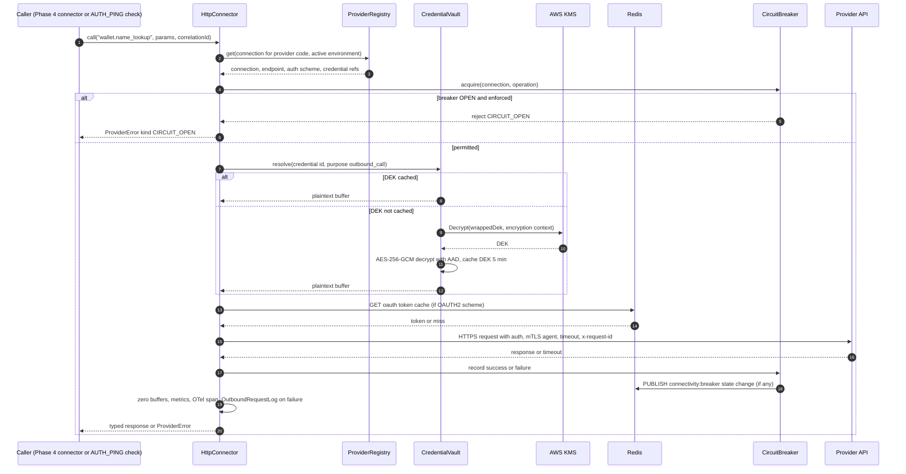
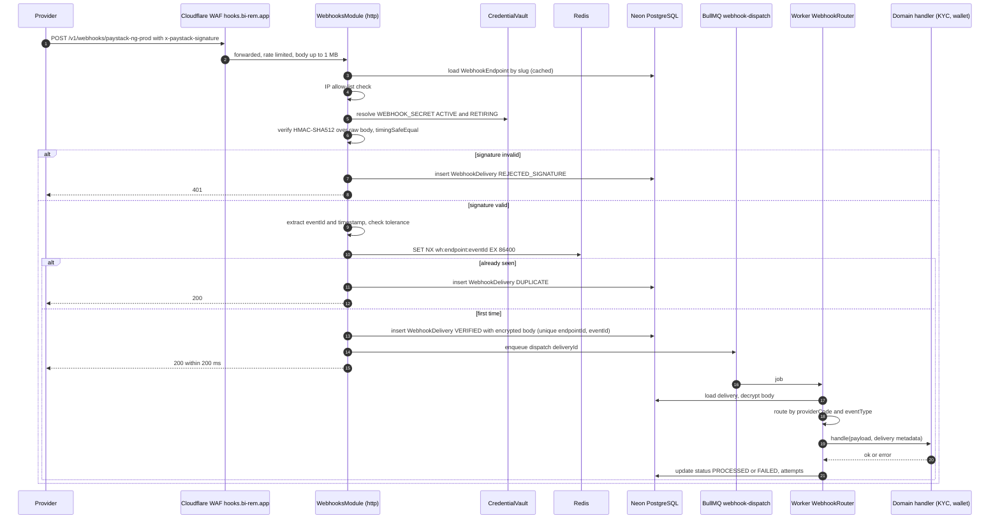
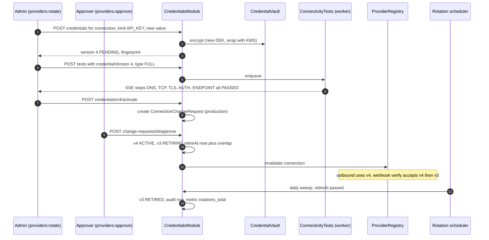
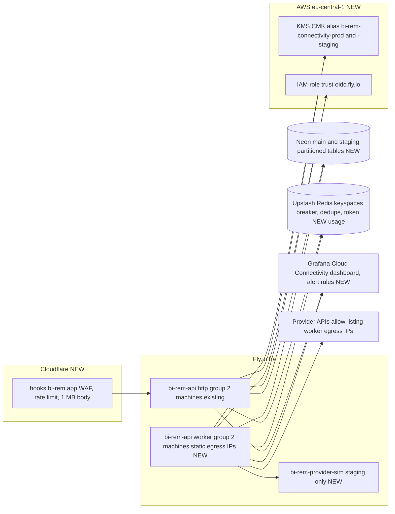
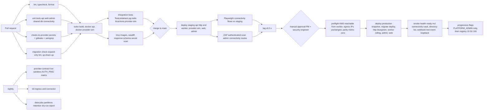

# Phase 3 — Connectivity Management Framework

| Field                     | Value                                                                                                                                                                                                       |
| ------------------------- | ----------------------------------------------------------------------------------------------------------------------------------------------------------------------------------------------------------- |
| **Phase**                 | 3 of 13 — `connectivity`                                                                                                                                                                                    |
| **Dates**                 | 2027-01-25 → 2027-03-05                                                                                                                                                                                     |
| **Duration**              | 6 weeks (W1 = 2027-01-25, W6 = 2027-03-01 … 2027-03-05)                                                                                                                                                     |
| **Team**                  | `platform` (2 backend, 1 frontend, 1 QA at 60 %, solution architect at 50 %, DevOps/SRE at 60 %, 0.5 security engineer, PM at 30 %, product designer at 25 %, compliance analyst consulting)                |
| **Depends on**            | Phase 1 — Foundation & Platform Setup (ends 2026-12-25). Phase 2 (`core` team) runs in parallel until 2027-02-19; Phase 3 consumes Phase 2 artefacts opportunistically, never as a hard dependency (§15.1). |
| **Unlocks**               | Phase 4 — Wallet Connector Engine (2027-03-08); transitively Phases 5–7 (transfers, international, FX), Phase 9 (partner APIs) and Phase 13 (new-country providers added by configuration)                  |
| **Runs in parallel with** | Phase 2 — Customer Management & KYC (`core` team, W1–W4 of this phase)                                                                                                                                      |

---

## 1. Overview

### 1.1 Objective

Phase 3 builds the **dynamic API management platform** that every money-moving phase sits on. Today (Phase 1 + Phase 2 as planned) a provider integration means: secrets in Fly environment variables validated by `apps/api/src/config/env.ts`, a hand-written adapter, a bespoke webhook controller and a deploy. BI-Rem's target scale is **50 providers across 20 countries** (`schedule.json`), with sandbox and production environments each, rotating credentials and mTLS certificates, and at least one provider changing a base URL or a signing scheme every month. That does not scale through code changes.

At the end of this phase an operator with the right permissions can, from the admin portal and without a deploy: register a provider in the **Provider Directory**; configure its **Sandbox** and **Production** connections (base URLs, operation endpoints, auth scheme, credentials, mTLS certificates, inbound webhook endpoints, outbound callback URLs); run a **connectivity test** and see every step (DNS, TCP, TLS, mTLS handshake, auth, synthetic operation, webhook loopback) pass or fail; **promote** the production connection under four-eyes approval; watch **health and status** on a NOC-style board; and **rotate a secret** with a dual-secret overlap so no webhook or call is dropped. Every credential is encrypted with **envelope encryption** (KMS-backed data keys), **versioned**, never displayed after creation, and every read of a decrypted value is audited.

The phase also hardens the two things that bite every remittance platform in production: **inbound webhooks** (signature verification per provider scheme, replay protection, idempotent delivery log, replay from the portal) and **outbound resilience** (per-connection circuit breakers, bulkheads, timeouts, retry budgets, shared across API and worker machines).

Nothing in Phase 3 moves money. Phase 4 plugs wallet operations into the connections this phase manages.

### 1.2 In scope

| Area                          | Included                                                                                                                                                                                                                                                                                                                                                                                                                                                                                                                                                                                                                                                                                           |
| ----------------------------- | -------------------------------------------------------------------------------------------------------------------------------------------------------------------------------------------------------------------------------------------------------------------------------------------------------------------------------------------------------------------------------------------------------------------------------------------------------------------------------------------------------------------------------------------------------------------------------------------------------------------------------------------------------------------------------------------------- |
| Provider Directory            | `Provider` catalogue (code, category, countries, capabilities, documentation links, contacts, status lifecycle `DRAFT → ACTIVE → SUSPENDED → DEPRECATED`), seeded with the pilot providers (MTN MoMo, Orange Money, Wave, M-Pesa Daraja, Airtel Money, Flutterwave, Paystack, Smile Identity, Sumsub, Veriff, Africa's Talking, Resend) as **configuration rows, not code**.                                                                                                                                                                                                                                                                                                                       |
| Provider Configuration Portal | Admin screens to manage per-provider **connections** (`SANDBOX` / `PRODUCTION`): base URLs, operation endpoints (method, path template, timeout, retry policy, idempotency header), auth scheme (`API_KEY_HEADER`, `BASIC`, `HMAC_REQUEST_SIGNING`, `OAUTH2_CLIENT_CREDENTIALS`, `JWT_BEARER`, `MTLS`, `MTLS_PLUS_OAUTH2`), credentials, certificates, webhook endpoints, callback URLs, rate limits, circuit-breaker thresholds, environment selection, four-eyes change approval for production.                                                                                                                                                                                                 |
| Credential Encryption         | `CredentialVault` service: envelope encryption (random 256-bit DEK per credential version, AES-256-GCM with AAD, DEK wrapped by AWS KMS CMK `alias/bi-rem-connectivity-{env}` with encryption context), KEK versioning and re-wrap job, in-process DEK cache, write-only API (no reveal endpoint), fingerprints for duplicate/sandbox-vs-production detection, audited decrypts.                                                                                                                                                                                                                                                                                                                   |
| Versioned credentials         | `ProviderCredential.version` per (connection, kind) with lifecycle `PENDING → ACTIVE → RETIRING → RETIRED / REVOKED`; outbound uses `ACTIVE`; inbound verification accepts `ACTIVE` + `RETIRING` (dual-secret window).                                                                                                                                                                                                                                                                                                                                                                                                                                                                             |
| Certificates (mTLS)           | PEM upload of client cert / private key / CA bundle; parse + key-match validation; metadata (subject, issuer, serial, SAN, `notBefore`/`notAfter`, SHA-256 fingerprint); encrypted private keys; expiry alerts at 30/14/7/1 days; per-connection `https.Agent` built from the vault at runtime (never written to disk).                                                                                                                                                                                                                                                                                                                                                                            |
| Webhook Management            | Generic inbound ingress `POST /v1/webhooks/:endpointSlug` on `hooks.bi-rem.app`; signature scheme plugins (`HMAC_SHA256`, `HMAC_SHA512`, `HMAC_TIMESTAMPED` Stripe/Wave style, `RSA_SHA256`/`ECDSA_SHA256` with provider public key, `JWT_HS256`, `STATIC_TOKEN` Flutterwave style, `BASIC`, `IP_ALLOWLIST`, composable); constant-time compare; replay protection (timestamp tolerance + unique event id + Redis fast path); `WebhookDelivery` log with status, raw body (encrypted), headers; routing by `(providerCode, eventType)` to domain handlers over BullMQ; replay/redrive from portal; **callbacks** (the URLs we register at the provider, per event type, with registration status). |
| Health Monitoring             | Scheduled checks per connection (`HTTP_GET`, `TCP`, `TLS_CERT`, `AUTH_PING`, `SYNTHETIC_OPERATION`), results time series (partitioned, 30-day retention), hysteresis-based status aggregation (`UP` / `DEGRADED` / `DOWN` / `UNKNOWN`), incident records, Prometheus gauges, Grafana alerts, in-app/Slack notifications to admins.                                                                                                                                                                                                                                                                                                                                                                 |
| Connectivity Testing          | On-demand test runs from the dashboard executed on the **worker** (real egress IPs): DNS → TCP → TLS → mTLS → auth → synthetic operation → webhook loopback → egress IP echo; step-by-step results streamed via SSE; test against a `PENDING` credential version before activation.                                                                                                                                                                                                                                                                                                                                                                                                                |
| Connection Validation         | Zod schemas per auth scheme; URL policy (https only outside local); endpoint template variable check; certificate/key match; credential completeness; duplicate active connection prevention; production-credential-equals-sandbox detection by fingerprint; DNS pre-flight; "validate" is a dry run returning a structured report; "activate" refuses an invalid connection.                                                                                                                                                                                                                                                                                                                      |
| Provider Status Monitoring    | Status board (grid by provider × environment), current `ProviderStatus` (status, since, circuit state, consecutive failures, rolling p95), incident timeline, `provider.status_changed` outbox events consumed by Phase 4/5 routing and by a customer-portal service banner.                                                                                                                                                                                                                                                                                                                                                                                                                       |
| Secret Rotation               | Rotation policies per credential kind (max age, warn-before, overlap window), rotation calendar, reminders, manual rotation wizard (create `PENDING` → test → activate → auto-retire), **automatic rotation** for providers that expose a rotation API (OAuth client secrets, MTN MoMo API user keys), KEK re-wrap job, emergency revoke.                                                                                                                                                                                                                                                                                                                                                          |
| Outbound resilience           | `@bi-rem/connectivity` package: `HttpConnector` (undici-based, per-connection `Agent`/mTLS, timeouts, retry with jitter on idempotent ops only, retry budget), `CircuitBreaker` (rolling window, half-open probes, state shared via Redis pub/sub and persisted to `ProviderStatus`), `Bulkhead` (per-connection concurrency), request/response redaction, metrics and OpenTelemetry spans. Phase 2's `ResilientKycProvider` is re-based on it behind a flag.                                                                                                                                                                                                                                      |
| Migration of existing secrets | Import of Phase 1/2 env-var provider secrets (`SMILE_*`, `SUMSUB_*`, `VERIFF_*`, `AT_API_KEY`, Resend) into the vault as version 1; env fallback removed in W6 (the "no hardcoded credential" success criterion).                                                                                                                                                                                                                                                                                                                                                                                                                                                                                  |

### 1.3 Out of scope (explicitly deferred)

- Business operations on wallets/banks (payout, collection, name lookup, balance reconciliation) — **Phase 4**. Phase 3 only provides `AUTH_PING` and read-only synthetic operations (e.g. sandbox balance) for testing.
- Routing of transactions between providers (least-cost, availability-based) — **Phase 4/5**, which consume `provider.status_changed` and `ProviderStatus`.
- Outbound webhooks **to partners/merchants** (we calling them) — **Phase 9**. Phase 3 "callbacks" are URLs we register at providers so they can call us.
- An API gateway product (Kong, Apigee, AWS API Gateway) — rejected (§4.4 D3.6); the framework is in-process.
- HSM / CloudHSM, BYOK — rejected for now; KMS CMK is sufficient for the data classification; revisit in Phase 12 if a regulator requires FIPS 140-3 Level 3 custody.
- SMS/e-mail channel adapters' internals — they stay in `NotificationsModule` (Phase 1), only their **credentials** move to the vault.
- Partner-facing public API keys (`ApiKey` table) — unchanged; Phase 9.

### 1.4 Independent deployability strategy

"Deployable alone" for Phase 3 means: **the framework ships to production as an empty, dark platform while Phase 2 is still being rolled out by the core team; no existing call path changes behaviour until a flag says so; every migration of an existing integration onto the framework is dual-run and reversible in under a minute; and a Phase 3 outage can never block logins, KYC or notifications.**

| Mechanism                                         | How it is used in Phase 3                                                                                                                                                                                                                                                                                                                                                                                                                                                                                                                                                                                                                                                                                                                                                                                                                                                                                                                                                                                                                                                             |
| ------------------------------------------------- | ------------------------------------------------------------------------------------------------------------------------------------------------------------------------------------------------------------------------------------------------------------------------------------------------------------------------------------------------------------------------------------------------------------------------------------------------------------------------------------------------------------------------------------------------------------------------------------------------------------------------------------------------------------------------------------------------------------------------------------------------------------------------------------------------------------------------------------------------------------------------------------------------------------------------------------------------------------------------------------------------------------------------------------------------------------------------------------- |
| **Feature flags** (Phase 1 `FeatureFlag` service) | `connectivity.enabled` (master; admin screens hidden and `/v1/admin/providers*` return 404 when off), `connectivity.vault.kms` (envelope encryption via KMS; off = local `ENCRYPTION_KEYS` wrapping for CI/local only, never allowed in production — guarded by Zod env), `connectivity.webhooks.generic_ingress`, `connectivity.webhooks.kyc_via_registry` (route Phase 2 KYC webhooks through the generic ingress; off = legacy controllers), `connectivity.kyc_adapters_via_registry` (Phase 2 KYC adapters resolve credentials from the vault instead of env; `rolloutPercentage` applies per application id), `connectivity.notifications_via_vault` (Africa's Talking / Resend secrets from vault), `connectivity.health_monitor.enabled`, `connectivity.circuit_breakers.enforced` (off = observe-only "shadow" mode that records what the breaker _would_ do), `connectivity.rotation.auto`, `connectivity.outbound.global_pause` (**kill switch**: every outbound provider call fails fast with `ProviderPausedError`), per-connection `ProviderConnection.status=DISABLED`. |
| **Expand → migrate → contract**                   | W1 `20270125120000_phase2_contract` (Phase 2's scheduled contract, executed by this team with the core team's sign-off, snapshot first) and `20270126000000_phase3_expand` (17 new Prisma models of which 2 are range-partitioned, one raw-SQL dedupe table, 20 enums, no changes to existing columns). W6 `20270301000000_phase3_contract` removes provider secret vars from the env schema and drops the Phase 1 `settings.is_secret` encryption path for provider keys after a one-week soak. Migrations are additive; `down.sql` maintained for each.                                                                                                                                                                                                                                                                                                                                                                                                                                                                                                                             |
| **Dark launch**                                   | W3: framework deployed to production with `connectivity.enabled=true` for the `platform` role only (flag rule `roles contains PLATFORM_ADMIN`), providers seeded as `DRAFT`, health monitor running against **sandbox** connections only, circuit breakers in shadow mode. W5: internal canary of the KYC adapter migration. W6: 100 %.                                                                                                                                                                                                                                                                                                                                                                                                                                                                                                                                                                                                                                                                                                                                               |
| **Kill switches**                                 | `connectivity.outbound.global_pause`; per-connection `DISABLED`; per-endpoint `enabled=false`; webhook endpoint `PAUSED` (acknowledged with `202` and queued, not processed); health monitor off; all editable in admin Flags/Settings with ≤ 30 s propagation (Redis invalidation).                                                                                                                                                                                                                                                                                                                                                                                                                                                                                                                                                                                                                                                                                                                                                                                                  |
| **Dual-run / dual-read**                          | Credential resolution: `CredentialResolver` tries vault (if flag on) then env fallback, logs `credential_source{source=vault                                                                                                                                                                                                                                                                                                                                                                                                                                                                                                                                                                                                                                                                                                                                                                                                                                                                                                                                                          | env}`; mismatch between vault and env fingerprints raises an alert during the soak. Webhooks: when `kyc_via_registry`is on, the legacy controllers still exist and return`410 Gone` with a log line so a mis-registered provider URL is visible. |
| **Worker isolation**                              | Health checks, connectivity tests, rotation, re-wrap and webhook dispatch run in the `worker` process group (`PROCESS_ROLE=worker`, created by Phase 2; created in W1 by this team if Phase 2 has not yet shipped it). The HTTP process only verifies signatures, writes the delivery row and enqueues.                                                                                                                                                                                                                                                                                                                                                                                                                                                                                                                                                                                                                                                                                                                                                                               |
| **Backward-compatible APIs**                      | All new endpoints under `/v1/admin/providers`, `/v1/admin/connections`, `/v1/admin/webhooks`, `/v1/webhooks/:slug`, `/v1/status`. No existing endpoint changes shape. OpenAPI snapshot diff gate (`oasdiff`) stays green.                                                                                                                                                                                                                                                                                                                                                                                                                                                                                                                                                                                                                                                                                                                                                                                                                                                             |
| **Fail-safe degradations**                        | KMS unreachable → cached DEKs serve for up to 5 min, then calls fail with `VaultUnavailableError` (fail closed for secrets) while `/health/ready` reports `connectivity-vault: degraded`; Redis unreachable → breaker state falls back to per-instance memory, webhook dedupe falls back to the DB unique index (slower, still correct); worker down → webhooks are acknowledged and persisted, processed when it returns.                                                                                                                                                                                                                                                                                                                                                                                                                                                                                                                                                                                                                                                            |

---

## 2. Milestones

Phase start is Monday **2027-01-25**; week _n_ runs Monday to Friday; milestone dates are the Friday of the week.

| ID       | Week | Target date | Deliverable                                                                                                                                                                                                                                                                                                                                                                                                                             | Acceptance criteria                                                                                                                                                                                                                                                                                                                                                                                                                                                                                                                              | Owner                        |
| -------- | ---- | ----------- | --------------------------------------------------------------------------------------------------------------------------------------------------------------------------------------------------------------------------------------------------------------------------------------------------------------------------------------------------------------------------------------------------------------------------------------- | ------------------------------------------------------------------------------------------------------------------------------------------------------------------------------------------------------------------------------------------------------------------------------------------------------------------------------------------------------------------------------------------------------------------------------------------------------------------------------------------------------------------------------------------------ | ---------------------------- |
| **M3.1** | W1   | 2027-01-29  | Design freeze; ADR-0010 (envelope encryption & KMS), ADR-0011 (provider/connection model & registry), ADR-0012 (webhook ingress & replay protection), ADR-0013 (outbound resilience); `20270125120000_phase2_contract` executed with snapshot; `20270126000000_phase3_expand` merged; KMS CMKs + IAM roles (OIDC trust from Fly) provisioned for staging and production; `packages/connectivity` skeleton; `apps/provider-sim` skeleton | Contract migration applied to `staging` and `main` with Neon snapshot markers and a clean `smoke.sh`; expand migration applies on a Phase 2 snapshot with zero data loss and `prisma migrate diff` empty; `kms:Encrypt`/`Decrypt` succeed from a staging worker machine using an OIDC-assumed role (no static AWS keys); ADRs accepted at the Thursday architecture review; threat model workshop held (§8)                                                                                                                                      | Solution Architect           |
| **M3.2** | W2   | 2027-02-05  | Credential vault (envelope encryption, versioning, fingerprints, audited decrypt), Provider Directory API + admin list/detail/create screens, env-secret import script                                                                                                                                                                                                                                                                  | Crypto test vectors pass; a credential written in staging is readable only through `CredentialVault.resolve()` and every resolve writes an `AuditLog` row with `action=credentials:decrypt`; `GET /v1/admin/credentials/:id` never returns plaintext (contract test); `infra/scripts/import-env-secrets.ts --dry-run` lists all Phase 1/2 provider secrets and `--apply` creates version 1 for each; 12 providers seeded as `DRAFT` with countries/capabilities                                                                                  | Backend Lead                 |
| **M3.3** | W3   | 2027-02-12  | Connection configuration (endpoints, auth schemes, mTLS certificates), connection validation, `HttpConnector` with breaker/bulkhead/timeouts/retries, `provider-sim` with 4 provider personas; dark launch to production                                                                                                                                                                                                                | Admin can configure MTN MoMo sandbox, M-Pesa Daraja sandbox and `provider-sim` connections end to end and `AUTH_PING` succeeds from the staging worker; invalid PEM / mismatched key / expired cert / `http://` URL / duplicate active connection each rejected with a structured validation report; breaker opens after configured failures against `provider-sim` fault injection and recovers via half-open probes; shadow-mode breaker metrics visible in Grafana; production deploy with `connectivity.enabled` limited to `PLATFORM_ADMIN` | Backend Lead                 |
| **M3.4** | W4   | 2027-02-19  | Webhook management: generic ingress, 9 signature schemes, replay protection, delivery log, router, replay from portal, callbacks registry; Phase 2 KYC webhooks routed through the ingress behind flag                                                                                                                                                                                                                                  | Contract tests for each scheme with vendor sample payloads (Paystack, Flutterwave, Wave, MTN MoMo, Smile ID, Sumsub, Veriff) pass; replayed delivery (same event id) → `DUPLICATE`, no dispatch; timestamp older than tolerance → `REJECTED_REPLAY`; wrong signature → `REJECTED_SIGNATURE` + metric + alert after 10/min; `kyc_via_registry=true` in staging processes Smile ID / Sumsub sandbox webhooks into Phase 2 `KycProviderEvent` rows identically to the legacy path (parity test)                                                     | Backend Lead                 |
| **M3.5** | W5   | 2027-02-26  | Health monitoring + status board, connectivity test console (SSE), rotation policies/calendar/wizard, auto-rotation for MTN MoMo and OAuth2 client secrets, certificate expiry alerts, Grafana dashboards and alert rules; internal canary of `kyc_adapters_via_registry`                                                                                                                                                               | Status board shows all seeded connections with live status; killing `provider-sim` flips its status to `DOWN` within 3 intervals and opens an incident, restoring flips `UP` after 2 successes; test console streams 8 steps for a sandbox connection in < 15 s; rotating the Smile ID sandbox key via the wizard keeps webhooks verifying (dual-secret) and outbound calls succeeding with zero errors during the overlap; `kyc_adapters_via_registry` at 100 % in staging, 10 % internal in production                                         | Frontend Lead / Backend Lead |
| **M3.6** | W6   | 2027-03-05  | Hardening: security review of vault + ingress, k6 profile, chaos game day, UAT with operations, `20270301000000_phase3_contract` (env secret vars removed), runbooks, 100 % rollout, Phase 4 handover                                                                                                                                                                                                                                   | `check-no-provider-secrets` CI gate green on `main` (no provider secret in `env.ts`, `.env.example`, Fly secrets list); security review findings ≥ High closed; k6: ingress 500 req/s p95 < 120 ms with signature verification, outbound connector overhead p95 < 5 ms; game day scenarios (KMS down, Redis down, provider DOWN, cert expired) pass with documented behaviour; UAT script 100 %; §12 evidence complete; sign-offs (§11) collected; Phase 4 lead accepts handover                                                                 | Program Manager              |


---

## 3. Deliverables

Each deliverable lists its **Definition of Done (DoD)**. Done means: code merged with tests, OpenAPI documented, admin screens shipped, permissions registered in `packages/db/src/permissions.ts`, audit coverage verified, runbook entry written, metrics and alerts in place.

### 3.1 Provider Directory

- **What**: `Provider` catalogue and the `ProviderRegistry` service (in-memory, Redis-invalidated cache of providers + connections + endpoints + resolved credential references) that Phase 4 connectors query by `providerCode`.
- **DoD**:
  - `Provider` fields: `code` (slug, immutable, e.g. `mtn-momo-ci`), `name`, `category` (`MOBILE_MONEY`, `BANK`, `CARD_ACQUIRER`, `PAYOUT_AGGREGATOR`, `KYC`, `SMS`, `EMAIL`, `FX_RATES`, `SANCTIONS`, `OTHER`), `countryCodes[]`, `currencies[]`, `capabilities` (JSON array of operation keys the provider supports, e.g. `wallet.payout`, `wallet.collect`, `wallet.name_lookup`, `kyc.document`, `sms.send`), `docsUrl`, `supportContacts` (JSON, redacted in list view), `status`, `activeEnvironment` (`SANDBOX` | `PRODUCTION`), `tags[]`.
  - Seed (`packages/db/prisma/seed-data/providers.json`) with 12 pilot providers as `DRAFT`; seed is idempotent (upsert by `code`).
  - Lifecycle rules: `ACTIVE` requires at least one `ENABLED` connection in `activeEnvironment` that passed validation in the last 24 h; `SUSPENDED` disables all connections and emits `provider.suspended`; `DEPRECATED` hides from Phase 4 routing but keeps history.
  - `ProviderRegistry.get(code)` p99 < 1 ms from cache; cache invalidated on any provider/connection/credential write via Redis channel `connectivity:invalidate`.
  - Permissions `providers:read`, `providers:write`, `providers:approve`, `providers:suspend` registered; `PLATFORM_ADMIN` and `SUPER_ADMIN` system roles updated in seed.
  - Admin list with facets (category, country, status, health), detail page with tabs (§7).

### 3.2 Provider Configuration Portal

- **What**: Admin management of `ProviderConnection` (one per provider per environment), `ProviderEndpoint` rows, auth scheme configuration, environment selection, and a **change-request / approval** flow for production.
- **DoD**:
  - Connection fields: `environment`, `baseUrl`, `authScheme`, `authConfig` (non-secret JSON: header names, token URL, scopes, audience, signature algorithm, key id header, clock skew), `timeoutMs` default, `rateLimit` (`requestsPerSecond`, `burst`), `circuitBreaker` (`failureRateThreshold`, `minimumCalls`, `openDurationMs`, `halfOpenProbes`), `bulkheadMaxConcurrent`, `requiresStaticEgressIp`, `egressIps[]` (our IPs the provider has allow-listed), `status` (`DRAFT`, `ENABLED`, `DISABLED`, `PENDING_APPROVAL`), `lastValidatedAt`, `lastValidationReport`.
  - Endpoint fields: `operationKey` (from a controlled vocabulary in `@bi-rem/shared` `PROVIDER_OPERATIONS`), `method`, `pathTemplate` (`/collection/v1_0/requesttopay/{referenceId}`), `timeoutMs`, `retryPolicy` (`maxAttempts`, `backoffMs`, `jitter`, `retryOn` status list; only allowed when `idempotent=true`), `idempotencyHeader`, `headers` (static non-secret), `enabled`.
  - Auth schemes implemented as `AuthStrategy` plugins: `API_KEY_HEADER`, `BASIC`, `BEARER_STATIC`, `HMAC_REQUEST_SIGNING` (canonical string builder configurable: method, path, timestamp, body hash), `OAUTH2_CLIENT_CREDENTIALS` (token cache in Redis keyed by connection + credential version, refresh at 80 % TTL, single-flight), `JWT_BEARER` (RS256 client assertion with vault-held private key), `MTLS`, `MTLS_PLUS_OAUTH2`.
  - **Environment selection**: `Provider.activeEnvironment` switch; guard: our `APP_ENV=staging` refuses `PRODUCTION` connections being `ENABLED` (hard rule, test-covered); switching to `PRODUCTION` requires `providers:approve` from a **different** admin than the requester (four-eyes via `ConnectionChangeRequest`), recent MFA (`@RequiresRecentMfa(300)` from Phase 2, or Phase 1 TOTP re-verification if Phase 2 guard is not merged yet), and a passing connectivity test in the last 24 h.
  - Every change produces an `AuditLog` row with `before/after` diff where secret values are replaced by `{ "fingerprint": "sha256:…", "version": n }`.
  - Change requests: any write to a `PRODUCTION` connection or credential activation creates a `ConnectionChangeRequest` (`PENDING → APPROVED | REJECTED | EXPIRED` after 72 h); approver sees the diff; approval applies atomically and invalidates the registry.

### 3.3 Credential Encryption (CredentialVault)

- **What**: `packages/connectivity/src/vault/*` and `CredentialsModule` in `apps/api`.
- **DoD**:
  - Envelope: `DEK = randomBytes(32)`; `ciphertext, iv(12), tag(16) = AES-256-GCM(DEK, plaintext, AAD)`; `AAD = "birem:v1|" + connectionId + "|" + kind + "|" + version`; `wrappedDek = KMS.Encrypt(KeyId=alias/bi-rem-connectivity-{env}, Plaintext=DEK, EncryptionContext={app:"bi-rem", env, connectionId, kind, version})`; stored columns `ciphertext`, `iv`, `auth_tag`, `wrapped_dek`, `kek_id` (KMS key ARN + version alias), `envelope_version`.
  - KMS access: IAM role `bi-rem-connectivity-{env}` with trust policy on `oidc.fly.io` (`sub` constrained to `app:bi-rem-api[-staging]`), permissions `kms:Encrypt`, `kms:Decrypt`, `kms:GenerateDataKey`, `kms:DescribeKey` on the one CMK; key policy denies `Decrypt` without `EncryptionContext:app=bi-rem`. Fallback (if OIDC federation is not available in time, R3.2): IAM user access key in Fly secrets, rotated every 90 days by runbook.
  - Local/CI: `local-kms` container (`nsmithuk/local-kms`) in docker-compose with a seeded key; same code path, no mocks.
  - DEK cache: in-process LRU of **decrypted DEKs** (not plaintext credentials), max 500 entries, TTL 5 min, invalidated on credential status change; metric `birem_vault_dek_cache_hits_total`.
  - Plaintext credential material lives only in `Buffer`s zeroed after use; never logged (pino redaction paths `*.secret`, `*.privateKey`, `*.password`, `*.clientSecret`, `*.apiKey`, `authorization`), never in `AuditLog` (`before/after` carry fingerprints), never returned by any API (contract test scans every response schema for forbidden field names).
  - `fingerprint = HMAC-SHA256(CRED_FINGERPRINT_KEY, plaintext)` stored for equality checks (duplicate detection, sandbox-equals-production warning, dual-read parity).
  - Every `resolve()` writes an `AuditLog` (`actorType=SYSTEM`, `action=credentials:decrypt`, `resourceId=credentialId`, `metadata.purpose` ∈ `outbound_call | webhook_verify | connectivity_test | rotation | rewrap`), batched (one row per credential per minute per process with a counter) to keep volume manageable.
  - KEK rotation: AWS automatic annual rotation on the CMK plus `connectivity:rewrap` job (re-encrypt wrapped DEKs under the current key version when `kek_id` differs or on demand); zero plaintext credential handling during re-wrap (only DEKs are unwrapped and re-wrapped).
  - Revocation: `REVOKED` sets `wrapped_dek = NULL` after the retention hold (crypto-shredding); ciphertext becomes unrecoverable.

### 3.4 Webhook Management

- **What**: `WebhooksModule` (HTTP), `webhook-dispatch` BullMQ consumer (worker), `WebhookEndpoint` / `WebhookDelivery` / `ProviderCallback` models, admin screens.
- **DoD**:
  - Ingress `POST /v1/webhooks/:slug` served on dedicated hostname `hooks.bi-rem.app` (Fly app `bi-rem-api`, same image, route guarded so only `/v1/webhooks/*` and `/health/*` respond on that host); `@Public()`; raw body preserved (`express.raw` for the route, 1 MB limit); IP allow-list (CIDRs) checked first when configured; unknown slug → `404` with no body; paused endpoint → `202` + stored.
  - Signature plugins with config: header name(s), encoding (`hex`/`base64`), algorithm, timestamp header or payload path, tolerance (default 300 s), canonical payload rule (`raw_body`, `timestamp.raw_body`, `json_path`), secret source (credential kind `WEBHOOK_SECRET`, or `PROVIDER_PUBLIC_KEY` certificate for asymmetric). Verification tries `ACTIVE` then `RETIRING` secret. Constant-time compare (`crypto.timingSafeEqual`).
  - Replay protection: `eventId` extracted via configured source (header, JSON path, or `sha256(rawBody)` fallback); reject if `|now - timestamp| > tolerance` when timestamped; dedupe fast path `SET NX wh:{endpointId}:{eventId} EX 86400` in Redis, source of truth `@@unique([endpointId, eventId])`; duplicates stored as `DUPLICATE` and acknowledged `200`.
  - Delivery row written **before** `200` is returned (`RECEIVED` → `VERIFIED` | `REJECTED_SIGNATURE` | `REJECTED_REPLAY` | `REJECTED_IP` | `DUPLICATE`), body stored encrypted with the vault (kind `WEBHOOK_BODY`, shared monthly DEK), headers subset (no auth headers) stored as JSON; then job `webhook-dispatch` enqueued with `{ deliveryId }` (`attempts 8`, exponential backoff 5 s → 1 h, DLQ `webhook-dispatch:failed`).
  - `WebhookRouter`: handlers register `@WebhookHandler({ providerCode, eventType })`; `eventType` extracted via per-endpoint JSON path (e.g. `$.event` for Paystack, `$.type` for Wave); unmatched → `UNROUTED` status + alert; handler outcome → `PROCESSED` | `FAILED` with error class. Phase 2 KYC handlers registered via adapter shim.
  - Portal: delivery list with filters (status, provider, time, event type), detail (verification trace, redacted headers, decrypted body for `webhooks:read_body`), **replay** (`webhooks:replay`, re-enqueues dispatch with `replayOf`), **redrive DLQ**, **send test event** (signs with current secret and POSTs to our own endpoint).
  - **Callbacks**: `ProviderCallback` rows (`eventType`, `callbackUrl` we expose, `registeredAtProvider`, `providerReference`, `lastVerifiedAt`); copy-to-clipboard of the exact URL to paste in the provider console; for providers with a callback-registration API (MTN MoMo API user callback host, Paystack webhook URL via dashboard only) the registration is automated where possible and recorded otherwise.
  - Metrics `birem_webhook_deliveries_total{provider,endpoint,result}`, `birem_webhook_verify_duration_seconds`, `birem_webhook_dispatch_lag_seconds`; alert on `REJECTED_*` > 10/min per endpoint and on dispatch lag > 2 min.

### 3.5 Health Monitoring

- **What**: `HealthMonitorService` (worker) with BullMQ repeatable jobs per `HealthCheckConfig`, results store, aggregation into `ProviderStatus`, incidents.
- **DoD**:
  - Check types: `HTTP_GET` (expected status set, optional JSON path assertion), `TCP` (connect to host:port), `TLS_CERT` (handshake + chain validation + days-to-expiry, used for both provider server certs and our client certs), `AUTH_PING` (acquire token / sign a no-op request, e.g. MTN MoMo `GET /collection/v1_0/accountholder/msisdn/{id}/active` sandbox, Daraja `oauth/v1/generate`), `SYNTHETIC_OPERATION` (read-only endpoint from the connection, e.g. sandbox balance; with optional `syntheticAmountMinor` + `syntheticCurrency` for Phase 4 synthetic micro-transactions, stored as BIGINT + ISO-4217).
  - Interval default 60 s production / 300 s sandbox; jitter ±10 %; timeout per check ≤ `timeoutMs`; concurrency 20 checks per worker machine; checks run from the `worker` group so they share the egress IPs the provider allow-listed.
  - Aggregation with hysteresis: `DOWN` after 3 consecutive failures, `DEGRADED` when p95 latency over the last 10 checks > 2× baseline or failure ratio ≥ 20 %, `UP` after 2 consecutive successes; `UNKNOWN` when no check in 3 intervals (scheduler problem).
  - Status change writes `ProviderStatus`, opens/closes `ProviderIncident`, emits outbox `provider.status_changed`, sends in-app + Slack notification (Phase 1 `NotificationsService`, template `provider.status_changed` en/fr) to users with `providers:alerts`.
  - Results stored in `health_check_results` (monthly partitions, 30-day retention, nightly partition maintenance job); rolling aggregates (p50/p95, uptime 24 h / 7 d / 30 d) materialised in `provider_status`.
  - Metrics `birem_provider_health_status{provider,env}` (0 unknown, 1 up, 2 degraded, 3 down), `birem_provider_health_latency_seconds`, `birem_provider_uptime_ratio_24h`; Grafana dashboard "Connectivity" and alerts (`DOWN` for 5 min on an `ACTIVE` production provider → PagerDuty; certificate expiry < 14 d → Slack).

### 3.6 Connectivity Testing

- **What**: `ConnectivityTestService` + `POST /v1/admin/connections/:id/tests` + SSE stream + admin test console.
- **DoD**:
  - Test types: `DNS` (A/AAAA + CNAME chain, resolution time), `TCP`, `TLS` (protocol, cipher, chain, expiry, SNI), `MTLS` (handshake with our client cert, server-requested CA names), `AUTH` (strategy-specific: token acquired, signature accepted), `ENDPOINT` (one read-only `operationKey`), `WEBHOOK_LOOPBACK` (sign a synthetic event with the endpoint's current secret and POST to our own public URL; asserts a `VERIFIED` delivery appears), `EGRESS_IP` (calls our own `GET /v1/system/echo-ip` through the public internet and compares with `egressIps[]`), `FULL` (all in order, stops at first hard failure).
  - Runs in the worker; each step persisted in `ConnectivityTest.steps` JSON with `name, status, durationMs, detail (redacted), hint`; final `outcome` `PASSED | FAILED | PARTIAL`; max duration 60 s.
  - Can target a specific `credentialVersion` (`PENDING` allowed) and `certificateId` so rotation is tested before activation.
  - Live progress via `GET /v1/admin/connections/:id/tests/:testId/stream` (SSE, 30 s heartbeat), falling back to polling.
  - Rate-limited to 10 tests/min/connection; production `ENDPOINT` tests require `connections:test_production`.

### 3.7 Connection Validation

- **What**: `ConnectionValidator` (pure, in `@bi-rem/connectivity`) + `POST /v1/admin/connections/:id/validate`.
- **DoD**:
  - Static rules: Zod schema per `authScheme` for `authConfig`; `baseUrl` must be `https:` (exception: `http://provider-sim*` and `http://localhost` only when `APP_ENV in (local, ci, staging)`); every `{variable}` in `pathTemplate` must be in the operation's declared variables; `timeoutMs` 500–60 000; `retryPolicy` only when `idempotent`; credential kinds required by the scheme are present with an `ACTIVE` version (or the version under test); certificates: PEM parses, private key matches certificate public key, chain validates to the CA bundle, `notAfter` > now + 7 d; at most one `ENABLED` connection per (provider, environment); production credential fingerprint ≠ sandbox credential fingerprint (warning, not error); webhook endpoints have a signature scheme unless `IP_ALLOWLIST` + explicit `allowUnsigned=true` acknowledged by `webhooks:write_unsigned`.
  - Dynamic rules (optional, executed by a `FULL` test): DNS resolves, TLS handshake, auth.
  - Report format `{ ok, errors[], warnings[], checkedAt }` with stable error codes (`CONN_URL_SCHEME`, `CONN_CERT_KEY_MISMATCH`, …) rendered in the portal; stored in `lastValidationReport`.
  - Activation (`status → ENABLED`) calls the validator and refuses on `errors.length > 0`.

### 3.8 Provider Status Monitoring

- **What**: `ProviderStatus` aggregate, `GET /v1/status/providers` (admin) and `GET /v1/status/public` (customer-facing, country-scoped summary), status board, incidents.
- **DoD**:
  - Board grid provider × environment with status chip, since, p95, uptime 24 h/7 d, circuit state, open incident; auto-refresh 15 s via React Query; filters by country/category; drill-down to health history chart (30 d).
  - Incidents: auto-opened/closed by the monitor; admins can acknowledge, add notes, link a provider ticket reference, mark `MAINTENANCE` windows (suppresses alerts and routing penalties).
  - Public summary: per country, list of `category` statuses (`MOBILE_MONEY: degraded`) with no provider names unless `Setting connectivity.public_status.show_provider_names=true`; cached 60 s; consumed by the customer portal banner and later by mobile.
  - `provider.status_changed` events consumed by Phase 4 router (documented contract in §15.2).

### 3.9 Secret Rotation

- **What**: `SecretRotationPolicy`, rotation scheduler (worker), rotation wizard (portal), auto-rotation strategies, certificate expiry tracking.
- **DoD**:
  - Policy per (connection, credential kind): `maxAgeDays` (default 90 for API keys/secrets, 365 for certificates, 30 for webhook secrets where provider allows), `warnBeforeDays` (14), `overlapMinutes` (default 60; webhooks 1440), `autoRotate` (bool), `strategy` (`MANUAL`, `OAUTH2_SECRET_API`, `MTN_MOMO_APIKEY`, `PROVIDER_DASHBOARD_ONLY`).
  - Scheduler daily: computes `nextRotationAt`, sends reminders (in-app + e-mail to `providers:rotate` holders) at warn threshold, executes auto rotation where `autoRotate` and strategy support it, retires `RETIRING` versions whose `retireAt` passed, escalates overdue rotations (> `maxAgeDays` + 7) to Slack and the readiness indicator.
  - Manual wizard: 1) paste new secret (or generate for HMAC webhook secrets) → `PENDING` version; 2) run `FULL` test with the pending version; 3) activate → previous `ACTIVE` becomes `RETIRING` with `retireAt = now + overlap`; 4) show the copy-ready value **once** for webhook secrets we generate (provider must receive it); 5) auto-retire. Production activation goes through the change-request approval.
  - Emergency revoke: `POST /v1/admin/credentials/:id/revoke` marks `REVOKED` immediately (no overlap), invalidates caches, fails outbound calls until a new `ACTIVE` exists, pages on-call if provider is `ACTIVE` in production.
  - Metrics `birem_credential_age_days{provider,env,kind}`, `birem_certificate_expiry_days`, `birem_rotations_total{strategy,outcome}`.

### 3.10 Outbound resilience — `@bi-rem/connectivity` SDK

- **What**: `packages/connectivity` (`@bi-rem/connectivity`, ESM, no NestJS dependency so Phase 4 connectors and tests use it directly): `HttpConnector`, `AuthStrategy` plugins, `CircuitBreaker`, `Bulkhead`, `RetryPolicy`, `Redactor`, `Signer`/`Verifier` (shared with webhooks), `ConnectionValidator`, `EnvelopeCipher`.
- **DoD**:
  - `HttpConnector.call(operationKey, { pathParams, query, body, idempotencyKey, correlationId })` resolves endpoint + auth + credentials + mTLS agent from the registry, applies bulkhead → breaker → timeout → retry policy, emits metrics (`birem_provider_request_duration_seconds{provider,env,operation,outcome}`, `birem_provider_requests_total`, `birem_provider_circuit_state`) and an OTel span `provider.call` with redacted attributes, writes `OutboundRequestLog` for failures and a 1 % sample of successes, propagates `x-request-id`.
  - Circuit breaker per (connection, operationKey): rolling window of 20 calls, opens at ≥ 50 % failure or 5 consecutive timeouts, `OPEN` for `openDurationMs` (default 30 s), `HALF_OPEN` admits `halfOpenProbes` (3) calls, closes on all-success; state changes published on Redis `connectivity:breaker` and persisted on `ProviderStatus.circuitState` so every machine and the portal see the same state; `enforced=false` (shadow) records transitions without blocking.
  - Bulkhead per connection (`bulkheadMaxConcurrent`, default 50) with a 100-deep queue and 2 s queue timeout → `ProviderBusyError`.
  - Retry only on `idempotent` operations, on network errors / `408 425 429 500 502 503 504`, with `Retry-After` honoured, full jitter, retry budget 20 % of calls per minute per connection.
  - Error taxonomy `ProviderError` (`kind`: `TIMEOUT`, `NETWORK`, `AUTH`, `RATE_LIMITED`, `CIRCUIT_OPEN`, `PAUSED`, `VALIDATION`, `PROVIDER_4XX`, `PROVIDER_5XX`, `UNKNOWN`) that Phase 4 maps to transaction states.
  - Phase 2 `ResilientKycProvider` re-implemented as a thin wrapper over `HttpConnector` behind `connectivity.kyc_adapters_via_registry` (parity tests against Phase 2 contract tests).

### 3.11 Provider simulator — `apps/provider-sim`

- **What**: Small Fastify server (not NestJS, to stay light) with personas `momo` (MTN MoMo sandbox semantics: API user/key, OAuth token, `X-Reference-Id`, callbacks), `daraja` (OAuth basic → token, STK push callback), `paystack-like` (secret key, `x-paystack-signature` HMAC-SHA512, IP allow-list), `wave-like` (`Wave-Signature` `t=,v1=` HMAC-SHA256), `mtls` (requires client cert); fault injection via headers/admin endpoint (latency, 5xx burst, bad signature, replayed event, cert expiry simulation).
- **DoD**: Docker image built in CI, deployed to staging (`bi-rem-provider-sim`), used by integration tests, e2e tests, k6 and game days; never deployed to production.

### 3.12 Migration of existing integrations

- **What**: `infra/scripts/import-env-secrets.ts`, `CredentialResolver` dual-read, flagged migration of Phase 1 notification channel secrets and Phase 2 KYC adapters, contract migration in W6.
- **DoD**: all provider secrets have vault version 1 in staging (W2) and production (W3); dual-read parity metric at 100 % for 7 days; env variables removed from `env.ts`, `.env.example`, Fly secrets and GitHub environments in W6; `check-no-provider-secrets` gate enforces the allow-list of platform secrets (`DATABASE_*`, `REDIS_URL`, `JWT_*`, `ENCRYPTION_KEYS`, `CRED_FINGERPRINT_KEY`, `KMS_*`, `SENTRY_DSN`, `OTEL_*`, `SMTP_*` for Mailpit only in local).

---

## 4. Architecture

### 4.1 Component / container diagram — Phase 3 additions

```mermaid
flowchart TB
  subgraph Clients
    ADM["Admin portal apps/admin Next.js 16"]
    WEB["Customer portal apps/web status banner"]
  end

  subgraph API["apps/api NestJS 12 PROCESS_ROLE=http"]
    PROV["ProvidersModule directory, connections, endpoints, change requests"]
    CRED["CredentialsModule versions, certificates, rotation policies"]
    VAULT["CredentialVault envelope encryption, DEK cache"]
    REG["ProviderRegistry cached config, Redis invalidation"]
    WHI["WebhooksModule ingress verify, dedupe, persist, enqueue"]
    STAT["StatusModule board, incidents, public summary"]
    TESTAPI["ConnectivityTests API + SSE"]
    FLAGS["FeatureFlagService Phase 1"]
    AUDIT["AuditInterceptor Phase 1"]
  end

  subgraph WORKER["apps/api PROCESS_ROLE=worker BullMQ"]
    HM["health-checks consumer"]
    CT["connectivity-tests consumer"]
    WD["webhook-dispatch consumer + WebhookRouter"]
    ROT["rotation and rewrap schedulers"]
    PART["partition maintenance"]
    OUTBOX["Outbox relay Phase 1"]
  end

  subgraph SDK["packages/connectivity @bi-rem/connectivity"]
    HC["HttpConnector"]
    CB["CircuitBreaker + Bulkhead + RetryPolicy"]
    AUTHS["AuthStrategy plugins"]
    SIGV["Signer / Verifier schemes"]
    ENV["EnvelopeCipher"]
    VAL["ConnectionValidator"]
  end

  PG[("Neon PostgreSQL 16 schema v3 partitioned health and deliveries")]
  REDIS[("Upstash Redis breaker state, dedupe, token cache, invalidation")]
  KMS["AWS KMS CMK alias bi-rem-connectivity"]
  SIM["apps/provider-sim staging only"]
  EXT["Provider APIs MTN MoMo, Daraja, Wave, Paystack, Smile ID ..."]
  GRAF["Grafana Cloud dashboards and alerts"]

  ADM --> PROV & CRED & WHI & STAT & TESTAPI
  WEB --> STAT
  PROV --> REG
  CRED --> VAULT
  VAULT --> ENV
  VAULT --> KMS
  WHI --> SIGV
  WHI --> VAULT
  HM --> HC
  CT --> HC
  CT --> SIGV
  HC --> CB & AUTHS
  HC --> REG
  REG --> VAULT
  HC -. "HTTPS, mTLS, static egress IPs" .-> EXT
  HC -. "staging" .-> SIM
  EXT -. "webhooks hooks.bi-rem.app" .-> WHI
  WHI --> WD
  WD --> KYCH["Phase 2 KYC handlers via shim"]
  WD --> P4H["Phase 4 wallet handlers future"]
  HM --> STAT
  STAT --> OUTBOX
  API --> PG & REDIS
  WORKER --> PG & REDIS
  WORKER --> KMS
  API --> GRAF
  WORKER --> GRAF
```



### 4.2 Sequence diagram — outbound call through the framework



### 4.3 Sequence diagram — inbound webhook with signature verification and replay protection



### 4.4 Sequence diagram — credential rotation with dual-secret overlap



### 4.5 Deployment / infrastructure delta



**Infra delta summary** (also §14): AWS account with two KMS CMKs and an IAM role trusted from Fly OIDC (no static AWS keys); Fly `worker` process group confirmed/created with **static egress IPs** (`fly machine egress-ip allocate`) so providers can allow-list us, QuotaGuard Static as fallback; Fly app `bi-rem-provider-sim` in staging; Cloudflare DNS + WAF in front of `hooks.bi-rem.app` (rate limit 300 req/min per IP, body limit, bot rules off for provider ASNs); `local-kms` and `provider-sim` services in `infra/docker/docker-compose.yml`; Postgres monthly partitions for `health_check_results` and `webhook_deliveries`; Redis keyspace growth (dedupe keys 24 h TTL, token cache, breaker state); Grafana "Connectivity" dashboard + 9 alert rules; GitHub environment secrets for sandbox accounts used by `provider-contract.yml`.

### 4.6 Design decisions and alternatives rejected

| ID    | Decision                                                                                              | Alternatives rejected                                                                                        | Rationale                                                                                                                                                                                                                                                                                                                                                                                                                   |
| ----- | ----------------------------------------------------------------------------------------------------- | ------------------------------------------------------------------------------------------------------------ | --------------------------------------------------------------------------------------------------------------------------------------------------------------------------------------------------------------------------------------------------------------------------------------------------------------------------------------------------------------------------------------------------------------------------- |
| D3.1  | **Envelope encryption with AWS KMS CMK, per-credential-version DEK, AES-256-GCM, encryption context** | Single static `ENCRYPTION_KEY` (Phase 1 approach); HashiCorp Vault Transit; Infisical/Doppler SaaS; CloudHSM | Static key cannot be rotated without re-encrypting everything and has no usage audit; Vault is a new stateful system for a 2-person platform team; SaaS secret managers still require us to hold mTLS private keys and give no per-record AAD; KMS gives key-usage logging (CloudTrail), automatic rotation, IAM-scoped decrypt, ~USD 1/key/month. Phase 2 already chose KMS for documents, so one account and one pattern. |
| D3.2  | **Credentials in Postgres (ciphertext) rather than in a secret manager**                              | AWS Secrets Manager per credential; Fly secrets                                                              | Credentials are relational data: versioned, linked to connections, approvals, rotation policies, audit; Secrets Manager costs USD 0.40/secret/month and makes four-eyes and dual-secret windows awkward; Fly secrets require a machine restart to change. The CMK remains the root of trust.                                                                                                                                |
| D3.3  | **No reveal endpoint, ever**                                                                          | "Reveal with MFA" for troubleshooting                                                                        | Troubleshooting is served by fingerprints, the test console and audited decrypt purposes; a reveal path is the most likely exfiltration vector in a remittance back office (insider threat T3.1).                                                                                                                                                                                                                           |
| D3.4  | **Generic ingress with pluggable signature schemes**                                                  | One controller per provider (Phase 2 style)                                                                  | Phase 2 shipped 3 controllers in 8 weeks; 50 providers would be 50 deploys. Schemes converge on ~9 patterns; configuration covers > 90 % of African PSPs reviewed (§6.3); an escape hatch `CUSTOM` scheme requires code but still no new route.                                                                                                                                                                             |
| D3.5  | **Replay protection = timestamp tolerance + unique event id with Redis fast path and DB uniqueness**  | Redis only; DB only                                                                                          | Redis alone loses dedupe state on eviction/outage; DB alone adds ~5 ms per webhook and lock contention at 500 req/s. Combined: cheap and correct.                                                                                                                                                                                                                                                                           |
| D3.6  | **In-process framework (`@bi-rem/connectivity`) rather than an API gateway product**                  | Kong, Tyk, AWS API Gateway, Envoy sidecar                                                                    | Gateways manage _inbound_ APIs well but provider _outbound_ auth (HMAC canonicalisation, OAuth client credentials, mTLS with rotating certs) is application logic; a sidecar adds a hop and an ops surface on Fly. Revisit for partner-facing APIs in Phase 9.                                                                                                                                                              |
| D3.7  | **Breaker state shared via Redis pub/sub, persisted on `ProviderStatus`**                             | Per-instance breakers only                                                                                   | With 2 http + 2 worker machines, per-instance breakers give inconsistent behaviour and the portal cannot show one truth; shared state with local fallback keeps correctness when Redis is down.                                                                                                                                                                                                                             |
| D3.8  | **Health checks and tests run on the worker group**                                                   | Run on http machines                                                                                         | Providers allow-list egress IPs; only the worker group has static egress IPs; tests must observe exactly what production calls will see.                                                                                                                                                                                                                                                                                    |
| D3.9  | **Four-eyes approval for production connection changes**                                              | Single-admin writes with audit                                                                               | Regulators (BCEAO Instruction 008-05-2015 on e-money, CBN guidelines on outsourcing/third-party risk) expect segregation of duties for changes to payment rails; also protects against a single compromised admin account.                                                                                                                                                                                                  |
| D3.10 | **undici-based `HttpConnector` with per-connection `Agent`**                                          | axios/got; NestJS `HttpModule`                                                                               | undici is Node 22's native client with first-class connection pooling, per-dispatcher TLS options for mTLS, and no interceptor magic; keeps the SDK NestJS-free for Phase 4 connectors and tests.                                                                                                                                                                                                                           |
| D3.11 | **Declarative monthly partitions created by a worker job**                                            | `pg_partman`; TimescaleDB                                                                                    | Avoids extension availability questions on Neon; two tables only; a 20-line job.                                                                                                                                                                                                                                                                                                                                            |
| D3.12 | **Fastify `provider-sim` in-repo**                                                                    | WireMock; vendor sandboxes only                                                                              | Vendor sandboxes are flaky and rate-limited (MTN MoMo sandbox resets, Daraja sandbox downtime); a simulator with fault injection makes integration, k6 and game days deterministic; WireMock cannot do stateful OAuth/mTLS flows easily.                                                                                                                                                                                    |
| D3.13 | **Credential fingerprint = HMAC-SHA256 with a dedicated key**                                         | Plain SHA-256                                                                                                | A plain hash of a low-entropy API key is brute-forceable from a DB dump; keyed hash is not.                                                                                                                                                                                                                                                                                                                                 |

---

## 5. Data Model & Migrations

### 5.1 Prisma model additions (schema v3)

Conventions as CLAUDE.md: uuid ids via `gen_random_uuid()`, `timestamptz(6)`, snake_case `@@map`/`@map`, money as BIGINT minor units + ISO-4217 currency (only the synthetic-transaction fields carry money in this phase). Existing models gain back-relations only.

```prisma
// ---------------------------------------------------------------------------
// Phase 3 — Connectivity Management Framework (schema v3 additions)
// ---------------------------------------------------------------------------

enum ProviderCategory {
  MOBILE_MONEY
  BANK
  CARD_ACQUIRER
  PAYOUT_AGGREGATOR
  KYC
  SMS
  EMAIL
  FX_RATES
  SANCTIONS
  OTHER

  @@map("provider_category")
}

enum ProviderLifecycle {
  DRAFT
  ACTIVE
  SUSPENDED
  DEPRECATED

  @@map("provider_lifecycle")
}

enum ProviderEnvironment {
  SANDBOX
  PRODUCTION

  @@map("provider_environment")
}

enum ConnectionStatus {
  DRAFT
  PENDING_APPROVAL
  ENABLED
  DISABLED

  @@map("connection_status")
}

enum AuthScheme {
  API_KEY_HEADER
  BASIC
  BEARER_STATIC
  HMAC_REQUEST_SIGNING
  OAUTH2_CLIENT_CREDENTIALS
  JWT_BEARER
  MTLS
  MTLS_PLUS_OAUTH2

  @@map("auth_scheme")
}

enum CredentialKind {
  API_KEY
  API_SECRET
  CLIENT_ID
  CLIENT_SECRET
  USERNAME
  PASSWORD
  SUBSCRIPTION_KEY
  WEBHOOK_SECRET
  SIGNING_PRIVATE_KEY
  OTHER

  @@map("credential_kind")
}

enum CredentialStatus {
  PENDING
  ACTIVE
  RETIRING
  RETIRED
  REVOKED

  @@map("credential_status")
}

enum CertificateKind {
  CLIENT_CERT
  CLIENT_KEY
  CA_BUNDLE
  PROVIDER_PUBLIC_KEY

  @@map("certificate_kind")
}

enum SignatureScheme {
  HMAC_SHA256
  HMAC_SHA512
  HMAC_TIMESTAMPED
  RSA_SHA256
  ECDSA_SHA256
  JWT_HS256
  STATIC_TOKEN
  BASIC
  IP_ALLOWLIST
  CUSTOM
  NONE

  @@map("signature_scheme")
}

enum WebhookEndpointStatus {
  ENABLED
  PAUSED
  DISABLED

  @@map("webhook_endpoint_status")
}

enum WebhookDeliveryStatus {
  RECEIVED
  VERIFIED
  REJECTED_SIGNATURE
  REJECTED_REPLAY
  REJECTED_IP
  DUPLICATE
  UNROUTED
  PROCESSED
  FAILED

  @@map("webhook_delivery_status")
}

enum HealthCheckType {
  HTTP_GET
  TCP
  TLS_CERT
  AUTH_PING
  SYNTHETIC_OPERATION

  @@map("health_check_type")
}

enum HealthStatus {
  UNKNOWN
  UP
  DEGRADED
  DOWN

  @@map("health_status")
}

enum CircuitState {
  CLOSED
  OPEN
  HALF_OPEN

  @@map("circuit_state")
}

enum IncidentStatus {
  OPEN
  ACKNOWLEDGED
  MAINTENANCE
  RESOLVED

  @@map("incident_status")
}

enum ConnectivityTestType {
  DNS
  TCP
  TLS
  MTLS
  AUTH
  ENDPOINT
  WEBHOOK_LOOPBACK
  EGRESS_IP
  FULL

  @@map("connectivity_test_type")
}

enum TestOutcome {
  RUNNING
  PASSED
  PARTIAL
  FAILED
  TIMED_OUT

  @@map("test_outcome")
}

enum RotationStrategy {
  MANUAL
  OAUTH2_SECRET_API
  MTN_MOMO_APIKEY
  PROVIDER_DASHBOARD_ONLY

  @@map("rotation_strategy")
}

enum ChangeRequestStatus {
  PENDING
  APPROVED
  REJECTED
  EXPIRED

  @@map("change_request_status")
}

/// Directory entry. Configuration, never code: adding a row is how a provider is "added".
model Provider {
  id                String             @id @default(dbgenerated("gen_random_uuid()")) @db.Uuid
  /// Immutable slug, e.g. "mtn-momo-ci", "mpesa-ke", "paystack-ng".
  code              String             @unique @db.VarChar(64)
  name              String             @db.VarChar(120)
  category          ProviderCategory
  /// ISO-3166-1 alpha-2 codes served by this provider entry.
  countryCodes      String[]           @map("country_codes") @db.Char(2)
  /// ISO-4217 codes.
  currencies        String[]           @db.Char(3)
  /// Operation keys from @bi-rem/shared PROVIDER_OPERATIONS, e.g. ["wallet.payout","wallet.collect"].
  capabilities      String[]           @default([])
  docsUrl           String?            @map("docs_url") @db.VarChar(512)
  /// Non-secret contacts (account manager, support e-mail, escalation phone). Redacted in list views.
  supportContacts   Json               @default("{}") @map("support_contacts")
  status            ProviderLifecycle  @default(DRAFT)
  activeEnvironment ProviderEnvironment @default(SANDBOX) @map("active_environment")
  tags              String[]           @default([])
  createdById       String?            @map("created_by_id") @db.Uuid
  createdAt         DateTime           @default(now()) @map("created_at") @db.Timestamptz(6)
  updatedAt         DateTime           @updatedAt @map("updated_at") @db.Timestamptz(6)
  deletedAt         DateTime?          @map("deleted_at") @db.Timestamptz(6)

  connections ProviderConnection[]

  @@index([category, status])
  @@index([status])
  @@map("providers")
}

/// One connection per provider per environment. Holds everything non-secret about how we talk to it.
model ProviderConnection {
  id                     String              @id @default(dbgenerated("gen_random_uuid()")) @db.Uuid
  providerId             String              @map("provider_id") @db.Uuid
  environment            ProviderEnvironment
  baseUrl                String              @map("base_url") @db.VarChar(512)
  authScheme             AuthScheme          @map("auth_scheme")
  /// Non-secret auth configuration validated by a per-scheme Zod schema (header names, token URL, scopes...).
  authConfig             Json                @default("{}") @map("auth_config")
  timeoutMs              Int                 @default(10000) @map("timeout_ms")
  /// { "requestsPerSecond": 20, "burst": 40 } — our client-side limiter, from the provider's published limits.
  rateLimit              Json                @default("{}") @map("rate_limit")
  /// { "failureRateThreshold": 50, "minimumCalls": 20, "openDurationMs": 30000, "halfOpenProbes": 3 }
  circuitBreaker         Json                @default("{}") @map("circuit_breaker")
  bulkheadMaxConcurrent  Int                 @default(50) @map("bulkhead_max_concurrent")
  requiresStaticEgressIp Boolean             @default(false) @map("requires_static_egress_ip")
  /// Our egress IPs the provider has allow-listed, for the EGRESS_IP test.
  egressIps              String[]            @default([]) @map("egress_ips") @db.VarChar(45)
  status                 ConnectionStatus    @default(DRAFT)
  lastValidatedAt        DateTime?           @map("last_validated_at") @db.Timestamptz(6)
  lastValidationReport   Json?               @map("last_validation_report")
  notes                  String?
  createdAt              DateTime            @default(now()) @map("created_at") @db.Timestamptz(6)
  updatedAt              DateTime            @updatedAt @map("updated_at") @db.Timestamptz(6)

  provider         Provider                 @relation(fields: [providerId], references: [id], onDelete: Restrict)
  endpoints        ProviderEndpoint[]
  credentials      ProviderCredential[]
  certificates     ProviderCertificate[]
  webhookEndpoints WebhookEndpoint[]
  callbacks        ProviderCallback[]
  healthChecks     HealthCheckConfig[]
  healthResults    HealthCheckResult[]
  currentStatus    ProviderStatus?
  incidents        ProviderIncident[]
  tests            ConnectivityTest[]
  rotationPolicies SecretRotationPolicy[]
  changeRequests   ConnectionChangeRequest[]
  requestLogs      OutboundRequestLog[]

  @@unique([providerId, environment])
  @@index([status])
  @@map("provider_connections")
}

/// A provider operation we can call: method + path template + resilience settings.
model ProviderEndpoint {
  id                String   @id @default(dbgenerated("gen_random_uuid()")) @db.Uuid
  connectionId      String   @map("connection_id") @db.Uuid
  /// Controlled vocabulary key, e.g. "wallet.payout.create", "auth.token", "health.ping".
  operationKey      String   @map("operation_key") @db.VarChar(96)
  method            String   @db.VarChar(8)
  /// e.g. "/collection/v1_0/requesttopay/{referenceId}"
  pathTemplate      String   @map("path_template") @db.VarChar(512)
  timeoutMs         Int?     @map("timeout_ms")
  idempotent        Boolean  @default(false)
  idempotencyHeader String?  @map("idempotency_header") @db.VarChar(64)
  /// { "maxAttempts": 3, "backoffMs": 200, "jitter": true, "retryOn": [429, 502, 503, 504] } — only when idempotent.
  retryPolicy       Json     @default("{}") @map("retry_policy")
  /// Static, non-secret headers (e.g. X-Target-Environment).
  headers           Json     @default("{}")
  enabled           Boolean  @default(true)
  createdAt         DateTime @default(now()) @map("created_at") @db.Timestamptz(6)
  updatedAt         DateTime @updatedAt @map("updated_at") @db.Timestamptz(6)

  connection ProviderConnection @relation(fields: [connectionId], references: [id], onDelete: Cascade)

  @@unique([connectionId, operationKey])
  @@map("provider_endpoints")
}

/// Versioned, envelope-encrypted secret. Plaintext never leaves CredentialVault.
model ProviderCredential {
  id               String           @id @default(dbgenerated("gen_random_uuid()")) @db.Uuid
  connectionId     String           @map("connection_id") @db.Uuid
  kind             CredentialKind
  /// Monotonic per (connection, kind).
  version          Int
  status           CredentialStatus @default(PENDING)
  /// AES-256-GCM output. AAD = "birem:v1|" + connection_id + "|" + kind + "|" + version.
  ciphertext       Bytes
  iv               Bytes
  authTag          Bytes            @map("auth_tag")
  /// DEK wrapped by KMS with encryption context {app, env, connectionId, kind, version}. NULL once crypto-shredded.
  wrappedDek       Bytes?           @map("wrapped_dek")
  /// KMS key ARN (or local-kms id) that wrapped the DEK; used by the rewrap job.
  kekId            String           @map("kek_id") @db.VarChar(256)
  envelopeVersion  Int              @default(1) @map("envelope_version")
  /// HMAC-SHA256(CRED_FINGERPRINT_KEY, plaintext) as "sha256:<hex>" for equality checks only.
  fingerprint      String           @db.VarChar(80)
  /// Optional non-secret label, e.g. "Primary key issued 2027-02", or key id from the provider.
  label            String?          @db.VarChar(120)
  expiresAt        DateTime?        @map("expires_at") @db.Timestamptz(6)
  activatedAt      DateTime?        @map("activated_at") @db.Timestamptz(6)
  retireAt         DateTime?        @map("retire_at") @db.Timestamptz(6)
  retiredAt        DateTime?        @map("retired_at") @db.Timestamptz(6)
  revokedAt        DateTime?        @map("revoked_at") @db.Timestamptz(6)
  revokeReason     String?          @map("revoke_reason")
  lastUsedAt       DateTime?        @map("last_used_at") @db.Timestamptz(6)
  createdById      String?          @map("created_by_id") @db.Uuid
  createdAt        DateTime         @default(now()) @map("created_at") @db.Timestamptz(6)
  updatedAt        DateTime         @updatedAt @map("updated_at") @db.Timestamptz(6)

  connection ProviderConnection @relation(fields: [connectionId], references: [id], onDelete: Restrict)

  @@unique([connectionId, kind, version])
  @@index([connectionId, kind, status])
  @@index([status, retireAt])
  @@index([expiresAt])
  @@map("provider_credentials")
}

/// mTLS material and provider public keys. Private keys are envelope-encrypted like credentials.
model ProviderCertificate {
  id              String          @id @default(dbgenerated("gen_random_uuid()")) @db.Uuid
  connectionId    String          @map("connection_id") @db.Uuid
  kind            CertificateKind
  status          CredentialStatus @default(PENDING)
  /// PEM for public material (CLIENT_CERT, CA_BUNDLE, PROVIDER_PUBLIC_KEY); NULL for CLIENT_KEY.
  pem             String?
  /// Envelope-encrypted PEM for CLIENT_KEY.
  ciphertext      Bytes?
  iv              Bytes?
  authTag         Bytes?          @map("auth_tag")
  wrappedDek      Bytes?          @map("wrapped_dek")
  kekId           String?         @map("kek_id") @db.VarChar(256)
  subject         String?         @db.VarChar(512)
  issuer          String?         @db.VarChar(512)
  serialNumber    String?         @map("serial_number") @db.VarChar(128)
  subjectAltNames String[]        @default([]) @map("subject_alt_names")
  fingerprintSha256 String        @map("fingerprint_sha256") @db.VarChar(95)
  notBefore       DateTime?       @map("not_before") @db.Timestamptz(6)
  notAfter        DateTime?       @map("not_after") @db.Timestamptz(6)
  /// For CLIENT_KEY: the CLIENT_CERT it matches (validated at upload).
  pairedCertificateId String?     @map("paired_certificate_id") @db.Uuid
  createdById     String?         @map("created_by_id") @db.Uuid
  createdAt       DateTime        @default(now()) @map("created_at") @db.Timestamptz(6)
  updatedAt       DateTime        @updatedAt @map("updated_at") @db.Timestamptz(6)

  connection ProviderConnection @relation(fields: [connectionId], references: [id], onDelete: Restrict)

  @@index([connectionId, kind, status])
  @@index([notAfter])
  @@map("provider_certificates")
}

/// Tracks KEK versions seen, so the rewrap job knows what is current and what is stale.
model EncryptionKeyVersion {
  id         String    @id @default(dbgenerated("gen_random_uuid()")) @db.Uuid
  alias      String    @db.VarChar(128)
  kekId      String    @unique @map("kek_id") @db.VarChar(256)
  isCurrent  Boolean   @default(false) @map("is_current")
  activatedAt DateTime @default(now()) @map("activated_at") @db.Timestamptz(6)
  retiredAt  DateTime? @map("retired_at") @db.Timestamptz(6)
  rewrapCompletedAt DateTime? @map("rewrap_completed_at") @db.Timestamptz(6)

  @@index([alias, isCurrent])
  @@map("encryption_key_versions")
}

/// Inbound webhook endpoint: the public URL we give a provider and how we verify what arrives.
model WebhookEndpoint {
  id                String                @id @default(dbgenerated("gen_random_uuid()")) @db.Uuid
  connectionId      String                @map("connection_id") @db.Uuid
  /// URL path segment, e.g. "paystack-ng-prod-7f3a". Random suffix prevents guessing.
  slug              String                @unique @db.VarChar(96)
  signatureScheme   SignatureScheme       @map("signature_scheme")
  /// { "header": "x-paystack-signature", "encoding": "hex", "timestampHeader": null, "toleranceSeconds": 300,
  ///   "eventIdSource": {"type":"jsonPath","path":"$.data.reference"}, "eventTypeSource": {"type":"jsonPath","path":"$.event"} }
  verificationConfig Json                 @default("{}") @map("verification_config")
  ipAllowlist       String[]              @default([]) @map("ip_allowlist") @db.VarChar(64)
  allowUnsigned     Boolean               @default(false) @map("allow_unsigned")
  replayWindowSeconds Int                 @default(86400) @map("replay_window_seconds")
  status            WebhookEndpointStatus @default(ENABLED)
  description       String?
  lastReceivedAt    DateTime?             @map("last_received_at") @db.Timestamptz(6)
  createdAt         DateTime              @default(now()) @map("created_at") @db.Timestamptz(6)
  updatedAt         DateTime              @updatedAt @map("updated_at") @db.Timestamptz(6)

  connection ProviderConnection @relation(fields: [connectionId], references: [id], onDelete: Restrict)
  deliveries WebhookDelivery[]

  @@index([connectionId])
  @@map("webhook_endpoints")
}

/// Every inbound delivery, kept 90 days (partitioned monthly on received_at). Unique on (endpoint, event id).
model WebhookDelivery {
  id              String                @default(dbgenerated("gen_random_uuid()")) @db.Uuid
  endpointId      String                @map("endpoint_id") @db.Uuid
  /// Provider event id or sha256 of the raw body when the provider has none.
  eventId         String                @map("event_id") @db.VarChar(256)
  eventType       String?               @map("event_type") @db.VarChar(128)
  status          WebhookDeliveryStatus @default(RECEIVED)
  sourceIp        String?               @map("source_ip") @db.VarChar(45)
  /// Redacted subset of headers (no Authorization / signature values).
  headers         Json                  @default("{}")
  bodySha256      String                @map("body_sha256") @db.VarChar(64)
  /// Envelope-encrypted raw body (credential kind WEBHOOK_BODY, monthly DEK).
  bodyCiphertext  Bytes?                @map("body_ciphertext")
  bodyIv          Bytes?                @map("body_iv")
  bodyAuthTag     Bytes?                @map("body_auth_tag")
  bodyWrappedDek  Bytes?                @map("body_wrapped_dek")
  bodyKekId       String?               @map("body_kek_id") @db.VarChar(256)
  /// Which credential version verified the signature (ACTIVE or RETIRING), for rotation audits.
  verifiedWithCredentialId String?      @map("verified_with_credential_id") @db.Uuid
  providerTimestamp DateTime?           @map("provider_timestamp") @db.Timestamptz(6)
  attempts        Int                   @default(0)
  lastError       String?               @map("last_error")
  replayOfId      String?               @map("replay_of_id") @db.Uuid
  correlationId   String?               @map("correlation_id") @db.VarChar(128)
  receivedAt      DateTime              @default(now()) @map("received_at") @db.Timestamptz(6)
  processedAt     DateTime?             @map("processed_at") @db.Timestamptz(6)

  endpoint WebhookEndpoint @relation(fields: [endpointId], references: [id], onDelete: Restrict)

  @@id([id, receivedAt])
  @@unique([endpointId, eventId, receivedAt])
  @@index([status, receivedAt])
  @@index([endpointId, receivedAt])
  @@index([correlationId])
  @@map("webhook_deliveries")
}

/// Callback URLs we register at the provider (per event type) and whether registration is confirmed.
model ProviderCallback {
  id                   String    @id @default(dbgenerated("gen_random_uuid()")) @db.Uuid
  connectionId         String    @map("connection_id") @db.Uuid
  eventType            String    @map("event_type") @db.VarChar(128)
  callbackUrl          String    @map("callback_url") @db.VarChar(512)
  registeredAtProvider Boolean   @default(false) @map("registered_at_provider")
  providerReference    String?   @map("provider_reference") @db.VarChar(256)
  registeredById       String?   @map("registered_by_id") @db.Uuid
  lastVerifiedAt       DateTime? @map("last_verified_at") @db.Timestamptz(6)
  createdAt            DateTime  @default(now()) @map("created_at") @db.Timestamptz(6)
  updatedAt            DateTime  @updatedAt @map("updated_at") @db.Timestamptz(6)

  connection ProviderConnection @relation(fields: [connectionId], references: [id], onDelete: Cascade)

  @@unique([connectionId, eventType])
  @@map("provider_callbacks")
}

model HealthCheckConfig {
  id                  String          @id @default(dbgenerated("gen_random_uuid()")) @db.Uuid
  connectionId        String          @map("connection_id") @db.Uuid
  type                HealthCheckType
  /// Type-specific: { "path": "/health", "expectedStatus": [200], "jsonPath": "$.status", "expected": "ok" } or operationKey.
  config              Json            @default("{}")
  intervalSeconds     Int             @default(60) @map("interval_seconds")
  timeoutMs           Int             @default(5000) @map("timeout_ms")
  /// Optional synthetic transaction amount for SYNTHETIC_OPERATION (Phase 4): BIGINT minor units + ISO-4217.
  syntheticAmountMinor BigInt?        @map("synthetic_amount_minor")
  syntheticCurrency   String?         @map("synthetic_currency") @db.Char(3)
  enabled             Boolean         @default(true)
  createdAt           DateTime        @default(now()) @map("created_at") @db.Timestamptz(6)
  updatedAt           DateTime        @updatedAt @map("updated_at") @db.Timestamptz(6)

  connection ProviderConnection @relation(fields: [connectionId], references: [id], onDelete: Cascade)
  results    HealthCheckResult[]

  @@index([connectionId, enabled])
  @@map("health_check_configs")
}

/// Time series, partitioned monthly on checked_at, 30-day retention.
model HealthCheckResult {
  id           String       @default(dbgenerated("gen_random_uuid()")) @db.Uuid
  configId     String       @map("config_id") @db.Uuid
  connectionId String       @map("connection_id") @db.Uuid
  status       HealthStatus
  latencyMs    Int?         @map("latency_ms")
  httpStatus   Int?         @map("http_status")
  errorKind    String?      @map("error_kind") @db.VarChar(32)
  detail       String?      @db.VarChar(512)
  /// Fly region of the worker that ran the check.
  region       String?      @db.VarChar(16)
  checkedAt    DateTime     @default(now()) @map("checked_at") @db.Timestamptz(6)

  config     HealthCheckConfig  @relation(fields: [configId], references: [id], onDelete: Cascade)
  connection ProviderConnection @relation(fields: [connectionId], references: [id], onDelete: Cascade)

  @@id([id, checkedAt])
  @@index([connectionId, checkedAt])
  @@map("health_check_results")
}

/// Current aggregated state, one row per connection; updated by the monitor and the breaker.
model ProviderStatus {
  connectionId        String       @id @map("connection_id") @db.Uuid
  status              HealthStatus @default(UNKNOWN)
  statusSince         DateTime     @default(now()) @map("status_since") @db.Timestamptz(6)
  consecutiveFailures Int          @default(0) @map("consecutive_failures")
  circuitState        CircuitState @default(CLOSED) @map("circuit_state")
  circuitStateSince   DateTime?    @map("circuit_state_since") @db.Timestamptz(6)
  lastSuccessAt       DateTime?    @map("last_success_at") @db.Timestamptz(6)
  lastFailureAt       DateTime?    @map("last_failure_at") @db.Timestamptz(6)
  p50LatencyMs        Int?         @map("p50_latency_ms")
  p95LatencyMs        Int?         @map("p95_latency_ms")
  /// 0–10000 basis points to avoid floats (9990 = 99.90 %).
  uptime24hBps        Int?         @map("uptime_24h_bps")
  uptime7dBps         Int?         @map("uptime_7d_bps")
  uptime30dBps        Int?         @map("uptime_30d_bps")
  updatedAt           DateTime     @updatedAt @map("updated_at") @db.Timestamptz(6)

  connection ProviderConnection @relation(fields: [connectionId], references: [id], onDelete: Cascade)

  @@index([status])
  @@map("provider_status")
}

model ProviderIncident {
  id               String         @id @default(dbgenerated("gen_random_uuid()")) @db.Uuid
  connectionId     String         @map("connection_id") @db.Uuid
  status           IncidentStatus @default(OPEN)
  openedAt         DateTime       @default(now()) @map("opened_at") @db.Timestamptz(6)
  acknowledgedAt   DateTime?      @map("acknowledged_at") @db.Timestamptz(6)
  acknowledgedById String?        @map("acknowledged_by_id") @db.Uuid
  resolvedAt       DateTime?      @map("resolved_at") @db.Timestamptz(6)
  /// Auto-generated cause (e.g. "3 consecutive AUTH_PING failures: TIMEOUT") or operator text.
  cause            String?
  notes            Json           @default("[]")
  providerTicketRef String?       @map("provider_ticket_ref") @db.VarChar(128)
  maintenanceUntil DateTime?      @map("maintenance_until") @db.Timestamptz(6)
  createdAt        DateTime       @default(now()) @map("created_at") @db.Timestamptz(6)
  updatedAt        DateTime       @updatedAt @map("updated_at") @db.Timestamptz(6)

  connection ProviderConnection @relation(fields: [connectionId], references: [id], onDelete: Cascade)

  @@index([connectionId, status])
  @@index([status, openedAt])
  @@map("provider_incidents")
}

model ConnectivityTest {
  id                  String               @id @default(dbgenerated("gen_random_uuid()")) @db.Uuid
  connectionId        String               @map("connection_id") @db.Uuid
  type                ConnectivityTestType
  /// Optional override: test a PENDING credential version / certificate before activation.
  credentialVersionId String?              @map("credential_version_id") @db.Uuid
  certificateId       String?              @map("certificate_id") @db.Uuid
  outcome             TestOutcome          @default(RUNNING)
  /// [{ "name":"TLS","status":"PASSED","durationMs":83,"detail":{...redacted},"hint":null }, ...]
  steps               Json                 @default("[]")
  requestedById       String               @map("requested_by_id") @db.Uuid
  workerRegion        String?              @map("worker_region") @db.VarChar(16)
  startedAt           DateTime             @default(now()) @map("started_at") @db.Timestamptz(6)
  finishedAt          DateTime?            @map("finished_at") @db.Timestamptz(6)
  correlationId       String?              @map("correlation_id") @db.VarChar(128)

  connection ProviderConnection @relation(fields: [connectionId], references: [id], onDelete: Cascade)

  @@index([connectionId, startedAt])
  @@map("connectivity_tests")
}

model SecretRotationPolicy {
  id              String           @id @default(dbgenerated("gen_random_uuid()")) @db.Uuid
  connectionId    String           @map("connection_id") @db.Uuid
  kind            CredentialKind
  maxAgeDays      Int              @default(90) @map("max_age_days")
  warnBeforeDays  Int              @default(14) @map("warn_before_days")
  overlapMinutes  Int              @default(60) @map("overlap_minutes")
  autoRotate      Boolean          @default(false) @map("auto_rotate")
  strategy        RotationStrategy @default(MANUAL)
  nextRotationAt  DateTime?        @map("next_rotation_at") @db.Timestamptz(6)
  lastRotatedAt   DateTime?        @map("last_rotated_at") @db.Timestamptz(6)
  lastReminderAt  DateTime?        @map("last_reminder_at") @db.Timestamptz(6)
  createdAt       DateTime         @default(now()) @map("created_at") @db.Timestamptz(6)
  updatedAt       DateTime         @updatedAt @map("updated_at") @db.Timestamptz(6)

  connection ProviderConnection @relation(fields: [connectionId], references: [id], onDelete: Cascade)

  @@unique([connectionId, kind])
  @@index([nextRotationAt])
  @@map("secret_rotation_policies")
}

/// Four-eyes approval for production connection / credential changes.
model ConnectionChangeRequest {
  id            String              @id @default(dbgenerated("gen_random_uuid()")) @db.Uuid
  connectionId  String              @map("connection_id") @db.Uuid
  /// e.g. "connection.update", "credential.activate", "provider.promote_environment", "certificate.activate"
  action        String              @db.VarChar(64)
  /// Proposed change; secret values replaced by fingerprints and version numbers.
  payload       Json
  status        ChangeRequestStatus @default(PENDING)
  requestedById String              @map("requested_by_id") @db.Uuid
  reviewedById  String?             @map("reviewed_by_id") @db.Uuid
  reviewNote    String?             @map("review_note")
  expiresAt     DateTime            @map("expires_at") @db.Timestamptz(6)
  appliedAt     DateTime?           @map("applied_at") @db.Timestamptz(6)
  createdAt     DateTime            @default(now()) @map("created_at") @db.Timestamptz(6)
  updatedAt     DateTime            @updatedAt @map("updated_at") @db.Timestamptz(6)

  connection ProviderConnection @relation(fields: [connectionId], references: [id], onDelete: Cascade)

  @@index([status, expiresAt])
  @@index([connectionId, createdAt])
  @@map("connection_change_requests")
}

/// Failures and a 1 percent sample of successes for outbound calls. 14-day retention.
model OutboundRequestLog {
  id            String   @id @default(dbgenerated("gen_random_uuid()")) @db.Uuid
  connectionId  String   @map("connection_id") @db.Uuid
  operationKey  String   @map("operation_key") @db.VarChar(96)
  method        String   @db.VarChar(8)
  /// Path with path params masked, never query secrets.
  pathRedacted  String   @map("path_redacted") @db.VarChar(512)
  httpStatus    Int?     @map("http_status")
  outcome       String   @db.VarChar(24)
  errorKind     String?  @map("error_kind") @db.VarChar(32)
  attempt       Int      @default(1)
  durationMs    Int      @map("duration_ms")
  circuitState  CircuitState @map("circuit_state")
  correlationId String?  @map("correlation_id") @db.VarChar(128)
  /// Redacted response excerpt (max 2 KB) for failures only.
  responseExcerpt String? @map("response_excerpt") @db.VarChar(2048)
  createdAt     DateTime @default(now()) @map("created_at") @db.Timestamptz(6)

  connection ProviderConnection @relation(fields: [connectionId], references: [id], onDelete: Cascade)

  @@index([connectionId, createdAt])
  @@index([correlationId])
  @@map("outbound_request_logs")
}
```

New permissions (added to `packages/db/src/permissions.ts`, resources `providers`, `connections`, `credentials`, `certificates`, `webhooks`, `incidents`): `providers:read|write|approve|suspend|alerts|rotate`, `connections:read|write|validate|test|test_production`, `credentials:read_meta|write|activate|revoke`, `certificates:read_meta|write`, `webhooks:read|write|write_unsigned|read_body|replay`, `incidents:read|write`. System role `PLATFORM_ADMIN` (new) gets all except `providers:approve`; `PLATFORM_APPROVER` (new) gets `providers:approve` + read permissions; `SUPER_ADMIN` gets everything (but the four-eyes rule still requires requester ≠ approver).

### 5.2 Migration plan (expand → migrate → contract)

| Step                                                  | When                                                                       | Migration                             | Content                                                                                                                                                                                                                                                                                                                                                                                                                                                                  | Rollback                                                                                                       |
| ----------------------------------------------------- | -------------------------------------------------------------------------- | ------------------------------------- | ------------------------------------------------------------------------------------------------------------------------------------------------------------------------------------------------------------------------------------------------------------------------------------------------------------------------------------------------------------------------------------------------------------------------------------------------------------------------ | -------------------------------------------------------------------------------------------------------------- |
| **Phase 2 contract** (inherited slot, see Phase 2 §5) | W1 — 2027-01-25, after Neon snapshot marker and core-team sign-off         | `20270125120000_phase2_contract`      | `ALTER TABLE users DROP CONSTRAINT users_realm_email_key; ALTER TABLE users DROP COLUMN mfa_secret;` plus Phase 2 legacy consent placeholder cleanup — exactly as Phase 2 specified; executed by the platform team because it owns the W1 release train                                                                                                                                                                                                                  | Restore Neon snapshot taken immediately before (RTO ≤ 60 min)                                                  |
| **Expand**                                            | W1 — 2027-01-26                                                            | `20270126000000_phase3_expand`        | 20 enums, 17 Prisma-mapped tables (two partitioned by range: `webhook_deliveries`, `health_check_results`) plus `webhook_event_keys`, indexes, first three monthly partitions, `birem_app` grants; no change to existing columns                                                                                                                                                                                                                                         | `down.sql` drops the new objects; nothing else referenced them                                                 |
| **Seed**                                              | W1                                                                         | `pnpm db:seed`                        | Providers (12, `DRAFT`), default rotation policies, permission catalogue, `PLATFORM_ADMIN` / `PLATFORM_APPROVER` roles, feature flags (all off), settings (`connectivity.hooks_base_url`, `connectivity.public_status.show_provider_names=false`)                                                                                                                                                                                                                        | Idempotent upserts; re-run safe                                                                                |
| **Backfill / migrate**                                | W2 staging, W3 production                                                  | `infra/scripts/import-env-secrets.ts` | Reads known env secrets (`SMILE_API_KEY`, `SMILE_PARTNER_ID`, `SUMSUB_APP_TOKEN`, `SUMSUB_SECRET_KEY`, `SUMSUB_WEBHOOK_SECRET`, `VERIFF_API_KEY`, `VERIFF_SHARED_SECRET`, `AT_API_KEY`, `AT_USERNAME`, `RESEND_API_KEY`) and Phase 1 `settings.is_secret` rows for providers; creates `ProviderConnection` (environment inferred from `APP_ENV`), `ProviderCredential` v1 `ACTIVE` and `WebhookEndpoint` rows with the legacy slug; `--dry-run` prints fingerprints only | Delete the created rows (script `--undo` keyed by a run id stored in `label`); env vars remain until contract  |
| **Dual-read window**                                  | W3 → W6                                                                    | code                                  | `CredentialResolver` prefers vault when flag on, falls back to env; parity metric `birem_credential_source_mismatch_total` must stay 0 for 7 days                                                                                                                                                                                                                                                                                                                        | Flip `connectivity.kyc_adapters_via_registry` / `connectivity.notifications_via_vault` off                     |
| **Contract**                                          | W6 — 2027-03-01 (release of its own, no code change other than env schema) | `20270301000000_phase3_contract`      | Removes provider secret keys from `apps/api/src/config/env.ts` Zod schema (code), deletes them from Fly secrets and GitHub environments (runbook), deletes migrated `settings` rows with `is_secret=true` for providers (SQL); `settings.is_secret` column itself stays for non-provider secrets                                                                                                                                                                         | Re-add env vars from the password manager escrow (kept 30 days), redeploy previous image; vault rows untouched |
| **Partition maintenance**                             | nightly from W1                                                            | worker job `connectivity:partitions`  | Creates next month's partitions for both tables, detaches and drops partitions past retention                                                                                                                                                                                                                                                                                                                                                                            | —                                                                                                              |

### 5.3 Example SQL

```sql
-- 20270126000000_phase3_expand (excerpt)
CREATE TYPE provider_environment AS ENUM ('SANDBOX', 'PRODUCTION');
CREATE TYPE credential_status AS ENUM ('PENDING', 'ACTIVE', 'RETIRING', 'RETIRED', 'REVOKED');
CREATE TYPE webhook_delivery_status AS ENUM ('RECEIVED','VERIFIED','REJECTED_SIGNATURE','REJECTED_REPLAY',
  'REJECTED_IP','DUPLICATE','UNROUTED','PROCESSED','FAILED');

CREATE TABLE providers (
  id uuid PRIMARY KEY DEFAULT gen_random_uuid(),
  code varchar(64) NOT NULL UNIQUE,
  name varchar(120) NOT NULL,
  category provider_category NOT NULL,
  country_codes char(2)[] NOT NULL DEFAULT '{}',
  currencies char(3)[] NOT NULL DEFAULT '{}',
  capabilities text[] NOT NULL DEFAULT '{}',
  docs_url varchar(512),
  support_contacts jsonb NOT NULL DEFAULT '{}',
  status provider_lifecycle NOT NULL DEFAULT 'DRAFT',
  active_environment provider_environment NOT NULL DEFAULT 'SANDBOX',
  tags text[] NOT NULL DEFAULT '{}',
  created_by_id uuid,
  created_at timestamptz(6) NOT NULL DEFAULT now(),
  updated_at timestamptz(6) NOT NULL,
  deleted_at timestamptz(6)
);

CREATE TABLE provider_credentials (
  id uuid PRIMARY KEY DEFAULT gen_random_uuid(),
  connection_id uuid NOT NULL REFERENCES provider_connections(id) ON DELETE RESTRICT,
  kind credential_kind NOT NULL,
  version integer NOT NULL,
  status credential_status NOT NULL DEFAULT 'PENDING',
  ciphertext bytea NOT NULL,
  iv bytea NOT NULL,
  auth_tag bytea NOT NULL,
  wrapped_dek bytea,
  kek_id varchar(256) NOT NULL,
  envelope_version integer NOT NULL DEFAULT 1,
  fingerprint varchar(80) NOT NULL,
  label varchar(120),
  expires_at timestamptz(6), activated_at timestamptz(6), retire_at timestamptz(6),
  retired_at timestamptz(6), revoked_at timestamptz(6), revoke_reason text, last_used_at timestamptz(6),
  created_by_id uuid,
  created_at timestamptz(6) NOT NULL DEFAULT now(),
  updated_at timestamptz(6) NOT NULL,
  CONSTRAINT provider_credentials_connection_kind_version_key UNIQUE (connection_id, kind, version)
);
-- At most one ACTIVE and one RETIRING version per (connection, kind).
CREATE UNIQUE INDEX provider_credentials_one_active_idx
  ON provider_credentials (connection_id, kind) WHERE status = 'ACTIVE';
CREATE UNIQUE INDEX provider_credentials_one_retiring_idx
  ON provider_credentials (connection_id, kind) WHERE status = 'RETIRING';

-- Partitioned delivery log. Prisma maps the model; partitions are managed by SQL.
CREATE TABLE webhook_deliveries (
  id uuid NOT NULL DEFAULT gen_random_uuid(),
  endpoint_id uuid NOT NULL REFERENCES webhook_endpoints(id) ON DELETE RESTRICT,
  event_id varchar(256) NOT NULL,
  event_type varchar(128),
  status webhook_delivery_status NOT NULL DEFAULT 'RECEIVED',
  source_ip varchar(45),
  headers jsonb NOT NULL DEFAULT '{}',
  body_sha256 varchar(64) NOT NULL,
  body_ciphertext bytea, body_iv bytea, body_auth_tag bytea, body_wrapped_dek bytea, body_kek_id varchar(256),
  verified_with_credential_id uuid,
  provider_timestamp timestamptz(6),
  attempts integer NOT NULL DEFAULT 0,
  last_error text,
  replay_of_id uuid,
  correlation_id varchar(128),
  received_at timestamptz(6) NOT NULL DEFAULT now(),
  processed_at timestamptz(6),
  PRIMARY KEY (id, received_at),
  UNIQUE (endpoint_id, event_id, received_at)
) PARTITION BY RANGE (received_at);

CREATE TABLE webhook_deliveries_2027_01 PARTITION OF webhook_deliveries
  FOR VALUES FROM ('2027-01-01') TO ('2027-02-01');
CREATE TABLE webhook_deliveries_2027_02 PARTITION OF webhook_deliveries
  FOR VALUES FROM ('2027-02-01') TO ('2027-03-01');
CREATE TABLE webhook_deliveries_2027_03 PARTITION OF webhook_deliveries
  FOR VALUES FROM ('2027-03-01') TO ('2027-04-01');
CREATE INDEX webhook_deliveries_status_received_idx ON webhook_deliveries (status, received_at);
CREATE INDEX webhook_deliveries_endpoint_received_idx ON webhook_deliveries (endpoint_id, received_at);

-- Replay protection across partitions: the per-partition UNIQUE above only protects within a month,
-- so a global exclusion is enforced by a small side table keyed for the replay window.
CREATE TABLE webhook_event_keys (
  endpoint_id uuid NOT NULL,
  event_id varchar(256) NOT NULL,
  seen_at timestamptz(6) NOT NULL DEFAULT now(),
  PRIMARY KEY (endpoint_id, event_id)
);
CREATE INDEX webhook_event_keys_seen_idx ON webhook_event_keys (seen_at);

-- Grants for the application role (Phase 1 pattern: birem_app DML only).
GRANT SELECT, INSERT, UPDATE ON providers, provider_connections, provider_endpoints, provider_credentials,
  provider_certificates, encryption_key_versions, webhook_endpoints, webhook_deliveries, webhook_event_keys,
  provider_callbacks, health_check_configs, health_check_results, provider_status, provider_incidents,
  connectivity_tests, secret_rotation_policies, connection_change_requests, outbound_request_logs TO birem_app;
GRANT DELETE ON webhook_event_keys, outbound_request_logs TO birem_app;  -- retention sweeps only

-- Nightly partition maintenance (executed by the worker with birem_migrate-equivalent DDL grant on these two tables)
-- CREATE TABLE IF NOT EXISTS health_check_results_2027_04 PARTITION OF health_check_results
--   FOR VALUES FROM ('2027-04-01') TO ('2027-05-01');
-- ALTER TABLE health_check_results DETACH PARTITION health_check_results_2027_01; DROP TABLE health_check_results_2027_01;

-- 20270301000000_phase3_contract (data part; code part removes env schema keys)
DELETE FROM settings WHERE is_secret = true AND key LIKE 'providers.%';
```

`webhook_event_keys` is the global dedupe table (not in the Prisma block above because it is written with raw SQL by the ingress for speed; it is documented in `packages/db/README.md`). Rows older than `replay_window_seconds` are swept nightly.

### 5.4 Backfill & rollback strategy

- **Import of existing secrets** is executed by a `PLATFORM_ADMIN` from a worker machine (`fly ssh console -C "node dist/scripts/import-env-secrets.js --apply"`) so the plaintext never leaves the production network; the script writes one `AuditLog` row per credential (`action=credentials:import`, fingerprint only) and prints a parity table (fingerprint of env value vs vault value).
- **Dual-read parity**: `CredentialResolver` computes the fingerprint of the env value at boot and compares with the vault's; a mismatch increments `birem_credential_source_mismatch_total` and the readiness indicator `connectivity-vault` goes `degraded` — the W6 contract is blocked until this is 0 for 7 consecutive days.
- **Rollback of the expand** is a plain `down.sql` (drop tables/enums) — nothing else depends on them.
- **Rollback of the contract**: env vars are escrowed in the team password manager (1Password vault "BI-Rem prod secrets — contract escrow") for 30 days after the contract; restoring means `fly secrets set` + redeploy of the previous image (< 10 min). The vault rows are never deleted by a rollback.
- **KEK rotation rollback**: old KMS key versions are never deleted (AWS keeps them for decrypt); the rewrap job is idempotent and resumable (cursor on `kek_id <> current`).
- **Partition drops** are preceded by an `aws s3 cp` export of the detached partition (`infra/scripts/export-partition.sh`) to the Phase 2 archive bucket for 1 year (webhook bodies are evidence in payment disputes).

### 5.5 Data retention

| Data                                                                | Retention                                                                                                 | Mechanism                            |
| ------------------------------------------------------------------- | --------------------------------------------------------------------------------------------------------- | ------------------------------------ |
| `providers`, `provider_connections`, `provider_endpoints`, policies | Life of the platform; soft delete                                                                         | `deleted_at`                         |
| `provider_credentials` ciphertext                                   | `RETIRED`/`REVOKED` versions kept 90 days then `wrapped_dek` nulled (crypto-shredded), row kept for audit | nightly `connectivity:retention` job |
| `provider_certificates`                                             | Expired certificates kept 1 year (metadata), private-key ciphertext shredded at expiry + 30 days          | same job                             |
| `webhook_deliveries`                                                | 90 days hot (3 monthly partitions + current), exported to archive bucket for 1 year (regulatory evidence) | partition maintenance + export       |
| `webhook_event_keys`                                                | `replay_window_seconds` (default 24 h) + 1 h                                                              | nightly sweep                        |
| `health_check_results`                                              | 30 days                                                                                                   | partition drop                       |
| `provider_status` aggregates                                        | Current only                                                                                              | overwritten                          |
| `provider_incidents`                                                | 3 years                                                                                                   | none (small)                         |
| `connectivity_tests`                                                | 180 days                                                                                                  | retention job                        |
| `outbound_request_logs`                                             | 14 days                                                                                                   | retention job                        |
| `connection_change_requests`                                        | 3 years                                                                                                   | none                                 |
| `audit_logs` (`credentials:decrypt` etc.)                           | Phase 1 policy (append-only, 7 years for regulated records)                                               | Phase 1                              |
| KMS CloudTrail key-usage logs                                       | 1 year in AWS                                                                                             | CloudTrail trail to S3               |

---

## 6. API & Integration Surface

### 6.1 Endpoints (all under `/v1`, admin realm unless noted; every mutation audited by the Phase 1 interceptor)

| Method | Path                                                    | Permission                                                                      | Description                                                                                                                            |
| ------ | ------------------------------------------------------- | ------------------------------------------------------------------------------- | -------------------------------------------------------------------------------------------------------------------------------------- |
| GET    | `/admin/providers`                                      | `providers:read`                                                                | List with facets `category`, `countryCode`, `status`, `health`; cursor pagination                                                      |
| POST   | `/admin/providers`                                      | `providers:write`                                                               | Create directory entry (`DRAFT`)                                                                                                       |
| GET    | `/admin/providers/:id`                                  | `providers:read`                                                                | Detail incl. connections summary, status, open incidents                                                                               |
| PATCH  | `/admin/providers/:id`                                  | `providers:write`                                                               | Update metadata (code immutable)                                                                                                       |
| POST   | `/admin/providers/:id/promote-environment`              | `providers:write` (+ approval)                                                  | Request `activeEnvironment` switch; creates change request when target is `PRODUCTION`                                                 |
| POST   | `/admin/providers/:id/suspend` / `:id/reactivate`       | `providers:suspend`                                                             | Lifecycle transitions; suspend disables all connections and emits event                                                                |
| GET    | `/admin/providers/:id/connections`                      | `connections:read`                                                              | Both environments                                                                                                                      |
| POST   | `/admin/providers/:id/connections`                      | `connections:write`                                                             | Create connection (`DRAFT`) for an environment                                                                                         |
| GET    | `/admin/connections/:id`                                | `connections:read`                                                              | Full config, credential/certificate **metadata**, endpoints, webhooks, callbacks, policies                                             |
| PATCH  | `/admin/connections/:id`                                | `connections:write` (+ approval for `PRODUCTION`)                               | Update non-secret config                                                                                                               |
| POST   | `/admin/connections/:id/validate`                       | `connections:validate`                                                          | Dry-run validation report                                                                                                              |
| POST   | `/admin/connections/:id/enable` / `:id/disable`         | `connections:write` (+ approval)                                                | Status transitions; enable runs validator                                                                                              |
| PUT    | `/admin/connections/:id/endpoints`                      | `connections:write`                                                             | Replace endpoint set (array; validated as a whole)                                                                                     |
| GET    | `/admin/connections/:id/credentials`                    | `credentials:read_meta`                                                         | Versions with status, fingerprint, dates — never values                                                                                |
| POST   | `/admin/connections/:id/credentials`                    | `credentials:write`                                                             | Create `PENDING` version `{ kind, value, label?, expiresAt? }`; value accepted once, response carries fingerprint only                 |
| POST   | `/admin/credentials/:id/activate`                       | `credentials:activate` (+ approval)                                             | `PENDING → ACTIVE`, previous `ACTIVE → RETIRING`                                                                                       |
| POST   | `/admin/credentials/:id/revoke`                         | `credentials:revoke`                                                            | Immediate revoke with reason                                                                                                           |
| POST   | `/admin/connections/:id/certificates`                   | `certificates:write`                                                            | Upload PEM (`kind`, `pem`, optional `pairedCertificateId`); parses and validates                                                       |
| GET    | `/admin/connections/:id/certificates`                   | `certificates:read_meta`                                                        | Metadata, expiry, fingerprint                                                                                                          |
| POST   | `/admin/certificates/:id/activate` / `:id/revoke`       | `certificates:write` (+ approval)                                               | Lifecycle                                                                                                                              |
| GET    | `/admin/connections/:id/webhook-endpoints`              | `webhooks:read`                                                                 | Endpoints with public URL                                                                                                              |
| POST   | `/admin/connections/:id/webhook-endpoints`              | `webhooks:write`                                                                | Create endpoint; generates slug and (optionally) a webhook secret as `PENDING` credential                                              |
| PATCH  | `/admin/webhook-endpoints/:id`                          | `webhooks:write`                                                                | Scheme/config/status (`PAUSED`)                                                                                                        |
| POST   | `/admin/webhook-endpoints/:id/test-event`               | `webhooks:write`                                                                | Sign a synthetic event and POST it to our own public URL                                                                               |
| GET    | `/admin/webhook-deliveries`                             | `webhooks:read`                                                                 | Filter by endpoint, status, eventType, time, correlationId                                                                             |
| GET    | `/admin/webhook-deliveries/:id`                         | `webhooks:read`                                                                 | Verification trace, redacted headers                                                                                                   |
| GET    | `/admin/webhook-deliveries/:id/body`                    | `webhooks:read_body`                                                            | Decrypted body (audited)                                                                                                               |
| POST   | `/admin/webhook-deliveries/:id/replay`                  | `webhooks:replay`                                                               | Re-enqueue dispatch (`replayOfId`)                                                                                                     |
| POST   | `/admin/webhook-deliveries/redrive-dlq`                 | `webhooks:replay`                                                               | Redrive `webhook-dispatch:failed` for an endpoint                                                                                      |
| PUT    | `/admin/connections/:id/callbacks`                      | `connections:write`                                                             | Replace callback registrations                                                                                                         |
| POST   | `/admin/connections/:id/callbacks/:callbackId/register` | `connections:write`                                                             | Try automated registration at the provider where supported                                                                             |
| GET    | `/admin/connections/:id/health`                         | `connections:read`                                                              | Current status + 30-day series (downsampled)                                                                                           |
| PUT    | `/admin/connections/:id/health-checks`                  | `connections:write`                                                             | Replace check configs                                                                                                                  |
| POST   | `/admin/connections/:id/tests`                          | `connections:test` (`connections:test_production` for `ENDPOINT` on production) | Start a test `{ type, credentialVersionId?, certificateId? }` → `202` with test id                                                     |
| GET    | `/admin/connections/:id/tests/:testId`                  | `connections:test`                                                              | Result with steps                                                                                                                      |
| GET    | `/admin/connections/:id/tests/:testId/stream`           | `connections:test`                                                              | SSE progress                                                                                                                           |
| GET    | `/admin/connections/:id/request-logs`                   | `connections:read`                                                              | Outbound failures / samples                                                                                                            |
| GET    | `/admin/status/providers`                               | `providers:read`                                                                | Status board payload                                                                                                                   |
| GET    | `/admin/incidents` / `PATCH /admin/incidents/:id`       | `incidents:read` / `incidents:write`                                            | List, acknowledge, notes, maintenance window                                                                                           |
| GET    | `/admin/rotation/calendar`                              | `providers:read`                                                                | Upcoming rotations and expiring certificates                                                                                           |
| PUT    | `/admin/connections/:id/rotation-policies`              | `providers:rotate`                                                              | Replace policies                                                                                                                       |
| POST   | `/admin/connections/:id/rotations`                      | `providers:rotate`                                                              | Trigger auto-rotation strategy now                                                                                                     |
| GET    | `/admin/change-requests`                                | `providers:read`                                                                | Pending approvals queue                                                                                                                |
| POST   | `/admin/change-requests/:id/approve` / `:id/reject`     | `providers:approve`                                                             | Four-eyes decision (requester ≠ approver enforced)                                                                                     |
| POST   | `/admin/vault/rewrap`                                   | `settings:write`                                                                | Trigger KEK re-wrap job                                                                                                                |
| POST   | `/webhooks/:slug`                                       | `@Public()` (signature / IP)                                                    | Generic provider ingress on `hooks.bi-rem.app`                                                                                         |
| GET    | `/status/public`                                        | `@Public()`                                                                     | Country-scoped category status summary (customer portal, mobile)                                                                       |
| GET    | `/system/echo-ip`                                       | `@Public()` (rate limited)                                                      | Returns caller IP, used by `EGRESS_IP` test                                                                                            |
| GET    | `/health/ready`                                         | —                                                                               | Adds indicators `connectivity-vault` (KMS reachable or DEK cache warm), `connectivity-registry` (cache loaded), `webhook-dispatch-lag` |

OpenAPI tags `Providers`, `Connections`, `Credentials`, `Webhooks`, `Connectivity Health`; DTOs in `@bi-rem/shared` (`packages/shared/src/schemas/connectivity/*`) so admin forms and API share Zod schemas, including the per-scheme `authConfig` and `verificationConfig` schemas.

### 6.2 Events (transactional outbox) and queues

| Event                                                                                         | Producer           | Consumers                                         | Payload                                                                     |
| --------------------------------------------------------------------------------------------- | ------------------ | ------------------------------------------------- | --------------------------------------------------------------------------- |
| `provider.created`, `provider.updated`, `provider.suspended`, `provider.environment_promoted` | ProvidersModule    | registry invalidation, Phase 4 router             | `{ providerId, code, activeEnvironment }`                                   |
| `connection.enabled`, `connection.disabled`, `connection.updated`                             | ProvidersModule    | registry, Phase 4                                 | `{ connectionId, providerCode, environment }`                               |
| `credential.activated`, `credential.retiring`, `credential.retired`, `credential.revoked`     | CredentialsModule  | registry, alerts                                  | `{ credentialId, connectionId, kind, version }` (no values)                 |
| `certificate.expiring`, `certificate.expired`                                                 | rotation scheduler | alerts                                            | `{ certificateId, notAfter, daysLeft }`                                     |
| `provider.status_changed`                                                                     | HealthMonitor      | Phase 4/5 routing, customer banner, notifications | `{ connectionId, providerCode, environment, from, to, since, incidentId? }` |
| `provider.circuit_changed`                                                                    | CircuitBreaker     | status board, alerts                              | `{ connectionId, operationKey, from, to }`                                  |
| `webhook.received`, `webhook.rejected`, `webhook.unrouted`                                    | WebhooksModule     | metrics, alerts                                   | `{ deliveryId, endpointId, status, eventType }`                             |
| `rotation.due`, `rotation.completed`, `rotation.failed`                                       | rotation scheduler | notifications                                     | `{ connectionId, kind, strategy }`                                          |

BullMQ queues (worker): `webhook-dispatch` (concurrency 20, attempts 8, DLQ), `health-checks` (repeatable per config, concurrency 20), `connectivity-tests` (concurrency 4, job timeout 60 s), `rotation` (daily `0 3 * * *` + on-demand), `vault-rewrap` (on-demand, batches of 200), `connectivity-partitions` (`30 1 * * *`), `connectivity-retention` (`0 2 * * *`).

### 6.3 External provider integration details (planning-time understanding; to be re-verified against current vendor docs in W2)

Phase 3 configures and tests these; Phase 4 implements business operations. Columns reflect what the framework must support.

| Provider (code)                                  | Auth scheme                                                                                                                                      | Key endpoints used in Phase 3                                                                                                          | Sandbox                                                                               | Rate limits / constraints                                                                  | Webhook signature                                                                                                                                                       | Failure modes & our handling                                                                                                                                                                            |
| ------------------------------------------------ | ------------------------------------------------------------------------------------------------------------------------------------------------ | -------------------------------------------------------------------------------------------------------------------------------------- | ------------------------------------------------------------------------------------- | ------------------------------------------------------------------------------------------ | ----------------------------------------------------------------------------------------------------------------------------------------------------------------------- | ------------------------------------------------------------------------------------------------------------------------------------------------------------------------------------------------------- |
| **MTN MoMo** (`mtn-momo-{ci,gh,ug,cm}`)          | `OAUTH2_CLIENT_CREDENTIALS` with `BASIC` (API User:API Key) at `/collection/token/` + `Ocp-Apim-Subscription-Key` header; `X-Target-Environment` | `POST /collection/token/`, `GET /collection/v1_0/account/balance`, `GET /collection/v1_0/accountholder/msisdn/{id}/active` (AUTH_PING) | Yes (`sandbox.momodeveloper.mtn.com`, free; API user/key created via `/v1_0/apiuser`) | Sandbox ~ per-subscription throttling; production limits per market agreement; tokens ~1 h | Callbacks unsigned; we use `IP_ALLOWLIST` + per-callback random slug + state reconciliation by `X-Reference-Id`                                                         | Sandbox resets; token 401 → single-flight refresh; callback host must be registered at API-user creation (automated by `MTN_MOMO_APIKEY` strategy); callbacks only for registered host                  |
| **Safaricom M-Pesa Daraja** (`mpesa-ke`)         | `OAUTH2_CLIENT_CREDENTIALS` with Basic(consumer key:secret) at `/oauth/v1/generate?grant_type=client_credentials`                                | `GET /oauth/v1/generate` (AUTH_PING), `POST /mpesa/accountbalance/v1/query` (synthetic, Phase 4)                                       | Yes (`sandbox.safaricom.co.ke`, free)                                                 | Token 1 h; production requires go-live approval and IP allow-listing for callbacks         | Callbacks unsigned; `IP_ALLOWLIST` on Safaricom ranges + slug; result codes reconciled                                                                                  | Frequent sandbox downtime → `UNKNOWN` not `DOWN` in sandbox; `SecurityCredential` (RSA-encrypted initiator password with Safaricom public cert) stored as `PROVIDER_PUBLIC_KEY` + `PASSWORD` credential |
| **Orange Money** (`orange-money-{sn,ci,ml}`)     | `OAUTH2_CLIENT_CREDENTIALS` (`api.orange.com/oauth/v3/token`, Basic auth header)                                                                 | token endpoint (AUTH_PING); Web Payment `POST /orange-money-webpay/{country}/v1/webpayment` (Phase 4)                                  | Limited (`dev` mode, merchant key per country)                                        | Token 90 min; per-app quotas                                                               | Notification webhooks unsigned; `IP_ALLOWLIST` + `notif_token` compare (`STATIC_TOKEN` scheme on body field)                                                            | Per-country base URLs → one connection per country entry                                                                                                                                                |
| **Wave** (`wave-{sn,ci}`)                        | `BEARER_STATIC` API key                                                                                                                          | `GET /v1/checkout/sessions?limit=1` (AUTH_PING), `GET /v1/balance` (synthetic)                                                         | Yes (test API keys on a business account)                                             | ~ 20 rps per key                                                                           | `HMAC_TIMESTAMPED` (`Wave-Signature: t=…,v1=…`, HMAC-SHA256 over `t + "." + body`)                                                                                      | Idempotency-Key header on mutations (Phase 4); 429 with Retry-After honoured                                                                                                                            |
| **Airtel Money** (`airtel-money-{ug,tz,ke,ml}`)  | `OAUTH2_CLIENT_CREDENTIALS` (`/auth/oauth2/token`, JSON body) + `X-Country`/`X-Currency` headers                                                 | token (AUTH_PING), `GET /standard/v1/users/{msisdn}` (name lookup, Phase 4)                                                            | Yes (`openapiuat.airtel.africa`)                                                      | Token ~3 min in UAT; low rps                                                               | Callbacks unsigned (optional `BASIC` on callback); `IP_ALLOWLIST`                                                                                                       | Short token TTL stresses token cache; refresh at 80 % TTL                                                                                                                                               |
| **Flutterwave** (`flutterwave-ng`)               | `BEARER_STATIC` secret key                                                                                                                       | `GET /v3/balances` (AUTH_PING/synthetic)                                                                                               | Yes (test keys)                                                                       | Published 100 rps                                                                          | `STATIC_TOKEN` (`verif-hash` header equals configured secret)                                                                                                           | Static hash → treat as low-assurance; require `IP_ALLOWLIST` as well                                                                                                                                    |
| **Paystack** (`paystack-ng`, `paystack-gh`)      | `BEARER_STATIC` secret key                                                                                                                       | `GET /balance` (AUTH_PING)                                                                                                             | Yes (test keys)                                                                       | Not published strictly; 429 on bursts                                                      | `HMAC_SHA512` over raw body, header `x-paystack-signature`, plus published IP list                                                                                      | Transfer webhooks may arrive before API response → delivery row + handler idempotency                                                                                                                   |
| **Smile Identity** (`smile-id`)                  | `HMAC_REQUEST_SIGNING` (signature = base64 HMAC-SHA256(api_key, timestamp + partner_id + "sid_request"))                                         | `POST /v1/services` (AUTH_PING equivalent)                                                                                             | Yes (`testapi.smileidentity.com`)                                                     | Per-partner                                                                                | `HMAC_SHA256` with timestamp in body                                                                                                                                    | Phase 2 adapter migrated to `HttpConnector` behind flag                                                                                                                                                 |
| **Sumsub** (`sumsub`)                            | `HMAC_REQUEST_SIGNING` (`X-App-Token`, `X-App-Access-Sig` = HMAC-SHA256(secret, ts + method + path + body), `X-App-Access-Ts`)                   | `GET /resources/status/api` (AUTH_PING)                                                                                                | Yes                                                                                   | Per plan                                                                                   | `HMAC_SHA256` over raw body, header `x-payload-digest`, algorithm header `x-payload-digest-alg`                                                                         | Secret rotation via dashboard only (`PROVIDER_DASHBOARD_ONLY`)                                                                                                                                          |
| **Veriff** (`veriff`)                            | `API_KEY_HEADER` (`X-AUTH-CLIENT`) + `HMAC_REQUEST_SIGNING` (`X-HMAC-SIGNATURE` over body)                                                       | `GET /v1/sessions/{id}` (AUTH_PING with known sandbox id)                                                                              | Yes                                                                                   | Per plan                                                                                   | `HMAC_SHA256` over raw body, `x-hmac-signature`                                                                                                                         | —                                                                                                                                                                                                       |
| **Africa's Talking** (`africastalking`)          | `API_KEY_HEADER` (`apiKey`) + username                                                                                                           | `GET /version1/user?username=…` (AUTH_PING, balance)                                                                                   | Yes (sandbox app)                                                                     | Per account                                                                                | Delivery reports unsigned; `IP_ALLOWLIST`                                                                                                                               | Phase 1 SMS channel reads key via vault behind `connectivity.notifications_via_vault`                                                                                                                   |
| **Resend** (`resend`)                            | `BEARER_STATIC`                                                                                                                                  | `GET /domains` (AUTH_PING)                                                                                                             | Test mode                                                                             | 10 rps                                                                                     | `RSA_SHA256`-style Svix signature (`svix-id`, `svix-timestamp`, `svix-signature`, HMAC-SHA256 base64 over `id.timestamp.body`) → modelled as `HMAC_TIMESTAMPED` variant | —                                                                                                                                                                                                       |
| **AWS KMS** (platform, not a directory provider) | IAM role via Fly OIDC (web identity)                                                                                                             | `Encrypt`, `Decrypt`, `GenerateDataKey`, `DescribeKey`                                                                                 | `local-kms` locally; staging CMK                                                      | 5 500–30 000 req/s shared per account/region (far above need)                              | n/a                                                                                                                                                                     | Throttling → exponential backoff (SDK), DEK cache absorbs; outage → fail closed for new decrypts after cache TTL, readiness degraded                                                                    |

Coverage check for D3.4: of the 12 providers, 10 fit the built-in schemes; MTN/Daraja/Airtel/Orange rely on IP allow-list + reconciliation (their callbacks are unsigned by design), which the framework models explicitly rather than pretending to verify.

---

## 7. Portal Changes

### 7.1 Admin portal (`apps/admin`)

New navigation section **Connectivity** (visible with `providers:read`), route group `app/(dashboard)/connectivity/*`, Server Components by default, React Query for live data, shared Zod schemas from `@bi-rem/shared`.

| Screen / component          | Route                                  | Key elements                                                                                                                                                                                                                                                                                                                                                                                                                                                                                                                 |
| --------------------------- | -------------------------------------- | ---------------------------------------------------------------------------------------------------------------------------------------------------------------------------------------------------------------------------------------------------------------------------------------------------------------------------------------------------------------------------------------------------------------------------------------------------------------------------------------------------------------------------- |
| Provider Directory          | `/connectivity/providers`              | Faceted table (category, country flags, status, health chip, active env badge), search, "Add provider" dialog; row actions suspend/reactivate                                                                                                                                                                                                                                                                                                                                                                                |
| Provider detail             | `/connectivity/providers/[id]`         | Header with status + environment switch (opens change request for production), tabs: **Overview** (capabilities, contacts, docs), **Sandbox** / **Production** connection tabs, **Webhooks**, **Callbacks**, **Health**, **Tests**, **Incidents**, **Audit timeline** (Phase 1 audit viewer filtered by resource)                                                                                                                                                                                                            |
| Connection editor           | `/connectivity/connections/[id]/edit`  | Wizard: 1) Base & resilience (URL, timeouts, rate limit, breaker, bulkhead, egress IP requirement) 2) Auth scheme (scheme-driven form from Zod schema; credential inputs are write-only password fields; "paste once" UX with fingerprint echo) 3) Certificates (PEM drop zone, parsed preview: subject, issuer, expiry, SAN, fingerprint; key-match indicator) 4) Endpoints (table editor with path-template variable linting) 5) Review & validate (validation report with error codes and hints) → Save as draft / Enable |
| Credential versions panel   | component in connection tab            | Timeline of versions with status chips, fingerprint, activated/retire dates; actions: add version, test with version, activate (→ change request), revoke (reason modal, confirm typing provider code)                                                                                                                                                                                                                                                                                                                       |
| Rotation wizard             | modal                                  | Steps described in §3.9; progress of the `FULL` test streamed; one-time display of generated webhook secret with copy button and "I have stored this at the provider" acknowledgement                                                                                                                                                                                                                                                                                                                                        |
| Webhook endpoints panel     | connection tab                         | Public URL with copy, scheme + config form, IP allow-list editor, replay window, status (`ENABLED/PAUSED`), "Send test event"; recent deliveries mini-table                                                                                                                                                                                                                                                                                                                                                                  |
| Webhook deliveries explorer | `/connectivity/webhooks/deliveries`    | Filters, status colouring, detail drawer (verification trace, headers, decrypted body behind `webhooks:read_body` with audit notice), replay button, redrive DLQ button                                                                                                                                                                                                                                                                                                                                                      |
| Callbacks panel             | connection tab                         | Event type → URL table, registration status, "Register at provider" where automated, copy URL                                                                                                                                                                                                                                                                                                                                                                                                                                |
| Health tab                  | connection tab                         | 30-day status strip (per hour), latency sparkline (p50/p95), uptime tiles 24 h/7 d/30 d, check config editor                                                                                                                                                                                                                                                                                                                                                                                                                 |
| Test console                | `/connectivity/connections/[id]/tests` | Test type selector, optional pending credential/cert picker, "Run" → step list updating via SSE (DNS ✓ 12 ms, TLS ✓ TLS 1.3 …), hints on failure, history list                                                                                                                                                                                                                                                                                                                                                               |
| Status board                | `/connectivity/status`                 | Grid provider × environment, colour by status, circuit state icon, open incident badge, filters, auto-refresh 15 s, click → provider health tab                                                                                                                                                                                                                                                                                                                                                                              |
| Incidents                   | `/connectivity/incidents`              | Open/acknowledged/maintenance lists, acknowledge, notes, provider ticket ref, maintenance window scheduler                                                                                                                                                                                                                                                                                                                                                                                                                   |
| Rotation calendar           | `/connectivity/rotation`               | Month view of due rotations and certificate expiries, overdue list, policy editor per connection                                                                                                                                                                                                                                                                                                                                                                                                                             |
| Change requests             | `/connectivity/approvals`              | Queue of pending production changes with diff viewer (secrets shown as fingerprint/version), approve/reject with note; requester cannot approve own request (button disabled + server enforced)                                                                                                                                                                                                                                                                                                                              |
| Feature flags               | existing Phase 1 screen                | New `connectivity.*` flags appear automatically                                                                                                                                                                                                                                                                                                                                                                                                                                                                              |

Design tokens and shells from Phase 1; new shared components `StatusChip`, `FingerprintBadge`, `PemDropzone`, `StepStream` added to the admin UI kit. FR/EN copy; all secret inputs `autocomplete="off"`, no browser password-manager hints, paste-only, cleared on blur after submit.

### 7.2 Customer portal (`apps/web`)

- `ServiceStatusBanner` Server Component on the dashboard and (from Phase 5) on the send-money flow: reads `GET /v1/status/public?country=XX` (cached 60 s), shows "Mobile money transfers to Côte d'Ivoire may be delayed" style notices for `DEGRADED`/`DOWN` categories; no provider names unless the setting allows. Hidden when everything is `UP`.
- No other customer-facing change.

### 7.3 Mobile

Not in scope (Phase 11). Handover: `GET /v1/status/public` contract and the banner copy keys (`status.banner.degraded`, `status.banner.down`) in en/fr/pt.

---

## 8. Security & Compliance

### 8.1 Threat model (STRIDE, phase-specific)

| ID    | Threat                                                                                 | Vector                                                                                                   | Controls                                                                                                                                                                                                                                                                                                                               |
| ----- | -------------------------------------------------------------------------------------- | -------------------------------------------------------------------------------------------------------- | -------------------------------------------------------------------------------------------------------------------------------------------------------------------------------------------------------------------------------------------------------------------------------------------------------------------------------------- |
| T3.1  | Insider exfiltration of provider credentials                                           | Admin with broad permissions reads secrets via API/DB                                                    | No reveal endpoint (D3.3); ciphertext only in DB; DEK wrapped by KMS with IAM limited to API/worker roles (DB dump alone is useless); `credentials:decrypt` audit with purpose; four-eyes on production activation; `PLATFORM_ADMIN` cannot approve own requests; quarterly access review                                              |
| T3.2  | Compromised admin account configures a malicious base URL (credential-stealing MITM)   | Phished admin changes `baseUrl` to attacker host                                                         | Production changes require change request + different approver + recent MFA; URL must be https and resolves/handshakes during validation; `provider.updated` Slack notification with diff; TLS pinning optional per connection (`authConfig.pinnedSpkiSha256[]`) for Tier-1 providers                                                  |
| T3.3  | Forged or replayed webhooks moving money (Phase 4) or flipping KYC decisions (Phase 2) | Attacker posts to `hooks.bi-rem.app`                                                                     | Signature verification with constant-time compare; timestamp tolerance; dedupe by event id (Redis + DB); IP allow-list for unsigned providers; random slugs; Cloudflare WAF rate limits; unsigned endpoints require explicit `webhooks:write_unsigned`; handlers reconcile against provider API before acting (Phase 4 rule inherited) |
| T3.4  | Secret in logs, traces, audit rows or error responses                                  | Debug logging of request headers/bodies                                                                  | pino redaction paths; `Redactor` applied to OTel attributes and `OutboundRequestLog`; audit diff replaces secrets by fingerprints; contract test scanning every OpenAPI response schema for forbidden names; semgrep rule banning logging of `headers`/`authConfig`/`credential` objects                                               |
| T3.5  | KMS misuse / key policy drift                                                          | Over-broad IAM                                                                                           | Key policy requires `EncryptionContext:app=bi-rem`; IAM role trust bound to Fly app + process group; CloudTrail alarm on `kms:Decrypt` from unexpected principal; Terraform-managed (`infra/terraform/kms`) with drift detection weekly                                                                                                |
| T3.6  | Private mTLS key theft from disk/memory                                                | Agent writes temp files                                                                                  | Keys loaded into `tls.createSecureContext` from memory buffers; never written to disk; buffers zeroed; worker machines have no shell access except `fly ssh` with audit                                                                                                                                                                |
| T3.7  | SSRF via connectivity tests / health checks                                            | Admin points a connection at internal addresses (`10.x`, Fly `.internal`, Neon host, metadata endpoints) | Validator rejects private/link-local/loopback ranges and `.internal`/`.flycast` hostnames after DNS resolution (re-checked at request time to defeat DNS rebinding); outbound allow-list of ports 443/8443; `EGRESS_IP` echo only to our own host                                                                                      |
| T3.8  | Denial of service via webhook floods                                                   | Attacker floods a known slug                                                                             | Cloudflare rate limit; 1 MB body cap; per-endpoint throttle (`@nestjs/throttler` 600/min); verification before any DB write for signed endpoints; delivery rows for rejects are sampled when > 100/min                                                                                                                                 |
| T3.9  | Credential reuse between sandbox and production                                        | Operator pastes prod key in sandbox connection                                                           | Fingerprint comparison warning; `APP_ENV=staging` refuses `PRODUCTION` connections                                                                                                                                                                                                                                                     |
| T3.10 | Stale/expired certificates causing outage                                              | Forgotten renewal                                                                                        | Expiry tracking, alerts at 30/14/7/1 days, readiness `degraded` under 7 days for an `ACTIVE` production connection                                                                                                                                                                                                                     |
| T3.11 | Supply-chain compromise of connectivity SDK dependencies                               | Malicious npm release                                                                                    | undici is Node built-in-adjacent; `@aws-sdk/client-kms` pinned; Dependabot grouped; `pnpm audit` gate; SBOM                                                                                                                                                                                                                            |

### 8.2 Controls summary

- **Cryptography**: AES-256-GCM, 96-bit random IV per record, 128-bit tag, AAD binding record identity; DEK per credential version; KMS CMK with automatic rotation; HMAC-SHA256 fingerprints with dedicated key; `timingSafeEqual` everywhere; TLS 1.2+ enforced to providers (`minVersion: 'TLSv1.2'`), TLS 1.3 preferred.
- **Access control**: new permissions (§5.1) with least-privilege system roles; `PLATFORM_APPROVER` is a distinct role; approvals time out after 72 h; all mutations audited with before/after diff.
- **Network**: static egress IPs for worker; providers allow-list them; `hooks.bi-rem.app` behind Cloudflare; API host does not serve `/v1/webhooks` on the main hostname (host-based route guard) to keep WAF rules targeted.
- **Secrets hygiene**: `check-no-provider-secrets` CI gate; gitleaks; `.env.example` lists only platform secrets; escrow of removed env vars for 30 days then destroyed.
- **Observability of security events**: metrics for signature failures, replay rejections, decrypt counts per purpose, approvals; Grafana alerts; Sentry for exceptions with redaction.

### 8.3 Data classification

| Data                                                        | Class                                              | Handling                                                                    |
| ----------------------------------------------------------- | -------------------------------------------------- | --------------------------------------------------------------------------- |
| Credential plaintext                                        | **Secret**                                         | Memory only, zeroed; never persisted, logged or returned                    |
| Credential ciphertext, wrapped DEKs, private-key ciphertext | **Restricted**                                     | DB; backups encrypted (Neon); useless without KMS                           |
| Fingerprints                                                | **Confidential**                                   | DB; equality checks only                                                    |
| Webhook bodies                                              | **Confidential** (contain MSISDNs, names, amounts) | Encrypted at rest; `webhooks:read_body` audited; 90-day retention + archive |
| Provider configuration, endpoints, public certificates      | **Internal**                                       | DB; visible to `connections:read`                                           |
| Health results, status, incidents                           | **Internal**                                       | DB; public summary is aggregated and anonymised                             |
| Audit logs of decrypts/approvals                            | **Restricted / regulatory record**                 | Append-only (Phase 1)                                                       |

### 8.4 Regulatory notes

- **Third-party / outsourcing risk** (BCEAO Instruction 008-05-2015 on e-money issuers, CBN Guidelines on Operations of Electronic Payment Channels and the 2023 risk-based cybersecurity framework for PSPs, Bank of Ghana Payment Systems and Services Act 2019, CBK National Payment System Regulations): regulated entities must maintain an inventory of technology providers, document connectivity and security arrangements, and control changes to payment rails. The Provider Directory, change requests and audit trail are the evidence; the compliance analyst reviews the directory export quarterly.
- **Cryptographic key management** (ISO/IEC 27001:2022 A.8.24, CBN cybersecurity framework key-management clauses): documented key hierarchy (CMK → DEK), rotation cadence, access restrictions and logging — captured in ADR-0010 and `docs/architecture/key-management.md`.
- **PCI DSS**: not applicable — BI-Rem does not store, process or transmit card PANs; Flutterwave/Paystack are used for collections via hosted flows (Phase 4). Noted so auditors do not expect PCI controls here.
- **Data protection** (Nigeria NDPA 2023, Kenya DPA 2019, Senegal Loi 2008-12, Côte d'Ivoire Loi 2013-450): webhook bodies contain personal data; retention (90 days hot, 1 year archive) and encryption are documented in the records of processing; provider contracts (DPAs) are tracked in the directory `supportContacts.dpaReference`.
- **Data residency**: configuration and ciphertext live in Neon `eu-central-1` (as Phases 1–2); KMS in `eu-central-1`. Phase 13 residency work (R1.9) may require per-country KMS keys — `kek_id` per record already supports multiple keys.

---

## 9. Test Plan

### 9.1 Test pyramid

| Layer            | Scope                                                                                                                                                                                                                                                                                                                    | Tooling                                             | Target                                                                                           |
| ---------------- | ------------------------------------------------------------------------------------------------------------------------------------------------------------------------------------------------------------------------------------------------------------------------------------------------------------------------ | --------------------------------------------------- | ------------------------------------------------------------------------------------------------ |
| Unit             | `EnvelopeCipher` (vectors, AAD tamper, wrong key), `Signer/Verifier` for 9 schemes with vendor sample payloads, `CircuitBreaker` state machine (property-based with fast-check), `RetryPolicy`, `Bulkhead`, `ConnectionValidator` rules, canonical string builders, PEM parsing/key match, status aggregation hysteresis | Vitest (`packages/connectivity`), Jest (`apps/api`) | ≥ 90 % lines in `packages/connectivity`; 100 % of scheme plugins                                 |
| Integration      | Vault round trip against `local-kms`; registry invalidation via Redis; ingress → delivery → dispatch with Testcontainers (Postgres 16, Redis 7, local-kms, provider-sim); rotation flow; health monitor against provider-sim fault injection; partition job; import script                                               | Jest + supertest + Testcontainers                   | All §3 DoD bullets with a test id                                                                |
| Contract         | OpenAPI snapshot (`oasdiff`), response-schema secret scan, Phase 2 KYC adapter parity (legacy vs registry path produce identical `KycProviderEvent`), nightly live sandbox `AUTH_PING` for MTN MoMo, Daraja, Wave, Paystack, Smile ID, Sumsub                                                                            | `provider-contract.yml`                             | Drift → Slack, not blocking merges                                                               |
| E2E              | Playwright admin flows: add provider → configure sandbox connection → upload cert → validate → run FULL test → create webhook endpoint → send test event → see delivery → rotate secret → approve as second admin → status board reflects provider-sim outage                                                            | Playwright vs staging (provider-sim + sandboxes)    | Green nightly and before release                                                                 |
| Performance      | Ingress 500 req/s signed payloads; connector overhead; registry lookups; 50 providers × 2 env × 3 checks health load; webhook dedupe at 1 000 req/s burst                                                                                                                                                                | k6 (`perf.yml`)                                     | p95 ingress < 120 ms, connector overhead p95 < 5 ms, health scheduler drift < 5 s, DB CPU < 60 % |
| Security         | semgrep rules, ZAP authenticated scan of admin connectivity routes, manual review of vault + ingress by security engineer, SSRF test suite, replay/signature fuzzing (mutated signatures, timestamps, bodies), secrets-in-logs grep over 24 h staging logs                                                               | CI + W6 review                                      | Zero High findings open                                                                          |
| Chaos / game day | KMS unreachable (block egress to KMS), Redis down, provider-sim DOWN/latency/5xx bursts, certificate expired, worker group scaled to 0, Cloudflare bypass attempt                                                                                                                                                        | Manual W6 (DevOps + backend)                        | Behaviour matches §1.4 fail-safe table; runbooks updated                                         |
| UAT              | Operations lead + compliance analyst execute the UAT script (20 scenarios) in staging                                                                                                                                                                                                                                    | W6                                                  | 100 % pass, sign-off                                                                             |

### 9.2 Concrete test cases mapped to success criteria

| ID    | Test                                                                                                                                                            | Layer             | Criterion                            |
| ----- | --------------------------------------------------------------------------------------------------------------------------------------------------------------- | ----------------- | ------------------------------------ |
| TC-01 | `check-no-provider-secrets` fails when a `*_API_KEY`/`*_SECRET` not on the platform allow-list is added to `env.ts` or `.env.example`                           | CI                | No credential hardcoded              |
| TC-02 | gitleaks + semgrep detect a hardcoded Paystack-style key `sk_live_…` in a test branch                                                                           | CI                | No credential hardcoded              |
| TC-03 | `fly secrets list` for prod after contract contains none of the migrated provider keys (runbook evidence + `check-env.ts`)                                      | Ops               | No credential hardcoded              |
| TC-04 | Every API response schema scan: no field named `secret                                                                                                          | apiKey            | clientSecret                         | privateKey | password | value` under credential resources | Contract | No credential hardcoded / no reveal |
| TC-05 | Envelope round trip; tampering 1 byte of ciphertext, iv, tag or AAD → decrypt fails                                                                             | Unit              | Encryption correctness               |
| TC-06 | DEK cache: KMS blocked after warm-up → calls succeed 5 min then `VaultUnavailableError`; readiness `degraded`                                                   | Integration/Chaos | Fail-safe                            |
| TC-07 | Add provider `test-psp` with connection to provider-sim persona `paystack-like` entirely via admin UI; `AUTH_PING` passes; **no code change, no deploy**        | E2E               | Providers added without code changes |
| TC-08 | Seed 12 providers from JSON; registry returns them; Phase 4-style call `HttpConnector.call('health.ping')` works for each sandbox connection                    | Integration       | Providers added without code changes |
| TC-09 | Validator rejects: `http://` in production, private IP, `.internal`, mismatched key/cert, expired cert, duplicate active connection, retry on non-idempotent op | Unit              | Connection validation                |
| TC-10 | `FULL` test streams 8 steps via SSE for sandbox connection in < 15 s; failure in TLS step yields hint                                                           | E2E               | Provider testing via dashboard       |
| TC-11 | Test with `PENDING` credential version uses that version (asserted by provider-sim seeing the new key)                                                          | Integration       | Provider testing / rotation          |
| TC-12 | Each signature scheme accepts vendor sample and rejects: wrong secret, mutated body, stale timestamp, missing header                                            | Unit              | Webhook security                     |
| TC-13 | Same event id twice → second is `DUPLICATE`, dispatched once; with Redis down → still `DUPLICATE` via DB                                                        | Integration/Chaos | Replay protection                    |
| TC-14 | Dual-secret window: rotate webhook secret; events signed with old and new secret both `VERIFIED` until `retireAt`; old rejected after                           | Integration       | Rotation                             |
| TC-15 | Breaker opens after 10/20 failures from provider-sim, `CIRCUIT_OPEN` errors returned, half-open probes close it; state visible on all machines and status board | Integration       | Circuit breakers                     |
| TC-16 | Shadow mode: same scenario records transitions but never blocks                                                                                                 | Integration       | Safe rollout                         |
| TC-17 | Provider-sim killed → `DOWN` after 3 intervals, incident opened, `provider.status_changed` in outbox, Slack message; restored → `UP` after 2                    | E2E               | Status monitoring                    |
| TC-18 | Production change by admin A requires approval by admin B; A cannot approve; approval applies and invalidates registry within 1 s                               | Integration       | Four-eyes                            |
| TC-19 | `APP_ENV=staging` refuses enabling a `PRODUCTION` connection                                                                                                    | Unit              | Environment selection                |
| TC-20 | KYC parity: Smile ID sandbox webhook through legacy and registry path yields identical `KycProviderEvent` and application state                                 | Contract          | Safe migration                       |
| TC-21 | k6 ingress 500 req/s p95 < 120 ms, 0 verification errors                                                                                                        | Performance       | Scale                                |
| TC-22 | SSRF: connection to `http://169.254.169.254`, `http://bi-rem-api.internal`, DNS-rebinding host → rejected at validation and at request time                     | Security          | SSRF                                 |
| TC-23 | Logs over 24 h contain no fingerprint-matching secret (grep of Loki export with known test secret)                                                              | Security          | No secret leakage                    |
| TC-24 | Partition job creates next month and drops expired; queries still fast                                                                                          | Integration       | Retention                            |

### 9.3 Provider sandbox / simulator approach

- `apps/provider-sim` personas (§3.11) cover auth styles, signature styles, mTLS and faults deterministically; used by integration tests (Testcontainers image), e2e/k6 (staging deployment) and game days.
- Live vendor sandboxes used only in `provider-contract.yml` (nightly) and in M3.3/M3.5 demos; credentials for them are **themselves stored in the vault** of the staging environment (dogfooding) and in GitHub environment secrets for the workflow.
- `local-kms` for crypto in local/CI; staging and production use real CMKs.

### 9.4 Test data strategy

- Fixtures: vendor sample webhook payloads and signatures (from public docs) in `packages/connectivity/test/fixtures/webhooks/*.json`; generated PEM chains (`infra/scripts/gen-test-certs.sh`, short-lived, committed as test fixtures with clearly fake CN `provider-sim.test`); provider seed JSON.
- No real production credentials in any non-production system; sandbox keys are low-value and rotated after the phase.
- Factories (`@bi-rem/db` test helpers) create providers/connections/credentials with random fingerprints.

### 9.5 Exit criteria

All §3 DoD met; TC-01…TC-24 green; security review findings ≥ High closed; k6 thresholds met two consecutive nights; game day report filed; UAT signed; `check-no-provider-secrets` enforced as a required check on `main`; parity metric 0 for 7 days before contract; §12 evidence attached.

---

## 10. CI/CD Pipeline

### 10.1 Pipeline



### 10.2 Workflow changes (`.github/workflows`)

| Workflow                                      | Trigger                                                              | Phase 3 changes                                                                                                                                                                                                                                                                                                                                                                                                                                                                                                     |
| --------------------------------------------- | -------------------------------------------------------------------- | ------------------------------------------------------------------------------------------------------------------------------------------------------------------------------------------------------------------------------------------------------------------------------------------------------------------------------------------------------------------------------------------------------------------------------------------------------------------------------------------------------------------- |
| `ci.yml`                                      | PR, push `main`                                                      | New job `secrets-gate`: `infra/scripts/check-no-provider-secrets.ts` (fails on any Zod env key or `.env.example` key matching `/(API_KEY                                                                                                                                                                                                                                                                                                                                                                            | SECRET | TOKEN | PASSWORD | PRIVATE_KEY)/`not in`PLATFORM_SECRET_ALLOWLIST`; fails on `process.env.*`reads outside`config/env.ts`), `semgrep`rules`birem/no-log-credentials`, `birem/no-reveal-field`; adds `packages/connectivity`to unit matrix;`response-schema-scan`against`openapi.json`; builds `ghcr.io/bi-rem/provider-sim:<sha>` |
| `integration.yml`                             | PR paths `apps/api/**`, `packages/db/**`, `packages/connectivity/**` | Testcontainers adds `nsmithuk/local-kms` and `ghcr.io/bi-rem/provider-sim`; runs `test:integration` incl. ingress and vault suites                                                                                                                                                                                                                                                                                                                                                                                  |
| `migration-check` (in `ci.yml`, from Phase 2) | PR                                                                   | Label `contract-migration` required for `20270125120000_phase2_contract` and `20270301000000_phase3_contract`; partition DDL allow-listed in the expand-only lint                                                                                                                                                                                                                                                                                                                                                   |
| `e2e.yml`                                     | after staging deploy, nightly                                        | New Playwright project `admin-connectivity`; uses staging provider-sim; approval flow uses two seeded admin personas                                                                                                                                                                                                                                                                                                                                                                                                |
| `provider-contract.yml`                       | nightly 02:00 UTC, manual                                            | Matrix extended: `[smile-identity, sumsub, veriff, mtn-momo, mpesa, wave, paystack]` running `AUTH_PING` through the staging API test endpoint; schema drift and auth failures → Slack `#birem-alerts`                                                                                                                                                                                                                                                                                                              |
| `security.yml`                                | PR, nightly                                                          | ZAP context adds connectivity routes; `trivy` for provider-sim image; weekly Terraform drift check for `infra/terraform/kms` (plan must be empty)                                                                                                                                                                                                                                                                                                                                                                   |
| `perf.yml`                                    | nightly, manual                                                      | k6 scenarios `webhook-ingress`, `connector-overhead`, `health-load`; thresholds §9.1                                                                                                                                                                                                                                                                                                                                                                                                                                |
| `deploy-staging.yml`                          | push `main`                                                          | Deploys `bi-rem-provider-sim`; `fly deploy` `--process-group http` and `worker`; verifies worker egress IPs after deploy (`infra/scripts/verify-egress-ips.sh`)                                                                                                                                                                                                                                                                                                                                                     |
| `deploy-prod.yml`                             | tag `v0.3.*`                                                         | Environment `production` reviewers: PM + security engineer for this phase; new `preflight` job: `kms:DescribeKey` via OIDC from a worker-equivalent runner is **not** possible, so preflight calls staging-proven `GET /health/ready` on production and asserts `connectivity-vault=ok`, checks `birem_credential_source_mismatch_total == 0` via Grafana API, verifies egress IPs unchanged; worker group deployed `rolling` after http `bluegreen`; post-deploy webhook loopback smoke; flag-state table to Slack |
| `data-jobs.yml`                               | nightly                                                              | Dry-run report of partition maintenance and retention (actual execution is in the worker; the workflow only reports drift)                                                                                                                                                                                                                                                                                                                                                                                          |
| `release-please.yml`                          | push `main`                                                          | Unchanged; Phase 3 releases `v0.3.x`                                                                                                                                                                                                                                                                                                                                                                                                                                                                                |

Environments: `staging` (auto; secrets for sandbox accounts used by contract tests, `APP_ENV=staging`), `production` (protected; **no provider secrets** — only platform secrets: `DATABASE_*`, `REDIS_URL`, `JWT_*`, `ENCRYPTION_KEYS`, `CRED_FINGERPRINT_KEY`, `KMS_KEY_ALIAS`, `AWS_REGION`, `AWS_ROLE_ARN`, `SENTRY_DSN`). Terraform for KMS/IAM in `infra/terraform/kms` applied by DevOps via OIDC from `infra.yml` (manual dispatch, plan → approve → apply).

### 10.3 Rollout strategy

1. **Dark deploy** (W3, `v0.3.0-rc.1`): schema + code in production; `connectivity.enabled` rule `roles contains PLATFORM_ADMIN`; providers `DRAFT`; health monitor on sandbox connections only; breakers shadow.
2. **Secrets import** (W3): production vault populated; dual-read parity starts; `connectivity.vault.kms=true`.
3. **Webhook ingress** (W4): `connectivity.webhooks.generic_ingress=true`; KYC provider callback URLs re-pointed to `hooks.bi-rem.app` **one provider at a time** (Smile ID sandbox first, then production) with `kyc_via_registry` and legacy controllers returning `410` with logging; rollback = repoint URL (provider dashboard) + flag off.
4. **Adapters via registry** (W5): `connectivity.kyc_adapters_via_registry` 10 % → 50 % → 100 % by application id over 3 days, watching `birem_credential_source_mismatch_total`, KYC provider error rates, p95; `connectivity.notifications_via_vault` same pattern for SMS/e-mail.
5. **Breakers enforced** (W5 end): `connectivity.circuit_breakers.enforced=true` after a week of shadow transitions reviewed.
6. **Contract** (W6, `v0.3.x` dedicated release): remove env secrets; escrow; `check-no-provider-secrets` required check.
7. **Guardrails**: automatic flag rollback job (Phase 2 pattern) turns `kyc_adapters_via_registry` off if KYC provider error rate > 10 % for 5 min or mismatch metric > 0; pages on-call.

### 10.4 Rollback procedure

| Situation                                          | Action                                                                                                                                                               | Time to effect      |
| -------------------------------------------------- | -------------------------------------------------------------------------------------------------------------------------------------------------------------------- | ------------------- |
| Vault/KMS problem affecting outbound calls         | `connectivity.kyc_adapters_via_registry=false`, `connectivity.notifications_via_vault=false` (env fallback, pre-contract)                                            | ≤ 30 s              |
| Vault/KMS problem after contract                   | Restore escrowed env vars via `fly secrets set` + redeploy previous image; or fix KMS/IAM                                                                            | ≤ 10 min / depends  |
| Generic ingress misverifying a provider            | Set that endpoint `PAUSED` (deliveries stored, `202`), fix config, replay stored deliveries; or repoint provider URL to legacy controller + `kyc_via_registry=false` | ≤ 1 min + replay    |
| Breaker misfiring                                  | `connectivity.circuit_breakers.enforced=false` (shadow)                                                                                                              | ≤ 30 s              |
| Runaway health checks (provider complains of load) | Disable check configs or `connectivity.health_monitor.enabled=false`                                                                                                 | ≤ 30 s              |
| Any provider misbehaving                           | Connection `DISABLED`; `connectivity.outbound.global_pause` as last resort                                                                                           | ≤ 30 s              |
| Worker bug                                         | `fly scale count worker=0`; webhooks keep being acknowledged and stored; fix forward                                                                                 | 1 min               |
| API regression                                     | `fly deploy --image <previous>` (http bluegreen, worker rolling); Vercel instant rollback for admin                                                                  | 3–5 min             |
| Bad expand migration                               | `down.sql` + `prisma migrate resolve --rolled-back` + previous image                                                                                                 | 10 min              |
| Bad contract migration                             | Phase 2 contract: restore Neon snapshot (≤ 60 min RTO). Phase 3 contract: re-add env vars (escrow) + redeploy                                                        | ≤ 60 min / ≤ 10 min |

---

## 11. Production Readiness Checklist

**Observability**

- [ ] Grafana dashboard "Connectivity": provider status grid, request rate/latency/error by provider+operation, circuit states, webhook deliveries by result, dispatch lag, KMS ops and DEK cache hit ratio, credential age and certificate expiry, rotation outcomes.
- [ ] Metrics exported: `birem_provider_request_duration_seconds`, `birem_provider_requests_total`, `birem_provider_circuit_state`, `birem_provider_health_status`, `birem_provider_health_latency_seconds`, `birem_provider_uptime_ratio_24h`, `birem_webhook_deliveries_total`, `birem_webhook_verify_duration_seconds`, `birem_webhook_dispatch_lag_seconds`, `birem_vault_kms_operations_total{op,outcome}`, `birem_vault_dek_cache_hits_total`, `birem_credential_age_days`, `birem_certificate_expiry_days`, `birem_credential_source_mismatch_total`, `birem_rotations_total`, BullMQ gauges for the 7 new queues.
- [ ] Alerts: production `ACTIVE` provider `DOWN` 5 min (page); signature rejections > 10/min per endpoint; dispatch lag > 2 min; `UNROUTED` > 0 in 10 min; KMS error ratio > 1 %; DEK cache hit ratio < 80 % with KMS errors; certificate expiry < 14 d; rotation overdue; mismatch metric > 0; worker queue failed > 20.
- [ ] OTel span `provider.call` with redacted attributes; Sentry release tagging for `v0.3.x`; pino redaction paths extended and tested.
- [ ] `/health/ready` indicators `connectivity-vault`, `connectivity-registry`, `webhook-dispatch-lag` wired and shown on the Phase 1 system page.

**Reliability**

- [ ] Worker group ≥ 2 machines with static egress IPs; health checks and tests confirmed to originate from them.
- [ ] Circuit breakers enforced after shadow review; bulkheads and timeouts configured per seeded connection.
- [ ] Redis-down, KMS-down, worker-down, provider-down game day executed; behaviour matches §1.4 and runbooks updated.
- [ ] Webhook ingress acknowledges within 200 ms p95 under 500 req/s; backlog drained after a 15-minute worker outage in staging.
- [ ] Partition maintenance running nightly for 2 weeks in staging; next-month partitions exist in production.

**Security**

- [ ] KMS key policy and IAM role reviewed; CloudTrail alarm on unexpected `Decrypt` principals; Terraform drift check green.
- [ ] No reveal path (contract test) and response-schema secret scan in CI; semgrep rules enforced.
- [ ] `check-no-provider-secrets` required check; gitleaks clean; escrow procedure documented and tested.
- [ ] Four-eyes approval enforced server-side; `PLATFORM_APPROVER` role assigned to ≥ 2 named people.
- [ ] SSRF controls tested (TC-22); Cloudflare WAF rules on `hooks.bi-rem.app` active; main API host does not serve webhook routes.
- [ ] Security engineer review of vault + ingress signed; High findings closed.

**Data**

- [ ] Expand migration applied; Phase 2 contract applied with snapshot evidence; Phase 3 contract scheduled with escrow step.
- [ ] Import script run in production with parity table archived; mismatch metric 0 for 7 days.
- [ ] Retention jobs scheduled; archive export of detached partitions tested once.
- [ ] `webhook_event_keys` sweep and Redis TTLs verified.

**Compliance**

- [ ] Provider inventory export (CSV) reviewed by compliance analyst; `supportContacts.dpaReference` populated for providers processing personal data.
- [ ] `docs/architecture/key-management.md` and ADR-0010 accepted; records of processing updated for webhook bodies.
- [ ] Audit coverage verified for every mutating endpoint in §6.1 and for `credentials:decrypt`.

**Operations**

- [ ] Runbooks: provider outage response, rotate a credential (manual/auto), emergency revoke, certificate renewal, KMS outage, re-wrap after KEK rotation, webhook endpoint paused/replay/redrive DLQ, repoint provider callback URL, add a new provider (no-code checklist), promote sandbox → production, egress IP change notification to providers, restore escrowed env secrets.
- [ ] On-call rota includes platform team; PagerDuty service "Connectivity" created.
- [ ] Rotation calendar populated for all production credentials and certificates.

**Documentation**

- [ ] ADR-0010…0013 merged; this document updated with as-built deviations.
- [ ] `packages/connectivity/README.md` (SDK usage for Phase 4 connector authors), `apps/provider-sim/README.md`, admin user guide "Connectivity" (FR/EN).
- [ ] OpenAPI tags complete; Phase 4 handover notes (§15.2) accepted.

**Sign-offs**

- [ ] Solution Architect — architecture, ADRs, SDK API frozen for Phase 4.
- [ ] Backend Lead — DoD §3, test exit criteria §9.5.
- [ ] Frontend Lead — admin screens, accessibility (keyboard-only rotation wizard), FR/EN.
- [ ] Security Engineer — threat model controls, review findings.
- [ ] DevOps/SRE — infra delta, alerts, runbooks, game day.
- [ ] Compliance Analyst — inventory, key management, retention.
- [ ] Program Manager — milestones, budget, handover to Phase 4 lead.

---

## 12. Success Criteria Verification

| Criterion                                            | How demonstrated                                                                                                                                                                                                                                                                                                                                                                | Evidence artifact                                                                                                                                                                                 |
| ---------------------------------------------------- | ------------------------------------------------------------------------------------------------------------------------------------------------------------------------------------------------------------------------------------------------------------------------------------------------------------------------------------------------------------------------------- | ------------------------------------------------------------------------------------------------------------------------------------------------------------------------------------------------- |
| **No API credential is hardcoded**                   | (a) `check-no-provider-secrets` passes on `main` and is a required check; (b) `fly secrets list` for `bi-rem-api` and GitHub `production` environment contain only the platform allow-list; (c) all provider credentials exist as vault versions with fingerprints; (d) gitleaks/semgrep history clean; (e) 24 h Loki grep shows no fingerprint-matching values                 | CI run links (TC-01, TC-02, TC-04), signed `fly secrets list` output in the release ticket, vault inventory export (`GET /admin/providers` + credentials metadata) attached to M3.6, TC-23 report |
| **Providers added without code changes**             | Live demo at M3.6: a new provider (provider-sim persona `wave-like` as `demo-psp-sn`) is created, configured (connection, endpoints, webhook endpoint, callbacks, health checks) and tested from the admin portal; a `HttpConnector.call('health.ping')` and a signed inbound webhook succeed; `git log` shows no commit during the demo; the 12 seeded providers are JSON rows | Demo recording, TC-07/TC-08 results, `providers.json` seed, AuditLog export for the demo session                                                                                                  |
| **Provider testing available via dashboard**         | Test console runs `FULL` test with SSE steps for sandbox and production connections; failure hints shown for an induced TLS failure; test history persisted; test against `PENDING` credential works                                                                                                                                                                            | TC-10/TC-11 Playwright traces, screenshots in M3.5 demo, `connectivity_tests` rows                                                                                                                |
| Envelope encryption with KMS-backed data keys        | Crypto vectors; KMS CloudTrail shows `Decrypt` only from the `bi-rem-connectivity-prod` role; DB dump exercise: ciphertext undecryptable without KMS                                                                                                                                                                                                                            | TC-05/TC-06, CloudTrail query export, security review report                                                                                                                                      |
| Versioned credentials with dual-secret rotation      | Rotation of Smile ID sandbox key in staging and of an internal webhook secret in production with zero failed calls/deliveries during overlap                                                                                                                                                                                                                                    | TC-14, Grafana panel export during rotation, audit rows                                                                                                                                           |
| Webhook signature verification and replay protection | 9 schemes with vendor fixtures; replay and stale-timestamp rejections; fuzzing report                                                                                                                                                                                                                                                                                           | TC-12/TC-13, fuzz report, `birem_webhook_deliveries_total{result}` dashboard                                                                                                                      |
| Outbound circuit breakers                            | Breaker opens/half-opens/closes against provider-sim faults; state shared across machines; shadow → enforced transition reviewed                                                                                                                                                                                                                                                | TC-15/TC-16, game day report                                                                                                                                                                      |
| Health & status monitoring                           | Status board reflects outage/recovery within 3 intervals; incident lifecycle; `provider.status_changed` consumed by customer banner                                                                                                                                                                                                                                             | TC-17, outbox rows, banner screenshot                                                                                                                                                             |

---

## 13. Risks & Mitigations

| ID    | Risk                                                                                                       | Likelihood | Impact | Mitigation                                                                                                                                                                                                                            | Owner              |
| ----- | ---------------------------------------------------------------------------------------------------------- | ---------- | ------ | ------------------------------------------------------------------------------------------------------------------------------------------------------------------------------------------------------------------------------------- | ------------------ |
| R3.1  | Platform team (2 backend) under-staffed for the breadth of the framework in 6 weeks                        | High       | High   | Scope ladder: §3.1–3.4, 3.7, 3.10 are must-have; auto-rotation strategies, public status, SSE streaming can slip to Phase 4 W1 without blocking Phase 4; reuse Phase 2 resilience and webhook raw-body work; architect pairs on vault | Program Manager    |
| R3.2  | Fly OIDC → AWS IAM federation not available/approved in time                                               | Med        | Med    | Fallback IAM user with access key in Fly secrets, 90-day rotation runbook, scoped to the CMK; decision by M3.1                                                                                                                        | DevOps/SRE         |
| R3.3  | Static egress IPs on Fly change or are unavailable in `fra`                                                | Med        | High   | Allocate at M3.1 and verify after each deploy (`verify-egress-ips.sh`); QuotaGuard Static proxy fallback; document IP change notification procedure to providers                                                                      | DevOps/SRE         |
| R3.4  | Vendor sandboxes flaky → false `DOWN`, failing contract tests                                              | High       | Low    | Sandbox status mapped to `UNKNOWN` on timeouts; nightly contract informational; provider-sim for all blocking tests                                                                                                                   | QA Lead            |
| R3.5  | A provider's signature scheme does not fit the 9 built-ins                                                 | Med        | Med    | `CUSTOM` scheme escape hatch (code plugin, no new route); schemes reviewed against the 12 pilot providers in W2                                                                                                                       | Backend Lead       |
| R3.6  | KMS outage or throttling blocks outbound calls after DEK cache TTL                                         | Low        | High   | 5-min DEK cache, exponential backoff, readiness degraded early; runbook; option to extend TTL via setting during an incident                                                                                                          | Backend Lead       |
| R3.7  | Executing the Phase 2 contract migration in W1 collides with core team's Phase 2 rollout (ends 2027-02-19) | Med        | Med    | Joint go/no-go on 2027-01-25 with Neon snapshot; defer to Phase 5 W1 if Phase 2 soak < 1 week (Phase 2 open question 6)                                                                                                               | Solution Architect |
| R3.8  | Migrating KYC adapters/webhooks onto the framework destabilises Phase 2 production during its own rollout  | Med        | High   | Dual-read, parity tests, per-provider repointing, flags with automatic rollback, migration only after Phase 2 reaches 100 % (W5+)                                                                                                     | Backend Lead       |
| R3.9  | Admins find the configuration UX too complex → misconfiguration                                            | Med        | Med    | Scheme-driven forms, validation hints, provider templates (pre-filled endpoint/auth presets per seeded provider), UAT with operations lead in W6                                                                                      | Product Designer   |
| R3.10 | Partitioned tables + Prisma friction (composite ids, raw SQL for partitions)                               | Med        | Low    | Prisma models mirror partition keys; raw SQL isolated in `packages/db/src/partitions.ts`; integration tests                                                                                                                           | Backend Lead       |
| R3.11 | Secret escrow (1Password) for the contract rollback becomes a leak vector                                  | Low        | High   | Separate vault, 2-person access, 30-day auto-destroy, access logged                                                                                                                                                                   | Security Engineer  |
| R3.12 | Cloudflare in front of webhooks alters source IPs breaking `IP_ALLOWLIST`                                  | Med        | Med    | Use `CF-Connecting-IP` only when request comes from Cloudflare ranges; test in staging; document                                                                                                                                      | DevOps/SRE         |

---

## 14. Effort & Cost Drivers

### 14.1 Effort (person-weeks, 6-week phase, `platform` team)

| Role                        | PW     | Basis                                                                                                                                                                                                                                                             |
| --------------------------- | ------ | ----------------------------------------------------------------------------------------------------------------------------------------------------------------------------------------------------------------------------------------------------------------- |
| Backend engineers (2)       | 11     | Vault + crypto + KMS (2.5), providers/connections/endpoints/approvals (2), `HttpConnector`/breaker/bulkhead/auth strategies (2), webhook ingress/schemes/replay/router (2), health monitor/status/tests (1.5), rotation + import + contract (1); ~90 % allocation |
| Frontend engineer (1)       | 5.5    | Directory, detail, connection wizard, credentials/rotation UX, webhooks explorer, test console (SSE), status board, approvals, calendar; banner in customer portal                                                                                                |
| QA engineer (1 at 60 %)     | 3.5    | Fixtures, provider-sim personas with backend, integration/e2e authoring, k6, fuzzing, UAT facilitation                                                                                                                                                            |
| Solution architect (50 %)   | 3      | ADR-0010…0013, data model, SDK API for Phase 4, reviews, game day, handover                                                                                                                                                                                       |
| DevOps / SRE (60 %)         | 3.5    | KMS/IAM Terraform, OIDC, egress IPs, Cloudflare, provider-sim deploy, docker-compose, workflows, dashboards/alerts, runbooks                                                                                                                                      |
| Security engineer (0.5 FTE) | 1.5    | Threat model, crypto/ingress review, semgrep rules, SSRF tests                                                                                                                                                                                                    |
| Program manager (30 %)      | 2      | Vendor sandbox accounts, coordination with core team (contract slot, adapter migration), UAT, sign-offs                                                                                                                                                           |
| Product designer (25 %)     | 1.5    | Wizard, test console, status board, rotation flow, FR/EN copy                                                                                                                                                                                                     |
| Compliance analyst          | 0.5    | Inventory review, key-management doc, regulatory notes                                                                                                                                                                                                            |
| Mobile engineers            | 0      | Not engaged (status API contract shared in writing)                                                                                                                                                                                                               |
| **Total**                   | **32** | Contingency 10 % (≈ 3 PW) held at program level for R3.1                                                                                                                                                                                                          |

### 14.2 External costs (USD; phase window ≈ 1.5 months of recurring items)

| Item                                                                                      | Low         | High        | Recurring      | Assumptions                                                                                     |
| ----------------------------------------------------------------------------------------- | ----------- | ----------- | -------------- | ----------------------------------------------------------------------------------------------- |
| AWS KMS (2 CMKs + ~2M requests/month)                                                     | 2           | 10          | monthly        | USD 1/key/month + USD 0.03 per 10k requests; DEK cache keeps calls low                          |
| AWS CloudTrail + S3 for key-usage logs                                                    | 1           | 5           | monthly        | Single trail, small volume                                                                      |
| Fly static egress IPs (2–4 worker machines)                                               | 8           | 20          | monthly        | Per-IP monthly fee as published; QuotaGuard Static fallback would be USD 19–149/month instead   |
| Fly worker machines increment (health/tests load)                                         | 15          | 40          | monthly        | From shared-cpu-1x to shared-cpu-2x for 2 machines                                              |
| Fly `bi-rem-provider-sim` (staging)                                                       | 5           | 10          | monthly        | 1 × shared-cpu-1x                                                                               |
| Cloudflare (DNS + WAF for `hooks.bi-rem.app`)                                             | 0           | 25          | monthly        | Free plan may suffice; Pro for advanced rate limiting                                           |
| Upstash Redis growth (dedupe keys, token cache, breaker pub/sub)                          | 0           | 30          | monthly        | Within existing tier at pilot volume                                                            |
| Neon storage/compute growth (partitions, deliveries)                                      | 5           | 20          | monthly        | < 5 GB in phase                                                                                 |
| Grafana Cloud (additional series/alerts)                                                  | 0           | 49          | monthly        | Likely within Phase 1/2 plan                                                                    |
| Provider sandbox accounts (MTN MoMo, Daraja, Wave, Airtel, Flutterwave, Paystack, Orange) | 0           | 0           | —              | Free; some require a business account already in progress for Phase 4                           |
| External crypto/ingress design review (2–3 days)                                          | 3,000       | 8,000       | one-off        | Independent reviewer in W6; complements internal 0.5 FTE                                        |
| 1Password Business seats for escrow vault (if not already)                                | 0           | 100         | one-off/annual | ~USD 8/user/month × 2 for the phase                                                             |
| **Phase total (6 weeks)**                                                                 | **≈ 3,050** | **≈ 8,400** |                | Recurring items counted for 1.5 months; incremental run-rate entering Phase 4: USD 35–210/month |

Assumptions: list prices as understood at planning time, to be re-quoted; staff costs excluded; infra figures are deltas over the Phase 1/2 baseline; no production transaction volume in Phase 3.

---

## 15. Dependencies & Handover

### 15.1 Needs from earlier phases (verified against the repo and the Phase 1/2 plans)

- **From Phase 1 (hard dependency)**: `User`/RBAC with `PermissionsGuard` and permission catalogue in `packages/db/src/permissions.ts`; `AuditLog` interceptor; `FeatureFlag` service with `rolloutPercentage` + `rules`; `Setting`; `Outbox` + relay; `Notification*` for alerts; `prom-client`, `nestjs-pino`, Terminus health indicators; Zod env validation; `createPrismaClient()` with `@prisma/adapter-pg`; BullMQ + Upstash; Fly/Neon/Vercel pipelines; `ENCRYPTION_KEYS` versioning convention (reused for local-only wrapping mode).
- **From Phase 2 (soft, opportunistic — Phase 3 ships its own if absent)**: raw-body middleware for webhook HMAC; `PROCESS_ROLE=worker` process group; `@RequiresRecentMfa` step-up guard; `ResilientKycProvider`/`packages/shared/resilience` (to be re-based); KMS account and OIDC/IAM groundwork from the documents pipeline; the contract migration slot and snapshot procedure.
- **Gaps to close in W1**: `packages/connectivity` workspace + `packages/config` presets; host-based routing for `hooks.bi-rem.app`; `APP_ENV` env var (Zod enum `local|ci|preview|staging|production`) distinct from `NODE_ENV`; permission resources `providers`, `connections`, `credentials`, `certificates`, `webhooks`, `incidents` added to `PERMISSION_RESOURCES`; docker-compose services `local-kms` and `provider-sim`.

### 15.2 Hands to later phases

| Phase                                          | What Phase 3 provides                                                                                                                                                                                                                                                                                                                                                                               | Interface                                                                                             |
| ---------------------------------------------- | --------------------------------------------------------------------------------------------------------------------------------------------------------------------------------------------------------------------------------------------------------------------------------------------------------------------------------------------------------------------------------------------------- | ----------------------------------------------------------------------------------------------------- |
| **4 — Wallet Connectors (2027-03-08)**         | `@bi-rem/connectivity` SDK (`HttpConnector`, `ProviderError` taxonomy, breaker/bulkhead), `ProviderRegistry` lookups by `providerCode`/capability, seeded providers with sandbox connections, `WebhookRouter` registration decorator, `provider.status_changed` + `ProviderStatus` for routing, `SYNTHETIC_OPERATION` hook with BIGINT amount + currency, provider-sim personas for connector tests | `packages/connectivity/README.md`, `PROVIDER_OPERATIONS` vocabulary in `@bi-rem/shared`, OpenAPI tags |
| **5 — Domestic Transfers / 6 — International** | Status summary for pre-flight routing decisions and customer banner; webhook delivery ids as idempotency anchors for transaction state machines                                                                                                                                                                                                                                                     | `GET /v1/status/providers`, `WebhookDelivery.id`                                                      |
| **7 — FX & Treasury**                          | `FX_RATES` category providers configured the same way (auth, health, rotation)                                                                                                                                                                                                                                                                                                                      | Directory                                                                                             |
| **8 — AML/Compliance**                         | `SANCTIONS` category providers; audit of credential use; provider inventory export                                                                                                                                                                                                                                                                                                                  | Directory, audit                                                                                      |
| **9 — Partner Portal**                         | Pattern and schemes for _outbound_ webhooks to partners (Signer reused), four-eyes approval component                                                                                                                                                                                                                                                                                               | `Signer`, `ConnectionChangeRequest` UI                                                                |
| **10 — Reporting**                             | Provider uptime/latency series and incidents for SLA reporting                                                                                                                                                                                                                                                                                                                                      | `provider_status`, `provider_incidents`, metrics                                                      |
| **11 — Mobile**                                | `GET /v1/status/public` and banner copy keys                                                                                                                                                                                                                                                                                                                                                        | OpenAPI                                                                                               |
| **12 — Go-Live**                               | Runbooks (§11), game-day scenarios, production inventory, rotation calendar                                                                                                                                                                                                                                                                                                                         | `docs/runbooks/connectivity-*.md`                                                                     |
| **13 — Expansion**                             | Adding a country's providers = seed rows + portal configuration; per-record `kek_id` supports per-country KMS keys for residency                                                                                                                                                                                                                                                                    | Seeds, ADR-0010                                                                                       |

### 15.3 Open questions

| ID   | Question                                                                                                                                            | Owner                          | Needed by         |
| ---- | --------------------------------------------------------------------------------------------------------------------------------------------------- | ------------------------------ | ----------------- |
| Q3.1 | Fly OIDC federation to AWS IAM: confirmed available on our Fly organisation plan? Else fallback R3.2                                                | DevOps/SRE                     | 2027-01-29 (M3.1) |
| Q3.2 | Execute the Phase 2 contract migration in W1 as planned, or defer to Phase 5 W1 if Phase 2's production soak is < 1 week? (Phase 2 open question 6) | Solution Architect + core lead | 2027-01-25        |
| Q3.3 | Hostname for webhooks: `hooks.bi-rem.app` vs `webhooks.bi-rem.com` — depends on Phase 1 Q1 domain decision                                          | PM                             | 2027-02-05 (M3.2) |
| Q3.4 | Should `TLS pinning` be mandatory for Tier-1 money providers in production or optional per connection?                                              | Security Engineer              | 2027-02-12 (M3.3) |
| Q3.5 | Do pilot regulators require in-country key custody for provider credentials (would force per-country KMS or HSM in Phase 13)?                       | Compliance Analyst             | 2027-02-26 (M3.5) |
| Q3.6 | Public status page (Phase 1 Q5) — should `GET /v1/status/public` feed an external status page provider now?                                         | PM / DevOps                    | 2027-02-26        |
| Q3.7 | Which operations team members hold `PLATFORM_APPROVER`, and is a weekend approval rota needed for emergency rotations?                              | PM / Operations lead           | 2027-03-05 (M3.6) |

### 15.4 Operational procedures established in Phase 3

Add a provider without code (checklist); configure and validate a connection; upload/renew mTLS certificates; promote sandbox → production under four-eyes; rotate a credential (manual wizard, auto strategy) with dual-secret overlap; emergency revoke and re-issue; respond to a provider outage (incident acknowledge, maintenance window, routing implications); pause/replay/redrive webhooks; repoint a provider callback URL; verify and communicate egress IP changes; handle KMS outage or throttling; re-wrap after KEK rotation; run partition and retention jobs manually; restore escrowed env secrets (contract rollback); quarterly provider inventory export for compliance.

### 15.5 Support scenarios the framework handles

Provider reports "your calls are failing" (test console shows TLS/auth step, request logs by correlation id, circuit state); a provider rotated its webhook secret without notice (signature rejections alert → paste new secret as `PENDING` → test event → activate; replay rejected deliveries); a certificate expired overnight (expiry alerts should have fired; upload renewed cert, activate, `MTLS` test, replay); mobile-money payouts in one country degraded (status board, incident, banner informs customers, Phase 4 router avoids the provider); suspected leaked key (revoke → provider issues new → activate; audit shows every decrypt of the old version with purpose); "who changed the base URL and who approved it" (audit timeline + change request record); duplicate provider notifications (delivery explorer shows `DUPLICATE` rows, nothing processed twice); operator cannot enable production connection (validation report explains the failing rule); webhook never arrived (delivery explorer empty for slug → callback registration status → provider-side URL mismatch).
