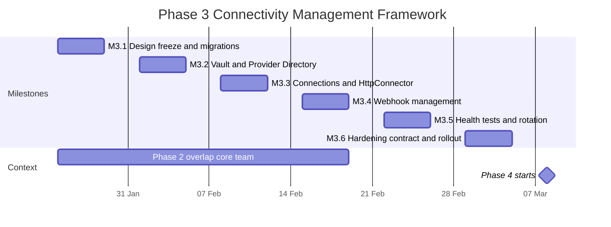
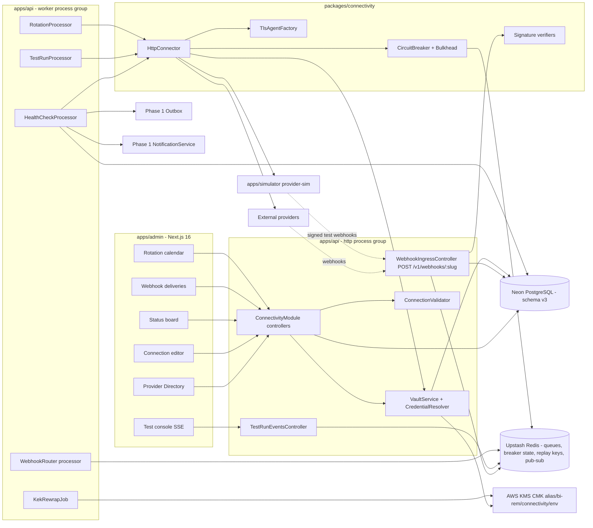
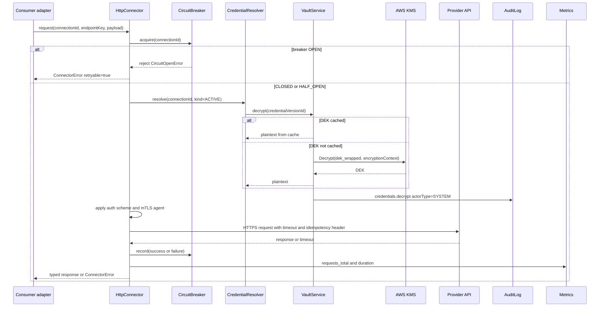
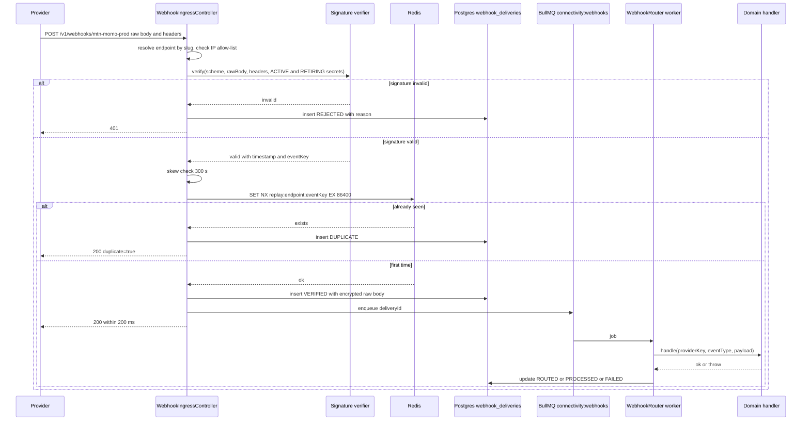
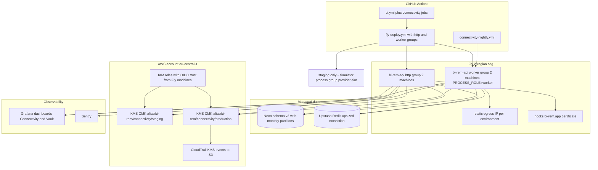
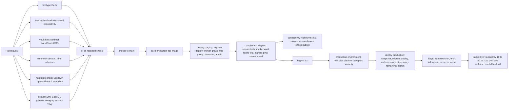

# Phase 3 — Connectivity Management Framework

| Field                     | Value                                                                                                                                                                                                                                                              |
| ------------------------- | ------------------------------------------------------------------------------------------------------------------------------------------------------------------------------------------------------------------------------------------------------------------ |
| **Phase**                 | 3 of 13 — `connectivity`                                                                                                                                                                                                                                           |
| **Dates**                 | 2027-01-25 → 2027-03-05                                                                                                                                                                                                                                            |
| **Duration**              | 6 weeks (W1 = 2027-01-25 … W6 = 2027-03-01 → 2027-03-05)                                                                                                                                                                                                           |
| **Team**                  | `platform` — 2 backend, 1 frontend, 1 QA (shared with `core` until 2027-02-19), solution architect 50 %, DevOps/SRE 50 %, security engineer 0.5 FTE, program manager 25 %, product designer 25 %; compliance analyst consulted on key custody and audit evidence |
| **Depends on**            | Phase 1 — Foundation & Platform Setup (ended 2026-12-25): `CryptoService`, `Setting`, `FeatureFlag`, `AuditLog` interceptor, `Outbox`, `RedisModule`/BullMQ, `MonitoringModule`, Fly/Vercel/Neon pipeline. Soft dependency on Phase 2 W1 items (`PROCESS_ROLE`, raw-body middleware) — see §15.1 |
| **Unlocks**               | Phase 4 — Wallet Connector Engine (2027-03-08) and, through it, Phases 5–7 and 9; Phase 13 adds providers and countries as configuration on this framework                                                                                                       |
| **Runs in parallel with** | Phase 2 — Customer Management & KYC (`core` team) during our W1–W4; Phase 2's KYC adapters are the first consumers migrated onto the framework behind a flag                                                                                                      |
| **Schema version**        | v3 (`20270125000000_phase3_expand`, `20270301000000_phase3_contract`)                                                                                                                                                                                              |
| **ADRs**                  | ADR-0010 (credential vault: envelope encryption, KMS, versioning), ADR-0011 (provider registry, webhook ingress and outbound resilience)                                                                                                                            |

---

## 1. Overview

### 1.1 Objective

Phase 3 turns "integrating a provider" from a code change into a configuration change. Today a provider secret is a Fly secret validated in `apps/api/src/config/env.ts`, an endpoint is a constant in an adapter, and a webhook is a bespoke controller. BI-Rem targets **50 providers in 20 countries** (`docs/roadmap/schedule.json`), each with a sandbox and a production tenancy, credentials that must rotate, mTLS certificates that expire, and callback URLs that must be registered on the provider side. None of that may require a deploy.

At the end of the phase an operator holding the right permissions can, from the admin portal:

1. Register a provider in the **Provider Directory** (category, countries, currencies, documentation, contacts, lifecycle).
2. Configure one **connection** per environment (`SANDBOX`, `PRODUCTION`): base URL, operation endpoints, auth scheme, credentials, mTLS certificates, inbound webhook endpoints and outbound callback URLs.
3. **Validate** the connection as a dry run and **test** it live from the dashboard, step by step (DNS → TCP → TLS → mTLS → auth → synthetic operation → webhook loopback → egress IP).
4. Promote a production change under **four-eyes approval**.
5. Watch **health and status** on a board that Phase 4/5 routing will consume as data.
6. **Rotate** any secret with an overlap window so no call and no webhook is dropped, or revoke it in an emergency.

Every secret is protected by **envelope encryption** — a random data key per credential version, wrapped by an AWS KMS customer-managed key — is **versioned**, is never returned by any API after creation, and every decrypt is audited. Inbound webhooks are **signature-verified** per provider scheme with **replay protection** before any business code sees them. Outbound calls go through one `HttpConnector` with timeouts, bounded retries, a per-connection **circuit breaker** and a bulkhead, so a slow provider cannot take the API down.

Phase 3 moves no money. It is the socket Phase 4 plugs wallet operations into.

### 1.2 In scope

| Area                              | Included                                                                                                                                                                                                                                                                                                             |
| --------------------------------- | -------------------------------------------------------------------------------------------------------------------------------------------------------------------------------------------------------------------------------------------------------------------------------------------------------------------- |
| Provider Directory                | `Provider` catalogue with lifecycle `DRAFT → ACTIVE → SUSPENDED → DEPRECATED`; categories `MOBILE_MONEY`, `BANK`, `KYC`, `MESSAGING`, `FX`, `SCREENING`, `OTHER`; seeded as **data** with the providers Phases 1–2 already use (e-mail provider, Africa's Talking, Smile ID, Sumsub, Veriff) and the Phase 4 wallet providers in `DRAFT` |
| Provider Configuration Portal     | Admin screens for connections per environment: base URL, endpoints (method, path template, timeout, retry policy, idempotency header), auth scheme, credentials, certificates, webhook endpoints, callbacks, limits, breaker thresholds; validate / test / activate; four-eyes change requests for `PRODUCTION`   |
| Credential Encryption             | `VaultService`: envelope encryption (AES-256-GCM, per-version DEK wrapped by KMS CMK with encryption context), `kek_id` on every record, KEK re-wrap job, bounded in-process DEK cache, write-only API, SHA-256 fingerprints, audited decrypts; `LOCAL_DEV` KEK for laptops and CI only                        |
| Versioned credentials             | `ProviderCredential.version` per `(connection, kind)` with lifecycle `PENDING → ACTIVE → RETIRING → RETIRED / REVOKED`; outbound uses `ACTIVE`; inbound verification accepts `ACTIVE` and `RETIRING`                                                                                                           |
| Certificates (mTLS)               | PEM upload of client certificate, private key (vaulted) and CA bundle; key/cert match check; parsed metadata (subject, issuer, serial, SANs, validity, fingerprint); expiry alerts at 30/14/7/1 days; per-connection TLS agent built in memory, never on disk                                                      |
| Webhook Management                | Generic ingress `POST /v1/webhooks/:slug` on `hooks.bi-rem.app`; signature schemes `HMAC_SHA256`, `HMAC_SHA512`, `HMAC_TIMESTAMPED`, `RSA_SHA256`, `ECDSA_P256`, `JWT_HS256`, `STATIC_TOKEN`, `BASIC`, `NONE_IP_ALLOWLIST` (composable with an IP allow-list); replay protection; delivery log; routing to handlers over BullMQ; replay from the portal; callback registry |
| Health Monitoring                 | Scheduled checks per connection (`HTTP_GET`, `TCP`, `TLS_CERT`, `AUTH_PING`, `SYNTHETIC`), partitioned results, hysteresis-based state `UP / DEGRADED / DOWN / UNKNOWN`, Prometheus gauges, Grafana alerts, admin notifications, `connectivity.status_changed` outbox event                                           |
| Connectivity Testing              | On-demand test runs executed on the `worker` process group (real egress path), eight ordered steps, results streamed to the portal over SSE, tests allowed against a `PENDING` credential version before activation                                                                                             |
| Connection Validation             | Zod schema per auth scheme, URL policy (https only outside development, SSRF guard), endpoint template check, certificate/key match, credential completeness, duplicate detection, production-equals-sandbox fingerprint check; `validate` is a dry run, `activate` refuses an invalid connection                 |
| Provider Status Monitoring        | Status board (provider × environment), `ConnectionHealth` row per connection (state, since, circuit state, consecutive failures, rolling p95), incident timeline, customer-portal service banner behind a flag                                                                                                   |
| Secret Rotation                   | Policies per credential kind (max age, warn-before, overlap), rotation calendar and reminders, rotation wizard (`PENDING` → test → activate → retire), optional automatic rotation where a provider exposes a rotation API, KEK re-wrap, emergency revoke                                                        |
| Outbound resilience               | `@bi-rem/connectivity` package: `HttpConnector` (undici-based, per-connection agent, timeouts, idempotent-only retries with jitter and a retry budget), `CircuitBreaker` (rolling window, half-open probes, state shared through Redis), `Bulkhead`, redaction, metrics and OpenTelemetry spans                  |
| Migration of existing secrets     | Import of Phase 1/2 provider secrets from Fly secrets into the vault as version 1; env fallback behind `connectivity.vault.env-fallback`; fallback and variables removed in W6                                                                                                                                  |
| `worker` process group            | Dedicated Fly process group (`PROCESS_ROLE=worker`) for health checks, test runs, webhook routing and rotation jobs; one static egress IP per environment so providers can allow-list us                                                                                                                         |

### 1.3 Out of scope (explicitly deferred)

- Wallet operations (payout, collection, balance, status) and the `WalletConnector` interface — **Phase 4**. Phase 3 only runs `AUTH_PING` and read-only synthetic operations configured per connection.
- Routing of transactions between providers by availability or cost — **Phases 4/5** (they consume `ConnectionHealth` and `connectivity.status_changed`).
- Outbound webhooks from BI-Rem to partners and merchants — **Phase 9**. Phase 3 "callbacks" are the URLs we register at a provider so the provider can call us.
- A hosted API gateway (Kong, Apigee, AWS API Gateway) — rejected in §4.4; the framework is in-process.
- HSM / CloudHSM / BYOK — rejected for now; a KMS CMK matches the data classification. Revisited in Phase 12 if a regulator requires FIPS 140-3 Level 3 custody.
- Partner API keys (`ApiKey` table) and partner OAuth — unchanged, **Phase 9**.
- Provider contract negotiation and sandbox account procurement for wallet providers — started in parallel by the PM, consumed in Phase 4.

### 1.4 Independent deployability strategy

"Deployable alone" for Phase 3 means: **the framework reaches production as a dark, empty platform while the `core` team is still rolling out Phase 2; no existing call path changes behaviour until a flag says so; every migration of an existing integration onto the framework is dual-run and reversible within one minute without a deploy; and an outage of anything Phase 3 adds degrades to "health data is stale", never to "logins, KYC or notifications fail".**

| Mechanism                          | Use in Phase 3                                                                                                                                                                                                                                                                                                                                                           |
| ---------------------------------- | ------------------------------------------------------------------------------------------------------------------------------------------------------------------------------------------------------------------------------------------------------------------------------------------------------------------------------------------------------------------------ |
| Feature flags (Phase 1 service)    | `connectivity.framework.enabled` (master), `connectivity.webhooks.ingress.enabled`, `connectivity.health-checks.enabled`, `connectivity.circuit-breakers.enforce` (observe-only when false), `connectivity.vault.env-fallback`, `connectivity.kyc-adapters.via-registry`, `connectivity.notifications.via-vault`, `connectivity.auto-rotation.enabled`, `admin.connectivity.console`, `portal.provider-status-banner` |
| Expand / contract migrations       | W1 expand adds 15 tables and 14 enums, touches no existing table. W6 contract only removes the env-fallback code path and the Fly secrets it read; nothing is dropped from the database. Phase 2's contract slot (Phase 5 W1) is untouched                                                                                                                                 |
| Dark launch                        | From W3 production runs the framework with the imported credentials marked `ACTIVE` while consumers still read env vars (`env-fallback=true`). Health checks run against production connections in `observe` mode; breakers compute state but do not open                                                                                                            |
| Dual-run and shadow verification   | W4: KYC and notification adapters resolve the credential from both sources and log (never fail) on mismatch (`vault_env_mismatch_total`). Inbound KYC webhooks are verified by both the Phase 2 controller and the new ingress for one week; results compared in a nightly report                                                                                        |
| Kill switches                      | `connectivity.framework.enabled=false` returns adapters to env resolution and pauses worker queues within 30 s (flag cache). `connectivity.webhooks.ingress.enabled=false` makes `/v1/webhooks/*` answer `503` with `Retry-After: 60`; providers retry. Per-connection `status=DISABLED` stops traffic for that connection only. All switches are audited settings       |
| Worker isolation                   | Everything that waits on a provider (health checks, test runs, webhook routing, rotations) runs only on `worker` machines. The `http` group never blocks on a provider except for the bounded synchronous calls Phase 4 will add                                                                                                                                       |
| Readiness semantics                | `/health/ready` gains a `vault` indicator (KMS reachable or decrypt from cache possible) that is **degraded-tolerant**: readiness fails only when the cache is empty and KMS is unreachable, which matches "cannot serve any provider call" rather than "one provider is down"                                                                                            |

---

## 2. Milestones

Phase start is Monday **2027-01-25**; a week runs Monday to Friday; milestone dates are the Friday of the week.

| ID       | Week | Target date | Deliverable                                                                                                                                                                                                                            | Acceptance criteria                                                                                                                                                                                                                                                                                                                                                                             | Owner role              |
| -------- | ---- | ----------- | -------------------------------------------------------------------------------------------------------------------------------------------------------------------------------------------------------------------------------------- | ----------------------------------------------------------------------------------------------------------------------------------------------------------------------------------------------------------------------------------------------------------------------------------------------------------------------------------------------------------------------------------------------- | ----------------------- |
| **M3.1** | W1   | 2027-01-29  | Design freeze: ADR-0010, ADR-0011; schema v3 expand migration merged; KMS CMKs and IAM roles for staging and production; `packages/connectivity` skeleton; `worker` process group in `infra/fly/api.fly.toml`; permission and flag catalogues extended | `pnpm db:migrate:dev` applies `20270125000000_phase3_expand` on a Phase 2 database and down/up is clean; `aws kms generate-data-key` succeeds from a Fly staging machine with the OIDC-assumed role; `PERMISSIONS` gains the 14 keys of §6.1 and seed reconciles roles; ADRs accepted at the Thursday architecture review                                                      | Solution Architect      |
| **M3.2** | W2   | 2027-02-05  | Credential vault (envelope encryption, versioning, fingerprints, audited decrypt) and Provider Directory API + admin list/detail/create                                                                                                 | Vault round-trip test against LocalStack KMS in CI and real KMS on staging; ciphertext format `v2` parses; decrypt writes `AuditLog(action=credentials.decrypt)`; `GET /v1/providers` lists seeded providers; a `DRAFT` provider is created from the portal and appears in the audit log with before/after                                                                                | Backend Lead (platform) |
| **M3.3** | W3   | 2027-02-12  | Connections: endpoints, auth schemes, mTLS certificates, validation; `HttpConnector` with breaker, bulkhead, timeouts, retries; `apps/simulator` (`provider-sim`) with four personas; import of existing env secrets; **dark launch to production** | Validation returns a structured report for 12 negative fixtures; `HttpConnector` passes the fault-injection suite (timeouts, 5xx storm, breaker open/half-open/close, retry budget exhaustion); production carries imported credentials with `env-fallback=true`; p95 overhead of `HttpConnector` over raw undici < 3 ms                                                                       | Backend Lead (platform) |
| **M3.4** | W4   | 2027-02-19  | Webhook management: ingress, nine signature schemes, replay protection, delivery log, router, portal replay, callback registry; Phase 2 KYC webhooks mirrored through the ingress                                                       | Golden-vector suite passes for every scheme; replayed event returns `200` with `duplicate=true` and is not routed; ingress acks within 200 ms p95 at 300 rps on staging (k6); one week of dual verification shows zero disagreement for Smile ID and Sumsub callbacks                                                                                                                | Backend Lead (platform) |
| **M3.5** | W5   | 2027-02-26  | Health monitoring and status board; connectivity test console with SSE; rotation policies, calendar, wizard, auto-rotation; certificate expiry alerts; Grafana dashboards and alert rules; KYC adapters routed through the registry for 10 % of checks | Status board reflects a `provider-sim` outage within 90 s and recovers with hysteresis; test run shows eight steps with per-step latency; rotation wizard completes a rotation with zero failed calls during the overlap (simulator asserts both secrets accepted); Grafana alert fires on `DOWN` in staging                                                                        | Frontend Lead + QA Lead |
| **M3.6** | W6   | 2027-03-05  | Hardening: security review of vault and ingress, k6 profiles, chaos game day, UAT with operations, contract (`env-fallback` removed, Fly provider secrets deleted), runbooks, 100 % rollout, Phase 4 handover                           | `envSchema` contains no provider-specific key (CI allow-list test); `fly secrets list` on production shows no provider variable; security findings of severity ≥ High closed; UAT sign-off by operations lead; handover accepted by the Phase 4 lead                                                                                                                                | Program Manager         |



---

## 3. Deliverables

Every deliverable below maps to an item of the phase brief. "DoD" is the definition of done checked at the milestone review.

### 3.1 Provider Directory

- **What**: `Provider` model, REST API, seed data, admin list and detail screens.
- **DoD**: `providers` table per §5 with unique `key` (kebab-case, e.g. `mtn-momo`, `smile-id`, `resend`); lifecycle transitions enforced in `ProviderService` (`DEPRECATED` is terminal, `SUSPENDED` disables every connection); seed creates `resend`, `africas-talking`, `smile-id`, `sumsub`, `veriff` as `ACTIVE` and `mtn-momo`, `orange-money`, `airtel-money`, `moov-money`, `mpesa-daraja`, `unitel-money`, `emola` as `DRAFT` with countries and currencies from `@bi-rem/shared`; `GET /v1/providers` supports filters `category`, `country`, `status` and the Phase 1 pagination envelope; every mutation is audited with before/after; adding a provider requires no code change (success criterion 2).

### 3.2 Provider Configuration Portal

- **What**: Admin screens and API for connections, endpoints, auth, credentials, certificates, webhooks, callbacks, environment selection and four-eyes approval.
- **DoD**: One `Connection` per `(provider, environment)`, `environment ∈ {SANDBOX, PRODUCTION}`; the editor has tabs General, Endpoints, Auth & Credentials, Certificates, Webhooks & Callbacks, Limits & Resilience, Health, Tests, Rotation, Changes; credential fields are write-only (the portal shows kind, version, state, fingerprint, created by/at, never a value); a change to a `PRODUCTION` connection creates a `ConnectionChangeRequest` that a **different** admin with `connections:approve` must approve within 72 h (expires otherwise); `SANDBOX` changes apply immediately; environment selector is a persistent toggle in the admin shell (`sandbox` badge amber, `production` red) and every list is scoped by it.

### 3.3 Credential Encryption (vault)

- **What**: `VaultService` in `apps/api/src/modules/connectivity/vault/`, KMS adapter, local adapter, re-wrap job, `CredentialResolver` for consumers.
- **DoD**: Envelope encryption per §4.3 — per-version random 256-bit DEK, AES-256-GCM with AAD `credentialId|version|connectionId|kind`, DEK wrapped with KMS `GenerateDataKey` under `alias/bi-rem/connectivity/<env>` and encryption context `{app:"bi-rem", env, connection_id}`; ciphertext format `v2.<kek_id>.<dek_wrapped b64url>.<iv>.<ct>.<tag>`; `kek_id` and `kek_version` persisted per record; decrypt path caches unwrapped DEKs in a bounded LRU (500 entries, 5 min TTL, zeroised on eviction) so a KMS blip does not stop traffic; **no read endpoint** returns a plaintext secret; every `decrypt` writes an `AuditLog` row (`actorType=SYSTEM` for runtime use, `USER` for test runs) with the credential id and version; `VAULT_PROVIDER=local` (HKDF of `ENCRYPTION_KEY`) is refused when `NODE_ENV=production`; re-wrap job re-encrypts every DEK under a new KEK alias target in batches of 200 with progress in `Setting connectivity.vault.rewrap-progress`.

### 3.4 Versioned credentials

- **What**: `ProviderCredential` rows with monotonic `version` per `(connection, kind)` and a lifecycle.
- **DoD**: Exactly one `ACTIVE` version per `(connection, kind)` enforced by a partial unique index; `PENDING` versions can be used by test runs only; `activate` moves the previous `ACTIVE` to `RETIRING` with `retireAt = now() + overlap`; the worker retires it at `retireAt`; `REVOKED` is immediate and terminal; inbound signature verification iterates `ACTIVE` then `RETIRING`; outbound uses `ACTIVE` only; `fingerprint = sha256(plaintext)` (hex, first 16 chars shown) enables "same secret in sandbox and production" detection and duplicate-upload warnings.

### 3.5 Certificates (mTLS)

- **What**: `ProviderCertificate` rows, upload API, TLS agent factory, expiry alerts.
- **DoD**: PEM upload of `clientCert`, `privateKey` (encrypted via vault as credential kind `MTLS_PRIVATE_KEY`), optional `caBundle`; server rejects a key that does not match the certificate's public key, an expired certificate, or a chain that does not validate against the uploaded CA; parsed metadata persisted (`subject`, `issuer`, `serialNumber`, `sans[]`, `notBefore`, `notAfter`, `sha256Fingerprint`); `TlsAgentFactory` builds an undici `Agent` with `connect: { cert, key, ca, minVersion: 'TLSv1.2' }` from decrypted material held in memory only; expiry notifications at 30/14/7/1 days via Phase 1 `NotificationService` template `certificate-expiring` (EMAIL + IN_APP) and Prometheus `connectivity_certificate_expiry_seconds`.

### 3.6 Webhook Management

- **What**: Ingress controller, verifier plugins, replay protection, delivery log, router, replay API, callback registry.
- **DoD**: `POST /v1/webhooks/:slug` is `@Public()`, served under `hooks.bi-rem.app` (staging `hooks-staging.bi-rem.app`), captures raw body (≤ 1 MiB) through the Phase 2 raw-body middleware, resolves `WebhookEndpoint` by slug, enforces the optional IP allow-list, verifies the configured scheme in constant time, checks replay (timestamp skew ≤ 300 s where the scheme carries one; `(endpoint_id, event_key)` unique where `event_key` is the provider event id or `sha256(rawBody)`; Redis `SET NX EX 86400` fast path), persists `WebhookDelivery` **before** acknowledging, answers `200` within 200 ms p95 and never calls a provider on the request path; verified deliveries are enqueued to `connectivity:webhooks` and routed by `(providerKey, eventType)` to handlers registered through `WebhookRouter.register()`; unrouted deliveries are kept 7 days as `UNROUTED`; failed signatures answer `401` and increment `connectivity_webhook_rejected_total{reason}`; replay from the portal re-enqueues a stored delivery with `replayedFromId`; `ProviderCallback` rows record the URL registered at the provider per event type with `registrationStatus` and last verification.

### 3.7 Health Monitoring

- **What**: Scheduled checks, result store, state aggregation, metrics, alerts, notifications.
- **DoD**: `ConnectionHealthCheck` rows define check type, interval (default 60 s, minimum 30 s), timeout and expectation; BullMQ repeatable jobs on the worker execute them with bulkhead `1` per connection; results land in `connection_health_results` (monthly partitions, 30-day raw retention, daily roll-ups kept 13 months in `connection_health_daily`); `ConnectionHealth` holds the current state with hysteresis (3 consecutive failures → `DOWN`, 2 consecutive successes → `UP`, `DEGRADED` when rolling 5-minute error rate is 5–50 % or p95 exceeds the configured threshold); state changes write `connectivity.status_changed` to the outbox and notify admins (`provider-status-changed` template); Prometheus `connectivity_connection_up{provider,environment}`, `connectivity_health_check_duration_seconds`, `connectivity_circuit_state`; Grafana alert rules in §11.

### 3.8 Connectivity Testing

- **What**: Test runs from the dashboard with live step results.
- **DoD**: `POST /v1/connections/:id/tests` enqueues `connectivity:tests` on the worker and returns `202` with `runId`; steps `DNS`, `TCP`, `TLS`, `MTLS`, `AUTH`, `SYNTHETIC`, `WEBHOOK_LOOPBACK`, `EGRESS_IP` run in order and stop at the first hard failure; each step records `status`, `durationMs`, `detail` (redacted) in `connectivity_test_runs.steps`; `GET /v1/connections/:id/tests/:runId/events` streams SSE from a Redis pub/sub channel so any `http` machine can serve the stream; a run may target a `PENDING` credential version (`credentialVersionId` body field); `WEBHOOK_LOOPBACK` sends a signed synthetic event to our own ingress endpoint for the connection and asserts it is accepted; `EGRESS_IP` calls `https://api.ipify.org` (configurable) and asserts the IP is in the environment's static egress set; results retained 90 days; success criterion 3 ("provider testing from the dashboard") is demonstrated by this console.

### 3.9 Connection Validation

- **What**: Dry-run validation engine shared by the portal, the API and the activation guard.
- **DoD**: `ConnectionValidator.validate(connectionId)` returns `{ valid, errors[], warnings[] }` with stable codes (`URL_NOT_HTTPS`, `URL_PRIVATE_ADDRESS`, `TEMPLATE_VAR_UNBOUND`, `CREDENTIAL_MISSING`, `CERT_KEY_MISMATCH`, `CERT_EXPIRED`, `DUPLICATE_ACTIVE_CONNECTION`, `SANDBOX_SECRET_REUSED_IN_PRODUCTION`, `TIMEOUT_EXCEEDS_BUDGET`, `WEBHOOK_SCHEME_NEEDS_SECRET`, `DNS_UNRESOLVED`); SSRF guard resolves the host and rejects loopback, RFC 1918, link-local, CGNAT, ULA and `0.0.0.0/8` unless `NODE_ENV=development`; `activate` and change-request approval call `validate` and refuse on `valid=false`; the portal shows the report inline with links to the offending tab.

### 3.10 Provider Status Monitoring

- **What**: Status board, incidents, downstream event, optional customer banner.
- **DoD**: `/connectivity/status` renders a grid provider × environment with state, since, circuit state, consecutive failures, p95, last incident; `ConnectionIncident` rows open on `DOWN` and close on `UP` with duration; `GET /v1/connectivity/status` returns the same data for Phase 4/5 routing and the Phase 11 app; `portal.provider-status-banner` shows "Payments to <provider> are delayed" on the customer portal when a production `MOBILE_MONEY` connection is `DOWN` for more than 5 minutes (copy from a template, localised en/fr/pt).

### 3.11 Secret Rotation

- **What**: Policies, calendar, wizard, automatic rotation, KEK re-wrap, emergency revoke.
- **DoD**: `CredentialRotationPolicy` per `(provider, kind)` with defaults (`API_KEY`/`API_SECRET`/`HMAC_SIGNING_KEY`/`WEBHOOK_SECRET` 90 days, `OAUTH2_CLIENT_SECRET` 180 days, `MTLS_PRIVATE_KEY` 365 days, `BASIC_PASSWORD` 90 days), `warnBeforeDays` 14, `overlapHours` 24; nightly job computes `dueAt` and sends reminders; wizard: create `PENDING` → run test against it → activate (previous → `RETIRING`) → auto-retire after overlap; automatic rotation runs for connections whose provider declares a `ROTATION` endpoint in its configuration (generic: call endpoint, parse new secret from a JSONPath, store as `PENDING`, test, activate) behind `connectivity.auto-rotation.enabled`; emergency revoke sets `REVOKED`, opens the breaker for the connection until a new `ACTIVE` version exists and pages on-call; rotation events are audited and surface in the calendar.

### 3.12 Outbound resilience (`@bi-rem/connectivity`)

- **What**: Framework package consumed by `apps/api`, Phase 2 adapters and Phase 4 connectors.
- **DoD**: `HttpConnector.forConnection(connectionId)` returns a client bound to the connection's base URL, agent, auth scheme and limits; defaults connect 5 s / total 20 s, overridable per endpoint; retries only for `GET`/`HEAD` or requests carrying an idempotency key, 3 attempts, exponential backoff 200 ms base with full jitter, retry budget 20 % of requests per connection per minute; `CircuitBreaker` with rolling window 20 requests / 30 s, opens at 50 % failures, half-open after 30 s with one probe, state in Redis `cb:<connectionId>` broadcast over pub/sub and mirrored to `ConnectionHealth.circuitState`; `Bulkhead` enforces `Provider.maxConcurrency`; request and response logging redacts `Authorization`, `Ocp-Apim-Subscription-Key`, `X-Api-Key`, `SecurityCredential` and configured secret headers; metrics `connectivity_requests_total{provider,environment,operation,outcome}`, `connectivity_request_duration_seconds`, `connectivity_retries_total`; OpenTelemetry span per request with `peer.service=<providerKey>`; exported also as the type alias `ResilientHttpClient` used by the Phase 4 plan; Phase 2 `ResilientKycProvider` re-based on it behind `connectivity.kyc-adapters.via-registry`.

### 3.13 Migration of existing secrets and the "no hardcoded credential" contract

- **What**: Import script, dual resolution, env schema contraction.
- **DoD**: `infra/scripts/import-env-secrets.ts` reads the current Fly secrets of a given app (via `fly secrets list` names and a one-time operator-supplied values file that is shredded after use), creates or updates providers and connections and stores version 1 credentials; `CredentialResolver` resolves vault first and env second while `connectivity.vault.env-fallback=true`, emitting `vault_env_mismatch_total` on disagreement; W6 contract removes `SMTP_USER`, `SMTP_PASS` and every Phase 2 provider variable from `envSchema`, deletes them with `fly secrets unset`, and a CI test asserts `Object.keys(envSchema.shape)` ⊆ the platform allow-list in `apps/api/src/config/env-allowlist.ts`; gitleaks and a semgrep rule (`bi-rem/no-provider-secret-literal`) run in `security.yml`.

---

## 4. Architecture

### 4.1 Component view (Phase 3 additions)



The framework is one NestJS module tree (`apps/api/src/modules/connectivity/{providers,connections,vault,webhooks,health,testing,rotation}`) plus a pure TypeScript package `packages/connectivity` (`@bi-rem/connectivity`) with no Nest dependency, so Phase 4 connector packages and the simulator can use `HttpConnector` and the signature verifiers directly. The same `apps/api` image runs as `http` or `worker` depending on `PROCESS_ROLE`; BullMQ consumers are registered only when the role is `worker` (or `all` in development).

### 4.2 Key flow: outbound call through a managed connection



### 4.3 Key flow: inbound webhook with verification and replay protection



### 4.4 Design decisions and alternatives rejected

| #     | Decision                                                                                                         | Alternatives rejected                                                                   | Rationale                                                                                                                                                                                                                                                         |
| ----- | ---------------------------------------------------------------------------------------------------------------- | --------------------------------------------------------------------------------------- | ----------------------------------------------------------------------------------------------------------------------------------------------------------------------------------------------------------------------------------------------------------------- |
| D3.1  | **Envelope encryption with AWS KMS CMK**, one DEK per credential version, `kek_id` stored per record (ADR-0010) | Reuse Phase 1 `ENCRYPTION_KEY` AES-GCM directly; HashiCorp Vault; CloudHSM             | A single static key in an env var is the thing we are removing; KMS gives audited key use, IAM-scoped access, rotation and a path to per-country keys in Phase 13; a Vault cluster is an operational burden for a 0.5 FTE security engineer; HSM is not required by the data class |
| D3.2  | **Data keys unwrapped on demand and cached in memory**, never persisted in plaintext                            | Decrypt everything at boot; persist DEKs in Redis                                       | Boot-time decrypt couples startup to KMS and leaks secrets into heap dumps for the whole process life; Redis is shared infrastructure and outside the key-custody boundary                                                                                       |
| D3.3  | **Provider configuration is data** (`providers`, `provider_connections`, `provider_endpoints`), code only in adapters | Config files per provider in the repo; one Nest module per provider                      | Success criterion "providers added without code changes"; Phase 13 must add a country's providers in ≤ 10 engineering days with zero API deploys                                                                                                                 |
| D3.4  | **One generic webhook ingress** with pluggable signature schemes, persistence before ack                         | One controller per provider (Phase 2 style); API gateway with request validation         | Every provider needs the same five things (verify, de-duplicate, store, ack fast, route); a gateway product adds cost and a second deploy surface and still cannot verify provider-specific HMAC schemes without custom code                                      |
| D3.5  | **Worker process group** owns everything that waits on a provider                                                | Run health checks and tests in the http process                                          | A slow provider must never consume http request capacity; Fly `http_service.concurrency` limits are tuned for API latency; worker machines get the static egress IPs providers allow-list                                                                        |
| D3.6  | **Circuit-breaker state shared through Redis** and mirrored to Postgres                                           | Per-process breakers                                                                     | With 2+ http and 2 worker machines a per-process breaker would open on one machine and keep hammering from the others; the Postgres mirror makes state visible on the board and survives Redis loss                                                             |
| D3.7  | **Four-eyes approval for production connection changes** stored as change requests                               | Trust the single admin; rely on audit only                                                | Changing a production base URL or secret is a money-movement risk; the audit log records but does not prevent; regulators (BCEAO, CBN, CBK) expect maker-checker on payment configuration                                                                       |
| D3.8  | **Dual-secret overlap on rotation**                                                                              | Instant cut-over                                                                         | Providers keep signing webhooks with the old secret for minutes to hours after we rotate; instant cut-over drops callbacks                                                                                                                                      |
| D3.9  | **undici `Agent` per connection** in `HttpConnector`                                                             | axios / `@nestjs/axios`; global `https.Agent`                                            | mTLS material differs per connection; undici gives connection pooling, per-origin limits and body timeouts without monkey-patching                                                                                                                              |
| D3.10 | **Simulator `provider-sim` in `apps/simulator`** with generic personas now, provider-specific profiles in Phase 4 | Mock at the unit level only                                                                | The test console, rotation overlap and webhook loopback need a real HTTP peer that signs, delays, fails and replays on command; Phase 9's sandbox reuses it                                                                                                      |

### 4.5 Deployment and infrastructure delta



Infra delta summary: (a) `infra/fly/api.fly.toml` gains a `[processes]` table with `http` and `worker` commands and a second `[[vm]]` for `worker` (2 × `shared-cpu-2x`, 1 GB, no public service, `WORKER_QUEUES=connectivity:*,notifications,outbox-relay`); (b) one Fly static egress IP per environment attached to the worker group and documented in `docs/handbooks/provider-allowlisting.md`; (c) Fly certificate and DNS for `hooks.bi-rem.app` / `hooks-staging.bi-rem.app` pointing at the http group (apex per Phase 1 open question Q1); (d) AWS account with two KMS CMKs, two IAM roles (`bi-rem-api-staging`, `bi-rem-api-production`) trusting Fly machine OIDC tokens with `aud=bi-rem-kms`, policy limited to `kms:GenerateDataKey`, `kms:Decrypt`, `kms:DescribeKey` with encryption-context conditions, CloudTrail to an S3 bucket with 400-day retention; if Fly OIDC federation proves unavailable in W1, fallback is a scoped IAM user access key as a Fly secret with 90-day rotation tracked by this phase's own rotation calendar; (e) Upstash Redis upsized to 1 GB with `noeviction` (BullMQ) and key prefixes `connectivity:`, `cb:`, `replay:`; (f) Neon: monthly range partitions for `webhook_deliveries` and `connection_health_results` created three months ahead by the existing `db-migrate.yml` nightly job; (g) staging-only `simulator` process group reachable over Fly private networking (`simulator.internal:4100`); (h) Grafana dashboards "Connectivity" and "Vault" and the alert rules of §11; (i) LocalStack KMS service container in CI.

### 4.6 Envelope encryption detail

```
plaintext secret ──AES-256-GCM(DEK, iv, AAD)──▶ ct, tag
DEK (32 random bytes) ──KMS GenerateDataKey(CMK, ctx)──▶ dek_wrapped
stored: v2 . kek_id . b64url(dek_wrapped) . b64url(iv) . b64url(ct) . b64url(tag)
AAD = credential_id | version | connection_id | kind
ctx = { app: "bi-rem", env: "production", connection_id: "<uuid>" }
```

Decrypt requires the same AAD and encryption context, so a ciphertext copied onto another connection row or another environment fails authentication. KMS automatic annual rotation of the CMK is transparent (KMS keeps old backing keys); the re-wrap job exists for deliberate key replacement (compromise, per-country keys in Phase 13).

---

## 5. Data Model & Migrations

### 5.1 Prisma additions (schema v3)

All additions follow CLAUDE.md: uuid ids via `gen_random_uuid()`, `timestamptz(6)`, snake_case `@@map`/`@map`. Phase 3 stores no money; the convention (BIGINT minor units + `currency`) is applied to the only amount-like field, the synthetic-operation amount used by test runs.

```prisma
// ---------------------------------------------------------------------------
// Phase 3 — Connectivity Management Framework (schema v3)
// ---------------------------------------------------------------------------

enum ProviderCategory {
  MOBILE_MONEY
  BANK
  KYC
  MESSAGING
  FX
  SCREENING
  OTHER

  @@map("provider_category")
}

enum ProviderLifecycle {
  DRAFT
  ACTIVE
  SUSPENDED
  DEPRECATED

  @@map("provider_lifecycle")
}

enum ProviderEnvironment {
  SANDBOX
  PRODUCTION

  @@map("provider_environment")
}

enum ConnectionState {
  DRAFT
  VALIDATED
  ACTIVE
  DISABLED

  @@map("connection_state")
}

enum AuthScheme {
  NONE
  API_KEY_HEADER
  BASIC
  HMAC_REQUEST_SIGNING
  OAUTH2_CLIENT_CREDENTIALS
  JWT_BEARER
  MTLS
  MTLS_PLUS_OAUTH2

  @@map("auth_scheme")
}

enum CredentialKind {
  API_KEY
  API_SECRET
  BASIC_PASSWORD
  OAUTH2_CLIENT_SECRET
  HMAC_SIGNING_KEY
  JWT_PRIVATE_KEY
  MTLS_PRIVATE_KEY
  WEBHOOK_SECRET
  PARTNER_WEBHOOK_SECRET
  OTHER

  @@map("credential_kind")
}

enum CredentialState {
  PENDING
  ACTIVE
  RETIRING
  RETIRED
  REVOKED

  @@map("credential_state")
}

enum VaultKeyProvider {
  AWS_KMS
  LOCAL_DEV

  @@map("vault_key_provider")
}

enum WebhookSignatureScheme {
  HMAC_SHA256
  HMAC_SHA512
  HMAC_TIMESTAMPED
  RSA_SHA256
  ECDSA_P256
  JWT_HS256
  STATIC_TOKEN
  BASIC
  NONE_IP_ALLOWLIST

  @@map("webhook_signature_scheme")
}

enum WebhookDeliveryStatus {
  VERIFIED
  REJECTED
  DUPLICATE
  ROUTED
  PROCESSED
  UNROUTED
  FAILED

  @@map("webhook_delivery_status")
}

enum HealthCheckType {
  HTTP_GET
  TCP
  TLS_CERT
  AUTH_PING
  SYNTHETIC

  @@map("health_check_type")
}

enum HealthState {
  UP
  DEGRADED
  DOWN
  UNKNOWN

  @@map("health_state")
}

enum CircuitState {
  CLOSED
  OPEN
  HALF_OPEN

  @@map("circuit_state")
}

enum TestRunStatus {
  QUEUED
  RUNNING
  PASSED
  FAILED
  CANCELLED

  @@map("test_run_status")
}

enum ChangeRequestStatus {
  PENDING
  APPROVED
  REJECTED
  APPLIED
  EXPIRED

  @@map("change_request_status")
}

/// Key-encryption keys known to the vault. Exactly one is `isDefault` per environment.
model VaultKey {
  id          String           @id @default(dbgenerated("gen_random_uuid()")) @db.Uuid
  /// Stable identifier embedded in every ciphertext (`kek_id`), e.g. "aws:alias/bi-rem/connectivity/production".
  kekId       String           @unique @map("kek_id") @db.VarChar(200)
  provider    VaultKeyProvider
  environment ProviderEnvironment
  isDefault   Boolean          @default(false) @map("is_default")
  retiredAt   DateTime?        @map("retired_at") @db.Timestamptz(6)
  createdAt   DateTime         @default(now()) @map("created_at") @db.Timestamptz(6)

  credentials ProviderCredential[]

  @@index([environment, isDefault])
  @@map("vault_keys")
}

model Provider {
  id                 String            @id @default(dbgenerated("gen_random_uuid()")) @db.Uuid
  /// kebab-case, immutable once ACTIVE (e.g. "mtn-momo", "smile-id").
  key                String            @unique @db.VarChar(64)
  name               String            @db.VarChar(120)
  category           ProviderCategory
  status             ProviderLifecycle @default(DRAFT)
  /// ISO-3166-1 alpha-2 codes served by this provider.
  countries          String[]          @default([])
  /// ISO-4217 codes supported.
  currencies         String[]          @default([])
  maxConcurrency     Int               @default(20) @map("max_concurrency")
  rateLimitPerSecond Int?              @map("rate_limit_per_second")
  documentationUrl   String?           @map("documentation_url") @db.VarChar(500)
  /// Support contacts: [{ name, email, phone, role }], no secrets.
  contacts           Json              @default("[]")
  tags               String[]          @default([])
  createdById        String?           @map("created_by_id") @db.Uuid
  createdAt          DateTime          @default(now()) @map("created_at") @db.Timestamptz(6)
  updatedAt          DateTime          @updatedAt @map("updated_at") @db.Timestamptz(6)

  connections      Connection[]
  rotationPolicies CredentialRotationPolicy[]

  @@index([category, status])
  @@map("providers")
}

/// One connection per provider per environment. Carries the non-secret configuration;
/// secrets live in `ProviderCredential`, certificates in `ProviderCertificate`.
model Connection {
  id                String              @id @default(dbgenerated("gen_random_uuid()")) @db.Uuid
  providerId        String              @map("provider_id") @db.Uuid
  environment       ProviderEnvironment
  status            ConnectionState     @default(DRAFT)
  baseUrl           String              @map("base_url") @db.VarChar(500)
  authScheme        AuthScheme          @default(NONE) @map("auth_scheme")
  /// Scheme-specific non-secret settings (header names, token URL, scopes, HMAC algorithm, JWT claims).
  authConfig        Json                @default("{}") @map("auth_config")
  connectTimeoutMs  Int                 @default(5000) @map("connect_timeout_ms")
  totalTimeoutMs    Int                 @default(20000) @map("total_timeout_ms")
  /// { maxAttempts, baseDelayMs, retryBudgetPercent, retryOn: [status codes] }
  retryPolicy       Json                @default("{}") @map("retry_policy")
  /// { windowSize, windowMs, failureRatePercent, halfOpenAfterMs, halfOpenProbes }
  breakerPolicy     Json                @default("{}") @map("breaker_policy")
  /// Static egress IPs the provider has allow-listed on their side (informational).
  providerAllowlistedIps String[]       @default([]) @map("provider_allowlisted_ips")
  notes             String?
  activatedAt       DateTime?           @map("activated_at") @db.Timestamptz(6)
  disabledAt        DateTime?           @map("disabled_at") @db.Timestamptz(6)
  lastValidatedAt   DateTime?           @map("last_validated_at") @db.Timestamptz(6)
  lastValidation    Json?               @map("last_validation")
  rotatedAt         DateTime?           @map("rotated_at") @db.Timestamptz(6)
  createdById       String?             @map("created_by_id") @db.Uuid
  createdAt         DateTime            @default(now()) @map("created_at") @db.Timestamptz(6)
  updatedAt         DateTime            @updatedAt @map("updated_at") @db.Timestamptz(6)

  provider        Provider                   @relation(fields: [providerId], references: [id], onDelete: Restrict)
  endpoints       ProviderEndpoint[]
  credentials     ProviderCredential[]
  certificates    ProviderCertificate[]
  webhookEndpoints WebhookEndpoint[]
  callbacks       ProviderCallback[]
  healthChecks    ConnectionHealthCheck[]
  health          ConnectionHealth?
  incidents       ConnectionIncident[]
  testRuns        ConnectivityTestRun[]
  changeRequests  ConnectionChangeRequest[]

  @@unique([providerId, environment])
  @@index([status])
  @@map("provider_connections")
}

/// A named operation on a connection, e.g. "token", "transfer", "status", "auth_ping", "rotation".
model ProviderEndpoint {
  id              String     @id @default(dbgenerated("gen_random_uuid()")) @db.Uuid
  connectionId    String     @map("connection_id") @db.Uuid
  key             String     @db.VarChar(64)
  method          String     @db.VarChar(8)
  /// Path template relative to base_url, e.g. "/collection/v1_0/requesttopay/{referenceId}".
  pathTemplate    String     @map("path_template") @db.VarChar(500)
  timeoutMs       Int?       @map("timeout_ms")
  idempotent      Boolean    @default(false)
  idempotencyHeader String?  @map("idempotency_header") @db.VarChar(64)
  /// Static headers (non-secret) merged into every request.
  headers         Json       @default("{}")
  /// For SYNTHETIC checks and tests: request body template and expected response JSONPath assertions.
  syntheticSpec   Json?      @map("synthetic_spec")
  createdAt       DateTime   @default(now()) @map("created_at") @db.Timestamptz(6)
  updatedAt       DateTime   @updatedAt @map("updated_at") @db.Timestamptz(6)

  connection Connection @relation(fields: [connectionId], references: [id], onDelete: Cascade)

  @@unique([connectionId, key])
  @@map("provider_endpoints")
}

/// Versioned, envelope-encrypted secret. No API ever returns `ciphertext` or a plaintext.
model ProviderCredential {
  id            String          @id @default(dbgenerated("gen_random_uuid()")) @db.Uuid
  connectionId  String          @map("connection_id") @db.Uuid
  kind          CredentialKind
  version       Int
  state         CredentialState @default(PENDING)
  /// `v2.<kek_id>.<dek_wrapped>.<iv>.<ct>.<tag>` (see §4.6).
  ciphertext    String
  kekId         String          @map("kek_id") @db.VarChar(200)
  kekVersion    Int             @default(1) @map("kek_version")
  /// hex sha256 of the plaintext; used for duplicate and sandbox-vs-production detection.
  fingerprint   String          @db.VarChar(64)
  /// Non-secret label shown in the portal, e.g. "subscription key (collections)".
  label         String?         @db.VarChar(120)
  expiresAt     DateTime?       @map("expires_at") @db.Timestamptz(6)
  activatedAt   DateTime?       @map("activated_at") @db.Timestamptz(6)
  retireAt      DateTime?       @map("retire_at") @db.Timestamptz(6)
  retiredAt     DateTime?       @map("retired_at") @db.Timestamptz(6)
  revokedAt     DateTime?       @map("revoked_at") @db.Timestamptz(6)
  revokedReason String?         @map("revoked_reason") @db.VarChar(255)
  createdById   String?         @map("created_by_id") @db.Uuid
  createdAt     DateTime        @default(now()) @map("created_at") @db.Timestamptz(6)
  updatedAt     DateTime        @updatedAt @map("updated_at") @db.Timestamptz(6)

  connection Connection @relation(fields: [connectionId], references: [id], onDelete: Cascade)
  vaultKey   VaultKey   @relation(fields: [kekId], references: [kekId], onDelete: Restrict)

  @@unique([connectionId, kind, version])
  @@index([connectionId, kind, state])
  @@index([state, retireAt])
  @@index([kekId])
  @@map("provider_credentials")
}

/// Client certificate for mTLS. The private key is a `ProviderCredential` of kind MTLS_PRIVATE_KEY.
model ProviderCertificate {
  id                String    @id @default(dbgenerated("gen_random_uuid()")) @db.Uuid
  connectionId      String    @map("connection_id") @db.Uuid
  privateKeyCredentialId String? @map("private_key_credential_id") @db.Uuid
  certificatePem    String    @map("certificate_pem")
  caBundlePem       String?   @map("ca_bundle_pem")
  subject           String    @db.VarChar(500)
  issuer            String    @db.VarChar(500)
  serialNumber      String    @map("serial_number") @db.VarChar(100)
  sans              String[]  @default([])
  notBefore         DateTime  @map("not_before") @db.Timestamptz(6)
  notAfter          DateTime  @map("not_after") @db.Timestamptz(6)
  sha256Fingerprint String    @map("sha256_fingerprint") @db.VarChar(95)
  isActive          Boolean   @default(false) @map("is_active")
  createdById       String?   @map("created_by_id") @db.Uuid
  createdAt         DateTime  @default(now()) @map("created_at") @db.Timestamptz(6)
  updatedAt         DateTime  @updatedAt @map("updated_at") @db.Timestamptz(6)

  connection Connection @relation(fields: [connectionId], references: [id], onDelete: Cascade)

  @@index([connectionId, isActive])
  @@index([notAfter])
  @@map("provider_certificates")
}

/// An inbound URL we expose to a provider: hooks.bi-rem.app/v1/webhooks/<slug>.
model WebhookEndpoint {
  id              String                 @id @default(dbgenerated("gen_random_uuid()")) @db.Uuid
  connectionId    String                 @map("connection_id") @db.Uuid
  slug            String                 @unique @db.VarChar(80)
  scheme          WebhookSignatureScheme
  /// Header names, timestamp header, tolerance seconds, JSONPath of the event id and event type, public key PEM for RSA/ECDSA.
  schemeConfig    Json                   @default("{}") @map("scheme_config")
  allowedCidrs    String[]               @default([]) @map("allowed_cidrs")
  isEnabled       Boolean                @default(true) @map("is_enabled")
  /// Days to keep raw bodies before they are nulled (default 30).
  rawBodyRetentionDays Int               @default(30) @map("raw_body_retention_days")
  createdAt       DateTime               @default(now()) @map("created_at") @db.Timestamptz(6)
  updatedAt       DateTime               @updatedAt @map("updated_at") @db.Timestamptz(6)

  connection Connection        @relation(fields: [connectionId], references: [id], onDelete: Cascade)
  deliveries WebhookDelivery[]

  @@index([connectionId])
  @@map("webhook_endpoints")
}

/// Every inbound webhook, persisted before acknowledgement. Range-partitioned by received_at (monthly).
model WebhookDelivery {
  id              String                @id @default(dbgenerated("gen_random_uuid()")) @db.Uuid
  endpointId      String                @map("endpoint_id") @db.Uuid
  /// Provider event id when the scheme exposes one, else sha256(rawBody).
  eventKey        String                @map("event_key") @db.VarChar(160)
  eventType       String?               @map("event_type") @db.VarChar(120)
  status          WebhookDeliveryStatus
  rejectReason    String?               @map("reject_reason") @db.VarChar(120)
  /// Encrypted with the vault (kind WEBHOOK_SECRET is not used; the endpoint's connection DEK is). Nulled after retention.
  rawBodyEncrypted String?              @map("raw_body_encrypted")
  headers         Json
  sourceIp        String?               @map("source_ip") @db.VarChar(45)
  credentialVersion Int?                @map("credential_version")
  routedTo        String?               @map("routed_to") @db.VarChar(120)
  attempts        Int                   @default(0)
  lastError       String?               @map("last_error")
  replayedFromId  String?               @map("replayed_from_id") @db.Uuid
  correlationId   String?               @map("correlation_id") @db.VarChar(128)
  receivedAt      DateTime              @default(now()) @map("received_at") @db.Timestamptz(6)
  processedAt     DateTime?             @map("processed_at") @db.Timestamptz(6)

  endpoint WebhookEndpoint @relation(fields: [endpointId], references: [id], onDelete: Cascade)

  @@unique([endpointId, eventKey, receivedAt])
  @@index([status, receivedAt])
  @@index([endpointId, receivedAt])
  @@map("webhook_deliveries")
}

/// The URL we registered at the provider for a given event type (so the provider can call us).
model ProviderCallback {
  id                 String    @id @default(dbgenerated("gen_random_uuid()")) @db.Uuid
  connectionId       String    @map("connection_id") @db.Uuid
  eventType          String    @map("event_type") @db.VarChar(120)
  url                String    @db.VarChar(500)
  /// REGISTERED, PENDING_PROVIDER, FAILED, UNKNOWN — free text kept short on purpose.
  registrationStatus String    @default("UNKNOWN") @map("registration_status") @db.VarChar(32)
  registeredAt       DateTime? @map("registered_at") @db.Timestamptz(6)
  lastVerifiedAt     DateTime? @map("last_verified_at") @db.Timestamptz(6)
  notes              String?
  createdAt          DateTime  @default(now()) @map("created_at") @db.Timestamptz(6)
  updatedAt          DateTime  @updatedAt @map("updated_at") @db.Timestamptz(6)

  connection Connection @relation(fields: [connectionId], references: [id], onDelete: Cascade)

  @@unique([connectionId, eventType])
  @@map("provider_callbacks")
}

model ConnectionHealthCheck {
  id              String          @id @default(dbgenerated("gen_random_uuid()")) @db.Uuid
  connectionId    String          @map("connection_id") @db.Uuid
  type            HealthCheckType
  /// Endpoint key for HTTP_GET / AUTH_PING / SYNTHETIC; host:port for TCP; null for TLS_CERT.
  target          String?         @db.VarChar(200)
  intervalSeconds Int             @default(60) @map("interval_seconds")
  timeoutMs       Int             @default(5000) @map("timeout_ms")
  /// { expectStatus: [200], jsonPath: "$.status", equals: "ok", p95ThresholdMs: 1500 }
  expectation     Json            @default("{}")
  isEnabled       Boolean         @default(true) @map("is_enabled")
  createdAt       DateTime        @default(now()) @map("created_at") @db.Timestamptz(6)
  updatedAt       DateTime        @updatedAt @map("updated_at") @db.Timestamptz(6)

  connection Connection              @relation(fields: [connectionId], references: [id], onDelete: Cascade)
  results    ConnectionHealthResult[]

  @@unique([connectionId, type, target])
  @@map("connection_health_checks")
}

/// Raw check results. Range-partitioned by checked_at (monthly), 30-day retention.
model ConnectionHealthResult {
  id         String   @id @default(dbgenerated("gen_random_uuid()")) @db.Uuid
  checkId    String   @map("check_id") @db.Uuid
  ok         Boolean
  durationMs Int      @map("duration_ms")
  statusCode Int?     @map("status_code")
  errorCode  String?  @map("error_code") @db.VarChar(64)
  detail     Json?
  checkedAt  DateTime @default(now()) @map("checked_at") @db.Timestamptz(6)

  check ConnectionHealthCheck @relation(fields: [checkId], references: [id], onDelete: Cascade)

  @@index([checkId, checkedAt])
  @@map("connection_health_results")
}

/// Current aggregated state per connection (one row, upserted by the worker).
model ConnectionHealth {
  connectionId        String       @id @map("connection_id") @db.Uuid
  state               HealthState  @default(UNKNOWN)
  stateSince          DateTime     @default(now()) @map("state_since") @db.Timestamptz(6)
  circuitState        CircuitState @default(CLOSED) @map("circuit_state")
  consecutiveFailures Int          @default(0) @map("consecutive_failures")
  consecutiveSuccesses Int         @default(0) @map("consecutive_successes")
  errorRatePercent    Int          @default(0) @map("error_rate_percent")
  p95Ms               Int?         @map("p95_ms")
  lastCheckedAt       DateTime?    @map("last_checked_at") @db.Timestamptz(6)
  lastError           String?      @map("last_error")
  updatedAt           DateTime     @updatedAt @map("updated_at") @db.Timestamptz(6)

  connection Connection @relation(fields: [connectionId], references: [id], onDelete: Cascade)

  @@index([state])
  @@map("connection_health")
}

model ConnectionIncident {
  id           String    @id @default(dbgenerated("gen_random_uuid()")) @db.Uuid
  connectionId String    @map("connection_id") @db.Uuid
  fromState    HealthState @map("from_state")
  toState      HealthState @map("to_state")
  startedAt    DateTime  @default(now()) @map("started_at") @db.Timestamptz(6)
  resolvedAt   DateTime? @map("resolved_at") @db.Timestamptz(6)
  summary      String?   @db.VarChar(500)
  notifiedAt   DateTime? @map("notified_at") @db.Timestamptz(6)

  connection Connection @relation(fields: [connectionId], references: [id], onDelete: Cascade)

  @@index([connectionId, startedAt])
  @@index([resolvedAt])
  @@map("connection_incidents")
}

/// On-demand connectivity test. Steps are an ordered JSON array with status, duration and redacted detail.
model ConnectivityTestRun {
  id                  String        @id @default(dbgenerated("gen_random_uuid()")) @db.Uuid
  connectionId        String        @map("connection_id") @db.Uuid
  credentialVersionId String?       @map("credential_version_id") @db.Uuid
  status              TestRunStatus @default(QUEUED)
  steps               Json          @default("[]")
  /// Synthetic operation amount (if the endpoint spec uses one), minor units + ISO-4217.
  syntheticAmountMinor BigInt?      @map("synthetic_amount_minor")
  syntheticCurrency   String?       @map("synthetic_currency") @db.Char(3)
  egressIp            String?       @map("egress_ip") @db.VarChar(45)
  requestedById       String        @map("requested_by_id") @db.Uuid
  correlationId       String?       @map("correlation_id") @db.VarChar(128)
  startedAt           DateTime?     @map("started_at") @db.Timestamptz(6)
  finishedAt          DateTime?     @map("finished_at") @db.Timestamptz(6)
  createdAt           DateTime      @default(now()) @map("created_at") @db.Timestamptz(6)

  connection Connection @relation(fields: [connectionId], references: [id], onDelete: Cascade)

  @@index([connectionId, createdAt])
  @@map("connectivity_test_runs")
}

model CredentialRotationPolicy {
  id             String         @id @default(dbgenerated("gen_random_uuid()")) @db.Uuid
  /// Null provider = platform default for the kind.
  providerId     String?        @map("provider_id") @db.Uuid
  kind           CredentialKind
  maxAgeDays     Int            @map("max_age_days")
  warnBeforeDays Int            @default(14) @map("warn_before_days")
  overlapHours   Int            @default(24) @map("overlap_hours")
  autoRotate     Boolean        @default(false) @map("auto_rotate")
  createdAt      DateTime       @default(now()) @map("created_at") @db.Timestamptz(6)
  updatedAt      DateTime       @updatedAt @map("updated_at") @db.Timestamptz(6)

  provider Provider? @relation(fields: [providerId], references: [id], onDelete: Cascade)

  @@unique([providerId, kind])
  @@map("credential_rotation_policies")
}

/// Four-eyes change request for PRODUCTION connections. `diff` is the JSON patch to apply.
model ConnectionChangeRequest {
  id            String              @id @default(dbgenerated("gen_random_uuid()")) @db.Uuid
  connectionId  String              @map("connection_id") @db.Uuid
  status        ChangeRequestStatus @default(PENDING)
  /// e.g. "connection.update", "credential.activate", "connection.activate", "certificate.activate"
  action        String              @db.VarChar(64)
  diff          Json
  reason        String              @db.VarChar(500)
  requestedById String              @map("requested_by_id") @db.Uuid
  decidedById   String?             @map("decided_by_id") @db.Uuid
  decisionNote  String?             @map("decision_note") @db.VarChar(500)
  expiresAt     DateTime            @map("expires_at") @db.Timestamptz(6)
  decidedAt     DateTime?           @map("decided_at") @db.Timestamptz(6)
  appliedAt     DateTime?           @map("applied_at") @db.Timestamptz(6)
  createdAt     DateTime            @default(now()) @map("created_at") @db.Timestamptz(6)

  connection Connection @relation(fields: [connectionId], references: [id], onDelete: Cascade)

  @@index([status, expiresAt])
  @@index([connectionId, createdAt])
  @@map("connection_change_requests")
}
```

Phase 4 extends `Provider` (`kind`, `adapterPackage`, `capabilities`) and `Connection` (webhook CIDRs, accounts) as documented in its own plan; no Phase 3 column is renamed to make room for that.

### 5.2 Migration plan (expand → migrate → contract)

| Step               | When                | Migration / script                              | Content                                                                                                                                                                                                                                                            | Reversible?                                                                 |
| ------------------ | ------------------- | ----------------------------------------------- | ------------------------------------------------------------------------------------------------------------------------------------------------------------------------------------------------------------------------------------------------------------------ | --------------------------------------------------------------------------- |
| **Expand**         | W1 (M3.1)           | `20270125000000_phase3_expand`                  | 14 enums, 15 tables, indexes, partial unique index for one `ACTIVE` credential per `(connection, kind)`, monthly partitions for `webhook_deliveries` and `connection_health_results` (Jan–Apr 2027), `vault_keys` default rows per environment, seed of providers | Yes — drop tables and enums; no existing table touched                      |
| **Migrate (data)** | W3 (M3.3)           | `infra/scripts/import-env-secrets.ts`           | Creates connections and version-1 credentials for Phase 1/2 provider secrets on staging and production; idempotent by fingerprint; report artifact kept in the run                                                                                                   | Yes — vault rows can be deleted while `env-fallback=true`                   |
| **Migrate (code)** | W4–W5               | flags                                           | `connectivity.notifications.via-vault`, `connectivity.kyc-adapters.via-registry` 10 % → 50 % → 100 % on staging then production                                                                                                                                   | Yes — flag off returns to env resolution within 30 s                        |
| **Contract**       | W6 (M3.6), after a 72-hour soak at 100 % | `20270301000000_phase3_contract` + code change | `vault_keys.is_default` NOT NULL constraint check; `provider_credentials.kek_id` FK made `NOT VALID` → `VALIDATE`; **code**: `connectivity.vault.env-fallback` removed, provider variables removed from `envSchema`, `fly secrets unset` on both apps              | Code via redeploy of the previous image and `fly secrets set` from the sealed backup kept 30 days in the security engineer's password manager |

### 5.3 Example SQL

```sql
-- 20270125000000_phase3_expand (excerpt)
CREATE TYPE provider_environment AS ENUM ('SANDBOX', 'PRODUCTION');
CREATE TYPE credential_state AS ENUM ('PENDING', 'ACTIVE', 'RETIRING', 'RETIRED', 'REVOKED');

CREATE TABLE providers (
  id                    uuid PRIMARY KEY DEFAULT gen_random_uuid(),
  key                   varchar(64) NOT NULL UNIQUE,
  name                  varchar(120) NOT NULL,
  category              provider_category NOT NULL,
  status                provider_lifecycle NOT NULL DEFAULT 'DRAFT',
  countries             text[] NOT NULL DEFAULT '{}',
  currencies            text[] NOT NULL DEFAULT '{}',
  max_concurrency       integer NOT NULL DEFAULT 20,
  rate_limit_per_second integer,
  documentation_url     varchar(500),
  contacts              jsonb NOT NULL DEFAULT '[]',
  tags                  text[] NOT NULL DEFAULT '{}',
  created_by_id         uuid,
  created_at            timestamptz(6) NOT NULL DEFAULT now(),
  updated_at            timestamptz(6) NOT NULL
);

CREATE TABLE provider_credentials (
  id             uuid PRIMARY KEY DEFAULT gen_random_uuid(),
  connection_id  uuid NOT NULL REFERENCES provider_connections(id) ON DELETE CASCADE,
  kind           credential_kind NOT NULL,
  version        integer NOT NULL,
  state          credential_state NOT NULL DEFAULT 'PENDING',
  ciphertext     text NOT NULL,
  kek_id         varchar(200) NOT NULL REFERENCES vault_keys(kek_id),
  kek_version    integer NOT NULL DEFAULT 1,
  fingerprint    varchar(64) NOT NULL,
  label          varchar(120),
  expires_at     timestamptz(6),
  activated_at   timestamptz(6),
  retire_at      timestamptz(6),
  retired_at     timestamptz(6),
  revoked_at     timestamptz(6),
  revoked_reason varchar(255),
  created_by_id  uuid,
  created_at     timestamptz(6) NOT NULL DEFAULT now(),
  updated_at     timestamptz(6) NOT NULL,
  UNIQUE (connection_id, kind, version)
);

-- Exactly one ACTIVE version per (connection, kind).
CREATE UNIQUE INDEX provider_credentials_one_active_idx
  ON provider_credentials (connection_id, kind) WHERE state = 'ACTIVE';

-- Partitioned delivery log (Prisma sees the parent; partitions are managed by SQL).
CREATE TABLE webhook_deliveries (
  id                 uuid NOT NULL DEFAULT gen_random_uuid(),
  endpoint_id        uuid NOT NULL REFERENCES webhook_endpoints(id) ON DELETE CASCADE,
  event_key          varchar(160) NOT NULL,
  event_type         varchar(120),
  status             webhook_delivery_status NOT NULL,
  reject_reason      varchar(120),
  raw_body_encrypted text,
  headers            jsonb NOT NULL,
  source_ip          varchar(45),
  credential_version integer,
  routed_to          varchar(120),
  attempts           integer NOT NULL DEFAULT 0,
  last_error         text,
  replayed_from_id   uuid,
  correlation_id     varchar(128),
  received_at        timestamptz(6) NOT NULL DEFAULT now(),
  processed_at       timestamptz(6),
  PRIMARY KEY (id, received_at),
  UNIQUE (endpoint_id, event_key, received_at)
) PARTITION BY RANGE (received_at);

CREATE TABLE webhook_deliveries_2027_01 PARTITION OF webhook_deliveries
  FOR VALUES FROM ('2027-01-01') TO ('2027-02-01');
CREATE TABLE webhook_deliveries_2027_02 PARTITION OF webhook_deliveries
  FOR VALUES FROM ('2027-02-01') TO ('2027-03-01');
CREATE TABLE webhook_deliveries_2027_03 PARTITION OF webhook_deliveries
  FOR VALUES FROM ('2027-03-01') TO ('2027-04-01');
CREATE TABLE webhook_deliveries_2027_04 PARTITION OF webhook_deliveries
  FOR VALUES FROM ('2027-04-01') TO ('2027-05-01');
CREATE INDEX webhook_deliveries_status_received_idx ON webhook_deliveries (status, received_at);

INSERT INTO vault_keys (kek_id, provider, environment, is_default)
VALUES ('aws:alias/bi-rem/connectivity/staging', 'AWS_KMS', 'SANDBOX', true),
       ('aws:alias/bi-rem/connectivity/production', 'AWS_KMS', 'PRODUCTION', true)
ON CONFLICT (kek_id) DO NOTHING;

-- Nightly retention (worker job, not a migration):
-- UPDATE webhook_deliveries SET raw_body_encrypted = NULL
--  WHERE received_at < now() - interval '30 days' AND raw_body_encrypted IS NOT NULL;
-- DROP TABLE IF EXISTS connection_health_results_2027_01;  -- after 30-day roll-up
```

### 5.4 Backfill and rollback strategy

- **Backfill** is the env-secret import only. It runs per environment from an operator laptop with `fly ssh console` access, takes names from `fly secrets list` and values from a file the operator assembles from the team password manager, writes vault rows, prints a fingerprint report and shreds the file. Re-running is idempotent: a credential whose fingerprint already exists as `ACTIVE` is skipped.
- **Rollback of expand**: `prisma migrate` down script drops the 15 tables and 14 enums; nothing else references them until Phase 4.
- **Rollback of consumers**: flags. `connectivity.kyc-adapters.via-registry=false` returns the Phase 2 adapters to their own `ResilientKycProvider`; `connectivity.notifications.via-vault=false` returns SMTP to env values. Both within one flag-cache period (30 s).
- **Rollback of contract**: redeploy the previous API image (which still has the fallback) and `fly secrets set` from the sealed backup. Rehearsed on staging in W6 before the production contract.
- **Partition management**: `db-migrate.yml` nightly job creates partitions three months ahead and drops `connection_health_results` partitions older than 30 days after the daily roll-up; `webhook_deliveries` partitions are kept 13 months (bodies nulled at 30 days), then dropped.

### 5.5 Data retention

| Data                                   | Retention                                        | Rationale                                                        |
| -------------------------------------- | ------------------------------------------------ | ---------------------------------------------------------------- |
| `provider_credentials` (all states)    | Indefinite (ciphertext only); `REVOKED`/`RETIRED` plaintext unrecoverable after KEK retirement | Evidence of who rotated what and when                             |
| `webhook_deliveries` metadata          | 13 months                                        | Dispute window for mobile-money transactions (Phase 4/5)          |
| `webhook_deliveries.raw_body_encrypted` | 30 days (configurable per endpoint)             | Replay and debugging; bodies may contain MSISDNs                  |
| `connection_health_results`            | 30 days raw, 13 months daily roll-up             | Operational; SLA reporting to providers                           |
| `connectivity_test_runs`               | 90 days                                          | Operational                                                       |
| `connection_change_requests`           | Indefinite                                       | Maker-checker evidence                                            |
| `AuditLog` rows written by the vault   | Phase 1 policy (append-only, exported in Phase 8) | Regulatory                                                        |
| KMS CloudTrail                         | 400 days in S3                                   | Key-use evidence for auditors                                     |

---

## 6. API & Integration Surface

### 6.1 New permissions (added to `PERMISSIONS` in `@bi-rem/shared`)

Resources added to `PERMISSION_RESOURCES`: `providers`, `connections`, `credentials`, `webhooks`, `connectivity`. Keys: `providers:read`, `providers:write`, `providers:delete`, `connections:read`, `connections:write`, `connections:activate`, `connections:approve`, `connections:test`, `credentials:write`, `credentials:rotate`, `credentials:revoke`, `webhooks:read`, `webhooks:manage`, `webhooks:replay`, `connectivity:read`, `connectivity:admin`. New system role `PLATFORM_OPERATOR` (all except `connections:approve`, `credentials:revoke`, `connectivity:admin`) and `PLATFORM_APPROVER` (`connections:read`, `connections:approve`, `connectivity:read`). `SUPER_ADMIN` receives everything but the seed enforces that approver and requester are different users at runtime, not by role.

### 6.2 Endpoints (all under `/v1`, JWT realm `ADMIN` unless `@Public()`)

| Method   | Path                                                  | Permission              | Description                                                                                                        |
| -------- | ----------------------------------------------------- | ----------------------- | ------------------------------------------------------------------------------------------------------------------ |
| `GET`    | `/providers`                                          | `providers:read`        | List providers; filters `category`, `country`, `status`, `q`; paginated                                            |
| `POST`   | `/providers`                                          | `providers:write`       | Create provider (`DRAFT`)                                                                                          |
| `GET`    | `/providers/:key`                                     | `providers:read`        | Provider detail with connections summary and health                                                                |
| `PATCH`  | `/providers/:key`                                     | `providers:write`       | Update metadata, limits, lifecycle transition (`status`)                                                           |
| `DELETE` | `/providers/:key`                                     | `providers:delete`      | Allowed only for `DRAFT` providers without connections                                                             |
| `GET`    | `/connections`                                        | `connections:read`      | List connections; filter `environment`, `providerKey`, `status`, `healthState`                                     |
| `POST`   | `/connections`                                        | `connections:write`     | Create connection (`DRAFT`) for a provider and environment                                                         |
| `GET`    | `/connections/:id`                                    | `connections:read`      | Full non-secret configuration, credential metadata, certificates metadata, health                                  |
| `PATCH`  | `/connections/:id`                                    | `connections:write`     | Update configuration; for `PRODUCTION` creates a change request instead of applying                                |
| `POST`   | `/connections/:id/validate`                           | `connections:read`      | Dry-run validation report                                                                                          |
| `POST`   | `/connections/:id/activate`                           | `connections:activate`  | `VALIDATED → ACTIVE`; `PRODUCTION` goes through a change request                                                   |
| `POST`   | `/connections/:id/disable`                            | `connections:activate`  | Immediate stop of traffic; reason required; audited                                                                |
| `PUT`    | `/connections/:id/endpoints/:key`                     | `connections:write`     | Upsert an operation endpoint                                                                                       |
| `DELETE` | `/connections/:id/endpoints/:key`                     | `connections:write`     | Remove an endpoint                                                                                                 |
| `GET`    | `/connections/:id/credentials`                        | `connections:read`      | Credential versions metadata (kind, version, state, fingerprint prefix, dates) — never values                      |
| `POST`   | `/connections/:id/credentials`                        | `credentials:write`     | Create a `PENDING` version (body contains the secret once; response contains metadata only)                        |
| `POST`   | `/connections/:id/credentials/:credId/activate`       | `credentials:rotate`    | Activate version; previous → `RETIRING`; `PRODUCTION` via change request                                           |
| `POST`   | `/connections/:id/credentials/:credId/revoke`         | `credentials:revoke`    | Emergency revoke; opens the breaker; pages on-call                                                                 |
| `POST`   | `/connections/:id/certificates`                       | `credentials:write`     | Upload PEM bundle (cert, key, CA); returns parsed metadata                                                         |
| `POST`   | `/connections/:id/certificates/:certId/activate`      | `credentials:rotate`    | Make the certificate the active mTLS identity                                                                      |
| `GET`    | `/connections/:id/health`                             | `connectivity:read`     | Current state, recent results, incidents                                                                           |
| `PUT`    | `/connections/:id/health-checks`                      | `connections:write`     | Replace the health-check set for the connection                                                                    |
| `POST`   | `/connections/:id/tests`                              | `connections:test`      | Start a connectivity test run (`202` + `runId`); optional `credentialVersionId`                                    |
| `GET`    | `/connections/:id/tests`                              | `connections:read`      | Test run history                                                                                                   |
| `GET`    | `/connections/:id/tests/:runId`                       | `connections:read`      | Run detail with steps                                                                                              |
| `GET`    | `/connections/:id/tests/:runId/events`                | `connections:read`      | SSE stream of step events                                                                                          |
| `GET`    | `/connections/:id/webhook-endpoints`                  | `webhooks:read`         | Inbound endpoints for the connection                                                                               |
| `POST`   | `/connections/:id/webhook-endpoints`                  | `webhooks:manage`       | Create endpoint (slug, scheme, config, CIDRs); returns the public URL                                               |
| `PATCH`  | `/webhook-endpoints/:endpointId`                      | `webhooks:manage`       | Update scheme, CIDRs, enable/disable                                                                               |
| `GET`    | `/webhook-deliveries`                                 | `webhooks:read`         | Search deliveries by endpoint, status, event type, date, correlation id                                            |
| `GET`    | `/webhook-deliveries/:id`                             | `webhooks:read`         | Delivery detail; raw body shown only with `webhooks:manage` and while retained                                     |
| `POST`   | `/webhook-deliveries/:id/replay`                      | `webhooks:replay`       | Re-enqueue a stored delivery                                                                                       |
| `PUT`    | `/connections/:id/callbacks/:eventType`               | `connections:write`     | Record the callback URL registered at the provider and its status                                                  |
| `GET`    | `/connectivity/status`                                | `connectivity:read`     | Board data: every connection's health, circuit state, incidents (consumed by Phase 4/5 and Phase 11)               |
| `GET`    | `/connectivity/rotation-calendar`                     | `connectivity:read`     | Upcoming rotations and expiring certificates                                                                       |
| `PUT`    | `/connectivity/rotation-policies`                     | `connectivity:admin`    | Upsert rotation policies                                                                                           |
| `GET`    | `/connectivity/change-requests`                       | `connections:read`      | Pending and historical change requests                                                                             |
| `POST`   | `/connectivity/change-requests/:id/approve`           | `connections:approve`   | Approve (requester ≠ approver enforced); applies the diff after re-validation                                      |
| `POST`   | `/connectivity/change-requests/:id/reject`            | `connections:approve`   | Reject with note                                                                                                   |
| `POST`   | `/connectivity/vault/rewrap`                          | `connectivity:admin`    | Start KEK re-wrap to the current default key; progress in `GET /connectivity/vault`                                |
| `GET`    | `/connectivity/vault`                                 | `connectivity:admin`    | Vault keys, default KEK, re-wrap progress, cache stats                                                             |
| `POST`   | `/webhooks/:slug`                                     | `@Public()`             | Inbound provider webhook ingress (raw body, verification, replay protection, persist, ack)                         |

All mutating endpoints write `AuditLog` through the Phase 1 interceptor; credential bodies are redacted from `before`/`after` by the `@Audit({ redact: ['secret', 'privateKeyPem'] })` decorator option added in this phase. Errors use RFC 9457 problem details with codes `CONNECTION_INVALID`, `CREDENTIAL_STATE_CONFLICT`, `CHANGE_REQUEST_REQUIRED`, `SELF_APPROVAL_FORBIDDEN`, `WEBHOOK_SIGNATURE_INVALID`, `WEBHOOK_REPLAY`, `CIRCUIT_OPEN`.

### 6.3 Events (outbox) and queues

| Event / queue                        | Payload or job                                                                                        | Consumers                                                    |
| ------------------------------------ | ----------------------------------------------------------------------------------------------------- | ------------------------------------------------------------ |
| `connectivity.status_changed`        | `{ connectionId, providerKey, environment, from, to, since, circuitState }`                            | Phase 4/5 routing, customer banner, Slack notifier           |
| `connectivity.credential_rotated`    | `{ connectionId, kind, fromVersion, toVersion, overlapUntil }`                                         | Audit dashboards, Phase 10                                   |
| `connectivity.credential_revoked`    | `{ connectionId, kind, version, reason }`                                                              | On-call pager, Phase 8 (security incident log)               |
| `connectivity.certificate_expiring`  | `{ connectionId, certificateId, notAfter, daysLeft }`                                                  | Notifications                                                |
| `connectivity.webhook_unrouted`      | `{ deliveryId, providerKey, eventType }`                                                               | Alerting                                                     |
| BullMQ `connectivity:health`         | repeatable per check id                                                                               | Worker `HealthCheckProcessor`                                |
| BullMQ `connectivity:tests`          | `{ runId }`                                                                                           | Worker `TestRunProcessor`                                    |
| BullMQ `connectivity:webhooks`       | `{ deliveryId }`, 5 attempts, exponential backoff, DLQ `connectivity:webhooks:dlq`                     | Worker `WebhookRouter`                                       |
| BullMQ `connectivity:rotation`       | `{ credentialId, action: RETIRE \| AUTO_ROTATE \| REMIND }`                                            | Worker `RotationProcessor`                                   |
| BullMQ `connectivity:rewrap`         | `{ kekId, batch }`                                                                                    | Worker `KekRewrapJob`                                        |

### 6.4 External integrations in this phase

| System                                   | Auth                                                                   | Endpoints used                                                                                         | Sandbox                                       | Rate limits                               | Failure modes and handling                                                                                                                   |
| ---------------------------------------- | ---------------------------------------------------------------------- | ------------------------------------------------------------------------------------------------------ | --------------------------------------------- | ----------------------------------------- | -------------------------------------------------------------------------------------------------------------------------------------------- |
| **AWS KMS**                              | IAM role via Fly OIDC web identity (fallback scoped access key)        | `GenerateDataKey`, `Decrypt`, `DescribeKey`, `ReEncrypt`                                               | LocalStack in CI; staging CMK                 | 5,500–30,000 req/s per account/region      | Throttling → SDK retries with backoff; outage → serve from DEK cache, readiness `degraded`, alert; `AccessDenied` → fail closed and page      |
| **Fly.io Machines API**                  | Fly deploy token in GitHub Environments                                | process groups, egress IP allocation, certificates                                                      | n/a                                           | n/a                                        | Deploy failures handled by `fly-deploy.yml` rollback                                                                                         |
| **Provider sandboxes (existing)**        | Per Phase 2 adapters, credentials now from the vault                   | Smile ID, Sumsub, Veriff status and webhook endpoints; Africa's Talking; e-mail provider SMTP          | Yes                                           | Per provider                               | Verified unchanged by the dual-run; breaker now shared                                                                                       |
| **Wallet provider sandboxes (Phase 4)**  | Not integrated in Phase 3                                              | `AUTH_PING` only once sandbox accounts arrive (MTN MoMo token endpoint, Daraja OAuth)                   | Requested by PM in W1                         | —                                          | Connections stay `DRAFT`; `provider-sim` personas stand in                                                                                   |
| **ipify (egress echo)**                  | None                                                                   | `GET https://api.ipify.org?format=json`                                                                 | n/a                                           | Public                                     | Timeout marks `EGRESS_IP` step `SKIPPED`, never fails the run; replaceable by a self-hosted echo on the simulator                             |
| **Slack (ops channel)**                  | Incoming webhook URL stored as a vault credential of provider `slack`  | `POST` message                                                                                         | Test channel                                  | 1 msg/s                                    | Best effort; IN_APP + EMAIL remain primary                                                                                                   |

Signature scheme coverage at the end of the phase (golden vectors in `packages/connectivity/test/vectors/`): Smile ID (`HMAC_SHA256` over timestamp + partner id), Sumsub (`HMAC_SHA256` with `X-Payload-Digest` and algorithm header), Veriff (`HMAC_SHA256` of body with `X-HMAC-SIGNATURE`), Flutterwave style `STATIC_TOKEN` (`verif-hash`), Stripe/Wave style `HMAC_TIMESTAMPED` (`t=,v1=`), MTN MoMo (`NONE_IP_ALLOWLIST` plus Basic on callback where configured), Safaricom Daraja (`NONE_IP_ALLOWLIST` with published CIDRs), generic `RSA_SHA256`, `ECDSA_P256` and `JWT_HS256`.

---

## 7. Portal Changes

### 7.1 Admin portal (`apps/admin`)

| Screen / component                        | Route                                      | Permission                              | Content                                                                                                                                                                                                                 |
| ----------------------------------------- | ------------------------------------------ | --------------------------------------- | ----------------------------------------------------------------------------------------------------------------------------------------------------------------------------------------------------------------------- |
| Connectivity section in sidebar           | `/connectivity/*`                          | `connectivity:read`                     | Hidden entirely without the permission (`<PermissionGate>`); environment toggle in the shell header (`SANDBOX` amber, `PRODUCTION` red) persisted per user                                                             |
| Status board                              | `/connectivity/status`                     | `connectivity:read`                     | Grid provider × environment; tiles coloured by state; circuit badge; since; p95 sparkline (last hour); click → connection health tab; incident timeline on the right; auto-refresh 30 s                                 |
| Provider directory                        | `/connectivity/providers`                  | `providers:read`                        | Table with category, countries flags, lifecycle, connections (2 chips), health; create drawer; lifecycle actions with confirmation and reason                                                                           |
| Provider detail                           | `/connectivity/providers/[key]`            | `providers:read`                        | Metadata, contacts, documentation link, connection cards per environment, rotation policy overrides                                                                                                                     |
| Connection editor                         | `/connectivity/connections/[id]`           | `connections:read` (+ `write`)          | Tabs General · Endpoints · Auth & Credentials · Certificates · Webhooks & Callbacks · Limits & Resilience · Health · Tests · Rotation · Changes; sticky footer Validate / Save / Activate; production edits open the change-request dialog |
| Credential form                           | component                                  | `credentials:write`                     | Kind, label, secret (password field, paste only, never echoed, cleared on blur), optional expiry; after save shows version row with fingerprint prefix and "Test with this version" button                              |
| Certificate uploader                      | component                                  | `credentials:write`                     | Drag-and-drop PEM files, client-side parse preview, server-side validation errors inline, expiry countdown                                                                                                              |
| Test console                              | `/connectivity/connections/[id]/tests/[runId]` | `connections:test`                  | Eight-step vertical stepper fed by SSE, per-step latency, expandable redacted detail, copy-as-JSON, re-run button                                                                                                       |
| Webhook deliveries explorer               | `/connectivity/webhooks`                   | `webhooks:read`                         | Filters (endpoint, status, event type, date, correlation id), status chips, detail drawer with headers and (if permitted and retained) body, replay action with confirmation                                             |
| Rotation calendar                         | `/connectivity/rotation`                   | `connectivity:read`                     | Month view of due rotations and expiring certificates, overdue list, "Start rotation" launching the wizard                                                                                                              |
| Rotation wizard                           | modal                                      | `credentials:rotate`                    | Steps: create pending → test → activate → confirm overlap; shows retire time; blocked until the test passes                                                                                                             |
| Approvals inbox                           | `/connectivity/approvals`                  | `connections:approve`                   | Pending change requests with JSON diff viewer (reuses the Phase 1 audit diff component), approve/reject with note, self-approval disabled with explanation                                                               |
| Vault panel                               | `/settings/vault`                          | `connectivity:admin`                    | KEK list, default key, re-wrap progress bar, DEK cache stats, "Start re-wrap"                                                                                                                                           |
| Dashboard tile                            | `/`                                        | `connectivity:read`                     | Count of connections by state, open incidents, next rotation due                                                                                                                                                        |

Design notes: provider-sim and sandbox data are visually distinct from production everywhere (environment colour on cards, badge on page titles); destructive and production actions require typing the provider key; all tables use the Phase 1 data-table component with server-side pagination; copy in en/fr/pt via the Phase 1 i18n setup.

### 7.2 Customer portal (`apps/web`)

- Service banner component `ProviderStatusBanner` behind `portal.provider-status-banner`, fed by a BFF route `/api/proxy/v1/connectivity/public-status` that exposes only `{ providerName, country, state, since }` for production `MOBILE_MONEY`/`BANK` connections in `DOWN` or `DEGRADED` for ≥ 5 minutes. No other customer-facing change in Phase 3.

### 7.3 Mobile

- Nothing in Phase 3; Phase 11 consumes `GET /v1/connectivity/public-status` for the same banner.

---

## 8. Security & Compliance

### 8.1 Threats and controls

| ID   | Threat                                                                                     | Vector                                                                | Controls                                                                                                                                                                                                                                                                        |
| ---- | ------------------------------------------------------------------------------------------ | --------------------------------------------------------------------- | ------------------------------------------------------------------------------------------------------------------------------------------------------------------------------------------------------------------------------------------------------------------------------- |
| T3.1 | Credential exfiltration from the database                                                  | SQL injection, backup theft, insider with DB access                   | Envelope encryption; DEK wrapped by KMS with encryption context; DB dump alone is useless; IAM policy restricts `kms:Decrypt` to the two API roles; CloudTrail on every key use                                                                                                 |
| T3.2 | Credential exfiltration through the API or portal                                          | Malicious admin, XSS                                                  | No read endpoint for plaintext; write-only forms; audit of every decrypt with actor; CSP from Phase 1; portal never holds a secret after submit                                                                                                                                 |
| T3.3 | Credential leakage in logs, traces, error reports                                          | Request logging, Sentry breadcrumbs, exceptions                       | pino redaction of configured secret headers and body paths; `HttpConnector` redacts before logging; Sentry `beforeSend` scrubber extended; semgrep rule forbids logging `credential.*`                                                                                           |
| T3.4 | Malicious production configuration change (base URL to attacker host)                      | Compromised admin account                                             | Four-eyes change requests; SSRF/URL policy; MFA enforced for admins (Phase 1); `@RequiresRecentMfa` (Phase 2) on approve, activate, revoke; alerts on change-request approval outside business hours                                                                            |
| T3.5 | SSRF through operator-entered URLs                                                         | Base URL or callback URL pointing at internal services                | Resolve-and-check guard (private, loopback, link-local, metadata ranges blocked), https only, re-resolution at request time, egress only from worker machines for tests                                                                                                         |
| T3.6 | Forged or replayed provider webhooks                                                        | Attacker posts to the public ingress                                  | Scheme verification in constant time, IP allow-lists, timestamp tolerance, `(endpoint, eventKey)` uniqueness with Redis fast path, per-endpoint rate limit (Redis throttler) 600 req/min, bodies ≤ 1 MiB, `401` without detail                                                 |
| T3.7 | Denial of service via the ingress or a slow provider                                        | Flood of webhooks; provider hangs                                     | Ack-then-process; worker isolation; bulkheads; circuit breakers; `/v1/webhooks/*` served by the http group with its own throttler bucket; Fly autoscaling on the http group                                                                                                     |
| T3.8 | KMS unavailability                                                                          | Regional incident, IAM misconfiguration                               | DEK cache; degraded-tolerant readiness; runbook to switch to the standby CMK (second region alias) via `vault_keys.is_default`; rehearsed in the chaos game day                                                                                                                 |
| T3.9 | Misuse of the simulator in production                                                        | Connection base URL pointing at `simulator.internal`                  | Simulator process group exists only on staging; validator rejects `.internal` hosts when `NODE_ENV=production`                                                                                                                                                                  |
| T3.10 | Stale retired secret still accepted                                                        | Overlap window too long                                               | `RETIRING` has a hard `retireAt`; worker retires on schedule; metric `connectivity_retiring_credentials` with alert when > 48 h                                                                                                                                                 |

### 8.2 Data classification

| Data                                              | Class        | Handling                                                                                                 |
| ------------------------------------------------- | ------------ | -------------------------------------------------------------------------------------------------------- |
| Provider secrets, private keys, webhook secrets   | Secret       | Envelope-encrypted; never logged; never returned; access audited; rotation per policy                   |
| Base URLs, endpoints, scheme config, CIDRs        | Internal     | Visible to `connections:read`; changes audited and (production) approved                                  |
| Webhook raw bodies                                | Confidential | May contain MSISDN and names; encrypted at rest; 30-day retention; visible only with `webhooks:manage`   |
| Health results, incidents, test steps             | Internal     | Redacted detail; retained per §5.5                                                                       |
| Certificates (public part), fingerprints          | Internal     | Stored in clear; fingerprints are non-reversible                                                         |

### 8.3 Regulatory notes

- Maker-checker on payment-system configuration and evidence of key custody are expected by BCEAO (WAEMU e-money instruction), CBN (Nigeria PSP guidelines), CBK (Kenya NPS regulations) and BoG (Ghana PSP Act); change requests, audit logs and CloudTrail exports are the evidence.
- PCI DSS is not in scope (no card data), but the vault design follows PCI DSS 4.0 requirement 3.6/3.7 key-management practices as a baseline.
- Data residency: credentials and webhook bodies stay in the Neon EU region used by Phase 1; Phase 13 introduces per-country KEKs (`kek_id` already supports it).
- Security review (internal) of the vault and the ingress in W6 by the security engineer; external penetration test of the ingress and portal scheduled with the Phase 12 programme, budgeted here as an option.

---

## 9. Test Plan

### 9.1 Test pyramid

| Level                   | Scope                                                                                                                                                                                                                             | Tooling                                                                   | Gate                                                                          |
| ----------------------- | --------------------------------------------------------------------------------------------------------------------------------------------------------------------------------------------------------------------------------- | ------------------------------------------------------------------------- | ----------------------------------------------------------------------------- |
| Unit                    | Vault format and AAD binding, scheme verifiers (golden vectors), replay logic, validator rules, breaker state machine, retry budget, hysteresis, rotation state transitions, PEM parsing                                            | Jest 30 (api, package), Vitest (admin)                                    | ≥ 90 % lines in `packages/connectivity` and `modules/connectivity/vault`      |
| Integration             | Vault against LocalStack KMS; Prisma repositories against Postgres (Testcontainers); BullMQ processors against Redis; ingress end-to-end with `supertest` and real signatures; SSE stream                                            | Jest + Testcontainers + LocalStack                                        | All green in `ci.yml` job `test`                                              |
| Contract                | `provider-sim` personas vs `HttpConnector` auth schemes; webhook vectors recorded from real sandboxes (Smile ID, Sumsub, Veriff) replayed through the ingress                                                                      | Recorded fixtures under `packages/connectivity/test/fixtures`             | Job `connectivity-contract`                                                   |
| End-to-end              | Admin flows with Playwright: create provider → connection → credential → validate → test → change request → approve → rotate                                                                                                      | Playwright against `pnpm dev` + simulator                                 | Job `e2e-admin` (nightly and on `release/*`)                                   |
| Performance             | k6: ingress 300 rps sustained 10 min p95 < 200 ms; `HttpConnector` overhead; 200 connections × 60 s checks on one worker                                                                                                          | k6 in `connectivity-nightly.yml` against staging                          | Thresholds as code                                                            |
| Security                | ZAP baseline on ingress and portal; semgrep secret rules; gitleaks; SSRF suite (30 hostile URLs); replay suite; timing test on signature compare                                                                                   | `security.yml`                                                            | No High/Critical                                                              |
| Chaos                   | KMS unreachable, Redis failover, worker kill during rotation, provider-sim 100 % 5xx, clock skew                                                                                                                                 | Game day W6 on staging, toxiproxy in integration                          | Documented outcomes; no data loss                                             |
| UAT                     | Operations lead adds a new provider end-to-end from the portal without engineering help; rotates a secret; reads the status board during a simulated outage                                                                        | Staging, scripted scenarios                                               | Sign-off                                                                      |

### 9.2 Concrete test cases mapped to success criteria

| ID     | Test case                                                                                                                                       | Level        | Criterion                                 |
| ------ | ----------------------------------------------------------------------------------------------------------------------------------------------- | ------------ | ----------------------------------------- |
| TC3.01 | `envSchema` keys ⊆ platform allow-list; test fails if a provider variable is added                                                              | Unit         | No credential hardcoded                   |
| TC3.02 | gitleaks + semgrep over the repo find zero provider secret literals; fixture with a fake key is caught                                            | Security     | No credential hardcoded                   |
| TC3.03 | `fly secrets list` (staging, production) contains no provider variable after contract (script asserts)                                           | Operational  | No credential hardcoded                   |
| TC3.04 | Ciphertext decrypts only with matching AAD and encryption context; swapped connection id fails                                                   | Unit         | Credential encryption                     |
| TC3.05 | KMS unavailable for 10 min → cached connections keep working, uncached fail with `CIRCUIT_OPEN`-style retryable error, readiness `degraded`      | Chaos        | Resilience                                |
| TC3.06 | Create provider + sandbox connection + credential from the portal; `AUTH_PING` succeeds against `provider-sim` with no deploy                    | E2E          | Providers added without code changes      |
| TC3.07 | Change production base URL → change request; same user cannot approve; different approver applies; audit shows both actors                      | Integration  | Governance                                |
| TC3.08 | Test run streams eight steps over SSE and persists them; failing TLS step stops the run with actionable detail                                  | Integration  | Provider testing via dashboard            |
| TC3.09 | Nine signature schemes pass golden vectors; one tampered byte fails; compare is constant-time within tolerance                                    | Unit         | Webhook verification                      |
| TC3.10 | Same event id twice → second returns `200 duplicate=true`, not routed; Redis flushed → DB uniqueness still rejects                                | Integration  | Replay protection                         |
| TC3.11 | Rotation wizard: during the 24 h overlap simulator signs with both secrets, both accepted; after retire only the new one                         | Integration  | Secret rotation                           |
| TC3.12 | Breaker opens at 50 % failures over 20 requests, half-opens after 30 s, closes after a successful probe; state visible on another process        | Integration  | Circuit breakers                          |
| TC3.13 | Health hysteresis: 3 failures → `DOWN` + outbox event + notification; 2 successes → `UP`; flapping does not spam                                  | Integration  | Status monitoring                         |
| TC3.14 | Certificate upload with mismatched key rejected; expiring in 10 days raises `certificate-expiring` notification                                   | Integration  | mTLS management                           |
| TC3.15 | SSRF suite: 30 hostile URLs rejected by validator and at request time                                                                             | Security     | Security                                  |
| TC3.16 | Ingress k6 300 rps p95 < 200 ms, zero lost deliveries (count in DB equals sent)                                                                   | Performance  | Reliability                               |
| TC3.17 | Flag `connectivity.framework.enabled=false` → adapters resolve from env within 30 s; webhooks answer `503`                                        | Integration  | Kill switch                               |
| TC3.18 | Migration up → down → up on a Phase 2 snapshot; import script idempotent on re-run                                                                | Integration  | Deployability                             |

### 9.3 Simulator and test data

`apps/simulator` (`provider-sim`, NestJS, port 4100) ships four personas in Phase 3: `oauth2-hmac` (token endpoint, HMAC-signed webhooks with timestamp), `apikey-static` (API key header, `STATIC_TOKEN` webhooks), `mtls-basic` (requires client certificate from the simulator's own CA, Basic callbacks) and `flaky` (control API to set latency, error rate, drop, duplicate, out-of-order, secret in use). Personas accept a `secret` and `secret_previous` so rotation overlap can be asserted. Test data: seeds create one sandbox connection per persona on staging; credentials are random per environment and never reused; recorded vectors from real sandboxes are stored with secrets replaced by test keys and the signatures recomputed.

### 9.4 Exit criteria

All TC3.x green; coverage thresholds met; k6 thresholds met on staging; security scan without High/Critical; chaos game-day actions closed; UAT sign-off; contract executed on production with 72-hour soak.

---

## 10. CI/CD Pipeline



### 10.1 Workflow changes

| Workflow                        | Change                                                                                                                                                                                                                                                                                                                                                 |
| ------------------------------- | ------------------------------------------------------------------------------------------------------------------------------------------------------------------------------------------------------------------------------------------------------------------------------------------------------------------------------------------------------ |
| `ci.yml`                        | `test` job gains service containers `localstack` (KMS) and `redis`; new jobs `vault-kms-contract`, `webhook-vectors`, `migration-check` (restores the Phase 2 schema snapshot, applies v3 up/down/up); Turborepo filter `--filter=@bi-rem/connectivity...` so package-only PRs skip portal builds; `ci-ok` requires all                              |
| `security.yml`                  | Semgrep ruleset `bi-rem/secrets` (`no-provider-secret-literal`, `no-credential-logging`); gitleaks config extended with provider key patterns (`Ocp-Apim-Subscription-Key`, `SecurityCredential`, `sk_live_`, `FLWSECK-`); ZAP baseline against the staging ingress on `main`                                                                     |
| `fly-deploy.yml`                | Deploys the image to both process groups; worker canary first (1 machine, 10 min soak watching `connectivity_webhooks_dlq_depth`, `vault_decrypt_errors_total`), then http canary, then remaining; staging adds the `simulator` group; post-deploy step posts flag state and status board summary to the releases channel                              |
| `deploy-admin.yml`              | Unchanged mechanics; Vercel preview gets `NEXT_PUBLIC_CONNECTIVITY_CONSOLE=true` so reviewers see the section                                                                                                                                                                                                                                          |
| `db-migrate.yml`                | Nightly step creates partitions three months ahead for `webhook_deliveries` and `connection_health_results`, drops expired health partitions, nulls raw bodies past retention                                                                                                                                                                         |
| `connectivity-nightly.yml` (new) | 02:00 UTC on staging: k6 ingress and connector profiles, contract tests against real sandboxes where credentials exist (secrets from the staging vault, never GitHub), chaos subset (KMS block via LocalStack toggle on staging worker, provider-sim 5xx storm), publishes a Markdown report artifact and alerts on threshold breaches                 |
| `release.yml`                   | Tag pattern `v0.3.*`; changelog section "Connectivity"                                                                                                                                                                                                                                                                                                  |

GitHub Environments: `staging` gains `AWS_ROLE_ARN_STAGING` and `KMS_KEY_ALIAS_STAGING` as variables (no AWS secrets — OIDC from Actions to AWS for the LocalStack-free contract test against the staging CMK); `production` keeps required reviewers PM + platform lead + security engineer.

### 10.2 Rollout strategy

1. **W3 dark launch**: production deploy with `connectivity.framework.enabled=true`, `connectivity.vault.env-fallback=true`, `connectivity.circuit-breakers.enforce=false`, `connectivity.webhooks.ingress.enabled=true` but no endpoint configured except a canary slug used by the smoke test.
2. **W4 dual verification**: Smile ID and Sumsub endpoints created on the ingress; Phase 2 controllers keep handling; nightly report compares outcomes.
3. **W5 ramp**: `connectivity.kyc-adapters.via-registry` 10 % → 50 % → 100 % by `rolloutPercentage` on the flag (hash of the KYC case id); `connectivity.notifications.via-vault=true`; `connectivity.circuit-breakers.enforce=true` once 48 h of observe-mode data show no false opens; health checks `enabled`.
4. **W6 contract**: `connectivity.vault.env-fallback=false` for 72 h, then the contract deploy removes the code and the Fly secrets.

### 10.3 Rollback procedure

| Situation                                        | Action                                                                                                   | Time to effect |
| ------------------------------------------------ | -------------------------------------------------------------------------------------------------------- | -------------- |
| Adapter errors after a ramp step                 | Set the ramp flag back (`via-registry` 0 %, `via-vault=false`)                                           | ≤ 30 s         |
| Ingress misbehaving                              | `connectivity.webhooks.ingress.enabled=false` (providers retry) or disable the single endpoint            | ≤ 30 s         |
| Breaker false positives                          | `connectivity.circuit-breakers.enforce=false`                                                            | ≤ 30 s         |
| Bad image                                        | `fly deploy --image <previous digest>` per process group (`infra/scripts/deploy-api.sh --rollback`)       | ≤ 5 min        |
| Bad expand migration                             | Down migration (no existing tables touched); Neon point-in-time restore available                        | ≤ 15 min       |
| After contract, vault unusable                   | Redeploy previous image and `fly secrets set` from the sealed backup; vault rows untouched                | ≤ 20 min       |

---

## 11. Production Readiness Checklist

**Observability**
- [ ] Grafana "Connectivity" dashboard: requests, errors, p95 per provider/environment, breaker states, health states, ingress rate and rejections, DLQ depth, test-run outcomes
- [ ] Grafana "Vault" dashboard: decrypts/min, KMS latency and errors, DEK cache hit ratio, re-wrap progress, retiring credentials, certificate expiry horizon
- [ ] Alert rules: connection `DOWN` > 2 min (page for `PRODUCTION`, notify for `SANDBOX`); `vault_decrypt_errors_total` > 0 in 5 min (page); KMS p95 > 500 ms (notify); ingress rejections > 5/min per endpoint (notify); DLQ depth > 0 for 10 min (page); certificate < 7 days (page); retiring credential > 48 h (notify)
- [ ] Logs carry `providerKey`, `connectionId`, `environment`, `correlationId`; no secret material (verified by log scrub test)
- [ ] OpenTelemetry spans for every outbound call with `peer.service`

**Reliability**
- [ ] Worker group 2 machines, http group 2 machines, both passing health checks; `min_machines_running` set
- [ ] Breakers enforced for 48 h on staging with zero false opens
- [ ] k6 thresholds met; ingress ack p95 < 200 ms
- [ ] Chaos game day report with actions closed
- [ ] Partitions exist three months ahead; retention job observed deleting

**Security**
- [ ] KMS key policies reviewed; IAM roles least privilege; CloudTrail delivering
- [ ] No plaintext secret reachable through any API (negative tests TC3.04, scan of OpenAPI for secret fields)
- [ ] Four-eyes enforced on production changes; self-approval blocked
- [ ] SSRF, replay and timing suites green; ZAP baseline clean
- [ ] Semgrep and gitleaks rules active in `security.yml`
- [ ] Internal security review sign-off on vault and ingress

**Data**
- [ ] Expand migration applied on staging and production; `migration-check` green
- [ ] Env secrets imported; fingerprint report archived
- [ ] Backup/restore drill includes `provider_credentials` and KMS access from the restore target
- [ ] Retention policies in §5.5 implemented and tested

**Compliance**
- [ ] Maker-checker evidence export documented for regulators
- [ ] Key-management procedure (`docs/handbooks/key-management.md`) approved by compliance
- [ ] Data classification applied; webhook body retention agreed with compliance

**Operations**
- [ ] Runbooks: provider onboarding, credential rotation, emergency revoke, certificate renewal, KMS outage, ingress flood, breaker stuck open, re-wrap, contract rollback
- [ ] On-call rota includes platform team for connectivity pages
- [ ] Provider allow-listing handbook with static egress IPs published
- [ ] Operations lead trained; UAT complete

**Documentation**
- [ ] ADR-0010, ADR-0011 accepted
- [ ] `docs/architecture/connectivity-framework.md` and `docs/handbooks/provider-onboarding.md` written
- [ ] OpenAPI updated at `/docs`; `.env.example` updated (vars added and removed)
- [ ] `packages/connectivity/README.md` with consumer guide for Phase 4

**Sign-offs**
- [ ] Solution Architect — architecture and ADRs
- [ ] Security Engineer — vault, ingress, key custody
- [ ] Backend Lead (platform) — code complete, tests green
- [ ] Frontend Lead — admin console
- [ ] QA Lead — exit criteria
- [ ] DevOps/SRE — infra delta, alerts, runbooks
- [ ] Compliance Analyst — evidence and retention
- [ ] Operations Lead — UAT
- [ ] Program Manager — milestones, budget, handover accepted by the Phase 4 lead

---

## 12. Success Criteria Verification

| Criterion                                   | How demonstrated                                                                                                                                                                                                   | Evidence artifact                                                                                                                      |
| ------------------------------------------- | ------------------------------------------------------------------------------------------------------------------------------------------------------------------------------------------------------------------ | -------------------------------------------------------------------------------------------------------------------------------------- |
| No API credential is hardcoded              | `envSchema` allow-list test (TC3.01); gitleaks + semgrep clean (TC3.02); `fly secrets list` on both apps shows only platform secrets (TC3.03); every adapter resolves through `CredentialResolver` (grep gate in CI) | CI run links for `ci-ok` and `security.yml`; `fly secrets list` output archived in the release notes of `v0.3.x`; audit log sample of `credentials.decrypt` |
| Providers added without code changes        | UAT scenario: operations lead registers a new provider, configures a sandbox connection against `provider-sim`, uploads a credential, validates, tests and activates — with no PR merged during the session (TC3.06) | Playwright recording and UAT sign-off sheet; `git log` showing no deploy in the window; audit log entries for the session               |
| Provider testing available via dashboard    | Test console runs the eight-step check and streams results; a deliberately broken TLS configuration is diagnosed from the UI alone (TC3.08)                                                                        | Screenshots and `connectivity_test_runs` rows; demo recording at the M3.6 review                                                       |
| Envelope encryption with KMS-backed keys    | Ciphertext format `v2` with `kek_id`; CloudTrail shows `GenerateDataKey`/`Decrypt` from the API roles; AAD/context binding tests (TC3.04)                                                                          | CloudTrail query export; test report                                                                                                   |
| Versioned credentials and rotation          | Rotation with overlap performed on staging and production for the e-mail provider credential (TC3.11)                                                                                                             | `provider_credentials` history; `connectivity.credential_rotated` event; zero failed sends during overlap (Grafana panel)              |
| Webhook verification and replay protection  | Golden vectors (TC3.09); replay suite (TC3.10); one week of dual verification with zero disagreement                                                                                                              | Nightly report artifact; `webhook_deliveries` status distribution                                                                      |
| Outbound circuit breakers                   | Fault-injection suite (TC3.12); 48 h enforce mode with no false opens; game-day provider outage contained to the affected connection                                                                              | Test report; Grafana breaker panel; game-day notes                                                                                     |

---

## 13. Risks & Mitigations

| ID    | Risk                                                                                                                   | Likelihood | Impact | Mitigation                                                                                                                                                                              | Owner                   |
| ----- | ---------------------------------------------------------------------------------------------------------------------- | ---------- | ------ | --------------------------------------------------------------------------------------------------------------------------------------------------------------------------------------- | ----------------------- |
| R3.1  | Fly machine OIDC federation to AWS not workable in W1                                                                  | Med        | Med    | Spike on day 1; fallback scoped IAM access key as a Fly secret, rotated every 90 days by this phase's own rotation calendar; decision recorded in ADR-0010                             | DevOps/SRE              |
| R3.2  | KMS latency or outage degrades every provider call                                                                     | Low        | High   | DEK cache with 5 min TTL; degraded-tolerant readiness; standby alias in a second region; chaos test TC3.05                                                                              | Backend Lead            |
| R3.3  | Phase 2 `PROCESS_ROLE` switch or raw-body middleware not merged by 2027-01-25                                          | Med        | Med    | Both are small; platform team implements them in W1 if missing and hands the PR to `core`; interface agreed at the joint stand-up                                                       | Solution Architect      |
| R3.4  | Shared QA engineer over-committed during Phase 2 W5–W8                                                                 | High       | Med    | Backend engineers own integration tests; QA focuses on E2E/UAT from W4; contract and vector suites are automated                                                                        | Program Manager         |
| R3.5  | Provider signature schemes differ from documentation (undocumented headers, encoding quirks)                           | High       | Med    | Record real sandbox vectors in W2 for every existing provider; `schemeConfig` is data so quirks are configuration; `NONE_IP_ALLOWLIST` as a documented fallback with alerting            | Backend Lead            |
| R3.6  | Four-eyes approval slows legitimate incident response                                                                   | Med        | Med    | `disable` and `revoke` are single-actor emergency actions (audited, paged); only changes that add or redirect traffic require approval; approvers across two time zones                | Operations Lead         |
| R3.7  | Over-generic configuration model cannot express a provider's auth flow (Phase 4 finds a gap)                            | Med        | Med    | `authConfig`/`schemeConfig` are JSON validated by Zod per scheme; adding a scheme is a code change in `packages/connectivity` only; Phase 4 lead reviews the model at M3.1               | Solution Architect      |
| R3.8  | Webhook ingress becomes a DoS target once the hostname is public                                                        | Med        | Med    | Per-endpoint throttling, body limit, cheap `401` path, Fly proxy limits; endpoints disabled individually; alerting on rejection spikes                                                   | Security Engineer       |
| R3.9  | Import of env secrets misses a variable or imports a stale value                                                        | Med        | High   | Dual-run with mismatch metric for two weeks; contract only after 72 h at `env-fallback=false` with zero mismatches; sealed backup of Fly secrets for 30 days                             | Backend Lead            |
| R3.10 | Partition and retention jobs fail silently on Neon                                                                      | Low        | Med    | Nightly job alerts on failure; `connection_health_results` insert into a missing partition raises an error caught by the worker and paged                                               | DevOps/SRE              |
| R3.11 | Scope creep from Phase 4 wanting wallet-specific operations now                                                          | Med        | Med    | `SYNTHETIC` endpoints are read-only by policy; anything that moves money is refused by the validator (`syntheticSpec.mutating=false` required); Phase 4 backlog receives the requests   | Program Manager         |

---

## 14. Effort & Cost Drivers

### 14.1 Effort (person-weeks, 6-week phase)

| Role                        | PW   | Notes                                                                                                                                                                                                  |
| --------------------------- | ---- | ------------------------------------------------------------------------------------------------------------------------------------------------------------------------------------------------------ |
| Backend engineers (2)       | 12   | Vault + KMS adapters (2.5), providers/connections/validation (2.5), `HttpConnector`/breaker/bulkhead (2), webhook ingress/verifiers/router (2.5), health/tests/rotation workers (2.5)                   |
| Frontend engineer (1)       | 6    | Directory, connection editor with ten tabs, test console (SSE), status board, deliveries explorer, rotation calendar, approvals inbox, vault panel                                                      |
| QA engineer (shared)        | 3.5  | Contract and vector suites, E2E, k6, chaos game day, UAT scripts; ~60 % allocation W1–W4, full from W5                                                                                                 |
| Solution architect          | 3    | ADRs, data model, review with Phase 4 lead, security review participation                                                                                                                              |
| DevOps/SRE                  | 3    | AWS account and KMS, IAM/OIDC, worker group, egress IPs, hostname and certificate, LocalStack in CI, dashboards and alerts, partitions, nightly workflow                                                |
| Security engineer (0.5 FTE) | 2.5  | Threat model, vault and ingress review, semgrep/gitleaks rules, SSRF/replay/timing suites, key-management handbook                                                                                      |
| Program manager             | 1.5  | Plan, sandbox account procurement for Phase 4 providers, UAT coordination, handover                                                                                                                    |
| Product designer            | 1.5  | Connection editor information architecture, status board, environment colour system, rotation wizard                                                                                                   |
| Compliance analyst          | 0.5  | Maker-checker evidence, retention, regulatory notes                                                                                                                                                    |
| Mobile engineers            | 0    | No mobile work in this phase                                                                                                                                                                           |
| **Total**                   | **33.5** |                                                                                                                                                                                                    |

Assumptions: the Phase 1 code base is green and the Phase 2 W1 items (`PROCESS_ROLE`, raw-body middleware) exist; the team is co-located in time zones within ±3 h; no new provider contract is negotiated in this phase.

### 14.2 External costs (USD)

| Item                                                 | Low   | High   | Recurring | Assumptions                                                                                             |
| ---------------------------------------------------- | ----- | ------ | --------- | ------------------------------------------------------------------------------------------------------- |
| AWS KMS (2 CMKs, requests, CloudTrail S3)            | 5     | 25     | monthly   | USD 1/key/month, < 1 M requests/month thanks to DEK cache, small CloudTrail bucket                       |
| Fly worker process group (2 × shared-cpu-2x, 1 GB) ×2 envs | 40 | 90     | monthly   | Staging may scale to 1 machine outside business hours                                                   |
| Fly static egress IPs (2) and `hooks` certificate    | 4     | 10     | monthly   | One dedicated IPv4 per environment                                                                      |
| Fly `simulator` group (staging only)                 | 5     | 15     | monthly   | 1 × shared-cpu-1x                                                                                       |
| Upstash Redis upgrade (1 GB, noeviction)             | 10    | 60     | monthly   | Pay-as-you-go above free tier                                                                           |
| Grafana Cloud (within existing tier, possible upgrade) | 0   | 49     | monthly   | Series cardinality kept to provider/environment labels                                                  |
| Neon storage for partitions                          | 5     | 20     | monthly   | 30-day raw results, 13-month delivery metadata                                                          |
| LocalStack (community) in CI                         | 0     | 0      | —         | Pro not required for KMS                                                                                |
| External penetration test of ingress and portal (optional, may fold into Phase 12) | 6,000 | 12,000 | one-off | 5–8 tester days                                                                                         |
| Provider sandbox accounts                            | 0     | 0      | —         | Free for MTN MoMo, Daraja, Airtel, Smile ID, Sumsub test environments                                   |

Monthly run-rate delta at the end of the phase: roughly **USD 70–270**; one-off **USD 0–12,000** depending on the penetration-test decision.

---

## 15. Dependencies & Handover

### 15.1 Needs from earlier phases

- **Phase 1 (verified in the repository)**: `CryptoService` (AES-GCM helpers and `safeEqual`), `Setting`/`FeatureFlag` services, `AuditLog` interceptor and `@Audit` decorator, `OutboxService.publish`, `RedisModule`/BullMQ, `MonitoringModule` (`MetricsService`, Terminus indicators), `ProblemDetailsFilter`, `PermissionsGuard`/`@Permissions`/`@Public`, pagination helpers, admin portal shell with `<PermissionGate>`, Fly/Vercel/Neon pipeline, `security.yml`.
- **Phase 2 (soft, W1 items)**: `PROCESS_ROLE` switch in `apps/api/src/main.ts`, raw-body middleware for HMAC verification, Redis storage for `@nestjs/throttler`, `ResilientKycProvider` and `packages/shared/src/resilience/*` (re-based onto `HttpConnector`), `@RequiresRecentMfa`. If any is missing on 2027-01-25 the platform team implements it in W1 (R3.3).
- **Program**: AWS account and billing owner; decision on the apex domain (Phase 1 Q1) for `hooks.bi-rem.app`; Slack ops channel.

### 15.2 Hands to later phases

| Phase                          | What Phase 3 provides                                                                                                                                                                                                                         | Interface                                                                                      |
| ------------------------------ | --------------------------------------------------------------------------------------------------------------------------------------------------------------------------------------------------------------------------------------------- | ---------------------------------------------------------------------------------------------- |
| **4 — Wallet Connectors**      | `Provider`/`Connection` registry (`providers`, `provider_connections`, `provider_endpoints`), `CredentialResolver` → `CredentialHandle.get()`, `HttpConnector` (alias `ResilientHttpClient`), breakers and bulkheads, `worker` process group, `WebhookRouter.register(providerKey, eventType, handler)` so `/v1/webhooks/wallet/<key>` becomes a slug namespace on the ingress with `parseWebhook()` as handler, `ConnectionHealth` for routing, `provider-sim` to extend with provider profiles, static egress IPs to scale | `@bi-rem/connectivity`, `ConnectivityModule` exports, `GET /v1/connectivity/status`           |
| **5/6/7 — Transfers, FX**      | `connectivity.status_changed` for availability-based routing; health data for corridor status pages                                                                                                                                           | Outbox event, status endpoint                                                                  |
| **8 — AML & Compliance**       | Screening providers (ComplyAdvantage or equivalent) onboarded as directory entries with vaulted keys; `credential_revoked` events for the security incident log                                                                                | Directory + vault                                                                              |
| **9 — Partner & Merchant**     | Credential kind `PARTNER_WEBHOOK_SECRET` reserved; vault for partner webhook secrets; ingress for KYB provider callbacks; `provider-sim` reused by the partner sandbox                                                                         | Vault API, ingress, simulator                                                                  |
| **10 — Reporting & BI**        | Health roll-ups (`connection_health_daily`), delivery metadata, rotation events                                                                                                                                                              | Tables + outbox                                                                                |
| **11 — Mobile**                | `GET /v1/connectivity/public-status` for the service banner                                                                                                                                                                                  | OpenAPI                                                                                        |
| **12 — Go-Live**               | Key-management handbook, runbooks, CloudTrail evidence, penetration-test scope                                                                                                                                                                | `docs/handbooks/*`                                                                             |
| **13 — Expansion**             | Per-record `kek_id` enabling per-country KEKs; providers and connections as data for new-country packs; validator and test console for zero-deploy onboarding                                                                                 | Vault format `v2`, directory                                                                   |

### 15.3 Operational procedures delivered

Runbooks under `docs/runbooks/`: `provider-onboarding.md`, `credential-rotation.md`, `emergency-credential-revoke.md`, `certificate-renewal.md`, `kms-outage.md`, `webhook-ingress-flood.md`, `circuit-breaker-stuck-open.md`, `vault-rewrap.md`, `phase3-contract-rollback.md`; handbooks `key-management.md` and `provider-allowlisting.md`.

### 15.4 Open questions

| #    | Question                                                                                                        | Owner              | Needed by |
| ---- | --------------------------------------------------------------------------------------------------------------- | ------------------ | --------- |
| Q3.1 | Fly OIDC → AWS federation availability and token audience format                                                | DevOps/SRE         | W1        |
| Q3.2 | Final hostname for the ingress (`hooks.bi-rem.app` assumed; depends on Phase 1 Q1)                              | Program Manager    | W2        |
| Q3.3 | Does compliance require webhook raw bodies longer than 30 days for dispute handling once Phase 5 goes live?    | Compliance Analyst | W5        |
| Q3.4 | Should the external penetration test run in this phase or be folded into the Phase 12 programme?               | Security Engineer  | W4        |
| Q3.5 | Which wallet-provider sandbox accounts will exist by 2027-03-08 so Phase 4 can start with `AUTH_PING` passing? | Program Manager    | W6        |
