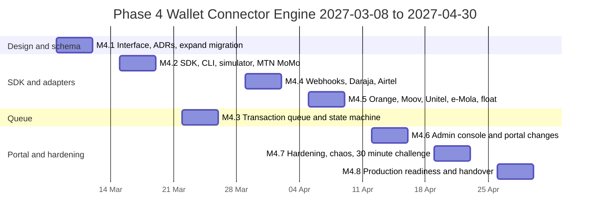
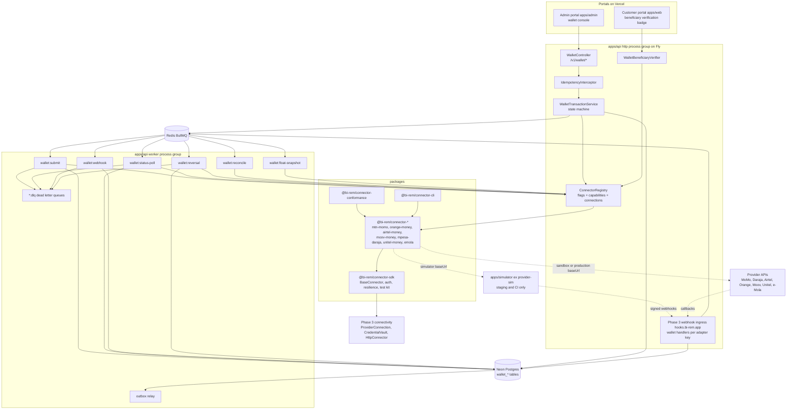
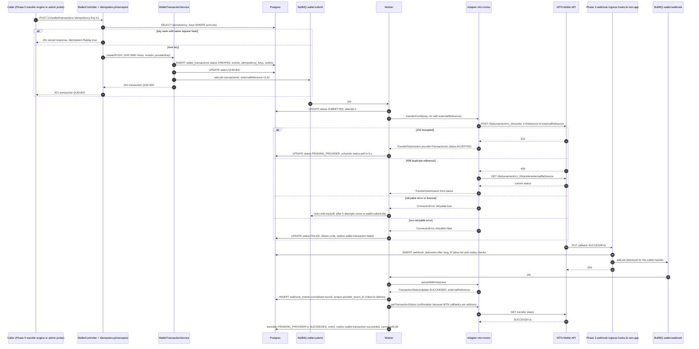
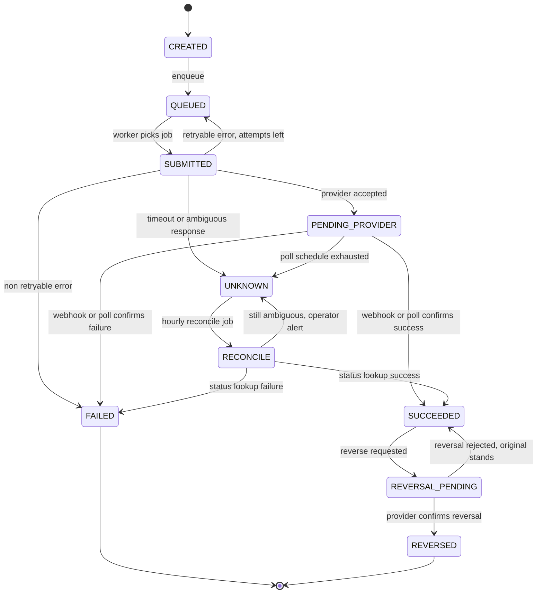
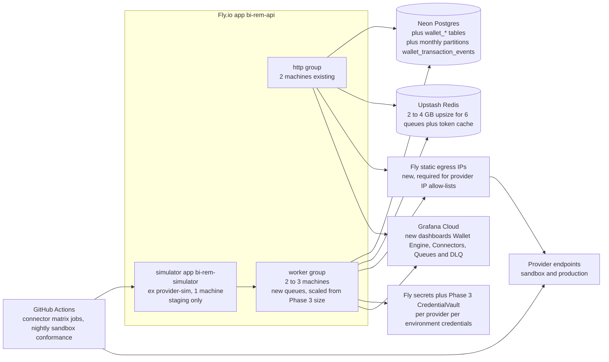
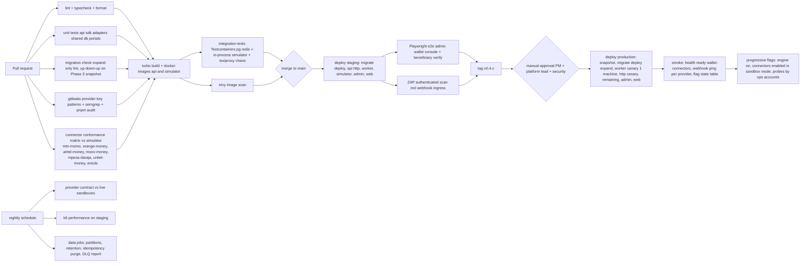

# Phase 4 — Wallet Connector Engine

| Field                     | Value                                                                                                                                                                                                                                                                                                                                                                                                                           |
| ------------------------- | ------------------------------------------------------------------------------------------------------------------------------------------------------------------------------------------------------------------------------------------------------------------------------------------------------------------------------------------------------------------------------------------------------------------------------- |
| **Phase**                 | 4 of 13 — `wallet-connectors`                                                                                                                                                                                                                                                                                                                                                                                                   |
| **Dates**                 | 2027-03-08 → 2027-04-30                                                                                                                                                                                                                                                                                                                                                                                                         |
| **Duration**              | 8 weeks (W1 = 2027-03-08, W8 = 2027-04-26 … 2027-04-30)                                                                                                                                                                                                                                                                                                                                                                         |
| **Team**                  | `platform` (3 backend, 1 frontend, 1 QA, solution architect, DevOps/SRE, PM; 0.5 security engineer; 1 backend + 1 QA borrowed from `core` in W1–W4 while Phase 2 closes out)                                                                                                                                                                                                                                                    |
| **Depends on**            | Phase 3 — Connectivity Management Framework (ends 2027-03-05): `Provider` / `ProviderConnection` catalogue, `CredentialVault` (envelope-encrypted credentials, dual-secret rotation), `@bi-rem/connectivity` SDK (`HttpConnector`, breaker, bulkhead, `Signer`/`Verifier`), webhook ingress `hooks.bi-rem.app` with `WebhookEndpoint`/`WebhookDelivery`, `apps/provider-sim`, `worker` Fly process group, provider status board |
| **Unlocks**               | Phase 5 — Domestic Transfers (starts 2027-04-19, overlapping our W7–W8), Phase 6 — International Remittance (2027-05-31), Phase 7 — FX & Treasury (2027-06-28), Phase 9 — Partner & Merchant Portal (2027-08-23), Phase 13 — Pan-African Expansion (50 providers / 20 countries)                                                                                                                                                |
| **Runs in parallel with** | Phase 2 close-out (core team, until 2027-02-19 — finished before we start) and Phase 5 kick-off (core team, from 2027-04-19)                                                                                                                                                                                                                                                                                                    |

---

## 1. Overview

### 1.1 Objective

Phase 4 builds the **wallet abstraction layer**: one `WalletConnector` interface that every mobile-money provider adapter implements, a Connector SDK that makes writing an adapter a fill-in-the-blanks exercise, a durable **transaction queue** with an explicit state machine, idempotency and dead-letter handling, and a **webhook processing** pipeline that normalises provider callbacks into platform events. At the end of the phase the platform can, for any of the seven launch providers (MTN MoMo, Orange Money, Airtel Money, Moov Money, M-Pesa Daraja, Unitel Money, e-Mola), validate an account, read a balance, push or pull funds, poll a transaction status, reverse a transaction and retrieve a statement — through the **same** TypeScript interface, the same REST endpoints and the same operational tooling.

Phase 4 does **not** move customer money for real end-to-end transfers; that is Phase 5. It moves money in **provider sandboxes** and, in production, only through _operator-initiated_ dark-launch probes (balance reads, account validation, 1-unit self-transfers between BI-Rem float wallets). The phase is successful when a new wallet provider can be added in **under 30 minutes** by running the scaffolding CLI, implementing the mapping functions, passing the conformance suite against the built-in simulator, and registering the connector — and when every provider, old or new, behaves identically from the point of view of the transfer engine that Phase 5 will build on top.

### 1.2 In scope

| Area                     | Included                                                                                                                                                                                                                                                                                                                                                                                                                                                                                                                                         |
| ------------------------ | ------------------------------------------------------------------------------------------------------------------------------------------------------------------------------------------------------------------------------------------------------------------------------------------------------------------------------------------------------------------------------------------------------------------------------------------------------------------------------------------------------------------------------------------------ |
| Connector Interface      | `WalletConnector` TypeScript interface in `packages/connector-sdk`: `validateAccount`, `getBalance`, `transferFunds` (push = disbursement / payout, pull = collection / request-to-pay), `getTransactionStatus`, `reverse`, `getStatement`, plus `capabilities()`, `healthCheck()`, `parseWebhook()`. Normalised request/response DTOs (Zod), normalised error taxonomy (`ConnectorError` with `code`, `retryable`, `providerCode`, `providerMessage`).                                                                                          |
| Connector SDK            | Base class `BaseConnector` with resilience (from Phase 3 `HttpConnector` in `@bi-rem/connectivity`), auth strategies (OAuth2 client-credentials with token cache, API-key + subscription key, HMAC request signing, Basic → bearer exchange), MSISDN normalisation per country, amount/currency guards (BIGINT minor units, exponent per currency), pagination helpers, structured logging with redaction, metrics labels, test kit (`ConnectorTestKit`, recorded fixtures, simulator client).                                                   |
| Provider adapters        | Seven first-party adapters in `packages/connectors/<key>`: `mtn-momo` (MoMo API Collections + Disbursements), `orange-money` (Orange Money Web Pay / B2B APIs per country), `airtel-money` (Airtel Africa Open API), `moov-money` (Moov Africa Flooz API), `mpesa-daraja` (Safaricom Daraja B2C/C2B/B2B, STK Push, Transaction Status, Reversal), `unitel-money` (Angola, UNITEL Money Business API), `emola` (Mozambique, Movitel e-Mola API). Each ships with a provider simulator profile, recorded sandbox fixtures and a `CAPABILITIES.md`. |
| Scaffolding CLI          | `pnpm connector new <key>` generates the package, adapter skeleton with TODO-marked mapping functions, simulator profile, conformance test wiring, `.env.example` entries, feature flag and provider catalogue seed row; `pnpm connector verify <key>` runs conformance against simulator and (optionally) sandbox.                                                                                                                                                                                                                              |
| Conformance test-suite   | `@bi-rem/connector-conformance`: ~120 Jest cases every adapter must pass (happy paths, every error class, idempotent retry, out-of-order webhooks, amount edge cases, MSISDN formats, timeouts, circuit-open behaviour). Run per adapter in CI against the simulator; nightly against live sandboxes.                                                                                                                                                                                                                                            |
| Sandbox simulator        | `apps/simulator` (the Phase 3 Fastify `apps/provider-sim`, renamed and extended with one full profile per wallet provider; port 4100): deterministic fake of each provider's HTTP API, driven by **scenario MSISDNs/amounts** (e.g. amount ending `…13` → provider timeout, MSISDN `…0001` → insufficient funds), emits signed webhooks to a configurable callback URL with configurable delay/duplication/reordering; used by CI, local dev, e2e and load tests.                                                                                |
| Transaction Queue        | `WalletTransaction` aggregate + state machine (`CREATED → QUEUED → SUBMITTED → PENDING_PROVIDER → SUCCEEDED                                                                                                                                                                                                                                                                                                                                                                                                                                      | FAILED | REVERSAL_PENDING → REVERSED | UNKNOWN → RECONCILE`), BullMQ queues `wallet:submit`, `wallet:status-poll`, `wallet:webhook`, `wallet:reversal`, `wallet:reconcile`, each with a DLQ (`*:dlq`); per-provider concurrency and rate limits; idempotency keys at API edge (`Idempotency-Key` header) and towards providers (`externalReference`); exactly-once _effects_ via outbox. |
| Webhook Processing       | Wallet handlers plugged into the Phase 3 ingress (`POST /v1/webhooks/:endpointSlug` on `hooks.bi-rem.app`: `WebhookRouter`, `Verifier`, `WebhookDelivery` stored before the ack): adapter `parseWebhook()` normalisation to `TransactionStatusUpdate`, a `webhook_events` normalisation record linked to the delivery, matching to legs, monotonic state rule, confirmation lookups for advisory callbacks, `UNMATCHED` parking, replay tooling.                                                                                                 |
| Provider operations      | Admin portal: connector registry (per country/currency/environment), credential rotation (Phase 3 `ProviderConnection` / `CredentialVault`), live health & circuit state, transaction explorer with state history, DLQ console (inspect / replay / discard), webhook event viewer, simulator scenario control (non-prod).                                                                                                                                                                                                                        |
| Float monitoring         | Scheduled `getBalance` per `ProviderAccount` (BI-Rem float wallets) into `provider_balance_snapshots`; low-float alerts (threshold per account) for Phase 7 treasury to consume.                                                                                                                                                                                                                                                                                                                                                                 |
| Beneficiary verification | Real `WalletBeneficiaryVerifier` implementing Phase 2's `BeneficiaryVerifier` via `validateAccount` (name lookup where the provider supports it; `nameMatchScore` written back).                                                                                                                                                                                                                                                                                                                                                                 |

### 1.3 Out of scope (explicitly deferred)

- End-to-end customer transfers, fees, limits enforcement, ledger postings — **Phase 5** (we expose `WalletTransaction` as the leg primitive; Phase 5 composes legs into a `Transfer`).
- Cross-border routing, FX quotes and corridor configuration — **Phases 6–7**. Each `WalletTransaction` is single-currency in Phase 4.
- Bank connectors (NIBSS, PesaLink, GIMAC, bank APIs) and cash-pickup networks — modelled with the Phase 3 `ProviderCategory` (`BANK`, `PAYOUT_AGGREGATOR`; a `CASH_AGENT` value is added by Phase 6), no adapter in Phase 4. The same SDK is intended to host them in Phase 6/13.
- Card acquiring (Flutterwave/Paystack) — Phase 9 decision.
- AML screening of counterparties — **Phase 8**; we emit `wallet.transaction.*` events with MSISDN hash for Phase 8 velocity rules.
- Automated reconciliation against provider settlement reports — Phase 7/10. Phase 4 ships statement **retrieval** and a _per-transaction_ reconcile job for `UNKNOWN` states only.
- Native mobile integrations (USSD push UX, STK Push front-end) — Phase 11; Phase 4 returns the provider's `customerActionRequired` hint in the DTO.
- Operating real provider production credentials for customer traffic — credentials are provisioned and smoke-tested but routing of customer-initiated legs stays off (`wallet.connector.<key>.live=false`) until Phase 5 flips it per corridor.

### 1.4 Independent deployability strategy

"Deployable alone" for Phase 4 means: **everything merges to `main` and deploys to production with no customer-facing surface changed, every connector dark, the queue workers running but idle, webhook ingress live and verifying signatures, and the whole subsystem switchable off per provider or globally within 30 seconds without a redeploy.**

| Mechanism                                                            | How it is used in Phase 4                                                                                                                                                                                                                                                                                                                                                                                                                                                                                                                                                                                                                                                                                                                                                        |
| -------------------------------------------------------------------- | -------------------------------------------------------------------------------------------------------------------------------------------------------------------------------------------------------------------------------------------------------------------------------------------------------------------------------------------------------------------------------------------------------------------------------------------------------------------------------------------------------------------------------------------------------------------------------------------------------------------------------------------------------------------------------------------------------------------------------------------------------------------------------- |
| **Feature flags** (Phase 1 `FeatureFlag` service, Redis-cached 30 s) | `wallet.engine.enabled` (master switch — workers pause consumption when off), `wallet.connector.<key>.enabled` (adapter registered and health-checked), `wallet.connector.<key>.live` (allowed to submit money-moving operations in production; off for all of Phase 4 except operator probes with `rules: userIds in [ops accounts]`), `wallet.connector.<key>.sandbox` (route to sandbox credentials even in prod — used for dark launch), `wallet.reversal.auto` (auto-reverse on `UNKNOWN` after N polls vs. park for operator), `wallet.float.monitoring`, `admin.wallet.console`. Keys registered in `packages/shared/src/constants/feature-flags.ts`. Webhook ingress is paused per endpoint through the Phase 3 `WebhookEndpoint.status` (`PAUSED`), not through a flag. |
| **Expand → migrate → contract**                                      | All Phase 4 migrations are expand-only (new tables, new enums, one nullable FK `beneficiaries.provider_id`). The only contract — dropping the free-text `beneficiaries.provider_code` once every row is mapped to `providers.id` — is scheduled for **Phase 5 W1 (2027-04-19)** after a one-week soak, and executed by the core team as part of their W1 migration slot.                                                                                                                                                                                                                                                                                                                                                                                                         |
| **Dark launch**                                                      | From W4 the production API carries all adapters configured against **sandbox** connections (`wallet.connector.<key>.sandbox=true`). Health indicators `/health/ready` → `wallet-connectors` run in _degraded-tolerant_ mode (never fail readiness for a provider outage). Nightly conformance runs hit sandboxes from the production worker group so network paths (egress IPs, TLS, allow-lists) are proven before real credentials arrive.                                                                                                                                                                                                                                                                                                                                     |
| **Kill switches**                                                    | Flipping `wallet.engine.enabled=false` makes every worker `pause()` its queue (jobs stay in Redis, nothing is lost); `wallet.connector.<key>.enabled=false` makes the registry return `ConnectorUnavailableError` (retryable, client gets HTTP 503 + `Retry-After`) and marks in-flight transactions for that provider `QUEUED` again; per-provider circuit breaker (Phase 3) opens automatically on error-rate thresholds. Webhook ingress keeps accepting and storing events even when processing is paused, so nothing from the provider is lost.                                                                                                                                                                                                                             |
| **Worker isolation**                                                 | All queue consumers run only in the Phase 3 `worker` process group (`PROCESS_ROLE=worker`); the `http` group never calls a provider synchronously except `validateAccount` and `getBalance` (bounded 5 s, circuit-protected). A worker outage therefore degrades to "transactions stay QUEUED", never to API errors.                                                                                                                                                                                                                                                                                                                                                                                                                                                             |
| **Backward-compatible APIs**                                         | All new endpoints are new paths under `/v1/wallet/*`; provider callbacks keep arriving through the existing Phase 3 ingress `/v1/webhooks/:endpointSlug`. Phase 2's `BeneficiaryVerifier` binding changes from `NoopVerifier` to `WalletBeneficiaryVerifier` behind `beneficiaries.verify.wallet` (default off) so Phase 2 behaviour is preserved until Phase 5 turns it on per country.                                                                                                                                                                                                                                                                                                                                                                                         |
| **Independent packages**                                             | Connector adapters are separate workspace packages with no dependency on `apps/api`; the API depends on the registry only. A broken adapter fails its own CI job and cannot break the API build (Turborepo filters).                                                                                                                                                                                                                                                                                                                                                                                                                                                                                                                                                             |

---

## 2. Milestones

Phase start is Monday **2027-03-08**; week _n_ runs Monday to Friday, milestone dates are the Friday of the week.

| ID       | Week | Target date | Deliverable                                                                                                                                                                                                                                                                         | Acceptance criteria                                                                                                                                                                                                                                                                                                                                                                                                                                          | Owner                   |
| -------- | ---- | ----------- | ----------------------------------------------------------------------------------------------------------------------------------------------------------------------------------------------------------------------------------------------------------------------------------- | ------------------------------------------------------------------------------------------------------------------------------------------------------------------------------------------------------------------------------------------------------------------------------------------------------------------------------------------------------------------------------------------------------------------------------------------------------------ | ----------------------- |
| **M4.1** | W1   | 2027-03-12  | Design freeze: `WalletConnector` interface v1, state machine, DTOs and error taxonomy; ADR-0012 (connector abstraction), ADR-0013 (queue & idempotency), ADR-0014 (webhook ingestion); schema v4 _expand_ migration merged; sandbox accounts for MTN MoMo, Daraja, Airtel requested | `packages/connector-sdk` compiles with the interface, Zod DTOs and `ConnectorError`; `pnpm db:migrate:dev` applies `20270308090000_phase4_expand` on a Phase 3 database; state machine table (§4.3) reviewed with the Phase 5 lead; ADRs accepted at the Thursday architecture review                                                                                                                                                                        | Solution Architect      |
| **M4.2** | W2   | 2027-03-19  | Connector SDK + `BaseConnector` + simulator skeleton + scaffolding CLI; first adapter (**MTN MoMo**) passing conformance against the simulator                                                                                                                                      | `pnpm connector new demo` produces a package that builds, lints and fails exactly the TODO-marked conformance cases; `mtn-momo` passes 100 % of conformance against `apps/simulator`; token cache, retry and circuit behaviour covered by SDK unit tests ≥ 90 % lines                                                                                                                                                                                        | Backend Lead (platform) |
| **M4.3** | W3   | 2027-03-26  | Transaction queue: `WalletTransaction` aggregate, state machine, BullMQ queues with DLQs, idempotency keys, outbox events; API `POST /v1/wallet/transactions` and status endpoints                                                                                                  | Duplicate `Idempotency-Key` returns the original 201 body with `Idempotent-Replay: true`; killing the worker mid-submit leaves no transaction in a non-recoverable state (chaos test); a poisoned job lands in `wallet:submit:dlq` after 5 attempts with full context; p95 enqueue-to-submit < 500 ms at 20 TPS on staging                                                                                                                                   | Backend Lead (platform) |
| **M4.4** | W4   | 2027-04-02  | Webhook ingestion pipeline; **M-Pesa Daraja** and **Airtel Money** adapters passing conformance; dark deploy to production against sandboxes                                                                                                                                        | Signed, replayed and out-of-order webhooks handled per conformance cases; invalid signature → 401 + alert; the Phase 3 `webhook_deliveries` row exists before any 200 is returned and the wallet `webhook_events` normalisation record follows asynchronously; Daraja STK Push + B2C + status + reversal and Airtel disbursement + collection + enquiry green against live sandboxes; production `/health/ready` shows three connectors `up` in sandbox mode | Backend Lead (platform) |
| **M4.5** | W5   | 2027-04-09  | **Orange Money**, **Moov Money**, **Unitel Money**, **e-Mola** adapters; statement retrieval; float monitoring; `WalletBeneficiaryVerifier`                                                                                                                                         | All seven adapters pass conformance against simulator; sandbox conformance green for every provider that offers a sandbox, recorded-fixture mode for those that do not (Unitel, e-Mola, see §6.3); `provider_balance_snapshots` populated every 5 min in staging; beneficiary add in staging shows `nameMatchScore` for MTN/M-Pesa test MSISDNs                                                                                                              | Backend Lead (platform) |
| **M4.6** | W6   | 2027-04-16  | Admin portal: connector registry, transaction explorer, DLQ console, webhook viewer, simulator control; customer portal: beneficiary verification status                                                                                                                            | Operator can disable a provider, rotate a credential, replay a DLQ job and see the resulting state transition within one screen flow; every mutating action produces an `audit_logs` row; Playwright suite green                                                                                                                                                                                                                                             | Frontend Lead           |
| **M4.7** | W7   | 2027-04-23  | Hardening: performance (100 TPS sustained via simulator), chaos (provider latency, Redis failover, duplicate webhooks), security review, runbooks; **30-minute challenge** rehearsal with an engineer who has not seen the SDK                                                      | k6 profile (§9.5) passes; chaos scenarios leave zero inconsistent states; pen-test findings ≥ High closed; a Phase 5 engineer adds a fictitious `wave-senegal` connector from CLI to green conformance in ≤ 30 min, recorded and timed                                                                                                                                                                                                                       | QA Lead / Security      |
| **M4.8** | W8   | 2027-04-30  | Production readiness: real credentials for MTN (GH/CI/CM), Daraja (KE), Airtel (UG/TZ) in secrets manager; operator probes executed; phase exit review; handover to Phases 5/6/7                                                                                                    | Balance reads and 1-unit float self-transfers succeeded in production for MTN GH, Daraja KE and Airtel UG; `wallet.connector.*.live` remains **off** for customer traffic; success criteria (§12) evidenced; sign-offs (§11) collected; Phase 5 team consuming `WalletTransaction` API in their W2                                                                                                                                                           | Program Manager         |



---

## 3. Deliverables

### 3.1 Connector Interface (`packages/connector-sdk/src/interface.ts`)

- **What**: The single TypeScript contract every wallet adapter implements.

```ts
export interface WalletConnector {
  readonly key: ProviderKey; // 'mtn-momo', 'mpesa-daraja', …
  readonly version: string; // adapter semver
  capabilities(): ConnectorCapabilities; // which functions / currencies / countries / name-lookup
  healthCheck(ctx: ConnectorContext): Promise<HealthResult>;
  validateAccount(
    req: ValidateAccountRequest,
    ctx: ConnectorContext,
  ): Promise<ValidateAccountResult>;
  getBalance(req: GetBalanceRequest, ctx: ConnectorContext): Promise<BalanceResult>;
  transferFunds(req: TransferFundsRequest, ctx: ConnectorContext): Promise<TransferSubmission>;
  getTransactionStatus(req: StatusRequest, ctx: ConnectorContext): Promise<TransactionStatusResult>;
  reverse(req: ReversalRequest, ctx: ConnectorContext): Promise<ReversalSubmission>;
  getStatement(req: StatementRequest, ctx: ConnectorContext): Promise<StatementPage>;
  parseWebhook(raw: RawWebhook, ctx: ConnectorContext): Promise<WebhookParseResult>;
}
```

- **DoD**: Every method takes a `ConnectorContext` (connection credentials handle from Phase 3, `correlationId`, `idempotencyKey`, `environment`, logger, clock, metrics); every request/response is a Zod schema in `@bi-rem/shared` (`schemas/wallet.ts`) with `Money` (BIGINT minor units + currency) for all amounts; `TransferFundsRequest.direction` is `PUSH` (BI-Rem float → customer wallet) or `PULL` (customer wallet → BI-Rem float); `TransactionStatusResult.status` is one of the normalised `ProviderStatus` values (`ACCEPTED`, `PENDING`, `SUCCEEDED`, `FAILED`, `REVERSED`, `UNKNOWN`) with `providerStatusRaw` preserved; every failure is a `ConnectorError` subclass with `code` from a closed enum (§4.5), `retryable: boolean`, `providerCode`, `providerMessage` (redacted of PII) and `httpStatus`; the interface is frozen at `v1` with an `@since` on every member; breaking changes require ADR and a `v2` interface with an adapter shim. `ProviderKey` is the **adapter** key (`mtn-momo`); one adapter serves several Phase 3 `Provider` rows (`mtn-momo-gh`, `mtn-momo-ci`, …) linked through the new `providers.adapter_key` column, and the `ConnectorContext` carries the concrete `providerId`/`connectionId` so adapters read per-OpCo settings (`X-Target-Environment`, Orange country profile) from `ProviderConnection.authConfig`.

### 3.2 Connector SDK (`packages/connector-sdk`)

- **What**: `BaseConnector` abstract class, auth strategies, resilience wiring, helpers, test kit and documentation that reduce an adapter to its provider-specific mapping functions.
- **DoD**: `BaseConnector` provides `http` (Phase 3 `HttpConnector` from `@bi-rem/connectivity`, resolving endpoint, auth, credentials and mTLS agent from the registry; per-connection timeouts 8 s connect / 20 s total, retries only for idempotent GETs and for POSTs carrying a provider idempotency reference, breaker 50 % errors / 20 calls / 30 s open, bulkhead from `bulkheadMaxConcurrent`; `ProviderError.kind` is mapped onto `ConnectorErrorCode` — `TIMEOUT`→`TIMEOUT`, `CIRCUIT_OPEN`/`PAUSED`/`PROVIDER_5XX`/`NETWORK`→`PROVIDER_UNAVAILABLE`, `RATE_LIMITED`→`RATE_LIMITED`, `AUTH`→`AUTH_FAILED`, `PROVIDER_4XX`→ adapter `errors.ts`), `auth` (strategies `OAuth2ClientCredentials` with Redis token cache keyed by `connectionId`, `ApiKeyHeader`, `HmacSigner`, `BasicToBearer`), `msisdn` (E.164 normalisation and per-country/operator validation from `@bi-rem/shared/utils/phone`), `money` (`assertSupportedCurrency`, `toProviderAmount` string formatting per currency exponent), `pagination`, `clock`, `logger` (pino child with `provider`, `connectionId`, `transactionId`; redaction of `msisdn`, `accountName`, tokens), `metrics` (`wallet_connector_requests_total{provider,operation,outcome}`, `wallet_connector_duration_seconds`, `wallet_connector_circuit_state`); `ConnectorTestKit` offers `withSimulator()`, `withRecordedFixtures()`, `withSandbox()` and golden-file assertions; README with a 10-step "write an adapter" guide; SDK unit coverage ≥ 90 % lines; published as workspace package `@bi-rem/connector-sdk` consumed by `apps/api`, `apps/simulator` and every `packages/connectors/*`.

### 3.3 Provider Adapters (`packages/connectors/*`)

- **What**: Seven adapters, each a workspace package `@bi-rem/connector-<key>` exporting `createConnector(config): WalletConnector`, with `CAPABILITIES.md`, simulator profile (`simulator/profile.ts`), recorded fixtures (`fixtures/*.json`, PII scrubbed), and `.env.example` entries.
- **DoD per adapter**: 100 % of conformance cases pass against the simulator; sandbox conformance passes where a sandbox exists; `capabilities()` is truthful (e.g. `nameLookup: true` for MTN MoMo `GET /accountholder/.../basicuserinfo`, `false` for Airtel in most markets); every provider error code is mapped in `errors.ts` to the normalised taxonomy with a unit test per mapping; webhook signature verification implemented per provider (or IP allow-list + shared-secret where the provider offers no signature); statement retrieval implemented or declared `unsupported` with the reconciliation fallback (status polling) documented; adapter package has no dependency on NestJS or Prisma; p95 adapter overhead (excluding network) < 5 ms.
- **Adapter matrix** (functions: VA = validate account, GB = get balance, TF = transfer funds push/pull, TS = transaction status, RV = reversal, ST = statement):

| Adapter        | Markets (Phase 4 → 13)           | VA                                | GB                  | TF push                  | TF pull                     | TS                     | RV                                       | ST                                               | Auth                                                                                | Sandbox                                                                    |
| -------------- | -------------------------------- | --------------------------------- | ------------------- | ------------------------ | --------------------------- | ---------------------- | ---------------------------------------- | ------------------------------------------------ | ----------------------------------------------------------------------------------- | -------------------------------------------------------------------------- |
| `mtn-momo`     | GH, CI, CM, UG, RW, ZM, BJ       | yes (basicuserinfo, active check) | yes                 | Disbursements `transfer` | Collections `requesttopay`  | yes                    | Disbursements `refund` (post-settlement) | no (polling fallback)                            | OAuth2 client-credentials per product + `Ocp-Apim-Subscription-Key`                 | yes (sandbox.momodeveloper.mtn.com)                                        |
| `orange-money` | CI, SN, CM, ML, BF, GN           | partial (per country)             | yes (merchant)      | B2C cash-out API         | Web Payment / M-Payment     | yes                    | partial (country dependent)              | yes (merchant history)                           | OAuth2 client-credentials (`api.orange.com`)                                        | yes (test environment per API)                                             |
| `airtel-money` | UG, TZ, KE, ZM, MW, RW, NG, CD   | yes (KYC user enquiry)            | yes                 | Disbursement             | Collection (USSD push)      | yes                    | Refund                                   | no                                               | OAuth2 client-credentials + optional RSA-encrypted PIN                              | yes (openapiuat)                                                           |
| `moov-money`   | BJ, TG, CI, ML, BF, NE           | yes (subscriber info)             | yes                 | Cash-in / transfer       | Push payment                | yes                    | yes (within window)                      | partial                                          | API key + HMAC                                                                      | limited (partner UAT, credentials via commercial contact)                  |
| `mpesa-daraja` | KE (TZ via M-Pesa Vodacom later) | partial (B2C validation, no name) | Account Balance API | B2C                      | C2B register URL + STK Push | Transaction Status API | Reversal API                             | no (statement via Org portal — out of API scope) | OAuth2 client-credentials + `SecurityCredential` (RSA encrypted initiator password) | yes (sandbox.safaricom.co.ke)                                              |
| `unitel-money` | AO                               | yes                               | yes                 | yes                      | yes (push)                  | yes                    | yes                                      | yes                                              | API key + HMAC (contract dependent)                                                 | no public sandbox → recorded fixtures + simulator; partner UAT in Phase 13 |
| `emola`        | MZ                               | yes                               | yes                 | yes (B2C)                | yes (C2B)                   | yes                    | yes                                      | partial                                          | Basic → bearer                                                                      | no public sandbox → recorded fixtures + simulator; partner UAT in Phase 13 |
| _future_       | any                              | per capabilities                  |                     |                          |                             |                        |                                          |                                                  | SDK strategies                                                                      | simulator profile mandatory                                                |

### 3.4 Scaffolding CLI (`packages/connector-cli`, `pnpm connector …`)

- **What**: Commands `new <key> [--category MOBILE_MONEY|BANK|PAYOUT_AGGREGATOR] [--countries GH,CI] [--auth oauth2|apikey|hmac]`, `verify <key> [--target simulator|sandbox]`, `record <key>` (captures scrubbed sandbox fixtures), `list`, `doctor` (checks env, credentials, connectivity).
- **DoD**: `new` generates the package from templates (adapter class with TODO blocks per interface method, `errors.ts` with an exhaustive `switch` that fails typecheck until every normalised code is handled, `profile.ts` simulator stub, `fixtures/`, conformance test file, `CAPABILITIES.md`, `.env.example` lines), registers the package in `pnpm-workspace.yaml` globs (already covered by `packages/*`), appends the `ProviderKey` to `@bi-rem/shared` and the `FEATURE_FLAG_KEYS`, and adds a seed row to `packages/db/prisma/seed-data/providers.ts`; `verify` runs conformance with a progress table and fails on any red case; generated package passes `lint` + `typecheck` immediately; total wall-clock for `new` ≤ 60 s; documented in `docs/handbooks/add-a-wallet-connector.md`.

### 3.5 Conformance test-suite (`packages/connector-conformance`)

- **What**: A Jest project that takes any `WalletConnector` factory and a `SimulatorControl` handle and runs the behavioural contract.
- **DoD**: Case groups — capabilities honesty (declared vs behaviour), validateAccount (valid, unknown, barred, wrong network, malformed MSISDN), getBalance (ok, auth failure, timeout), transferFunds push/pull (success, insufficient float, insufficient customer funds, limit exceeded, pending then success via webhook, pending then success via poll, pending then failed, timeout then `UNKNOWN`, duplicate idempotency reference returns the same provider transaction), status (every normalised status + unknown reference), reversal (success, not reversible, window expired, already reversed), statement (pagination, empty, unsupported), webhooks (valid signature, invalid signature, replay, out-of-order `SUCCEEDED` then `PENDING`, unknown reference), resilience (circuit opens and recovers, retry only on retryable codes), amounts (minimum, maximum, exponent-0 currencies such as XOF/XAF/UGX, rejecting non-integer minor units), PII redaction in logs. ≥ 120 cases; a single `pnpm connector verify <key>` runs the whole suite in < 90 s against the simulator.

### 3.6 Sandbox simulator (`apps/simulator`)

- **What**: The Phase 3 Fastify service `apps/provider-sim`, renamed `apps/simulator` (its `momo` and `daraja` personas become the first two full profiles), faking every provider's HTTP surface closely enough that the _real adapter code_ talks to it unchanged (only `baseUrl` differs), plus a control API for scenarios and webhook emission.
- **DoD**: One profile module per adapter key mounted under `/sim/<key>/…` mirroring the provider's paths and payload shapes (including auth token endpoints and signature schemes); deterministic scenario triggers documented in `docs/handbooks/simulator-scenarios.md` (amount suffix `13` → timeout, `21` → insufficient funds, `34` → pending then success after 3 s webhook, `55` → pending then failed, `89` → duplicate webhook, MSISDN `…0000` → unknown account); control endpoints `POST /sim/control/scenario`, `POST /sim/control/webhook/replay`, `POST /sim/control/latency`, `POST /sim/control/outage`; state in memory with optional Redis for multi-instance; Docker image `ghcr.io/bi-rem/simulator` replaces `provider-sim` in `infra/docker/docker-compose.yml` and in the staging Fly app (`bi-rem-provider-sim` renamed `bi-rem-simulator`); never deployed to production, which the Phase 3 `APP_ENV` rule enforces by refusing `http://` simulator base URLs outside `local|ci|staging`.

### 3.7 Transaction Queue (`apps/api/src/wallet/*`, worker)

- **What**: `WalletTransaction` aggregate, state machine, BullMQ queues and workers, idempotency store, DLQ handling, outbox events.
- **DoD**: State transitions only via `WalletTransactionStateMachine.transition(tx, event)` which rejects illegal moves and writes `wallet_transaction_events` in the same DB transaction as the state change; `Idempotency-Key` header (Phase 1 `HTTP_HEADERS.idempotencyKey`) stored in `idempotency_keys` with request hash, 24 h TTL, scoped by `(actor, key)`; provider-facing reference `externalReference` = ULID derived from `wallet_transactions.id`, reused on every retry; queues `wallet:submit` (per-connection concurrency from `provider_connections.bulkhead_max_concurrent`, rate limiter from `provider_connections.rate_limit.requestsPerSecond`), `wallet:status-poll` (delayed jobs with schedule 5 s, 15 s, 30 s, 60 s, 2 m, 5 m, 15 m, 30 m, 1 h; then `UNKNOWN → RECONCILE`), `wallet:webhook`, `wallet:reversal`, `wallet:reconcile` (hourly sweep of `UNKNOWN`), each with `attempts` 5, exponential backoff 2 s base, DLQ on exhaustion with the full job payload + last error + `transactionId`; DLQ depth metric and alert; `wallet.transaction.{queued,submitted,succeeded,failed,reversed,unknown}` outbox events; chaos tests prove no transaction can be submitted twice to a provider.

### 3.8 Webhook Processing (`apps/api/src/wallet/webhooks/*`)

- **What**: Ingress controller, verification, persistence, normalisation worker, replay.
- **DoD**: Callbacks enter through the Phase 3 ingress `POST|PUT /v1/webhooks/:endpointSlug` on `hooks.bi-rem.app` (`@Public()`, raw body preserved, `Verifier` per `signatureScheme`, IP allow-list, replay window, `webhook_deliveries` row written **before** the 200). Phase 4 registers one handler per adapter key with the `WebhookRouter` decorator (`@WebhookHandler('wallet', 'mtn-momo')`) and adds `PUT` support for MTN callbacks. For providers that sign nothing (MTN, Daraja) the endpoint is configured `allowUnsigned=true` **only** together with an IP allow-list and the unguessable random slug (validation rejects the combination otherwise), and a `SUCCEEDED` carried by such a callback is applied only after `getTransactionStatus` confirms it. The handler enqueues `wallet:webhook` with the delivery id (ack p95 < 200 ms, no provider call on the request path); the worker calls the adapter's `parseWebhook()`, writes a `webhook_events` normalisation record (unique on `(provider_id, provider_event_id)` — a duplicate delivery is recorded as `IGNORED` and never re-processed), matches on `external_reference` or `provider_transaction_id`, applies the monotonic state rule (terminal states never regress; `PENDING` after `SUCCEEDED` is ignored and logged), runs the confirmation lookup where callbacks are advisory (Daraja result URLs are authoritative; MTN callbacks are advisory and confirmed by `GET /transfer/{referenceId}`), parks events that arrive before the provider's 202 is processed as `UNMATCHED` and retries them for 24 h, and exposes replay (`POST /v1/wallet/webhook-events/:id/replay`) that re-reads the stored delivery. Signature/IP rejections stay in Phase 3 `webhook_deliveries` as `REJECTED` and are mirrored into the wallet console; alert on rejections > 5/min per endpoint.

### 3.9 Provider operations console (admin portal) — see §7

- **DoD**: Screens listed in §7.1 live behind `admin.wallet.console`; all actions permission-gated (`wallet:*` permissions registered in `packages/db/src/permissions.ts`) and audited.

### 3.10 Float monitoring & beneficiary verifier

- **DoD**: `wallet:float-snapshot` repeatable job every 5 min per active `ProviderAccount`; `provider_balance_snapshots` retained 90 days raw then daily aggregates; alert `wallet_float_balance_minor_units < threshold` per account; `WalletBeneficiaryVerifier` resolves provider by `(beneficiaries.provider_id, country)`, calls `validateAccount`, writes `beneficiaries.verification_status` and `nameMatchScore` (Jaro-Winkler on normalised names, 0–100 in the existing `Int` column, threshold 85 configurable through `Setting` `wallet.verify.name-match-threshold`), falls back to `NoopVerifier` when the flag is off or the provider lacks name lookup.

---

## 4. Architecture

### 4.1 Component view — Phase 4 additions



### 4.2 Key flow — PUSH transfer with webhook confirmation



### 4.3 Transaction state machine



Transition rules enforced in code: (1) terminal states `SUCCEEDED`, `FAILED`, `REVERSED` are only left through the explicit `reverse` path; (2) a webhook or poll result carrying an _older_ status than the current one is recorded as an event with `ignored=true` and never applied; (3) every transition writes a `wallet_transaction_events` row with `from_status`, `to_status`, `trigger` (`API`, `WORKER`, `WEBHOOK`, `POLL`, `RECONCILE`, `OPERATOR`), `provider_payload` (redacted) and `correlation_id`; (4) `UNKNOWN` is a first-class state that blocks any ledger effect in Phase 5 until resolved — money is never assumed moved or not moved; (5) operator transitions (`OPERATOR` trigger, permission `wallet:transactions:resolve`) require a reason code and are limited to `UNKNOWN → SUCCEEDED | FAILED` with provider evidence attached.

### 4.4 Deployment / infrastructure delta



Infra delta summary: (a) `worker` group scaled to 2–3 `shared-cpu-2x` machines with `WORKER_QUEUES=wallet:*,notifications,outbox-relay`; (b) Fly **static egress IPs** attached (M-Pesa Daraja production, Orange and several MTN OpCos require IP allow-listing for callbacks and API access); (c) Upstash Redis upsized to 2–4 GB with eviction `noeviction` (BullMQ requirement) and separate logical prefix `wallet:`; (d) Neon: `wallet_transaction_events` as monthly range partitions, the pattern Phase 3 already runs for `webhook_deliveries` (`pg_partman` not available on Neon — partitions created by the `data-jobs.yml` nightly job three months ahead); (e) the staging simulator app (Phase 3 `bi-rem-provider-sim`, renamed `bi-rem-simulator`) reachable only over Fly private networking (`bi-rem-simulator.internal:4100`), grown to one `shared-cpu-2x` machine; (f) Grafana dashboards + alerts (§11); (g) GitHub Actions: per-connector matrix job, nightly sandbox conformance workflow with provider secrets in the `staging` environment; (h) callback URLs per environment registered with providers through Phase 3 `ProviderCallback` rows (`https://hooks-staging.bi-rem.app/v1/webhooks/<slug>`, `https://hooks.bi-rem.app/v1/webhooks/<slug>`, random slug per endpoint) — hostname per Phase 3 Q3.3.

### 4.5 Design decisions and alternatives rejected

| #   | Decision                                                                                                                                                                                                                                       | Alternatives rejected                                                                                         | Rationale                                                                                                                                                                                                                                                                                                                             |
| --- | ---------------------------------------------------------------------------------------------------------------------------------------------------------------------------------------------------------------------------------------------- | ------------------------------------------------------------------------------------------------------------- | ------------------------------------------------------------------------------------------------------------------------------------------------------------------------------------------------------------------------------------------------------------------------------------------------------------------------------------- |
| D1  | **One synchronous-looking interface, asynchronous reality.** `transferFunds` returns a `TransferSubmission` (`ACCEPTED`/`PENDING`/`SUCCEEDED`/`FAILED`), and the queue/state machine owns the lifecycle.                                       | (a) Interface returns final status (blocking); (b) separate interfaces per provider style (sync vs callback). | Every African MoMo API is eventually consistent (MTN 202 + callback, Daraja result URLs, Airtel enquiry). A blocking interface would hide this and force timeouts into business logic. Uniformity is the success criterion.                                                                                                           |
| D2  | **Adapters are plain TypeScript packages, not NestJS modules.**                                                                                                                                                                                | NestJS dynamic modules per provider; plugin loading at runtime from a registry URL.                           | Keeps adapters testable in isolation and consumable by `apps/simulator` and the CLI; prevents DI coupling; Turborepo caches per package. Runtime plugin loading rejected for supply-chain and audit reasons — every adapter ships in the image and is code-reviewed.                                                                  |
| D3  | **Idempotency at two levels**: API edge (`Idempotency-Key`, 24 h, scoped per actor) and provider edge (`externalReference` ULID generated once per transaction and reused on every retry).                                                     | Provider idempotency only; API idempotency only; random reference per attempt.                                | API-level protects Phase 5 from double-creating legs on client retries; provider-level is the _only_ protection against double-pay when the network drops after the provider committed. MTN requires a client UUID `X-Reference-Id`; Daraja has no idempotency so we rely on `OriginatorConversationID` + status lookup before retry. |
| D4  | **State machine persisted in Postgres with an append-only event table**, BullMQ only as a work scheduler.                                                                                                                                      | Job state in Redis as source of truth; event-sourcing with a projection store.                                | Redis is not durable enough for money (Upstash persistence is best-effort); Postgres gives us transactional writes with `outbox` (Phase 1) and the `audit_logs` pattern. Full event sourcing rejected as over-engineering for Phase 4; the event table gives most of the benefit.                                                     |
| D5  | **BullMQ (Phase 1 stack) with one queue per concern and per-provider rate limiting via BullMQ group-less limiter keyed by `providerKey` prefix**, rather than NATS/Kafka.                                                                      | Kafka/Redpanda, NATS JetStream, SQS.                                                                          | Phase 1 D8 explicitly deferred a broker decision to Phase 4; at 100k tx/day (≈ 1.2 TPS average, 50 TPS peak) BullMQ on a 4 GB Redis is comfortable. Fan-out needs are served by the outbox. Revisit for Phase 13 scale (ADR-0013 lists the trigger: sustained > 200 TPS or multi-region).                                             |
| D6  | **Dead-letter queues per queue with a Postgres mirror** (`dead_letter_jobs`) so DLQ contents survive Redis loss and are searchable from the admin console.                                                                                     | Redis-only failed set; re-enqueue forever with backoff.                                                       | Operators need to search by MSISDN hash/transaction id and to attach a resolution; regulators may ask why a payout failed six months later.                                                                                                                                                                                           |
| D7  | **Reuse the Phase 3 ingress (store-then-ack) and add only wallet normalisation**: the delivery is persisted and acked by Phase 3, Phase 4 processes it asynchronously from `wallet:webhook`.                                                   | (a) A second, wallet-specific ingress path; (b) process inline and return the result.                         | One public surface to harden, one signature/IP policy per endpoint, one replay tool. Providers retry aggressively on non-200 and some (Daraja) disable callbacks after repeated failures; inline provider calls on the ingress path would make ingress latency depend on provider health.                                             |
| D8  | **Simulator speaks the providers' own wire formats** so the production adapter code is what gets tested.                                                                                                                                       | Mock at the `WalletConnector` interface level (`FakeConnector`).                                              | A `FakeConnector` tests the queue but not the adapter mapping — exactly where provider bugs live. A `FakeConnector` still exists in the test kit for Phase 5 unit tests.                                                                                                                                                              |
| D9  | **Scenario triggers via amount suffix and MSISDN suffix** in the simulator.                                                                                                                                                                    | Scenario per HTTP header; per-test control API call before each request.                                      | Mirrors how MTN and Daraja sandboxes themselves behave (MTN uses MSISDN-driven outcomes), so the same test cases run against simulator and sandbox unchanged.                                                                                                                                                                         |
| D10 | **Statement retrieval optional in capabilities**; reconciliation of `UNKNOWN` by per-transaction status lookup.                                                                                                                                | Mandate statements for all adapters.                                                                          | M-Pesa, MTN and Airtel do not expose statement APIs to all partners; mandating would block go-live. Phase 7 adds settlement-report reconciliation.                                                                                                                                                                                    |
| D11 | **Credentials live in Phase 3 `ProviderCredential` rows behind `CredentialVault`** (envelope-encrypted, versioned, dual-secret rotation), never in adapter config; adapters receive a `CredentialHandle` and call `ctx.credentials.get(kind)`. | Env vars per provider.                                                                                        | 7 providers × 3 environments × multiple OpCos = dozens of secrets; rotation from the admin console (Phase 3) without redeploy; audit of who rotated what.                                                                                                                                                                             |
| D12 | **Float wallets modelled as `provider_accounts`** (BI-Rem-owned wallets per provider/country/currency), separate from customer beneficiaries.                                                                                                  | Reuse `Beneficiary`.                                                                                          | Different lifecycle, different permission model, needed by Phase 7 treasury for float forecasting.                                                                                                                                                                                                                                    |

### 4.6 Normalised error taxonomy (`ConnectorErrorCode`)

| Code                        | Retryable                    | Typical provider mappings                                                              | Queue behaviour                                              |
| --------------------------- | ---------------------------- | -------------------------------------------------------------------------------------- | ------------------------------------------------------------ |
| `AUTH_FAILED`               | no (after one token refresh) | MTN 401, Daraja `400.008.01` invalid token, Orange `invalid_token`                     | Refresh token once; then DLQ + alert `credential`            |
| `ACCOUNT_NOT_FOUND`         | no                           | MTN `PAYEE_NOT_FOUND`, Airtel `DP00800001003`, Daraja `2001`                           | `FAILED`                                                     |
| `ACCOUNT_BARRED`            | no                           | MTN `NOT_ALLOWED_TARGET_ENVIRONMENT`/`PAYEE_NOT_ALLOWED_TO_RECEIVE`, Daraja `C2B00013` | `FAILED`                                                     |
| `INSUFFICIENT_FUNDS`        | no                           | MTN `NOT_ENOUGH_FUNDS`, Daraja `1`/`17`, Airtel `DP00800001006`                        | `FAILED`; if float account → alert `float`                   |
| `LIMIT_EXCEEDED`            | no                           | MTN `PAYER_LIMIT_REACHED`, Daraja `ES01`-style limits, Moov limit codes                | `FAILED`                                                     |
| `INVALID_REQUEST`           | no                           | 400 validation errors                                                                  | `FAILED`, bug alert if from our side                         |
| `DUPLICATE_REFERENCE`       | special                      | MTN 409, Airtel duplicate txn id                                                       | Adapter resolves via status lookup                           |
| `PROVIDER_UNAVAILABLE`      | yes                          | 5xx, MTN `INTERNAL_PROCESSING_ERROR`, Daraja `500.001.1001`                            | Retry with backoff; circuit breaker                          |
| `RATE_LIMITED`              | yes                          | 429, MTN `TOO_MANY_REQUESTS`                                                           | Retry honouring `Retry-After`; reduce limiter                |
| `TIMEOUT`                   | ambiguous                    | socket/read timeout                                                                    | `UNKNOWN` → status lookup before any retry                   |
| `TRANSACTION_NOT_FOUND`     | no                           | status lookup unknown reference                                                        | After 3 polls → `UNKNOWN`                                    |
| `REVERSAL_NOT_ALLOWED`      | no                           | Daraja reversal window / MTN refund rejected                                           | `REVERSAL_PENDING → SUCCEEDED` with note                     |
| `WEBHOOK_SIGNATURE_INVALID` | no                           | n/a                                                                                    | 401 at ingress, event stored as `REJECTED`                   |
| `UNSUPPORTED_OPERATION`     | no                           | capability false                                                                       | 422 at API edge, never queued                                |
| `UNMAPPED_PROVIDER_ERROR`   | no                           | anything not mapped                                                                    | `FAILED` + alert; conformance forbids this in known fixtures |

---

## 5. Data Model & Migrations

### 5.1 Context from earlier phases

Phase 3 introduced the catalogue this phase plugs into: `Provider` (`providers`: `code` such as `mtn-momo-gh`, `category` from `ProviderCategory`, `countryCodes`, `currencies`, `capabilities` as `PROVIDER_OPERATIONS` keys, `activeEnvironment`), `ProviderConnection` (`provider_connections`: one per provider and environment with `baseUrl`, `authScheme`/`authConfig`, `timeoutMs`, `rateLimit`, `circuitBreaker`, `bulkheadMaxConcurrent`, `egressIps`), `ProviderEndpoint`, `ProviderCredential` behind `CredentialVault`, `WebhookEndpoint` (random `slug`, `signatureScheme`, `ipAllowlist`, `allowUnsigned`) with the partitioned `WebhookDelivery` store, and `ProviderStatus`/`ProviderIncident`. Phase 2 introduced `Beneficiary` with a free-text `providerCode`, an `Int? nameMatchScore` and `verifiedAt`. Phase 4 **extends** these (new columns on `providers` and `beneficiaries`, back-relations elsewhere) and adds the wallet engine tables below. All additions follow CLAUDE.md: uuid ids via `gen_random_uuid()`, `timestamptz(6)`, money as `BIGINT` minor units + ISO-4217 `currency`, snake_case `@@map`/`@map`.

### 5.2 Prisma additions (schema v4)

```prisma
// ---------------------------------------------------------------------------
// Phase 4 — Wallet Connector Engine
// ---------------------------------------------------------------------------

enum WalletTransactionType {
  PUSH          // BI-Rem float -> customer wallet (disbursement / payout)
  PULL          // customer wallet -> BI-Rem float (collection / request-to-pay)
  FLOAT_TRANSFER // BI-Rem float -> BI-Rem float (operator probes, rebalancing)

  @@map("wallet_transaction_type")
}

enum WalletTransactionStatus {
  CREATED
  QUEUED
  SUBMITTED
  PENDING_PROVIDER
  SUCCEEDED
  FAILED
  UNKNOWN
  RECONCILE
  REVERSAL_PENDING
  REVERSED

  @@map("wallet_transaction_status")
}

enum WalletTransitionTrigger {
  API
  WORKER
  WEBHOOK
  POLL
  RECONCILE
  OPERATOR

  @@map("wallet_transition_trigger")
}

enum WebhookEventStatus {
  RECEIVED
  QUEUED
  PROCESSED
  IGNORED      // out-of-order or duplicate semantic update
  UNMATCHED    // no transaction found yet; retried for 24 h
  REJECTED     // mirror of a Phase 3 delivery rejected by signature / IP verification

  @@map("webhook_event_status")
}

enum DeadLetterStatus {
  OPEN
  REPLAYED
  DISCARDED

  @@map("dead_letter_status")
}

enum ProviderAccountStatus {
  ACTIVE
  SUSPENDED
  CLOSED

  @@map("provider_account_status")
}

enum BeneficiaryVerificationStatus {
  UNVERIFIED
  VERIFIED
  NAME_MISMATCH
  NOT_FOUND
  UNSUPPORTED

  @@map("beneficiary_verification_status")
}

/// A BI-Rem-owned float wallet at a provider (per country / currency / connection).
model ProviderAccount {
  id                   String                @id @default(dbgenerated("gen_random_uuid()")) @db.Uuid
  providerId           String                @map("provider_id") @db.Uuid
  connectionId         String                @map("connection_id") @db.Uuid
  /// ISO-3166-1 alpha-2.
  countryCode          String                @map("country_code") @db.Char(2)
  /// ISO-4217.
  currency             String                @db.Char(3)
  /// Provider-side identifier of the float wallet (MSISDN, shortcode, merchant id). Encrypted.
  accountRefEncrypted  String                @map("account_ref_encrypted")
  accountRefLast4      String                @map("account_ref_last4") @db.VarChar(4)
  label                String                @db.VarChar(100)
  status               ProviderAccountStatus @default(ACTIVE)
  /// Alert when the latest snapshot falls below this (minor units of `currency`).
  lowBalanceThreshold  BigInt?               @map("low_balance_threshold")
  createdAt            DateTime              @default(now()) @map("created_at") @db.Timestamptz(6)
  updatedAt            DateTime              @updatedAt @map("updated_at") @db.Timestamptz(6)

  provider     Provider                  @relation(fields: [providerId], references: [id], onDelete: Restrict)
  connection   ProviderConnection        @relation(fields: [connectionId], references: [id], onDelete: Restrict)
  transactions WalletTransaction[]
  snapshots    ProviderBalanceSnapshot[]

  @@unique([providerId, countryCode, currency, label])
  @@index([connectionId])
  @@map("provider_accounts")
}

/// One money movement leg against one provider. Phase 5 composes legs into a Transfer.
model WalletTransaction {
  id                    String                  @id @default(dbgenerated("gen_random_uuid()")) @db.Uuid
  type                  WalletTransactionType
  status                WalletTransactionStatus @default(CREATED)
  providerId            String                  @map("provider_id") @db.Uuid
  providerAccountId     String                  @map("provider_account_id") @db.Uuid
  /// ULID generated once; sent to the provider as its idempotency reference on every attempt.
  externalReference     String                  @unique @map("external_reference") @db.VarChar(64)
  /// Provider's own transaction id once known (Daraja TransactionID, MTN financialTransactionId).
  providerTransactionId String?                 @map("provider_transaction_id") @db.VarChar(128)
  /// Minor units of `currency`; always positive, direction given by `type`.
  amount                BigInt
  currency              String                  @db.Char(3)
  countryCode           String                  @map("country_code") @db.Char(2)
  /// Counterparty wallet MSISDN or account, encrypted; hash for lookup and Phase 8 velocity rules.
  counterpartyEncrypted String                  @map("counterparty_encrypted")
  counterpartyHash      String                  @map("counterparty_hash") @db.VarChar(64)
  counterpartyLast4     String                  @map("counterparty_last4") @db.VarChar(4)
  counterpartyName      String?                 @map("counterparty_name") @db.VarChar(200)
  /// Free-text narration passed to the provider (sanitised, max 50 chars for most providers).
  narration             String?                 @db.VarChar(100)
  /// Phase 5 fills this with the Transfer id; nullable in Phase 4.
  parentType            String?                 @map("parent_type") @db.VarChar(32)
  parentId              String?                 @map("parent_id") @db.Uuid
  /// Actor who created the leg (operator probe) or SYSTEM for engine-created legs.
  initiatedByUserId     String?                 @map("initiated_by_user_id") @db.Uuid
  attempts              Int                     @default(0)
  failureCode           String?                 @map("failure_code") @db.VarChar(64)
  failureMessage        String?                 @map("failure_message") @db.VarChar(500)
  providerStatusRaw     String?                 @map("provider_status_raw") @db.VarChar(64)
  /// Provider fee reported back, if any (minor units of `currency`).
  providerFee           BigInt?                 @map("provider_fee")
  customerActionRequired Boolean                @default(false) @map("customer_action_required")
  reversalOfId          String?                 @unique @map("reversal_of_id") @db.Uuid
  correlationId         String?                 @map("correlation_id") @db.VarChar(128)
  submittedAt           DateTime?               @map("submitted_at") @db.Timestamptz(6)
  completedAt           DateTime?               @map("completed_at") @db.Timestamptz(6)
  nextPollAt            DateTime?               @map("next_poll_at") @db.Timestamptz(6)
  createdAt             DateTime                @default(now()) @map("created_at") @db.Timestamptz(6)
  updatedAt             DateTime                @updatedAt @map("updated_at") @db.Timestamptz(6)

  provider        Provider                 @relation(fields: [providerId], references: [id], onDelete: Restrict)
  providerAccount ProviderAccount          @relation(fields: [providerAccountId], references: [id], onDelete: Restrict)
  initiatedBy     User?                    @relation("WalletTransactionInitiator", fields: [initiatedByUserId], references: [id], onDelete: SetNull)
  reversalOf      WalletTransaction?       @relation("WalletReversal", fields: [reversalOfId], references: [id], onDelete: Restrict)
  reversal        WalletTransaction?       @relation("WalletReversal")
  events          WalletTransactionEvent[]
  webhookEvents   WebhookEvent[]

  @@index([status, nextPollAt])
  @@index([providerId, status, createdAt])
  @@index([providerTransactionId])
  @@index([counterpartyHash, createdAt])
  @@index([parentType, parentId])
  @@index([createdAt])
  @@map("wallet_transactions")
}

/// Append-only state transition log (partitioned monthly by created_at in SQL, hence the
/// composite id — the same pattern Phase 3 uses for `webhook_deliveries`).
model WalletTransactionEvent {
  id              String                   @default(dbgenerated("gen_random_uuid()")) @db.Uuid
  transactionId   String                   @map("transaction_id") @db.Uuid
  fromStatus      WalletTransactionStatus? @map("from_status")
  toStatus        WalletTransactionStatus  @map("to_status")
  trigger         WalletTransitionTrigger
  /// True when the update was received but not applied (older than current state).
  ignored         Boolean                  @default(false)
  attempt         Int?
  errorCode       String?                  @map("error_code") @db.VarChar(64)
  /// Provider request/response excerpt, redacted (no MSISDN, names, tokens).
  providerPayload Json?                    @map("provider_payload")
  actorUserId     String?                  @map("actor_user_id") @db.Uuid
  reasonCode      String?                  @map("reason_code") @db.VarChar(64)
  correlationId   String?                  @map("correlation_id") @db.VarChar(128)
  createdAt       DateTime                 @default(now()) @map("created_at") @db.Timestamptz(6)

  transaction WalletTransaction @relation(fields: [transactionId], references: [id], onDelete: Cascade)

  @@id([id, createdAt])
  @@index([transactionId, createdAt])
  @@index([createdAt])
  @@map("wallet_transaction_events")
}

/// Wallet-side normalisation record for one Phase 3 `WebhookDelivery`. The raw body stays in
/// `webhook_deliveries` (encrypted, 90 days); this row holds only PII-free normalised data.
model WebhookEvent {
  id                 String             @id @default(dbgenerated("gen_random_uuid()")) @db.Uuid
  providerId         String             @map("provider_id") @db.Uuid
  /// Phase 3 delivery; composite because `webhook_deliveries` is partitioned by received_at.
  /// Nullable so the Phase 3 90-day purge can detach partitions (ON DELETE SET NULL).
  deliveryId         String?            @map("delivery_id") @db.Uuid
  deliveryReceivedAt DateTime?          @map("delivery_received_at") @db.Timestamptz(6)
  /// Provider's event / notification id as extracted by the adapter, else the delivery's event id.
  providerEventId    String             @map("provider_event_id") @db.VarChar(160)
  transactionId      String?            @map("transaction_id") @db.Uuid
  status             WebhookEventStatus @default(RECEIVED)
  /// EXTERNAL_REFERENCE | PROVIDER_TRANSACTION_ID | NONE
  matchedOn          String?            @map("matched_on") @db.VarChar(32)
  /// Adapter output: normalised status, provider transaction id, fee, raw provider status. No MSISDN, no names.
  normalized         Json?
  /// True when an advisory callback was confirmed by getTransactionStatus before being applied.
  confirmedByLookup  Boolean            @default(false) @map("confirmed_by_lookup")
  processingError    String?            @map("processing_error") @db.VarChar(500)
  attempts           Int                @default(0)
  processedAt        DateTime?          @map("processed_at") @db.Timestamptz(6)
  receivedAt         DateTime           @default(now()) @map("received_at") @db.Timestamptz(6)

  provider    Provider           @relation(fields: [providerId], references: [id], onDelete: Restrict)
  delivery    WebhookDelivery?   @relation(fields: [deliveryId, deliveryReceivedAt], references: [id, receivedAt], onDelete: SetNull)
  transaction WalletTransaction? @relation(fields: [transactionId], references: [id], onDelete: SetNull)

  @@unique([providerId, providerEventId])
  @@unique([deliveryId, deliveryReceivedAt])
  @@index([status, receivedAt])
  @@index([transactionId])
  @@map("webhook_events")
}

/// API-edge idempotency store for `Idempotency-Key` (24 h TTL, purged nightly).
model IdempotencyKey {
  id             String   @id @default(dbgenerated("gen_random_uuid()")) @db.Uuid
  /// `user:<uuid>` or `apikey:<uuid>` — keys are scoped per actor.
  actorScope     String   @map("actor_scope") @db.VarChar(80)
  key            String   @db.VarChar(128)
  requestHash    String   @map("request_hash") @db.VarChar(64)
  responseStatus Int      @map("response_status")
  responseBody   Json     @map("response_body")
  resourceType   String?  @map("resource_type") @db.VarChar(64)
  resourceId     String?  @map("resource_id") @db.Uuid
  expiresAt      DateTime @map("expires_at") @db.Timestamptz(6)
  createdAt      DateTime @default(now()) @map("created_at") @db.Timestamptz(6)

  @@unique([actorScope, key])
  @@index([expiresAt])
  @@map("idempotency_keys")
}

/// Postgres mirror of BullMQ dead-letter jobs so they survive Redis loss and are searchable.
model DeadLetterJob {
  id             String           @id @default(dbgenerated("gen_random_uuid()")) @db.Uuid
  queue          String           @db.VarChar(64)
  jobId          String           @map("job_id") @db.VarChar(128)
  jobName        String           @map("job_name") @db.VarChar(64)
  payload        Json
  transactionId  String?          @map("transaction_id") @db.Uuid
  providerId     String?          @map("provider_id") @db.Uuid
  attempts       Int
  lastError      String           @map("last_error")
  lastErrorCode  String?          @map("last_error_code") @db.VarChar(64)
  status         DeadLetterStatus @default(OPEN)
  resolvedById   String?          @map("resolved_by_id") @db.Uuid
  resolutionNote String?          @map("resolution_note") @db.VarChar(500)
  resolvedAt     DateTime?        @map("resolved_at") @db.Timestamptz(6)
  failedAt       DateTime         @default(now()) @map("failed_at") @db.Timestamptz(6)

  resolvedBy User? @relation("DeadLetterResolver", fields: [resolvedById], references: [id], onDelete: SetNull)

  @@unique([queue, jobId])
  @@index([status, failedAt])
  @@index([transactionId])
  @@map("dead_letter_jobs")
}

/// Periodic float balance reads (every 5 min; raw rows kept 90 days, daily aggregates forever).
model ProviderBalanceSnapshot {
  id                String   @id @default(dbgenerated("gen_random_uuid()")) @db.Uuid
  providerAccountId String   @map("provider_account_id") @db.Uuid
  /// Minor units of `currency`.
  available         BigInt
  /// Some providers report a separate reserved / pending figure.
  reserved          BigInt?
  currency          String   @db.Char(3)
  source            String   @default("POLL") @db.VarChar(16)
  takenAt           DateTime @default(now()) @map("taken_at") @db.Timestamptz(6)

  providerAccount ProviderAccount @relation(fields: [providerAccountId], references: [id], onDelete: Cascade)

  @@index([providerAccountId, takenAt])
  @@map("provider_balance_snapshots")
}

/// Evidence for the "new provider in < 30 minutes" criterion: every CLI / CI conformance run.
model ConnectorConformanceRun {
  id             String   @id @default(dbgenerated("gen_random_uuid()")) @db.Uuid
  providerKey    String   @map("provider_key") @db.VarChar(64)
  adapterVersion String   @map("adapter_version") @db.VarChar(32)
  target         String   @db.VarChar(16) // SIMULATOR | SANDBOX | FIXTURES
  gitSha         String   @map("git_sha") @db.VarChar(40)
  totalCases     Int      @map("total_cases")
  passedCases    Int      @map("passed_cases")
  durationMs     Int      @map("duration_ms")
  report         Json
  ranAt          DateTime @default(now()) @map("ran_at") @db.Timestamptz(6)

  @@index([providerKey, ranAt])
  @@map("connector_conformance_runs")
}

// --- Extensions to existing models (shown as fragments) ------------------------------

// model Provider (Phase 3) gains:
//   adapterKey            String?  @map("adapter_key") @db.VarChar(64)            // "mtn-momo": one adapter serves mtn-momo-gh, mtn-momo-ci, ...
//   adapterPackage        String?  @map("adapter_package") @db.VarChar(100)       // "@bi-rem/connector-mtn-momo"
//   connectorCapabilities Json     @default("{}") @map("connector_capabilities")  // cached capabilities(); `capabilities` String[] keeps PROVIDER_OPERATIONS keys
//   accounts              ProviderAccount[]
//   walletTransactions    WalletTransaction[]
//   webhookEvents         WebhookEvent[]
//   beneficiaries         Beneficiary[]

// model ProviderConnection (Phase 3) gains the back-relation only (webhook secrets, IP allow-lists
// and callback URLs already live in WebhookEndpoint / ProviderCallback):
//   accounts ProviderAccount[]

// model WebhookDelivery (Phase 3) gains the back-relation only:
//   walletEvents WebhookEvent[]

// model Beneficiary (Phase 2; already has providerCode, nameMatchScore Int?, verifiedAt) gains:
//   providerId          String?                        @map("provider_id") @db.Uuid   // FK -> providers; provider_code kept until the Phase 5 contract
//   verificationStatus  BeneficiaryVerificationStatus  @default(UNVERIFIED) @map("verification_status")
//   verifiedName        String?                        @map("verified_name") @db.VarChar(200)   // provider-returned name, encrypted at app layer
//   provider            Provider?                      @relation(fields: [providerId], references: [id], onDelete: Restrict)

// model User (Phase 1) gains relations:
//   walletTransactionsInitiated WalletTransaction[] @relation("WalletTransactionInitiator")
//   deadLettersResolved         DeadLetterJob[]     @relation("DeadLetterResolver")
```

### 5.3 Migration plan (expand → migrate → contract)

| Step               | When                                                                                           | Migration                                        | Content                                                                                                                                                                                                                                                                                                                                                                                             | Reversibility                                                                   |
| ------------------ | ---------------------------------------------------------------------------------------------- | ------------------------------------------------ | --------------------------------------------------------------------------------------------------------------------------------------------------------------------------------------------------------------------------------------------------------------------------------------------------------------------------------------------------------------------------------------------------- | ------------------------------------------------------------------------------- |
| **Expand 1**       | W1 (M4.1), 2027-03-08                                                                          | `20270308090000_phase4_expand`                   | New enums, new tables (§5.2), partition parent for `wallet_transaction_events` with the first three monthly partitions, nullable `beneficiaries.provider_id` + `verification_status` + `verified_name`, `providers.adapter_key/adapter_package/connector_capabilities`, `PROVIDER_OPERATIONS` vocabulary extended with the six wallet operations, new permissions seeded, feature flags seeded off. | `down.sql` drops the new objects; nothing existing is altered destructively.    |
| **Expand 2**       | W3 (M4.3), 2027-03-22                                                                          | `20270322090000_phase4_indexes`                  | `CREATE INDEX CONCURRENTLY` for hot paths after real query plans are known (`wallet_transactions(status,next_poll_at)` partial `WHERE status IN ('PENDING_PROVIDER','UNKNOWN')`, `webhook_events(status) WHERE status='UNMATCHED'`). Run outside a transaction (`-- prisma: no-transaction` wrapper script).                                                                                        | Drop index.                                                                     |
| **Migrate (data)** | W5–W6                                                                                          | `infra/scripts/backfill-beneficiary-provider.ts` | Map `beneficiaries.provider_code` → `providers.id` using the Phase 3 catalogue plus an alias table (`'MTN'`, `'mtn_momo'`, `'MOMO'` → `mtn-momo`); batches of 5,000 with `SKIP LOCKED`; unmapped codes reported, not guessed. Dual-write: beneficiary service writes both columns from W5.                                                                                                          | Idempotent; re-runnable; report artifact kept.                                  |
| **Soak**           | W7–W8                                                                                          | —                                                | Phase 2 and Phase 4 code paths read `provider_id` first and fall back to `provider_code`. Alert if fallback is hit > 0 times/day after backfill completion.                                                                                                                                                                                                                                         | —                                                                               |
| **Contract**       | **Phase 5 W1 (2027-04-19)**, executed by core team in their migration slot after Neon snapshot | `20270419090000_phase4_contract`                 | `ALTER TABLE beneficiaries ALTER COLUMN provider_id SET NOT NULL` (for `type = 'MOBILE_MONEY'` via CHECK), `DROP COLUMN provider_code`. Label `contract-migration` required by the Phase 2 migration lint.                                                                                                                                                                                          | Restore snapshot taken immediately before (RTO ≤ 60 min) — hence one-week soak. |

### 5.4 Example SQL

```sql
-- 20270308090000_phase4_expand (excerpt)

CREATE TYPE wallet_transaction_status AS ENUM (
  'CREATED','QUEUED','SUBMITTED','PENDING_PROVIDER','SUCCEEDED','FAILED',
  'UNKNOWN','RECONCILE','REVERSAL_PENDING','REVERSED'
);

CREATE TABLE wallet_transactions (
  id                        uuid PRIMARY KEY DEFAULT gen_random_uuid(),
  type                      wallet_transaction_type NOT NULL,
  status                    wallet_transaction_status NOT NULL DEFAULT 'CREATED',
  provider_id               uuid NOT NULL REFERENCES providers(id) ON DELETE RESTRICT,
  provider_account_id       uuid NOT NULL REFERENCES provider_accounts(id) ON DELETE RESTRICT,
  external_reference        varchar(64) NOT NULL UNIQUE,
  provider_transaction_id   varchar(128),
  amount                    bigint NOT NULL CHECK (amount > 0),
  currency                  char(3) NOT NULL,
  country_code              char(2) NOT NULL,
  counterparty_encrypted    text NOT NULL,
  counterparty_hash         varchar(64) NOT NULL,
  counterparty_last4        varchar(4) NOT NULL,
  counterparty_name         varchar(200),
  narration                 varchar(100),
  parent_type               varchar(32),
  parent_id                 uuid,
  initiated_by_user_id      uuid REFERENCES users(id) ON DELETE SET NULL,
  attempts                  integer NOT NULL DEFAULT 0,
  failure_code              varchar(64),
  failure_message           varchar(500),
  provider_status_raw       varchar(64),
  provider_fee              bigint,
  customer_action_required  boolean NOT NULL DEFAULT false,
  reversal_of_id            uuid UNIQUE REFERENCES wallet_transactions(id) ON DELETE RESTRICT,
  correlation_id            varchar(128),
  submitted_at              timestamptz(6),
  completed_at              timestamptz(6),
  next_poll_at              timestamptz(6),
  created_at                timestamptz(6) NOT NULL DEFAULT now(),
  updated_at                timestamptz(6) NOT NULL DEFAULT now()
);

CREATE INDEX wallet_transactions_status_next_poll_idx
  ON wallet_transactions (status, next_poll_at);
CREATE INDEX wallet_transactions_provider_status_created_idx
  ON wallet_transactions (provider_id, status, created_at);
CREATE INDEX wallet_transactions_counterparty_hash_idx
  ON wallet_transactions (counterparty_hash, created_at);

-- Append-only event log, partitioned monthly. Prisma sees the parent table.
CREATE TABLE wallet_transaction_events (
  id               uuid NOT NULL DEFAULT gen_random_uuid(),
  transaction_id   uuid NOT NULL REFERENCES wallet_transactions(id) ON DELETE CASCADE,
  from_status      wallet_transaction_status,
  to_status        wallet_transaction_status NOT NULL,
  trigger          wallet_transition_trigger NOT NULL,
  ignored          boolean NOT NULL DEFAULT false,
  attempt          integer,
  error_code       varchar(64),
  provider_payload jsonb,
  actor_user_id    uuid,
  reason_code      varchar(64),
  correlation_id   varchar(128),
  created_at       timestamptz(6) NOT NULL DEFAULT now(),
  PRIMARY KEY (id, created_at)
) PARTITION BY RANGE (created_at);

CREATE TABLE wallet_transaction_events_2027_03 PARTITION OF wallet_transaction_events
  FOR VALUES FROM ('2027-03-01') TO ('2027-04-01');
CREATE TABLE wallet_transaction_events_2027_04 PARTITION OF wallet_transaction_events
  FOR VALUES FROM ('2027-04-01') TO ('2027-05-01');
CREATE TABLE wallet_transaction_events_2027_05 PARTITION OF wallet_transaction_events
  FOR VALUES FROM ('2027-05-01') TO ('2027-06-01');

-- Same DB-role pattern as audit_logs: the app role may only INSERT/SELECT.
REVOKE UPDATE, DELETE ON wallet_transaction_events FROM birem_app;
GRANT INSERT, SELECT ON wallet_transaction_events TO birem_app;

-- Guard: a terminal transaction may only move to REVERSAL_PENDING (SUCCEEDED) or stay.
CREATE OR REPLACE FUNCTION wallet_transactions_guard() RETURNS trigger AS $$
BEGIN
  IF OLD.status IN ('FAILED','REVERSED') AND NEW.status <> OLD.status THEN
    RAISE EXCEPTION 'illegal transition % -> % on %', OLD.status, NEW.status, OLD.id
      USING ERRCODE = 'check_violation';
  END IF;
  IF OLD.status = 'SUCCEEDED' AND NEW.status NOT IN ('SUCCEEDED','REVERSAL_PENDING') THEN
    RAISE EXCEPTION 'illegal transition % -> % on %', OLD.status, NEW.status, OLD.id
      USING ERRCODE = 'check_violation';
  END IF;
  RETURN NEW;
END $$ LANGUAGE plpgsql;

CREATE TRIGGER wallet_transactions_guard_trg
  BEFORE UPDATE OF status ON wallet_transactions
  FOR EACH ROW EXECUTE FUNCTION wallet_transactions_guard();

-- Wallet normalisation record; the raw body stays in the Phase 3 webhook_deliveries store.
CREATE TABLE webhook_events (
  id                    uuid PRIMARY KEY DEFAULT gen_random_uuid(),
  provider_id           uuid NOT NULL REFERENCES providers(id) ON DELETE RESTRICT,
  delivery_id           uuid,
  delivery_received_at  timestamptz(6),
  provider_event_id     varchar(160) NOT NULL,
  transaction_id        uuid REFERENCES wallet_transactions(id) ON DELETE SET NULL,
  status                webhook_event_status NOT NULL DEFAULT 'RECEIVED',
  matched_on            varchar(32),
  normalized            jsonb,
  confirmed_by_lookup   boolean NOT NULL DEFAULT false,
  processing_error      varchar(500),
  attempts              integer NOT NULL DEFAULT 0,
  processed_at          timestamptz(6),
  received_at           timestamptz(6) NOT NULL DEFAULT now(),
  UNIQUE (provider_id, provider_event_id),
  UNIQUE (delivery_id, delivery_received_at),
  FOREIGN KEY (delivery_id, delivery_received_at)
    REFERENCES webhook_deliveries(id, received_at) ON DELETE SET NULL
);
CREATE INDEX webhook_events_unmatched_idx ON webhook_events (received_at) WHERE status = 'UNMATCHED';

-- Provider catalogue (Phase 3) learns which adapter serves each row.
ALTER TABLE providers
  ADD COLUMN adapter_key varchar(64),
  ADD COLUMN adapter_package varchar(100),
  ADD COLUMN connector_capabilities jsonb NOT NULL DEFAULT '{}'::jsonb;
CREATE INDEX providers_adapter_key_idx ON providers (adapter_key);
UPDATE providers SET adapter_key = 'mtn-momo',     adapter_package = '@bi-rem/connector-mtn-momo'     WHERE code LIKE 'mtn-momo-%';
UPDATE providers SET adapter_key = 'mpesa-daraja', adapter_package = '@bi-rem/connector-mpesa-daraja' WHERE code LIKE 'mpesa-%';

-- Beneficiary expand (Phase 2 table; verified_at and name_match_score already exist)
ALTER TABLE beneficiaries
  ADD COLUMN provider_id uuid REFERENCES providers(id) ON DELETE RESTRICT,
  ADD COLUMN verification_status beneficiary_verification_status NOT NULL DEFAULT 'UNVERIFIED',
  ADD COLUMN verified_name text;
CREATE INDEX beneficiaries_provider_id_idx ON beneficiaries (provider_id);

-- Backfill (run by infra/scripts/backfill-beneficiary-provider.ts in batches)
UPDATE beneficiaries b
   SET provider_id = p.id
  FROM provider_code_aliases a
  JOIN providers p ON p.key = a.provider_key
 WHERE b.provider_id IS NULL
   AND b.type = 'MOBILE_MONEY'
   AND upper(b.provider_code) = a.alias
   AND b.id IN (SELECT id FROM beneficiaries WHERE provider_id IS NULL AND type = 'MOBILE_MONEY'
                 ORDER BY created_at LIMIT 5000 FOR UPDATE SKIP LOCKED);

-- 20270419090000_phase4_contract (Phase 5 W1, after snapshot)
ALTER TABLE beneficiaries
  ADD CONSTRAINT beneficiaries_mobile_money_provider_chk
  CHECK (type <> 'MOBILE_MONEY' OR provider_id IS NOT NULL) NOT VALID;
ALTER TABLE beneficiaries VALIDATE CONSTRAINT beneficiaries_mobile_money_provider_chk;
ALTER TABLE beneficiaries DROP COLUMN provider_code;

-- Nightly partition maintenance (data-jobs.yml) creates month+3 and detaches month-13 for archive.
```

### 5.5 Backfill & rollback strategy

- **Backfill** only touches `beneficiaries.provider_id` (§5.3). Everything else is new data produced from W3 onward. Unmapped `provider_code` values are listed in a report artifact and resolved by adding aliases, never by guessing; the contract migration is blocked while any `MOBILE_MONEY` beneficiary has `provider_id IS NULL`.
- **Rollback of expand migrations**: each migration has a maintained `down.sql`; `prisma migrate resolve --rolled-back` after applying it. Because Phase 4 never changes existing columns destructively before the contract, rolling back code (previous image) without rolling back schema is always safe — the Phase 2/3 code ignores the new tables.
- **Rollback of in-flight money state**: never by migration. `wallet_transactions` rows in non-terminal states after a bad deploy are drained by the fixed worker version; a `RECONCILE` sweep with `OPERATOR` resolution exists for anything the sweep cannot settle. Redis loss is tolerated: `wallet:recover` startup job re-enqueues every `QUEUED`/`SUBMITTED`/`PENDING_PROVIDER` row with no live BullMQ job (status lookup first for `SUBMITTED`).
- **Contract rollback**: Neon snapshot taken immediately before, restore within the RTO; outbox replay from snapshot time (Phase 1 procedure).

### 5.6 Data retention

| Data                                    | Classification                  | Retention                                                                                                                               | Mechanism                                                                                                       |
| --------------------------------------- | ------------------------------- | --------------------------------------------------------------------------------------------------------------------------------------- | --------------------------------------------------------------------------------------------------------------- |
| `wallet_transactions`                   | Confidential (financial record) | 10 years (BCEAO / CBN / CBK record-keeping)                                                                                             | Never deleted; counterparty plaintext only via encrypted column; archive partitions to cold storage in Phase 10 |
| `wallet_transaction_events`             | Confidential                    | 10 years; partitions > 13 months detached and exported to object storage (Parquet) by Phase 10 tooling                                  | Monthly partitions                                                                                              |
| `webhook_events` (normalised, PII-free) | Confidential                    | 10 years; the raw body lives in Phase 3 `webhook_deliveries` (encrypted, 90 days, partitioned) and the link is nulled when it is purged | Phase 3 partition purge; `UNMATCHED` rows expire after 24 h                                                     |
| `idempotency_keys`                      | Internal                        | 24 h TTL, purged nightly                                                                                                                | `DELETE WHERE expires_at < now()` in batches                                                                    |
| `dead_letter_jobs`                      | Confidential                    | 2 years after resolution                                                                                                                | Nightly purge                                                                                                   |
| `provider_balance_snapshots`            | Confidential                    | Raw 90 days → daily min/max/close aggregates kept indefinitely (`provider_balance_daily` view materialised by job)                      | Nightly aggregate + purge                                                                                       |
| `connector_conformance_runs`            | Internal                        | 2 years                                                                                                                                 | Nightly purge                                                                                                   |
| Redis BullMQ job data                   | Internal                        | Completed jobs removed on completion (`removeOnComplete: 1000`), failed moved to DLQ then removed                                       | BullMQ options                                                                                                  |
| Sandbox fixtures in repo                | Internal (scrubbed)             | Life of repo                                                                                                                            | `pnpm connector record` scrubber refuses to write unscrubbed MSISDNs/names                                      |

---

## 6. API & Integration Surface

### 6.1 Endpoints (all under `/v1`; permissions registered in `packages/db/src/permissions.ts`, resource `wallet`, `providers`, `webhooks`)

| Method       | Path                                  | Permission                                                                   | Description                                                                                                                                                                                                                                                                                                                                       |
| ------------ | ------------------------------------- | ---------------------------------------------------------------------------- | ------------------------------------------------------------------------------------------------------------------------------------------------------------------------------------------------------------------------------------------------------------------------------------------------------------------------------------------------- |
| `GET`        | `/wallet/providers`                   | `wallet:providers:read`                                                      | List registered connectors with capabilities, countries, currencies, flag state, health and circuit state                                                                                                                                                                                                                                         |
| `GET`        | `/wallet/providers/:key`              | `wallet:providers:read`                                                      | Connector detail including `CAPABILITIES.md` rendered, connections per environment, last conformance run                                                                                                                                                                                                                                          |
| `POST`       | `/wallet/providers/:key/health-check` | `wallet:providers:write`                                                     | Run `healthCheck()` now against the active connection; audited                                                                                                                                                                                                                                                                                    |
| `PATCH`      | `/wallet/providers/:key`              | `wallet:providers:write`                                                     | Update `bulkhead_max_concurrent`, `rate_limit`, countries/currencies on the Phase 3 provider and connection rows (flags remain in `/feature-flags`)                                                                                                                                                                                               |
| `GET`        | `/wallet/accounts`                    | `wallet:accounts:read`                                                       | List float `provider_accounts` with latest balance snapshot and threshold status                                                                                                                                                                                                                                                                  |
| `POST`       | `/wallet/accounts`                    | `wallet:accounts:write`                                                      | Register a float account (encrypted account ref)                                                                                                                                                                                                                                                                                                  |
| `POST`       | `/wallet/accounts/:id/balance`        | `wallet:accounts:read`                                                       | Live `getBalance` (bounded 5 s, circuit-protected) and store snapshot with `source=MANUAL`                                                                                                                                                                                                                                                        |
| `POST`       | `/wallet/accounts/validate`           | `wallet:validate`                                                            | `validateAccount` for `{providerKey, countryCode, msisdn}`; returns `exists`, `accountName` (masked unless `wallet:validate:name`), `active`, `nameMatchScore` when `expectedName` supplied; 5 s bound                                                                                                                                            |
| `POST`       | `/wallet/transactions`                | `wallet:transactions:write`                                                  | Create a leg (`type`, `providerKey`, `providerAccountId`, `amount`, `currency`, `countryCode`, `counterparty`, `narration`, optional `parentType/parentId`); requires `Idempotency-Key`; returns 201 `QUEUED` or 202 when `customerActionRequired`; 422 `UNSUPPORTED_OPERATION` if capability missing; 503 + `Retry-After` when provider disabled |
| `GET`        | `/wallet/transactions`                | `wallet:transactions:read`                                                   | Paginated search: status, provider, country, currency, counterparty (hashed server-side), external reference, provider txn id, parent, date range                                                                                                                                                                                                 |
| `GET`        | `/wallet/transactions/:id`            | `wallet:transactions:read`                                                   | Transaction with current status, provider ids, fee, timestamps                                                                                                                                                                                                                                                                                    |
| `GET`        | `/wallet/transactions/:id/events`     | `wallet:transactions:read`                                                   | State history (events incl. `ignored`), webhook events linked                                                                                                                                                                                                                                                                                     |
| `POST`       | `/wallet/transactions/:id/refresh`    | `wallet:transactions:write`                                                  | Force an immediate `getTransactionStatus` poll                                                                                                                                                                                                                                                                                                    |
| `POST`       | `/wallet/transactions/:id/reverse`    | `wallet:transactions:reverse`                                                | Request reversal (`reason`); creates a linked `reversalOf` transaction; 409 if not `SUCCEEDED` or capability missing; step-up MFA (`@RequiresRecentMfa`, Phase 2)                                                                                                                                                                                 |
| `POST`       | `/wallet/transactions/:id/resolve`    | `wallet:transactions:resolve`                                                | Operator resolution of `UNKNOWN`/`RECONCILE` to `SUCCEEDED`/`FAILED` with `reasonCode` + `evidence` (provider ref / screenshot object key); four-eyes when amount > setting `wallet.resolve.four-eyes-threshold`; audited                                                                                                                         |
| `GET`        | `/wallet/statements`                  | `wallet:statements:read`                                                     | `getStatement` proxy for a float account and date range; cursor pagination; 422 when unsupported                                                                                                                                                                                                                                                  |
| `GET`        | `/wallet/dead-letters`                | `wallet:dlq:read`                                                            | Search DLQ mirror (queue, provider, status, transaction)                                                                                                                                                                                                                                                                                          |
| `POST`       | `/wallet/dead-letters/:id/replay`     | `wallet:dlq:replay`                                                          | Re-enqueue the job (after optional payload patch for `narration` only); marks `REPLAYED`                                                                                                                                                                                                                                                          |
| `POST`       | `/wallet/dead-letters/:id/discard`    | `wallet:dlq:replay`                                                          | Mark `DISCARDED` with mandatory note                                                                                                                                                                                                                                                                                                              |
| `GET`        | `/wallet/webhook-events`              | `webhooks:read`                                                              | Search stored callbacks by provider, status, transaction, date                                                                                                                                                                                                                                                                                    |
| `GET`        | `/wallet/webhook-events/:id`          | `webhooks:read`                                                              | Linked Phase 3 delivery (headers; body via Phase 3 `webhooks:body:read`), normalised result, matching outcome, processing error                                                                                                                                                                                                                   |
| `POST`       | `/wallet/webhook-events/:id/replay`   | `webhooks:replay`                                                            | Re-run normalisation for a stored event                                                                                                                                                                                                                                                                                                           |
| `POST`/`PUT` | `/webhooks/:endpointSlug`             | `@Public()` (Phase 3 ingress on `hooks.bi-rem.app`; signature / IP verified) | Existing Phase 3 ingress, unchanged path; Phase 4 registers one wallet handler per adapter key through `WebhookRouter` and adds `PUT` for MTN callbacks; 200 once the delivery is stored, 401 on invalid signature / IP, 404 when the endpoint is `PAUSED` or `DISABLED`                                                                          |
| `GET`        | `/wallet/conformance-runs`            | `wallet:providers:read`                                                      | Conformance run history per provider (evidence for §12)                                                                                                                                                                                                                                                                                           |
| `GET`        | `/wallet/metrics/summary`             | `wallet:transactions:read`                                                   | Dashboard tiles: per-provider success rate, p95 completion time, pending > 15 min, DLQ depth, float status (24 h window)                                                                                                                                                                                                                          |
| `POST`       | `/wallet/simulator/scenario`          | `wallet:simulator` (staging only, 404 in prod)                               | Proxy to `apps/simulator` control API                                                                                                                                                                                                                                                                                                             |

Shared DTOs (`@bi-rem/shared/schemas/wallet.ts`): `WalletTransactionCreateSchema`, `WalletTransactionSchema`, `ValidateAccountSchema`, `ProviderSummarySchema`, `ConnectorErrorSchema`. Route constants added to `API_ROUTES.wallet.*`. Response for every 4xx/5xx uses the Phase 1 problem format with `code` from `ConnectorErrorCode` where applicable.

### 6.2 Events (outbox → BullMQ → consumers)

| Event                            | Aggregate               | Payload (minimum)                                                                            | Consumers                                                   |
| -------------------------------- | ----------------------- | -------------------------------------------------------------------------------------------- | ----------------------------------------------------------- |
| `wallet.transaction.queued`      | `WalletTransaction`     | id, type, providerKey, amount, currency, countryCode, counterpartyHash, parentType, parentId | Phase 5 transfer saga, Phase 10                             |
| `wallet.transaction.submitted`   |                         | id, externalReference, attempt                                                               | Phase 10                                                    |
| `wallet.transaction.succeeded`   |                         | id, providerTransactionId, providerFee, completedAt                                          | Phase 5 (ledger posting), Phase 8 (velocity), notifications |
| `wallet.transaction.failed`      |                         | id, failureCode, failureMessage (redacted)                                                   | Phase 5 (compensation), notifications                       |
| `wallet.transaction.unknown`     |                         | id, attempts, lastErrorCode                                                                  | Ops alerting, Phase 5 (hold)                                |
| `wallet.transaction.reversed`    |                         | id, reversalOfId                                                                             | Phase 5, Phase 7                                            |
| `wallet.provider.health_changed` | `Provider`              | key, from, to (`UP`/`DEGRADED`/`DOWN`), circuitState                                         | Alerting, admin console live tile                           |
| `wallet.float.low`               | `ProviderAccount`       | id, providerKey, currency, available, threshold                                              | Phase 7 treasury, alerting                                  |
| `wallet.webhook.rejected`        | `WebhookEvent`          | providerKey, sourceIp, reason                                                                | Security alerting                                           |
| `wallet.dlq.added`               | `DeadLetterJob`         | queue, jobId, transactionId, errorCode                                                       | Alerting                                                    |
| `beneficiary.verified`           | `Beneficiary` (Phase 2) | beneficiaryId, verificationStatus, nameMatchScore                                            | Customer notification, Phase 5                              |

Outbound webhooks to partners are **not** in Phase 4 (Phase 9).

### 6.3 External provider integration details

| Provider                                                                               | Auth                                                                                                                                                                                                     | Key endpoints used                                                                                                                                                                                                                                                                                                                            | Callbacks                                                                                                                                                                                                                         | Sandbox                                                                                                                                                                             | Rate limits / quirks                                                                                                                                                    | Failure modes handled                                                                                                                                                                                                         |
| -------------------------------------------------------------------------------------- | -------------------------------------------------------------------------------------------------------------------------------------------------------------------------------------------------------- | --------------------------------------------------------------------------------------------------------------------------------------------------------------------------------------------------------------------------------------------------------------------------------------------------------------------------------------------- | --------------------------------------------------------------------------------------------------------------------------------------------------------------------------------------------------------------------------------- | ----------------------------------------------------------------------------------------------------------------------------------------------------------------------------------- | ----------------------------------------------------------------------------------------------------------------------------------------------------------------------- | ----------------------------------------------------------------------------------------------------------------------------------------------------------------------------------------------------------------------------- |
| **MTN MoMo API** (`momodeveloper.mtn.com`)                                             | Per product (Collections, Disbursements) API user + API key → `POST /token/` (Basic) → bearer 1 h; `Ocp-Apim-Subscription-Key` header; `X-Target-Environment` (`sandbox` / OpCo code such as `mtnghana`) | `POST /collection/v1_0/requesttopay`, `GET /collection/v1_0/requesttopay/{ref}`, `POST /disbursement/v1_0/transfer`, `GET /disbursement/v1_0/transfer/{ref}`, `GET /disbursement/v1_0/account/balance`, `GET /…/accountholder/msisdn/{msisdn}/active`, `GET /…/accountholder/msisdn/{msisdn}/basicuserinfo`, `POST /disbursement/v2_0/refund` | `X-Callback-Url` per request → `PUT` with JSON body; **unsigned** → verify by callback host allow-list + per-request secret token embedded in URL path + mandatory status confirmation (advisory callbacks)                       | Yes, free, self-service; sandbox outcomes driven by MSISDN (e.g. `46733123450` → FAILED) which our simulator mirrors                                                                | ~ 10 rps per subscription on sandbox; production limits per OpCo contract; production onboarding per country (GH, CI, CM, UG) takes 4–8 weeks → start W1                | Token expiry mid-batch (refresh once), 409 duplicate `X-Reference-Id` (status lookup), 500 `INTERNAL_PROCESSING_ERROR` (retry), callbacks not delivered (poll schedule), per-OpCo payload differences (`payerMessage` length) |
| **Orange Money** (`api.orange.com` Web Payment, Orange Money B2B/cash-out per country) | OAuth2 client credentials → bearer; per-country merchant key                                                                                                                                             | `POST /orange-money-webpay/{country}/v1/webpayment` (pull), transaction status endpoint, cash-out / transfer endpoints from the country-specific OM API (CI, SN, CM), merchant balance/history                                                                                                                                                | Notification URL (`notif_url`) POST with `notif_token` we issued → match on token; no HMAC → token + status confirmation                                                                                                          | Yes (`dev`/test environment per API), limited transaction scenarios                                                                                                                 | Country APIs differ materially (field names, status vocab) → adapter is parameterised by `countryProfile` with per-country mapping tables; limits per merchant contract | Payment page flow requires customer redirect (`customerActionRequired=true`), expiry of `pay_token` (10 min), `txnid` reuse rejected                                                                                          |
| **Airtel Money** (`openapi.airtel.africa`)                                             | OAuth2 client credentials → bearer; `X-Country`, `X-Currency` headers; optional RSA-OAEP encryption of PIN for disbursement                                                                              | `POST /merchant/v1/payments/` (USSD push collection), `GET /standard/v1/payments/{id}`, `POST /standard/v1/disbursements/`, `GET /standard/v1/disbursements/{id}`, `GET /standard/v1/users/{msisdn}` (KYC), `GET /standard/v1/users/balance`, `POST /standard/v1/payments/refund`                                                             | Callback URL configured per app → POST JSON, HMAC header on newer tenants (`x-auth-token`), else IP allow-list                                                                                                                    | Yes (`openapiuat.airtel.africa`), MSISDN-driven outcomes                                                                                                                            | Documented 5 rps on UAT; production per contract; per-country enablement                                                                                                | Pending collection awaiting customer PIN entry (`customerActionRequired`), ambiguous `TIP` (transaction in progress) → `UNKNOWN` path, duplicated callbacks                                                                   |
| **Moov Money** (Moov Africa Flooz, country APIs)                                       | API key + HMAC-SHA256 request signing (partner-specific), IP allow-list                                                                                                                                  | Subscriber info, cash-in / transfer, push payment, transaction status, reversal                                                                                                                                                                                                                                                               | POST callback with HMAC signature                                                                                                                                                                                                 | Partner UAT only (credentials via commercial contact; requested W1) — until then recorded fixtures + simulator                                                                      | Low rps; UAT availability during business hours only                                                                                                                    | Window-limited reversal, signature clock skew (±5 min tolerance), sporadic UAT downtime                                                                                                                                       |
| **M-Pesa Daraja** (`api.safaricom.co.ke`)                                              | OAuth2 client credentials (`/oauth/v1/generate`) → bearer 1 h; `SecurityCredential` = RSA-encrypted initiator password with Safaricom public cert (prod cert differs from sandbox)                       | `POST /mpesa/b2c/v3/paymentrequest`, `POST /mpesa/stkpush/v1/processrequest`, `POST /mpesa/stkpushquery/v1/query`, `POST /mpesa/c2b/v2/registerurl`, `POST /mpesa/transactionstatus/v1/query`, `POST /mpesa/accountbalance/v1/query`, `POST /mpesa/reversal/v1/request`                                                                       | `ResultURL`/`QueueTimeOutURL` per request (authoritative results); **no signature** → IP allow-list of Safaricom ranges + match on `OriginatorConversationID`/`ConversationID` + unguessable per-environment callback path secret | Yes (`sandbox.safaricom.co.ke`), test credentials shared, STK Push simulation; sandbox results are synthetic                                                                        | Sandbox throttled; production requires go-live approval + static IPs for callbacks; one `ResultURL` must be publicly reachable (no auth header support)                 | Timeout URL fires → `UNKNOWN` then `transactionstatus` query; async nature of _every_ call including balance; result codes `0` success vs many failure codes mapped in `errors.ts`                                            |
| **Unitel Money** (Angola)                                                              | Partner API key + HMAC (contract-dependent; confirm in W1)                                                                                                                                               | Account validation, wallet-to-wallet transfer, status, reversal, statement                                                                                                                                                                                                                                                                    | Signed POST callback                                                                                                                                                                                                              | **No public sandbox**; partner UAT expected in Phase 13 → Phase 4 ships adapter against recorded fixtures from documentation + simulator profile; marked `EXPERIMENTAL` in registry | Unknown until contract                                                                                                                                                  | Treated as high-risk adapter; conformance target is simulator only; nothing live in Phase 4                                                                                                                                   |
| **e-Mola** (Movitel, Mozambique)                                                       | Basic → bearer (per docs), IP allow-list                                                                                                                                                                 | B2C payout, C2B collection, status, reversal, partial statement                                                                                                                                                                                                                                                                               | POST callback                                                                                                                                                                                                                     | **No public sandbox**; same approach as Unitel                                                                                                                                      | Unknown until contract                                                                                                                                                  | Same as Unitel                                                                                                                                                                                                                |

Common integration rules: every connection has its own outbound timeout budget (connect 8 s / total 20 s; `validateAccount` and `getBalance` 5 s on the HTTP path); clock skew tolerance ±5 min for HMAC schemes; all provider traffic leaves via Fly static egress IPs; TLS 1.2+ with certificate validation (no pinning in Phase 4; pinning evaluated for Daraja production in Phase 12); provider documentation snapshots stored in `docs/providers/<key>/` with version and date; contract tests (nightly) compare live sandbox responses against the Zod schemas and alert on drift.

---

## 7. Portal Changes

### 7.1 Admin portal (`apps/admin`, behind `admin.wallet.console`)

| Screen / component                                   | Route                       | Permission                          | Content & behaviour                                                                                                                                                                                                                                                                                                                                                                                                                                     |
| ---------------------------------------------------- | --------------------------- | ----------------------------------- | ------------------------------------------------------------------------------------------------------------------------------------------------------------------------------------------------------------------------------------------------------------------------------------------------------------------------------------------------------------------------------------------------------------------------------------------------------- |
| **Connector registry**                               | `/wallet/providers`         | `wallet:providers:read`             | Table of providers: kind, countries, currencies, flags (`enabled`, `live`, `sandbox`), health (`UP`/`DEGRADED`/`DOWN`), circuit state, 24 h success rate sparkline, last conformance run badge. Row actions: health-check now, open detail.                                                                                                                                                                                                             |
| **Connector detail**                                 | `/wallet/providers/[key]`   | `wallet:providers:read` (+ `write`) | Tabs: _Overview_ (capabilities matrix rendered from `capabilities()`, adapter version, docs link), _Connections_ (Phase 3 components embedded: environments, base URLs, credential rotation, webhook endpoints with signature scheme and IP allow-list), _Limits_ (concurrency, rate limit editable), _Flags_ (deep link to Phase 1 flags screen filtered by `wallet.connector.<key>.*`), _Conformance_ (run history, failing cases), _Float accounts_. |
| **Transaction explorer**                             | `/wallet/transactions`      | `wallet:transactions:read`          | Filters (status, provider, country, currency, date, reference, provider txn id, parent, counterparty last-4 / hash lookup field). Status chips coloured by state class; "stuck" preset (pending > 15 min, UNKNOWN, RECONCILE). CSV export with `wallet:transactions:export` (audited).                                                                                                                                                                  |
| **Transaction detail**                               | `/wallet/transactions/[id]` | `wallet:transactions:read`          | Header with amount (formatted from minor units via `@bi-rem/shared/money`), status timeline (events incl. ignored ones greyed), linked webhook events with redacted payload viewer, provider ids, fee; actions: _Refresh status_, _Reverse_ (reason + step-up MFA), _Resolve_ (UNKNOWN only; reason code + evidence upload via Phase 2 documents pipeline; four-eyes banner when above threshold).                                                      |
| **DLQ console**                                      | `/wallet/dead-letters`      | `wallet:dlq:read` / `replay`        | Grouped by queue and error code; bulk select → replay/discard with note; shows linked transaction state so operators do not replay a job for an already-completed transaction (button disabled with explanation).                                                                                                                                                                                                                                       |
| **Webhook events**                                   | `/wallet/webhooks`          | `webhooks:read`                     | Search by provider, status (`REJECTED` highlighted), transaction; detail drawer with headers, redacted body, normalised result, replay button. Signature failure rate tile.                                                                                                                                                                                                                                                                             |
| **Float dashboard**                                  | `/wallet/float`             | `wallet:accounts:read`              | Per account: current balance, threshold, 7-day chart from snapshots, last refresh; _Refresh now_; _Edit threshold_; low-float alerts list.                                                                                                                                                                                                                                                                                                              |
| **Engine health tile** (on Phase 1 system dashboard) | `/system`                   | `system:read`                       | Queue depths per `wallet:*` queue, DLQ depth, oldest pending job age, worker count, master flag state with one-click _Pause engine_ (`wallet.engine.enabled=false`, confirmation + reason, audited).                                                                                                                                                                                                                                                    |
| **Simulator control** (staging/preview only)         | `/wallet/simulator`         | `wallet:simulator`                  | Scenario presets, latency injection, outage toggle, webhook replay/duplicate buttons; hidden when `NEXT_PUBLIC_ENV=production`.                                                                                                                                                                                                                                                                                                                         |

Shared components: `StatusBadge<WalletTransactionStatus>`, `MoneyCell` (minor units → formatted), `ProviderLogo`, `CircuitStateDot`, `RedactedJsonViewer` (masks MSISDN/name patterns client-side as a second layer).

### 7.2 Customer portal (`apps/web`)

| Change                         | Where                                           | Behaviour                                                                                                                                                                                                                                                                                                                                                       |
| ------------------------------ | ----------------------------------------------- | --------------------------------------------------------------------------------------------------------------------------------------------------------------------------------------------------------------------------------------------------------------------------------------------------------------------------------------------------------------- |
| Beneficiary verification badge | Beneficiaries list and detail (Phase 2 screens) | Shows `Verified`, `Name mismatch`, `Not found`, `Unverified` from `verification_status`; tooltip explains; CTA "Re-check" (rate-limited 3/day) when `beneficiaries.verify.wallet` on.                                                                                                                                                                           |
| Add-beneficiary inline check   | Phase 2 add-beneficiary form                    | After MSISDN + provider entered, debounce 800 ms → `POST /v1/wallet/accounts/validate` through the BFF; shows "Account found — name matches" (masked name, e.g. `K**** M****`) or warning; never blocks saving (Phase 5 decides enforcement). Provider selector now sourced from `/v1/wallet/providers` filtered by `countryCode` and capability `PULL`/`PUSH`. |
| Provider availability notice   | Beneficiary form, dashboard banner              | When a provider's health is `DOWN` or flag disabled: "Transfers to <provider> are temporarily unavailable" (copy from Phase 1 maintenance banner pattern).                                                                                                                                                                                                      |

### 7.3 Mobile (Phase 11 preparation only)

No mobile deliverable. API contracts (`validate`, `providers`, `customerActionRequired` hint for STK Push / USSD prompts) are reviewed with the mobile lead in W6 and frozen in OpenAPI `/docs` so Phase 11 can build the "Confirm on your phone" screen against stable shapes.

---

## 8. Security & Compliance

### 8.1 Threats specific to this phase

| ID    | Threat                                                                                           | Vector                                                                        | Controls                                                                                                                                                                                                                                                                                                                                                               |
| ----- | ------------------------------------------------------------------------------------------------ | ----------------------------------------------------------------------------- | ---------------------------------------------------------------------------------------------------------------------------------------------------------------------------------------------------------------------------------------------------------------------------------------------------------------------------------------------------------------------- |
| T4.1  | **Double payout** (same leg submitted twice to a provider)                                       | Worker crash after provider commit; client retry; webhook-triggered re-submit | Provider idempotency reference reused per transaction; `SUBMITTED` state requires status lookup before any retry; DB trigger forbids terminal regressions; chaos tests in CI; DLQ replay disabled when transaction is terminal                                                                                                                                         |
| T4.2  | **Forged webhook** marks a transaction `SUCCEEDED` without real settlement                       | Public ingress path                                                           | Per-provider signature/HMAC verification; IP allow-lists (Daraja, MTN, Airtel ranges in Phase 3 `webhook_endpoints.ip_allowlist`); unguessable random endpoint slug per environment (`allowUnsigned=true` accepted only together with an IP allow-list); advisory callbacks confirmed by status lookup before applying `SUCCEEDED`; `REJECTED` events alert at > 5/min |
| T4.3  | **Credential theft** (provider API keys, initiator passwords, RSA private keys)                  | Logs, repo, env dumps, admin UI                                               | Credentials in Phase 3 `CredentialVault` envelope encryption only; never in env or logs (pino redaction + semgrep rule for `Authorization`/`Ocp-Apim-Subscription-Key`/`SecurityCredential`); gitleaks with provider key patterns; admin UI shows write-only fields; rotation audited                                                                                  |
| T4.4  | **Operator abuse** — fraudulent `resolve` to `SUCCEEDED`, reversal to self, float account change | Admin console                                                                 | Distinct permissions (`wallet:transactions:resolve`, `reverse`, `wallet:accounts:write`) assigned to a `TREASURY_OPS` system role, not `SUPER_ADMIN` by default; step-up MFA; four-eyes above threshold; every action in `audit_logs` with before/after; daily report of operator resolutions to compliance                                                            |
| T4.5  | **Replay / reordering** of provider callbacks causing wrong state                                | Network, provider retries                                                     | Unique `(provider_id, provider_event_id)`; monotonic state rule; `ignored` events retained for forensics                                                                                                                                                                                                                                                               |
| T4.6  | **SSRF / callback URL injection**                                                                | Operator-editable base URLs and callback URLs                                 | Phase 3 connection validation (`https:` only; simulator `http://` only when `APP_ENV` is `local                                                                                                                                                                                                                                                                        | ci  | staging`) extended with a per-adapter host allow-list (`allowedHosts`in`CAPABILITIES.md`), no private IP ranges; callback URLs are generated from the endpoint slug, never entered |
| T4.7  | **PII leakage** (MSISDN, names) in logs, metrics labels, fixtures, DLQ payloads                  | Observability pipeline, repo                                                  | Redaction at SDK logger; metrics labels never carry identifiers; `pnpm connector record` scrubber; DLQ payload stores transaction id + hashed counterparty only; `RedactedJsonViewer`                                                                                                                                                                                  |
| T4.8  | **Simulator reachable in production** or sandbox flag left on for a live corridor                | Misconfiguration                                                              | Simulator app exists only in staging and `APP_ENV=production` refuses simulator base URLs (Phase 3 rule); `wallet.connector.<key>.sandbox=true` with `live=true` is rejected by flag validation; production readiness check lists flag states                                                                                                                          |
| T4.9  | **Denial of wallet** via webhook flood or poll storms                                            | Public endpoint; buggy schedule                                               | `@nestjs/throttler` per provider path (200 rps burst), early 401 on signature failure before any DB write beyond a counter, poll schedule capped, BullMQ rate limiter per provider                                                                                                                                                                                     |
| T4.10 | **Supply-chain compromise of an adapter package**                                                | Dependency or malicious PR                                                    | Adapters are in-repo; CODEOWNERS `packages/connectors/**` → platform leads + security; `pnpm audit` + Socket-style checks; no runtime plugin loading (D2)                                                                                                                                                                                                              |

### 8.2 Data classification

| Data                                               | Class                                 | Handling                                                                                                             |
| -------------------------------------------------- | ------------------------------------- | -------------------------------------------------------------------------------------------------------------------- |
| Provider credentials, webhook secrets, RSA keys    | Secret                                | Phase 3 envelope encryption (`ENCRYPTION_KEYS` versioning), never logged, rotation ≤ 90 days or on staff departure   |
| Counterparty MSISDN / account, account holder name | Restricted (personal + financial)     | Encrypted column + hash + last-4; plaintext only decrypted for provider calls and for `wallet:validate:name` holders |
| Transaction amounts, statuses, provider ids        | Confidential                          | Standard RBAC; exports audited                                                                                       |
| Float balances                                     | Confidential (commercially sensitive) | `wallet:accounts:read` only                                                                                          |
| Webhook raw bodies                                 | Restricted                            | 90-day raw retention then nulled                                                                                     |
| Simulator data, scrubbed fixtures                  | Internal                              | Repo                                                                                                                 |

### 8.3 Regulatory notes

- **Record keeping**: BCEAO (WAEMU e-money instruction), CBN (Nigeria) and CBK (Kenya) require transaction records retained ≥ 5–10 years; we adopt 10 years for `wallet_transactions`/events (§5.6).
- **Agent/aggregator agreements**: Each provider's production access is governed by a partner/aggregator agreement (MTN, Safaricom, Airtel) that typically requires security questionnaires, static IPs, and sometimes PCI-adjacent controls; PM tracks these as external dependencies from W1.
- **Reversals**: Several regulators (e.g. CBK, BoG) impose time windows and customer-notification duties on reversals; the `reverse` path records `reason` and emits `wallet.transaction.reversed` to the notifications pipeline (templates seeded: `wallet.reversal.customer`).
- **Data residency**: Phase 4 stores no additional biometric data; MSISDN and names are processed in the existing EU region (Neon `aws-eu-central-1`) under the Phase 2 DPIA addendum; Kenya DPA / Nigeria NDPR cross-border notes updated by the compliance analyst in W5.
- **Audit**: All operator actions through the Phase 1 `AuditInterceptor`; state transitions additionally in the append-only event table with the same DB-role protection as `audit_logs`.
- **Sanctions**: Phase 4 does not screen counterparties; the compliance analyst signs off that production traffic remains operator probes between BI-Rem-owned float accounts until Phase 8 screening is available (or Phase 5 limits apply).

---

## 9. Test Plan

### 9.1 Test pyramid

| Layer                      | Scope                                                                                                                                                                                            | Tooling                                                                           | Volume / gate                                                                                            |
| -------------------------- | ------------------------------------------------------------------------------------------------------------------------------------------------------------------------------------------------ | --------------------------------------------------------------------------------- | -------------------------------------------------------------------------------------------------------- |
| **Unit**                   | SDK (auth strategies, token cache, retry/circuit decisions, MSISDN and money guards, redaction), state machine transition table, error mappers per adapter, idempotency hashing, DTO Zod schemas | Jest 30 (api, SDK, adapters), Vitest (shared, db, portals)                        | ≥ 90 % lines on `connector-sdk`, ≥ 85 % on `apps/api/src/wallet`; every adapter `errors.ts` 100 % branch |
| **Conformance (contract)** | Every adapter against the simulator, nightly against live sandboxes; schema-drift detection                                                                                                      | `@bi-rem/connector-conformance`, Jest matrix per connector                        | 100 % pass per adapter; nightly sandbox failures page platform on-call only after two consecutive nights |
| **Integration**            | Queue + Postgres + Redis + simulator: full leg lifecycle, webhooks, DLQ, reconcile, idempotency replay, migrations up/down/up                                                                    | Testcontainers (`postgres:16`, `redis:7`), `apps/simulator` in-process, supertest | All green on PR for `apps/api/**`, `packages/db/**`, `packages/connector*/**`                            |
| **E2E**                    | Admin console flows (disable provider, rotate credential, DLQ replay, resolve UNKNOWN, reverse), customer beneficiary verification                                                               | Playwright against staging (simulator-backed)                                     | Green after each staging deploy                                                                          |
| **Chaos / resilience**     | Worker kill mid-submit, Redis failover, provider timeout storms, duplicate/out-of-order webhooks, circuit open/close                                                                             | Simulator control API + `toxiproxy` in integration job; game day W7 on staging    | Zero inconsistent states; recovery job re-enqueues 100 %                                                 |
| **Performance**            | 100 TPS sustained 30 min, 300 TPS burst 2 min via simulator; webhook ingress 500 rps                                                                                                             | k6 against staging                                                                | p95 enqueue-to-SUBMITTED < 500 ms; webhook ack p95 < 200 ms; no DLQ growth; Redis < 60 % memory          |
| **Security**               | Webhook forgery, replay, SSRF on base URLs, permission matrix, secret redaction, semgrep rules                                                                                                   | ZAP authenticated scan, custom Jest security suite, manual pen-test W7            | No High/Critical open at M4.8                                                                            |
| **UAT**                    | Operators (treasury ops) walk through runbooks on staging: probe transfer, stuck transaction, provider outage, DLQ, reversal                                                                     | Scripted UAT with PM + treasury ops lead                                          | 100 % of UAT script passed; feedback triaged                                                             |
| **30-minute challenge**    | Independent engineer scaffolds and conforms a new fictitious connector                                                                                                                           | Timed, recorded session                                                           | ≤ 30 min to green conformance (W7 rehearsal, W8 final)                                                   |

### 9.2 Concrete test cases mapped to success criteria

| ID     | Test case                                                                                                                                                               | Layer              | Success criterion           |
| ------ | ----------------------------------------------------------------------------------------------------------------------------------------------------------------------- | ------------------ | --------------------------- |
| TC4.01 | `pnpm connector new wave-senegal --auth oauth2 --countries SN` generates a package that builds, lints and has N TODO-failing conformance cases                          | CLI / unit         | New provider < 30 min       |
| TC4.02 | After implementing 6 mapping functions (~150 LOC) and a simulator profile, `pnpm connector verify wave-senegal` is green within 30 min wall clock (timed)               | Challenge          | New provider < 30 min       |
| TC4.03 | Generated connector registered → appears in `/v1/wallet/providers` and admin registry with correct capabilities without API code changes                                | Integration        | Same interface              |
| TC4.04 | For each of 7 adapters: conformance suite 100 % against simulator                                                                                                       | Conformance        | Same interface              |
| TC4.05 | For MTN, Daraja, Airtel, Orange: conformance against live sandbox green (nightly)                                                                                       | Conformance        | Same interface              |
| TC4.06 | Phase 5 consumer test: a transfer saga stub executes PULL then PUSH legs using only `WalletTransactionService` and events for 3 different providers with identical code | Integration        | Same interface              |
| TC4.07 | Same `Idempotency-Key` + same body → identical 201 + `Idempotent-Replay: true`; same key + different body → 422 `IDEMPOTENCY_MISMATCH`                                  | Integration        | Idempotency                 |
| TC4.08 | Worker SIGKILL between provider 202 and DB update → on restart status lookup finds `PENDING` and no second provider call (simulator asserts 1 transfer)                 | Chaos              | Idempotency / no double pay |
| TC4.09 | Provider timeout on submit → `UNKNOWN` → status lookup → `SUCCEEDED` without resubmission                                                                               | Integration        | State machine               |
| TC4.10 | Webhook `SUCCEEDED` then late `PENDING` → second ignored, event recorded `ignored=true`                                                                                 | Integration        | State machine               |
| TC4.11 | DB trigger rejects `FAILED → SUCCEEDED` direct update (raw SQL attempt)                                                                                                 | Integration        | State machine               |
| TC4.12 | Poisoned job (adapter throws non-retryable unmapped error) → DLQ after exactly 5 attempts, `dead_letter_jobs` row with payload, alert metric incremented                | Integration        | DLQ                         |
| TC4.13 | DLQ replay re-enqueues job; replay refused when transaction is terminal                                                                                                 | Integration / E2E  | DLQ                         |
| TC4.14 | Redis flushed while 50 legs `PENDING_PROVIDER` → recovery job re-schedules polls for all 50                                                                             | Chaos              | Reliability                 |
| TC4.15 | Invalid HMAC webhook → 401, `REJECTED` row, no state change; 6 in a minute → alert                                                                                      | Security           | Webhook processing          |
| TC4.16 | Daraja callback from non-allow-listed IP → 401                                                                                                                          | Security           | Webhook processing          |
| TC4.17 | Duplicate `provider_event_id` → 200, single processing                                                                                                                  | Integration        | Webhook processing          |
| TC4.18 | Amount `1250.5` XOF (exponent 0) rejected at API edge; `1250` accepted and sent as `"1250"`                                                                             | Unit / conformance | Same interface              |
| TC4.19 | `getStatement` on adapter with `statements:false` → 422 and `UNSUPPORTED_OPERATION`, never queued                                                                       | Conformance        | Same interface              |
| TC4.20 | `wallet.engine.enabled=false` → workers paused within 30 s, API returns 503 with `Retry-After`, jobs intact                                                             | Integration / E2E  | Kill switch                 |
| TC4.21 | `wallet.connector.mtn-momo.enabled=false` while 10 legs queued → legs stay `QUEUED`, resume when re-enabled                                                             | Integration        | Kill switch                 |
| TC4.22 | Circuit opens after 50 % errors over 20 requests; half-open probe after 30 s; metrics reflect state                                                                     | Unit / integration | Resilience                  |
| TC4.23 | Log output for a full leg lifecycle contains no MSISDN, name or token (regex scan)                                                                                      | Unit               | Security                    |
| TC4.24 | Float snapshot below threshold → `wallet.float.low` event + alert                                                                                                       | Integration        | Float monitoring            |
| TC4.25 | Beneficiary add with MTN test MSISDN → `VERIFIED` and `nameMatchScore ≥ 85`; name mismatch MSISDN → `NAME_MISMATCH`                                                     | E2E                | Beneficiary verification    |
| TC4.26 | 100 TPS for 30 min via simulator: p95 thresholds met, DLQ depth 0, no `UNKNOWN` except injected                                                                         | Performance        | Reliability                 |
| TC4.27 | Operator `resolve` above four-eyes threshold requires second approver; single approver → 403                                                                            | E2E / security     | Operator controls           |
| TC4.28 | Migration up → down → up on Phase 3 snapshot with seeded data; backfill script idempotent on re-run                                                                     | Integration        | Deployability               |

### 9.3 Provider sandbox / simulator approach

- **Simulator-first**: all PR CI runs against `apps/simulator` (in-process for integration tests, as a Fly process group for staging e2e). Deterministic, offline, < 90 s per adapter.
- **Sandbox nightly**: `provider-contract.yml` runs conformance against live sandboxes for MTN, Daraja, Airtel, Orange (and Moov when UAT credentials arrive) with staging-environment secrets; drift between sandbox responses and Zod schemas fails the job and posts to `#birem-alerts`. Fixtures re-recorded (`pnpm connector record`) when a provider changes.
- **Fixtures-only adapters**: Unitel Money and e-Mola have no public sandbox; their adapters ship with fixtures derived from partner documentation and a simulator profile, are flagged `EXPERIMENTAL`, and their production enablement is a Phase 13 activity with partner UAT.
- **Production probes**: in W8, operator-initiated `FLOAT_TRANSFER` legs of the smallest unit between two BI-Rem float accounts and `getBalance` reads prove production credentials, egress IPs and callbacks; probes are tagged `probe=true` and excluded from business dashboards.

### 9.4 Test data strategy

- Scenario MSISDNs and amounts documented in `docs/handbooks/simulator-scenarios.md`; a `ScenarioBuilder` in the test kit composes them (e.g. `scenario.insufficientFunds().forProvider('airtel-money')`).
- Seed `providers` (with `adapter_key`), `provider_connections` (simulator base URLs), `webhook_endpoints`, `provider_accounts` (one float account per provider/country/currency) for local/staging via `packages/db/prisma/seed-data/wallet.ts`.
- Performance seeds: 1M historical `wallet_transactions` rows generated with realistic status distribution (92 % `SUCCEEDED`, 5 % `FAILED`, 2 % `REVERSED`, 1 % `UNKNOWN`) on a temporary Neon branch to validate explorer queries and partitions.
- No real customer MSISDNs in any non-production environment; fixtures scrubbed and validated by a pre-commit check (`scripts/check-fixtures.ts`).

### 9.5 Performance profile (k6, staging)

| Scenario         | Load                                        | Thresholds                                                                                                                                              |
| ---------------- | ------------------------------------------- | ------------------------------------------------------------------------------------------------------------------------------------------------------- |
| Leg creation     | 100 TPS for 30 min, mixed providers         | `http_req_duration{p95} < 300 ms` for `POST /wallet/transactions`; enqueue-to-SUBMITTED p95 < 500 ms; completion (with simulator 2 s webhook) p95 < 5 s |
| Burst            | 300 TPS for 2 min                           | No 5xx; queue depth drains within 5 min; Redis memory < 60 %                                                                                            |
| Webhook ingress  | 500 rps for 10 min, 10 % invalid signatures | ack p95 < 200 ms; 401 rate matches injected; zero lost events                                                                                           |
| Status polling   | 20k pending legs with staggered schedules   | Poll worker keeps `next_poll_at` lag < 10 s p95                                                                                                         |
| Explorer queries | 50 concurrent operators, 1M rows            | p95 < 800 ms                                                                                                                                            |

### 9.6 Exit criteria

All PR gates green on `main`; TC4.01–TC4.28 passed with evidence linked in §12; conformance 100 % for 7 adapters on simulator and for 4 on sandbox; k6 thresholds met two consecutive nights; chaos game day report with zero inconsistent states; pen-test High/Critical closed; UAT 100 %; 30-minute challenge ≤ 30 min; no open P1/P2 defects.

---

## 10. CI/CD Pipeline

### 10.1 Pipeline



### 10.2 Workflow changes (`.github/workflows`)

| Workflow                       | Trigger                                                              | Jobs / gates added in Phase 4                                                                                                                                                                                                                                                                                                                                                                                  |
| ------------------------------ | -------------------------------------------------------------------- | -------------------------------------------------------------------------------------------------------------------------------------------------------------------------------------------------------------------------------------------------------------------------------------------------------------------------------------------------------------------------------------------------------------- |
| `ci.yml`                       | PR, push `main`                                                      | New job `connector-conformance` with `strategy.matrix.connector` over the seven keys (auto-discovered from `packages/connectors/*`), runs `pnpm connector verify <key> --target simulator --report junit`; uploads reports; required check `ci / connector-conformance`. `migration-check` reused from Phase 2 with the Phase 3 snapshot as base. Turborepo filters so an adapter-only PR skips portal builds. |
| `integration.yml`              | PR (paths `apps/api/**`, `packages/db/**`, `packages/connector*/**`) | Adds in-process simulator and `toxiproxy` service; runs `test:integration` and `test:chaos` suites; records `connector_conformance_runs` evidence artifact                                                                                                                                                                                                                                                     |
| `provider-contract.yml`        | nightly 02:30 UTC, manual                                            | Matrix `[mtn-momo, mpesa-daraja, airtel-money, orange-money, moov-money]` against live sandboxes with `staging` environment secrets; Zod drift → fail + Slack; two consecutive failures → page                                                                                                                                                                                                                 |
| `security.yml`                 | PR, nightly                                                          | gitleaks custom rules (`Ocp-Apim-Subscription-Key`, Daraja consumer secrets, PEM blocks), semgrep rule set `wallet/no-raw-msisdn-log`, trivy for `api` and `simulator` images, ZAP scan includes the wallet endpoint slugs on `hooks.bi-rem.app` with forged payloads                                                                                                                                          |
| `perf.yml`                     | nightly, manual                                                      | k6 scenarios §9.5; thresholds two-night rule                                                                                                                                                                                                                                                                                                                                                                   |
| `deploy-staging.yml`           | push `main`                                                          | Deploys the `bi-rem-simulator` image (ex `provider-sim`); registers staging callback URLs with sandboxes where API allows (Daraja `registerurl`); seeds wallet test data                                                                                                                                                                                                                                       |
| `deploy-prod.yml`              | tag `v0.4.*`                                                         | Environment `production` required reviewers PM + platform lead + security; order: Neon snapshot → `migrate deploy` → **worker canary** (1 machine, new image, 10 min soak watching DLQ/`UNKNOWN` metrics) → http canary → remaining machines → portals; post-deploy job posts flag-state and connector health table to `#birem-releases`                                                                       |
| `data-jobs.yml`                | nightly 01:00 UTC                                                    | Partition maintenance (+3 months), expiry of `UNMATCHED` `webhook_events` older than 24 h, idempotency key purge, balance snapshot aggregation, DLQ daily report, conformance-run retention                                                                                                                                                                                                                    |
| `connector-scaffold-check.yml` | weekly, manual                                                       | Runs `pnpm connector new ci-probe-<date>` in a temp branch and asserts generated package passes lint/typecheck and the expected failing-case count — guards the 30-minute criterion against template rot                                                                                                                                                                                                       |

Environments: `staging` holds sandbox credentials and the simulator; `production` holds real provider credentials written only through the Phase 3 connection rotation flow (never via GitHub secrets, except `FLY_API_TOKEN`); OIDC for cloud smoke tests as in Phase 2.

### 10.3 Rollout strategy

1. **Dark deploy** (W4, after M4.4): all code in production; `wallet.engine.enabled=true` so workers run and queues are healthy, every `wallet.connector.*.enabled=true` with `sandbox=true`, `live=false`; webhook ingress live for sandbox callbacks (Daraja sandbox callbacks reach production path to prove egress/ingress).
2. **Sandbox soak** (W5–W7): nightly conformance from the production worker group against sandboxes (`--target sandbox --from production-worker`), proving egress IPs and TLS; alerts tuned.
3. **Production credentials** (W8): MTN GH/CI/CM, Daraja KE, Airtel UG rotated into production `ProviderConnection` credentials through `CredentialVault`; `sandbox=false` per connector; `live=true` with rule `userIds in [treasury ops accounts]` only.
4. **Operator probes** (W8): `getBalance` and 1-unit `FLOAT_TRANSFER` per provider; success recorded as §12 evidence; `live` rule stays ops-only — customer traffic is enabled by **Phase 5** per corridor with its own canary (country × provider × percentage).
5. **Guardrails** (automatic flag rollback job): provider error rate > 20 % over 5 min → `wallet.connector.<key>.enabled=false`; `UNKNOWN` rate > 2 % over 15 min → same + page; DLQ depth > 25 for a queue → page; signature failures > 50/5 min → the Phase 3 `WebhookEndpoint` is set `PAUSED` + page; float below threshold → alert only.

### 10.4 Rollback procedure

| Situation                                         | Action                                                                                                                                                                                                     | Time to effect |
| ------------------------------------------------- | ---------------------------------------------------------------------------------------------------------------------------------------------------------------------------------------------------------- | -------------- |
| One provider misbehaving (errors, wrong statuses) | `wallet.connector.<key>.enabled=false`; in-flight legs for that provider remain `QUEUED`/`PENDING_PROVIDER` and resume on re-enable                                                                        | ≤ 30 s         |
| Webhook forgery suspected                         | Set the Phase 3 `WebhookEndpoint` to `PAUSED` (ingress answers 404, genuine providers retry later and the poll schedule still completes legs), rotate the webhook secret through the Phase 3 rotation flow | ≤ 30 s         |
| Engine-wide defect                                | `wallet.engine.enabled=false` → workers pause, API 503                                                                                                                                                     | ≤ 30 s         |
| Worker bug corrupting states                      | `fly scale count worker=0`, fix forward, redeploy; jobs persist in Redis; recovery job on restart                                                                                                          | 1–3 min        |
| API regression                                    | `fly deploy --image <previous>` for `http` and `worker`; Vercel instant rollback for admin/web                                                                                                             | 3–5 min        |
| Bad expand migration                              | `down.sql` + `prisma migrate resolve --rolled-back`, previous image                                                                                                                                        | 10 min         |
| Bad contract migration (Phase 5 W1)               | Neon snapshot restore, outbox replay                                                                                                                                                                       | ≤ 60 min (RTO) |
| Redis data loss                                   | Workers restart, `wallet:recover` job rebuilds schedules from Postgres                                                                                                                                     | 5 min          |
| Provider credentials compromised                  | Rotate via Phase 3 connection flow; old token cache purged (`wallet:auth:<connectionId>` keys deleted)                                                                                                     | ≤ 5 min        |

---

## 11. Production Readiness Checklist

**Observability**

- [ ] Grafana dashboards _Wallet Engine_ (queue depth/age per queue, DLQ depth, state distribution, UNKNOWN count), _Connectors_ (per provider requests, error codes, latency p50/p95/p99, circuit state, token refreshes), _Webhooks_ (ingress rate, signature failures, unmatched), _Float_ (balances vs thresholds).
- [ ] Alerts wired to on-call: DLQ depth > 25; `UNKNOWN` > 2 % / 15 min; provider error rate > 20 % / 5 min; circuit open > 10 min; webhook signature failures > 50 / 5 min; oldest pending job > 15 min; float below threshold; worker count < 2; Redis memory > 70 %.
- [ ] pino redaction verified for `msisdn`, `accountName`, `Authorization`, `Ocp-Apim-Subscription-Key`, `SecurityCredential`, token bodies; log sample reviewed.
- [ ] Correlation id propagates API → job → adapter → webhook match (visible in Loki by `correlationId`).
- [ ] Sentry release tagging for `v0.4.x`; adapter errors grouped by `ConnectorErrorCode`.

**Reliability**

- [ ] Chaos game-day report (worker kill, Redis flush, provider timeouts, duplicate webhooks) with zero inconsistent states.
- [ ] `wallet:recover` startup job tested in staging after Redis flush.
- [ ] Per-provider concurrency and rate limits configured from provider contracts.
- [ ] Poll schedule and `UNKNOWN` thresholds reviewed with treasury ops.
- [ ] Worker group 2+ machines across two Fly regions; `/health/ready` `wallet-connectors` indicator in degraded-tolerant mode.
- [ ] k6 profile met two consecutive nights.

**Security**

- [ ] Pen-test findings High/Critical closed; report filed.
- [ ] Webhook verification per provider documented and tested (HMAC, IP allow-lists, random endpoint slugs, confirmation lookups for unsigned callbacks).
- [ ] Production provider credentials present only in Phase 3 `ProviderCredential` rows (envelope-encrypted), rotation owners named, rotation dates in calendar.
- [ ] Static egress IPs allow-listed with Safaricom, MTN OpCos, Airtel; inbound callback IP ranges configured.
- [ ] `TREASURY_OPS` role and `wallet:*` permissions reviewed; four-eyes threshold set; step-up MFA verified on reverse/resolve.
- [ ] Simulator app absent from production; `APP_ENV=production` refuses simulator base URLs; flag validation rejects `sandbox=true && live=true`.
- [ ] SSRF guard: provider base URLs restricted to allow-listed hosts.

**Data**

- [ ] Expand migrations applied; partitions exist for current month + 3; nightly partition job verified.
- [ ] Backfill of `beneficiaries.provider_id` 100 % for `MOBILE_MONEY`; contract migration scheduled for Phase 5 W1 with snapshot step.
- [ ] Retention jobs (raw webhook body, idempotency keys, snapshots) running in staging for ≥ 1 week.
- [ ] DB roles: `birem_app` cannot `UPDATE`/`DELETE` on event tables; verified by test.
- [ ] Neon PITR window confirmed; restore drill of a wallet table performed.

**Compliance**

- [ ] Compliance analyst sign-off that production traffic is limited to float probes until Phase 5/8.
- [ ] Record-keeping retention (10 years) documented in the data-retention register.
- [ ] Reversal notification template reviewed by compliance and legal.
- [ ] DPIA addendum for counterparty MSISDN/name processing filed.
- [ ] Partner/aggregator agreements for MTN, Safaricom, Airtel signed or production access letters on file.

**Operations**

- [ ] Runbooks published: provider outage, stuck/UNKNOWN transaction resolution, DLQ replay, webhook secret rotation, credential rotation, low float, engine pause/resume, Redis loss recovery, adding a connector, rotating Daraja security credential/cert.
- [ ] On-call rota includes platform team for wallet alerts; escalation to provider support contacts listed per provider.
- [ ] Treasury ops trained on the admin console (recorded session).
- [ ] Simulator scenario handbook and conformance guide published.

**Documentation**

- [ ] ADR-0012, ADR-0013, ADR-0014 accepted and linked.
- [ ] `docs/handbooks/add-a-wallet-connector.md` validated by the 30-minute challenge participant.
- [ ] OpenAPI `/docs` includes all `/v1/wallet/*` endpoints with examples; Phase 5 team reviewed.
- [ ] `CAPABILITIES.md` per adapter accurate against conformance results.
- [ ] Provider documentation snapshots stored with version/date.

**Sign-offs**

- [ ] Solution Architect — interface freeze, state machine, ADRs.
- [ ] Platform Backend Lead — adapters, queue, webhooks.
- [ ] Frontend Lead — admin console, portal changes.
- [ ] QA Lead — test evidence, exit criteria.
- [ ] Security Engineer — threat model, pen-test closure.
- [ ] DevOps/SRE — infra delta, alerts, runbooks.
- [ ] Compliance Analyst — regulatory notes, traffic restriction.
- [ ] Phase 5 Lead — handover accepted (API, events, FakeConnector).
- [ ] Program Manager — milestones, budget, exit review.

---

## 12. Success Criteria Verification

| Criterion                                                                                       | How demonstrated                                                                                                                                                                                                                      | Evidence artifact                                                                                                                                                          |
| ----------------------------------------------------------------------------------------------- | ------------------------------------------------------------------------------------------------------------------------------------------------------------------------------------------------------------------------------------- | -------------------------------------------------------------------------------------------------------------------------------------------------------------------------- |
| New wallet provider added in < 30 minutes (scaffolding CLI + conformance suite + simulator)     | Timed, recorded session (W7 rehearsal, W8 final) in which an engineer outside the platform team runs `pnpm connector new wave-senegal`, implements mapping functions and simulator profile, and reaches green `pnpm connector verify` | Screen recording + `connector_conformance_runs` rows with timestamps; `connector-scaffold-check.yml` weekly green run; handbook sign-off                                   |
| All providers use the same interface                                                            | Seven adapters implement `WalletConnector` v1 with no interface-level special cases; TC4.06 saga stub runs unchanged across three providers; capability flags are the only variation                                                  | Conformance reports (100 % × 7 on simulator, 4 on sandbox); TypeScript `implements WalletConnector` compile gate; `CAPABILITIES.md` set; `GET /v1/wallet/providers` output |
| Idempotency keys                                                                                | TC4.07, TC4.08                                                                                                                                                                                                                        | Integration test reports; chaos game-day report; simulator request counters                                                                                                |
| State machine for transactions                                                                  | TC4.09–TC4.11; DB trigger; event table                                                                                                                                                                                                | Test reports; ADR-0013; sample transaction event timeline export                                                                                                           |
| Dead-letter queues                                                                              | TC4.12–TC4.13; DLQ console demo                                                                                                                                                                                                       | Test reports; e2e video; Grafana DLQ panel screenshot                                                                                                                      |
| Provider simulators for CI                                                                      | Every PR runs the conformance matrix against the simulator; integration tests in-process                                                                                                                                              | `ci.yml` run logs; simulator image in GHCR; scenario handbook                                                                                                              |
| Six functions available per provider (validate, balance, transfer, status, reversal, statement) | Capability matrix (§3.3) vs conformance results; unsupported functions explicitly declared and returning 422                                                                                                                          | Conformance reports; OpenAPI examples                                                                                                                                      |
| Deployable alone                                                                                | Dark deploy to production in W4 with no customer-visible change; kill switches exercised in production (engine pause/resume during a maintenance window)                                                                              | Deploy logs; flag audit entries; smoke results                                                                                                                             |
| Production connectivity proven                                                                  | W8 probes: balance reads and 1-unit float transfers for MTN GH, Daraja KE, Airtel UG                                                                                                                                                  | `wallet_transactions` rows tagged `probe`; provider statements/screenshots                                                                                                 |

---

## 13. Risks & Mitigations

| ID    | Risk                                                                                                                     | Likelihood | Impact                         | Mitigation                                                                                                                                                                                                                                                  | Owner                   |
| ----- | ------------------------------------------------------------------------------------------------------------------------ | ---------- | ------------------------------ | ----------------------------------------------------------------------------------------------------------------------------------------------------------------------------------------------------------------------------------------------------------- | ----------------------- |
| R4.1  | Production onboarding with MTN OpCos / Safaricom / Airtel (contracts, security questionnaires, static IPs) slips past W8 | High       | Med                            | Start W1; sandbox-only dark launch keeps the phase shippable; Phase 5 corridor canary depends on production access per provider, sequenced GH/KE first                                                                                                      | Program Manager         |
| R4.2  | Provider sandboxes diverge from production behaviour (synthetic Daraja results, MTN sandbox MSISDN rules)                | High       | Med                            | Capability and error mappings double-checked in W8 production probes; fixtures re-recorded from production probe traffic (scrubbed); `UNMAPPED_PROVIDER_ERROR` alerting                                                                                     | Backend Lead (platform) |
| R4.3  | Unitel Money / e-Mola adapters built without sandbox are wrong in practice                                               | High       | Low (Phase 4) / Med (Phase 13) | Marked `EXPERIMENTAL`; simulator-only conformance; Phase 13 budget includes partner UAT and rework weeks                                                                                                                                                    | Solution Architect      |
| R4.4  | Double payout due to ambiguous timeout handling with a provider lacking idempotency (Daraja)                             | Low        | High                           | `UNKNOWN` state with mandatory status lookup before retry; `OriginatorConversationID` matching; chaos tests; operator resolution with evidence; reconcile sweep                                                                                             | Backend Lead (platform) |
| R4.5  | Webhook ingress abused or spoofed (no signatures from MTN / Daraja)                                                      | Med        | High                           | IP allow-lists, per-environment callback path secret, advisory-callback confirmation by status lookup, alerting, ZAP tests                                                                                                                                  | Security Engineer       |
| R4.6  | BullMQ/Redis capacity or Upstash latency insufficient at 300 TPS bursts                                                  | Low        | Med                            | Perf tests W7; Redis upsize; per-provider limiter; ADR-0013 broker trigger criteria                                                                                                                                                                         | DevOps/SRE              |
| R4.7  | Interface v1 misses something Phase 5/6 needs (e.g. fee quotes, multi-currency legs) → breaking change mid-program       | Med        | Med                            | Phase 5 lead reviews interface at M4.1 and consumes the API from their W2; `capabilities()` and `metadata` extension points; versioned interface with shim policy                                                                                           | Solution Architect      |
| R4.8  | Orange Money per-country API differences explode adapter complexity                                                      | Med        | Med                            | `countryProfile` mapping tables; conformance per country profile; limit Phase 4 to CI, SN, CM profiles                                                                                                                                                      | Backend Lead (platform) |
| R4.9  | 30-minute criterion fails because of tooling friction (workspace install, generation time, flaky simulator)              | Med        | Med                            | Weekly `connector-scaffold-check.yml`; W7 rehearsal with fixes before W8 measurement; template kept minimal                                                                                                                                                 | QA Lead                 |
| R4.10 | Phase 5 (core) starts 2027-04-19 and consumes platform team time during our hardening weeks                              | High       | Med                            | Handover artefacts ready by M4.6; `FakeConnector` + OpenAPI frozen W6; weekly joint stand-up W7–W8                                                                                                                                                          | Program Manager         |
| R4.11 | PII leaks via DLQ payloads, fixtures or provider error messages                                                          | Med        | High                           | Redaction at SDK; scrubber in `record`; semgrep; DLQ stores ids and hashes only; review in pen-test                                                                                                                                                         | Security Engineer       |
| R4.12 | Static egress IP change (Fly) breaks provider allow-lists                                                                | Low        | High                           | Dedicated static IPs; change procedure in runbook with provider notification lead times                                                                                                                                                                     | DevOps/SRE              |
| R4.13 | Float accounts under-funded in production probes blocked by provider KYB                                                 | Med        | Low                            | Finance opens float accounts W1–W4; minimal funding for probes                                                                                                                                                                                              | Program Manager         |
| R4.14 | Partitioned tables complicate Prisma usage (composite PK)                                                                | Low        | Low                            | Only `wallet_transaction_events` is partitioned, reusing the composite-key pattern Phase 3 proved on `webhook_deliveries` (`@@id([id, createdAt])`); `webhook_events` stays a plain table so its dedup key is simple; integration tests cover inserts/reads | Backend Lead (platform) |

---

## 14. Effort & Cost Drivers

### 14.1 Effort (person-weeks, 8-week phase)

| Role                                                 | PW     | Basis                                                                                                                                                                                                                                                                                                                      |
| ---------------------------------------------------- | ------ | -------------------------------------------------------------------------------------------------------------------------------------------------------------------------------------------------------------------------------------------------------------------------------------------------------------------------- |
| Backend engineers (3 platform + 1 borrowed W1–W4)    | 28     | Interface, SDK, auth strategies, resilience wiring (5); CLI + templates + conformance suite (4); simulator with 7 profiles (4); transaction queue, state machine, idempotency, DLQ, recovery (5); webhook pipeline (2); 7 adapters incl. error mapping and fixtures (6); float monitoring + beneficiary verifier + API (2) |
| Frontend engineer (1 platform, + 0.5 borrowed W5–W6) | 7      | Admin wallet console (registry, detail, explorer, DLQ, webhooks, float, simulator control) (6); customer beneficiary verification UI (1)                                                                                                                                                                                   |
| QA engineers (1 platform + 1 borrowed W3–W7)         | 10     | Conformance case authoring with backend (2); integration + chaos harness (3); e2e (2); performance (1.5); UAT + 30-minute challenge + exit (1.5)                                                                                                                                                                           |
| Solution architect                                   | 5      | Interface design, ADRs, provider API evaluation, state machine review, Phase 5 alignment, game day                                                                                                                                                                                                                         |
| Program manager                                      | 6      | Provider onboarding/contracts (significant), milestones, rollout, sign-offs, cross-team scheduling                                                                                                                                                                                                                         |
| Compliance analyst                                   | 2      | Record-keeping, reversal rules, DPIA addendum, traffic-restriction sign-off                                                                                                                                                                                                                                                |
| Product designer                                     | 2      | Admin console flows (transaction timeline, DLQ, resolve), beneficiary verification states                                                                                                                                                                                                                                  |
| DevOps / SRE                                         | 5      | Worker scaling, static egress IPs, Redis upsize, simulator group, partitions job, dashboards/alerts, pipelines, runbooks                                                                                                                                                                                                   |
| Security engineer (0.5 FTE)                          | 2.5    | Threat model, webhook verification review, redaction/secret scanning rules, pen-test coordination                                                                                                                                                                                                                          |
| Mobile engineers                                     | 0.5    | API contract review for Phase 11 (`customerActionRequired`, validate)                                                                                                                                                                                                                                                      |
| **Total**                                            | **68** |                                                                                                                                                                                                                                                                                                                            |

### 14.2 External costs (USD, ranges; assumptions below)

| Item                                                                                     | Low          | High         | Recurring                                 | Assumptions                                                                      |
| ---------------------------------------------------------------------------------------- | ------------ | ------------ | ----------------------------------------- | -------------------------------------------------------------------------------- |
| Provider sandbox access (MTN, Daraja, Airtel, Orange)                                    | 0            | 0            | —                                         | Free developer portals                                                           |
| Provider production onboarding / integration fees (MTN OpCos, Safaricom, Airtel, Orange) | 0            | 6,000        | one-off                                   | Some OpCos charge integration or certification fees; most are revenue-share only |
| Float funding for production probes (3 providers)                                        | 500          | 2,000        | one-off (returnable capital, not expense) | Minimal balances for 1-unit transfers; real float sizing is Phase 7              |
| Provider transaction fees during probes                                                  | 20           | 100          | one-off                                   | Tens of probe transactions                                                       |
| Fly worker group scale-up (2 → 3 shared-cpu-2x) + static egress IPs                      | 80           | 200          | monthly                                   | Delta over Phase 3 baseline; static IPs ~ $2/IP/month × 2–4                      |
| Staging simulator machine                                                                | 20           | 40           | monthly                                   | Single shared-cpu-1x                                                             |
| Upstash Redis upsize (2 → 4 GB, `noeviction`)                                            | 60           | 150          | monthly                                   | Delta over Phase 2 sizing                                                        |
| Neon compute (perf tests, partitions, 1M-row seed branch)                                | 100          | 300          | one-off                                   | Temporary scale-up                                                               |
| Grafana Cloud metrics/logs delta (per-provider label cardinality)                        | 30           | 120          | monthly                                   | Additional series and log volume                                                 |
| External penetration test (W7, webhook + console focus)                                  | 6,000        | 15,000       | one-off                                   | 4–6 days                                                                         |
| Legal review of aggregator/partner agreements (3–4 providers)                            | 3,000        | 10,000       | one-off                                   | Counsel in GH/KE/CI                                                              |
| Toxiproxy / k6 cloud (optional)                                                          | 0            | 300          | one-off                                   | k6 OSS by default                                                                |
| **Phase total (8 weeks, ~2 months recurring)**                                           | **≈ 10,000** | **≈ 34,700** |                                           | recurring items × 2 months; float funding counted but is capital, not spend      |

Assumptions: no customer traffic in Phase 4, so provider fee exposure is negligible; infra figures are deltas over Phases 1–3; internal salaries excluded; production onboarding fees vary widely by OpCo and are often waived for licensed remittance operators — to be confirmed by PM in W1–W2.

---

## 15. Dependencies & Handover

### 15.1 Needs from earlier phases (verified against the repo and sibling plans)

- **Phase 1**: `FeatureFlag` service (`rules`, `rolloutPercentage`, 30 s cache), `Setting`, `AuditLog` interceptor, `Outbox` + relay, BullMQ + ioredis wiring, `prom-client`, pino redaction, `@nestjs/throttler`, Zod env validation, `@prisma/adapter-pg` client factory, `HTTP_HEADERS.idempotencyKey` constant, `Money` helpers (`toMinorUnits`, exponents incl. XOF/XAF/UGX), `countries.ts` (CM, CF, TD, CG, GQ, GA, AO, MZ, CV, GW, ST, NG, GH, KE, UG, TZ, RW, ZA — note: CI, SN, BJ, TG, ML, BF, NE, ZM, MW, CD are **not yet** in the catalogue and must be added in W1 for Orange/Moov/Airtel markets), permission catalogue in `packages/db/src/permissions.ts` (resource list needs `wallet`, `providers`, `webhooks`), Fly/Vercel/Neon/Upstash/Grafana baseline.
- **Phase 2**: `Beneficiary` with `provider_code`, `name_match_score`, `BeneficiaryVerifier` interface + `NoopVerifier`, `@RequiresRecentMfa`, raw-body middleware for webhooks, `ResilientKycProvider` pattern (`packages/shared/resilience/*`), documents pipeline (for resolution evidence uploads), `PROCESS_ROLE` switch.
- **Phase 3**: `Provider`/`ProviderConnection`/`ProviderEndpoint` catalogue and admin screens (`environment` + `baseUrl` per connection, which is what simulator routing needs), `CredentialVault` with `ENCRYPTION_KEYS`/KMS envelope encryption, dual-secret rotation UI and `ProviderCredential` versions, `@bi-rem/connectivity` SDK (`HttpConnector`, `AuthStrategy` plugins, `CircuitBreaker`, `Bulkhead`, `RetryPolicy`, `Redactor`, `Signer`/`Verifier`, `ProviderError` taxonomy), webhook ingress on `hooks.bi-rem.app` with `WebhookEndpoint`/`WebhookDelivery`/`ProviderCallback` and the `WebhookRouter` decorator, `ProviderStatus` board and `provider.status_changed` event, `apps/provider-sim` with `momo`/`daraja` personas, `APP_ENV` env var, `worker` Fly process group and `WORKER_QUEUES` selection, provider health indicator pattern in `/health/ready`, Phase 2 contract migration (`users`) completed in Phase 3 W1 so our migration lint baseline is clean.
- **Gaps to close in W1**: extend `PERMISSION_RESOURCES`; add missing countries/currencies; register `FEATURE_FLAG_KEYS` for `wallet.*`; add `API_ROUTES.wallet`; add `providers.adapter_key` and extend `PROVIDER_OPERATIONS` with `wallet.validate`, `wallet.balance`, `wallet.payout`, `wallet.collect`, `wallet.status`, `wallet.reverse`, `wallet.statement`; rename `apps/provider-sim` → `apps/simulator` (Fly app, compose service, CI references); add `packages/connector-sdk`, `packages/connector-cli`, `packages/connector-conformance`, `packages/connectors/*`, `apps/simulator` to Turborepo pipeline and CODEOWNERS.

### 15.2 Hands to later phases

| Phase                                   | What Phase 4 provides                                                                                                                                                                                                                                                                                                                                                               | Interface                                                                                |
| --------------------------------------- | ----------------------------------------------------------------------------------------------------------------------------------------------------------------------------------------------------------------------------------------------------------------------------------------------------------------------------------------------------------------------------------- | ---------------------------------------------------------------------------------------- |
| **5 — Domestic Transfers** (2027-04-19) | `WalletTransaction` leg primitive (`PULL` then `PUSH`), `parentType/parentId` slots, events `wallet.transaction.*` for the transfer saga, `FakeConnector` + simulator for their tests, `WalletBeneficiaryVerifier`, per-provider `live` flag to be lit per corridor, `UNKNOWN` semantics (hold ledger until resolved), contract migration slot W1 for `beneficiaries.provider_code` | `WalletTransactionService`, `/v1/wallet/*`, `@bi-rem/shared/schemas/wallet.ts`, ADR-0013 |
| **6 — International Remittance**        | Same leg primitive across countries; `ProviderCategory.BANK` / `PAYOUT_AGGREGATOR` rows routed through the same registry, SDK ready for bank/cash connectors; adapter matrix for 20+ markets                                                                                                                                                                                        | SDK + CLI                                                                                |
| **7 — FX & Treasury**                   | `provider_accounts`, `provider_balance_snapshots`, `wallet.float.low` events, statement retrieval, `FLOAT_TRANSFER` type for rebalancing                                                                                                                                                                                                                                            | Tables + events                                                                          |
| **8 — AML/Fraud/Compliance**            | `counterparty_hash` on every leg, `wallet.transaction.*` events for velocity rules, reversal reasons, operator resolution audit                                                                                                                                                                                                                                                     | Events + tables                                                                          |
| **9 — Partner & Merchant**              | Connector registry/capabilities for partner-facing availability; outbound webhook pattern to copy (store-then-ack inverted)                                                                                                                                                                                                                                                         | API                                                                                      |
| **10 — Reporting & BI**                 | Partitioned event tables, daily balance aggregates, conformance run history, metrics naming                                                                                                                                                                                                                                                                                         | Tables + Prometheus                                                                      |
| **11 — Mobile**                         | `customerActionRequired` hint, `validate` endpoint, provider list per country                                                                                                                                                                                                                                                                                                       | OpenAPI                                                                                  |
| **12 — Go-Live**                        | Runbooks, chaos game-day template, flag guardrails, probe procedure                                                                                                                                                                                                                                                                                                                 | `docs/handbooks/*`                                                                       |
| **13 — Expansion**                      | 30-minute connector onboarding path, `EXPERIMENTAL` adapters (Unitel, e-Mola) awaiting partner UAT, per-country Orange/Moov profiles                                                                                                                                                                                                                                                | CLI + conformance                                                                        |

### 15.3 Open questions

| ID   | Question                                                                                                                                                                                                        | Owner                     | Needed by         |
| ---- | --------------------------------------------------------------------------------------------------------------------------------------------------------------------------------------------------------------- | ------------------------- | ----------------- |
| Q4.1 | Which MTN OpCos first for production access (GH and CI assumed; CM, UG next)? Drives contract sequencing and float accounts                                                                                     | PM / Compliance           | 2027-03-12 (M4.1) |
| Q4.2 | Is Phase 3 `WebhookEndpoint.allowUnsigned=true` + IP allow-list + random slug an acceptable control for MTN and Daraja callbacks (which carry no signature), or do we also mandate slug rotation every 90 days? | Security Eng. / Architect | 2027-03-12 (M4.1) |
| Q4.3 | Interface: should `transferFunds` accept a fee-quote token for providers that quote fees (Orange, Airtel) or is fee handling fully Phase 5/7? Proposed: optional `quoteRef` field, unused in Phase 4            | Architect / Phase 5 lead  | 2027-03-12 (M4.1) |
| Q4.4 | Unitel Money and e-Mola: keep adapters in Phase 4 (fixtures-only) or move entirely to Phase 13? Default: keep, `EXPERIMENTAL`, ≤ 1 PW each                                                                      | PM / Architect            | 2027-03-19 (M4.2) |
| Q4.5 | Reversal policy: auto-reverse on `UNKNOWN` legs that cannot be reconciled after 24 h, or always operator-driven? Default: operator-driven in Phase 4 (`wallet.reversal.auto=false`)                             | Compliance / Treasury ops | 2027-04-09 (M4.5) |
| Q4.6 | Partitioning vs plain tables with archive job for event tables given Prisma composite-key ergonomics                                                                                                            | Backend lead              | 2027-03-12 (M4.1) |
| Q4.7 | Four-eyes threshold for operator resolution (proposed: equivalent of USD 500) and who holds `TREASURY_OPS`                                                                                                      | Compliance / PM           | 2027-04-16 (M4.6) |
| Q4.8 | Static egress IPs: Fly dedicated IPv4 per region or NAT gateway alternative given provider allow-list limits (some allow ≤ 3 IPs)                                                                               | DevOps/SRE                | 2027-03-26 (M4.3) |

### 15.4 Operational procedures established in Phase 4

Pause/resume the wallet engine; disable/enable a single connector; rotate provider credentials and webhook secrets without redeploy; resolve a stuck or `UNKNOWN` transaction with evidence and four-eyes; replay or discard dead-letter jobs; replay a stored webhook event; respond to a provider outage (circuit open) and to provider-side status drift; recover from Redis data loss (`wallet:recover`); add a new wallet connector end-to-end (scaffold → conformance → registry → flags → credentials → probe); rotate Daraja security credential/certificate; change static egress IPs with provider notification; top-up or respond to low float alerts; run the production probe procedure; maintain monthly partitions and retention jobs.

### 15.5 Support scenarios this phase prepares for

Operator sees a payout "pending" for more than 15 minutes (explorer stuck preset → refresh status → events timeline → resolve with provider evidence if `UNKNOWN`); provider reports a transaction we show as failed (webhook events search by provider txn id → replay → or operator resolve); duplicate callback from provider (visible as `IGNORED` event, no action); customer's beneficiary shows "name mismatch" (re-check, compare masked provider name, Phase 5 decides enforcement); provider API outage (circuit open tile, legs queue up, communicate ETA, auto-recovery); float wallet low (alert → treasury top-up → snapshot confirms); suspected forged webhook (REJECTED events with source IP → disable provider webhooks → rotate secret → security review); engineer adding a connector gets failing conformance cases (handbook: scenario triggers and mapping tables); DLQ growing for one error code (group view → fix mapping or credentials → bulk replay).
