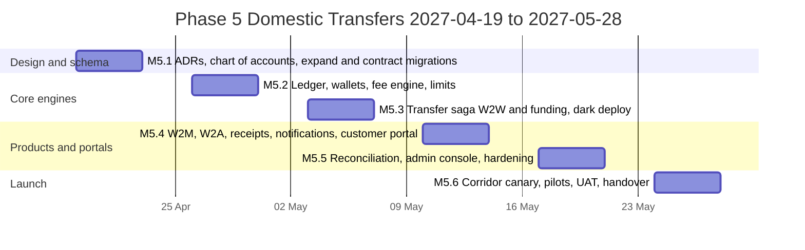
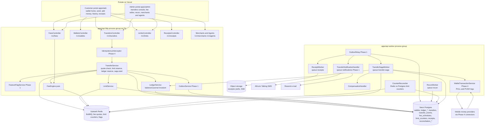
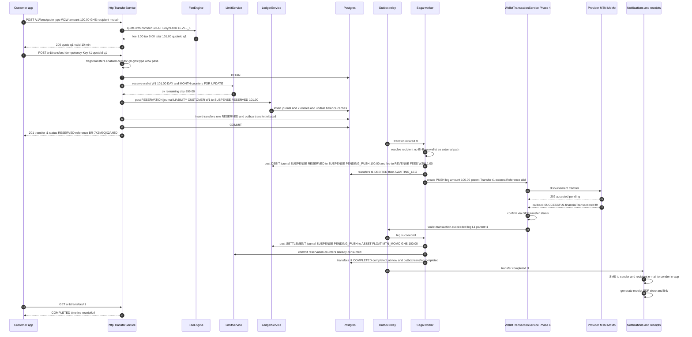
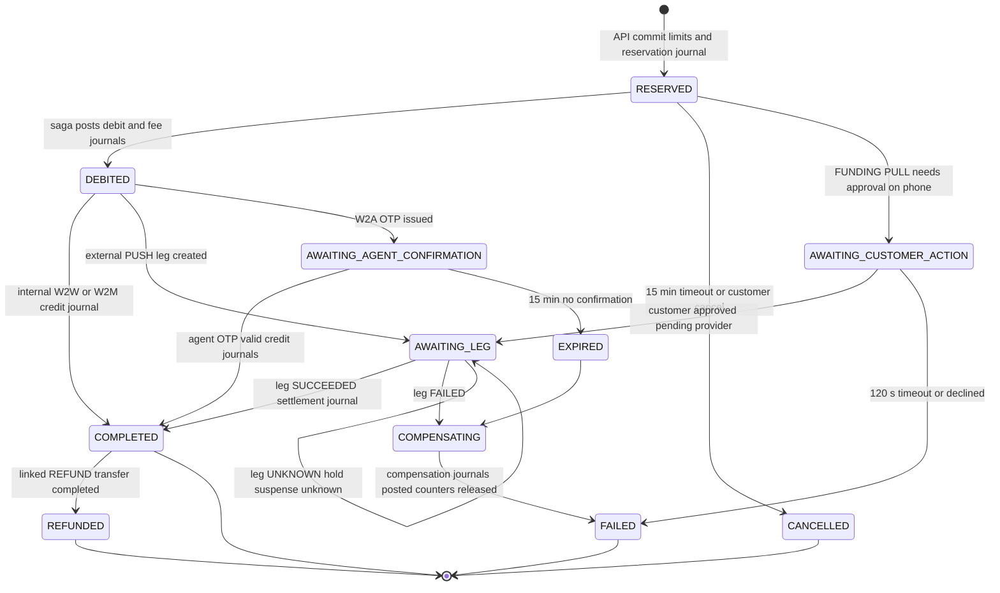
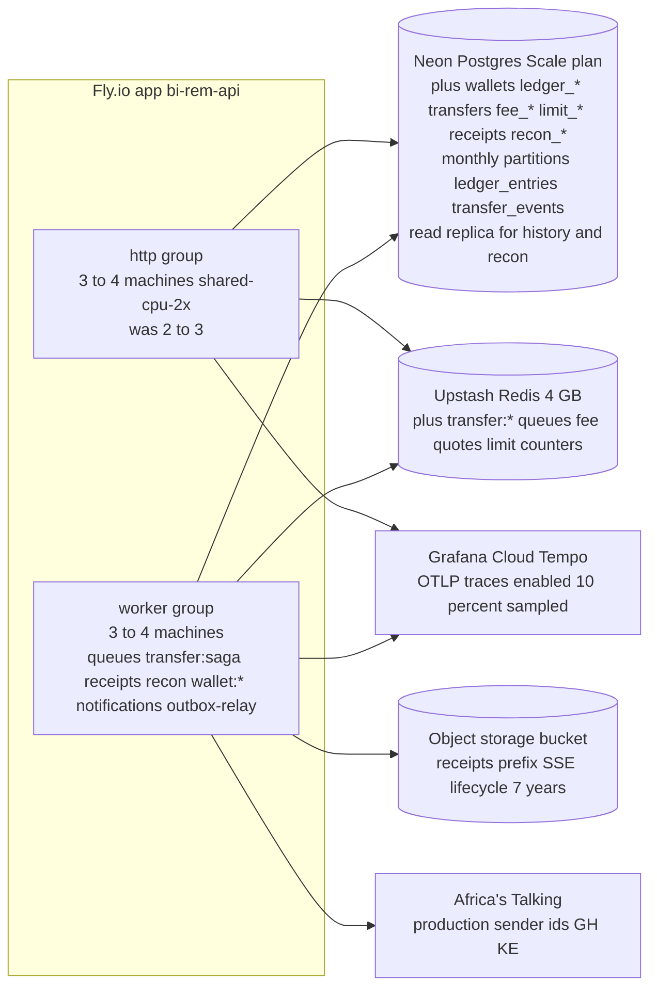
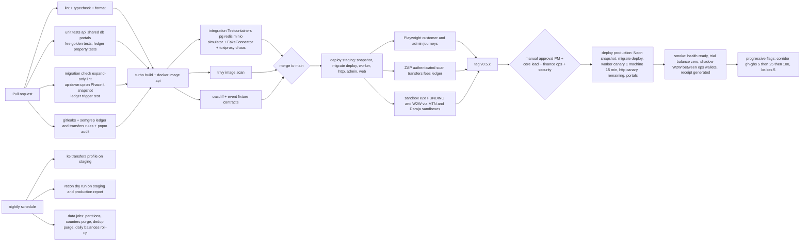

# Phase 5 — Domestic Transfers

| Field                     | Value                                                                                                                                                                                                                                                                                                                                                                                                                                                                                                                                             |
| ------------------------- | ------------------------------------------------------------------------------------------------------------------------------------------------------------------------------------------------------------------------------------------------------------------------------------------------------------------------------------------------------------------------------------------------------------------------------------------------------------------------------------------------------------------------------------------------- |
| **Phase**                 | 5 of 13 — `domestic-transfers`                                                                                                                                                                                                                                                                                                                                                                                                                                                                                                                    |
| **Dates**                 | 2027-04-19 → 2027-05-28                                                                                                                                                                                                                                                                                                                                                                                                                                                                                                                           |
| **Duration**              | 6 weeks (W1 = 2027-04-19, W6 = 2027-05-24 … 2027-05-28)                                                                                                                                                                                                                                                                                                                                                                                                                                                                                           |
| **Team**                  | `core` (4 backend, 2 frontend, 1 QA + 1 QA from W3, solution architect, DevOps/SRE, PM, compliance analyst, product designer; 0.5 security engineer; 1 platform backend engineer on loan W1–W2 while Phase 4 closes out)                                                                                                                                                                                                                                                                                                                          |
| **Depends on**            | Phase 2 — Customer Management & KYC (ended 2027-02-19): `CustomerProfile.kycLevel`, `KycLevelPolicy` limits, `Beneficiary`, `@RequiresRecentMfa`, OTP service, `kyc.level_changed` event. Phase 4 — Wallet Connector Engine (ends 2027-04-30, overlaps our W1–W2): `WalletTransaction` leg primitive (`PULL`/`PUSH`), `wallet.transaction.*` events, `FakeConnector` + `apps/simulator`, `WalletBeneficiaryVerifier`, per-connector `live` flag, `UNKNOWN` semantics                                                                              |
| **Unlocks**               | Phase 6 — International Remittance (2027-05-31) reuses the ledger, saga, fee engine, receipts and notifications; Phase 7 — FX & Treasury (2027-06-28) consumes ledger accounts and reconciliation hooks; Phase 8 — AML/Fraud (2027-07-26) consumes `transfer.*` events and limit counters; Phase 9 — Partner & Merchant Portal (2027-08-23) builds on Wallet-to-Merchant and Wallet-to-Agent; Phase 10 — Reporting (2027-09-20) reads `ledger_entries`; Phase 11 — Mobile (2027-08-09) consumes the transfer API, receipts and push notifications |
| **Runs in parallel with** | Phase 4 close-out (platform team, until 2027-04-30)                                                                                                                                                                                                                                                                                                                                                                                                                                                                                               |

---

## 1. Overview

### 1.1 Objective

Phase 5 is the first phase in which **a BI-Rem customer moves money**. It launches local (same-country, same-currency) money movement on top of the Phase 4 leg primitive: a customer funds a BI-Rem wallet from their mobile-money account and sends to another BI-Rem wallet, to a registered merchant or to a cash-out agent, with fees computed by a configurable **Fee Calculation Engine**, enforced **per-KYC-tier limits**, a **double-entry ledger** that is the single source of truth for balances, a **saga orchestrator** that drives debit → credit with explicit compensation, **transfer history**, **PDF receipts**, multi-channel **notifications**, end-to-end **transaction tracking** and **reconciliation hooks** that Phase 7 (treasury) and Phase 10 (reporting) will plug into.

The phase succeeds when, in production and behind per-corridor flags, a KYC `LEVEL_1`+ customer in the first live corridor (Ghana / GHS via MTN MoMo, with Kenya / KES via M-Pesa Daraja as the second corridor) can complete a Wallet-to-Wallet transfer in under 10 seconds p95 with the ledger balanced to the cent, both parties notified, a receipt downloadable, and every state change auditable from the admin portal.

### 1.2 In scope

- **Customer wallets** (`wallets`) — one wallet per customer per currency, balance derived from the ledger, never stored as a mutable counter without a ledger entry behind it.
- **Double-entry ledger** (`ledger_accounts`, `ledger_journals`, `ledger_entries`) — immutable journals with balanced entries; customer liabilities, provider float assets, fee revenue, tax payable, suspense/clearing accounts.
- **Funding and cash-out legs** via Phase 4 `WalletTransaction` (`PULL` from the customer's mobile-money account into BI-Rem float, `PUSH` from float to a wallet/agent/merchant mobile-money account).
- **Wallet to Wallet (W2W)** — internal transfer between two BI-Rem wallets; instant, ledger-only when both parties hold BI-Rem wallets; optional external leg when the recipient is identified by MSISDN but has no wallet (push to their mobile-money account).
- **Wallet to Merchant (W2M)** — payment to a registered merchant (merchant code / QR), with merchant fee schedule and merchant settlement account.
- **Wallet to Agent (W2A)** — cash-out at a registered agent (agent code + OTP release), with agent commission accrual.
- **Fee Calculation Engine** — versioned fee schedules per corridor × transfer type × KYC tier, components (flat, percentage, tiered bands), floors/caps, taxes (e.g. Ghana E-Levy, Kenya excise duty on money transfer fees, VAT on fees where applicable), merchant/agent commission splits; quote → lock → apply.
- **Limits engine** — single-transaction, daily and monthly limits per KYC level from `KycLevelPolicy`, plus per-wallet balance cap, counted in Redis with Postgres as source of truth, enforced atomically at reservation time.
- **Saga / orchestration** — `TransferSaga` state machine driving reserve → debit → external legs → credit → finalise, with compensation (release reservation, reverse ledger, request provider reversal) and `UNKNOWN` holds.
- **Transfer history** and **transaction tracking** — customer-facing history with filters, status timeline per transfer, admin transfer explorer with saga step view.
- **Receipts (PDF)** — deterministic, localised (en/fr/pt) PDF receipts with QR verification code, generated by a worker, stored in object storage, served via signed URL.
- **Notifications** — transfer lifecycle templates (SMS, e-mail, push placeholder, in-app) for sender and recipient, rate-limited and preference-aware (Phase 1 `NotificationPreference`).
- **Reconciliation hooks** — daily ledger trial balance, float-vs-ledger comparison using Phase 4 `provider_balance_snapshots` and statements, break detection (`reconciliation_breaks`), and the interfaces Phase 7 will extend.
- **Admin portal**: transfer explorer, saga inspector, fee schedule editor with simulation, limits overview, merchant/agent registry (minimal), reconciliation dashboard, manual journal with four-eyes.
- **Customer portal**: wallet home, add money, send (W2W/W2M/W2A), transfer detail with tracking, history, receipts, limits widget.

### 1.3 Out of scope (deferred)

- Cross-border and cross-currency transfers, FX rates, corridors with two currencies — **Phase 6 / Phase 7**.
- Treasury float rebalancing, liquidity forecasting, bank settlement — **Phase 7** (we expose the ledger accounts and `FLOAT_TRANSFER` usage pattern).
- Sanctions screening, transaction monitoring rules, fraud scoring, case management — **Phase 8** (we emit `transfer.*` events with hashed counterparties and keep a `riskHold` hook that Phase 8 will populate; Phase 5 ships a conservative velocity rule set in the limits engine only).
- Self-service merchant and agent onboarding, merchant APIs, settlement reports — **Phase 9** (we ship an admin-only registry so W2M/W2A can be launched with a small pilot set).
- Reporting warehouse, regulatory returns — **Phase 10** (we partition `ledger_entries` monthly and publish events).
- Native mobile apps — **Phase 11** (the customer portal is mobile-first responsive; the transfer API is designed for mobile consumption: idempotent, resumable, polling-friendly).
- Scheduled / recurring transfers, bill payments, airtime top-up, requests-to-pay between customers.

### 1.4 Independent deployability strategy

"Deployable alone" for Phase 5 means: **every migration is expand-only and applied to production in W1; all transfer code ships dark with `transfers.enabled=false`; the ledger module is exercised in production by shadow postings (internal test wallets owned by ops accounts) before any customer can see a wallet; each transfer type and each corridor is enabled independently by flag with a percentage canary; and the whole domain can be frozen in under 30 seconds without a redeploy while in-flight sagas finish or compensate safely.**

| Mechanism                                                                                           | Phase 5 application                                                                                                                                                                                                                                                                                                                                                                                                                                                                                                                                                                                                                                                                                                                                                                                                                                                                                                                       |
| --------------------------------------------------------------------------------------------------- | ----------------------------------------------------------------------------------------------------------------------------------------------------------------------------------------------------------------------------------------------------------------------------------------------------------------------------------------------------------------------------------------------------------------------------------------------------------------------------------------------------------------------------------------------------------------------------------------------------------------------------------------------------------------------------------------------------------------------------------------------------------------------------------------------------------------------------------------------------------------------------------------------------------------------------------------- |
| **Feature flags** (Phase 1 `FeatureFlag` service, Redis-cached 30 s, `rolloutPercentage` + `rules`) | `transfers.enabled` (master; off → `POST /v1/transfers` returns 503 `TRANSFERS_PAUSED`, sagas already past `DEBITED` continue, new ones are not accepted), `transfers.type.w2w.enabled`, `transfers.type.w2m.enabled`, `transfers.type.w2a.enabled`, `transfers.funding.enabled` (add money), `transfers.corridor.<cc>-<ccy>.enabled` with `rolloutPercentage` evaluated on the sender user id (e.g. `transfers.corridor.gh-ghs.enabled` at 5 % → 25 % → 100 %), `transfers.external-recipient.enabled` (W2W to non-customers via `PUSH`), `fees.engine.v2` (schedule evaluation path switch), `limits.redis-counters` (fast path vs Postgres-only), `receipts.pdf.enabled`, `notifications.transfer.sms`, `notifications.transfer.email`, `recon.daily.enabled`, `admin.transfers.console`, `wallet.connector.<key>.live` (Phase 4) lit per corridor by this phase. Keys registered in `packages/shared/src/constants/feature-flags.ts`. |
| **Expand → migrate → contract**                                                                     | W1 migration `20270419090000_phase5_expand` adds all new tables, enums and nullable columns; the only contract is Phase 4's `beneficiaries.provider_code` drop (`20270419100000_phase4_contract`) executed in our W1 migration slot after a Neon snapshot. Phase 5 introduces **no** contract of its own; `wallets.cached_balance` is a denormalised read model that can be rebuilt from `ledger_entries` at any time.                                                                                                                                                                                                                                                                                                                                                                                                                                                                                                                    |
| **Dark launch**                                                                                     | From W3 the production API carries the full transfer stack. Ops accounts (flag rule `userIds in [ops wallets]`) run **shadow transfers** between two internal test wallets funded from float probes (Phase 4 M4.8), W2W only, no provider legs, proving ledger posting, saga timing, receipts and notifications in production. From W4 the GH/GHS corridor is lit for an allow-list of 20 staff customers with real MTN MoMo accounts and 1–5 GHS amounts.                                                                                                                                                                                                                                                                                                                                                                                                                                                                                |
| **Kill switches**                                                                                   | `transfers.enabled=false` stops intake in ≤ 30 s; `transfers.type.*` and `transfers.corridor.*` stop one slice; `wallet.connector.<key>.live=false` (Phase 4) stops external legs — sagas waiting on legs park in `AWAITING_LEG` and resume or compensate when re-enabled; `ledger.postings.frozen=true` (Setting, not flag — requires `ledger:freeze` permission and MFA) rejects every journal except compensations and manual corrections, used only for a suspected ledger defect.                                                                                                                                                                                                                                                                                                                                                                                                                                                    |
| **Worker isolation**                                                                                | Saga steps, receipts, notifications, counters reconciliation and recon jobs run only in the Phase 3/4 `worker` process group (`WORKER_QUEUES=transfer:*,receipts,recon,wallet:*,notifications,outbox-relay`). The `http` group performs the synchronous part of a transfer (quote, limit reservation, ledger reservation journal) inside one Postgres transaction and hands the saga to the worker. A worker outage degrades to "transfers stay `RESERVED` and time out to `CANCELLED` after 15 minutes with reservation released", never to a double debit.                                                                                                                                                                                                                                                                                                                                                                              |
| **Backward-compatible APIs**                                                                        | New paths under `/v1/wallets/*`, `/v1/transfers/*`, `/v1/fees/*`, `/v1/limits/*`, `/v1/receipts/*`, `/v1/ledger/*` (admin), `/v1/merchants/*`, `/v1/agents/*`, `/v1/recon/*`. Phase 4 `/v1/wallet/transactions` keeps its contract; we only populate `parentType='Transfer'`, `parentId`.                                                                                                                                                                                                                                                                                                                                                                                                                                                                                                                                                                                                                                                 |
| **Rollback**                                                                                        | Flags first; then Fly image rollback (`infra/scripts/rollback-api.sh`) and Vercel instant rollback. Ledger rows are never deleted on rollback: a bad posting is corrected by a compensating journal (`ledger_journals.kind=CORRECTION`) with four-eyes.                                                                                                                                                                                                                                                                                                                                                                                                                                                                                                                                                                                                                                                                                   |

---

## 2. Milestones

Phase start is Monday **2027-04-19**; week _n_ runs Monday to Friday; milestone dates are the Friday of the week.

| ID       | Week | Target date | Deliverable                                                                                                                                                                                                                                                                                                                                          | Acceptance criteria                                                                                                                                                                                                                                                                                                                                                                                                                                                                                                | Owner                               |
| -------- | ---- | ----------- | ---------------------------------------------------------------------------------------------------------------------------------------------------------------------------------------------------------------------------------------------------------------------------------------------------------------------------------------------------- | ------------------------------------------------------------------------------------------------------------------------------------------------------------------------------------------------------------------------------------------------------------------------------------------------------------------------------------------------------------------------------------------------------------------------------------------------------------------------------------------------------------------ | ----------------------------------- |
| **M5.1** | W1   | 2027-04-23  | Design freeze: ledger chart of accounts, saga state machine, fee schedule model, limit algorithm; ADR-0015 (double-entry ledger), ADR-0016 (transfer saga & compensation), ADR-0017 (fee engine); schema v5 _expand_ migration and Phase 4 contract migration applied; first live corridor (GH/GHS, MTN MoMo) and pilot merchant/agent set confirmed | `pnpm db:migrate:dev` applies `20270419090000_phase5_expand` and `20270419100000_phase4_contract` on a Phase 4 database; chart of accounts seeded (`packages/db/prisma/seed-data/ledger-accounts.json`) for GHS and KES; saga table (§4.3) reviewed with Phase 4 lead and compliance; ADRs accepted at the Thursday architecture review; fee schedule JSON schema frozen in `@bi-rem/shared/schemas/fees.ts`                                                                                                       | Solution Architect                  |
| **M5.2** | W2   | 2027-04-30  | Ledger module (`apps/api/src/ledger/*`): accounts, journals, entries, balance projection, trial balance; `LedgerService.post()` with balanced-entry invariant; wallets module; Fee Calculation Engine v1 with quote API; Limits engine with Redis counters                                                                                           | Property tests prove every committed journal balances per currency (100 000 random journals); trial balance equals zero for every currency after the test suite; `POST /v1/fees/quote` returns the worked examples in §3.7 to the cent for GHS and KES; limit reservation is atomic under 200 concurrent requests on one wallet (exactly N succeed, none over-limit); `GET /v1/wallets/me` returns ledger-derived balance in < 50 ms p95                                                                           | Backend Lead (core)                 |
| **M5.3** | W3   | 2027-05-07  | Transfer saga for W2W (internal and external recipient) and funding (add money via `PULL`); compensation paths; `UNKNOWN` hold; transfer API; transaction tracking timeline; dark deploy to production with shadow transfers                                                                                                                         | Internal W2W completes in < 2 s p95 on staging; external W2W via simulator completes in < 10 s p95; chaos suite (worker kill after each step, provider timeout, provider `UNKNOWN`, duplicate webhook, Redis loss) leaves zero unbalanced journals and zero stuck sagas after recovery job; production shadow transfers between ops wallets succeed with receipts queued; `Idempotency-Key` replay returns the original 201                                                                                        | Backend Lead (core)                 |
| **M5.4** | W4   | 2027-05-14  | W2M and W2A sagas; merchant & agent registry (admin); OTP cash-out release; PDF receipts worker; transfer notifications (SMS/e-mail/in-app) for all lifecycle events; customer portal send/add-money/history/detail/receipt; GH/GHS corridor lit for staff allow-list                                                                                | Merchant payment credits merchant settlement account net of merchant fee and accrues commission journal; agent cash-out requires OTP verified by agent within 15 min or auto-expires with full compensation; receipt PDF generated < 3 s p95, byte-identical on regeneration for the same transfer, QR verifies via `GET /v1/receipts/verify/:code`; every lifecycle event produces exactly one notification per channel per party (dedupe test); 20 staff users complete real 1–5 GHS W2W transfers in production | Backend Lead (core) / Frontend Lead |
| **M5.5** | W5   | 2027-05-21  | Reconciliation hooks (daily trial balance, float vs ledger, break detection, admin dashboard); admin transfers console (explorer, saga inspector, fee editor with simulation, limits view, manual journal four-eyes); hardening: performance, security review, runbooks; KE/KES corridor dark                                                        | `recon.daily` job produces a `reconciliation_runs` row with zero unexplained breaks on staging after a 10 000-transfer simulated day; an injected break (simulator drops one webhook) is detected and linked to the transfer within one run; k6 profile (§9.5) passes at 50 TPS sustained / 100 TPS peak; pen-test findings ≥ High closed; Playwright suites green for both portals; every mutating admin action yields an `audit_logs` row                                                                        | QA Lead / Security / Frontend Lead  |
| **M5.6** | W6   | 2027-05-28  | Production launch: GH/GHS corridor canary 5 % → 25 % → 100 % of eligible customers; KE/KES at 5 %; W2M/W2A pilots (3 merchants, 5 agents in Accra); UAT sign-off; phase exit review; handover to Phases 6/7/8                                                                                                                                        | Success criteria (§12) evidenced with production data; real-time transfers p95 < 10 s end-to-end over the canary week; notification delivery rate ≥ 98 % SMS, ≥ 99 % e-mail; audit trail demonstrably complete for a sampled transfer (API → saga → ledger → notification → receipt); sign-offs (§11) collected; Phase 6 team consuming `TransferSaga` extension points in their W1                                                                                                                                | Program Manager                     |



---

## 3. Deliverables

Each deliverable lists what it is, where it lives in the monorepo and a precise definition of done (DoD).

### 3.1 Double-entry ledger (`apps/api/src/ledger/*`, `packages/shared/src/schemas/ledger.ts`)

- **What**: Chart of accounts, immutable journals with balanced entries, balance projection, trial balance, account freezing, correction journals.
- **DoD**: `ledger_accounts` seeded per currency with account types `ASSET` (float at provider, e.g. `ASSET:FLOAT:MTN_MOMO:GHS`; bank settlement placeholder for Phase 7), `LIABILITY` (one `LIABILITY:CUSTOMER:<walletId>` per wallet, `LIABILITY:MERCHANT:<merchantId>`, `LIABILITY:AGENT:<agentId>`, `LIABILITY:TAX:ELEVY:GHS`), `REVENUE` (`REVENUE:FEES:<type>:<ccy>`), `EXPENSE` (`EXPENSE:COMMISSION:AGENT:<ccy>`, `EXPENSE:PROVIDER_FEES:<key>:<ccy>`), `SUSPENSE` (`SUSPENSE:PENDING_PULL:<ccy>`, `SUSPENSE:PENDING_PUSH:<ccy>`, `SUSPENSE:UNKNOWN:<ccy>`); `LedgerService.post(journal, tx)` validates Σ debits = Σ credits per currency, rejects mixed-currency journals (Phase 7 will introduce FX journals with explicit rate entries), writes `ledger_journals` + `ledger_entries` in the caller's Prisma transaction and updates `ledger_accounts.balance_cache` via `UPDATE … SET balance = balance + delta` (row lock ordering by account id to avoid deadlocks); Postgres roles forbid `UPDATE`/`DELETE` on `ledger_journals` and `ledger_entries` for `birem_app`; a DB trigger `ledger_journal_balanced()` re-checks balance on commit (deferred constraint trigger) so an application bug cannot persist an unbalanced journal; `GET /v1/ledger/trial-balance?currency=GHS&asOf=` returns zero within 50 ms for 10 M entries using the monthly `ledger_account_daily_balances` roll-up; property-based tests with `fast-check`; ADR-0015 accepted.

### 3.2 Customer wallets (`apps/api/src/wallets/*`)

- **What**: Wallet lifecycle, balance view, statement.
- **DoD**: One `wallets` row per `(userId, currency)` created lazily on first funding or on KYC `LEVEL_1` approval (`kyc.level_changed` consumer) for the customer's home currency; `status` `ACTIVE | FROZEN | CLOSED`; `GET /v1/wallets/me` returns `available` (ledger balance minus active reservations), `reserved`, `ledgerBalance`, `currency`, `limits` summary; statement endpoint paginates `ledger_entries` for the wallet's liability account with running balance; freezing a wallet (`wallets:freeze`, MFA step-up, reason code) blocks debits but allows credits; `LEVEL_0` customers see a wallet placeholder with "verify to unlock" and cannot fund or send (Phase 2 rule).

### 3.3 Funding — Add Money (`TransferType.FUNDING`)

- **What**: Customer pulls money from their own mobile-money account into their BI-Rem wallet.
- **DoD**: `POST /v1/transfers` with `type=FUNDING`, `source={providerKey, msisdn}` (must equal the customer's verified phone or a verified linked account), amount in minor units; saga creates a Phase 4 `PULL` leg (`parentType='Transfer'`), posts `SUSPENSE:PENDING_PULL` journal on submission and the final `ASSET:FLOAT → LIABILITY:CUSTOMER` journal only on `wallet.transaction.succeeded`; `customerActionRequired` (USSD/STK prompt) surfaced to the UI with a 120 s countdown and polling; failure or expiry leaves the ledger untouched except the reversed suspense journal; `UNKNOWN` legs park the transfer in `AWAITING_LEG` with `SUSPENSE:UNKNOWN` journal until Phase 4 resolution; daily funding counted against the KYC balance cap, not the send limit.

### 3.4 Wallet to Wallet (`TransferType.W2W`)

- **What**: Send from one BI-Rem wallet to another customer identified by MSISDN, BI-Rem tag or saved beneficiary; optional external push when the recipient has no wallet.
- **DoD**: Internal path: single Postgres transaction posts `LIABILITY:CUSTOMER:<sender> → LIABILITY:CUSTOMER:<recipient>` plus fee and tax entries, completes synchronously in < 500 ms p95, both parties notified; external path (`transfers.external-recipient.enabled`): sender debited to `SUSPENSE:PENDING_PUSH`, `PUSH` leg created, on success `SUSPENSE → ASSET:FLOAT` (float decreases), on failure compensation credits the sender back and refunds fees per schedule rule `refundFeesOnFailure`; recipient resolution uses Phase 2 `Beneficiary` + Phase 4 `WalletBeneficiaryVerifier` (name match ≥ 70 % or explicit confirmation of masked name); self-transfer rejected; `@RequiresRecentMfa` above setting `transfers.stepup.threshold.<ccy>` (default GHS 1 000 / KES 10 000); idempotent on `Idempotency-Key`.

### 3.5 Wallet to Merchant (`TransferType.W2M`)

- **What**: Payment to a registered merchant by merchant code or QR (EMVCo-style static QR payload containing merchant code, optional amount and reference).
- **DoD**: `merchants` registry (admin-created in Phase 5; self-service in Phase 9) with settlement wallet (BI-Rem merchant wallet) and merchant fee schedule reference; payment posts `LIABILITY:CUSTOMER → LIABILITY:MERCHANT` net of merchant discount rate, `REVENUE:FEES:W2M`, tax entries; customer fee may be zero and merchant pays MDR (both configurable); merchant receives a notification with reference; QR payload parsed and validated server-side (`POST /v1/merchants/resolve-qr`); refund (`POST /v1/transfers/:id/refund`, merchant-initiated through admin in Phase 5) creates a linked `REFUND` transfer with reversed fee treatment per schedule.

### 3.6 Wallet to Agent (`TransferType.W2A`)

- **What**: Cash-out at an agent: customer initiates with agent code and amount, receives OTP, agent confirms with OTP in the agent flow (admin-portal agent screen in Phase 5; agent app in Phase 9/11), cash handed over.
- **DoD**: `agents` registry with agent float wallet and commission schedule; on initiation the customer amount + fee is reserved (not debited); agent confirmation with valid OTP (6 digits, 15 min TTL, 3 attempts, Phase 2 `OtpCode` with purpose `CASH_OUT`) posts `LIABILITY:CUSTOMER → LIABILITY:AGENT` plus fee, tax and `EXPENSE:COMMISSION:AGENT → LIABILITY:AGENT`; expiry releases reservation and notifies both; agent daily cash-out cap and per-transaction cap enforced from `agents.limits`; every step audited with agent user id.

### 3.7 Fee Calculation Engine (`apps/api/src/fees/*`, `packages/shared/src/schemas/fees.ts`)

- **What**: Versioned, data-driven fee schedules with components, tiers, floors/caps, taxes and splits; quote and apply with lock.
- **DoD**: `fee_schedules` (scope: `countryCode`, `currency`, `transferType`, optional `kycLevel`, optional `merchantId`/`agentId`, `providerKey`, `effectiveFrom/To`, `version`, `status DRAFT|ACTIVE|RETIRED`) with `fee_schedule_components` (`kind FLAT|PERCENT|TIERED`, `bands` JSON `[{upTo, flat, percentBps}]`, `minMinor`, `maxMinor`, `payer SENDER|RECIPIENT|MERCHANT|PLATFORM`, `revenueAccount`) and `fee_schedule_taxes` (`code ELEVY|EXCISE|VAT`, `rateBps`, `base FEE|AMOUNT`, `payableAccount`, `exemptBelowMinor`); evaluation is pure and deterministic (`FeeEngine.quote(input): FeeQuote` has no I/O), rounding half-up to minor units per component then summed; resolution order: most specific scope wins (merchant/agent > provider > kycLevel > corridor default), ties broken by latest `effectiveFrom`; `POST /v1/fees/quote` returns breakdown and a `quoteId` (Redis, 10 min TTL, signed) that `POST /v1/transfers` must present so the customer pays what was shown; applied quote persisted as `transfer_fee_lines`; admin simulation endpoint runs a schedule against a CSV of amounts; worked examples locked as golden tests: GH W2W `LEVEL_1`, 100.00 GHS → fee 1.00 GHS (1 % capped at 10 GHS, floor 0.50) + E-Levy 1 % on the amount above the daily GHS 100 exemption (0.00 here) → total debit 101.00; KE W2W 1 000.00 KES → fee 15.00 KES (band 501–1 000) + excise 15 % on fee 2.25 → total 1 017.25; ADR-0017 accepted.

### 3.8 Limits engine (`apps/api/src/limits/*`)

- **What**: Per-KYC-tier single/daily/monthly send limits, balance cap, per-type and per-corridor overrides, velocity guardrails, atomic reservation.
- **DoD**: Effective limits computed from Phase 2 `KycLevelPolicy` (`single_txn_max_minor`, `daily_limit_minor`, `monthly_limit_minor`, `balance_limit_minor`) overlaid with `limit_overrides` (admin, per customer with expiry and reason — e.g. raise for a verified business customer, lower for a risk hold); counters `limit_counters` keyed `(walletId, window DAY|MONTH, windowStart)` in Postgres with a Redis `INCRBY`/`DECRBY` mirror for the fast path (`limits.redis-counters`); reservation `LimitService.reserve(walletId, amountMinor, type)` runs in the same transaction as the ledger reservation using `SELECT … FOR UPDATE` on the counter row — exactly-once accounting proven by the concurrency test; failed/cancelled transfers release the reservation; windows use the customer's country time zone (Africa/Accra, Africa/Nairobi) and the monthly window is calendar month; `GET /v1/limits/me` shows used/remaining per window and "what you unlock at LEVEL_2"; velocity guardrails (max 10 transfers per 10 minutes per wallet, max 3 new recipients per day) are limits-engine rules until Phase 8 replaces them; `kyc.level_changed` invalidates the cached policy for the user within 5 s.

### 3.9 Transfer saga & orchestration (`apps/api/src/transfers/saga/*`, worker)

- **What**: `Transfer` aggregate, saga state machine, step handlers, compensation, timeouts, recovery.
- **DoD**: States per §4.3; each step is a BullMQ job in `transfer:saga` with `jobId=<transferId>:<step>:<attempt>` and the saga row carries `currentStep`, `stepAttempt`, `lastError`; every transition writes `transfer_events` (append-only, monthly partitions) with `from`, `to`, `trigger`, `correlationId`; compensation is explicit per step (`RELEASE_RESERVATION`, `REVERSE_DEBIT_JOURNAL`, `REQUEST_LEG_REVERSAL`, `REFUND_FEES`) and recorded as journals of kind `COMPENSATION` linked by `reverses_journal_id`; `UNKNOWN` leg → `AWAITING_LEG` (no customer-visible failure, "processing" copy, ops alert after 15 min); timeouts: `RESERVED` 15 min → `CANCELLED`, `AWAITING_CUSTOMER_ACTION` 120 s → `FAILED`, `AWAITING_AGENT_CONFIRMATION` 15 min → `EXPIRED`; recovery job `transfer:recover` on worker start re-enqueues any saga whose step job is missing from Redis; outbox events `transfer.*`; chaos tests kill the worker between every pair of steps and assert invariants; ADR-0016 accepted.

### 3.10 Transfer history & transaction tracking (`apps/api/src/transfers/*`, portals)

- **What**: Customer history with filters, per-transfer tracking timeline, admin explorer with saga inspector.
- **DoD**: `GET /v1/transfers?type=&status=&from=&to=&counterparty=&cursor=` cursor-paginated (keyset on `created_at,id`), < 100 ms p95 at 10 M transfers via `(sender_user_id, created_at desc)` and `(recipient_user_id, created_at desc)` indexes; `GET /v1/transfers/:id` includes `timeline[]` built from `transfer_events` with customer-safe copy per state (no provider codes), ETA hint, next action (e.g. "approve the prompt on your phone"); admin `GET /v1/admin/transfers/:id` additionally returns saga steps, leg ids, journals, notifications, receipts and audit rows; status search by `reference` (human reference `BR-<base32 12>` printed on receipts and SMS) is public-safe via `GET /v1/transfers/track/:reference` with OTP for non-authenticated recipients (Phase 11 deep link).

### 3.11 Receipts (PDF) (`apps/api/src/receipts/*`, worker `receipts`)

- **What**: Deterministic PDF receipt per completed transfer (and per refund/compensation), localised, verifiable.
- **DoD**: Generated by the worker on `transfer.completed` using `pdf-lib` (pure JS, no headless browser; template drawn from `packages/shared/receipts/templates/*.json` layout definitions), embedded Noto Sans for Latin + diacritics, fonts cached; content: reference, date/time in customer time zone, parties (masked MSISDN `+233 24 *** **12`), amount, fee breakdown, taxes with statutory wording (E-Levy line as required by GRA guidance), provider reference ids, QR encoding `https://app.bi-rem.com/r/<verifyCode>`; stored in the Phase 2 object-storage bucket pattern under `receipts/<yyyy>/<mm>/<transferId>.pdf` with SSE; `receipts` row with `sha256`; served via `GET /v1/receipts/:transferId` → 302 signed URL (5 min) or inline bytes for the BFF; regeneration yields identical bytes (fixed metadata, fixed creation date = transfer completion time); verification `GET /v1/receipts/verify/:code` public, rate-limited, returns amount/date/status only; e-mail notification attaches the PDF when < 200 KB.

### 3.12 Notifications (`apps/api/src/notifications/*` extensions, templates)

- **What**: Transfer lifecycle notifications on SMS, e-mail, in-app (push placeholder for Phase 11).
- **DoD**: Templates seeded for en/fr/pt × channels: `transfer.initiated`, `transfer.action_required`, `transfer.completed.sender`, `transfer.completed.recipient`, `transfer.failed`, `transfer.refunded`, `funding.completed`, `cashout.otp`, `cashout.completed`, `merchant.payment_received`, `limits.near_threshold` (80 %), `wallet.frozen`; one consumer `TransferNotificationHandler` on `transfer.*` outbox events with idempotency key `(transferId, event, channel, party)` → `notification_dedup` unique index so retries never double-send; respects `NotificationPreference` except for `cashout.otp` and `transfer.completed.recipient` (mandatory, regulatory); SMS via Africa's Talking (Phase 1) with sender id per country, cost tracked as metric `notifications_sms_cost_minor_total`; delivery callbacks update `delivered_at`; rate limit 20 SMS per user per day except OTP; in-app notifications list and badge in customer portal; no amount or full MSISDN in push/in-app previews (lock-screen leakage).

### 3.13 Transaction tracking & observability

- **What**: End-to-end traceability from API request to ledger to provider to notification.
- **DoD**: `correlationId` (`x-request-id`) propagated into saga jobs, `wallet_transactions.correlation_id`, `ledger_journals.correlation_id`, notifications and receipts; OpenTelemetry spans `transfer.saga.<step>` with `transfer.id` attribute (OTEL exporter enabled in production from this phase, sampled 10 %, 100 % for failures); metrics `transfers_total{type,corridor,status}`, `transfer_duration_seconds{type,corridor}` (initiated → completed), `transfer_saga_step_duration_seconds{step}`, `transfer_compensations_total{step,reason}`, `ledger_journals_total{kind}`, `ledger_unbalanced_attempts_total` (must stay 0), `limits_rejections_total{window,level}`, `fee_quotes_total{schedule}`, `receipts_generated_total`, `recon_breaks_open`; Grafana dashboard "Transfers" and alerts (§11).

### 3.14 Reconciliation hooks (`apps/api/src/recon/*`, worker `recon`)

- **What**: Daily and on-demand reconciliation between ledger, Phase 4 legs and provider balances/statements; break register; interfaces for Phase 7.
- **DoD**: `recon:daily` at 02:00 local per corridor: (1) trial balance per currency = 0; (2) Σ `LIABILITY:CUSTOMER:*` = Σ `wallets.cached_balance` (rebuild + alert on drift); (3) each `SUCCEEDED` `PULL`/`PUSH` leg has exactly one final journal and each final journal has a `SUCCEEDED` leg; (4) `ASSET:FLOAT:<provider>:<ccy>` ledger balance vs latest Phase 4 `provider_balance_snapshots.available` ± in-flight legs ± provider fees within tolerance setting `recon.float.tolerance.<ccy>`; (5) provider statement lines (Phase 4 `getStatement`) matched to legs by provider transaction id; unmatched items create `reconciliation_breaks` (`kind`, `amountMinor`, `currency`, `transferId?`, `legId?`, `status OPEN|EXPLAINED|RESOLVED`, `resolutionJournalId?`); breaks older than 24 h page treasury ops; admin dashboard; `ReconciliationSource` interface so Phase 7 can add bank statements; manual journal API with four-eyes (`ledger:journals:write` + second approver, MFA) to resolve breaks.

### 3.15 Merchant & agent registry (admin-only, pilot scale)

- **What**: Minimal CRUD so W2M/W2A can launch with pilots.
- **DoD**: `merchants` (`code` 8-char Crockford base32, display name, category MCC, settlement wallet, fee schedule, status, KYB reference placeholder, QR payload generation), `agents` (`code`, operator user, float wallet, commission schedule, cash-out caps, location, status); admin screens for create/suspend; both tied to a `User` in realm `CUSTOMER` with role `merchant` / `agent` (permissions `merchants:self:read`, `agents:cashout:confirm`); Phase 9 replaces with full onboarding.

### 3.16 Portals, documentation and runbooks

- Customer and admin screens per §7; OpenAPI complete for `/v1/transfers/*`, `/v1/wallets/*`, `/v1/fees/*`, `/v1/limits/*`, `/v1/receipts/*`; `docs/handbooks/transfers-operations.md` (runbooks §15.4), `docs/handbooks/fee-schedules.md` (how to author a schedule, examples, tax references), `docs/handbooks/ledger.md` (chart of accounts, posting rules per transfer type, correction procedure); ADR-0015/16/17.

---

## 4. Architecture

### 4.1 Component / container diagram (Phase 5 additions)



**Reading the diagram.** The synchronous request path (`TransfersController → TransferService`) does four things inside one Postgres transaction: validate the fee quote, reserve limits, post the _reservation_ journal (customer liability → `SUSPENSE:RESERVED`), and insert the `transfers` row in state `RESERVED` together with the outbox event `transfer.initiated`. Everything that can be slow or fail remotely (provider legs, receipts, notifications) happens in the worker driven by the saga. The ledger is only ever written through `LedgerService`, which is the one place the balanced-journal invariant lives (plus the database trigger as a backstop).

### 4.2 Sequence — Wallet to Wallet with external recipient (the key flow)



Compensation branch (not drawn to keep the diagram readable): if step 23 returns `wallet.transaction.failed`, the saga posts a `COMPENSATION` journal `SUSPENSE:PENDING_PUSH → LIABILITY:CUSTOMER:W1` for 100.00 and, because the GH W2W schedule has `refundFeesOnFailure=true`, `REVENUE:FEES:W2W → LIABILITY:CUSTOMER:W1` for 1.00; it releases the limit counters, sets `FAILED` with a customer-safe reason, and notifications send `transfer.failed`. If the leg ends `UNKNOWN`, the saga stays in `AWAITING_LEG`, moves the amount to `SUSPENSE:UNKNOWN` for visibility, and waits for Phase 4 resolution (`wallet.transaction.succeeded|failed` emitted by the operator resolve endpoint) — it never guesses.

### 4.3 Transfer saga state machine



Rules enforced in code and tests: (1) every state change is one row in `transfer_events` and, when money moved, exactly one journal in the same transaction; (2) terminal states are `COMPLETED`, `FAILED`, `CANCELLED`, `REFUNDED` — nothing leaves them except `COMPLETED → REFUNDED` through a new linked transfer; (3) a saga step is idempotent: it first reads the transfer row `FOR UPDATE`, checks the expected `from` state, and no-ops if already applied (BullMQ at-least-once delivery); (4) compensation is table-driven per step so adding a step (Phase 6 FX conversion) means adding its inverse; (5) money is never "assumed": the only transitions that touch `ASSET:FLOAT` are driven by Phase 4 `wallet.transaction.succeeded` events.

### 4.4 Ledger posting rules (summary)

| Transfer type | Step                           | Debit account                            | Credit account                                 | Amount                  |
| ------------- | ------------------------------ | ---------------------------------------- | ---------------------------------------------- | ----------------------- |
| All           | Reservation                    | `LIABILITY:CUSTOMER:<sender>`            | `SUSPENSE:RESERVED:<ccy>`                      | amount + fees + taxes   |
| All           | Debit                          | `SUSPENSE:RESERVED`                      | `SUSPENSE:PENDING_PUSH` or recipient liability | amount                  |
| All           | Fee                            | `SUSPENSE:RESERVED`                      | `REVENUE:FEES:<type>:<ccy>`                    | fee (sender-paid share) |
| All           | Tax                            | `SUSPENSE:RESERVED`                      | `LIABILITY:TAX:<code>:<ccy>`                   | tax                     |
| FUNDING       | On `PULL` succeeded            | `ASSET:FLOAT:<provider>:<ccy>`           | `LIABILITY:CUSTOMER:<customer>`                | amount                  |
| FUNDING       | Provider fee reported          | `EXPENSE:PROVIDER_FEES:<provider>:<ccy>` | `ASSET:FLOAT:<provider>:<ccy>`                 | provider fee            |
| W2W internal  | Credit                         | `SUSPENSE:RESERVED`                      | `LIABILITY:CUSTOMER:<recipient>`               | amount                  |
| W2W external  | Settlement on `PUSH` succeeded | `SUSPENSE:PENDING_PUSH`                  | `ASSET:FLOAT:<provider>:<ccy>`                 | amount                  |
| W2M           | Credit net                     | `SUSPENSE:RESERVED`                      | `LIABILITY:MERCHANT:<merchant>`                | amount − MDR            |
| W2M           | MDR                            | `SUSPENSE:RESERVED`                      | `REVENUE:FEES:W2M_MDR:<ccy>`                   | MDR                     |
| W2A           | Credit on OTP                  | `SUSPENSE:RESERVED`                      | `LIABILITY:AGENT:<agent>`                      | amount                  |
| W2A           | Commission                     | `EXPENSE:COMMISSION:AGENT:<ccy>`         | `LIABILITY:AGENT:<agent>`                      | commission              |
| Any           | Compensation                   | inverse of the step being undone         |                                                |                         |
| Any           | Correction (manual, four-eyes) | per operator input, balanced             |                                                |                         |

### 4.5 Deployment / infrastructure delta



Infra delta summary: (a) `http` group scaled to 3–4 machines and `worker` group to 3–4 machines with `WORKER_QUEUES` extended; (b) Neon upgraded to **Scale** plan (IP allow-list, 30-day PITR, read replica) — the ledger makes PITR and a replica for history/recon queries non-negotiable; (c) `ledger_entries` and `transfer_events` as monthly range partitions created three months ahead by the Phase 4 `data-jobs.yml` job; (d) Upstash Redis confirmed at 4 GB with `noeviction`, separate key prefixes `transfer:`, `fees:quote:`, `limits:`; (e) object storage bucket (Cloudflare R2 or S3, same provider as the Phase 2 KYC bucket) with `receipts/` prefix, SSE, Object Lock governance 7 years; (f) OpenTelemetry traces exported to Grafana Cloud Tempo (was optional/off since Phase 1); (g) Africa's Talking production sender ids for GH and KE and Resend production domain; (h) Grafana dashboards "Transfers", "Ledger", "Reconciliation" and alerts (§11); (i) GitHub Actions additions (§10).

### 4.6 Design decisions and alternatives rejected

| #   | Decision                                                                                                                                   | Alternatives                                                                                               | Why                                                                                                                                                                                                                                                                                                                                            |
| --- | ------------------------------------------------------------------------------------------------------------------------------------------ | ---------------------------------------------------------------------------------------------------------- | ---------------------------------------------------------------------------------------------------------------------------------------------------------------------------------------------------------------------------------------------------------------------------------------------------------------------------------------------- |
| D1  | **Double-entry ledger in Postgres as the single source of truth for every balance**; `wallets.cached_balance` is a rebuildable projection. | Mutable balance column with an audit log; external ledger service (e.g. a hosted ledger API, TigerBeetle). | Regulators (BoG, CBK, BCEAO) expect reconstructible accounts; double entry makes float-vs-liability reconciliation a query, not a project. TigerBeetle is attractive for Phase 13 scale but adds an operational component the one-person DevOps team cannot run in Phase 5; the `LedgerService` interface is kept narrow so it can be swapped. |
| D2  | **Orchestration saga** (central `TransferSagaWorker` with explicit step table and compensations) rather than choreography on events alone. | Pure choreography (each service reacts to events); 2PC across ledger and provider.                         | Money flows need one place that knows the whole story for support and audit; choreography spreads compensation logic across modules; 2PC is impossible with external providers. Phase 4's leg state machine already supplies the reliable "did the provider do it" answer the saga needs.                                                      |
| D3  | **Reservation before debit** (two journals) instead of debiting immediately.                                                               | Debit on initiation and refund on failure.                                                                 | Reservation lets the customer cancel for free, keeps the customer liability intact if the saga dies before the provider is involved, and gives limits a hook to count provisional usage.                                                                                                                                                       |
| D4  | **Fee engine as pure, versioned data** (`fee_schedules` + components + taxes) with a signed quote token.                                   | Fees in code per corridor; computing fees at execution without a quote.                                    | Fees change per regulator notice (E-Levy rate changed twice since 2022); compliance and finance need to edit and simulate without a deploy; the quote token guarantees "what you saw is what you pay".                                                                                                                                         |
| D5  | **Limits counted in Postgres with Redis fast path**, reservation in the same transaction as the ledger.                                    | Redis-only counters; counting by summing transfers at request time.                                        | Redis alone is not durable enough for a regulatory limit; summing at request time is O(transfers) and racy. The `FOR UPDATE` on a per-wallet counter row serialises only that wallet.                                                                                                                                                          |
| D6  | **Same-currency only in Phase 5**; `LedgerService` rejects mixed-currency journals.                                                        | Allow FX journals now.                                                                                     | Keeps the balanced-journal invariant trivially checkable; Phase 7 introduces FX journals with explicit `FX_GAIN_LOSS` accounts and rate entries.                                                                                                                                                                                               |
| D7  | **Receipts generated with `pdf-lib` from a layout definition** rather than headless Chromium.                                              | Puppeteer/Playwright PDF; third-party receipt API.                                                         | No browser binary in the worker image (image stays < 250 MB), deterministic bytes for verification, 50 ms generation.                                                                                                                                                                                                                          |
| D8  | **Human reference `BR-` + 12 Crockford base32** printed everywhere, uuid stays internal.                                                   | Expose uuid; sequential numbers.                                                                           | Customers read references to agents and support over the phone; sequential numbers leak volume.                                                                                                                                                                                                                                                |
| D9  | **Merchant and agent registries are admin-only and minimal** in Phase 5.                                                                   | Build self-service onboarding now.                                                                         | Phase 9 owns onboarding; pilots need 3 merchants and 5 agents.                                                                                                                                                                                                                                                                                 |
| D10 | **OTEL tracing turned on in production** from this phase.                                                                                  | Logs only.                                                                                                 | A transfer crosses http, worker, Phase 4 queues and a provider; trace-per-transfer is the fastest support tool.                                                                                                                                                                                                                                |

---

## 5. Data Model & Migrations

### 5.1 Context from earlier phases

Phase 1: `User`, `AuditLog`, `Notification*`, `FeatureFlag`, `Setting`, `Outbox`. Phase 2: `CustomerProfile.kycLevel`, `KycLevelPolicy` (limits), `Beneficiary`, `OtpCode`. Phase 4: `WalletTransaction` (legs, `parentType/parentId`), `ProviderAccount`, `ProviderBalanceSnapshot`, `IdempotencyKey`. Phase 5 **adds** the tables below and fills `wallet_transactions.parent_type='Transfer'`. All additions follow CLAUDE.md: uuid ids via `gen_random_uuid()`, `timestamptz(6)`, money as `BIGINT` minor units + ISO-4217 `currency`, snake_case `@@map`/`@map`.

### 5.2 Prisma additions (schema v5)

```prisma
// ---------------------------------------------------------------------------
// Phase 5 — Domestic Transfers
// ---------------------------------------------------------------------------

enum WalletStatus {
  ACTIVE
  FROZEN
  CLOSED

  @@map("wallet_status")
}

enum LedgerAccountType {
  ASSET
  LIABILITY
  REVENUE
  EXPENSE
  SUSPENSE

  @@map("ledger_account_type")
}

enum LedgerJournalKind {
  RESERVATION
  DEBIT
  FEE
  TAX
  CREDIT
  SETTLEMENT
  PROVIDER_FEE
  COMMISSION
  COMPENSATION
  CORRECTION
  REFUND

  @@map("ledger_journal_kind")
}

enum LedgerEntryDirection {
  DEBIT
  CREDIT

  @@map("ledger_entry_direction")
}

enum TransferType {
  FUNDING
  W2W
  W2M
  W2A
  REFUND

  @@map("transfer_type")
}

enum TransferStatus {
  RESERVED
  AWAITING_CUSTOMER_ACTION
  DEBITED
  AWAITING_LEG
  AWAITING_AGENT_CONFIRMATION
  COMPLETED
  COMPENSATING
  FAILED
  CANCELLED
  EXPIRED
  REFUNDED

  @@map("transfer_status")
}

enum TransferTrigger {
  API
  SAGA
  LEG_EVENT
  TIMEOUT
  AGENT
  OPERATOR

  @@map("transfer_trigger")
}

enum FeeScheduleStatus {
  DRAFT
  ACTIVE
  RETIRED

  @@map("fee_schedule_status")
}

enum FeeComponentKind {
  FLAT
  PERCENT
  TIERED

  @@map("fee_component_kind")
}

enum FeePayer {
  SENDER
  RECIPIENT
  MERCHANT
  PLATFORM

  @@map("fee_payer")
}

enum LimitWindow {
  DAY
  MONTH

  @@map("limit_window")
}

enum ReconBreakKind {
  TRIAL_BALANCE
  WALLET_CACHE_DRIFT
  LEG_WITHOUT_JOURNAL
  JOURNAL_WITHOUT_LEG
  FLOAT_MISMATCH
  STATEMENT_UNMATCHED
  LEG_UNMATCHED

  @@map("recon_break_kind")
}

enum ReconBreakStatus {
  OPEN
  EXPLAINED
  RESOLVED

  @@map("recon_break_status")
}

enum PartyStatus {
  ACTIVE
  SUSPENDED
  CLOSED

  @@map("party_status")
}

/// One wallet per customer per currency. Balance is a projection of the ledger.
model Wallet {
  id               String       @id @default(dbgenerated("gen_random_uuid()")) @db.Uuid
  userId           String       @map("user_id") @db.Uuid
  currency         String       @db.Char(3)
  countryCode      String       @map("country_code") @db.Char(2)
  status           WalletStatus @default(ACTIVE)
  ledgerAccountId  String       @unique @map("ledger_account_id") @db.Uuid
  /// Projection of the ledger account balance, minor units; rebuilt by recon on drift.
  cachedBalance    BigInt       @default(0) @map("cached_balance")
  /// Sum of active reservations (minor units).
  reservedBalance  BigInt       @default(0) @map("reserved_balance")
  frozenReason     String?      @map("frozen_reason") @db.VarChar(64)
  frozenById       String?      @map("frozen_by_id") @db.Uuid
  frozenAt         DateTime?    @map("frozen_at") @db.Timestamptz(6)
  createdAt        DateTime     @default(now()) @map("created_at") @db.Timestamptz(6)
  updatedAt        DateTime     @updatedAt @map("updated_at") @db.Timestamptz(6)

  user          User            @relation("WalletOwner", fields: [userId], references: [id], onDelete: Restrict)
  ledgerAccount LedgerAccount   @relation(fields: [ledgerAccountId], references: [id], onDelete: Restrict)
  frozenBy      User?           @relation("WalletFrozenBy", fields: [frozenById], references: [id], onDelete: SetNull)
  sentTransfers Transfer[]      @relation("TransferSenderWallet")
  receivedTransfers Transfer[]  @relation("TransferRecipientWallet")
  limitCounters LimitCounter[]

  @@unique([userId, currency])
  @@index([status])
  @@map("wallets")
}

/// Chart of accounts. `code` is hierarchical, e.g. LIABILITY:CUSTOMER:<walletId>.
model LedgerAccount {
  id            String            @id @default(dbgenerated("gen_random_uuid()")) @db.Uuid
  code          String            @unique @db.VarChar(160)
  type          LedgerAccountType
  currency      String            @db.Char(3)
  name          String            @db.VarChar(200)
  /// Positive = normal balance side (debit for ASSET/EXPENSE, credit for LIABILITY/REVENUE).
  balanceCache  BigInt            @default(0) @map("balance_cache")
  isFrozen      Boolean           @default(false) @map("is_frozen")
  /// Optional owner reference (wallet, merchant, agent, provider account).
  ownerType     String?           @map("owner_type") @db.VarChar(32)
  ownerId       String?           @map("owner_id") @db.Uuid
  createdAt     DateTime          @default(now()) @map("created_at") @db.Timestamptz(6)
  updatedAt     DateTime          @updatedAt @map("updated_at") @db.Timestamptz(6)

  entries LedgerEntry[]
  wallet  Wallet?
  dailyBalances LedgerAccountDailyBalance[]

  @@index([type, currency])
  @@index([ownerType, ownerId])
  @@map("ledger_accounts")
}

/// Immutable journal header. Entries must balance per currency (app + DB trigger).
model LedgerJournal {
  id                 String            @id @default(dbgenerated("gen_random_uuid()")) @db.Uuid
  kind               LedgerJournalKind
  currency           String            @db.Char(3)
  /// Total of debit entries (= total of credit entries), minor units.
  total              BigInt
  transferId         String?           @map("transfer_id") @db.Uuid
  walletTransactionId String?          @map("wallet_transaction_id") @db.Uuid
  /// For COMPENSATION / CORRECTION: the journal being undone.
  reversesJournalId  String?           @unique @map("reverses_journal_id") @db.Uuid
  description        String            @db.VarChar(200)
  /// SYSTEM for saga postings, user id for manual corrections.
  postedByUserId     String?           @map("posted_by_user_id") @db.Uuid
  approvedByUserId   String?           @map("approved_by_user_id") @db.Uuid
  correlationId      String?           @map("correlation_id") @db.VarChar(128)
  /// Idempotency guard: `<transferId>:<step>` or operator-supplied key.
  postingKey         String            @unique @map("posting_key") @db.VarChar(160)
  postedAt           DateTime          @default(now()) @map("posted_at") @db.Timestamptz(6)

  entries    LedgerEntry[]
  transfer   Transfer?        @relation(fields: [transferId], references: [id], onDelete: Restrict)
  reverses   LedgerJournal?   @relation("JournalReversal", fields: [reversesJournalId], references: [id], onDelete: Restrict)
  reversedBy LedgerJournal?   @relation("JournalReversal")
  postedBy   User?            @relation("JournalPostedBy", fields: [postedByUserId], references: [id], onDelete: SetNull)
  approvedBy User?            @relation("JournalApprovedBy", fields: [approvedByUserId], references: [id], onDelete: SetNull)

  @@index([transferId])
  @@index([kind, postedAt])
  @@index([postedAt])
  @@map("ledger_journals")
}

/// Immutable entry lines (partitioned monthly by posted_at in SQL).
model LedgerEntry {
  id         String               @id @default(dbgenerated("gen_random_uuid()")) @db.Uuid
  journalId  String               @map("journal_id") @db.Uuid
  accountId  String               @map("account_id") @db.Uuid
  direction  LedgerEntryDirection
  /// Always positive, minor units of `currency`.
  amount     BigInt
  currency   String               @db.Char(3)
  /// Account balance after this entry (minor units), for statements.
  runningBalance BigInt?          @map("running_balance")
  postedAt   DateTime             @default(now()) @map("posted_at") @db.Timestamptz(6)

  journal LedgerJournal @relation(fields: [journalId], references: [id], onDelete: Restrict)
  account LedgerAccount @relation(fields: [accountId], references: [id], onDelete: Restrict)

  @@index([accountId, postedAt])
  @@index([journalId])
  @@map("ledger_entries")
}

/// End-of-day balance per account for fast trial balance and statements.
model LedgerAccountDailyBalance {
  accountId String   @map("account_id") @db.Uuid
  day       DateTime @db.Date
  currency  String   @db.Char(3)
  closing   BigInt
  debits    BigInt
  credits   BigInt
  createdAt DateTime @default(now()) @map("created_at") @db.Timestamptz(6)

  account LedgerAccount @relation(fields: [accountId], references: [id], onDelete: Cascade)

  @@id([accountId, day])
  @@index([day])
  @@map("ledger_account_daily_balances")
}

/// The customer-facing money movement; composes Phase 4 legs and ledger journals.
model Transfer {
  id                    String         @id @default(dbgenerated("gen_random_uuid()")) @db.Uuid
  /// Human reference BR-<12 Crockford base32>.
  reference             String         @unique @db.VarChar(16)
  type                  TransferType
  status                TransferStatus @default(RESERVED)
  senderUserId          String         @map("sender_user_id") @db.Uuid
  senderWalletId        String?        @map("sender_wallet_id") @db.Uuid
  recipientUserId       String?        @map("recipient_user_id") @db.Uuid
  recipientWalletId     String?        @map("recipient_wallet_id") @db.Uuid
  beneficiaryId         String?        @map("beneficiary_id") @db.Uuid
  merchantId            String?        @map("merchant_id") @db.Uuid
  agentId               String?        @map("agent_id") @db.Uuid
  /// External counterparty MSISDN, encrypted; hash for search and Phase 8 velocity.
  counterpartyEncrypted String?        @map("counterparty_encrypted")
  counterpartyHash      String?        @map("counterparty_hash") @db.VarChar(64)
  counterpartyLast4     String?        @map("counterparty_last4") @db.VarChar(4)
  counterpartyName      String?        @map("counterparty_name") @db.VarChar(200)
  countryCode           String         @map("country_code") @db.Char(2)
  currency              String         @db.Char(3)
  /// Principal, minor units.
  amount                BigInt
  /// Sum of sender-paid fees, minor units.
  feeTotal              BigInt         @default(0) @map("fee_total")
  /// Sum of taxes charged to sender, minor units.
  taxTotal              BigInt         @default(0) @map("tax_total")
  /// amount + feeTotal + taxTotal (what the sender wallet is debited).
  totalDebit            BigInt         @map("total_debit")
  /// What the recipient / merchant / agent receives after recipient-side fees.
  netCredit             BigInt         @map("net_credit")
  feeScheduleId         String?        @map("fee_schedule_id") @db.Uuid
  feeQuoteId            String?        @map("fee_quote_id") @db.VarChar(64)
  providerKey           String?        @map("provider_key") @db.VarChar(64)
  narration             String?        @db.VarChar(100)
  /// Saga bookkeeping.
  currentStep           String?        @map("current_step") @db.VarChar(48)
  stepAttempt           Int            @default(0) @map("step_attempt")
  failureCode           String?        @map("failure_code") @db.VarChar(64)
  failureMessage        String?        @map("failure_message") @db.VarChar(300)
  refundOfId            String?        @unique @map("refund_of_id") @db.Uuid
  kycLevelAtInit        String         @map("kyc_level_at_init") @db.VarChar(16)
  correlationId         String?        @map("correlation_id") @db.VarChar(128)
  idempotencyKeyId      String?        @map("idempotency_key_id") @db.Uuid
  expiresAt             DateTime?      @map("expires_at") @db.Timestamptz(6)
  completedAt           DateTime?      @map("completed_at") @db.Timestamptz(6)
  createdAt             DateTime       @default(now()) @map("created_at") @db.Timestamptz(6)
  updatedAt             DateTime       @updatedAt @map("updated_at") @db.Timestamptz(6)

  sender          User          @relation("TransferSender", fields: [senderUserId], references: [id], onDelete: Restrict)
  recipient       User?         @relation("TransferRecipient", fields: [recipientUserId], references: [id], onDelete: Restrict)
  senderWallet    Wallet?       @relation("TransferSenderWallet", fields: [senderWalletId], references: [id], onDelete: Restrict)
  recipientWallet Wallet?       @relation("TransferRecipientWallet", fields: [recipientWalletId], references: [id], onDelete: Restrict)
  merchant        Merchant?     @relation(fields: [merchantId], references: [id], onDelete: Restrict)
  agent           Agent?        @relation(fields: [agentId], references: [id], onDelete: Restrict)
  feeSchedule     FeeSchedule?  @relation(fields: [feeScheduleId], references: [id], onDelete: Restrict)
  refundOf        Transfer?     @relation("TransferRefund", fields: [refundOfId], references: [id], onDelete: Restrict)
  refund          Transfer?     @relation("TransferRefund")
  events          TransferEvent[]
  feeLines        TransferFeeLine[]
  journals        LedgerJournal[]
  receipts        Receipt[]
  breaks          ReconciliationBreak[]

  @@index([senderUserId, createdAt(sort: Desc)])
  @@index([recipientUserId, createdAt(sort: Desc)])
  @@index([status, updatedAt])
  @@index([counterpartyHash, createdAt])
  @@index([merchantId, createdAt])
  @@index([agentId, createdAt])
  @@index([createdAt])
  @@map("transfers")
}

/// Append-only saga / status log (partitioned monthly by created_at in SQL).
model TransferEvent {
  id            String          @id @default(dbgenerated("gen_random_uuid()")) @db.Uuid
  transferId    String          @map("transfer_id") @db.Uuid
  fromStatus    TransferStatus? @map("from_status")
  toStatus      TransferStatus  @map("to_status")
  step          String?         @db.VarChar(48)
  trigger       TransferTrigger
  attempt       Int?
  journalId     String?         @map("journal_id") @db.Uuid
  walletTransactionId String?   @map("wallet_transaction_id") @db.Uuid
  errorCode     String?         @map("error_code") @db.VarChar(64)
  /// Redacted context (no MSISDN, names, tokens).
  context       Json?
  actorUserId   String?         @map("actor_user_id") @db.Uuid
  correlationId String?         @map("correlation_id") @db.VarChar(128)
  createdAt     DateTime        @default(now()) @map("created_at") @db.Timestamptz(6)

  transfer Transfer @relation(fields: [transferId], references: [id], onDelete: Cascade)

  @@index([transferId, createdAt])
  @@index([createdAt])
  @@map("transfer_events")
}

/// Applied fee / tax lines of a transfer, copied from the quote at initiation.
model TransferFeeLine {
  id            String   @id @default(dbgenerated("gen_random_uuid()")) @db.Uuid
  transferId    String   @map("transfer_id") @db.Uuid
  /// FEE or TAX.
  lineType      String   @map("line_type") @db.VarChar(8)
  code          String   @db.VarChar(32)
  payer         FeePayer
  amount        BigInt
  currency      String   @db.Char(3)
  rateBps       Int?     @map("rate_bps")
  componentId   String?  @map("component_id") @db.Uuid
  ledgerAccountCode String @map("ledger_account_code") @db.VarChar(160)
  createdAt     DateTime @default(now()) @map("created_at") @db.Timestamptz(6)

  transfer Transfer @relation(fields: [transferId], references: [id], onDelete: Cascade)

  @@index([transferId])
  @@map("transfer_fee_lines")
}

/// Versioned fee schedule; the most specific ACTIVE schedule wins at quote time.
model FeeSchedule {
  id            String            @id @default(dbgenerated("gen_random_uuid()")) @db.Uuid
  name          String            @db.VarChar(120)
  countryCode   String            @map("country_code") @db.Char(2)
  currency      String            @db.Char(3)
  transferType  TransferType      @map("transfer_type")
  kycLevel      String?           @map("kyc_level") @db.VarChar(16)
  providerKey   String?           @map("provider_key") @db.VarChar(64)
  merchantId    String?           @map("merchant_id") @db.Uuid
  agentId       String?           @map("agent_id") @db.Uuid
  status        FeeScheduleStatus @default(DRAFT)
  version       Int               @default(1)
  refundFeesOnFailure Boolean     @default(true) @map("refund_fees_on_failure")
  effectiveFrom DateTime          @map("effective_from") @db.Timestamptz(6)
  effectiveTo   DateTime?         @map("effective_to") @db.Timestamptz(6)
  createdById   String            @map("created_by_id") @db.Uuid
  approvedById  String?           @map("approved_by_id") @db.Uuid
  createdAt     DateTime          @default(now()) @map("created_at") @db.Timestamptz(6)
  updatedAt     DateTime          @updatedAt @map("updated_at") @db.Timestamptz(6)

  components FeeScheduleComponent[]
  taxes      FeeScheduleTax[]
  transfers  Transfer[]
  createdBy  User  @relation("FeeScheduleCreatedBy", fields: [createdById], references: [id], onDelete: Restrict)
  approvedBy User? @relation("FeeScheduleApprovedBy", fields: [approvedById], references: [id], onDelete: SetNull)

  @@unique([countryCode, currency, transferType, kycLevel, providerKey, merchantId, agentId, version])
  @@index([status, effectiveFrom])
  @@map("fee_schedules")
}

model FeeScheduleComponent {
  id             String           @id @default(dbgenerated("gen_random_uuid()")) @db.Uuid
  scheduleId     String           @map("schedule_id") @db.Uuid
  code           String           @db.VarChar(32)
  kind           FeeComponentKind
  payer          FeePayer         @default(SENDER)
  flatMinor      BigInt?          @map("flat_minor")
  percentBps     Int?             @map("percent_bps")
  /// TIERED: [{"upToMinor": 50000, "flatMinor": 100, "percentBps": 0}, ...] last band upToMinor null.
  bands          Json?
  minMinor       BigInt?          @map("min_minor")
  maxMinor       BigInt?          @map("max_minor")
  revenueAccountCode String       @map("revenue_account_code") @db.VarChar(160)
  sortOrder      Int              @default(0) @map("sort_order")

  schedule FeeSchedule @relation(fields: [scheduleId], references: [id], onDelete: Cascade)

  @@index([scheduleId])
  @@map("fee_schedule_components")
}

model FeeScheduleTax {
  id               String  @id @default(dbgenerated("gen_random_uuid()")) @db.Uuid
  scheduleId       String  @map("schedule_id") @db.Uuid
  /// ELEVY, EXCISE, VAT, STAMP.
  code             String  @db.VarChar(16)
  rateBps          Int     @map("rate_bps")
  /// FEE or AMOUNT.
  base             String  @db.VarChar(8)
  payer            FeePayer @default(SENDER)
  /// Per-day exempt amount (e.g. Ghana E-Levy GHS 100/day) in minor units.
  dailyExemptMinor BigInt? @map("daily_exempt_minor")
  payableAccountCode String @map("payable_account_code") @db.VarChar(160)

  schedule FeeSchedule @relation(fields: [scheduleId], references: [id], onDelete: Cascade)

  @@index([scheduleId])
  @@map("fee_schedule_taxes")
}

/// Rolling usage per wallet and window; source of truth for KYC limits.
model LimitCounter {
  id          String      @id @default(dbgenerated("gen_random_uuid()")) @db.Uuid
  walletId    String      @map("wallet_id") @db.Uuid
  window      LimitWindow
  /// Start of the window in the customer's local time zone, stored as UTC instant.
  windowStart DateTime    @map("window_start") @db.Timestamptz(6)
  /// Amount sent (completed + reserved), minor units.
  usedMinor   BigInt      @default(0) @map("used_minor")
  /// Count of transfers in the window.
  count       Int         @default(0)
  /// Tax exemption usage (E-Levy daily exempt consumed), minor units.
  taxExemptUsedMinor BigInt @default(0) @map("tax_exempt_used_minor")
  updatedAt   DateTime    @updatedAt @map("updated_at") @db.Timestamptz(6)

  wallet Wallet @relation(fields: [walletId], references: [id], onDelete: Cascade)

  @@unique([walletId, window, windowStart])
  @@map("limit_counters")
}

/// Admin override of policy limits for one customer, with expiry and reason.
model LimitOverride {
  id                 String    @id @default(dbgenerated("gen_random_uuid()")) @db.Uuid
  userId             String    @map("user_id") @db.Uuid
  currency           String    @db.Char(3)
  singleTxnMaxMinor  BigInt?   @map("single_txn_max_minor")
  dailyLimitMinor    BigInt?   @map("daily_limit_minor")
  monthlyLimitMinor  BigInt?   @map("monthly_limit_minor")
  balanceLimitMinor  BigInt?   @map("balance_limit_minor")
  reason             String    @db.VarChar(200)
  createdById        String    @map("created_by_id") @db.Uuid
  approvedById       String?   @map("approved_by_id") @db.Uuid
  expiresAt          DateTime? @map("expires_at") @db.Timestamptz(6)
  revokedAt          DateTime? @map("revoked_at") @db.Timestamptz(6)
  createdAt          DateTime  @default(now()) @map("created_at") @db.Timestamptz(6)

  user       User  @relation("LimitOverrideUser", fields: [userId], references: [id], onDelete: Cascade)
  createdBy  User  @relation("LimitOverrideCreatedBy", fields: [createdById], references: [id], onDelete: Restrict)
  approvedBy User? @relation("LimitOverrideApprovedBy", fields: [approvedById], references: [id], onDelete: SetNull)

  @@index([userId, currency])
  @@map("limit_overrides")
}

model Merchant {
  id                 String      @id @default(dbgenerated("gen_random_uuid()")) @db.Uuid
  code               String      @unique @db.VarChar(8)
  userId             String      @unique @map("user_id") @db.Uuid
  displayName        String      @map("display_name") @db.VarChar(200)
  categoryCode       String      @map("category_code") @db.VarChar(4)
  countryCode        String      @map("country_code") @db.Char(2)
  currency           String      @db.Char(3)
  settlementWalletId String      @unique @map("settlement_wallet_id") @db.Uuid
  feeScheduleId      String?     @map("fee_schedule_id") @db.Uuid
  status             PartyStatus @default(ACTIVE)
  /// Static EMVCo-style QR payload (regenerated on code change).
  qrPayload          String      @map("qr_payload") @db.VarChar(512)
  createdAt          DateTime    @default(now()) @map("created_at") @db.Timestamptz(6)
  updatedAt          DateTime    @updatedAt @map("updated_at") @db.Timestamptz(6)

  user      User       @relation("MerchantUser", fields: [userId], references: [id], onDelete: Restrict)
  transfers Transfer[]

  @@index([countryCode, status])
  @@map("merchants")
}

model Agent {
  id                   String      @id @default(dbgenerated("gen_random_uuid()")) @db.Uuid
  code                 String      @unique @db.VarChar(8)
  userId               String      @unique @map("user_id") @db.Uuid
  displayName          String      @map("display_name") @db.VarChar(200)
  countryCode          String      @map("country_code") @db.Char(2)
  currency             String      @db.Char(3)
  floatWalletId        String      @unique @map("float_wallet_id") @db.Uuid
  commissionScheduleId String?     @map("commission_schedule_id") @db.Uuid
  /// Minor units.
  dailyCashoutCapMinor BigInt      @map("daily_cashout_cap_minor")
  singleCashoutCapMinor BigInt     @map("single_cashout_cap_minor")
  locationLabel        String?     @map("location_label") @db.VarChar(200)
  status               PartyStatus @default(ACTIVE)
  createdAt            DateTime    @default(now()) @map("created_at") @db.Timestamptz(6)
  updatedAt            DateTime    @updatedAt @map("updated_at") @db.Timestamptz(6)

  user      User       @relation("AgentUser", fields: [userId], references: [id], onDelete: Restrict)
  transfers Transfer[]

  @@index([countryCode, status])
  @@map("agents")
}

/// Generated receipt documents (PDF) with verification code.
model Receipt {
  id          String   @id @default(dbgenerated("gen_random_uuid()")) @db.Uuid
  transferId  String   @map("transfer_id") @db.Uuid
  /// Public verification code (URL-safe, 16 chars).
  verifyCode  String   @unique @map("verify_code") @db.VarChar(16)
  locale      String   @db.VarChar(10)
  objectKey   String   @map("object_key") @db.VarChar(255)
  sha256      String   @db.VarChar(64)
  sizeBytes   Int      @map("size_bytes")
  /// 1 = original, incremented on regeneration after a template fix.
  version     Int      @default(1)
  generatedAt DateTime @default(now()) @map("generated_at") @db.Timestamptz(6)

  transfer Transfer @relation(fields: [transferId], references: [id], onDelete: Restrict)

  @@unique([transferId, version])
  @@map("receipts")
}

/// Notification dedupe for transfer lifecycle events.
model NotificationDedup {
  id          String   @id @default(dbgenerated("gen_random_uuid()")) @db.Uuid
  dedupKey    String   @unique @map("dedup_key") @db.VarChar(200)
  notificationId String? @map("notification_id") @db.Uuid
  createdAt   DateTime @default(now()) @map("created_at") @db.Timestamptz(6)

  @@index([createdAt])
  @@map("notification_dedup")
}

model ReconciliationRun {
  id             String   @id @default(dbgenerated("gen_random_uuid()")) @db.Uuid
  currency       String   @db.Char(3)
  countryCode    String?  @map("country_code") @db.Char(2)
  /// Business day reconciled.
  businessDate   DateTime @map("business_date") @db.Date
  trigger        String   @db.VarChar(16)
  trialBalanceOk Boolean  @map("trial_balance_ok")
  checksRun      Int      @map("checks_run")
  breaksFound    Int      @map("breaks_found")
  summary        Json
  startedAt      DateTime @default(now()) @map("started_at") @db.Timestamptz(6)
  finishedAt     DateTime? @map("finished_at") @db.Timestamptz(6)

  breaks ReconciliationBreak[]

  @@unique([currency, businessDate, trigger, startedAt])
  @@index([businessDate])
  @@map("reconciliation_runs")
}

model ReconciliationBreak {
  id                  String           @id @default(dbgenerated("gen_random_uuid()")) @db.Uuid
  runId               String           @map("run_id") @db.Uuid
  kind                ReconBreakKind
  status              ReconBreakStatus @default(OPEN)
  currency            String           @db.Char(3)
  amountMinor         BigInt           @map("amount_minor")
  transferId          String?          @map("transfer_id") @db.Uuid
  walletTransactionId String?          @map("wallet_transaction_id") @db.Uuid
  ledgerAccountId     String?          @map("ledger_account_id") @db.Uuid
  providerReference   String?          @map("provider_reference") @db.VarChar(128)
  details             Json
  explanation         String?          @db.VarChar(500)
  resolutionJournalId String?          @unique @map("resolution_journal_id") @db.Uuid
  resolvedById        String?          @map("resolved_by_id") @db.Uuid
  resolvedAt          DateTime?        @map("resolved_at") @db.Timestamptz(6)
  createdAt           DateTime         @default(now()) @map("created_at") @db.Timestamptz(6)

  run        ReconciliationRun @relation(fields: [runId], references: [id], onDelete: Cascade)
  transfer   Transfer?         @relation(fields: [transferId], references: [id], onDelete: SetNull)
  resolvedBy User?             @relation("ReconBreakResolver", fields: [resolvedById], references: [id], onDelete: SetNull)

  @@index([status, createdAt])
  @@index([transferId])
  @@map("reconciliation_breaks")
}

// --- Extensions to existing models (fragments) -------------------------------------------

// model User (Phase 1) gains relations:
//   wallets               Wallet[]        @relation("WalletOwner")
//   walletsFrozen         Wallet[]        @relation("WalletFrozenBy")
//   transfersSent         Transfer[]      @relation("TransferSender")
//   transfersReceived     Transfer[]      @relation("TransferRecipient")
//   journalsPosted        LedgerJournal[] @relation("JournalPostedBy")
//   journalsApproved      LedgerJournal[] @relation("JournalApprovedBy")
//   feeSchedulesCreated   FeeSchedule[]   @relation("FeeScheduleCreatedBy")
//   feeSchedulesApproved  FeeSchedule[]   @relation("FeeScheduleApprovedBy")
//   limitOverrides        LimitOverride[] @relation("LimitOverrideUser")
//   merchant              Merchant?       @relation("MerchantUser")
//   agent                 Agent?          @relation("AgentUser")
//   reconBreaksResolved   ReconciliationBreak[] @relation("ReconBreakResolver")
//   /// BI-Rem tag for W2W addressing (@kofi), unique, optional.
//   tag                   String?         @unique @db.Citext

// model WalletTransaction (Phase 4): parent_type now takes the value 'Transfer'; no schema change.
//   A partial index is added in SQL for the saga lookups (see 5.4).

// model OtpCode (Phase 2): enum OtpPurpose gains CASH_OUT.

// model KycLevelPolicy (Phase 2): unchanged; read by LimitService.
```

### 5.3 Migration plan (expand → migrate → contract)

| Step                        | When                                                   | Migration                                                                 | Content                                                                                                                                                                                                                                                                                                                                                                                                                                                               | Reversibility                                                                |
| --------------------------- | ------------------------------------------------------ | ------------------------------------------------------------------------- | --------------------------------------------------------------------------------------------------------------------------------------------------------------------------------------------------------------------------------------------------------------------------------------------------------------------------------------------------------------------------------------------------------------------------------------------------------------------- | ---------------------------------------------------------------------------- |
| **Contract (Phase 4 debt)** | W1, 2027-04-19, first in the slot, after Neon snapshot | `20270419090000_phase4_contract`                                          | `ALTER TABLE beneficiaries ADD CONSTRAINT … CHECK (type <> 'MOBILE_MONEY' OR provider_id IS NOT NULL)`, `DROP COLUMN provider_code`. Preceded by `SELECT count(*) … WHERE provider_code IS NOT NULL AND provider_id IS NULL` = 0 gate in the workflow.                                                                                                                                                                                                                | Neon snapshot restore (≤ 60 min RTO); Phase 4 soak completed so risk is low. |
| **Expand 1**                | W1, 2027-04-19                                         | `20270419100000_phase5_expand`                                            | New enums, all tables in §5.2, partition parents for `ledger_entries` and `transfer_events` with monthly partitions through 2027-08, `ledger_journal_balanced()` deferred constraint trigger, revoke `UPDATE/DELETE` on ledger tables from `birem_app`, `users.tag` nullable citext unique, `OtpPurpose` + `CASH_OUT`, new permissions seeded (§6.1), feature flags seeded off, settings defaults (`transfers.stepup.threshold.GHS`, `recon.float.tolerance.GHS`, …). | `down.sql` drops the new objects; no existing column altered.                |
| **Migrate (seed)**          | W1                                                     | `packages/db/prisma/seed-data/ledger-accounts.json`, `fee-schedules.json` | Chart of accounts for GHS and KES (non-customer accounts); DRAFT fee schedules for GH W2W/W2M/W2A/FUNDING and KE W2W/FUNDING with E-Levy and excise taxes; ACTIVE only after compliance approval in admin (W2). Idempotent upserts on `code` / `(scope, version)`.                                                                                                                                                                                                    | Re-runnable.                                                                 |
| **Migrate (data)**          | W2–W3                                                  | `packages/db/prisma/backfills/20270426_wallets_for_kyc_customers.ts`      | Create `wallets` + `LIABILITY:CUSTOMER:<walletId>` accounts (zero balance) for every `CustomerProfile` with `kycLevel >= LEVEL_1`, in batches of 2 000, resumable by cursor. Lazy creation stays as the fallback.                                                                                                                                                                                                                                                     | Idempotent; wallets with zero ledger activity can be deleted by `down`.      |
| **Expand 2**                | W3, 2027-05-03                                         | `20270503090000_phase5_indexes`                                           | `CREATE INDEX CONCURRENTLY` after real plans: `transfers(status, updated_at) WHERE status IN ('RESERVED','AWAITING_LEG','AWAITING_AGENT_CONFIRMATION','COMPENSATING')`, `wallet_transactions(parent_id) WHERE parent_type='Transfer'`, `ledger_entries(account_id, posted_at desc)` per partition template. Non-transactional wrapper.                                                                                                                                | Drop index.                                                                  |
| **Soak**                    | W3–W6                                                  | —                                                                         | `wallets.cached_balance` vs ledger drift alert; `ledger_unbalanced_attempts_total` must stay 0.                                                                                                                                                                                                                                                                                                                                                                       | —                                                                            |
| **Contract**                | **None in Phase 5.**                                   | —                                                                         | Candidates for Phase 6 W1: none identified; `transfers.fee_quote_id` could be dropped once `transfer_fee_lines` is proven sufficient.                                                                                                                                                                                                                                                                                                                                 | —                                                                            |

### 5.4 Example SQL

```sql
-- 20270419100000_phase5_expand (excerpt)

CREATE TYPE ledger_entry_direction AS ENUM ('DEBIT','CREDIT');
CREATE TYPE transfer_status AS ENUM (
  'RESERVED','AWAITING_CUSTOMER_ACTION','DEBITED','AWAITING_LEG','AWAITING_AGENT_CONFIRMATION',
  'COMPLETED','COMPENSATING','FAILED','CANCELLED','EXPIRED','REFUNDED'
);

CREATE TABLE ledger_journals (
  id                    uuid PRIMARY KEY DEFAULT gen_random_uuid(),
  kind                  ledger_journal_kind NOT NULL,
  currency              char(3) NOT NULL,
  total                 bigint NOT NULL CHECK (total >= 0),
  transfer_id           uuid,
  wallet_transaction_id uuid REFERENCES wallet_transactions(id) ON DELETE RESTRICT,
  reverses_journal_id   uuid UNIQUE REFERENCES ledger_journals(id) ON DELETE RESTRICT,
  description           varchar(200) NOT NULL,
  posted_by_user_id     uuid REFERENCES users(id) ON DELETE SET NULL,
  approved_by_user_id   uuid REFERENCES users(id) ON DELETE SET NULL,
  correlation_id        varchar(128),
  posting_key           varchar(160) NOT NULL UNIQUE,
  posted_at             timestamptz(6) NOT NULL DEFAULT now()
);

-- Entries: append-only, partitioned monthly. Prisma sees the parent table.
CREATE TABLE ledger_entries (
  id              uuid NOT NULL DEFAULT gen_random_uuid(),
  journal_id      uuid NOT NULL REFERENCES ledger_journals(id) ON DELETE RESTRICT,
  account_id      uuid NOT NULL REFERENCES ledger_accounts(id) ON DELETE RESTRICT,
  direction       ledger_entry_direction NOT NULL,
  amount          bigint NOT NULL CHECK (amount > 0),
  currency        char(3) NOT NULL,
  running_balance bigint,
  posted_at       timestamptz(6) NOT NULL DEFAULT now(),
  PRIMARY KEY (id, posted_at)
) PARTITION BY RANGE (posted_at);

CREATE TABLE ledger_entries_2027_04 PARTITION OF ledger_entries
  FOR VALUES FROM ('2027-04-01') TO ('2027-05-01');
CREATE TABLE ledger_entries_2027_05 PARTITION OF ledger_entries
  FOR VALUES FROM ('2027-05-01') TO ('2027-06-01');
-- further months created by data-jobs.yml three months ahead

CREATE INDEX ledger_entries_account_posted_idx ON ledger_entries (account_id, posted_at DESC);
CREATE INDEX ledger_entries_journal_idx ON ledger_entries (journal_id);

-- Balanced-journal backstop: fires once per statement at commit time.
CREATE OR REPLACE FUNCTION ledger_journal_balanced() RETURNS trigger
LANGUAGE plpgsql AS $$
DECLARE
  unbalanced record;
BEGIN
  SELECT j.id, j.currency,
         COALESCE(SUM(CASE WHEN e.direction = 'DEBIT'  THEN e.amount END), 0) AS debits,
         COALESCE(SUM(CASE WHEN e.direction = 'CREDIT' THEN e.amount END), 0) AS credits
    INTO unbalanced
    FROM ledger_journals j
    JOIN ledger_entries e ON e.journal_id = j.id
   WHERE j.id IN (SELECT DISTINCT journal_id FROM new_entries)
   GROUP BY j.id, j.currency
  HAVING COALESCE(SUM(CASE WHEN e.direction = 'DEBIT'  THEN e.amount END), 0)
      <> COALESCE(SUM(CASE WHEN e.direction = 'CREDIT' THEN e.amount END), 0)
      OR bool_or(e.currency <> j.currency)
   LIMIT 1;
  IF FOUND THEN
    RAISE EXCEPTION 'ledger journal % is unbalanced or mixes currencies (debits %, credits %)',
      unbalanced.id, unbalanced.debits, unbalanced.credits
      USING ERRCODE = 'integrity_constraint_violation';
  END IF;
  RETURN NULL;
END $$;

CREATE CONSTRAINT TRIGGER ledger_entries_balanced_trg
  AFTER INSERT ON ledger_entries
  DEFERRABLE INITIALLY DEFERRED
  REFERENCING NEW TABLE AS new_entries
  FOR EACH STATEMENT EXECUTE FUNCTION ledger_journal_balanced();

-- Immutability for the application role.
REVOKE UPDATE, DELETE, TRUNCATE ON ledger_journals, ledger_entries, transfer_events FROM birem_app;

-- Limit reservation (executed inside the API transaction).
INSERT INTO limit_counters (id, wallet_id, "window", window_start, used_minor, count)
VALUES (gen_random_uuid(), $1, 'DAY', $2, 0, 0)
ON CONFLICT (wallet_id, "window", window_start) DO NOTHING;

SELECT used_minor, count FROM limit_counters
 WHERE wallet_id = $1 AND "window" = 'DAY' AND window_start = $2
   FOR UPDATE;
-- application compares used_minor + $amount <= effective daily limit, then:
UPDATE limit_counters SET used_minor = used_minor + $3, count = count + 1
 WHERE wallet_id = $1 AND "window" = 'DAY' AND window_start = $2;

-- Trial balance (recon check 1): must return zero rows.
SELECT currency,
       SUM(CASE WHEN direction = 'DEBIT' THEN amount ELSE -amount END) AS net
  FROM ledger_entries
 GROUP BY currency
HAVING SUM(CASE WHEN direction = 'DEBIT' THEN amount ELSE -amount END) <> 0;
```

### 5.5 Backfill & rollback strategy

- **Wallet backfill** (W2–W3) creates zero-balance wallets and accounts; no ledger entries are written, so rollback is `DELETE … WHERE cached_balance = 0 AND NOT EXISTS (entries)`.
- **Ledger rows are never rolled back** by migration. A defective posting rule discovered after launch is corrected by `CORRECTION` journals generated by a reviewed script (`infra/scripts/ledger-correct.ts --dry-run`), posted with four-eyes, and referenced from the incident record.
- **`wallets.cached_balance` and `ledger_accounts.balance_cache`** can be rebuilt at any time by `pnpm --filter @bi-rem/api ledger:rebuild-balances` (batched per account from `ledger_account_daily_balances` + entries since the last closed day).
- **Expand rollback**: `down.sql` per migration; executed only if the deploy is rolled back before any `transfers` row exists in production (dark period); after that, tables stay and code paths are disabled by flags.
- **Contract rollback** (Phase 4 debt): Neon snapshot restore followed by outbox replay as documented in Phase 4 §10.4.

### 5.6 Data retention

| Data                                                                                        | Retention                                                                                                                             | Mechanism                                                                                                         |
| ------------------------------------------------------------------------------------------- | ------------------------------------------------------------------------------------------------------------------------------------- | ----------------------------------------------------------------------------------------------------------------- |
| `ledger_journals`, `ledger_entries`, `transfers`, `transfer_fee_lines`, `receipts` metadata | **10 years** (BoG AML record-keeping; CBK 7 years; BCEAO 10 years) — never deleted; partitions detached to cold storage after 3 years | `data-jobs.yml` partition maintenance; cold partitions exported to Parquet in object storage (Phase 10 warehouse) |
| `transfer_events`                                                                           | 3 years hot, then archived with the transfer                                                                                          | Partition detach                                                                                                  |
| Receipt PDFs                                                                                | 7 years in object storage with Object Lock governance; signed URL access only                                                         | Bucket lifecycle                                                                                                  |
| `limit_counters`                                                                            | Current + previous month; older rows deleted                                                                                          | Nightly purge                                                                                                     |
| `notification_dedup`                                                                        | 30 days                                                                                                                               | Nightly purge                                                                                                     |
| Fee quotes (Redis)                                                                          | 10 minutes                                                                                                                            | TTL                                                                                                               |
| `reconciliation_runs/breaks`                                                                | 10 years                                                                                                                              | Never deleted                                                                                                     |
| `counterparty_encrypted` on transfers                                                       | Encrypted at app layer with `ENCRYPTION_KEYS`; subject to Phase 2 erasure flow only after the legal retention period                  | Phase 2 anonymisation job extended to transfers                                                                   |

---

## 6. API & Integration Surface

### 6.1 Endpoints (all under `/v1`; JSON; money as `{ "amount": "<minor units string>", "currency": "GHS" }` per `@bi-rem/shared` `serializeMoney`)

New permissions seeded in `packages/db/src/permissions.ts`: `wallets:read:self`, `wallets:read`, `wallets:freeze`, `transfers:create`, `transfers:read:self`, `transfers:read`, `transfers:cancel:self`, `transfers:refund`, `transfers:operate` (retry step, force-compensate), `fees:read`, `fees:write`, `fees:approve`, `limits:read:self`, `limits:read`, `limits:override`, `limits:override:approve`, `ledger:read`, `ledger:journals:write`, `ledger:journals:approve`, `ledger:freeze`, `receipts:read:self`, `receipts:read`, `merchants:read`, `merchants:write`, `merchants:self:read`, `agents:read`, `agents:write`, `agents:cashout:confirm`, `recon:read`, `recon:run`, `recon:resolve`. Roles: `customer` gains the `:self` permissions; new system roles `finance_ops`, `treasury_ops`, `merchant`, `agent`; `compliance_supervisor` gains `fees:approve`, `limits:override:approve`.

| Method               | Path                                     | Permission                                                                           | Description                                                                                                                                                                                                                    |
| -------------------- | ---------------------------------------- | ------------------------------------------------------------------------------------ | ------------------------------------------------------------------------------------------------------------------------------------------------------------------------------------------------------------------------------ |
| `GET`                | `/wallets/me`                            | `wallets:read:self`                                                                  | Customer's wallets with `available`, `reserved`, `ledgerBalance`, `status`, limits summary                                                                                                                                     |
| `GET`                | `/wallets/me/statement`                  | `wallets:read:self`                                                                  | Cursor-paginated ledger entries for the wallet with running balance; `from`, `to`; CSV via `Accept: text/csv`                                                                                                                  |
| `GET`                | `/wallets`                               | `wallets:read`                                                                       | Admin search by user, currency, status, balance range                                                                                                                                                                          |
| `GET`                | `/wallets/:id`                           | `wallets:read`                                                                       | Admin wallet detail incl. ledger account, drift indicator                                                                                                                                                                      |
| `POST`               | `/wallets/:id/freeze` / `/unfreeze`      | `wallets:freeze`, MFA step-up                                                        | Freeze/unfreeze with reason code; audited; notification `wallet.frozen`                                                                                                                                                        |
| `POST`               | `/fees/quote`                            | `transfers:create`                                                                   | `{type, amount, currency, countryCode, recipient?, merchantCode?, agentCode?, providerKey?}` → breakdown (components, taxes, payer), `totalDebit`, `netCredit`, `quoteId`, `expiresAt`; 422 `NO_FEE_SCHEDULE` when none active |
| `GET`                | `/fees/schedules`                        | `fees:read`                                                                          | List schedules with scope, status, version, effective window                                                                                                                                                                   |
| `POST`               | `/fees/schedules`                        | `fees:write`                                                                         | Create DRAFT schedule (components, taxes)                                                                                                                                                                                      |
| `PUT`                | `/fees/schedules/:id`                    | `fees:write`                                                                         | Edit DRAFT only (ACTIVE is immutable; edits create a new version)                                                                                                                                                              |
| `POST`               | `/fees/schedules/:id/simulate`           | `fees:read`                                                                          | Run schedule against `amounts[]` or CSV; returns table                                                                                                                                                                         |
| `POST`               | `/fees/schedules/:id/activate`           | `fees:approve`, MFA step-up                                                          | DRAFT → ACTIVE (creator ≠ approver); retires the previous version at `effectiveFrom`; audited with diff                                                                                                                        |
| `POST`               | `/fees/schedules/:id/retire`             | `fees:approve`                                                                       | ACTIVE → RETIRED at a given instant                                                                                                                                                                                            |
| `GET`                | `/limits/me`                             | `limits:read:self`                                                                   | Effective limits, used/remaining per window, next-level preview                                                                                                                                                                |
| `GET`                | `/limits/users/:userId`                  | `limits:read`                                                                        | Admin view incl. active overrides and counters                                                                                                                                                                                 |
| `POST`               | `/limits/users/:userId/overrides`        | `limits:override`                                                                    | Create override with reason and expiry; pending approval                                                                                                                                                                       |
| `POST`               | `/limits/overrides/:id/approve`          | `limits:override:approve`, MFA                                                       | Four-eyes approval                                                                                                                                                                                                             |
| `POST`               | `/transfers`                             | `transfers:create`, `Idempotency-Key` required, `@RequiresRecentMfa` above threshold | Create transfer `{type, quoteId, amount, currency, recipient:{walletTag                                                                                                                                                        | msisdn | beneficiaryId}, merchantCode | qrPayload, agentCode, source:{providerKey,msisdn} for FUNDING, narration}`; 201 `RESERVED`(or`AWAITING_CUSTOMER_ACTION`for FUNDING); 402`INSUFFICIENT_FUNDS`, 422 `LIMIT_EXCEEDED`(with window and remaining), 409`QUOTE_EXPIRED`/`QUOTE_MISMATCH`, 423 `WALLET_FROZEN`, 503 `TRANSFERS_PAUSED`+`Retry-After` |
| `GET`                | `/transfers`                             | `transfers:read:self`                                                                | Customer history: `type`, `status`, `from`, `to`, `counterparty`, `cursor`; sender or recipient                                                                                                                                |
| `GET`                | `/transfers/:id`                         | `transfers:read:self`                                                                | Transfer with customer-safe `timeline[]`, `nextAction`, `receipt` link                                                                                                                                                         |
| `POST`               | `/transfers/:id/cancel`                  | `transfers:cancel:self`                                                              | Allowed only in `RESERVED`/`AWAITING_CUSTOMER_ACTION`; releases reservation                                                                                                                                                    |
| `GET`                | `/transfers/track/:reference`            | `@Public()`, rate-limited, OTP for details                                           | Minimal status by human reference; full detail after OTP to the recipient MSISDN                                                                                                                                               |
| `POST`               | `/transfers/:id/confirm-cashout`         | `agents:cashout:confirm`                                                             | Agent submits OTP; 200 `COMPLETED`, 401 `OTP_INVALID` (3 attempts), 410 `EXPIRED`                                                                                                                                              |
| `POST`               | `/transfers/:id/refund`                  | `transfers:refund`, MFA                                                              | Merchant payment refund (admin-initiated in Phase 5); creates linked `REFUND` transfer                                                                                                                                         |
| `GET`                | `/admin/transfers`                       | `transfers:read`                                                                     | Explorer search: reference, user, counterparty hash, status, type, corridor, amount range, date, `stuck` preset (non-terminal > 15 min)                                                                                        |
| `GET`                | `/admin/transfers/:id`                   | `transfers:read`                                                                     | Full view: saga steps, legs (Phase 4), journals, fee lines, notifications, receipts, audit rows                                                                                                                                |
| `POST`               | `/admin/transfers/:id/retry-step`        | `transfers:operate`                                                                  | Re-enqueue current step (e.g. after provider fix)                                                                                                                                                                              |
| `POST`               | `/admin/transfers/:id/compensate`        | `transfers:operate`, MFA, four-eyes above `wallet.resolve.four-eyes-threshold`       | Force compensation of an `AWAITING_LEG` transfer whose leg was resolved `FAILED` by Phase 4 operator                                                                                                                           |
| `GET`                | `/ledger/accounts`                       | `ledger:read`                                                                        | Chart of accounts with balances, filter by type/currency/owner                                                                                                                                                                 |
| `GET`                | `/ledger/accounts/:id/entries`           | `ledger:read`                                                                        | Entries with running balance                                                                                                                                                                                                   |
| `GET`                | `/ledger/journals/:id`                   | `ledger:read`                                                                        | Journal with entries and linked transfer                                                                                                                                                                                       |
| `GET`                | `/ledger/trial-balance`                  | `ledger:read`                                                                        | Per currency, as-of date                                                                                                                                                                                                       |
| `POST`               | `/ledger/journals`                       | `ledger:journals:write`                                                              | Manual journal (kind `CORRECTION`), pending approval; validated balanced                                                                                                                                                       |
| `POST`               | `/ledger/journals/:id/approve`           | `ledger:journals:approve`, MFA                                                       | Four-eyes approval posts the journal                                                                                                                                                                                           |
| `POST`               | `/ledger/freeze` / `/unfreeze`           | `ledger:freeze`, MFA                                                                 | Set `ledger.postings.frozen` (emergency)                                                                                                                                                                                       |
| `GET`                | `/receipts/:transferId`                  | `receipts:read:self`                                                                 | 302 to signed URL (5 min) or bytes for BFF; `?locale=` regenerates in another locale as a new version                                                                                                                          |
| `GET`                | `/receipts/verify/:code`                 | `@Public()`, rate-limited                                                            | Amount, currency, date, status, masked parties                                                                                                                                                                                 |
| `GET`/`POST`/`PATCH` | `/merchants`, `/merchants/:id`           | `merchants:read` / `merchants:write`                                                 | Registry CRUD (admin); `PATCH` status                                                                                                                                                                                          |
| `POST`               | `/merchants/resolve-qr`                  | `transfers:create`                                                                   | Parse QR payload → merchant display name, amount hint                                                                                                                                                                          |
| `GET`                | `/merchants/me/payments`                 | `merchants:self:read`                                                                | Merchant's received payments                                                                                                                                                                                                   |
| `GET`/`POST`/`PATCH` | `/agents`, `/agents/:id`                 | `agents:read` / `agents:write`                                                       | Registry CRUD (admin)                                                                                                                                                                                                          |
| `GET`                | `/agents/me/cashouts`                    | `agents:cashout:confirm`                                                             | Agent's pending and completed cash-outs                                                                                                                                                                                        |
| `GET`                | `/recon/runs`, `/recon/runs/:id`         | `recon:read`                                                                         | Runs with summary and breaks                                                                                                                                                                                                   |
| `POST`               | `/recon/runs`                            | `recon:run`                                                                          | Trigger on-demand run for currency/date                                                                                                                                                                                        |
| `GET`                | `/recon/breaks`                          | `recon:read`                                                                         | Open breaks, filters                                                                                                                                                                                                           |
| `POST`               | `/recon/breaks/:id/explain` / `/resolve` | `recon:resolve`                                                                      | Attach explanation; resolve with correction journal id                                                                                                                                                                         |
| `GET`                | `/transfers/metrics/summary`             | `transfers:read`                                                                     | Dashboard tiles: volume/value per corridor and type, success rate, p95 duration, stuck count, compensations, open breaks                                                                                                       |

Error codes added to `API_ERROR_CODES` in `@bi-rem/shared`: `INSUFFICIENT_FUNDS`, `LIMIT_EXCEEDED`, `QUOTE_EXPIRED`, `QUOTE_MISMATCH`, `WALLET_FROZEN`, `TRANSFERS_PAUSED`, `NO_FEE_SCHEDULE`, `RECIPIENT_NOT_FOUND`, `RECIPIENT_NOT_ELIGIBLE`, `SELF_TRANSFER`, `OTP_INVALID`, `CASHOUT_EXPIRED`, `MERCHANT_INACTIVE`, `AGENT_CAP_EXCEEDED`, `LEDGER_FROZEN`, `UNBALANCED_JOURNAL`.

### 6.2 Events (transactional outbox, `aggregateType='Transfer'` unless noted)

| Event                                                             | Payload (redacted)                                                                                                     | Consumers                                                        |
| ----------------------------------------------------------------- | ---------------------------------------------------------------------------------------------------------------------- | ---------------------------------------------------------------- |
| `transfer.initiated`                                              | id, reference, type, corridor, amount, currency, feeTotal, senderUserId, recipientUserId?, counterpartyHash?, kycLevel | Saga worker (start), Phase 8                                     |
| `transfer.action_required`                                        | id, type, expiresAt                                                                                                    | Notifications                                                    |
| `transfer.debited`                                                | id, journalId                                                                                                          | Phase 10                                                         |
| `transfer.awaiting_leg`                                           | id, walletTransactionId                                                                                                | Ops dashboards                                                   |
| `transfer.completed`                                              | id, reference, type, corridor, amount, netCredit, completedAt, durationMs                                              | Notifications, receipts, Phase 8, Phase 10, merchant/agent views |
| `transfer.failed`                                                 | id, failureCode, compensated: boolean                                                                                  | Notifications, Phase 8                                           |
| `transfer.cancelled` / `transfer.expired`                         | id, reason                                                                                                             | Notifications                                                    |
| `transfer.refunded`                                               | id, refundTransferId                                                                                                   | Notifications, Phase 9                                           |
| `ledger.journal.posted` (`LedgerJournal`)                         | journalId, kind, currency, total, transferId?                                                                          | Phase 10 streaming, recon                                        |
| `ledger.frozen` / `ledger.unfrozen`                               | actorUserId                                                                                                            | Alerting                                                         |
| `limits.threshold_reached` (`Wallet`)                             | walletId, window, pct                                                                                                  | Notifications                                                    |
| `wallet.created` / `wallet.frozen` / `wallet.unfrozen` (`Wallet`) | walletId, userId, currency, reason?                                                                                    | Notifications, Phase 8                                           |
| `fees.schedule.activated` (`FeeSchedule`)                         | scheduleId, scope, version, approvedBy                                                                                 | Audit, Phase 10                                                  |
| `recon.run.completed` (`ReconciliationRun`)                       | runId, currency, breaksFound                                                                                           | Alerting, Phase 7                                                |
| `recon.break.opened`                                              | breakId, kind, amount, currency                                                                                        | Alerting, Phase 7                                                |

Consumed from Phase 4: `wallet.transaction.succeeded|failed|unknown|reversed` with `parentType='Transfer'` route to the saga via `TransferLegEventHandler`. Consumed from Phase 2: `kyc.level_changed` (invalidate limit cache, create wallet on `LEVEL_1`).

### 6.3 External provider integration

Phase 5 adds no new money-moving provider integrations — all provider traffic goes through Phase 4 connectors. New or extended third-party touchpoints:

| Provider                                                                         | Use                                          | Auth                               | Endpoints                                                           | Sandbox                            | Rate limits                                         | Failure modes & handling                                                                                                                                         |
| -------------------------------------------------------------------------------- | -------------------------------------------- | ---------------------------------- | ------------------------------------------------------------------- | ---------------------------------- | --------------------------------------------------- | ---------------------------------------------------------------------------------------------------------------------------------------------------------------- |
| **Phase 4 connectors** (MTN MoMo GH, M-Pesa Daraja KE; others as corridors open) | `PULL` for FUNDING, `PUSH` for external W2W  | Per Phase 4                        | `WalletTransactionService.create()` + `wallet.transaction.*` events | `apps/simulator` + `FakeConnector` | Phase 4 per-provider limiter                        | `FAILED` → compensation; `UNKNOWN` → hold; disabled connector → 503 at quote time with corridor-level message                                                    |
| **Africa's Talking SMS** (Phase 1 adapter)                                       | Transfer notifications, cash-out OTP         | API key header `apiKey` + username | `POST /version1/messaging` (bulk), delivery reports webhook         | Yes (sandbox app, simulator UI)    | Documented ~ 100 msgs/s per account; we cap at 20/s | Delivery report `Failed`/`Rejected` → retry alternate route once, mark `FAILED`, in-app fallback; sender-id rejection per country → fallback to shared sender id |
| **Resend e-mail** (Phase 1)                                                      | Receipts and completion e-mails              | Bearer API key                     | `POST /emails` with attachment                                      | Test mode domain                   | 10 rps default                                      | 429 → BullMQ backoff; bounce webhook → mark address                                                                                                              |
| **Object storage** (R2/S3, Phase 2 bucket pattern)                               | Receipt PDFs                                 | IAM / R2 token via env             | S3 API `PutObject`, presigned `GetObject`                           | MinIO in docker-compose            | n/a                                                 | Upload failure → receipt job retried 5×, DLQ; receipt endpoint returns 202 "generating"                                                                          |
| **Grafana Cloud Tempo**                                                          | Traces                                       | OTLP HTTP with basic auth          | `/otlp/v1/traces`                                                   | Free tier                          | Ingest quota                                        | Exporter drops on backpressure; never blocks requests                                                                                                            |
| **Tax authority references** (GRA E-Levy, KRA excise)                            | Statutory wording and rates in fee schedules | n/a (reference data)               | n/a                                                                 | n/a                                | n/a                                                 | Rates are data in `fee_schedule_taxes`; a rate change is a new schedule version approved by compliance                                                           |

---

## 7. Portal Changes

### 7.1 Customer portal (`apps/web`)

| Route                     | Screen / component                                                                                                                                                                                                                                                                     | Notes                                                                                                              |
| ------------------------- | -------------------------------------------------------------------------------------------------------------------------------------------------------------------------------------------------------------------------------------------------------------------------------------- | ------------------------------------------------------------------------------------------------------------------ |
| `/` (dashboard)           | **Wallet home**: balance card (available / reserved), primary actions Add money, Send, Pay merchant, Cash out; recent activity; limits widget (used/remaining today, "unlock more at LEVEL_2" CTA to Phase 2 `/verify`)                                                                | Server Component; balance via BFF `GET /v1/wallets/me`; hidden for `LEVEL_0` with verify CTA                       |
| `/wallet/add-money`       | Add money wizard: provider (from Phase 4 `/wallet/providers` for the user's country), amount, quote preview, confirm → "Approve on your phone" screen with 120 s countdown and status polling every 2 s                                                                                | `AWAITING_CUSTOMER_ACTION` copy per provider (USSD vs STK)                                                         |
| `/send`                   | Send wizard: recipient (saved beneficiary, phone with contact picker on mobile, @tag), amount with live fee quote (debounced 400 ms), review (fee breakdown with tax line labels, masked recipient name confirmation when name match < 70 %), MFA step-up when above threshold, result | Client component for the form; quote token stored in form state; idempotency key generated client-side per attempt |
| `/pay`                    | Pay merchant: QR scan (camera via `BarcodeDetector` with fallback to code entry), merchant card, amount, review, result                                                                                                                                                                | QR payload resolved server-side                                                                                    |
| `/cash-out`               | Cash out: agent code, amount, review, OTP display screen with countdown ("show this code to the agent") and live status                                                                                                                                                                | OTP shown once; copy warns not to share before cash is in hand                                                     |
| `/activity`               | Transfer history: infinite scroll, filters (type, status, date, counterparty), search by reference, month separators, export CSV                                                                                                                                                       | Keyset pagination                                                                                                  |
| `/activity/[id]`          | Transfer detail: amount, parties, fee breakdown, **tracking timeline** (initiated → processing → completed with timestamps and friendly copy), next action, cancel button when allowed, Download receipt, Report a problem (opens support mail with reference)                         | Polls while non-terminal                                                                                           |
| `/r/[code]`               | Public receipt verification page (no auth): amount, date, status, masked parties                                                                                                                                                                                                       | Rate-limited                                                                                                       |
| `/settings/notifications` | Extended with transfer categories (completed, failed, limits) per channel                                                                                                                                                                                                              | Mandatory items shown locked                                                                                       |
| Components                | `MoneyInput` (minor units, currency exponent from `@bi-rem/shared`), `FeeBreakdown`, `TransferStatusBadge`, `TransferTimeline`, `LimitMeter`, `RecipientPicker`, `QrScanner`, `OtpDisplay`                                                                                             | Shared via `apps/web/src/components/transfers/*`; Vitest + Storybook stories                                       |

Mobile relevance: every flow is designed mobile-first (Phase 11 will reuse the API and the copy/state mapping; `nextAction` and `timeline` come from the API so the native apps do not re-implement saga semantics).

### 7.2 Admin portal (`apps/admin`)

| Route                          | Screen                                                                                                                                                                                                                                                                                                     | Notes                                                                                                            |
| ------------------------------ | ---------------------------------------------------------------------------------------------------------------------------------------------------------------------------------------------------------------------------------------------------------------------------------------------------------- | ---------------------------------------------------------------------------------------------------------------- |
| `/transfers`                   | **Transfer explorer**: filters, presets (`stuck`, `compensated today`, `awaiting leg`), table with reference, type, corridor, amount, status, age, sender/recipient (masked), actions                                                                                                                      | Saved filters per operator in `localStorage`                                                                     |
| `/transfers/[id]`              | **Saga inspector**: header, status timeline (`transfer_events`), saga steps with attempts and errors, linked Phase 4 legs (deep link to Phase 4 explorer), journals with entries, fee lines, notifications sent, receipts, audit log; actions Retry step, Force compensate (four-eyes modal), Refund (W2M) | Everything read from `GET /v1/admin/transfers/:id`                                                               |
| `/wallets` and `/wallets/[id]` | Wallet search and detail: balances, drift indicator, statement, freeze/unfreeze with reason                                                                                                                                                                                                                | MFA step-up on freeze                                                                                            |
| `/fees`                        | **Fee schedule editor**: list by corridor/type, version history, DRAFT editor (components table, tiers builder, taxes), **simulation** panel (paste amounts → table of fee/tax/total), submit for approval, approve (different user), retire                                                               | Diff view between versions                                                                                       |
| `/limits`                      | Limits overview: policy matrix from Phase 2 (read-only link), search customer → counters and overrides, create override, approve override                                                                                                                                                                  |                                                                                                                  |
| `/ledger`                      | Chart of accounts with balances by currency, trial balance tile (must be zero), account entries drill-down, manual journal form (balanced validator, pending approvals queue)                                                                                                                              | `ledger:read` for all finance roles                                                                              |
| `/recon`                       | Reconciliation dashboard: last run per currency, breaks by kind, break detail with linked transfer/leg, explain/resolve with correction journal, float-vs-ledger chart (Phase 4 snapshots vs ledger)                                                                                                       |                                                                                                                  |
| `/merchants`, `/agents`        | Registries: create, QR preview/print for merchants, caps for agents, suspend                                                                                                                                                                                                                               | Pilot scale                                                                                                      |
| `/agents/cashouts`             | Agent confirmation screen (used by pilot agents with the `agent` role): pending cash-outs, OTP entry, result                                                                                                                                                                                               | Agent realm = CUSTOMER with role `agent`; served from admin portal in Phase 5 for speed; moves to Phase 9 portal |
| `/dashboard`                   | New tiles: transfers today (count/value per corridor), success rate, p95 duration, stuck, compensations, open breaks, flag states                                                                                                                                                                          | From `/v1/transfers/metrics/summary`                                                                             |

---

## 8. Security & Compliance

### 8.1 Threats specific to this phase and controls

| ID    | Threat                                         | Vector                                                   | Controls                                                                                                                                                                                                                                          |
| ----- | ---------------------------------------------- | -------------------------------------------------------- | ------------------------------------------------------------------------------------------------------------------------------------------------------------------------------------------------------------------------------------------------- |
| T5.1  | Double spend / double debit                    | Client retries, worker redelivery, race on balance       | `Idempotency-Key` at the edge (Phase 4 store); `posting_key` unique per journal; `SELECT … FOR UPDATE` on wallet liability account and limit counter rows; saga steps check expected state; reservation journal before any external call          |
| T5.2  | Negative balance / overdraft                   | Concurrent sends, stale cache                            | Available balance computed from the ledger account row under lock, not from `cached_balance`; CHECK `balance_cache >= 0` for customer liability accounts (credit-normal, enforced in `LedgerService` as `credits − debits ≥ 0`); property tests   |
| T5.3  | Fee manipulation                               | Tampered quote, replayed old quote after schedule change | Quote token signed (HMAC with `FEE_QUOTE_KEY`), bound to user id, amount, type, schedule version, 10 min TTL; server recomputes and compares                                                                                                      |
| T5.4  | Limit evasion (structuring, multiple wallets)  | Splitting amounts, new recipients                        | Daily/monthly windows in local time, per-wallet and per-user aggregation (one wallet per currency), velocity rules (10 per 10 min, 3 new recipients/day), counters consistent under concurrency; events to Phase 8                                |
| T5.5  | Account takeover → drain wallet                | Stolen session, SIM swap                                 | `@RequiresRecentMfa` above threshold and for new recipients above a lower threshold; device-bound step-up (Phase 2); cooling-off 24 h for sends after phone change; notification on every send to both e-mail and SMS                             |
| T5.6  | Cash-out OTP interception / social engineering | Customer reads OTP to a fake agent                       | OTP bound to agent code chosen by the customer; agent must be `ACTIVE`; OTP shown with warning copy; 3 attempts; agent confirmation requires agent login; SMS also sent to the customer on completion                                             |
| T5.7  | Insider ledger manipulation                    | Manual journals, fee schedule edits                      | Four-eyes on corrections, schedule activation and overrides (creator ≠ approver enforced in DB via CHECK on `approved_by_user_id <> created_by_id`); `birem_app` cannot update/delete ledger rows; audit diff; alerts on any `CORRECTION` journal |
| T5.8  | Merchant/agent impersonation                   | Fake QR codes                                            | QR payload includes merchant code + CRC; server resolves and displays verified merchant name; customer confirms name; static QR regenerated on suspicion                                                                                          |
| T5.9  | Receipt forgery                                | Edited PDF                                               | Verification code + public verify endpoint; SHA-256 stored; PDF includes verification URL                                                                                                                                                         |
| T5.10 | PII leakage in notifications/logs              | SMS previews, logs                                       | No amounts in push/in-app previews; MSISDN masked in receipts and logs (pino redaction extended: `*.msisdn`, `*.counterparty*`, `*.recipient.phone`); `counterparty_encrypted` with `ENCRYPTION_KEYS`                                             |
| T5.11 | Saga stuck → funds in suspense indefinitely    | Worker crash, provider outage                            | Recovery job; timeouts per state; `SUSPENSE:*` balances alert when > 0 for > 60 min; stuck preset in explorer                                                                                                                                     |
| T5.12 | Enumeration of @tags / phone numbers           | Recipient resolution endpoint                            | Resolution requires auth + rate limit 30/min; returns masked name only; no existence hint for unknown MSISDN beyond "will be sent to mobile money"                                                                                                |
| T5.13 | Denial of wallet (mass freezes, flag abuse)    | Compromised admin                                        | `wallets:freeze` and flag changes audited and alerted; `transfers.enabled` flips require `flags:write` + MFA (Phase 1 guard extended)                                                                                                             |

### 8.2 Data classification

| Data                                      | Class                               | Handling                                                                                                 |
| ----------------------------------------- | ----------------------------------- | -------------------------------------------------------------------------------------------------------- |
| Ledger journals/entries, transfer amounts | **Confidential — financial record** | Immutable, 10-year retention, read via `ledger:read`/`transfers:read` only, never exported without audit |
| Counterparty MSISDN / names               | **Restricted — PII**                | Encrypted at rest (app layer), hashed for search, masked in UI/logs/receipts                             |
| Fee schedules, chart of accounts          | Internal                            | Versioned, audited                                                                                       |
| Receipts (PDF)                            | Confidential — customer document    | Signed URLs 5 min, Object Lock                                                                           |
| Reconciliation breaks                     | Internal — financial control        | Finance/treasury roles                                                                                   |
| OTP codes                                 | Secret                              | Hashed (Phase 2 `OtpCode`), 15 min TTL                                                                   |

### 8.3 Regulatory notes

- **Ghana** (Bank of Ghana Payment Systems and Services Act 2019; E-Levy Act 2022 as amended): e-money issuer / PSP obligations for customer funds segregation — the `ASSET:FLOAT` vs `LIABILITY:CUSTOMER` structure gives the daily trust-account reconciliation BoG expects; E-Levy applied per the current rate and daily exemption, with the statutory line on receipts; transaction limits per the tiered KYC guidance (`KycLevelPolicy` GH rows); 10-year record keeping.
- **Kenya** (National Payment System Act and Regulations 2014; Excise Duty Act — excise on money transfer fees): excise on fees modelled as tax base `FEE`; CBK consumer protection requires fee disclosure before confirmation (quote step) and receipts; KES limits aligned to the M-Pesa tiering for `LEVEL_1`.
- **WAEMU / BCEAO** (Instruction 008-05-2015 on e-money): not live in Phase 5 but the ledger and limits are designed for XOF (zero-exponent) from day one; 10-year retention.
- **AML/CFT**: Phase 5 enforces KYC tiers and velocity guardrails; sanctions and transaction monitoring are Phase 8 — compliance analyst signs off that live corridors run with conservative limits (`LEVEL_1` daily ≤ GHS 1 000 / KES 10 000 by default) until Phase 8 goes live.
- **Data protection** (Ghana DPA 2012, Kenya DPA 2019): transfer counterparties are personal data of non-customers too — lawful basis is contract/legitimate interest, retention limited to the financial record obligation; DPIA addendum for transfers by W3.
- **Consumer protection**: fee display before confirmation, receipts, status tracking, complaints path (reference on every receipt), refund flow for merchant payments.

---

## 9. Test Plan

### 9.1 Test pyramid

| Layer       | Scope                                                                                                                                                                                                                    | Tooling                                           | Target                                                                         |
| ----------- | ------------------------------------------------------------------------------------------------------------------------------------------------------------------------------------------------------------------------ | ------------------------------------------------- | ------------------------------------------------------------------------------ |
| Unit        | `FeeEngine` (pure), `LimitService` window math (time zones, month boundaries), `LedgerService` validation, saga step transition table, reference/verify code generators, receipt layout renderer, notification dedupe    | Jest 30, `fast-check` property tests              | ≥ 90 % lines on `fees/`, `ledger/`, `limits/`, `transfers/saga/`               |
| Integration | Postgres + Redis via Testcontainers; ledger trigger; concurrent reservations; saga end-to-end with `FakeConnector` and with `apps/simulator`; outbox → handlers; receipts to MinIO                                       | Jest + Testcontainers, Phase 4 `ConnectorTestKit` | All saga paths incl. compensation and `UNKNOWN`                                |
| Contract    | OpenAPI diff (`oasdiff`) vs `main`; Zod schemas in `@bi-rem/shared` shared by portals; Phase 4 event payload contracts (consumer-driven tests with recorded `wallet.transaction.*` fixtures)                             | `oasdiff`, Jest                                   | No breaking change without version bump                                        |
| Chaos       | Kill worker between each saga step; provider latency/timeout/`UNKNOWN`; duplicate leg events; Redis flush; Postgres failover during posting                                                                              | Toxiproxy (Phase 4), scripted kills               | Zero unbalanced journals, zero stuck sagas after recovery                      |
| E2E         | Customer: add money, send W2W (internal/external), pay merchant via QR, cash-out with agent OTP, history, receipt download; Admin: fee schedule lifecycle, saga inspector, manual journal four-eyes, recon break resolve | Playwright against staging with simulator         | Green per PR (smoke) and nightly (full)                                        |
| Performance | k6: 50 TPS sustained / 100 TPS peak mixed (60 % internal W2W, 25 % FUNDING, 10 % external W2W, 5 % W2M); history endpoint at 500 rps; trial balance on 10 M entries                                                      | k6 + Grafana                                      | p95 internal W2W < 500 ms, external < 10 s, history < 100 ms, no ledger errors |
| Security    | ZAP authenticated scan of `/v1/transfers/*`, `/v1/fees/*`; semgrep rules `ledger/no-direct-prisma-write` (only `LedgerService` may write ledger tables), `transfers/no-amount-in-log`; pen-test by external firm W5      | ZAP, semgrep, external                            | No High/Critical open at M5.6                                                  |
| UAT         | 20 staff customers in GH on real MTN MoMo accounts W4–W5; 3 merchants, 5 agents pilot W6; finance team reconciles a full day from admin UI                                                                               | Scripts in `docs/uat/phase-05.md`                 | Sign-off by PM, finance, compliance                                            |

### 9.2 Concrete test cases mapped to success criteria

| ID     | Test                                                                                                                                                                                     | Layer                 | Criterion                       |
| ------ | ---------------------------------------------------------------------------------------------------------------------------------------------------------------------------------------- | --------------------- | ------------------------------- |
| TC5.01 | 100 000 random balanced journals post; trial balance zero per currency; 1 000 random unbalanced journals rejected by service and, bypassing the service, by the DB trigger               | Unit + Integration    | Audit trail / ledger integrity  |
| TC5.02 | Internal W2W: sender debited `amount+fee+tax`, recipient credited `amount`, revenue and tax accounts credited; completes < 500 ms p95                                                    | Integration + Perf    | Real-time transfers operational |
| TC5.03 | External W2W via simulator (scenario `34` pending then success): `SUSPENSE:PENDING_PUSH` then `ASSET:FLOAT` settlement; < 10 s p95                                                       | Integration           | Real-time transfers operational |
| TC5.04 | External W2W, leg fails (`55`): compensation credits sender, fees refunded per schedule, `FAILED`, counters released                                                                     | Integration           | Audit trail                     |
| TC5.05 | External W2W, leg `UNKNOWN` (`13` timeout then no status): transfer `AWAITING_LEG`, `SUSPENSE:UNKNOWN` carries amount, operator resolves via Phase 4 → transfer completes or compensates | Integration           | Audit trail                     |
| TC5.06 | FUNDING with `customerActionRequired`: `AWAITING_CUSTOMER_ACTION`, approval → `AWAITING_LEG` → `COMPLETED`; decline → `FAILED` with no ledger effect except reversed suspense            | Integration           | Real-time transfers             |
| TC5.07 | 200 concurrent sends from one wallet with balance for exactly 37: exactly 37 succeed, 163 get `INSUFFICIENT_FUNDS` or `LIMIT_EXCEEDED`, balance never negative, counters exact           | Integration           | Ledger / limits                 |
| TC5.08 | Daily limit boundary at 23:59:59 Africa/Accra vs 00:00:01 next day; month boundary; override raises limit and expires                                                                    | Unit + Integration    | Limits per KYC tier             |
| TC5.09 | Fee golden examples (§3.7) for GH and KE; tiered bands edges; floor and cap; E-Levy daily exemption consumed across two transfers; excise rounding                                       | Unit                  | Fee engine                      |
| TC5.10 | Quote replay after schedule activation → `QUOTE_MISMATCH`; expired quote → `QUOTE_EXPIRED`                                                                                               | Integration           | Fee engine                      |
| TC5.11 | `Idempotency-Key` replay returns the original 201; different body with same key → 422                                                                                                    | Integration           | Real-time transfers             |
| TC5.12 | Worker killed after each of the 6 saga steps (×3 runs each): recovery job completes or compensates every transfer; trial balance zero                                                    | Chaos                 | Audit trail                     |
| TC5.13 | Duplicate `wallet.transaction.succeeded` for the same leg → one settlement journal (`posting_key` unique)                                                                                | Integration           | Ledger integrity                |
| TC5.14 | W2M via QR: merchant credited net of MDR; refund creates linked `REFUND` transfer and reverses fee per rule                                                                              | Integration + E2E     | Real-time transfers             |
| TC5.15 | W2A: OTP valid → `COMPLETED` with commission journal; wrong OTP ×3 → locked; 15 min expiry → `EXPIRED` → compensation                                                                    | Integration + E2E     | Real-time transfers             |
| TC5.16 | Every lifecycle event produces exactly one notification per channel per party; preferences respected except mandatory; SMS delivery report updates status                                | Integration           | Notification system functional  |
| TC5.17 | Receipt generated < 3 s; regenerate → identical SHA-256; verify endpoint returns matching data; tampered code → 404                                                                      | Integration           | Audit trail / receipts          |
| TC5.18 | For a sampled transfer: API audit row → `transfer_events` → journals → leg → notification → receipt all share `correlation_id`; trace visible in Tempo                                   | E2E                   | Audit trail generated           |
| TC5.19 | Recon: simulated day of 10 000 transfers with one dropped webhook and one provider fee drift → exactly two breaks, correctly classified and linked                                       | Integration           | Reconciliation hooks            |
| TC5.20 | `transfers.enabled=false` → new `POST /v1/transfers` 503 within 30 s; in-flight sagas complete; re-enable resumes                                                                        | Integration + Staging | Kill switch                     |
| TC5.21 | Corridor flag at 25 %: deterministic bucket by sender id; users outside see "coming soon" with no quote possible                                                                         | Integration           | Rollout                         |
| TC5.22 | ZAP + semgrep: no direct Prisma write to ledger tables outside `LedgerService`; no amount/MSISDN in logs                                                                                 | Security              | Security                        |
| TC5.23 | k6 profile (§9.5) passes thresholds two consecutive nights                                                                                                                               | Perf                  | Real-time transfers             |
| TC5.24 | Playwright: full customer journeys and admin journeys green on staging                                                                                                                   | E2E                   | All                             |

### 9.3 Provider sandbox / simulator approach

All provider behaviour is exercised through Phase 4's `apps/simulator` (deterministic amount-suffix scenarios) in PR integration tests and staging E2E, and through `FakeConnector` for fast saga unit tests. Nightly, the Phase 4 `provider-contract.yml` already runs against live sandboxes; Phase 5 adds a nightly `transfer-sandbox-e2e` job that executes one FUNDING and one external W2W against the MTN MoMo sandbox and Daraja sandbox from staging to prove the composed flow. Production shadow transfers (internal W2W between ops wallets) run hourly as synthetic monitoring from W3.

### 9.4 Test data strategy

- Personas seeded by `staging-reset.yml`: `LEVEL_0`, `LEVEL_1`, `LEVEL_2`, `LEVEL_3` customers in GH and KE with funded wallets (funded via seeded journals from a `ASSET:FLOAT:SIMULATOR:<ccy>` account), 3 merchants, 5 agents, a frozen wallet, a customer at 95 % of daily limit, a customer with an active override.
- Fee schedules: the production GH/KE schedules plus edge-case schedules (zero fee, recipient-pays, merchant MDR only).
- Ledger fixtures: a generator produces N balanced random journals for performance tests (`pnpm --filter @bi-rem/db seed:ledger --journals 1000000`).
- No real MSISDNs: simulator MSISDN ranges; production UAT uses staff numbers with consent recorded.

### 9.5 Performance profile (k6)

Scenarios: `w2w_internal` 30 TPS, `funding` 12 TPS, `w2w_external` 5 TPS, `w2m` 3 TPS ramping to 2× for 10 minutes peak; `history` 500 rps; `quote` 100 rps. Thresholds: `http_req_failed < 0.5 %`, internal W2W `p(95) < 500 ms`, quote `p(95) < 150 ms`, history `p(95) < 100 ms`, external completion (measured by polling) `p(95) < 10 s`, `ledger_unbalanced_attempts_total == 0`, Neon CPU < 70 %, Redis memory < 70 %.

### 9.6 Exit criteria

All TC5.* green; coverage targets met; zero open High/Critical security findings; k6 thresholds met two consecutive nights; chaos suite zero inconsistencies; UAT sign-offs from PM, finance ops, compliance; production canary week metrics meet §12.

---

## 10. CI/CD Pipeline

### 10.1 Pipeline



### 10.2 Workflow changes (`.github/workflows`)

| Workflow                   | Trigger                                                          | Jobs / gates added in Phase 5                                                                                                                                                                                                                                                                                                                                                                                                                              |
| -------------------------- | ---------------------------------------------------------------- | ---------------------------------------------------------------------------------------------------------------------------------------------------------------------------------------------------------------------------------------------------------------------------------------------------------------------------------------------------------------------------------------------------------------------------------------------------------- |
| `ci.yml`                   | PR, push `main`                                                  | `unit` gains fee golden tests and `fast-check` ledger properties (seeded, 2 000 runs in CI, 100 000 nightly); new job `ledger-invariants` runs the SQL trigger tests against the PR Neon branch; `migration-safety` asserts no `UPDATE/DELETE` grants on ledger tables and labels any contract migration; required check `ci / ledger-invariants`                                                                                                          |
| `integration.yml`          | PR (paths `apps/api/**`, `packages/db/**`, `packages/shared/**`) | Adds MinIO service for receipts, runs `test:integration` and `test:chaos` (saga kill matrix, 6 steps × 3), uploads `transfer_events` dump on failure                                                                                                                                                                                                                                                                                                       |
| `security.yml`             | PR, nightly                                                      | semgrep rules `ledger/no-direct-prisma-write`, `transfers/no-amount-in-log`, `fees/no-float-arithmetic`; ZAP scan adds `/v1/transfers/*`, `/v1/fees/*`, `/v1/ledger/*` with authenticated customer and admin contexts; gitleaks pattern for `FEE_QUOTE_KEY`                                                                                                                                                                                                |
| `perf.yml`                 | nightly, manual                                                  | k6 §9.5 against staging; two-night rule blocking for tag `v0.5.*`                                                                                                                                                                                                                                                                                                                                                                                          |
| `transfer-sandbox-e2e.yml` | nightly 03:15 UTC, manual                                        | From staging: FUNDING + external W2W against MTN MoMo and Daraja sandboxes using Phase 4 `staging` secrets; Slack on failure; two consecutive failures page                                                                                                                                                                                                                                                                                                |
| `deploy-staging.yml`       | push `main`                                                      | Adds `pnpm db:seed --only ledger-accounts,fee-schedules` and shadow W2W smoke; registers nothing new with providers                                                                                                                                                                                                                                                                                                                                        |
| `deploy-prod.yml`          | tag `v0.5.*`                                                     | Environment `production` required reviewers PM + core lead + finance ops + security; order: Neon snapshot (restore marker) → `migrate deploy` → **worker canary** (1 machine, 15 min soak watching `transfer_compensations_total`, `ledger_unbalanced_attempts_total`, stuck count) → http canary (10 % traffic via Fly weights) → remaining → portals; post-deploy job runs trial balance, one shadow W2W and posts flag-state table to `#birem-releases` |
| `data-jobs.yml`            | nightly 01:00 UTC                                                | Adds partitions for `ledger_entries` and `transfer_events` (+3 months), `ledger_account_daily_balances` roll-up for the previous day, `limit_counters` purge, `notification_dedup` purge, receipt object/metadata consistency check                                                                                                                                                                                                                        |
| `recon.yml`                | nightly 02:30 UTC per corridor time zone, manual                 | Triggers `POST /v1/recon/runs` for each live currency in staging and production (via OIDC-scoped API key); uploads summary; opens a GitHub issue on breaks > 0 in production                                                                                                                                                                                                                                                                               |
| `flag-guardrails.yml`      | every 5 min (production)                                         | Reads Grafana alert state; auto-sets `transfers.corridor.<x>.enabled=false` when the corridor failure rate > 10 % over 10 min or stuck > 20; posts to Slack and pages                                                                                                                                                                                                                                                                                      |

Environments: `staging` holds sandbox credentials and simulator; `production` secrets added: `FEE_QUOTE_KEY`, `RECEIPTS_BUCKET`, `RECEIPTS_SIGNING_TTL`, `OTEL_EXPORTER_OTLP_ENDPOINT` + headers, Africa's Talking production key (Fly secrets, never GitHub). `infra/scripts/check-env.ts` extended with the new keys and `.env.example` updated.

### 10.3 Rollout strategy

1. **Dark deploy** (W1–W2): migrations applied; `transfers.enabled=false`; ledger seeded; wallets backfilled; no customer-visible change.
2. **Shadow mode** (W3): `transfers.enabled=true` with `rules: userIds in [ops wallets]`; hourly synthetic internal W2W between two ops wallets; receipts and notifications to ops addresses; trial balance alert armed.
3. **Staff allow-list** (W4): `transfers.corridor.gh-ghs.enabled` with `rules: userIds in [20 staff]`; `wallet.connector.mtn-momo.live=true` with the same rule (Phase 4 flag); real 1–5 GHS FUNDING and W2W; `transfers.type.w2m/w2a` for pilot merchants/agents only.
4. **Canary** (W6): `transfers.corridor.gh-ghs.enabled` `rolloutPercentage` 5 % (Mon) → 25 % (Wed) → 100 % (Fri) gated by §12 metrics; `transfers.corridor.ke-kes.enabled` 5 % from Thu with `wallet.connector.mpesa-daraja.live` lit for the same bucket. A user outside the bucket sees the wallet but "Transfers coming soon to your account" (no quote possible).
5. **Guardrails** (automatic, `flag-guardrails.yml` + Grafana): corridor failure rate > 10 % / 10 min → corridor off + page; `ledger_unbalanced_attempts_total > 0` → `ledger.postings.frozen=true` + page (ledger defect is the one case where we stop everything); stuck sagas > 20 → page; compensations > 5 % of transfers / 30 min → corridor off; SMS delivery < 90 % / 30 min → alert only.

### 10.4 Rollback procedure

| Situation                                             | Action                                                                                                                                                                                     | Time to effect                     |
| ----------------------------------------------------- | ------------------------------------------------------------------------------------------------------------------------------------------------------------------------------------------ | ---------------------------------- |
| One corridor misbehaving                              | `transfers.corridor.<x>.enabled=false`; in-flight sagas finish or compensate; customers see "temporarily unavailable"                                                                      | ≤ 30 s                             |
| One transfer type defective (e.g. W2A OTP)            | `transfers.type.w2a.enabled=false`                                                                                                                                                         | ≤ 30 s                             |
| Provider legs failing                                 | Phase 4 `wallet.connector.<key>.live=false`; sagas park in `AWAITING_LEG`, resume on re-enable or compensate on timeout policy                                                             | ≤ 30 s                             |
| Suspected ledger defect                               | `ledger.postings.frozen=true` (only compensations/corrections allowed); `transfers.enabled=false`; investigate with trial balance and journal diff; fix forward with `CORRECTION` journals | ≤ 30 s to freeze; correction hours |
| Fee schedule wrong                                    | `POST /fees/schedules/:id/retire` → previous version becomes effective; refund affected customers via scripted `REFUND` transfers with four-eyes                                           | ≤ 1 min                            |
| Worker bug                                            | `fly scale count worker=0`, fix forward, redeploy; jobs persist in Redis; recovery job on restart                                                                                          | 1–3 min                            |
| API regression                                        | `infra/scripts/rollback-api.sh` to previous image for `http` and `worker`; Vercel instant rollback for portals                                                                             | 3–5 min                            |
| Bad expand migration (before any production transfer) | `down.sql` + `prisma migrate resolve --rolled-back`, previous image                                                                                                                        | 10 min                             |
| Phase 4 contract migration failure (W1)               | Neon snapshot restore, outbox replay                                                                                                                                                       | ≤ 60 min (RTO)                     |
| Redis data loss                                       | Workers restart; `transfer:recover` re-enqueues from Postgres; limit counters rebuilt from Postgres (source of truth); fee quotes simply expire                                            | 5 min                              |

---

## 11. Production Readiness Checklist

**Observability**

- [ ] Grafana dashboards "Transfers", "Ledger", "Reconciliation" live with per-corridor panels.
- [ ] Alerts: trial balance ≠ 0 (page), `ledger_unbalanced_attempts_total > 0` (page), stuck sagas > 20 (page), corridor failure rate > 10 % (page), compensations > 5 % (alert), `SUSPENSE:*` non-zero > 60 min (alert), recon breaks open > 24 h (page treasury), SMS delivery < 90 % (alert), receipt generation failures > 1 % (alert), Redis/Neon saturation (Phase 1).
- [ ] OTEL traces in Tempo with `transfer.id` searchable; trace link from admin saga inspector.
- [ ] pino redaction verified for MSISDN, names, amounts in error paths.
- [ ] Synthetic hourly shadow W2W in production with alert on failure.

**Reliability**

- [ ] Chaos suite green (saga kill matrix, provider timeout/unknown, Redis flush, Postgres failover).
- [ ] `transfer:recover` tested in staging after forced Redis flush.
- [ ] Timeouts per saga state configured and tested; stuck preset verified.
- [ ] k6 thresholds met two consecutive nights at 50/100 TPS.
- [ ] Worker and http groups scaled; autoscaling thresholds set; queue depth alerts.
- [ ] Neon Scale plan active: 30-day PITR, read replica serving history/recon queries, restore drill executed (≤ 60 min).

**Security**

- [ ] Pen-test of transfer, fee, ledger endpoints complete; High/Critical closed.
- [ ] `birem_app` role verified: no UPDATE/DELETE on ledger and event tables.
- [ ] Four-eyes enforced (DB CHECK + guard) on corrections, schedule activation, overrides, force-compensate above threshold.
- [ ] MFA step-up thresholds configured per currency; new-recipient rule active.
- [ ] `FEE_QUOTE_KEY`, Africa's Talking key, OTLP headers in Fly secrets; rotation runbook.
- [ ] semgrep ledger/transfer rules required checks.

**Data**

- [ ] Expand migrations applied; Phase 4 contract migration done with snapshot evidence.
- [ ] Chart of accounts seeded for GHS and KES; fee schedules ACTIVE with compliance approval recorded.
- [ ] Wallet backfill 100 % for `LEVEL_1+` customers; drift check zero.
- [ ] Partitions created through +3 months; `data-jobs.yml` verified.
- [ ] Retention jobs scheduled; receipt bucket Object Lock configured.
- [ ] `ledger:rebuild-balances` tested on staging.

**Compliance**

- [ ] Compliance analyst sign-off on fee schedules, tax lines and receipt wording (GH E-Levy, KE excise).
- [ ] Limits per KYC level confirmed conservative until Phase 8; velocity rules documented.
- [ ] DPIA addendum for transfer data filed; non-customer counterparty retention documented.
- [ ] Consumer-protection review: fee disclosure, receipts, complaints path, refund flow.
- [ ] Regulator notification/approval for live money movement in GH and KE obtained or confirmed not required by counsel.

**Operations**

- [ ] Runbooks in `docs/handbooks/transfers-operations.md` (§15.4) reviewed by on-call.
- [ ] Finance ops trained on fee editor, manual journals, recon dashboard; treasury ops on float vs ledger.
- [ ] Pilot merchants (3) and agents (5) onboarded, trained, QR codes printed, agent floats funded.
- [ ] Support macros and escalation path for transfer issues (§15.5); reference lookup tool.
- [ ] On-call rota covering the canary week with core backend + Phase 4 platform engineer.

**Documentation**

- [ ] ADR-0015/16/17 accepted; `docs/handbooks/ledger.md`, `fee-schedules.md`, `transfers-operations.md` published.
- [ ] OpenAPI `/docs` complete for all Phase 5 endpoints with examples; Phase 6 and Phase 11 teams reviewed.
- [ ] Customer help-centre articles: how to add money, send, pay, cash out, read a receipt, limits by level.
- [ ] `.env.example` and `check-env.ts` updated.

**Sign-offs**

- [ ] Solution Architect — design and invariants.
- [ ] Core Backend Lead — code and tests.
- [ ] Frontend Lead — portals.
- [ ] QA Lead — exit criteria.
- [ ] Security Engineer — threat model and pen-test closure.
- [ ] Compliance Analyst — regulatory notes and limits.
- [ ] Finance Ops Lead — chart of accounts, fee schedules, reconciliation.
- [ ] DevOps/SRE — infra, alerts, runbooks.
- [ ] Program Manager — go/no-go for canary and 100 %.
- [ ] Phase 6 Lead — handover accepted.

---

## 12. Success Criteria Verification

| Criterion                                           | How demonstrated                                                                                                                                                                                                                                                                                                                                               | Evidence artifact                                                                                                                                                          |
| --------------------------------------------------- | -------------------------------------------------------------------------------------------------------------------------------------------------------------------------------------------------------------------------------------------------------------------------------------------------------------------------------------------------------------- | -------------------------------------------------------------------------------------------------------------------------------------------------------------------------- |
| **Real-time transfers operational**                 | Production canary week: internal W2W p95 < 500 ms, external W2W and FUNDING p95 < 10 s initiated → completed, success rate ≥ 98 % excluding customer-declined prompts, across GH/GHS at 100 % and KE/KES at 5 %; W2M and W2A pilots complete ≥ 50 transactions each                                                                                            | Grafana "Transfers" dashboard export for the canary week; `transfers` aggregate query output; k6 nightly reports; pilot transaction list                                   |
| **Notification system functional**                  | Every completed/failed transfer produced the expected notifications to both parties; SMS delivery ≥ 98 %, e-mail ≥ 99 %; dedupe test shows zero duplicates; preferences respected; OTP SMS median latency < 5 s                                                                                                                                                | `notifications` and `notification_dedup` query joined to `transfers` for the canary week; Africa's Talking delivery report export; TC5.16 run log                          |
| **Audit trail generated**                           | For 25 randomly sampled production transfers: `audit_logs` (API), `transfer_events`, `ledger_journals/entries`, Phase 4 `wallet_transactions` + events, notifications and receipts all linked by `transfer_id` and `correlation_id`; trace visible in Tempo; trial balance zero at every nightly recon; no `CORRECTION` journals without an incident reference | Sampling script output (`infra/scripts/audit-sample.ts`) stored as release artifact; recon run summaries; Tempo trace links; `ledger_unbalanced_attempts_total == 0` panel |
| _Supporting_: configurable fees, tiers, caps, taxes | Finance ops activates a new GH W2W schedule version via admin with four-eyes; simulation table matches golden tests; receipts show the tax line                                                                                                                                                                                                                | Admin audit diff; simulation export; sample receipt PDF                                                                                                                    |
| _Supporting_: limits per KYC tier                   | `LEVEL_1` customer blocked at daily limit with clear message; `LEVEL_2` proceeds; override lifecycle                                                                                                                                                                                                                                                           | TC5.07/08 logs; UAT screenshots                                                                                                                                            |
| _Supporting_: saga compensation                     | Simulator-forced failures and production `FAILED` legs show compensation journals and refunded fees                                                                                                                                                                                                                                                            | Saga inspector screenshots; journal exports                                                                                                                                |
| _Supporting_: reconciliation hooks                  | Nightly recon runs for GHS and KES with breaks classified; injected break detected on staging                                                                                                                                                                                                                                                                  | `reconciliation_runs` export; break detail screenshot                                                                                                                      |

---

## 13. Risks & Mitigations

| ID    | Risk                                                                                                                   | Likelihood | Impact | Mitigation                                                                                                                                                                                                | Owner              |
| ----- | ---------------------------------------------------------------------------------------------------------------------- | ---------- | ------ | --------------------------------------------------------------------------------------------------------------------------------------------------------------------------------------------------------- | ------------------ |
| R5.1  | Phase 4 production credentials or `live` access for MTN GH / Daraja KE slip (Phase 4 R4.1), blocking real-money canary | Med        | High   | Corridor sequencing GH first; internal W2W and shadow mode deliver value without legs; canary can slip to W6 Friday without moving the phase end; joint stand-up with platform team W1–W2                 | Program Manager    |
| R5.2  | Ledger posting bug produces wrong balances in production                                                               | Low        | High   | Balanced-journal invariant in service and DB trigger; property tests; shadow mode; `ledger.postings.frozen` kill switch; corrections with four-eyes; nightly trial balance                                | Backend Lead       |
| R5.3  | Saga/compensation edge case leaves funds in suspense                                                                   | Med        | High   | Chaos matrix per step; `SUSPENSE:*` alerts; stuck preset; explicit `UNKNOWN` hold semantics from Phase 4; recovery job                                                                                    | Backend Lead       |
| R5.4  | Fee/tax rules misinterpreted (E-Levy exemption, excise base) → regulatory or customer complaints                       | Med        | Med    | Fees are data with compliance approval; golden tests from counsel-confirmed examples; simulation tool; refund script; receipts show statutory wording                                                     | Compliance Analyst |
| R5.5  | Limit counters drift between Redis and Postgres                                                                        | Low        | Med    | Postgres is the source of truth and the reservation uses the row lock; Redis only short-circuits obvious rejections; nightly counter reconciler                                                           | Backend Lead       |
| R5.6  | Performance of ledger under lock contention for hot accounts (`REVENUE:FEES`, `SUSPENSE`)                              | Med        | Med    | Hot accounts updated via `balance_cache` delta without `FOR UPDATE` ordering issues (single statement), per-currency revenue sub-accounts if needed, k6 at 2× target; Neon Scale plan CPU headroom        | Solution Architect |
| R5.7  | Six-week phase with 16 deliverables; portals and W2M/W2A compete for the same weeks                                    | High       | Med    | W2M/W2A pilots scoped to admin-only registries; Phase 4 engineer on loan W1–W2; second QA from W3; descoping order agreed at M5.1: W2A → W2M → external W2W (internal W2W and FUNDING are non-negotiable) | Program Manager    |
| R5.8  | SMS delivery or cost issues in GH/KE (sender-id approval, DND filtering)                                               | Med        | Med    | Sender-id applications in W1; fallback shared sender id; in-app and e-mail channels; cost metric and daily cap                                                                                            | DevOps/SRE         |
| R5.9  | Agent cash-out fraud in pilot (OTP social engineering)                                                                 | Med        | Med    | Pilot agents are vetted staff/partners; low caps; OTP bound to agent code; completion SMS to customer; daily agent review                                                                                 | Compliance Analyst |
| R5.10 | Neon Scale plan upgrade or read replica not ready before W3                                                            | Low        | Med    | Order in W1; fall back to pooled primary with history query limits; PITR 7 days acceptable for shadow mode only                                                                                           | DevOps/SRE         |
| R5.11 | Interface gaps for Phase 6 (multi-currency journals, FX step) discovered late                                          | Med        | Med    | Phase 6 lead reviews saga step table and ledger interface at M5.1 and M5.3; `LedgerService` rejects mixed currency explicitly so the extension point is known                                             | Solution Architect |
| R5.12 | Receipt or notification content leaks PII (lock-screen previews, e-mail forwarding)                                    | Low        | Med    | Masking rules in templates; no amounts in push previews; e-mail receipts only to verified addresses; review by security W4                                                                                | Security Engineer  |
| R5.13 | Regulator requires prior approval or sandbox participation for live transfers in GH/KE beyond what licences cover      | Med        | High   | Counsel confirmation at M5.1; canary scoped to staff until confirmed; compliance sign-off gate in §11                                                                                                     | Compliance Analyst |

---

## 14. Effort & Cost Drivers

### 14.1 Effort (person-weeks, 6-week phase)

| Role                                                  | PW     | Main drivers                                                                                                                                                                                                                                                                                                                                                                                                       |
| ----------------------------------------------------- | ------ | ------------------------------------------------------------------------------------------------------------------------------------------------------------------------------------------------------------------------------------------------------------------------------------------------------------------------------------------------------------------------------------------------------------------ |
| Backend engineers (4 core + 1 platform on loan W1–W2) | 26     | Ledger module, trigger, balances, trial balance (5); wallets + statements (1.5); fee engine + schedules API + simulation (3.5); limits engine + counters + overrides (2.5); transfer saga, compensation, recovery, timeouts, leg event handling (6); W2M/W2A, merchants/agents registry, OTP cash-out (3); receipts worker (1.5); notifications templates/handler/dedup (1.5); reconciliation hooks + breaks (1.5) |
| Frontend engineers (2 core)                           | 10     | Customer: wallet home, add money, send, pay, cash-out, activity, detail/timeline, receipts, verify page (6); Admin: explorer, saga inspector, fee editor + simulation, limits, ledger, recon, merchants/agents, agent confirmation, dashboard tiles (4)                                                                                                                                                            |
| QA engineers (1 core + 1 from W3)                     | 7      | Property/chaos harness with backend (2); integration + contract (1.5); Playwright journeys (1.5); performance (1); UAT coordination and exit (1)                                                                                                                                                                                                                                                                   |
| Solution architect                                    | 4      | ADR-0015/16/17, chart of accounts, saga step table, Phase 4/6/7 alignment, reviews, game day                                                                                                                                                                                                                                                                                                                       |
| DevOps / SRE                                          | 3.5    | Neon Scale upgrade + replica, scaling, OTEL, bucket, dashboards/alerts, workflows (`recon.yml`, `flag-guardrails.yml`, sandbox e2e), runbooks                                                                                                                                                                                                                                                                      |
| Program manager                                       | 5      | Corridor readiness with providers, pilots (merchants/agents), regulator/counsel coordination, UAT, canary go/no-go, sign-offs                                                                                                                                                                                                                                                                                      |
| Compliance analyst                                    | 3      | Fee/tax rules and wording, limits policy, DPIA addendum, consumer-protection review, pilot agent vetting                                                                                                                                                                                                                                                                                                           |
| Product designer                                      | 2.5    | Send/pay/cash-out flows, timeline states and copy, receipt layout, admin saga inspector and fee editor                                                                                                                                                                                                                                                                                                             |
| Security engineer (0.5 FTE)                           | 2      | Threat model, quote signing, OTP flow review, semgrep rules, pen-test coordination and closure                                                                                                                                                                                                                                                                                                                     |
| **Total**                                             | **63** |                                                                                                                                                                                                                                                                                                                                                                                                                    |

Assumptions: 5-day weeks, no public holidays beyond 2027-05-01 (Labour Day in GH/KE, Saturday that year, no impact) and 2027-05-13/14 (Ascension observed in some teams — not assumed); Phase 4 handover artefacts (`FakeConnector`, OpenAPI, events) ready by 2027-04-16 as planned; descoping order from R5.7 applied if slippage exceeds 3 days at M5.4.

### 14.2 External costs (USD; ranges with assumptions)

| Item                                                                                  | Low   | High   | Recurring               | Assumptions                                                                                               |
| ------------------------------------------------------------------------------------- | ----- | ------ | ----------------------- | --------------------------------------------------------------------------------------------------------- |
| Neon Scale plan upgrade (from Launch) + compute/storage growth                        | 700   | 1 500  | monthly                 | ~ USD 69 base plus 2–4 CU average, read replica, 30-day PITR, 100 GB storage at 100k tx/day run-rate      |
| Fly.io additional machines (http +1–2, worker +1–2, `shared-cpu-2x`)                  | 120   | 260    | monthly                 | 2–4 extra machines at ~ USD 60/month each incl. volumes                                                   |
| Upstash Redis 4 GB confirmed (delta over Phase 4)                                     | 0     | 100    | monthly                 | Phase 4 already budgeted 2–4 GB                                                                           |
| Object storage for receipts (R2/S3)                                                   | 10    | 40     | monthly                 | 100k receipts/day × ~ 60 KB = 6 GB/day → 180 GB/month growth; egress mostly via signed URLs               |
| Africa's Talking SMS (GH, KE)                                                         | 1 500 | 6 000  | monthly                 | 2 SMS per transfer avg at ~ USD 0.015–0.03; 50k–100k transfers/day at ramp; OTPs extra; cap by preference |
| Africa's Talking dedicated sender id (GH, KE)                                         | 100   | 400    | one-off + small monthly | Per-country registration fees                                                                             |
| Resend e-mail (receipts with attachments)                                             | 20    | 90     | monthly                 | Pro tier, 100k–300k e-mails/month                                                                         |
| Grafana Cloud traces (Tempo) ingest delta                                             | 50    | 200    | monthly                 | 10 % sampling, ~ 20 spans per transfer                                                                    |
| External penetration test (transfers, ledger, fees)                                   | 8 000 | 15 000 | one-off                 | 5–8 days, W5                                                                                              |
| Legal/regulatory counsel GH + KE (fee/tax interpretation, live-transfer confirmation) | 5 000 | 12 000 | one-off                 | 2 jurisdictions                                                                                           |
| Pilot merchant/agent materials (QR prints, agent float seed)                          | 500   | 2 000  | one-off                 | 3 merchants, 5 agents; float is working capital, not cost                                                 |
| Provider transaction fees (MTN MoMo, Daraja) during canary                            | 300   | 1 500  | one-off (canary)        | Pass-through priced in fee schedules thereafter; budgeted as cost during staff/canary weeks               |

---

## 15. Dependencies & Handover

### 15.1 Needs from earlier phases (verified against the repo and sibling plans)

- **Phase 1**: `FeatureFlag` service with `rolloutPercentage` and `rules` (`rollout.ts` stable bucket by `flagKey:subjectId` — used for corridor canaries), `Setting` (thresholds, tolerances), `AuditLog` interceptor and `@Audit` decorator, `OutboxService.publish(event, tx)` and relay, BullMQ + ioredis, `prom-client`, pino redaction, `@nestjs/throttler`, Zod env (`apps/api/src/config/env.ts` gains `FEE_QUOTE_KEY`, `RECEIPTS_*`, OTLP headers), `ApiException` + `API_ERROR_CODES` (extended), `Money` helpers in `packages/shared/src/utils/money.ts` (`toMinorUnits`, `fromMinorUnits`, `addMoney`, `assertSameCurrency` — used by `FeeEngine`), `NotificationTemplate`/`NotificationPreference`, permissions catalogue `packages/db/src/permissions.ts` (resources `wallets`, `transfers`, `fees`, `limits`, `ledger`, `receipts`, `merchants`, `agents`, `recon` added), Fly/Vercel/Neon/Upstash/Grafana baseline, `deploy-production.yml` environment protection.
- **Phase 2**: `CustomerProfile.kycLevel` and `KycLevelPolicy` (`single_txn_max_minor`, `daily_limit_minor`, `monthly_limit_minor`, `balance_limit_minor`, `currency`) — read-only by `LimitService`; `kyc.level_changed` event; `Beneficiary` (now with `provider_id` after our W1 contract); `@RequiresRecentMfa`; `OtpCode` with new purpose `CASH_OUT`; object-storage bucket pattern; anonymisation flow (extended to transfers after retention).
- **Phase 4**: `WalletTransactionService.create()` with `parentType/parentId`, `PULL`/`PUSH`, `customerActionRequired`; events `wallet.transaction.succeeded|failed|unknown|reversed`; `UNKNOWN` resolution endpoint emitting the terminal event; `FakeConnector`, `ConnectorTestKit`, `apps/simulator` scenario triggers; `WalletBeneficiaryVerifier`; `IdempotencyKey` store and interceptor; `provider_balance_snapshots` and `getStatement` for recon; `wallet.connector.<key>.live` flag semantics; `worker` process group and `WORKER_QUEUES`; partition maintenance in `data-jobs.yml`; `wallet.resolve.four-eyes-threshold` setting reused for force-compensate.
- **Gaps to close in W1**: register `FEATURE_FLAG_KEYS` for `transfers.*`, `fees.*`, `limits.*`, `receipts.*`, `recon.*`; add `API_ROUTES.transfers|wallets|fees|limits|receipts|ledger|merchants|agents|recon`; add `OtpPurpose.CASH_OUT`; confirm Phase 4 emits `wallet.transaction.*` with `parentType/parentId` in payload (yes per Phase 4 §6.2); confirm Phase 4 operator resolution of `UNKNOWN` emits `succeeded|failed` (Q5.2); add `pdf-lib` and `fast-check` to `apps/api`; Neon Scale upgrade order.

### 15.2 Hands to later phases

| Phase                                          | What Phase 5 provides                                                                                                                                                                                                                                                                                                                                                                    | Interface                                                                                                             |
| ---------------------------------------------- | ---------------------------------------------------------------------------------------------------------------------------------------------------------------------------------------------------------------------------------------------------------------------------------------------------------------------------------------------------------------------------------------- | --------------------------------------------------------------------------------------------------------------------- |
| **6 — International Remittance** (2027-05-31)  | Ledger with explicit single-currency invariant and the documented extension point for FX journals; `TransferSaga` step table with pluggable steps (add `FX_CONVERT`, `COMPLIANCE_HOLD`) and compensations; fee engine scopes (`countryCode`, `currency`, `providerKey`) ready for corridor pairs; receipts/notifications templates parameterised by corridor; limits engine per currency | `LedgerService`, `SagaStepRegistry`, `FeeEngine`, `@bi-rem/shared/schemas/{ledger,transfers,fees}.ts`, ADR-0015/16/17 |
| **7 — FX & Treasury** (2027-06-28)             | `ASSET:FLOAT:*` accounts and daily balances, `SUSPENSE:*` visibility, `ReconciliationSource` interface, `reconciliation_breaks` register, float-vs-ledger check, `PROVIDER_FEE` journals                                                                                                                                                                                                 | Tables, `recon` module, events `recon.*`, `ledger.journal.posted`                                                     |
| **8 — AML/Fraud/Compliance** (2027-07-26)      | `transfer.*` events with `counterpartyHash`, `kycLevel`, corridor; `limit_counters` for velocity; `riskHold` saga hook (`COMPLIANCE_HOLD` step slot, no-op in Phase 5); wallet freeze API; override approval pattern                                                                                                                                                                     | Events, `LimitService`, `WalletsService.freeze`                                                                       |
| **9 — Partner & Merchant Portal** (2027-08-23) | `merchants`/`agents` tables and W2M/W2A sagas, MDR and commission schedules, refund flow, merchant payments and agent cash-out endpoints to expose through partner APIs                                                                                                                                                                                                                  | Tables, `/v1/merchants/*`, `/v1/agents/*`                                                                             |
| **10 — Reporting & BI** (2027-09-20)           | Partitioned `ledger_entries`, `transfer_events`, daily balances, `ledger.journal.posted` stream, fee lines per transfer, metrics naming                                                                                                                                                                                                                                                  | Tables + events + Prometheus                                                                                          |
| **11 — Mobile** (2027-08-09)                   | Transfer API designed for mobile (idempotent, `nextAction`, `timeline`, polling), receipt deep links `/r/<code>`, push channel slot in templates, QR payload format                                                                                                                                                                                                                      | OpenAPI, `@bi-rem/shared` schemas                                                                                     |
| **12 — Go-Live**                               | Runbooks, guardrail automation, canary procedure per corridor, finance ops training material                                                                                                                                                                                                                                                                                             | `docs/handbooks/*`                                                                                                    |
| **13 — Expansion**                             | Fee schedules and chart of accounts as data per country/currency (XOF/XAF zero-exponent handled by `Money`), corridor flags pattern                                                                                                                                                                                                                                                      | Seeds + flags                                                                                                         |

### 15.3 Open questions

| ID    | Question                                                                                                                                                                      | Owner                                                                                     | Needed by         |
| ----- | ----------------------------------------------------------------------------------------------------------------------------------------------------------------------------- | ----------------------------------------------------------------------------------------- | ----------------- |
| Q5.1  | First live corridor confirmed as GH/GHS via MTN MoMo with KE/KES via Daraja second (depends on Phase 4 production access sequencing)?                                         | PM / Phase 4 lead                                                                         | 2027-04-23 (M5.1) |
| Q5.2  | Does Phase 4 operator resolution of `UNKNOWN` emit `wallet.transaction.succeeded                                                                                              | failed`, or must the saga poll? Proposed: emit (Phase 4 §4.3 rule 5 implies a transition) | Phase 4 lead      | 2027-04-23 (M5.1) |
| Q5.3  | Fee treatment on external W2W failure after provider fee incurred: refund customer fully (default) and book provider fee as expense, or pass through?                         | Finance ops / Compliance                                                                  | 2027-04-30 (M5.2) |
| Q5.4  | E-Levy current rate, exemption and applicability to wallet-to-wallet vs merchant payments; excise base in KE — counsel confirmation of worked examples                        | Compliance / Counsel                                                                      | 2027-04-30 (M5.2) |
| Q5.5  | Should `LEVEL_1` customers be allowed external W2W to non-customers or only internal W2W until Phase 8? Default: allowed with lower daily cap setting                         | Compliance                                                                                | 2027-05-07 (M5.3) |
| Q5.6  | Agent confirmation UI: admin portal with `agent` role (default) vs a minimal PWA now?                                                                                         | PM / Design                                                                               | 2027-05-07 (M5.3) |
| Q5.7  | Receipt language default: customer locale vs corridor official language; bilingual receipts for GH (en) and KE (en/sw)? Swahili template is not in Phase 1 locales (en/fr/pt) | Design / Compliance                                                                       | 2027-05-14 (M5.4) |
| Q5.8  | Four-eyes threshold for force-compensate and manual journals: reuse Phase 4 `wallet.resolve.four-eyes-threshold` (USD 500 equivalent) or separate ledger threshold?           | Finance ops / Compliance                                                                  | 2027-05-14 (M5.4) |
| Q5.9  | Neon read replica for history/recon: Scale plan replica or Phase 10 warehouse read path?                                                                                      | DevOps / Architect                                                                        | 2027-04-30 (M5.2) |
| Q5.10 | Who holds `treasury_ops` and `finance_ops` roles at launch and what is the daily recon sign-off procedure?                                                                    | PM / Finance                                                                              | 2027-05-21 (M5.5) |

### 15.4 Operational procedures established in Phase 5

Pause/resume all transfers, one transfer type or one corridor; freeze/unfreeze a wallet with reason; freeze/unfreeze ledger postings (emergency); investigate a stuck transfer (explorer stuck preset → saga inspector → leg status → retry step or force-compensate with four-eyes); handle an `AWAITING_LEG` transfer whose leg is `UNKNOWN` (coordinate with Phase 4 resolve procedure, then confirm saga completion); post a manual correction journal with four-eyes and incident reference; author, simulate, approve and retire a fee schedule version; raise or lower a customer's limits with approval and expiry; run and review the daily reconciliation, explain or resolve breaks; rebuild wallet and account balance caches; recover after Redis data loss (`transfer:recover`, counter rebuild); regenerate a receipt after a template fix; respond to SMS delivery degradation (switch sender id / channel); onboard a pilot merchant (code, QR, settlement wallet, schedule) or agent (code, float wallet, caps); execute the corridor canary procedure and the automatic guardrail rollback; refund a merchant payment; handle a customer dispute using the reference and audit sample script.

### 15.5 Support scenarios this phase prepares for

Customer says "money left my wallet but recipient did not get it" (lookup by reference → status `AWAITING_LEG`/`COMPLETED` → leg status and provider reference → if `UNKNOWN`, explain hold and ETA, escalate to ops; if `FAILED` and compensated, show refund journal and receipt); customer sees "processing" for a long time on add money (prompt expired on phone → `FAILED` with no debit; or `UNKNOWN` → hold explanation); customer disputes a fee (receipt breakdown, schedule version link, tax line explanation); customer hits a limit (`GET /limits/me` view, explain tier and how to upgrade via Phase 2 verification); customer sent to the wrong number (external push completed → explain irreversibility, offer provider dispute path; internal W2W → recipient contact; no admin clawback without consent and four-eyes); agent says the OTP does not work (attempts left, expiry, agent status, customer entered wrong agent code); merchant says a payment is missing (merchant payments view, QR payload check, pending refund); finance sees a non-zero trial balance alert (freeze postings, identify journal via recon run, correction with four-eyes, post-incident); SMS not received (delivery report, DND, fallback channel, resend receipt by e-mail); suspected fraud ring (freeze wallets, export transfers by counterparty hash for Phase 8 team, limits override to zero).
