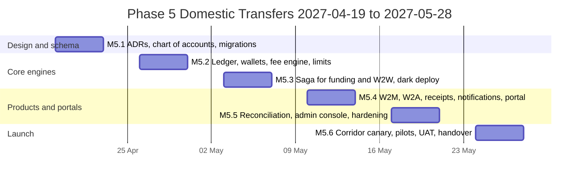
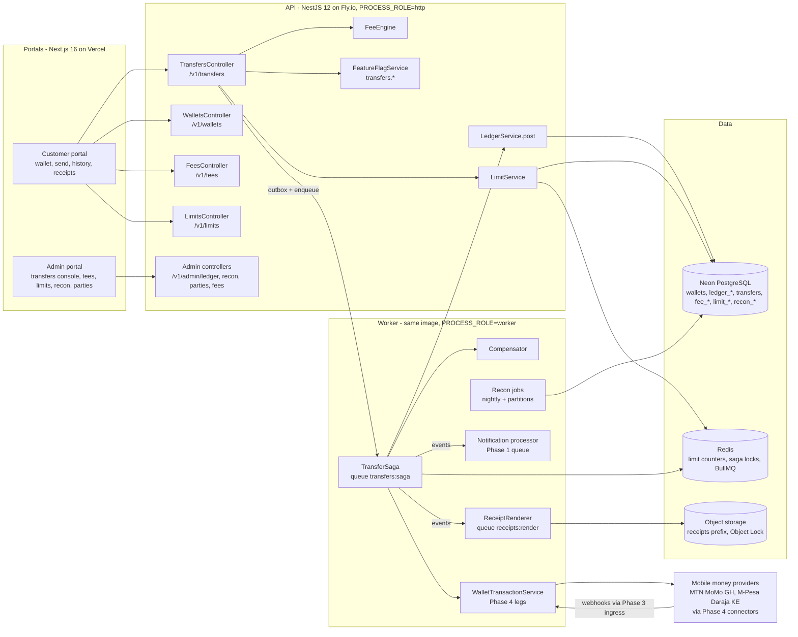
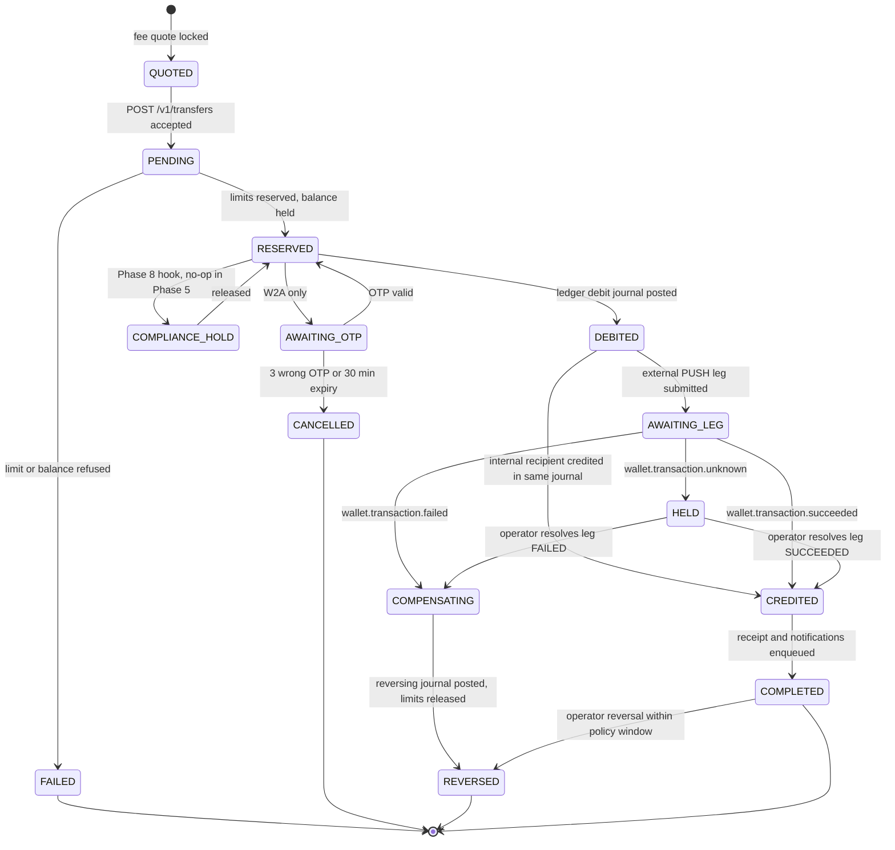
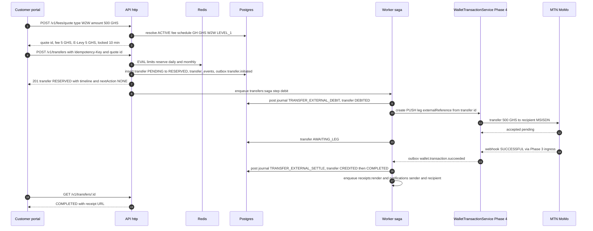
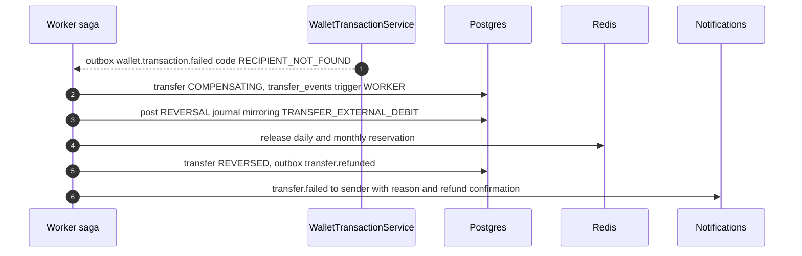
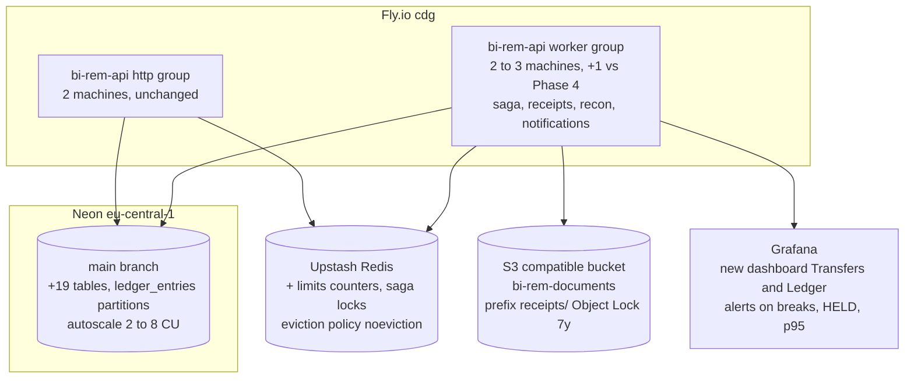
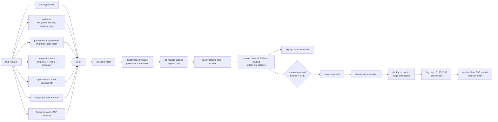

# Phase 5 — Domestic Transfers

| Field          | Value |
| -------------- | ----- |
| **Phase**      | 5 of 13 — `domestic-transfers` |
| **Dates**      | 2027-04-19 → 2027-05-28 (per `docs/roadmap/schedule.json`) |
| **Duration**   | 6 weeks (W1 starts Monday 2027-04-19, W6 ends Friday 2027-05-28) |
| **Team**       | `core` — 4 backend engineers, 2 frontend engineers (3rd frontend engineer on loan to Phase 4 close-out until 2027-04-30), 2 QA engineers, solution architect, DevOps/SRE, program manager, compliance analyst, product designer, 0.5 security engineer |
| **Depends on** | Phase 2 — Customer Management & KYC (ended 2027-02-19): `CustomerProfile.kycLevel`, `KycLevelPolicy` limit columns, `Beneficiary`, `OtpCode`, `@RequiresRecentMfa`, `kyc.level_changed` event. Phase 4 — Wallet Connector Engine (ends 2027-04-30, overlaps our W1–W2): `WalletTransaction` leg primitive with `PULL` / `PUSH` / `FLOAT_TRANSFER`, `wallet.transaction.*` events, `UNKNOWN` state semantics, `IdempotencyKey`, `FakeConnector` + `apps/simulator`, `provider_accounts`, `provider_balance_snapshots`, `wallet.connector.<key>.live` flag |
| **Unlocks**    | Phase 6 — International Remittance (2027-05-31) reuses `Transfer`, saga, ledger, fee engine, receipts and notifications; Phase 7 — FX & Treasury (2027-06-28) extends `LedgerService.post()`, `ASSET:FLOAT:*` / `SUSPENSE:*` accounts, `ledger_account_daily_balances` and the `recon` module; Phase 8 — AML (2027-07-26) consumes `transfer.*` events, `limit_counters` and the `COMPLIANCE_HOLD` saga slot; Phase 9 — Partner & Merchant Portal (2027-08-23) grows the `merchants` / `agents` pilot registries; Phase 10 — Reporting (2027-09-20) reads `transfers`, `transfer_events`, `ledger_entries`; Phase 11 — Mobile (2027-08-09) consumes `/v1/transfers`, `/v1/wallets/me`, `/v1/fees/quote`, `/v1/limits/me`, receipts `/r/<code>` |
| **Runs in parallel with** | Phase 4 close-out (platform team, W7–W8 of Phase 4 = our W1–W2) |

---

## 1. Overview

### 1.1 Objective

Phase 5 is the first phase in which a BI-Rem customer **moves money**. It launches same-country, same-currency money movement on top of the Phase 4 leg primitive: a customer funds a BI-Rem wallet from a mobile-money account (`PULL`), sends value to another BI-Rem wallet (**Wallet to Wallet**, W2W), pays a registered merchant (**Wallet to Merchant**, W2M) or cashes out at a registered agent (**Wallet to Agent**, W2A). Every movement is priced by a configurable **Fee Calculation Engine**, bounded by **per-KYC-tier limits**, recorded in a **double-entry ledger** that is the only source of truth for balances, driven by a **saga orchestrator** with explicit compensation, visible through **transfer history** and **transaction tracking**, evidenced by **PDF receipts** and **notifications**, and checked by **reconciliation hooks** that Phase 7 and Phase 10 will extend.

Phase 5 is complete when, in production and behind per-corridor flags, a KYC `LEVEL_1`+ customer in the first live corridor (**Ghana / GHS via MTN MoMo**) can complete an internal W2W transfer in **≤ 3 s p95** and a transfer with an external leg in **≤ 20 s p95**, with the ledger balanced to the minor unit, both parties notified, a receipt downloadable, and every state change traceable from the admin portal through `audit_logs`, `transfer_events` and `ledger_journals`. **Kenya / KES via M-Pesa Daraja** is the second corridor and goes live at 5 % canary in W6.

### 1.2 In scope

- **Customer wallets** — one `Wallet` per customer per currency; the stored balance is a cached projection, recomputable from `ledger_entries` at any time and verified nightly.
- **Double-entry ledger** — `ledger_accounts`, `ledger_journals`, `ledger_entries` (monthly partitions), `ledger_account_daily_balances`; balanced-journal invariant enforced in `LedgerService.post()` and by a deferred database constraint; chart of accounts covering customer liabilities, provider float assets, fee revenue, tax payable, merchant/agent liabilities, suspense and clearing.
- **Funding and pay-out legs** via Phase 4 `WalletTransaction` (`PULL` to fund, `PUSH` to pay an external MSISDN, merchant settlement wallet or agent float wallet).
- **W2W** — internal (ledger-only, instant) and external-recipient (recipient identified by MSISDN without a BI-Rem wallet → `PUSH` leg, behind `transfers.external-recipient.enabled`).
- **W2M** — payment to a `Merchant` by merchant code or QR; merchant fee schedule; settlement to the merchant's BI-Rem settlement wallet (T+0 ledger credit; bank settlement is Phase 7/9).
- **W2A** — cash-out at an `Agent` by agent code; customer OTP (`OtpCode` purpose `CASH_OUT`) releases the funds; agent commission accrued in the ledger.
- **Fee Calculation Engine** — versioned `fee_schedules` per country × currency × transfer type × KYC level (and optional merchant/agent scope); components `FLAT`, `PERCENT`, `TIERED`; min/max caps; taxes (Ghana E-Levy, Kenya excise duty on transfer fees, VAT on fees where applicable); payer `SENDER` / `RECIPIENT` / `SPLIT`; quote → lock (10 min) → apply.
- **Limits engine** — single-transaction, daily, monthly and balance limits per `KycLevelPolicy`; Redis counters with Postgres `limit_counters` as the source of truth; atomic reservation at transfer creation; admin `limit_overrides` with four-eyes.
- **Saga / orchestration** — `TransferSaga` state machine: `QUOTED → PENDING → RESERVED → DEBITED → AWAITING_LEG → CREDITED → COMPLETED`, with `COMPENSATING → REVERSED`, `FAILED`, `HELD` (for `UNKNOWN` legs) and the reserved no-op `COMPLIANCE_HOLD` step that Phase 8 populates.
- **Transfer history and transaction tracking** — paginated customer history with filters, per-transfer `timeline[]` and `nextAction`, public tracking endpoint by reference, admin transfer explorer with saga inspector.
- **Receipts (PDF)** — deterministic, localised (en/fr/pt) PDFs with QR verification code, generated by the `worker` process, stored in object storage, served by signed URL and verifiable at `/r/<code>`.
- **Notifications** — lifecycle templates for sender and recipient on SMS, e-mail and in-app (PUSH channel reserved for Phase 11), deduplicated per transfer × event × recipient.
- **Reconciliation hooks** — nightly trial balance, wallet projection vs ledger, float vs ledger using `provider_balance_snapshots`, break detection into `reconciliation_breaks`, `ReconciliationSource` interface for Phase 7.
- **Admin portal** — transfers console, saga inspector, fee schedule editor with simulation, limits view and overrides, merchant/agent pilot registry, reconciliation dashboard, manual journal with four-eyes.
- **Customer portal** — wallet home, add money, send (W2W/W2M/W2A), transfer detail with tracking, history, receipts, limits widget.

### 1.3 Out of scope

- Cross-border or cross-currency transfers, corridors, FX quotes — Phase 6 / Phase 7.
- Bank settlement of merchant and agent balances, treasury rebalancing between float wallets, P&L — Phase 7 (we accrue the liabilities; Phase 7 pays them out).
- Sanctions / PEP screening, velocity and fraud rules — Phase 8 (we emit the events and keep a `COMPLIANCE_HOLD` slot in the saga).
- Self-service merchant and agent onboarding, merchant API keys, bulk payouts, agent liquidity management — Phase 9 (we ship an admin-only pilot registry).
- Push notifications to devices, QR scanning in a native app — Phase 11 (templates and QR payload format are defined here).
- Scheduled / recurring transfers, requests for payment, bill payments.
- Customer-facing disputes workflow (admin-initiated reversal exists; dispute intake is Phase 9/12).

### 1.4 Independent deployability strategy

| Mechanism | How Phase 5 applies it |
| --------- | ---------------------- |
| **Feature flags** (Phase 1 `FeatureFlag`, percentage + rules) | `transfers.enabled` master switch (default off); `transfers.funding.enabled`; per type `transfers.type.w2w.enabled`, `transfers.type.w2m.enabled`, `transfers.type.w2a.enabled`; per corridor `transfers.corridor.<cc>-<ccy>.enabled` with rollout percentage keyed on the sender user id and a `staffOnly` rule for W4; `transfers.external-recipient.enabled`; `receipts.enabled`; `recon.nightly.enabled`. A disabled flag returns RFC 7807 `transfers/feature-disabled` (HTTP 503 with `Retry-After`) and never a 500. |
| **Kill switches** | `ledger.postings.frozen` (settings key, evaluated on every `post()`): all customer-initiated journals are refused, in-flight sagas park in `HELD`; operator journals with `ledger:post:manual` continue. `transfers.corridor.<cc>-<ccy>.enabled=false` drains a corridor: new transfers refused, in-flight sagas complete. Phase 4 `wallet.connector.<key>.live=false` stops external legs independently. |
| **Expand → migrate → contract** | All Phase 5 schema changes are additive (new tables, new enums, `wallet_transactions.parent_type/parent_id` already nullable in Phase 4). Phase 5 W1 also executes the two inherited contracts scheduled by Phases 2 and 4 (`20270419000000_phase2_contract`, `20270419090000_phase4_contract`) after a Neon snapshot. Phase 5's own contract (dropping `wallets.balance_cached` in favour of the daily-balance projection) is **not** planned; the column stays as a verified cache. |
| **Dark launch** | W3: production runs **shadow transfers** — staff accounts with `transfers.corridor.gh-ghs.enabled` rule `staffOnly=true` move real GHS between BI-Rem-owned wallets at ≤ 1 GHS; sagas, ledger, receipts and notifications exercise production infrastructure before any customer sees a Send button. |
| **Canary** | W6: GH/GHS 5 % → 25 % → 100 % of eligible customers by stable hash of user id; KE/KES held at 5 %. Promotion gates in §10.3. |
| **Worker isolation** | Saga steps, receipt rendering, notifications and reconciliation run only in the Phase 3 `PROCESS_ROLE=worker` group; the `http` group only creates transfers and reads state. A worker outage degrades to "transfers stay PENDING / RESERVED", never to API errors or unbalanced ledgers. |
| **Backward compatibility** | New endpoints only (`/v1/wallets/*`, `/v1/transfers/*`, `/v1/fees/*`, `/v1/limits/*`, `/v1/receipts/*`, `/v1/admin/ledger/*`, `/v1/admin/recon/*`, `/v1/admin/parties/*`). Phase 4 `/v1/wallet/*` is unchanged; Phase 5 only writes `parent_type='Transfer'`. |
| **"Deployable alone"** | With every Phase 5 flag off, the deployed API, worker and portals behave exactly as Phase 4 left them: the new tables are empty, no queue consumers receive jobs, the portals hide the Wallet navigation entry (server-side flag check), and the only new background activity is the nightly `recon.trialBalance` job which produces an empty, balanced report. Rollback is a redeploy of the previous image; the expand-only schema remains compatible. |

---

## 2. Milestones

Phase start is Monday **2027-04-19**; week _n_ runs Monday to Friday; milestone dates are the Friday of the week.

| ID | Week | Target date | Deliverable | Acceptance criteria | Owner |
| -- | ---- | ----------- | ----------- | ------------------- | ----- |
| **M5.1** | W1 | 2027-04-23 | Design freeze: chart of accounts, saga state machine, fee schedule model, limit algorithm; ADR-0015 (double-entry ledger), ADR-0016 (transfer saga and compensation), ADR-0017 (fee engine); schema v5 `20270419120000_phase5_expand` plus inherited Phase 2/4 contract migrations applied; GH/GHS confirmed as first corridor; pilot merchants (3) and agents (5) in Accra identified | `pnpm db:migrate:dev` applies all three migrations on a Phase 4 database and `prisma migrate diff --exit-code` is clean; ADRs accepted at Thursday architecture review; chart of accounts signed by compliance analyst and the Phase 7 lead; Neon snapshot `pre-phase5-contract` exists in production | Solution Architect |
| **M5.2** | W2 | 2027-04-30 | `ledger` module (`LedgerService.post()`, balance projection, trial balance), `wallets` module, Fee Calculation Engine v1 with `/v1/fees/quote`, Limits engine with Redis counters and `/v1/limits/me` | Property tests (fast-check) prove every generated journal balances per currency; 10 000 concurrent postings against one account leave projection = SUM(entries); fee engine reproduces the 40 golden fixtures (GH E-Levy, KE excise) to the minor unit; limit reservation is atomic under 500 concurrent requests on one wallet (exactly one succeeds at the boundary) | Backend Lead |
| **M5.3** | W3 | 2027-05-07 | `TransferSaga` for funding (`PULL`) and W2W internal/external; compensation and `HELD` paths; `POST /v1/transfers` with `Idempotency-Key`; `timeline[]` and tracking; dark deploy with staff shadow transfers in production | Internal W2W p95 ≤ 3 s on staging at 50 TPS; killing the worker at every step boundary (chaos harness) leaves zero unbalanced journals and every saga resumes; `UNKNOWN` leg parks the transfer in `HELD` with a Sentry alert and no ledger credit; 100 shadow transfers succeed in production GH/GHS with MTN MoMo sandbox-to-live cut-over on the operator probe accounts | Backend Lead |
| **M5.4** | W4 | 2027-05-14 | W2M and W2A sagas; merchant/agent pilot registry (admin); OTP cash-out release; PDF receipts worker; lifecycle notifications; customer portal wallet home, add money, send, history, detail, receipt; GH/GHS lit for staff allow-list | Merchant payment credits `LIABILITY:MERCHANT:<id>:GHS` and sends both notifications within 5 s; agent cash-out refuses a wrong OTP three times and locks; receipt PDF renders identically (byte-equal) for the same transfer twice; notification dedup prevents a second `transfer.completed` SMS on saga replay; Playwright suite green on web and admin | Frontend Lead / Backend Lead |
| **M5.5** | W5 | 2027-05-21 | Reconciliation hooks (nightly trial balance, projection check, float vs ledger, breaks, admin dashboard); admin transfers console (explorer, saga inspector, fee editor with simulation, limits view, overrides, manual journal four-eyes); performance, chaos and security hardening; runbooks; KE/KES corridor dark | `recon.nightly` produces a balanced report on staging after a 24 h k6 soak at 30 TPS; an injected 1-unit float discrepancy produces exactly one `FLOAT_MISMATCH` break; pen-test findings ≥ High closed; k6 profile §9.6 passes; runbooks reviewed by SRE | QA Lead / Security |
| **M5.6** | W6 | 2027-05-28 | Production launch: GH/GHS 5 % → 25 % → 100 % of eligible customers, KE/KES at 5 %; W2M/W2A pilots live (3 merchants, 5 agents); UAT sign-off; phase exit review; handover to Phases 6/7/8/9/11 | Success criteria §12 evidenced; 72 h at 100 % GH/GHS with zero unresolved `reconciliation_breaks` older than 24 h; sign-offs §11 collected; Phase 6 team has consumed `TransferSaga` extension points in their W1 spike | Program Manager |



---

## 3. Deliverables

Module layout added to `apps/api/src/modules/`: `wallets/`, `ledger/`, `fees/`, `limits/`, `transfers/` (with `saga/`), `parties/` (merchants, agents), `receipts/`, `recon/`. Shared Zod schemas and enums land in `packages/shared/src/transfers/`. Worker consumers register only when `PROCESS_ROLE=worker`.

### 3.1 Customer wallets (`wallets`)

- **What**: `Wallet` per (user, currency), created lazily on first funding or when a KYC `LEVEL_1` is granted (`kyc.level_changed` consumer) for the customer's home currency; status `ACTIVE | FROZEN | CLOSED`; `WalletsService.freeze(walletId, reason)` (permission `wallets:freeze`, used by Phase 8).
- **DoD**: `GET /v1/wallets/me` returns `availableMinor`, `reservedMinor`, `currency`, `status`, `limits` summary in ≤ 50 ms p95 (projection read); `balance_cached` equals `SUM(ledger_entries)` for 100 % of wallets in the nightly projection check; a `FROZEN` wallet refuses debits with `wallets/frozen` and still accepts credits; wallet creation is idempotent per (user, currency).

### 3.2 Double-entry ledger (`ledger`)

- **What**: `LedgerAccount` (typed by `LedgerAccountType`, keyed `ASSET:FLOAT:mtn-momo:GH:GHS`, `LIABILITY:CUSTOMER:<walletId>:GHS`, `REVENUE:FEE:GH:GHS`, `LIABILITY:TAX:GH:ELEVY:GHS`, `LIABILITY:MERCHANT:<merchantId>:GHS`, `LIABILITY:AGENT:<agentId>:GHS`, `EXPENSE:COMMISSION:AGENT:GH:GHS`, `SUSPENSE:UNKNOWN:GH:GHS`, `CLEARING:PULL:mtn-momo:GH:GHS`), `LedgerJournal` (kind, reference, idempotency key, posted_at, reversal link), `LedgerEntry` (direction `DEBIT|CREDIT`, minor units, currency), `LedgerAccountDailyBalance`.
- **DoD**: `LedgerService.post(journal)` rejects any journal whose debits ≠ credits per currency or that mixes currencies (single-currency invariant; the FX extension point is a documented `postMultiCurrency` stub that throws `NotImplemented` until Phase 7); entries are append-only (table-level `REVOKE UPDATE, DELETE` for the application role; corrections are reversing journals); posting the same `idempotencyKey` twice returns the first journal; `GET /v1/admin/ledger/trial-balance?date=` sums to zero per currency; monthly partitions `ledger_entries_2027_04 …` are created 2 months ahead by the `recon.partitions` job; `ledger.journal.posted` outbox event per journal.

### 3.3 Fee Calculation Engine (`fees`)

- **What**: `FeeSchedule` (scope: country, currency, transfer type, KYC level range, optional merchant/agent id, provider key; status `DRAFT | ACTIVE | RETIRED`; `effectiveFrom/To`; version), `FeeScheduleComponent` (`FLAT`, `PERCENT` in basis points, `TIERED` bands on amount), `FeeScheduleTax` (rate bps, base `FEE | AMOUNT`, account key, e.g. Ghana E-Levy 1 % on amount above 100 GHS daily cumulative exemption, Kenya 15 % excise on fee), payer rule, min/max caps, rounding (`HALF_UP` to minor unit), `FeeQuote` (locked 10 minutes, hash of inputs).
- **DoD**: `POST /v1/fees/quote` returns `feeLines[]` (component, tax, payer, account key) and `totalDebitMinor`/`totalCreditMinor`; the 40 golden fixtures in `packages/shared/src/transfers/__fixtures__/fees/*.json` pass to the minor unit; schedule selection is deterministic (most specific scope wins, ties broken by latest `effectiveFrom`, overlapping ACTIVE schedules of identical specificity are rejected at activation); admin simulation endpoint re-prices any historical transfer against a DRAFT schedule; activation requires `fees:activate` plus a second approver; a transfer always applies the quote it was created with, never a newer schedule.

### 3.4 Limits engine (`limits`)

- **What**: `LimitService.reserve(userId, currency, amountMinor, transferType)` → checks single-transaction, daily and monthly from the active `KycLevelPolicy` for the customer's country and level, plus `balanceLimitMinor` on credit, plus per-wallet active `LimitOverride`; counters in Redis (`limits:{userId}:{ccy}:{DAILY|MONTHLY}:{yyyymmdd|yyyymm}`, Lua script for atomic check-and-increment) mirrored to `limit_counters` within the same saga step; release on failure/compensation; `kyc.level_changed` invalidates the cached policy.
- **DoD**: boundary tests pass for Africa/Accra and Africa/Nairobi day/month roll-over (counters keyed in the customer's country time zone); Redis loss rebuilds counters from `limit_counters` on first access (source of truth is Postgres); `GET /v1/limits/me` shows remaining per window and the next reset instant; override creation requires `limits:override` + second approver + expiry ≤ 30 days; `limits.threshold_reached` event at 100 % and `limits.near_threshold` at 80 % (notification, Phase 8 consumer).

### 3.5 Transfer saga and transaction tracking (`transfers`)

- **What**: `Transfer` aggregate (type `FUNDING | W2W | W2M | W2A`, status, reference `BR-<base32 ULID>`, sender wallet, recipient wallet or external MSISDN hash, merchant/agent id, quote id, amounts, fee lines, legs as `WalletTransaction` with `parent_type='Transfer'`, `timeline` derived from `TransferEvent`), `TransferSaga` (BullMQ queue `transfers:saga`, step handlers idempotent and resumable, per-transfer lock, step timeout 60 s, max 5 attempts then `HELD`), compensation handlers, `GET /v1/transfers/:id`, `GET /v1/transfers`, public `GET /v1/transfers/track/:reference` (masked), `nextAction` (`NONE | CONFIRM_OTP | AUTHORISE_ON_PHONE | CONTACT_SUPPORT`).
- **DoD**: every state transition writes `transfer_events` (from, to, trigger `API|WORKER|WEBHOOK|OPERATOR|RECON`, correlation id) and an `AuditLog` row through the Phase 1 interceptor for API-originated transitions; chaos test kills the worker at each of the 7 step boundaries × 20 runs with zero unbalanced journals and zero stuck transfers after resume; `Idempotency-Key` replay returns the original 201 with `Idempotent-Replay: true`; `HELD` transfers list in admin with the `wallet_transactions.id` and provider evidence needed to resolve; p95 internal W2W ≤ 3 s, external ≤ 20 s (excluding customer phone authorisation time).

### 3.6 Wallet to Wallet

- **DoD**: recipient resolution by BI-Rem username/MSISDN (masked name confirmation, `K**** M****`); internal path posts one journal (debit sender liability, credit recipient liability, credit fee revenue and tax); external-recipient path (flag) adds a `PUSH` leg and parks funds in `CLEARING:PUSH:<provider>` until `wallet.transaction.succeeded`; failed `PUSH` compensates to the sender with the fee refunded (configurable `refundFeeOnFailure`); self-transfer refused; step-up MFA above `transfers.stepup.threshold.<ccy>` (default 2 000 GHS / 20 000 KES).

### 3.7 Wallet to Merchant

- **DoD**: `Merchant` pilot registry (code `M-xxxxxx`, display name, category MCC, settlement wallet, commission schedule id, `PartyStatus`); payment by code or QR payload `birem://pay?m=<code>&a=<minor>&c=<ccy>&r=<ref>` (amount optional); merchant fee schedule scope resolves per merchant; journal credits `LIABILITY:MERCHANT:<id>:<ccy>` net of merchant fee and `REVENUE:FEE`; merchant receives SMS/e-mail with reference; admin can reverse within 24 h with `transfers:reverse` + reason (reversing journal, both notified).

### 3.8 Wallet to Agent

- **DoD**: `Agent` pilot registry (code `A-xxxxxx`, float wallet, commission schedule, daily cash-out cap, `PartyStatus`); customer initiates with agent code and amount → `RESERVED`; 6-digit OTP (`OtpCode` purpose `CASH_OUT`, 10 min TTL) sent to the customer; agent enters OTP in the admin-lite agent screen (Phase 9 replaces with agent portal) → saga debits customer, credits `LIABILITY:AGENT:<id>:<ccy>` with the cash amount and `EXPENSE:COMMISSION:AGENT` for the agent commission; 3 wrong OTPs cancel the transfer and release the reservation; expiry at 30 min releases automatically.

### 3.9 Transfer history

- **DoD**: `GET /v1/transfers?status=&type=&from=&to=&cursor=` keyset-paginated (Phase 1 `pagination.ts`), ≤ 100 ms p95 for a wallet with 10 000 transfers (index `(sender_user_id, created_at desc)`), CSV export of own history (`transfers:export`, ≤ 10 000 rows, async with notification when larger); admin explorer searches by reference, MSISDN hash, user, status, date, amount range.

### 3.10 Receipts (PDF)

- **DoD**: worker renders A4 and 80 mm thermal variants with `@react-pdf/renderer` from a deterministic template (fixed fonts embedded, no timestamps other than transfer timestamps, so re-rendering is byte-equal); content: reference, date, parties (masked), amount, fee lines, taxes with statutory labels, QR to `https://<customer-portal>/r/<verifyCode>`; stored at `receipts/<yyyy>/<mm>/<transferId>.pdf` in S3-compatible object storage (Phase 2 document bucket, separate prefix, Object Lock 7 years); `GET /v1/transfers/:id/receipt` returns a 15-minute signed URL; `GET /r/<code>` (public, rate-limited) shows a verification page with masked data; rendered for `COMPLETED` and `REVERSED` only.

### 3.11 Notifications

- **DoD**: templates `transfer.initiated`, `transfer.action_required`, `transfer.completed.sender`, `transfer.completed.recipient`, `transfer.failed`, `transfer.refunded`, `transfer.held` (ops only), `cashout.otp`, `merchant.payment_received`, `limits.near_threshold`, `limits.threshold_reached` seeded in `notification_templates` for en/fr/pt × SMS/EMAIL/IN_APP; `NotificationDedup` prevents a second send for the same (transferId, event, recipient, channel); preference-aware except `cashout.otp` and `transfer.action_required` (transactional, always sent); SMS ≤ 160 GSM-7 characters verified by a unit test for every locale.

### 3.12 Reconciliation hooks (`recon`)

- **DoD**: `recon.nightly` (02:00 local per corridor) runs `TrialBalanceCheck`, `WalletProjectionCheck`, `FloatVsLedgerCheck` (latest `provider_balance_snapshots` vs `ASSET:FLOAT:*` balance ± in-flight legs), `StuckTransferCheck` (> 30 min non-terminal), `OrphanLegCheck` (`wallet_transactions` with `parent_type='Transfer'` and no transfer); results in `reconciliation_runs` and `reconciliation_breaks` (kind, amount, accounts, evidence, status `OPEN | INVESTIGATING | RESOLVED | WRITTEN_OFF`); `ReconciliationSource` interface (`collect(date) → ExternalBalance[]`) implemented for `provider_balance_snapshots`, extended by Phase 7 for bank statements; `recon.break.opened` / `recon.run.completed` events; admin dashboard.

### 3.13 Admin and customer portal

See §7. DoD: every mutating admin action produces an `audit_logs` row; Playwright e2e green for the 12 journeys in §9.4.

---

## 4. Architecture

### 4.1 Component view



### 4.2 Chart of accounts and journal patterns

| Journal kind | Debit | Credit | When |
| ------------ | ----- | ------ | ---- |
| `FUNDING_CLEARING` | `CLEARING:PULL:<provider>:<cc>:<ccy>` | `LIABILITY:CUSTOMER:<walletId>:<ccy>` | `PULL` leg `SUCCEEDED` (customer is credited immediately) |
| `FUNDING_SETTLE` | `ASSET:FLOAT:<provider>:<cc>:<ccy>` | `CLEARING:PULL:<provider>:<cc>:<ccy>` | Float snapshot or statement confirms receipt (recon) |
| `TRANSFER_INTERNAL` | `LIABILITY:CUSTOMER:<sender>` (amount + fee + tax) | `LIABILITY:CUSTOMER:<recipient>` (amount), `REVENUE:FEE:<cc>:<ccy>` (fee), `LIABILITY:TAX:<cc>:<taxKey>:<ccy>` (tax) | W2W internal `CREDITED` |
| `TRANSFER_EXTERNAL_DEBIT` | `LIABILITY:CUSTOMER:<sender>` | `CLEARING:PUSH:<provider>:<cc>:<ccy>`, `REVENUE:FEE`, `LIABILITY:TAX` | W2W external `DEBITED` |
| `TRANSFER_EXTERNAL_SETTLE` | `CLEARING:PUSH:<provider>` | `ASSET:FLOAT:<provider>` | `PUSH` leg `SUCCEEDED` |
| `MERCHANT_PAYMENT` | `LIABILITY:CUSTOMER:<sender>` | `LIABILITY:MERCHANT:<merchantId>:<ccy>` (net), `REVENUE:FEE`, `LIABILITY:TAX` | W2M `CREDITED` |
| `AGENT_CASHOUT` | `LIABILITY:CUSTOMER:<sender>` (amount + fee), `EXPENSE:COMMISSION:AGENT:<cc>:<ccy>` (commission) | `LIABILITY:AGENT:<agentId>:<ccy>` (amount + commission), `REVENUE:FEE`, `LIABILITY:TAX` | W2A `CREDITED` after OTP |
| `PROVIDER_FEE` | `EXPENSE:PROVIDER_FEE:<provider>:<cc>:<ccy>` | `ASSET:FLOAT:<provider>` | Leg reports `providerFee` |
| `REVERSAL` | mirror of the original journal | mirror | Compensation or operator reversal; `reversal_of_journal_id` set |
| `SUSPENSE_IN` / `SUSPENSE_OUT` | `SUSPENSE:UNKNOWN:<cc>:<ccy>` | counter-account | `HELD` resolution when evidence shows money moved without a matching leg state |
| `MANUAL` | any | any | Four-eyes operator journal (`ledger:post:manual` + approver) |

Balances: liabilities and revenue are credit-normal, assets and expenses debit-normal; `LedgerAccount.normalSide` makes `balanceMinor` always positive-when-healthy and lets the trial balance assert `SUM(debits) = SUM(credits)` per currency and per day.

### 4.3 Saga state machine



Rules enforced in `TransferSaga`: (1) each step runs under a Redis lock `saga:transfer:<id>` with a 60 s lease and is idempotent (it checks the persisted step before acting, so a replay after a crash is a no-op); (2) ledger postings and `transfer_events` and the outbox row are written in **one Postgres transaction**, so a crash can lose the queue job but never half a journal — the `recon.stuckTransfers` sweep re-enqueues; (3) external legs are created through Phase 4 `WalletTransactionService` with `externalReference` derived deterministically from `(transferId, legIndex)` so a retry never double-pays; (4) `UNKNOWN` never triggers a ledger effect — funds stay in `CLEARING:PUSH` until an operator or a later webhook resolves the leg; (5) compensation never deletes: it posts a `REVERSAL` journal referencing the original and releases limit reservations; (6) terminal states are left only through `COMPLETED → REVERSED` by an operator.

### 4.4 Key flow: W2W with external recipient



### 4.5 Compensation flow: external leg fails



### 4.6 Deployment delta



Infra deltas: one additional worker machine (`fly scale count 3 --process-group worker`), Redis `maxmemory-policy noeviction` and ≥ 1 GB (counters are reconstructible but eviction would cause spurious limit refusals), Neon autoscaling ceiling raised from 4 to 8 CU for the W5 soak, `receipts/` prefix with Object Lock in the existing documents bucket, PDF fonts baked into the API image (`infra/docker/api.Dockerfile` adds `fonts/NotoSans-*.ttf`, +2 MB), new Grafana dashboard and 8 alert rules, Neon snapshot `pre-phase5-contract`.

### 4.7 Design decisions and alternatives rejected

| # | Decision | Alternatives rejected | Why |
| - | -------- | --------------------- | --- |
| D1 | **Ledger-first balances**: `wallets.balance_cached` is a projection updated in the same transaction as the journal and checked nightly | Mutable balance column as source of truth; event-sourced balances computed on read | A mutable counter cannot be audited and drifts under concurrency bugs; compute-on-read over millions of entries is too slow for `/wallets/me`. Projection + invariant check gives both. |
| D2 | **Orchestration saga in the worker** with persisted steps and per-transfer lock | Choreography over outbox events only; a two-phase commit with providers | Providers cannot participate in XA; pure choreography makes compensation and `HELD` reasoning opaque to operators. A persisted orchestrator gives one place to inspect and resume. |
| D3 | **Journal, events and outbox in one Postgres transaction**, queue job as a hint only | Writing the queue job first; dual writes | Crash safety: the database is always consistent; a lost job is recovered by the stuck-transfer sweep. |
| D4 | **Fee engine as data** (`fee_schedules` tables) with versioning and golden fixtures | Fees in code per corridor; a rules engine library (json-rules-engine) | Finance must change fees without a deploy, with an audit trail and simulation; a generic rules engine makes tax rules hard to reason about. |
| D5 | **Limits in Redis with Postgres mirror** | Postgres-only counters with `SELECT … FOR UPDATE` | Lua script gives atomic check-and-increment at < 1 ms; Postgres row locks on hot users serialise at the exact moment traffic spikes. Postgres mirror makes Redis loss harmless. |
| D6 | **Monthly partitions on `ledger_entries` and `transfer_events`** from day one | Single table, partition later | 100 k transfers/day × ~6 entries = 600 k entries/day; later partitioning is a risky migration on the most sensitive table. Same pattern Phase 3/4 use for `webhook_deliveries`. |
| D7 | **Deterministic PDFs with `@react-pdf/renderer`** in the worker | Headless Chromium (Puppeteer) | Chromium in the API image adds 300 MB and non-determinism; react-pdf runs in Node with embedded fonts and gives byte-equal output. |
| D8 | **Clearing accounts for both directions** | Post directly float ↔ customer | Clearing makes "provider accepted but float not yet confirmed" visible and reconcilable; Phase 7 settles clearing from statements. |
| D9 | **Pilot `merchants` / `agents` in the core schema** rather than deferring entirely to Phase 9 | No W2M/W2A in Phase 5 | The brief requires W2M and W2A; a minimal registry with `PartyStatus` lets Phase 9 extend rather than migrate. |
| D10 | **Step-up MFA by amount** reusing Phase 2 `@RequiresRecentMfa` | Always MFA; never MFA | Balances fraud risk and UX; threshold is a setting per currency. |

---

## 5. Data Model & Migrations

### 5.1 Prisma additions (schema v5)

All identifiers `uuid` via `gen_random_uuid()`, all timestamps `timestamptz(6)`, all money `BigInt` minor units with an ISO-4217 `currency` column, tables `snake_case` via `@@map`. Relations to Phase 2/4 models (`CustomerProfile`, `Beneficiary`, `WalletTransaction`, `Provider`) are expressed by uuid columns plus indexes to keep this phase's migration independent of those packages' relation names.

```prisma
// ---------------------------------------------------------------------------
// Phase 5 — Domestic transfers: enums
// ---------------------------------------------------------------------------

enum WalletStatus {
  ACTIVE
  FROZEN
  CLOSED

  @@map("wallet_status")
}

enum LedgerAccountType {
  ASSET
  LIABILITY
  REVENUE
  EXPENSE
  SUSPENSE
  CLEARING

  @@map("ledger_account_type")
}

enum LedgerNormalSide {
  DEBIT
  CREDIT

  @@map("ledger_normal_side")
}

enum LedgerJournalKind {
  FUNDING_CLEARING
  FUNDING_SETTLE
  TRANSFER_INTERNAL
  TRANSFER_EXTERNAL_DEBIT
  TRANSFER_EXTERNAL_SETTLE
  MERCHANT_PAYMENT
  AGENT_CASHOUT
  PROVIDER_FEE
  REVERSAL
  SUSPENSE_IN
  SUSPENSE_OUT
  MANUAL

  @@map("ledger_journal_kind")
}

enum LedgerEntryDirection {
  DEBIT
  CREDIT

  @@map("ledger_entry_direction")
}

enum TransferType {
  FUNDING
  W2W
  W2M
  W2A

  @@map("transfer_type")
}

enum TransferStatus {
  QUOTED
  PENDING
  RESERVED
  AWAITING_OTP
  COMPLIANCE_HOLD
  DEBITED
  AWAITING_LEG
  HELD
  CREDITED
  COMPLETED
  COMPENSATING
  REVERSED
  FAILED
  CANCELLED

  @@map("transfer_status")
}

enum TransferTrigger {
  API
  WORKER
  WEBHOOK
  OPERATOR
  RECON

  @@map("transfer_trigger")
}

enum FeeScheduleStatus {
  DRAFT
  ACTIVE
  RETIRED

  @@map("fee_schedule_status")
}

enum FeeComponentKind {
  FLAT
  PERCENT
  TIERED

  @@map("fee_component_kind")
}

enum FeePayer {
  SENDER
  RECIPIENT
  SPLIT

  @@map("fee_payer")
}

enum FeeTaxBase {
  FEE
  AMOUNT

  @@map("fee_tax_base")
}

enum LimitWindow {
  DAILY
  MONTHLY

  @@map("limit_window")
}

enum PartyStatus {
  PENDING
  ACTIVE
  SUSPENDED
  CLOSED

  @@map("party_status")
}

enum ReconBreakKind {
  TRIAL_BALANCE
  WALLET_PROJECTION
  FLOAT_MISMATCH
  STUCK_TRANSFER
  ORPHAN_LEG
  CLEARING_AGED

  @@map("recon_break_kind")
}

enum ReconBreakStatus {
  OPEN
  INVESTIGATING
  RESOLVED
  WRITTEN_OFF

  @@map("recon_break_status")
}

// ---------------------------------------------------------------------------
// Wallets & ledger
// ---------------------------------------------------------------------------

/// One wallet per customer per currency. `balanceCached` / `reservedCached` are projections of
/// ledger_entries and limit reservations, updated in the same transaction and verified nightly.
model Wallet {
  id              String       @id @default(dbgenerated("gen_random_uuid()")) @db.Uuid
  userId          String       @map("user_id") @db.Uuid
  currency        String       @db.Char(3)
  countryCode     String       @map("country_code") @db.Char(2)
  status          WalletStatus @default(ACTIVE)
  ledgerAccountId String       @unique @map("ledger_account_id") @db.Uuid
  balanceCached   BigInt       @default(0) @map("balance_cached")
  reservedCached  BigInt       @default(0) @map("reserved_cached")
  frozenReason    String?      @map("frozen_reason") @db.VarChar(200)
  frozenAt        DateTime?    @map("frozen_at") @db.Timestamptz(6)
  createdAt       DateTime     @default(now()) @map("created_at") @db.Timestamptz(6)
  updatedAt       DateTime     @updatedAt @map("updated_at") @db.Timestamptz(6)

  user          User          @relation("WalletOwner", fields: [userId], references: [id], onDelete: Restrict)
  ledgerAccount LedgerAccount @relation(fields: [ledgerAccountId], references: [id], onDelete: Restrict)
  sentTransfers Transfer[]    @relation("TransferSenderWallet")
  receivedTransfers Transfer[] @relation("TransferRecipientWallet")

  @@unique([userId, currency])
  @@index([status])
  @@map("wallets")
}

/// Chart-of-accounts node. `key` is the canonical colon-separated path, e.g.
/// ASSET:FLOAT:mtn-momo:GH:GHS or LIABILITY:CUSTOMER:<walletId>:GHS.
model LedgerAccount {
  id            String            @id @default(dbgenerated("gen_random_uuid()")) @db.Uuid
  key           String            @unique @db.VarChar(160)
  type          LedgerAccountType
  normalSide    LedgerNormalSide  @map("normal_side")
  currency      String            @db.Char(3)
  countryCode   String?           @map("country_code") @db.Char(2)
  /// Owning entity for per-party accounts (wallet, merchant, agent, provider account).
  ownerType     String?           @map("owner_type") @db.VarChar(32)
  ownerId       String?           @map("owner_id") @db.Uuid
  /// Signed balance on the normal side; projection of entries, verified by recon.
  balanceCached BigInt            @default(0) @map("balance_cached")
  isActive      Boolean           @default(true) @map("is_active")
  createdAt     DateTime          @default(now()) @map("created_at") @db.Timestamptz(6)
  updatedAt     DateTime          @updatedAt @map("updated_at") @db.Timestamptz(6)

  wallet        Wallet?
  entries       LedgerEntry[]
  dailyBalances LedgerAccountDailyBalance[]

  @@index([type, currency])
  @@index([ownerType, ownerId])
  @@map("ledger_accounts")
}

/// Immutable, balanced set of entries. Never updated after insert; corrections are new
/// journals of kind REVERSAL referencing `reversalOfJournalId`.
model LedgerJournal {
  id                  String            @id @default(dbgenerated("gen_random_uuid()")) @db.Uuid
  kind                LedgerJournalKind
  /// Idempotency key, e.g. transfer:<id>:debit. Posting twice returns the first journal.
  idempotencyKey      String            @unique @map("idempotency_key") @db.VarChar(160)
  currency            String            @db.Char(3)
  /// Sum of debit entries (= sum of credit entries). Stored for fast trial balance.
  totalMinor          BigInt            @map("total_minor")
  referenceType       String?           @map("reference_type") @db.VarChar(32)
  referenceId         String?           @map("reference_id") @db.Uuid
  reversalOfJournalId String?           @unique @map("reversal_of_journal_id") @db.Uuid
  description         String?           @db.VarChar(200)
  /// SYSTEM for saga postings, user id for MANUAL journals.
  postedByUserId      String?           @map("posted_by_user_id") @db.Uuid
  approvedByUserId    String?           @map("approved_by_user_id") @db.Uuid
  correlationId       String?           @map("correlation_id") @db.VarChar(128)
  /// Business date in the corridor time zone; drives daily balances and partitions.
  valueDate           DateTime          @map("value_date") @db.Date
  postedAt            DateTime          @default(now()) @map("posted_at") @db.Timestamptz(6)

  entries    LedgerEntry[]
  reversalOf LedgerJournal? @relation("JournalReversal", fields: [reversalOfJournalId], references: [id], onDelete: Restrict)
  reversal   LedgerJournal? @relation("JournalReversal")

  @@index([referenceType, referenceId])
  @@index([kind, postedAt])
  @@index([valueDate])
  @@map("ledger_journals")
}

/// One side of a journal. Partitioned monthly by posted_at in SQL (composite primary key),
/// hence `@@id([id, postedAt])`. UPDATE and DELETE are revoked from the application role.
model LedgerEntry {
  id        String               @default(dbgenerated("gen_random_uuid()")) @db.Uuid
  journalId String               @map("journal_id") @db.Uuid
  accountId String               @map("account_id") @db.Uuid
  direction LedgerEntryDirection
  amountMinor BigInt             @map("amount_minor")
  currency  String               @db.Char(3)
  postedAt  DateTime             @default(now()) @map("posted_at") @db.Timestamptz(6)

  journal LedgerJournal @relation(fields: [journalId], references: [id], onDelete: Restrict)
  account LedgerAccount @relation(fields: [accountId], references: [id], onDelete: Restrict)

  @@id([id, postedAt])
  @@index([accountId, postedAt])
  @@index([journalId])
  @@map("ledger_entries")
}

/// Closing balance per account per value date, produced by recon.nightly; Phase 7 and 10 read it.
model LedgerAccountDailyBalance {
  accountId     String   @map("account_id") @db.Uuid
  valueDate     DateTime @map("value_date") @db.Date
  openingMinor  BigInt   @map("opening_minor")
  debitMinor    BigInt   @map("debit_minor")
  creditMinor   BigInt   @map("credit_minor")
  closingMinor  BigInt   @map("closing_minor")
  currency      String   @db.Char(3)
  entryCount    Int      @map("entry_count")
  computedAt    DateTime @default(now()) @map("computed_at") @db.Timestamptz(6)

  account LedgerAccount @relation(fields: [accountId], references: [id], onDelete: Restrict)

  @@id([accountId, valueDate])
  @@index([valueDate])
  @@map("ledger_account_daily_balances")
}

// ---------------------------------------------------------------------------
// Transfers
// ---------------------------------------------------------------------------

model Transfer {
  id                    String         @id @default(dbgenerated("gen_random_uuid()")) @db.Uuid
  /// Customer-facing reference BR-<base32 ULID>, printed on receipts and used for tracking.
  reference             String         @unique @db.VarChar(32)
  type                  TransferType
  status                TransferStatus @default(QUOTED)
  senderUserId          String         @map("sender_user_id") @db.Uuid
  senderWalletId        String         @map("sender_wallet_id") @db.Uuid
  recipientUserId       String?        @map("recipient_user_id") @db.Uuid
  recipientWalletId     String?        @map("recipient_wallet_id") @db.Uuid
  /// External recipient (no BI-Rem wallet): encrypted MSISDN plus hash for lookup.
  recipientMsisdnEncrypted String?     @map("recipient_msisdn_encrypted")
  recipientMsisdnHash   String?        @map("recipient_msisdn_hash") @db.VarChar(64)
  recipientMsisdnLast4  String?        @map("recipient_msisdn_last4") @db.VarChar(4)
  recipientProviderKey  String?        @map("recipient_provider_key") @db.VarChar(32)
  beneficiaryId         String?        @map("beneficiary_id") @db.Uuid
  merchantId            String?        @map("merchant_id") @db.Uuid
  agentId               String?        @map("agent_id") @db.Uuid
  currency              String         @db.Char(3)
  countryCode           String         @map("country_code") @db.Char(2)
  /// Principal the recipient receives.
  amountMinor           BigInt         @map("amount_minor")
  /// Fees and taxes borne by the sender; recipient-side deductions are in fee lines.
  senderFeeMinor        BigInt         @default(0) @map("sender_fee_minor")
  senderTaxMinor        BigInt         @default(0) @map("sender_tax_minor")
  recipientFeeMinor     BigInt         @default(0) @map("recipient_fee_minor")
  totalDebitMinor       BigInt         @map("total_debit_minor")
  feeQuoteId            String?        @map("fee_quote_id") @db.Uuid
  feeScheduleId         String?        @map("fee_schedule_id") @db.Uuid
  /// Sender's KYC level at creation; immutable for audit and limit disputes.
  senderKycLevel        String         @map("sender_kyc_level") @db.VarChar(16)
  narration             String?        @db.VarChar(100)
  /// Phase 1 IdempotencyKey scope: sender user id + header value.
  idempotencyKey        String?        @map("idempotency_key") @db.VarChar(128)
  /// Current saga step name; null when terminal.
  sagaStep              String?        @map("saga_step") @db.VarChar(40)
  sagaAttempts          Int            @default(0) @map("saga_attempts")
  failureCode           String?        @map("failure_code") @db.VarChar(64)
  failureMessage        String?        @map("failure_message") @db.VarChar(500)
  heldReason            String?        @map("held_reason") @db.VarChar(200)
  reversalOfId          String?        @unique @map("reversal_of_id") @db.Uuid
  correlationId         String?        @map("correlation_id") @db.VarChar(128)
  initiatedIp           String?        @map("initiated_ip") @db.VarChar(45)
  expiresAt             DateTime?      @map("expires_at") @db.Timestamptz(6)
  completedAt           DateTime?      @map("completed_at") @db.Timestamptz(6)
  createdAt             DateTime       @default(now()) @map("created_at") @db.Timestamptz(6)
  updatedAt             DateTime       @updatedAt @map("updated_at") @db.Timestamptz(6)

  senderWallet    Wallet           @relation("TransferSenderWallet", fields: [senderWalletId], references: [id], onDelete: Restrict)
  recipientWallet Wallet?          @relation("TransferRecipientWallet", fields: [recipientWalletId], references: [id], onDelete: Restrict)
  merchant        Merchant?        @relation(fields: [merchantId], references: [id], onDelete: Restrict)
  agent           Agent?           @relation(fields: [agentId], references: [id], onDelete: Restrict)
  reversalOf      Transfer?        @relation("TransferReversal", fields: [reversalOfId], references: [id], onDelete: Restrict)
  reversal        Transfer?        @relation("TransferReversal")
  events          TransferEvent[]
  feeLines        TransferFeeLine[]
  receipts        Receipt[]

  @@unique([senderUserId, idempotencyKey])
  @@index([senderUserId, createdAt(sort: Desc)])
  @@index([recipientUserId, createdAt(sort: Desc)])
  @@index([status, updatedAt])
  @@index([recipientMsisdnHash])
  @@index([merchantId, createdAt])
  @@index([agentId, createdAt])
  @@index([countryCode, currency, createdAt])
  @@map("transfers")
}

/// Append-only state transition log; partitioned monthly by created_at in SQL.
model TransferEvent {
  id            String          @default(dbgenerated("gen_random_uuid()")) @db.Uuid
  transferId    String          @map("transfer_id") @db.Uuid
  fromStatus    TransferStatus? @map("from_status")
  toStatus      TransferStatus  @map("to_status")
  trigger       TransferTrigger
  step          String?         @db.VarChar(40)
  actorUserId   String?         @map("actor_user_id") @db.Uuid
  reasonCode    String?         @map("reason_code") @db.VarChar(64)
  /// Redacted context: leg id, journal id, provider status. Never MSISDN or names.
  metadata      Json?
  correlationId String?         @map("correlation_id") @db.VarChar(128)
  createdAt     DateTime        @default(now()) @map("created_at") @db.Timestamptz(6)

  transfer Transfer @relation(fields: [transferId], references: [id], onDelete: Restrict)

  @@id([id, createdAt])
  @@index([transferId, createdAt])
  @@map("transfer_events")
}

/// Snapshot of each fee/tax line applied to a transfer (from the locked quote).
model TransferFeeLine {
  id            String   @id @default(dbgenerated("gen_random_uuid()")) @db.Uuid
  transferId    String   @map("transfer_id") @db.Uuid
  /// FEE or TAX.
  lineType      String   @map("line_type") @db.VarChar(8)
  label         String   @db.VarChar(64)
  componentId   String?  @map("component_id") @db.Uuid
  taxId         String?  @map("tax_id") @db.Uuid
  payer         FeePayer
  amountMinor   BigInt   @map("amount_minor")
  currency      String   @db.Char(3)
  /// Ledger account credited, e.g. REVENUE:FEE:GH:GHS or LIABILITY:TAX:GH:ELEVY:GHS.
  ledgerAccountKey String @map("ledger_account_key") @db.VarChar(160)

  transfer Transfer @relation(fields: [transferId], references: [id], onDelete: Cascade)

  @@index([transferId])
  @@map("transfer_fee_lines")
}

// ---------------------------------------------------------------------------
// Fees
// ---------------------------------------------------------------------------

/// Versioned fee schedule. Scope columns are nullable; the most specific ACTIVE match wins.
model FeeSchedule {
  id               String            @id @default(dbgenerated("gen_random_uuid()")) @db.Uuid
  name             String            @db.VarChar(120)
  version          Int               @default(1)
  status           FeeScheduleStatus @default(DRAFT)
  countryCode      String            @map("country_code") @db.Char(2)
  currency         String            @db.Char(3)
  transferType     TransferType      @map("transfer_type")
  kycLevelMin      String?           @map("kyc_level_min") @db.VarChar(16)
  kycLevelMax      String?           @map("kyc_level_max") @db.VarChar(16)
  providerKey      String?           @map("provider_key") @db.VarChar(32)
  merchantId       String?           @map("merchant_id") @db.Uuid
  agentId          String?           @map("agent_id") @db.Uuid
  payer            FeePayer          @default(SENDER)
  minFeeMinor      BigInt?           @map("min_fee_minor")
  maxFeeMinor      BigInt?           @map("max_fee_minor")
  refundFeeOnFailure Boolean         @default(true) @map("refund_fee_on_failure")
  effectiveFrom    DateTime          @map("effective_from") @db.Timestamptz(6)
  effectiveTo      DateTime?         @map("effective_to") @db.Timestamptz(6)
  createdById      String            @map("created_by_id") @db.Uuid
  activatedById    String?           @map("activated_by_id") @db.Uuid
  approvedById     String?           @map("approved_by_id") @db.Uuid
  createdAt        DateTime          @default(now()) @map("created_at") @db.Timestamptz(6)
  updatedAt        DateTime          @updatedAt @map("updated_at") @db.Timestamptz(6)

  components FeeScheduleComponent[]
  taxes      FeeScheduleTax[]

  @@unique([name, version])
  @@index([countryCode, currency, transferType, status])
  @@index([merchantId])
  @@index([agentId])
  @@map("fee_schedules")
}

model FeeScheduleComponent {
  id          String           @id @default(dbgenerated("gen_random_uuid()")) @db.Uuid
  scheduleId  String           @map("schedule_id") @db.Uuid
  kind        FeeComponentKind
  label       String           @db.VarChar(64)
  /// FLAT: minor units. PERCENT: basis points. TIERED: ignored (see tiers).
  valueMinor  BigInt?          @map("value_minor")
  rateBps     Int?             @map("rate_bps")
  /// TIERED bands: [{"uptoMinor": 10000, "flatMinor": 50, "rateBps": 0}, ...] ordered ascending.
  tiers       Json?
  sortOrder   Int              @default(0) @map("sort_order")

  schedule FeeSchedule @relation(fields: [scheduleId], references: [id], onDelete: Cascade)

  @@index([scheduleId])
  @@map("fee_schedule_components")
}

/// Statutory levies on the fee or on the amount, credited to a LIABILITY:TAX account.
model FeeScheduleTax {
  id                String     @id @default(dbgenerated("gen_random_uuid()")) @db.Uuid
  scheduleId        String     @map("schedule_id") @db.Uuid
  /// e.g. ELEVY, EXCISE, VAT. Appears on receipts with `label`.
  taxKey            String     @map("tax_key") @db.VarChar(16)
  label             String     @db.VarChar(64)
  rateBps           Int        @map("rate_bps")
  base              FeeTaxBase
  /// Daily cumulative exemption on the base (Ghana E-Levy: first 100 GHS per day).
  dailyExemptMinor  BigInt?    @map("daily_exempt_minor")
  ledgerAccountKey  String     @map("ledger_account_key") @db.VarChar(160)

  schedule FeeSchedule @relation(fields: [scheduleId], references: [id], onDelete: Cascade)

  @@index([scheduleId])
  @@map("fee_schedule_taxes")
}

// ---------------------------------------------------------------------------
// Limits
// ---------------------------------------------------------------------------

/// Postgres source of truth for the Redis counters. One row per user, currency, window, period.
model LimitCounter {
  id            String      @id @default(dbgenerated("gen_random_uuid()")) @db.Uuid
  userId        String      @map("user_id") @db.Uuid
  currency      String      @db.Char(3)
  window        LimitWindow
  /// yyyymmdd for DAILY, yyyymm for MONTHLY, in the customer's country time zone.
  periodKey     String      @map("period_key") @db.VarChar(8)
  usedMinor     BigInt      @default(0) @map("used_minor")
  reservedMinor BigInt      @default(0) @map("reserved_minor")
  transferCount Int         @default(0) @map("transfer_count")
  updatedAt     DateTime    @updatedAt @map("updated_at") @db.Timestamptz(6)

  @@unique([userId, currency, window, periodKey])
  @@index([periodKey])
  @@map("limit_counters")
}

/// Temporary per-user override of KycLevelPolicy limits; four-eyes, expiring.
model LimitOverride {
  id                  String    @id @default(dbgenerated("gen_random_uuid()")) @db.Uuid
  userId              String    @map("user_id") @db.Uuid
  currency            String    @db.Char(3)
  singleTxnMaxMinor   BigInt?   @map("single_txn_max_minor")
  dailyLimitMinor     BigInt?   @map("daily_limit_minor")
  monthlyLimitMinor   BigInt?   @map("monthly_limit_minor")
  reason              String    @db.VarChar(500)
  requestedById       String    @map("requested_by_id") @db.Uuid
  approvedById        String?   @map("approved_by_id") @db.Uuid
  approvedAt          DateTime? @map("approved_at") @db.Timestamptz(6)
  expiresAt           DateTime  @map("expires_at") @db.Timestamptz(6)
  revokedAt           DateTime? @map("revoked_at") @db.Timestamptz(6)
  createdAt           DateTime  @default(now()) @map("created_at") @db.Timestamptz(6)

  @@index([userId, expiresAt])
  @@map("limit_overrides")
}

// ---------------------------------------------------------------------------
// Parties (pilot registries; Phase 9 extends)
// ---------------------------------------------------------------------------

model Merchant {
  id                   String      @id @default(dbgenerated("gen_random_uuid()")) @db.Uuid
  code                 String      @unique @db.VarChar(12)
  displayName          String      @map("display_name") @db.VarChar(120)
  legalName            String      @map("legal_name") @db.VarChar(200)
  /// ISO 18245 merchant category code.
  mcc                  String      @db.VarChar(4)
  countryCode          String      @map("country_code") @db.Char(2)
  currency             String      @db.Char(3)
  status               PartyStatus @default(PENDING)
  ownerUserId          String      @map("owner_user_id") @db.Uuid
  settlementWalletId   String      @unique @map("settlement_wallet_id") @db.Uuid
  commissionScheduleId String?     @map("commission_schedule_id") @db.Uuid
  contactMsisdnEncrypted String?   @map("contact_msisdn_encrypted")
  createdById          String      @map("created_by_id") @db.Uuid
  createdAt            DateTime    @default(now()) @map("created_at") @db.Timestamptz(6)
  updatedAt            DateTime    @updatedAt @map("updated_at") @db.Timestamptz(6)

  transfers Transfer[]

  @@index([countryCode, status])
  @@map("merchants")
}

model Agent {
  id                   String      @id @default(dbgenerated("gen_random_uuid()")) @db.Uuid
  code                 String      @unique @db.VarChar(12)
  displayName          String      @map("display_name") @db.VarChar(120)
  countryCode          String      @map("country_code") @db.Char(2)
  currency             String      @db.Char(3)
  status               PartyStatus @default(PENDING)
  ownerUserId          String      @map("owner_user_id") @db.Uuid
  floatWalletId        String      @unique @map("float_wallet_id") @db.Uuid
  commissionScheduleId String?     @map("commission_schedule_id") @db.Uuid
  dailyCashoutCapMinor BigInt      @map("daily_cashout_cap_minor")
  /// Approximate location for the customer-facing agent finder; no precise GPS stored.
  locationLabel        String?     @map("location_label") @db.VarChar(120)
  createdById          String      @map("created_by_id") @db.Uuid
  createdAt            DateTime    @default(now()) @map("created_at") @db.Timestamptz(6)
  updatedAt            DateTime    @updatedAt @map("updated_at") @db.Timestamptz(6)

  transfers Transfer[]

  @@index([countryCode, status])
  @@map("agents")
}

// ---------------------------------------------------------------------------
// Receipts, notification dedup, reconciliation
// ---------------------------------------------------------------------------

model Receipt {
  id          String   @id @default(dbgenerated("gen_random_uuid()")) @db.Uuid
  transferId  String   @map("transfer_id") @db.Uuid
  /// A4 or THERMAL_80.
  variant     String   @db.VarChar(16)
  locale      String   @db.VarChar(10)
  /// Public verification code printed in the QR; 12 chars base32, rate-limited lookup.
  verifyCode  String   @unique @map("verify_code") @db.VarChar(16)
  storageKey  String   @map("storage_key") @db.VarChar(255)
  sha256      String   @db.VarChar(64)
  sizeBytes   Int      @map("size_bytes")
  renderedAt  DateTime @default(now()) @map("rendered_at") @db.Timestamptz(6)

  transfer Transfer @relation(fields: [transferId], references: [id], onDelete: Restrict)

  @@unique([transferId, variant, locale])
  @@map("receipts")
}

/// Guards against duplicate lifecycle notifications on saga replay.
model NotificationDedup {
  dedupKey  String   @id @map("dedup_key") @db.VarChar(200)
  notificationId String? @map("notification_id") @db.Uuid
  createdAt DateTime @default(now()) @map("created_at") @db.Timestamptz(6)

  @@index([createdAt])
  @@map("notification_dedup")
}

model ReconciliationRun {
  id           String   @id @default(dbgenerated("gen_random_uuid()")) @db.Uuid
  /// e.g. nightly, on-demand, phase7:bank-statement.
  source       String   @db.VarChar(64)
  valueDate    DateTime @map("value_date") @db.Date
  countryCode  String?  @map("country_code") @db.Char(2)
  currency     String?  @db.Char(3)
  startedAt    DateTime @default(now()) @map("started_at") @db.Timestamptz(6)
  finishedAt   DateTime? @map("finished_at") @db.Timestamptz(6)
  /// RUNNING, BALANCED, BREAKS, ERROR.
  outcome      String   @default("RUNNING") @db.VarChar(16)
  checksRun    Json     @default("[]") @map("checks_run")
  breakCount   Int      @default(0) @map("break_count")
  summary      Json?
  triggeredById String? @map("triggered_by_id") @db.Uuid

  breaks ReconciliationBreak[]

  @@index([valueDate, source])
  @@map("reconciliation_runs")
}

model ReconciliationBreak {
  id              String           @id @default(dbgenerated("gen_random_uuid()")) @db.Uuid
  runId           String           @map("run_id") @db.Uuid
  kind            ReconBreakKind
  status          ReconBreakStatus @default(OPEN)
  currency        String           @db.Char(3)
  /// Signed difference (expected - actual) in minor units.
  deltaMinor      BigInt           @map("delta_minor")
  ledgerAccountId String?          @map("ledger_account_id") @db.Uuid
  transferId      String?          @map("transfer_id") @db.Uuid
  walletTransactionId String?      @map("wallet_transaction_id") @db.Uuid
  evidence        Json
  assignedToId    String?          @map("assigned_to_id") @db.Uuid
  resolutionJournalId String?      @map("resolution_journal_id") @db.Uuid
  resolutionNote  String?          @map("resolution_note") @db.VarChar(1000)
  resolvedById    String?          @map("resolved_by_id") @db.Uuid
  resolvedAt      DateTime?        @map("resolved_at") @db.Timestamptz(6)
  createdAt       DateTime         @default(now()) @map("created_at") @db.Timestamptz(6)
  updatedAt       DateTime         @updatedAt @map("updated_at") @db.Timestamptz(6)

  run ReconciliationRun @relation(fields: [runId], references: [id], onDelete: Restrict)

  @@index([status, createdAt])
  @@index([kind, currency])
  @@index([transferId])
  @@map("reconciliation_breaks")
}

// Added to Phase 1 User:
//   wallets Wallet[] @relation("WalletOwner")
```

New tables (19): `wallets`, `ledger_accounts`, `ledger_journals`, `ledger_entries`, `ledger_account_daily_balances`, `transfers`, `transfer_events`, `transfer_fee_lines`, `fee_schedules`, `fee_schedule_components`, `fee_schedule_taxes`, `limit_counters`, `limit_overrides`, `merchants`, `agents`, `receipts`, `notification_dedup`, `reconciliation_runs`, `reconciliation_breaks`. New enums (15). No Phase 1–4 column is altered; `User` gains the `wallets` relation only.

### 5.2 Migration plan

| Step | When | Migration | Content | Rollback |
| ---- | ---- | --------- | ------- | -------- |
| Inherited contract (Phase 2) | W1 Mon 2027-04-19 after Neon snapshot `pre-phase5-contract` | `20270419000000_phase2_contract` | Drop `users_realm_email_key`, `users.mfa_secret`, `users.mfa_enabled` (see Phase 2 §5) | Neon PITR to snapshot (≤ 60 min) |
| Inherited contract (Phase 4) | W1 Mon 2027-04-19, same window | `20270419090000_phase4_contract` | `beneficiaries.provider_id` NOT NULL for mobile money, drop `provider_code` (see Phase 4 §5) | Same snapshot |
| **Expand** | W1 Tue 2027-04-20 (staging), W1 Fri 2027-04-23 (production, dark) | `20270419120000_phase5_expand` | All enums and tables above; partition parents for `ledger_entries` and `transfer_events` with partitions 2027-04 … 2027-07; `REVOKE UPDATE, DELETE ON ledger_entries, ledger_journals, transfer_events FROM birem_app`; deferred constraint trigger `ledger_journal_balanced`; seed system ledger accounts for GH/GHS and KE/KES | `prisma migrate` down script drops the new tables; no Phase 1–4 table is touched |
| **Migrate / backfill** | W2–W3 | `scripts/phase5/backfill-wallets.ts` (idempotent) | Create `LIABILITY:CUSTOMER` accounts and `wallets` rows for every `ACTIVE` customer with KYC ≥ `LEVEL_1` in GH and KE (balance 0, no journal needed) | Delete rows where `balance_cached = 0` and no entries |
| Seeds | W2 | `packages/db/prisma/seed-data/fee-schedules.ts`, `ledger-accounts.ts`, notification templates | DRAFT fee schedules for GH/GHS and KE/KES (activated via admin four-eyes, not by seed); 11 notification templates × 3 locales × channels | Seed is idempotent upsert |
| Partition maintenance | continuous | `recon.partitions` job | Creates `ledger_entries_<yyyy>_<mm>` and `transfer_events_<yyyy>_<mm>` two months ahead; alerts if missing | n/a |
| **Contract** | none in Phase 5 | — | `wallets.balance_cached` intentionally retained | — |

### 5.3 Example SQL

```sql
-- 20270419120000_phase5_expand (excerpt)

CREATE TYPE ledger_entry_direction AS ENUM ('DEBIT', 'CREDIT');

CREATE TABLE ledger_journals (
  id                     uuid        NOT NULL DEFAULT gen_random_uuid() PRIMARY KEY,
  kind                   ledger_journal_kind NOT NULL,
  idempotency_key        varchar(160) NOT NULL UNIQUE,
  currency               char(3)     NOT NULL,
  total_minor            bigint      NOT NULL CHECK (total_minor > 0),
  reference_type         varchar(32),
  reference_id           uuid,
  reversal_of_journal_id uuid UNIQUE REFERENCES ledger_journals(id) ON DELETE RESTRICT,
  description            varchar(200),
  posted_by_user_id      uuid,
  approved_by_user_id    uuid,
  correlation_id         varchar(128),
  value_date             date        NOT NULL,
  posted_at              timestamptz(6) NOT NULL DEFAULT now()
);

CREATE TABLE ledger_entries (
  id           uuid    NOT NULL DEFAULT gen_random_uuid(),
  journal_id   uuid    NOT NULL REFERENCES ledger_journals(id) ON DELETE RESTRICT,
  account_id   uuid    NOT NULL REFERENCES ledger_accounts(id) ON DELETE RESTRICT,
  direction    ledger_entry_direction NOT NULL,
  amount_minor bigint  NOT NULL CHECK (amount_minor > 0),
  currency     char(3) NOT NULL,
  posted_at    timestamptz(6) NOT NULL DEFAULT now(),
  PRIMARY KEY (id, posted_at)
) PARTITION BY RANGE (posted_at);

CREATE TABLE ledger_entries_2027_04 PARTITION OF ledger_entries
  FOR VALUES FROM ('2027-04-01') TO ('2027-05-01');
CREATE TABLE ledger_entries_2027_05 PARTITION OF ledger_entries
  FOR VALUES FROM ('2027-05-01') TO ('2027-06-01');
CREATE TABLE ledger_entries_2027_06 PARTITION OF ledger_entries
  FOR VALUES FROM ('2027-06-01') TO ('2027-07-01');
CREATE TABLE ledger_entries_2027_07 PARTITION OF ledger_entries
  FOR VALUES FROM ('2027-07-01') TO ('2027-08-01');

CREATE INDEX ledger_entries_account_posted_idx ON ledger_entries (account_id, posted_at);
CREATE INDEX ledger_entries_journal_idx ON ledger_entries (journal_id);

-- Entries and journals are append-only for the application role.
REVOKE UPDATE, DELETE ON ledger_entries, ledger_journals, transfer_events FROM birem_app;

-- Balanced-journal invariant, checked at commit so multi-row inserts are allowed.
CREATE OR REPLACE FUNCTION assert_ledger_journal_balanced() RETURNS trigger
LANGUAGE plpgsql AS $$
DECLARE
  v_debit  bigint;
  v_credit bigint;
  v_ccy    int;
BEGIN
  SELECT COALESCE(SUM(CASE WHEN direction = 'DEBIT'  THEN amount_minor END), 0),
         COALESCE(SUM(CASE WHEN direction = 'CREDIT' THEN amount_minor END), 0),
         COUNT(DISTINCT currency)
    INTO v_debit, v_credit, v_ccy
    FROM ledger_entries WHERE journal_id = NEW.journal_id;
  IF v_debit <> v_credit OR v_ccy <> 1 THEN
    RAISE EXCEPTION 'ledger journal % unbalanced: debit % credit % currencies %',
      NEW.journal_id, v_debit, v_credit, v_ccy USING ERRCODE = 'check_violation';
  END IF;
  RETURN NULL;
END $$;

CREATE CONSTRAINT TRIGGER ledger_journal_balanced
  AFTER INSERT ON ledger_entries
  DEFERRABLE INITIALLY DEFERRED
  FOR EACH ROW EXECUTE FUNCTION assert_ledger_journal_balanced();

-- Transfers: idempotency per sender and fast history reads.
CREATE UNIQUE INDEX transfers_sender_idempotency_key
  ON transfers (sender_user_id, idempotency_key) WHERE idempotency_key IS NOT NULL;
CREATE INDEX transfers_sender_created_idx ON transfers (sender_user_id, created_at DESC);

-- Seed system accounts for the first two corridors (idempotent).
INSERT INTO ledger_accounts (key, type, normal_side, currency, country_code)
VALUES
  ('ASSET:FLOAT:mtn-momo:GH:GHS',     'ASSET',     'DEBIT',  'GHS', 'GH'),
  ('CLEARING:PULL:mtn-momo:GH:GHS',   'CLEARING',  'DEBIT',  'GHS', 'GH'),
  ('CLEARING:PUSH:mtn-momo:GH:GHS',   'CLEARING',  'DEBIT',  'GHS', 'GH'),
  ('REVENUE:FEE:GH:GHS',              'REVENUE',   'CREDIT', 'GHS', 'GH'),
  ('LIABILITY:TAX:GH:ELEVY:GHS',      'LIABILITY', 'CREDIT', 'GHS', 'GH'),
  ('EXPENSE:COMMISSION:AGENT:GH:GHS', 'EXPENSE',   'DEBIT',  'GHS', 'GH'),
  ('EXPENSE:PROVIDER_FEE:mtn-momo:GH:GHS', 'EXPENSE', 'DEBIT', 'GHS', 'GH'),
  ('SUSPENSE:UNKNOWN:GH:GHS',         'SUSPENSE',  'DEBIT',  'GHS', 'GH'),
  ('ASSET:FLOAT:mpesa-daraja:KE:KES', 'ASSET',     'DEBIT',  'KES', 'KE'),
  ('CLEARING:PULL:mpesa-daraja:KE:KES','CLEARING', 'DEBIT',  'KES', 'KE'),
  ('CLEARING:PUSH:mpesa-daraja:KE:KES','CLEARING', 'DEBIT',  'KES', 'KE'),
  ('REVENUE:FEE:KE:KES',              'REVENUE',   'CREDIT', 'KES', 'KE'),
  ('LIABILITY:TAX:KE:EXCISE:KES',     'LIABILITY', 'CREDIT', 'KES', 'KE'),
  ('EXPENSE:COMMISSION:AGENT:KE:KES', 'EXPENSE',   'DEBIT',  'KES', 'KE'),
  ('EXPENSE:PROVIDER_FEE:mpesa-daraja:KE:KES', 'EXPENSE', 'DEBIT', 'KES', 'KE'),
  ('SUSPENSE:UNKNOWN:KE:KES',         'SUSPENSE',  'DEBIT',  'KES', 'KE')
ON CONFLICT (key) DO NOTHING;

-- Nightly trial balance (recon.nightly) — must return zero rows.
SELECT currency,
       SUM(CASE WHEN direction = 'DEBIT'  THEN amount_minor ELSE 0 END) -
       SUM(CASE WHEN direction = 'CREDIT' THEN amount_minor ELSE 0 END) AS imbalance
  FROM ledger_entries
 WHERE posted_at >= $1 AND posted_at < $2
 GROUP BY currency
HAVING SUM(CASE WHEN direction = 'DEBIT'  THEN amount_minor ELSE 0 END) <>
       SUM(CASE WHEN direction = 'CREDIT' THEN amount_minor ELSE 0 END);

-- Wallet projection check — must return zero rows.
SELECT w.id, w.balance_cached, COALESCE(b.bal, 0) AS ledger_balance
  FROM wallets w
  LEFT JOIN LATERAL (
    SELECT SUM(CASE WHEN e.direction = 'CREDIT' THEN e.amount_minor ELSE -e.amount_minor END) AS bal
      FROM ledger_entries e WHERE e.account_id = w.ledger_account_id
  ) b ON true
 WHERE w.balance_cached <> COALESCE(b.bal, 0);
```

### 5.4 Backfill and rollback strategy

- **Backfill** is limited to wallet shells (no money): `backfill-wallets.ts` runs in batches of 1 000 users, is idempotent (`ON CONFLICT (user_id, currency) DO NOTHING`), and is re-run after `kyc.level_changed` events during the rollout. No historical transactions exist before Phase 5, so no ledger backfill is needed; the opening balance of every `ASSET:FLOAT` account is posted as a `MANUAL` journal against `EQUITY:OPENING:<ccy>` (created on demand) from the Phase 4 `provider_balance_snapshots` on the launch date, approved four-eyes by finance.
- **Code rollback** (redeploy previous image) is safe at any point: expand-only schema, flags default off, queue consumers absent in old image simply leave jobs waiting (BullMQ jobs persist in Redis for 7 days).
- **Schema rollback**: the expand migration ships a reviewed `down.sql` that drops Phase 5 objects in dependency order; it is only used in staging. In production, rollback of a bad expand is "leave the empty tables, redeploy code". The inherited contracts roll back only by Neon PITR to `pre-phase5-contract` within 7 days.
- **Data rollback after money moved** is never done by schema rollback: ledger corrections are reversing journals; wallet projections are rebuilt by `pnpm --filter @bi-rem/api recon:rebuild-projections`, which recomputes `balance_cached` from entries under a short `ledger.postings.frozen` window.

### 5.5 Data retention

| Data | Retention | Mechanism |
| ---- | --------- | --------- |
| `ledger_journals`, `ledger_entries`, `ledger_account_daily_balances` | 10 years (financial records; Bank of Ghana and CBK record-keeping) | Never deleted; partitions older than 24 months detached to cold storage (Neon branch export to S3 parquet, Phase 10) |
| `transfers`, `transfer_fee_lines` | 10 years; PII columns (`recipient_msisdn_encrypted`, `narration`, `initiated_ip`) nulled after 5 years or on erasure request with hash retained | `privacy.retention` job (Phase 2) extended |
| `transfer_events` | 7 years | Partition drop after 84 months |
| `receipts` (object storage) | 7 years with Object Lock (compliance mode) | Bucket lifecycle |
| `limit_counters` | 13 months | Nightly delete where `period_key` older than 13 months |
| `limit_overrides` | 7 years (approval evidence) | Never deleted |
| `notification_dedup` | 30 days | Nightly delete |
| `reconciliation_runs`, `reconciliation_breaks` | 10 years | Never deleted |
| Redis counters, saga locks | TTL: daily 48 h, monthly 35 days, locks 60 s | Redis expiry |

---

## 6. API & Integration Surface

### 6.1 Endpoints (all under `/v1`, JWT unless marked public)

New permission keys added to `packages/shared/src/constants/permissions.ts`: resources `wallets`, `ledger`, `fees`, `limits`, `receipts`, `recon`, `merchants`, `agents`; the pre-existing `transfers:*` and `transactions:*` keys are used as listed. New system roles: `finance_ops` (ledger read, manual journal, fee activation approver, recon), `treasury_ops` (float accounts, recon breaks), `transfer_support` (transfer read, hold/release, reversal request), `compliance_supervisor` (limit override approver, wallet freeze).

| Method | Path | Permission | Description |
| ------ | ---- | ---------- | ----------- |
| GET | `/wallets/me` | `wallets:read-own` | Wallets of the caller with available/reserved balance, status, limit summary |
| GET | `/wallets/me/:currency/statement?from&to&cursor` | `wallets:read-own` | Ledger statement for one wallet (entries joined to transfers) |
| POST | `/wallets/me/fund` | `transfers:create` | Create a `FUNDING` transfer: `PULL` from the customer's mobile-money account; returns transfer with `nextAction=AUTHORISE_ON_PHONE` |
| POST | `/fees/quote` | `transfers:create` | Price a prospective transfer; returns `quoteId`, fee lines, totals, `lockedUntil` |
| GET | `/limits/me` | `wallets:read-own` | Remaining single/daily/monthly limits per currency and next reset instant |
| POST | `/transfers` | `transfers:create` | Create W2W/W2M/W2A from a quote; `Idempotency-Key` required; step-up MFA above threshold |
| GET | `/transfers` | `transfers:read` | Own history, keyset pagination, filters `type`, `status`, `from`, `to`, `minAmount`, `maxAmount` |
| GET | `/transfers/:id` | `transfers:read` | Transfer detail with `timeline[]`, `feeLines[]`, `nextAction`, `receipt` link |
| POST | `/transfers/:id/cancel` | `transfers:create` | Cancel while `RESERVED`/`AWAITING_OTP` (own transfer only) |
| POST | `/transfers/:id/otp/resend` | `transfers:create` | Resend cash-out OTP (max 3 per transfer, 60 s spacing) |
| GET | `/transfers/:id/receipt?variant=A4&locale=en` | `transfers:read` | 15-minute signed URL to the PDF (renders on demand if missing) |
| POST | `/transfers/export` | `transfers:export` | Async CSV export of own history, delivered by notification |
| GET | `/transfers/track/:reference` | public, throttled 10/min/IP | Masked status + timeline for a reference (no amounts unless caller is a party) |
| GET | `/r/:verifyCode` | public, throttled 10/min/IP | Receipt verification page data (masked) |
| POST | `/transfers/recipients/resolve` | `transfers:create` | Resolve a BI-Rem username / MSISDN / merchant code / agent code to a masked display name and the transfer type it allows |
| GET | `/merchants/:code/public` | `transfers:create` | Merchant display data for the pay screen |
| POST | `/agents/cashout/:transferId/release` | `agents:release` | Agent-lite screen: submit customer OTP to release a W2A |
| GET | `/admin/transfers?…` | `transactions:read` | Admin explorer: search by reference, user, MSISDN hash, status, type, date, amount |
| GET | `/admin/transfers/:id` | `transactions:read` | Full saga view: steps, legs (`wallet_transactions`), journals, events, notifications |
| POST | `/admin/transfers/:id/hold` | `transactions:review` | Move `RESERVED`/`AWAITING_LEG` → `HELD` with reason |
| POST | `/admin/transfers/:id/release` | `transactions:review` | Resume a `HELD` transfer after leg resolution (requires leg terminal) |
| POST | `/admin/transfers/:id/reverse` | `transactions:reverse` + `@RequiresRecentMfa` | Reverse a `COMPLETED` transfer within policy window; reason code required; posts `REVERSAL` journal |
| POST | `/admin/transfers/:id/replay-step` | `transactions:review` | Re-enqueue the current saga step (idempotent) |
| GET | `/admin/wallets?userId=` | `wallets:read` | Wallets of a customer with projection vs ledger comparison |
| POST | `/admin/wallets/:id/freeze` / `/unfreeze` | `wallets:freeze` | Freeze/unfreeze with reason (Phase 8 also calls `WalletsService.freeze`) |
| GET | `/admin/ledger/accounts?type&currency&q` | `ledger:read` | Chart of accounts with balances |
| GET | `/admin/ledger/accounts/:id/entries?from&to&cursor` | `ledger:read` | Entries for an account |
| GET | `/admin/ledger/journals/:id` | `ledger:read` | Journal with entries and reference |
| GET | `/admin/ledger/trial-balance?date&currency` | `ledger:read` | Trial balance per currency for a value date |
| POST | `/admin/ledger/journals/manual` | `ledger:post:manual` | Create a MANUAL journal in `PENDING_APPROVAL` |
| POST | `/admin/ledger/journals/manual/:id/approve` | `ledger:approve:manual` (different user) | Second approver posts the journal |
| GET | `/admin/fees/schedules?country&currency&type&status` | `fees:read` | List fee schedules |
| POST | `/admin/fees/schedules` | `fees:write` | Create DRAFT schedule with components and taxes |
| PUT | `/admin/fees/schedules/:id` | `fees:write` | Edit DRAFT (ACTIVE schedules are immutable; create a new version) |
| POST | `/admin/fees/schedules/:id/simulate` | `fees:read` | Price sample amounts or a historical transfer set against this schedule |
| POST | `/admin/fees/schedules/:id/activate` | `fees:activate` | Request activation (DRAFT → pending) |
| POST | `/admin/fees/schedules/:id/approve` | `fees:approve` (different user) | Approve; schedule becomes ACTIVE at `effectiveFrom`; overlapping same-specificity ACTIVE schedule is RETIRED |
| GET | `/admin/limits/:userId` | `limits:read` | Effective limits, counters, overrides for a customer |
| POST | `/admin/limits/:userId/overrides` | `limits:override` | Request override (pending approval, expiry ≤ 30 d) |
| POST | `/admin/limits/overrides/:id/approve` | `limits:approve` (different user) | Approve override |
| DELETE | `/admin/limits/overrides/:id` | `limits:override` | Revoke override |
| GET/POST/PUT | `/admin/parties/merchants`, `/:id` | `merchants:read` / `merchants:write` | Pilot merchant registry; creation provisions settlement wallet and ledger account |
| POST | `/admin/parties/merchants/:id/status` | `merchants:write` | `PENDING → ACTIVE`, `SUSPENDED`, `CLOSED` with reason |
| GET/POST/PUT | `/admin/parties/agents`, `/:id` | `agents:read` / `agents:write` | Pilot agent registry; creation provisions float wallet |
| POST | `/admin/parties/agents/:id/status` | `agents:write` | Status change with reason |
| GET | `/admin/recon/runs?from&to&source` | `recon:read` | Reconciliation runs |
| POST | `/admin/recon/runs` | `recon:run` | Trigger an on-demand run for a value date |
| GET | `/admin/recon/breaks?status&kind&currency` | `recon:read` | Breaks with evidence |
| POST | `/admin/recon/breaks/:id/assign` / `/resolve` / `/write-off` | `recon:resolve` (`write-off` also `ledger:approve:manual`) | Work a break; resolution may reference a journal |

Error contract: RFC 7807 via the Phase 1 `ProblemDetailsFilter`; Phase 5 adds types `transfers/feature-disabled` (503), `transfers/limit-exceeded` (422, with `window`, `remainingMinor`, `resetsAt`), `transfers/insufficient-funds` (422), `transfers/quote-expired` (409), `transfers/recipient-not-found` (404), `transfers/self-transfer` (422), `transfers/step-up-required` (403, `mfaRequired=true`), `transfers/wallet-frozen` (423), `transfers/invalid-otp` (422, `attemptsLeft`), `ledger/frozen` (503), `ledger/unbalanced` (500, never expected).

### 6.2 Events (transactional outbox, `aggregateType='Transfer' | 'LedgerJournal' | 'ReconciliationRun'`)

| Event | Payload (redacted) | Consumers |
| ----- | ------------------ | --------- |
| `transfer.initiated` | id, reference, type, senderUserId, recipientUserId or recipientMsisdnHash, amountMinor, currency, countryCode, senderKycLevel, merchantId/agentId | Notifications, Phase 8 velocity, Phase 10 |
| `transfer.state_changed` | id, from, to, step, trigger, reasonCode | Admin live view (SSE), Phase 10, Phase 11 push |
| `transfer.debited` | id, journalId | Phase 7 clearing settlement, Phase 10 |
| `transfer.awaiting_leg` | id, walletTransactionId | Ops dashboards |
| `transfer.held` | id, walletTransactionId, heldReason | Ops alerting, Phase 8 |
| `transfer.completed` | id, reference, type, amountMinor, feeMinor, taxMinor, currency, completedAt, merchantId/agentId | Receipts, notifications (sender + recipient), Phase 7 P&L, Phase 9 merchant feed, Phase 10, Phase 11 |
| `transfer.failed` | id, failureCode, compensated | Notifications, Phase 8, Phase 10 |
| `transfer.refunded` | id, reversalJournalId, reason | Notifications, Phase 9, Phase 10 |
| `transfer.cancelled` / `transfer.expired` | id, reason | Notifications |
| `transfer.action_required` | id, nextAction | Notifications, Phase 11 |
| `ledger.journal.posted` | journalId, kind, currency, totalMinor, referenceType, referenceId, valueDate | Phase 7 (P&L, FX), Phase 10 |
| `ledger.frozen` / `ledger.unfrozen` | actorUserId, reason | Ops alerting, status page |
| `limits.near_threshold` / `limits.threshold_reached` | userId, currency, window, usedMinor, limitMinor | Notifications, Phase 8 |
| `fees.schedule.activated` / `fees.schedule.retired` | scheduleId, scope, effectiveFrom | Phase 10, cache invalidation |
| `recon.run.completed` | runId, outcome, breakCount, valueDate | Ops alerting, Phase 7 |
| `recon.break.opened` / `recon.break.resolved` | breakId, kind, deltaMinor, currency | Ops alerting, Phase 7, Phase 10 |
| `merchant.payment_received` | merchantId, transferId, netMinor | Notifications, Phase 9 |

Consumed from Phase 4: `wallet.transaction.succeeded`, `wallet.transaction.failed`, `wallet.transaction.unknown`, `wallet.transaction.reversed` (matched by `parent_type='Transfer'`, `parent_id`). Consumed from Phase 2: `kyc.level_changed` (policy cache invalidation, wallet shell creation, limit recomputation).

### 6.3 External provider integration

Phase 5 does not call providers directly; every external movement is a Phase 4 `WalletTransaction` through the connector registry. Phase 5 adds the following corridor-level facts that the saga and fee engine depend on.

| Corridor | Provider / adapter | Leg usage | Auth and endpoints (via Phase 4) | Sandbox | Rate limits and latency | Failure modes handled by the saga |
| -------- | ------------------ | --------- | -------------------------------- | ------- | ----------------------- | --------------------------------- |
| GH / GHS | MTN MoMo (`mtn-momo`) Collections for `PULL` (`requesttopay`), Disbursements for `PUSH` (`transfer`) | Funding, external W2W, agent/merchant external settlement (not in Phase 5 scope) | OAuth2 client credentials per product, `X-Reference-Id` UUID idempotency, `X-Callback-Url` → Phase 3 ingress | Sandbox with scripted MSISDNs (`46733123450` → FAILED etc.); live cut-over done in Phase 4 W8 | Soft 20 req/s per subscription; `requesttopay` requires customer PIN approval, typical 5–40 s; status poll every 10 s up to 5 min | `PENDING` beyond 5 min → `customerActionRequired` reminder, then `FAILED` at 15 min with reservation release; `UNKNOWN` → `HELD`; payer limit reached → `transfers/recipient-provider-limit` |
| KE / KES | M-Pesa Daraja (`mpesa-daraja`) STK Push for `PULL`, B2C for `PUSH` | Funding, external W2W | OAuth2 bearer (1 h), `OriginatorConversationID`, result and timeout URLs → Phase 3 ingress; security credential for B2C | Daraja sandbox (test MSISDN `254708374149`), no idempotency so Phase 4 does status lookup before retry | Daraja throttles to ~30 tps per shortcode; STK Push 10–60 s; results via callback only | Timeout URL callback → `FAILED`; missing callback at 10 min → status query, then `HELD` if still unknown; B2C `InsufficientFunds` on float → `HELD` with `wallet.float.low` already raised by Phase 4 |
| Taxes | Ghana Revenue Authority E-Levy (1 % on transfers above the 100 GHS daily cumulative threshold, exemptions for same-person transfers to own account, merchant payments to registered VAT merchants); Kenya excise duty 15 % on money-transfer fees | Fee engine `FeeScheduleTax` | None (statutory; rates maintained as schedule data by finance) | n/a | n/a | Rate change is a new schedule version; receipts show statutory label |
| Notifications | Phase 1 SMS/e-mail providers | Lifecycle templates | Unchanged | Mailpit locally | Phase 1 throttles apply; dedup prevents duplicates | Failed SMS does not fail the transfer |
| Object storage | S3-compatible (Phase 2 documents bucket) | Receipts | IAM role / access key from secrets manager | MinIO in docker-compose | n/a | Render retry 5× then alert; receipt absence never blocks `COMPLETED` |

---

## 7. Portal Changes

### 7.1 Customer portal (`apps/web`)

| Route | Component(s) | Behaviour |
| ----- | ------------ | --------- |
| `/wallet` | `WalletHome` (Server Component) with `BalanceCard`, `QuickActions`, `RecentTransfers`, `LimitsWidget` | Shown only when `transfers.enabled` and corridor flag evaluate true server-side for the user; balance from `/wallets/me`; limits ring from `/limits/me`; `FROZEN` banner |
| `/wallet/add-money` | `AddMoneyForm` (`"use client"`), `ProviderPicker` (from `/v1/wallet/providers`, Phase 4), `AmountInput` | Creates `FUNDING` transfer; shows "Approve on your phone" state with countdown; polls `/transfers/:id` every 3 s via react-query until terminal |
| `/wallet/send` | `SendWizard` steps: `RecipientStep` (beneficiary list from Phase 2, username/MSISDN/merchant code/agent code, QR paste), `AmountStep` with live `/fees/quote` (debounced 400 ms) and fee breakdown incl. E-Levy label, `ReviewStep` with quote countdown, `MfaStep` when `step-up-required`, `ResultStep` | `Idempotency-Key` generated per wizard session (ULID) and reused on retry; W2A shows OTP instructions; W2M shows merchant display name and MCC category |
| `/wallet/transfers` | `TransferHistory` with `TransferFilters`, infinite keyset list, `ExportButton` | Filter by type/status/date/amount; export triggers async job |
| `/wallet/transfers/[id]` | `TransferDetail`, `TransferTimeline` (steps with timestamps from `timeline[]`), `FeeBreakdown`, `ReceiptButton`, `CancelButton`, `ResendOtpButton` | `nextAction` drives the primary CTA; `HELD` shows "We are checking this transfer with the provider" copy |
| `/r/[code]` | `ReceiptVerify` (public) | Masked verification page; "valid receipt issued by BI-Rem" with reference, date, amount |
| `/wallet/limits` | `LimitsPage` | Per-window usage, resets, "Upgrade KYC" CTA deep-linking to Phase 2 KYC flow |
| Shared | `MoneyText` (formats minor units with `Intl.NumberFormat` per currency), `MaskedName`, `StatusBadge` for `TransferStatus` | Added to `packages/shared` UI helpers; no floats anywhere |

### 7.2 Admin portal (`apps/admin`)

| Route | Component(s) | Permission | Behaviour |
| ----- | ------------ | ---------- | --------- |
| `/transfers` | `TransferExplorer` (table, saved filters, CSV export), `TransferSearchBar` | `transactions:read` | Search by reference/user/MSISDN hash; live updates via SSE on `transfer.state_changed` |
| `/transfers/[id]` | `SagaInspector` (step list with attempts, lock holder, last error), `LegsPanel` (Phase 4 `wallet_transactions` with provider status), `JournalsPanel`, `EventsTimeline`, `NotificationsPanel`, `ActionsBar` (hold, release, replay step, reverse with reason + MFA) | `transactions:read`, `transactions:review`, `transactions:reverse` | Every action shows the audit entry it produced |
| `/ledger/accounts`, `/ledger/accounts/[id]` | `ChartOfAccounts` tree, `AccountEntries` | `ledger:read` | Balance, normal side, projection vs computed |
| `/ledger/trial-balance` | `TrialBalance` | `ledger:read` | Per currency, per value date; red if non-zero |
| `/ledger/manual-journal` | `ManualJournalForm`, `ApprovalQueue` | `ledger:post:manual`, `ledger:approve:manual` | Four-eyes; requester cannot approve own journal |
| `/fees` , `/fees/[id]` | `FeeScheduleList`, `FeeScheduleEditor` (components, tiers, taxes), `FeeSimulator` (amount grid and historical replay), `ActivationPanel` | `fees:read/write/activate/approve` | Specificity conflicts highlighted before activation |
| `/limits/[userId]` | `LimitsOverview`, `OverrideForm`, `OverrideApprovals` | `limits:read/override/approve` | Shows policy, counters, overrides |
| `/parties/merchants`, `/parties/agents` | `PartyList`, `PartyForm`, `PartyStatusDialog`, `AgentCashoutRelease` (agent-lite) | `merchants:*`, `agents:*`, `agents:release` | Creating a party provisions wallet + ledger account |
| `/recon` | `ReconDashboard` (runs, outcome, breaks by kind/age), `BreakDetail` (evidence, assign, resolve with journal link, write-off) | `recon:read/run/resolve` | Red banner when any break > 24 h |
| `/wallets` | `WalletLookup`, `FreezeDialog` | `wallets:read`, `wallets:freeze` | Shows projection vs ledger |
| Settings | Feature flags page gains a "Transfers" group with corridor flags and kill switches; settings page gains `transfers.stepup.threshold.<ccy>` and `ledger.postings.frozen` with confirmation modal | `feature-flags:write`, `settings:write` | Kill switch requires typing the corridor key |

### 7.3 Mobile (Phase 11 preparation only)

Phase 5 fixes the contracts Phase 11 will consume: `timeline[]` and `nextAction` shapes, QR payload `birem://pay?...`, receipt verification URL `/r/<code>`, `Idempotency-Key` semantics, and the `transfer.action_required` event that becomes a push notification. No mobile code is written in Phase 5.

---

## 8. Security & Compliance

### 8.1 Threats specific to this phase

| # | Threat | Control |
| - | ------ | ------- |
| T1 | **Double spend / race on balance** — two concurrent transfers draining one wallet | Limit reservation via Redis Lua atomic script, then `SELECT … FOR UPDATE` on the wallet row inside the debit transaction; balance check against `balance_cached - reserved_cached`; property and concurrency tests (§9) |
| T2 | **Replay of `POST /transfers`** by client retry or attacker | `Idempotency-Key` scoped to sender; unique `(sender_user_id, idempotency_key)`; replay returns original response; keys expire after 24 h |
| T3 | **Fee or tax tampering** — client-submitted amounts | Server recomputes from the locked quote; quote hash binds (type, amount, currency, recipient class, KYC level, schedule version); mismatch → `quote-expired` |
| T4 | **Account takeover sending money** | Step-up MFA (`@RequiresRecentMfa(300)`) above threshold and for first transfer to a new recipient; `login-alert` (Phase 1) and `transfer.initiated` notification to sender on every transfer; cooling-off: new beneficiary added < 30 min ago caps at 20 % of single-transaction limit (setting `transfers.new-beneficiary.cooloff`) |
| T5 | **OTP interception for agent cash-out** | OTP bound to transfer id and agent code, 6 digits, 10 min, 3 attempts; agent screen shows no customer identity beyond masked name; OTP never logged (Phase 1 `redact.ts` extended with `otp`, `code`) |
| T6 | **Insider ledger manipulation** | Entries and journals append-only at the database role level; `MANUAL` journals four-eyes with distinct users; every admin action audited with before/after; `ledger:*` permissions never granted to `transfer_support` |
| T7 | **Privilege escalation via fee schedule or limit override** | Four-eyes on activation and override; requester ≠ approver enforced server-side; overrides expire ≤ 30 days; Phase 8 later screens overrides |
| T8 | **PII leakage in receipts, tracking and events** | Public endpoints return masked names and last-4 MSISDN only; events carry hashes not MSISDNs; receipts show masked recipient; signed URLs 15 min; `narration` sanitised (no URLs, ≤ 100 chars) |
| T9 | **Enumeration of recipients via `/recipients/resolve`** | Throttled 20/min/user; identical latency and response shape for found/not-found when the caller has fewer than 3 successful transfers; masked name only |
| T10 | **Saga poisoning via crafted provider webhook** | Webhooks validated and normalised by Phase 3/4 before Phase 5 sees `wallet.transaction.*`; saga additionally checks leg `externalReference` ↔ transfer binding before acting |
| T11 | **Denial of wallet via reservation exhaustion** | Reservations expire with the transfer (`expiresAt` ≤ 30 min); `recon.stuckTransfers` releases orphaned reservations; per-user max 5 concurrent non-terminal transfers |
| T12 | **Kill switch misuse** | `ledger.postings.frozen` and corridor flags require `settings:write` / `feature-flags:write` plus recent MFA; change emits `ledger.frozen` event and pages on-call |

### 8.2 Data classification

| Data | Class | Handling |
| ---- | ----- | -------- |
| Ledger entries, journals, balances | Financial record (Confidential, integrity-critical) | Append-only, 10-year retention, read via `ledger:read` only |
| Transfer MSISDN of external recipient | PII (Restricted) | AES-256-GCM via Phase 1 `CryptoService`, hash for lookup, last-4 for display |
| Narration | PII-adjacent (Confidential) | Sanitised, redacted from logs/events, nulled after 5 years |
| Fee schedules, limits policies | Business configuration (Internal) | Versioned, audited |
| Receipts | Financial record containing PII (Confidential) | Object Lock, signed URLs, masked content |
| OTP codes | Secret | Hashed at rest (Phase 2 `OtpCode`), never logged |
| Reconciliation evidence | Confidential | Admin only; may contain provider statement excerpts |

### 8.3 Regulatory notes

- **Ghana**: Bank of Ghana Payment Systems and Services Act 2019 (Act 987) — BI-Rem operates under a Dedicated Electronic Money Issuer partner / PSP licence arrangement; customer funds are liabilities backed 1:1 by float (the `ASSET:FLOAT` vs `LIABILITY:CUSTOMER` reconciliation is the daily evidence); E-Levy collection and remittance obligations are met by `LIABILITY:TAX:GH:ELEVY:GHS` accrual and a monthly finance export (Phase 10 formalises filing). Transaction limits per KYC tier follow BoG tiered-KYC guidance as encoded in Phase 2 `KycLevelPolicy`.
- **Kenya**: National Payment System Act and CBK regulations; excise duty on money-transfer fees accrued to `LIABILITY:TAX:KE:EXCISE:KES`; Data Protection Act 2019 for PII handling (encryption, retention, erasure path via Phase 2).
- **Record keeping**: 10-year ledger retention satisfies both regulators' minimum (5–7 years) with margin; receipts carry the statutory tax labels.
- **AML**: Phase 5 enforces tiered limits and emits events; sanctions screening, STR/SAR workflows arrive in Phase 8 — the compliance analyst signs off that launch volumes (two corridors, KYC ≥ LEVEL_1, limits) are acceptable in the interim and that the `COMPLIANCE_HOLD` slot allows Phase 8 to insert screening without saga redesign.
- **Consumer protection**: fee disclosure before confirmation (quote screen), receipts for every completed transfer, 24 h reversal window for merchant payments on dispute, status transparency through tracking.

---

## 9. Test Plan

### 9.1 Test pyramid

| Layer | Tooling | Scope | Target |
| ----- | ------- | ----- | ------ |
| Unit | Jest 30 (`apps/api`), Vitest (`packages/shared`, portals) | Fee engine (golden fixtures + property tests with fast-check), limit window math and time zones, saga step handlers with `FakeConnector`, ledger invariants, PDF template snapshot, SMS length | ≥ 90 % lines in `ledger`, `fees`, `limits`, `transfers/saga` |
| Integration | Jest + Testcontainers Postgres 17 + Redis 7 | `LedgerService.post()` against real constraints and partitions; saga end-to-end with Phase 4 `WalletTransactionService` + `apps/simulator`; outbox consumers; recon checks with injected discrepancies | All journal kinds, all saga transitions |
| Contract | OpenAPI snapshot diff (`@bi-rem/api` → `packages/shared` Zod), Pact-style consumer tests for events consumed by Phase 6/7/8 stubs | `/v1/transfers*`, `/v1/fees/quote`, `/v1/wallets/me`, `transfer.*` event schemas | Breaking change fails CI |
| E2E | Playwright (web + admin) against docker-compose stack with simulator | 12 journeys (§9.4) | Green on every PR touching `apps/*` |
| Performance | k6 against staging (simulator-backed providers) | §9.6 profile | Pass before W6 |
| Security | Semgrep + `pnpm audit` (existing `security.yml`), OWASP ZAP baseline on new endpoints, targeted pen-test W5 | Threats §8.1 | No High/Critical open |
| Chaos | Custom harness in `apps/api/test/chaos/` (kills worker at step boundaries, drops Redis, delays webhooks, duplicates webhooks) | Saga resilience, ledger integrity | Zero unbalanced journals, zero stuck transfers |
| UAT | Staff (GH and KE nationals on the team) with real MTN/M-Pesa accounts on production staff allow-list W4–W5, pilot merchants/agents W6 | Real money ≤ 50 GHS / 500 KES per transfer | Sign-off by product and compliance |

### 9.2 Concrete test cases mapped to success criteria

| ID | Test | Layer | Success criterion |
| -- | ---- | ----- | ----------------- |
| TC5.01 | Any generated journal with random entries either balances per currency or `post()` throws `ledger/unbalanced`; DB trigger also rejects a direct unbalanced insert | Unit + integration | Real-time transfers operational (integrity) |
| TC5.02 | 10 000 concurrent credits/debits on one account → `balance_cached` = SUM(entries) | Integration | Integrity |
| TC5.03 | Fee golden fixtures: GH W2W 500 GHS LEVEL_1 → fee 5.00, E-Levy 4.00 after 100 GHS daily exemption already consumed 0; KE W2W 5 000 KES → fee 50.00, excise 7.50 | Unit | Fee engine |
| TC5.04 | Tiered component boundary amounts (exactly at `uptoMinor`) select the lower band; rounding HALF_UP on odd bps | Unit | Fee engine |
| TC5.05 | Schedule specificity: merchant-scoped beats type-scoped; two identical-specificity ACTIVE schedules rejected at approval | Integration | Fee engine |
| TC5.06 | 500 concurrent `POST /transfers` at 100 GHS against a 1 000 GHS daily limit with 950 used → exactly one succeeds | Integration | Limits |
| TC5.07 | Daily window rolls at 00:00 Africa/Accra, not UTC; monthly rolls on the 1st local | Unit | Limits |
| TC5.08 | Redis flushed mid-day → next reservation rebuilds counter from `limit_counters` with identical value | Integration | Limits |
| TC5.09 | Internal W2W: one journal, both wallets updated, sender and recipient notified once each, receipt rendered, `AuditLog` row for the API call | Integration | Real-time transfers, notifications, audit trail |
| TC5.10 | External W2W: `PUSH` leg `SUCCEEDED` → `TRANSFER_EXTERNAL_SETTLE` journal and `COMPLETED`; `FAILED` → `REVERSAL` journal, limits released, fee refunded, `transfer.failed` notification | Integration (simulator scripted MSISDNs) | Real-time transfers, notifications |
| TC5.11 | `UNKNOWN` leg → `HELD`, no credit journal, Sentry alert, admin can resolve to SUCCEEDED or FAILED and saga continues correctly | Integration | Integrity, operability |
| TC5.12 | Worker killed at each of 7 step boundaries × 20 runs → after restart all transfers terminal, trial balance zero, no duplicate legs (unique `externalReference`) | Chaos | Integrity |
| TC5.13 | Duplicate `Idempotency-Key` → same 201 body, `Idempotent-Replay: true`, one transfer | Integration | Real-time transfers |
| TC5.14 | Quote expired (11 min) → 409 `quote-expired`; tampered amount with valid quote id → 409 | Integration | Fee engine, security |
| TC5.15 | W2A: wrong OTP ×3 → `CANCELLED`, reservation released; correct OTP → journal credits agent liability and commission expense | Integration | Real-time transfers |
| TC5.16 | W2M: QR payload parsed, merchant fee schedule applied, `LIABILITY:MERCHANT` credited net, merchant notified; admin reversal within 24 h posts mirror journal and notifies both | E2E | Real-time transfers, notifications |
| TC5.17 | Funding: `PULL` pending 16 min → `FAILED`, reservation released, customer notified; `PULL` succeeded → `FUNDING_CLEARING` journal, wallet credited | Integration | Real-time transfers |
| TC5.18 | Receipt rendered twice for the same transfer is byte-identical; `/r/<code>` shows masked data; signed URL expires at 15 min | Unit + E2E | Receipts |
| TC5.19 | Saga replay after `COMPLETED` does not resend notifications (`notification_dedup`) | Integration | Notifications |
| TC5.20 | SMS templates ≤ 160 GSM-7 characters for en/fr/pt with max-length variables | Unit | Notifications |
| TC5.21 | Every admin mutating endpoint produces `audit_logs` with before/after and correlation id; `transfer_events` for every transition; `GET /admin/transfers/:id` shows the full chain | E2E | Audit trail |
| TC5.22 | `recon.nightly` on a seeded day with an injected 1-unit float delta → exactly one `FLOAT_MISMATCH` break, run outcome `BREAKS`; clean day → `BALANCED` | Integration | Integrity, operability |
| TC5.23 | `ledger.postings.frozen=true` → customer transfers 503, in-flight park in `HELD`, manual journals allowed; unfreeze resumes | Integration | Kill switch |
| TC5.24 | Corridor flag at 25 % → the same user always gets the same decision; staff rule overrides percentage | Unit | Rollout |
| TC5.25 | ZAP baseline on new endpoints: no High; IDOR attempt on another user's transfer → 404 | Security | Security |
| TC5.26 | Statement, history and detail pages render correctly with 10 000 transfers in < 100 ms API p95 | Performance | Real-time |

### 9.3 Provider sandbox and simulator approach

- All CI and local runs use Phase 4 `apps/simulator` (speaks MTN and Daraja wire formats) with scripted MSISDN suffixes: `…0001` success in 2 s, `…0002` failure `RECIPIENT_NOT_FOUND`, `…0003` pending 20 s then success, `…0004` never answers (→ `UNKNOWN`), `…0005` duplicate webhook, `…0006` out-of-order webhook.
- Staging points MTN GH at the MTN sandbox and KE at the Daraja sandbox for M5.3–M5.5; `FakeConnector` is used for saga unit tests only.
- Production shadow transfers (W3) and staff UAT (W4–W5) use live providers with amount caps enforced by a `staffOnly` fee schedule and limit override (≤ 50 GHS / 500 KES).
- Provider outages during tests are simulated by the simulator's `/admin/chaos` endpoint (latency, 5xx, drop callbacks).

### 9.4 E2E journeys (Playwright)

1. Add money via MTN sandbox and see balance update. 2. Send internal W2W to a beneficiary with fee breakdown and receipt download. 3. Send to external MSISDN; observe pending then completed. 4. External send fails; see refund and notification. 5. Pay merchant by QR payload; merchant sees payment in admin agent-lite view. 6. Agent cash-out with OTP; wrong OTP path. 7. Step-up MFA above threshold. 8. Limit exceeded message with remaining and reset. 9. Admin: find transfer, hold, release, replay step. 10. Admin: create DRAFT fee schedule, simulate, activate with second approver. 11. Admin: manual journal four-eyes and trial balance. 12. Admin: recon break assign and resolve.

### 9.5 Test data strategy

- Deterministic seed `pnpm db:seed --profile transfers` creates 50 GH and 50 KE customers across KYC levels, 3 merchants, 5 agents, DRAFT + ACTIVE fee schedules, opening float journals of 100 000 GHS / 1 000 000 KES.
- Synthetic MSISDNs only (`+233 20 000 xxxx`, `+254 700 000 xxx`); no production data is copied to lower environments.
- Golden fee fixtures reviewed by finance and stored as JSON with the statutory source cited in `_meta`.
- k6 data generator creates 20 000 wallets with balances via `MANUAL` journals on a staging Neon branch that is reset before each run.

### 9.6 Performance profile (k6, staging)

| Scenario | Load | Pass criteria |
| -------- | ---- | ------------- |
| Internal W2W | 50 TPS for 30 min | p95 create ≤ 300 ms, p95 end-to-end `COMPLETED` ≤ 3 s, 0 errors other than expected limit refusals |
| External W2W (simulator 2 s latency) | 30 TPS for 30 min | p95 end-to-end ≤ 20 s, worker queue depth < 500 |
| Mixed day profile (target 100 k transfers/day ≈ 1.2 TPS average, 10× peak) | 12 TPS for 24 h soak | Trial balance zero, projection check zero breaks, no partition errors |
| Reads | 500 RPS `/wallets/me` + `/transfers` | p95 ≤ 100 ms |
| Recon nightly on 24 h soak data | once | Completes < 10 min |

### 9.7 Exit criteria

All TC5.xx green in CI; chaos harness zero defects over 3 consecutive nightly runs; k6 profile passed; pen-test High/Critical closed; UAT sign-off by product, finance and compliance; 72 h production at 100 % GH/GHS with no `OPEN` break older than 24 h.

---

## 10. CI/CD Pipeline

### 10.1 Pipeline



### 10.2 Workflow changes (`.github/workflows`)

| Workflow | Change |
| -------- | ------ |
| `ci.yml` | `test` job gains `apps/simulator` service start and `pnpm --filter @bi-rem/api test:integration`; new `contract` job runs `pnpm openapi:diff` (fails on breaking change without `api-breaking-change` label) and `pnpm events:diff` against `packages/shared/src/transfers/events/*.schema.json`; `prisma` job gains partition lint (`scripts/ci/check-partitions.ts` verifies partitions exist ≥ 2 months ahead in the migration SQL) and requires the `contract-migration` label for any migration containing `DROP COLUMN` or `DROP CONSTRAINT`; `e2e` job runs Playwright with the compose stack when `apps/**` or `packages/shared/**` change |
| `security.yml` | Adds ZAP baseline against the preview API for paths under `/v1/transfers`, `/v1/wallets`, `/v1/fees`, `/r`; Semgrep rule set `fintech-ledger` (no float arithmetic on money, no `Number()` on BigInt fields, no logging of `otp`/`msisdn`) |
| `db-migrate.yml` | New input `snapshot_name`; production runs create a Neon snapshot before `prisma migrate deploy`; refuses to run a migration tagged `contract-migration` unless `confirm_contract=true` |
| `deploy-api.yml` | Deploys both process groups; adds post-deploy smoke step (`infra/scripts/smoke-test.sh --transfers`: internal W2W between two staff wallets on staging, trial balance check) ; production job requires environment reviewers `finance-ops` and `sre` |
| New `nightly-soak.yml` | 02:00 UTC: k6 mixed profile 1 h + chaos harness on staging branch, then `recon.nightly`; posts summary to Slack; fails the badge on any break |
| New `flag-ramp.yml` (`workflow_dispatch`) | Inputs corridor, percentage; calls `/v1/admin/feature-flags/transfers.corridor.<cc>-<ccy>.enabled` with service API key; records who/when; refuses to raise if Grafana alert `TransfersSLOBreach` or `ReconBreakOpen` is firing |

### 10.3 Rollout strategy

| Stage | Date | Audience | Gate to proceed |
| ----- | ---- | -------- | --------------- |
| Dark | W3 2027-05-07 | Staff allow-list, shadow transfers between BI-Rem wallets | 100 shadow transfers, zero breaks |
| Staff UAT | W4–W5 | Staff with real MTN/M-Pesa accounts, ≤ 50 GHS | 200 transfers, all TC5 green on production telemetry |
| Canary 5 % | W6 Mon 2027-05-24 | GH/GHS eligible customers by user-id hash; KE/KES 5 % | 24 h: success rate ≥ 99 %, p95 within SLO, zero `OPEN` breaks, `HELD` < 0.5 % |
| 25 % | W6 Wed 2027-05-26 | GH/GHS | 24 h same gates |
| 100 % | W6 Fri 2027-05-28 | GH/GHS; KE/KES stays 5 % until Phase 6 W1 review | 72 h gates (continues into Phase 6 W1) |
| W2M / W2A pilots | W6 | 3 merchants, 5 agents in Accra, allow-listed codes | Daily reconciliation of merchant and agent liabilities with pilots' own records |

Auto-hold: Grafana alert `TransfersSLOBreach` (success < 98 % over 15 min or p95 > 2× SLO) or `ReconBreakOpen` (any break kind other than `STUCK_TRANSFER` opened) triggers the `flag-ramp.yml` "hold" mode which sets the corridor flag rollout to the previous percentage and pages on-call.

### 10.4 Rollback procedure

| Situation | Action | Time |
| --------- | ------ | ---- |
| Elevated failures in a corridor | `transfers.corridor.<cc>-<ccy>.enabled` → previous percentage or off; in-flight sagas complete | ≤ 2 min |
| Ledger integrity doubt (unexpected break, alert `LedgerUnbalanced`) | `ledger.postings.frozen=true` (pages on-call); investigate; reversing journals; unfreeze | ≤ 2 min to freeze |
| Bad API/worker release | `fly releases rollback` by digest for both process groups; flags untouched | ≤ 10 min |
| Bad expand migration (staging only expected) | `down.sql`; production: leave tables, roll back code | ≤ 15 min |
| Bad inherited contract (W1) | Neon PITR to `pre-phase5-contract`; replay outbox from snapshot time | ≤ 60 min (RTO) |
| Provider-side incident (MTN/Daraja) | Phase 4 `wallet.connector.<key>.live=false`; external legs stop; internal W2W continues | ≤ 2 min |
| Wrong fee schedule activated | Retire schedule (new version or `effectiveTo=now`); affected transfers listed by `fee_schedule_id`; refunds via `REVERSAL` journals of the fee lines with four-eyes | ≤ 30 min to stop, refunds same day |

---

## 11. Production Readiness Checklist

**Observability**
- [ ] Grafana dashboard "Transfers and Ledger": transfers/min by type and status, saga step latency, `HELD` count, worker queue depth, limit refusals, fee revenue by corridor, trial-balance delta (must be 0), float vs ledger delta.
- [ ] Prometheus metrics via Phase 1 `MetricsService`: `birem_transfers_total{type,status,country}`, `birem_transfer_duration_seconds{type}`, `birem_saga_step_duration_seconds{step}`, `birem_saga_held_total`, `birem_ledger_journals_total{kind}`, `birem_ledger_unbalanced_total` (always 0), `birem_limit_refusals_total{window}`, `birem_recon_breaks_open{kind}`, `birem_receipts_render_seconds`.
- [ ] Alerts: `LedgerUnbalanced` (page), `ReconBreakOpen` (page for FLOAT_MISMATCH/TRIAL_BALANCE, ticket for others), `TransfersSLOBreach` (page), `SagaHeldHigh` (> 10 or > 0.5 %), `SagaQueueBacklog` (> 500 for 5 min), `StuckTransfers` (> 20 non-terminal > 30 min), `PartitionMissing` (next month absent), `ReceiptRenderFailures`.
- [ ] Structured logs carry `transferId`, `journalId`, `sagaStep`, `correlationId`; `otp`, `msisdn`, `narration` redacted.
- [ ] OpenTelemetry spans around each saga step and `LedgerService.post()`.

**Reliability**
- [ ] Worker group at 3 machines with `max_unavailable=0.33`; saga lock lease 60 s; BullMQ job retention 7 days.
- [ ] Chaos harness green 3 consecutive nights; k6 profile passed.
- [ ] Redis `noeviction` confirmed; counter rebuild from Postgres tested in staging.
- [ ] Partitions created through 2027-07; `recon.partitions` job scheduled.
- [ ] Runbooks: `HELD` transfer resolution, break investigation, ledger freeze/unfreeze, projection rebuild, corridor hold/ramp, fee rollback, OTP lockout support.

**Security**
- [ ] Pen-test of new endpoints complete; High/Critical closed.
- [ ] Database role `birem_app` cannot UPDATE/DELETE ledger tables (verified by migration test).
- [ ] Four-eyes verified for manual journals, fee activation, limit overrides (requester ≠ approver).
- [ ] Step-up MFA thresholds set per currency in settings; recent-MFA required on reversal, freeze, kill switches.
- [ ] Secrets: no new secrets beyond object-storage credentials already in the secrets manager.

**Data**
- [ ] Expand migration applied to staging and production; drift check clean.
- [ ] Inherited Phase 2/4 contracts executed after snapshot `pre-phase5-contract`; snapshot retained 30 days.
- [ ] Wallet shells backfilled for eligible GH/KE customers.
- [ ] Opening float journals posted and approved by finance; trial balance zero at launch.
- [ ] Retention jobs configured (§5.5).

**Compliance**
- [ ] Fee schedules for GH/GHS and KE/KES reviewed by finance and compliance; E-Levy and excise logic signed off against statutory text.
- [ ] Receipt template reviewed for statutory labels (en/fr/pt).
- [ ] Interim AML position (limits + events until Phase 8) documented and accepted by compliance analyst.
- [ ] Customer-facing fee disclosure and terms updated in both portals.

**Operations**
- [ ] On-call rota includes a finance-ops contact for break triage.
- [ ] Support macros for: pending funding, failed external send with refund, HELD "we are checking", OTP lockout, limit exceeded.
- [ ] Pilot merchants and agents onboarded with signed pilot agreements and daily reconciliation contact.
- [ ] `flag-ramp.yml` tested in staging; auto-hold verified by injecting an alert.

**Documentation**
- [ ] ADR-0015/0016/0017 merged; chart of accounts document in `docs/architecture/ledger-chart-of-accounts.md`.
- [ ] OpenAPI published; event catalogue updated in `docs/architecture/events.md`.
- [ ] `packages/db/README.md` describes partitions and append-only roles.
- [ ] Phase 6/7/8/9/11 handover notes (§15) delivered.

**Sign-offs**
- [ ] Solution Architect (design, ADRs) · [ ] Backend Lead (code, tests) · [ ] Frontend Lead (portals) · [ ] QA Lead (exit criteria) · [ ] DevOps/SRE (runbooks, alerts, capacity) · [ ] Security Engineer (pen-test, controls) · [ ] Compliance Analyst (regulatory notes, fee/tax) · [ ] Finance (chart of accounts, opening balances, fee schedules) · [ ] Product Designer (UX) · [ ] Program Manager (phase exit).

---

## 12. Success Criteria Verification

| Criterion | How demonstrated | Evidence artifact |
| --------- | ---------------- | ----------------- |
| Real-time transfers operational | Internal W2W p95 ≤ 3 s and external p95 ≤ 20 s over 72 h at 100 % GH/GHS; k6 profile passed; W2M and W2A pilots complete ≥ 50 transfers each | Grafana snapshot `phase5-launch-72h`, k6 report in `nightly-soak` artifact, pilot reconciliation sheet signed by merchants/agents |
| Notification system functional | Every `COMPLETED`/`FAILED`/`REFUNDED` transfer in the 72 h window has sender and recipient notifications `SENT` or `DELIVERED` (≥ 99 %), zero duplicates per dedup key | SQL report `notifications joined to transfers` exported to the evidence folder; TC5.19/TC5.20 CI runs |
| Audit trail generated | Random sample of 50 production transfers: each has `transfer_events` for every transition, `ledger_journals` with balanced entries, `audit_logs` for the API call and any admin action, all linked by `correlationId` | Admin "Saga inspector" screenshots + `scripts/evidence/audit-chain.ts` output (JSON) attached to exit review |
| Double-entry integrity (implicit) | Trial balance zero every night since launch; projection check zero breaks; `birem_ledger_unbalanced_total = 0` | `reconciliation_runs` rows for the launch week with `outcome=BALANCED`, Prometheus query screenshot |
| Limits enforced per KYC tier | Staging test matrix per level/country; production sample of limit refusals with policy references | TC5.06–TC5.08 reports; `audit_logs` of refusals |
| Receipts available | 100 % of `COMPLETED` transfers have a receipt within 60 s; verification page works for a sample | `receipts` coverage query; manual verification video |
| Independent deployability | Deploy with all flags off shows no behaviour change (regression suite from Phase 4 green); flag ramp and rollback exercised | `deploy-api.yml` run logs, `flag-ramp.yml` history |

---

## 13. Risks & Mitigations

| ID | Risk | Likelihood | Impact | Mitigation | Owner |
| -- | ---- | ---------- | ------ | ---------- | ----- |
| R5.1 | Phase 4 slips past 2027-04-30; `WalletTransaction` API or events change under us during W1–W2 | Med | High | Interface frozen at Phase 4 M4.1 with Phase 5 lead review; Phase 5 W2 builds against `FakeConnector` and the simulator; one platform engineer on loan W1–W2; daily sync | Program Manager |
| R5.2 | Ledger bug produces an unbalanced or duplicate posting in production | Low | High | DB-level balanced-journal trigger, append-only role, idempotency keys, property tests, nightly trial balance, `LedgerUnbalanced` page, `ledger.postings.frozen` kill switch | Backend Lead |
| R5.3 | Provider `UNKNOWN` outcomes exceed operator capacity (many `HELD`) | Med | Med | Phase 4 status polling and reversal resolve most; `HELD` SLO 0.5 %; admin bulk-resolve with evidence; suspense accounting keeps ledger balanced meanwhile | SRE / Transfer support |
| R5.4 | E-Levy or excise rules misapplied (exemptions, thresholds) | Med | High | Finance-reviewed golden fixtures with statutory citations; schedule simulation before activation; receipts display tax lines for customer verification; fee rollback runbook | Compliance Analyst |
| R5.5 | Redis eviction or outage causes false limit refusals or double reservations | Low | Med | `noeviction`, Postgres mirror and rebuild, Lua atomic script, `FOR UPDATE` on wallet row as second guard | DevOps/SRE |
| R5.6 | Customer phone authorisation (MTN `requesttopay`, Daraja STK) is slow or abandoned, inflating pending funding and support load | High | Low | `customerActionRequired` reminder at 2 min, auto-fail at 15 min with clear copy, no ledger effect before success | Product |
| R5.7 | Performance of `ledger_entries` queries degrades at scale | Low | Med | Monthly partitions, `(account_id, posted_at)` index, daily balances for historical reads, k6 soak at 10× target | Backend Lead |
| R5.8 | Float shortfall on a provider during canary (`B2C InsufficientFunds`) | Med | Med | Phase 4 `wallet.float.low` alert, launch float sized at 3× expected daily external volume, Phase 7 rebalancing later; `HELD` not `FAILED` so funds are not lost | Treasury ops |
| R5.9 | Fraud via account takeover before Phase 8 controls exist | Med | High | Step-up MFA, new-beneficiary cool-off, conservative LEVEL_1 limits, transfer notifications to sender, admin reversal window, compliance sign-off on interim position | Security Engineer |
| R5.10 | PDF rendering non-deterministic or slow under load | Low | Low | Embedded fonts, no runtime dates, byte-equality test, render queue separate from saga, receipts never block completion | Backend Lead |
| R5.11 | Pilot merchants/agents not ready (agreements, training) by W6 | Med | Low | Identified at M5.1; agreements by W3; agent-lite screen demo W4; launch can proceed with W2W only | Program Manager |
| R5.12 | Inherited W1 contract migrations fail in production | Low | High | Executed first thing W1 after snapshot, rehearsed on Neon branch of production, PITR rollback ≤ 60 min | DevOps/SRE |
| R5.13 | Time-zone errors in daily limit windows and value dates across GH (UTC) and KE (UTC+3) | Med | Med | Country time zone from `KycLevelPolicy.countryCode`, explicit tests at roll-over, `value_date` stored on journals | Backend Lead |

---

## 14. Effort & Cost Drivers

### 14.1 Effort (person-weeks, 6-week phase)

| Role | Person-weeks | Main work |
| ---- | ------------ | --------- |
| Solution Architect | 5 | ADRs, chart of accounts, saga design, reviews, Phase 6/7 handover |
| Backend engineers (4 core + 1 platform on loan W1–W2) | 26 | Ledger (5), fees (3), limits (2.5), saga + transfers (7), parties + W2M/W2A (3), receipts (1.5), notifications (1), recon (3) |
| Frontend engineers (2, +1 from W3) | 10 | Customer portal wallet/send/history/detail (5), admin console (5) |
| QA engineers (2) | 11 | Test harnesses, chaos, k6, Playwright, UAT coordination |
| DevOps/SRE | 4 | Worker scaling, Redis config, partitions, dashboards/alerts, workflows, migrations |
| Security engineer (0.5 FTE) | 2.5 | Threat model, pen-test, Semgrep rules |
| Compliance analyst | 3 | Fee/tax validation, regulatory notes, interim AML position, receipt review |
| Product designer | 3 | Send wizard, tracking timeline, receipts, admin console UX |
| Program manager | 5 | Planning, pilots, sign-offs, ramp coordination |
| **Total** | **69.5** | |

Assumptions: team as in `schedule.json` fully allocated to Phase 5 except the third frontend engineer (joins W3) and the platform engineer on loan (W1–W2); no mobile work; Phase 4 delivers on 2027-04-30.

### 14.2 External costs (USD)

| Item | Low | High | Recurring | Assumption |
| ---- | --- | ---- | --------- | ---------- |
| Additional Fly worker machine (shared-cpu-2x, 2 GB) | 60 | 90 | monthly | 1 extra machine production + 1 staging part-time |
| Neon autoscale increase (4 → 8 CU ceiling) and 30-day PITR | 150 | 400 | monthly | Mostly during soak and launch weeks |
| Upstash Redis upgrade (≥ 1 GB, noeviction) | 40 | 120 | monthly | Counter and lock footprint |
| Object storage for receipts (Object Lock) | 5 | 20 | monthly | ~100 KB per receipt, 100 k/day at target scale ramps later |
| Provider transaction fees during shadow/UAT/canary | 300 | 1 200 | one-off (phase) | MTN disbursement and Daraja B2C fees on test and pilot volume |
| SMS for transfer notifications | 400 | 1 500 | monthly at launch volume | 2 SMS per transfer, GH/KE rates 0.02–0.04 USD |
| Pen-test of transfer and ledger endpoints | 6 000 | 12 000 | one-off | External firm, 5 days |
| Pilot merchant/agent incentives and float for pilots | 2 000 | 5 000 | one-off | Agent float advance recovered at pilot end |
| Grafana Cloud / Sentry quota increase | 50 | 150 | monthly | Additional series and events |
| **Total one-off** | **8 300** | **18 200** | | |
| **Total monthly delta** | **705** | **2 280** | | |

### 14.3 Infra deltas

Worker process group scaled to 3; Redis `maxmemory-policy noeviction` ≥ 1 GB; Neon autoscale ceiling 8 CU and PITR 30 days; `receipts/` prefix with Object Lock in documents bucket; API image +2 MB fonts; Grafana dashboard + 8 alerts; two new GitHub workflows (`nightly-soak.yml`, `flag-ramp.yml`); Neon snapshot `pre-phase5-contract`.

---

## 15. Dependencies & Handover

### 15.1 Needed from earlier phases

| From | Item | Status at Phase 5 start |
| ---- | ---- | ----------------------- |
| Phase 1 | `User`, `FeatureFlag` (percentage + rules), `Setting`, `AuditLog` interceptor, `Outbox` + relay, BullMQ/ioredis, notifications queue and templates, `CryptoService`, `prom-client`, RFC 7807 filter, keyset pagination | Delivered |
| Phase 2 | `CustomerProfile.kycLevel`, `KycLevelPolicy` limits and currency, `Beneficiary` (with `provider_id` after W1 contract), `OtpCode` purposes (add `CASH_OUT`), `@RequiresRecentMfa`, `kyc.level_changed`, documents bucket | Delivered; W1 contract executed by us |
| Phase 3 | `Provider` directory, `PROCESS_ROLE=worker` group, webhook ingress, `HttpConnector` resilience | Delivered |
| Phase 4 | `WalletTransaction` (`PULL`/`PUSH`), `WalletTransactionService`, `wallet.transaction.*` events, `IdempotencyKey`, `provider_accounts`, `provider_balance_snapshots`, `apps/simulator`, `FakeConnector`, `wallet.connector.<key>.live`, production credentials for MTN GH and Daraja KE | Delivered by 2027-04-30 (overlaps our W1–W2); W1 contract executed by us |

### 15.2 Handed to later phases

| To | Item |
| -- | ---- |
| Phase 6 — International | `Transfer` aggregate with `type` extensible, saga step registry (`registerStep`), `COMPLIANCE_HOLD` slot, fee engine scopes (add `corridorId`), receipts and notifications templates, `transfer.*` events; documented FX extension point `LedgerService.postMultiCurrency` (throws until Phase 7) |
| Phase 7 — FX & Treasury | Chart of accounts (`ASSET:FLOAT:*`, `CLEARING:*`, `SUSPENSE:*`, `REVENUE:FEE:*`, `EXPENSE:PROVIDER_FEE:*`), `ledger_account_daily_balances`, `ReconciliationSource` interface, `reconciliation_runs/breaks`, `PROVIDER_FEE` journals, `ledger.journal.posted`, `recon.*` events, `finance_ops` / `treasury_ops` roles, four-eyes manual journal pattern |
| Phase 8 — AML | `transfer.initiated/completed/failed` with `counterpartyHash`, `limit_counters`, `COMPLIANCE_HOLD` saga step (no-op → screening), `WalletsService.freeze`, `compliance_supervisor` role, override four-eyes pattern |
| Phase 9 — Partner & Merchant | `merchants` / `agents` pilot registries with `PartyStatus`, settlement/float wallets, commission schedule scope, W2M/W2A sagas, agent-lite OTP release endpoint, `merchant.payment_received` event, receipts worker |
| Phase 10 — Reporting | `transfers`, `transfer_events`, `ledger_entries` partitions, `ledger_account_daily_balances`, `fee_schedules`, `receipts`, `reconciliation_*` |
| Phase 11 — Mobile | `POST /v1/transfers` with `Idempotency-Key`, `timeline[]`, `nextAction`, `/v1/transfers/track/:reference`, `/v1/wallets/me`, `/v1/fees/quote`, `/v1/limits/me`, `/r/<code>`, QR payload format, `transfer.action_required` for push |

### 15.3 Operational procedures handed to support and SRE

1. Resolve a `HELD` transfer (check leg in Phase 4 explorer, resolve leg, release saga). 2. Investigate and resolve a reconciliation break (assign, evidence, journal, resolve/write-off). 3. Freeze and unfreeze ledger postings. 4. Rebuild wallet projections. 5. Hold, ramp or roll back a corridor flag. 6. Retire a wrong fee schedule and refund fee lines. 7. Reverse a completed transfer with reason and MFA. 8. Create the next ledger partitions manually if the job fails. 9. Daily pilot merchant/agent liability reconciliation. 10. Opening float journal posting at month start.

### 15.4 Support scenarios

| Scenario | Handling |
| -------- | -------- |
| "I approved on my phone but my wallet is not credited" | Check funding transfer timeline; if `PULL` is `UNKNOWN` → `HELD`, operator resolves with provider evidence; customer told "within 24 h" |
| "Money left my wallet but recipient did not receive" | External leg state; if `FAILED` the refund is automatic (show `transfer.refunded`); if `AWAITING_LEG` provider pending; if `HELD` escalate |
| "Fee charged is wrong" | Compare `transfer_fee_lines` with the active schedule at creation; E-Levy exemption explanation; refund via fee-line reversal if schedule error |
| "I was blocked by a limit" | Show `/limits/me` data; upgrade KYC path; temporary override only via compliance supervisor |
| "I entered the OTP wrong three times" | Transfer cancelled, funds released; customer restarts; no override of OTP lockout |
| "Merchant says payment not received" | Check `LIABILITY:MERCHANT` entry and `merchant.payment_received` notification; resend notification; reversal only within 24 h with merchant agreement |
| "I want a receipt" | `GET /transfers/:id/receipt`; regenerate if missing (idempotent) |

### 15.5 Open questions

1. Will Ghana's E-Levy rate or exemption rules change before 2027-05-24? Finance to confirm two weeks before launch; schedule versioning absorbs the change.
2. Does the DEMI partner require per-transaction reporting beyond daily float reconciliation in the pilot period? Compliance to confirm by M5.1.
3. Should KE/KES ramp beyond 5 % inside Phase 5 or wait for Phase 6 W1? Decided at the W6 review based on canary data.
4. Agent-lite screen in the admin portal vs. a minimal agent web view: Phase 9 owns the real agent portal; confirm the pilot agents accept admin-realm accounts.
5. Reversal window for merchant payments (24 h proposed) — align with pilot merchant agreements.
