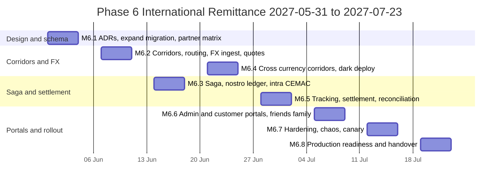
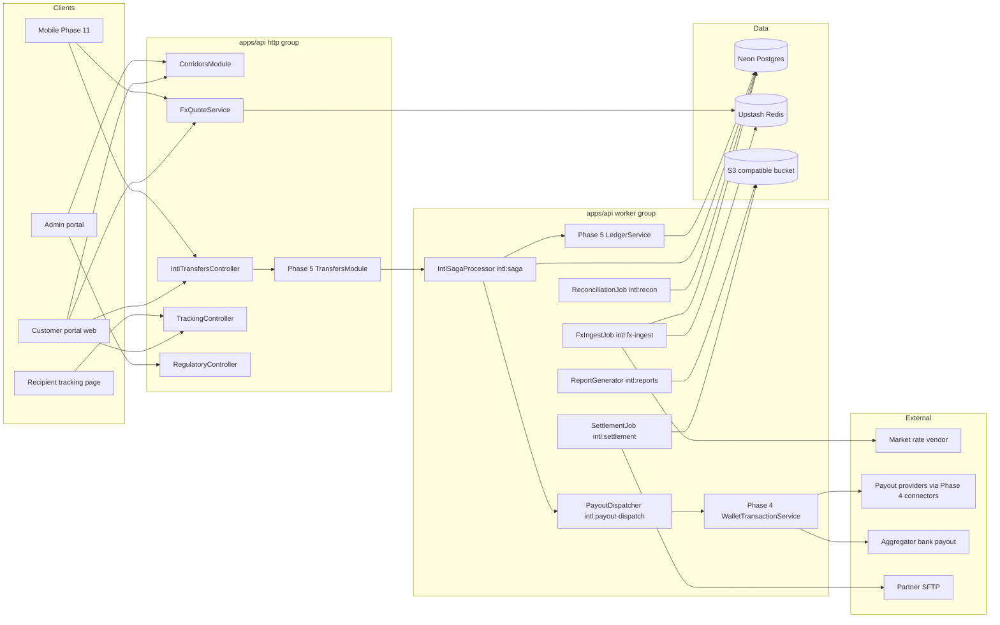
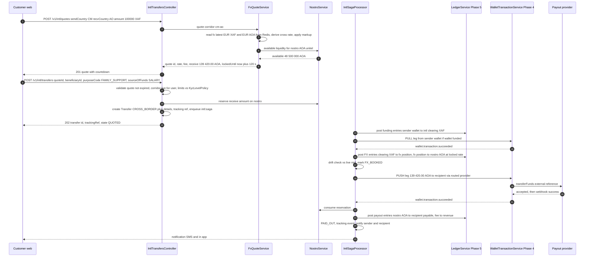
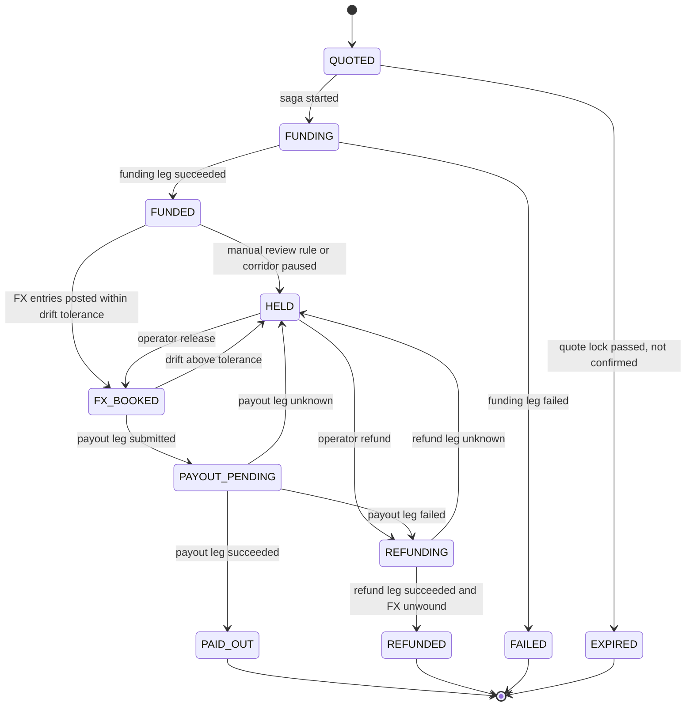
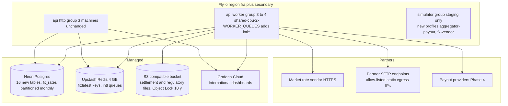

# Phase 6 — International Remittance

| Field                     | Value                                                                                                                                                                                                                                                                                                                                                                                                                     |
| ------------------------- | ------------------------------------------------------------------------------------------------------------------------------------------------------------------------------------------------------------------------------------------------------------------------------------------------------------------------------------------------------------------------------------------------------------------------- |
| **Phase**                 | 6 of 13 — `international`                                                                                                                                                                                                                                                                                                                                                                                                 |
| **Dates**                 | 2027-05-31 → 2027-07-23                                                                                                                                                                                                                                                                                                                                                                                                   |
| **Duration**              | 8 weeks (W1 = 2027-05-31, W8 = 2027-07-19 … 2027-07-23)                                                                                                                                                                                                                                                                                                                                                                   |
| **Team**                  | `core` (3 backend, 2 frontend, 1 QA, solution architect, PM, compliance analyst at ~75 %; DevOps/SRE and 0.5 security engineer shared; product designer W1–W5; 1 mobile engineer for API contract review)                                                                                                                                                                                                                 |
| **Depends on**            | Phase 5 — Domestic Transfers (ends 2027-05-28): `Transfer` aggregate and saga, double-entry ledger (`ledger_accounts` / `ledger_entries`), fee schedules, KYC-level limit enforcement, `WalletTransaction` legs (Phase 4), provider catalogue and credential store (Phase 3), customer profiles, beneficiaries and `KycLevelPolicy` (Phase 2)                                                                             |
| **Unlocks**               | Phase 7 — FX & Treasury (starts 2027-06-28, overlapping our W5–W8; consumes `fx_rates`, `fx_quotes`, `nostro_accounts`), Phase 8 — AML, Fraud & Compliance (2027-07-26; consumes purpose/source-of-funds fields, corridor risk, regulatory reports), Phase 10 — Reporting & BI (2027-09-20), Phase 11 — Mobile (2027-08-09; consumes quote + tracking APIs), Phase 13 — Pan-African Expansion (corridor-by-configuration) |
| **Runs in parallel with** | Phase 7 kick-off (platform team, from 2027-06-28 = our W5) — FX boundary agreed at M6.1                                                                                                                                                                                                                                                                                                                                   |

---

## 1. Overview

### 1.1 Objective

Phase 6 makes BI-Rem a **cross-border** remittance platform. A customer in one supported country sends money in their currency; the recipient in another supported country receives it in theirs, into a mobile-money wallet on _any_ network or into a bank account, with the exchange rate applied automatically and **locked at quote time**. The phase delivers the corridor configuration model (which country pairs, which payout rails, which limits, which partner), a first-generation FX quote engine with rate-validity windows, pre-funded **nostro / float accounts per corridor** with liquidity checks at quote time, the cross-border transfer saga on top of Phase 5's `Transfer` + ledger and Phase 4's `WalletTransaction` legs, customer-facing **transfer tracking**, daily **settlement files** exchanged with payout partners, a **reconciliation** engine with a break workflow, and the **regulatory reporting fields** (purpose of transfer, source of funds, sender/recipient identity snapshot) plus report generators for BEAC and the other central banks in scope.

Launch footprint: the **CEMAC** zone (Cameroon `CM`, Gabon `GA`, Chad `TD`, Congo-Brazzaville `CG`, Central African Republic `CF`, Equatorial Guinea `GQ` — all `XAF`) and the Portuguese-speaking **PALOP** markets plus Guinea-Bissau: Angola `AO` (`AOA`), Mozambique `MZ` (`MZN`), Cape Verde `CV` (`CVE`), Guinea-Bissau `GW` (`XOF`), São Tomé and Príncipe `ST` (`STN`). All eleven countries and six currencies already exist in `packages/shared/src/constants/countries.ts` and `currencies.ts` (XAF/XOF exponent 0, the others exponent 2), so no reference-data migration is needed for them.

Two success criteria drive every milestone: **(1) a user can send money between supported countries** and **(2) the exchange rate is applied automatically** — meaning the customer sees send amount, fee, rate and receive amount before confirming, the rate is honoured for the lock window, and the ledger, the payout leg and the settlement file all carry the same locked rate.

### 1.2 In scope

| Area                          | Included                                                                                                                                                                                                                                                                                                                                                                                                                                                                                                                                                                                                                                                                                                                                                                                                                                        |
| ----------------------------- | ----------------------------------------------------------------------------------------------------------------------------------------------------------------------------------------------------------------------------------------------------------------------------------------------------------------------------------------------------------------------------------------------------------------------------------------------------------------------------------------------------------------------------------------------------------------------------------------------------------------------------------------------------------------------------------------------------------------------------------------------------------------------------------------------------------------------------------------------- |
| Corridor configuration        | `Corridor` = ordered pair (send country, receive country) with send/receive currency, status (`DRAFT → SANDBOX → FRIENDS_FAMILY → LIVE → PAUSED → RETIRED`), per-corridor limits (single, daily, monthly, in send currency, intersected with the sender's `KycLevelPolicy`), fee schedule reference, FX markup (bps), quote lock seconds, cut-off / value-date rules, required compliance fields, regulator and licence basis, partner model. `CorridorRoute` = ordered list of payout rails per corridor × beneficiary type (`MOBILE_MONEY`, `BANK_ACCOUNT`) with priority, weight and health-based fallback. Domestic corridors (`cm-cm`, …) are modelled as corridors too so Phase 5's engine and Phase 6's share one routing path.                                                                                                          |
| Cross-Currency Transfers      | Send `XAF`, receive `AOA`, `MZN`, `CVE`, `XOF` or `STN` (and the reverse where the partner model allows); send-side funding by Phase 5 mechanisms (wallet pull / BI-Rem balance); FX booked at the locked quote; two-currency ledger postings through a corridor **FX position account**; receive amount guaranteed to the customer.                                                                                                                                                                                                                                                                                                                                                                                                                                                                                                            |
| Cross-Network Transfers       | Sender on MTN MoMo Cameroon → recipient on Airtel Money Gabon or Moov Money Chad; sender wallet → recipient bank account (Cape Verde, São Tomé) via aggregator/bank partner; routing engine picks the payout `Provider` from `CorridorRoute`, falls back on circuit-open or `ConnectorUnavailableError`. Same-currency intra-CEMAC corridors (`XAF → XAF`) are cross-border, cross-network, **no FX** — still subject to corridor limits and BEAC reporting fields.                                                                                                                                                                                                                                                                                                                                                                             |
| FX Conversion                 | `FxRateProvider` interface + two implementations in Phase 6: `PeggedRateProvider` (fixed parities: `EUR/XAF = 655.957`, `EUR/XOF = 655.957`, `EUR/CVE = 110.265`, `EUR/STN = 24.50`) and `MarketRateProvider` (HTTP feed for `AOA`, `MZN`, `USD`, `EUR`; one vendor in Phase 6, configurable). Rate ingestion every 60 s into `fx_rates` (mid, bid/ask when given, source, `capturedAt`); `FxQuote` = customer-facing rate = mid × (1 − markup) with a `lockedUntil` validity window (default 120 s for customers, 900 s for admin-initiated); quote is bound to exactly one transfer; stale-rate and tolerance guards; **shadow mode** in production before any customer sees a rate. Treasury-grade features (multi-source aggregation, hedging, position limits, rebalancing automation) are Phase 7.                                        |
| Transfer Tracking             | Public, non-guessable tracking reference (`BIR-` + 8 Crockford base32 chars) on every cross-border transfer; `TransferTrackingEvent` customer-facing timeline (`QUOTED → FUNDING → FUNDED → FX_BOOKED → PAYOUT_PENDING → PAID_OUT`, plus `HELD`, `REFUNDING`, `REFUNDED`, `FAILED`); sender endpoints and a signed recipient tracking link sent by SMS (no login needed, masked data); notifications in `en`, `fr`, `pt` to sender **and** recipient at `PAYOUT_PENDING`, `PAID_OUT`, `FAILED`, `REFUNDED`.                                                                                                                                                                                                                                                                                                                                     |
| Pre-funding / nostro          | `NostroAccount` per corridor payout currency and partner: links a Phase 5 ledger account (asset, `currency`), one or more Phase 4 `ProviderAccount` float wallets and/or a partner bank account; projected available liquidity = ledger balance − reserved quotes − in-flight payouts; quote refused (`CORRIDOR_LIQUIDITY_LOW`) when below the reserve; `PrefundingInstruction` records top-ups (bank wire / float transfer) with maker-checker and expected vs received amounts; low-liquidity alerts feed Phase 7.                                                                                                                                                                                                                                                                                                                            |
| Settlement files              | Daily `SettlementBatch` per partner and currency (cut-off per corridor, e.g. 16:00 WAT for CEMAC partners, 15:00 WAT for Luanda): outbound **payout instruction file** (CSV, with optional ISO 20022 `pain.001` rendering for bank partners) and **settlement statement** (what BI-Rem owes / is owed), delivered via SFTP (BI-Rem pulls/pushes from the Phase 4 static egress IPs); inbound partner statements ingested from SFTP or from Phase 4 `getStatement`; file hash, line counts and control totals stored.                                                                                                                                                                                                                                                                                                                            |
| Transfer Reconciliation       | Nightly (and on-demand) three-way reconciliation: ledger entries ↔ `WalletTransaction` legs ↔ partner statement lines, per `NostroAccount` and value date; automatic matching by `externalReference` / `providerTransactionId` / amount+date tolerance; `ReconciliationBreak` classification (`MISSING_AT_PARTNER`, `MISSING_IN_LEDGER`, `AMOUNT_MISMATCH`, `FX_MISMATCH`, `STATUS_MISMATCH`, `DUPLICATE`, `FEE_MISMATCH`); break workflow with evidence, four-eyes resolution and adjusting ledger entries; recon dashboard.                                                                                                                                                                                                                                                                                                                   |
| Regulatory fields & reporting | Mandatory `purposeCode` (ISO 20022 ExternalPurpose1Code subset mapped to each regulator's nomenclature) and `sourceOfFundsCode` on every cross-border transfer; sender identity snapshot (ID type, last 4, nationality, KYC level) and recipient details captured at transfer time (immutable); relationship to recipient; `RegulatoryReport` generators: BEAC FX-transfer declaration (per Règlement 02/18/CEMAC/UMAC/CM), BNA inbound remittance report (Angola), Banco de Moçambique remittance report, BCEAO (via Guinea-Bissau partner) statement, BCV and BCSTP partner statements — generated as CSV/XML into the Phase 2 S3-compatible document store, downloadable from the admin portal, with the exact column layouts confirmed with the sponsor bank/partner (open question Q6.2). Suspicious-activity reporting itself is Phase 8. |
| Licensing / partner model     | Documented per country (§8.4) and encoded on the `Corridor` row (`licenceBasis`, `partnerModel`, `regulatorCode`): BI-Rem operates as **principal** where licensed, otherwise as **agent of a licensed partner** (sponsor bank / EMI / aggregator); payout partner contract reference stored on `CorridorRoute`.                                                                                                                                                                                                                                                                                                                                                                                                                                                                                                                                |
| Portals                       | Admin: corridor console (matrix, routes, limits, flags), FX console (rates, markups, quotes, freeze), nostro & pre-funding, settlement files, reconciliation breaks, regulatory reports, cross-border transfer explorer. Customer: send-international flow (country → beneficiary → amount with live quote and countdown → purpose/source of funds → review → confirm), tracking timeline, recipient tracking page.                                                                                                                                                                                                                                                                                                                                                                                                                             |

### 1.3 Out of scope (explicitly deferred)

- **Treasury management**: multi-source rate aggregation, hedging, FX position limits and P&L, automated nostro rebalancing, liquidity forecasting — **Phase 7** (we hand over `fx_rates`, `fx_quotes`, `nostro_accounts`, `prefunding_instructions` and the `FxRateProvider` interface).
- **AML screening and transaction monitoring** on cross-border flows (sanctions screening of recipients, velocity across corridors, STR filing to ANIF/UIF/GIFiM) — **Phase 8**. Phase 6 captures every field Phase 8 needs and emits `intl.transfer.*` events; the only Phase 6 compliance gate is `HELD` for operator review when a corridor's `requiresManualReview` rule fires (amount above threshold, first transfer to a new recipient country, mismatched purpose/relationship).
- Outbound transfers **from** Angola and Mozambique (AOA/MZN are not freely convertible; outbound requires BNA/BM FX approval flows) — modelled as corridors in `DRAFT`, not activated. Cape Verde, Guinea-Bissau and São Tomé send-side likewise start as receive-only.
- Cash pick-up payout (`ConnectorKind.CASH_AGENT`) and card funding — Phase 9/13.
- GIMAC (CEMAC interbank switch) direct participation — intra-CEMAC corridors run as pre-funded payouts through partner EMIs/aggregator in Phase 6; a GIMACPAY route is a Phase 13 option (Q6.6).
- Native mobile screens — Phase 11 consumes the quote and tracking APIs; Phase 6 supplies OpenAPI examples and the recipient web tracking page which is mobile-responsive.
- Bulk / business remittances and partner-initiated transfers — Phase 9.

### 1.4 Independent deployability strategy

"Deployable alone" for Phase 6 means: **the whole phase merges to `main` and deploys to production behind flags with every corridor `DRAFT` or `SANDBOX`, FX rates being ingested and quotes computed in shadow mode (logged, never shown), nostro ledger accounts created at zero, settlement and reconciliation jobs running against staging SFTP only, no customer able to see "Send internationally", and every piece switchable off within 30 seconds without a redeploy. Domestic transfers (Phase 5) must be provably unaffected: their saga path is unchanged except for the new nullable `transfers.corridor_id` they start populating.**

| Mechanism                                                                                   | How it is used in Phase 6                                                                                                                                                                                                                                                                                                                                                                                                                                                                                                                                                                                                                                                                                                                                                                                                                                                                                                                                                                                                                         |
| ------------------------------------------------------------------------------------------- | ------------------------------------------------------------------------------------------------------------------------------------------------------------------------------------------------------------------------------------------------------------------------------------------------------------------------------------------------------------------------------------------------------------------------------------------------------------------------------------------------------------------------------------------------------------------------------------------------------------------------------------------------------------------------------------------------------------------------------------------------------------------------------------------------------------------------------------------------------------------------------------------------------------------------------------------------------------------------------------------------------------------------------------------------- |
| **Feature flags** (Phase 1 `FeatureFlag`, Redis-cached 30 s, `rules` + `rolloutPercentage`) | `intl.enabled` (master: quote and transfer creation refused with HTTP 503 `INTL_DISABLED` when off; in-flight transfers continue to payout); `intl.corridor.<send>-<recv>.enabled` (corridor visible, quoting allowed) and `intl.corridor.<send>-<recv>.live` (real money; `rules` carry the friends-and-family user list and `rolloutPercentage` the canary); `intl.fx.quote-engine` (shadow vs served), `intl.fx.freeze` (stop issuing new quotes, honour locked ones), `intl.fx.source.market` (use market feed vs last-good), `intl.routing.fallback` (allow secondary route), `intl.settlement.auto-generate`, `intl.settlement.auto-deliver` (write to partner SFTP vs staging bucket), `intl.recon.auto-match`, `intl.tracking.public-link`, `intl.reports.auto-generate`, `portal.send-international`, `admin.intl.console`. Keys registered in `packages/shared/src/constants/feature-flags.ts`; corridor keys are validated against the pattern `^[a-z][a-z0-9-]*(\.[a-z][a-z0-9-]*)+$` already enforced by `FEATURE_FLAG_KEY_PATTERN`. |
| **Expand → migrate → contract**                                                             | All Phase 6 migrations are expand-only: 16 new tables, 11 new enums, 1 enum value added (`ConnectorKind.AGGREGATOR`), 3 nullable columns on Phase 5 `transfers` (`corridor_id`, `fx_quote_id`, `tracking_ref`) and 1 nullable column on Phase 2 `beneficiaries` (`bank_account_country_code`). Backfill: a domestic `Corridor` row per Phase 5 live country, `transfers.corridor_id` filled for existing domestic transfers (batched, idempotent). The only **contract** — `transfers.corridor_id SET NOT NULL` — runs in **Phase 9 W1 (2027-08-23)**, the core team's next migration slot, after a Neon snapshot.                                                                                                                                                                                                                                                                                                                                                                                                                                |
| **Dark launch**                                                                             | From W4 (M6.4) production ingests FX rates every 60 s and computes shadow quotes for synthetic requests; from W5 production generates settlement files to a staging bucket (`intl.settlement.auto-deliver=false`) and runs reconciliation against partner UAT statements; from W6 the `CM→GA` corridor is `FRIENDS_FAMILY` with a hard cap (`XAF 50,000` per transfer, 20 named users).                                                                                                                                                                                                                                                                                                                                                                                                                                                                                                                                                                                                                                                           |
| **Kill switches**                                                                           | `intl.enabled=false` → `POST /v1/intl/quotes` and `POST /v1/intl/transfers` return 503, workers finish in-flight payouts; `intl.fx.freeze=true` → `FX_FROZEN` on new quotes, existing locks honoured; corridor `PAUSED` → quoting refused, transfers at `FUNDED` park (`HELD`, reason `CORRIDOR_PAUSED`) until resume or refund; per-provider kill switches from Phase 4 (`wallet.connector.<key>.live`) still apply underneath; stale-rate guard auto-freezes a currency pair when the last good rate is older than `fxMaxRateAgeSeconds` (default 300 s).                                                                                                                                                                                                                                                                                                                                                                                                                                                                                       |
| **Worker isolation**                                                                        | New BullMQ queues `intl:saga`, `intl:fx-ingest`, `intl:payout-dispatch`, `intl:settlement`, `intl:recon`, `intl:reports`, `intl:notify` (each with `*:dlq`) run only in the Phase 3 `worker` process group (`WORKER_QUEUES`); the `http` group only reads rates from Redis for quoting (≤ 5 ms) and never calls a payout provider synchronously.                                                                                                                                                                                                                                                                                                                                                                                                                                                                                                                                                                                                                                                                                                  |
| **Backward-compatible APIs**                                                                | New paths under `/v1/intl/*`, `/v1/corridors`, `/v1/track/*`; Phase 5 `/v1/transfers/*` responses gain optional fields only (`corridor`, `fxQuote`, `trackingRef`). Zod schemas in `@bi-rem/shared` are additive (`.optional()`), portals tolerate absence.                                                                                                                                                                                                                                                                                                                                                                                                                                                                                                                                                                                                                                                                                                                                                                                       |
| **Data isolation**                                                                          | Cross-border detail lives in `transfer_cross_border_details` (1:1), not in new NOT NULL columns on `transfers`, so a rollback of the API image leaves Phase 5 fully functional on the expanded schema.                                                                                                                                                                                                                                                                                                                                                                                                                                                                                                                                                                                                                                                                                                                                                                                                                                            |

---

## 2. Milestones

Phase start is Monday **2027-05-31**; week _n_ runs Monday to Friday, milestone dates are the Friday of the week. Phase 7 (platform team) starts on Monday 2027-06-28 (our W5).

| ID       | Week | Target date | Deliverable                                                                                                                                                                                                                                                                                                                                                                                                                                                            | Acceptance criteria                                                                                                                                                                                                                                                                                                                                                                                                                                                                      | Owner                         |
| -------- | ---- | ----------- | ---------------------------------------------------------------------------------------------------------------------------------------------------------------------------------------------------------------------------------------------------------------------------------------------------------------------------------------------------------------------------------------------------------------------------------------------------------------------- | ---------------------------------------------------------------------------------------------------------------------------------------------------------------------------------------------------------------------------------------------------------------------------------------------------------------------------------------------------------------------------------------------------------------------------------------------------------------------------------------- | ----------------------------- |
| **M6.1** | W1   | 2027-06-04  | Design freeze: corridor + routing model, `FxRateProvider` interface, quote-lock semantics, nostro ledger account plan, saga states; ADR-0018 (corridor & routing), ADR-0019 (FX quote locking & shadow mode), ADR-0020 (settlement & reconciliation); schema v6 _expand_ migration merged; licensing/partner matrix v1 (§8.4) reviewed by compliance; market-rate vendor, aggregator and partner SFTP sandbox accounts requested; FX boundary agreed with Phase 7 lead | `pnpm db:migrate:dev` applies `20270531090000_phase6_expand` on a Phase 5 database and Phase 5 e2e suite stays green; `packages/shared/src/schemas/intl.ts` compiles with Zod DTOs for quote, transfer, tracking; ADRs accepted at Thursday architecture review; partner matrix has an owner and a date per country                                                                                                                                                                      | Solution Architect            |
| **M6.2** | W2   | 2027-06-11  | Corridor configuration service + admin API; routing engine with fallback; FX ingestion (`PeggedRateProvider`, `MarketRateProvider`) into `fx_rates` + Redis; quote API with lock window; domestic corridor backfill job                                                                                                                                                                                                                                                | 11 launch corridors + domestic corridors seeded in staging; `POST /v1/intl/quotes` for `CM→GA` returns rate 1.0000, fee and receive amount in < 150 ms p95; for `CM→AO` returns market-derived rate with `lockedUntil = now + 120 s`; quoting against a corridor with stale rate (> 300 s) returns `FX_STALE_RATE`; routing picks the secondary route when the primary provider's circuit is open (integration test); backfill sets `corridor_id` on 100 % of staging domestic transfers | Backend Lead (core)           |
| **M6.3** | W3   | 2027-06-18  | Cross-border transfer saga (quote → fund → FX book → payout → complete / refund) on Phase 5 `Transfer`; nostro accounts and two-currency ledger postings; liquidity reservation; pre-funding instructions; intra-CEMAC `XAF→XAF` corridors end-to-end in staging via simulator                                                                                                                                                                                         | Saga for `CM→GA` completes in staging with balanced ledger (sum of entries per currency = 0, FX position account carries the spread); killing the worker at any step leaves the transfer recoverable (chaos test); a quote whose nostro liquidity is below reserve is refused; refund path returns funds to sender and releases the reservation; expired quote at confirmation returns `QUOTE_EXPIRED` with a fresh quote                                                                | Backend Lead (core)           |
| **M6.4** | W4   | 2027-06-25  | Cross-currency corridors `CM→AO`, `CM→MZ`, `CM→GW`, `CM→CV`, `CM→ST` in staging (Unitel Money, e-Mola, Orange Money GW adapters from Phase 4; new `aggregator-payout` connector for CV/ST/GW bank payout built with the Phase 4 SDK); regulatory fields (purpose, source of funds, identity snapshot) enforced; **dark deploy to production** with FX ingestion and shadow quotes                                                                                      | Each cross-currency corridor completes end-to-end in staging against simulator profiles; `aggregator-payout` passes Phase 4 conformance; transfer without `purposeCode` rejected 422; production `/health/ready` shows `fx-rates` indicator `up` with age < 120 s; shadow quote log in Loki shows 24 h of quotes with zero `FX_STALE_RATE` for pegged pairs                                                                                                                              | Backend Lead (core)           |
| **M6.5** | W5   | 2027-07-02  | Transfer tracking (timeline events, tracking ref, recipient signed link, sender/recipient notifications `en/fr/pt`); settlement batch generation + SFTP delivery + inbound statement ingestion; reconciliation engine with break classification and resolution API; Phase 7 joint review of FX hand-over                                                                                                                                                               | Tracking page renders every state for a seeded transfer in all three locales; recipient link cannot be reused after 30 days or reveal more than masked name + amount + status; daily settlement file for a staging partner has matching control totals with the ledger; recon run over 1,000 seeded legs with 20 injected discrepancies classifies all 20 correctly and auto-matches the rest; Phase 7 lead signs the `FxRateProvider` interface                                         | Backend Lead (core) / QA Lead |
| **M6.6** | W6   | 2027-07-09  | Admin portal: corridor console, FX console, nostro & pre-funding, settlement, reconciliation breaks, regulatory reports, cross-border explorer; customer portal: send-international flow and tracking; **friends-and-family** `CM→GA` live in production                                                                                                                                                                                                               | Operator can pause a corridor, change a markup, approve a pre-funding, resolve a break and download a report with an `audit_logs` row for each; a named friends-and-family user sends `XAF 10,000` CM→GA in production and the recipient's Airtel Money GA wallet is credited; Playwright suites green; Lighthouse a11y ≥ 90 on send flow                                                                                                                                                | Frontend Lead                 |
| **M6.7** | W7   | 2027-07-16  | Hardening: k6 (quotes 200 rps, transfers 30 TPS sustained), chaos (rate feed outage, SFTP outage, partner duplicate statement lines, worker kill mid-FX-book), security review and pen-test fixes, regulatory report generators validated against partner layouts, runbooks; canary `CM→GA`, `CM→TD` at 5 %                                                                                                                                                            | k6 thresholds met two nights; chaos scenarios leave zero unbalanced ledgers and zero orphan reservations; pen-test High/Critical closed; BEAC declaration sample accepted by sponsor bank on test data; canary error rate < 0.5 % and p95 quote-to-funded < 60 s                                                                                                                                                                                                                         | QA Lead / Security            |
| **M6.8** | W8   | 2027-07-23  | Production readiness: wave A corridors (`CM→GA`, `CM→TD`, `CM→CG`, `GA→CM`) at 25 %, wave B (`CM→AO`, `CM→MZ`, `CM→GW`) in `FRIENDS_FAMILY` or `SANDBOX` depending on partner readiness, `CM→CV`, `CM→ST` `SANDBOX`; success criteria evidenced; sign-offs; handover to Phases 7, 8, 10, 11                                                                                                                                                                            | ≥ 50 real cross-border transfers completed in production across ≥ 2 corridors with reconciliation showing zero unexplained breaks for 5 consecutive days; every §12 evidence artifact filed; §11 sign-offs collected; Phase 8 team has read access to `transfer_cross_border_details` and events; Phase 11 team consuming quote/tracking OpenAPI                                                                                                                                         | Program Manager               |



---

## 3. Deliverables

Every item from the phase brief, with its definition of done (DoD). Code lives in `apps/api/src/modules/intl/*` (NestJS module `IntlModule` with sub-modules `corridors`, `fx`, `nostro`, `saga`, `tracking`, `settlement`, `reconciliation`, `regulatory`), shared schemas in `packages/shared/src/schemas/intl.ts`, the new connector in `packages/connectors/aggregator-payout`.

### 3.1 Corridor configuration

- **DoD**: `corridors` and `corridor_routes` tables (§5) seeded for the 11 launch countries (send side `CM`, `GA`, `TD`, `CG`, `CF`, `GQ`; receive side all 11) plus one domestic corridor per Phase 5 live country; admin API `GET/POST/PATCH /v1/corridors` with maker-checker on status changes to `LIVE`; `CorridorService.resolve(sendCountry, recvCountry, beneficiaryType)` returns effective config (limits intersected with the sender's `KycLevelPolicy`, fee schedule, markup, lock seconds, required fields, route list) cached 30 s in Redis; corridor status drives flag evaluation (`intl.corridor.<k>.enabled/live` must both be on **and** status ≥ `FRIENDS_FAMILY`); every corridor change audited with before/after; `pnpm intl corridor:lint` validates that every `LIVE` corridor has ≥ 1 healthy route, a nostro account, a fee schedule and a regulator code.

### 3.2 Cross-Currency Transfers

- **DoD**: `POST /v1/intl/transfers` with `quoteId` creates a Phase 5 `Transfer` of kind `CROSS_BORDER` plus `transfer_cross_border_details`; saga (§4.3) funds in send currency, books FX at the locked rate, reserves and then consumes nostro liquidity, dispatches the payout `WalletTransaction` in receive currency through the routed provider, and completes or refunds; ledger postings (§4.4) balance per currency; receive amount shown at quote equals amount paid out to the minor unit (integration test over 10,000 random amounts across all six currencies, including exponent-0 rounding for XAF/XOF); `XAF→XOF` handled as a cross-currency corridor at fixed parity with its own nostro (the two CFA francs are not interchangeable at the partner level).

### 3.3 Cross-Network Transfers

- **DoD**: `RoutingEngine.select(corridor, beneficiary)` chooses the highest-priority `CorridorRoute` whose provider is `enabled`, circuit `CLOSED` or `HALF_OPEN`, supports the beneficiary type and whose nostro has liquidity; weighted split supported for A/B routing; fallback to the next route on `ConnectorUnavailableError` before submission (never after a provider has accepted a leg); routing decision persisted on the transfer (`routeId`, `routingReason`); same beneficiary MSISDN on a different network resolved by Phase 4 `validateAccount` before quoting (name match score surfaced); `aggregator-payout` connector (bank payout for `CV`, `ST`, `GW` and mobile-money fallback) implemented with the Phase 4 SDK, passing the conformance suite, with its simulator profile.

### 3.4 FX Conversion

- **DoD**: `FxRateProvider` interface (`fetchRates(pairs): Promise<RateTick[]>`, `supports(pair)`, `healthCheck()`); `PeggedRateProvider` (parities as `Setting` rows `intl.fx.peg.<base>-<quote>`, reviewed yearly) and `MarketRateProvider` (vendor REST, API key via Phase 3 credential store, 60 s schedule, Zod-validated response); `fx_rates` append-only with `source`, `mid`, `bid`, `ask`, `capturedAt`; latest tick per pair mirrored in Redis `fx:latest:<base>:<quote>`; `FxQuoteService.quote()` derives cross rates through `EUR` or `USD` when no direct tick exists (`XAF→AOA = EUR/AOA ÷ EUR/XAF`), applies corridor markup in bps, rounds receive amount **down** to the receive currency exponent, persists `fx_quotes` with `lockedUntil`, `rateSourceTickIds`, `markupBps`; confirmation after `lockedUntil` → `QUOTE_EXPIRED`; tolerance guard: if the live mid moved > `fxMaxDriftBps` (default 150) between quote and FX booking the transfer goes `HELD` (`FX_DRIFT`) for treasury decision rather than silently losing margin; shadow mode logs quotes without exposing them; rate age and drift exported as Prometheus gauges.

### 3.5 Transfer Tracking

- **DoD**: `trackingRef` generated at transfer creation (`BIR-` + 8 chars, collision-checked), shown in every notification; `transfer_tracking_events` written by the saga at each customer-visible state; `GET /v1/intl/transfers/:id/timeline` (sender) and `GET /v1/track/:token` (recipient; HMAC-signed, 30-day expiry, masked sender name, amount, currency, status, provider reference; rate-limited 30/min/IP); notification templates `intl-transfer-sent`, `intl-transfer-paid-out`, `intl-transfer-failed`, `intl-transfer-refunded`, `intl-recipient-incoming`, `intl-recipient-paid` for SMS and EMAIL in `en`, `fr`, `pt` seeded; customer portal timeline component; estimated delivery (`expectedPayoutAt` from corridor SLA) displayed and recomputed on delays; "delayed" event emitted when `PAYOUT_PENDING` exceeds the corridor SLA.

### 3.6 Pre-funding / nostro accounts per corridor

- **DoD**: `nostro_accounts` linked to a Phase 5 ledger asset account per (partner, currency), optionally to Phase 4 `provider_accounts`; `NostroService.available(nostroId)` = ledger balance − open reservations − in-flight payouts, cached 10 s; reservation created at transfer creation (`fx_quotes.reservedMinor`), released on expiry/refund, consumed on payout success; `prefunding_instructions` with states `DRAFTED → APPROVED → SENT → RECEIVED → RECONCILED | CANCELLED`, maker-checker (`treasury:write` + second approver), expected vs received, bank reference; low-liquidity alert when available < `minReserveMinor` or < projected 24 h outflow (rolling average); nostro balance snapshot nightly into `nostro_balance_snapshots` view (SQL view over ledger, no new table).

### 3.7 Settlement files

- **DoD**: `settlement_batches` created at each corridor cut-off per (partner, currency, value date) collecting completed payouts and refunds; outbound files: `payout-instructions-<partner>-<ccy>-<date>.csv` (one line per payout: tracking ref, external reference, provider txn id, amount, currency, FX rate, value date, beneficiary last4, purpose code) and `settlement-statement-<partner>-<ccy>-<date>.csv` (opening position, payouts, fees, pre-funding received, closing position); optional `pain.001.001.09` XML for bank partners; SHA-256, line count and control totals in `settlement_files`; delivered over SFTP (`ssh2-sftp-client`, host-key pinning, key auth) from static egress IPs or written to the S3-compatible bucket when `intl.settlement.auto-deliver=false`; inbound partner statements pulled from SFTP paths configured per partner, parsed by per-partner `StatementParser` (CSV/XLSX/MT940-light), stored line-by-line in `settlement_file_lines`; duplicate file detection by hash; delivery and ingestion retried with DLQ.

### 3.8 Transfer Reconciliation

- **DoD**: `reconciliation_runs` per (nostro, value date) executed nightly 03:00 UTC and on demand; three sources normalised to `ReconItem { ref, providerTxnId, amountMinor, currency, valueDate, status, source }`; matching passes: exact `externalReference`, exact `providerTransactionId`, fuzzy (amount ± 0 and date ± 1 day with unique candidate); unmatched or mismatched items become `reconciliation_breaks` with type, age, amounts per source, suggested action; resolution actions (`MATCH_MANUALLY`, `WRITE_OFF`, `ADJUST_LEDGER`, `REQUEST_PARTNER_CORRECTION`, `MARK_DUPLICATE`) with evidence upload (Phase 2 documents pipeline) and four-eyes above the equivalent of USD 500; adjusting ledger entries posted to `recon_adjustments` ledger account; recon summary metrics (match rate, open breaks by age bucket) and Grafana panel; exit criterion: 5 consecutive production days with zero unexplained breaks.

### 3.9 Regulatory reporting fields & central-bank reporting

- **DoD**: `transfer_purpose_codes` reference table (ISO 20022 code, label `en/fr/pt`, allowed per corridor, mapping to BEAC/BNA/BM nomenclature); `transfer_cross_border_details` carries `purposeCode`, `sourceOfFundsCode`, `relationshipCode`, `senderIdentitySnapshot` (JSON: id type, last4, nationality, KYC level, residence country), `recipientSnapshot` (name, country, account last4, provider), `declaredByUserAt`, `regulatoryStatus`; API rejects missing/invalid codes (422) and corridor-specific requirements (e.g. `BUSINESS_*` purposes require `LEVEL_2` KYC); `RegulatoryReportService.generate(type, period)` produces `BEAC_FX_DECLARATION` (monthly + per-transfer above threshold), `BNA_INBOUND_REMITTANCES`, `BM_INBOUND_REMITTANCES`, `BCEAO_PARTNER_STATEMENT`, `BCV_PARTNER_STATEMENT`, `BCSTP_PARTNER_STATEMENT` as CSV/XML into the document store with checksum, generated-by, period and status (`GENERATED → REVIEWED → SUBMITTED`); downloads audited; layouts versioned in `docs/handbooks/regulatory-reports.md`.

### 3.10 Licensing / partner model per country

- **DoD**: §8.4 matrix reviewed by compliance and counsel, with licence basis, regulator, partner, status and blocking items per country; encoded on each corridor (`regulatorCode`, `licenceBasis`, `partnerModel`); a corridor cannot move to `FRIENDS_FAMILY` or `LIVE` unless `licenceEvidenceDocumentId` points to an uploaded licence/partner agreement and compliance has approved (maker-checker); partner due-diligence checklist stored under `docs/handbooks/partner-onboarding.md`.

### 3.11 Portals, observability, runbooks

- **DoD**: admin and customer screens of §7 with Playwright coverage; Grafana dashboards _International_ (quotes/min, conversion funnel, saga state distribution, payout latency per corridor, liquidity per nostro, FX age/drift, settlement/recon status) and alerts (§11); runbooks `docs/handbooks/intl-operations.md` (pause corridor, FX freeze, liquidity top-up, break resolution, settlement redelivery, stuck saga, regulator report regeneration).

---

## 4. Architecture

### 4.1 Component diagram (Phase 6 additions)



Design notes: the `http` group answers quotes from Redis-mirrored rates (no vendor call in the request path); every money movement and every external call runs in the `worker` group; the saga is a BullMQ flow with one job per step and the transfer row as the single source of truth for the current step (idempotent step handlers, resumable after crash).

### 4.2 Sequence — quote, lock, fund, convert, pay out



Failure branches: `PULL` leg fails → transfer `FAILED` before any FX posting, reservation released, no ledger movement beyond a reversed funding attempt; `PUSH` leg `FAILED` → saga posts reversing FX entries at the **same locked rate** (BI-Rem absorbs no FX risk on a failed payout because the position is unwound against the same nostro), refunds the sender (`REFUNDED`), releases reservation; `PUSH` leg `UNKNOWN` → transfer `HELD` with reason `PAYOUT_UNKNOWN`, nostro reservation kept, operator resolves through the Phase 4 explorer, saga resumes from the resolution event.

### 4.3 Saga state machine



Rules enforced in code: terminal states are `PAID_OUT`, `REFUNDED`, `FAILED`, `EXPIRED`; every transition writes a `transfer_tracking_events` row (customer-visible subset) and a Phase 5 transfer event; `HELD` always records a `holdReason` and an SLA timer (alert at 2 h, escalation at 24 h); a step handler re-run after a crash checks the persisted state and the idempotent effect (ledger entry `idempotencyKey`, `WalletTransaction.externalReference`) before acting.

### 4.4 Ledger model for cross-currency flows

Phase 5's ledger is single-currency per account; a cross-currency transfer therefore touches accounts in two currencies, joined by a **corridor FX position account pair**. For `CM→AO` with locked rate `r` (AOA per XAF), send amount `S` XAF, fee `F` XAF, receive `R = floor((S − F) × r)` AOA:

| #   | Debit                              | Credit                                                      | Amount | Currency |
| --- | ---------------------------------- | ----------------------------------------------------------- | ------ | -------- |
| 1   | Customer wallet / funding clearing | `intl_clearing_xaf`                                         | S      | XAF      |
| 2   | `intl_clearing_xaf`                | `fee_revenue_xaf`                                           | F      | XAF      |
| 3   | `intl_clearing_xaf`                | `fx_position_xaf_aoa` (XAF leg)                             | S − F  | XAF      |
| 4   | `fx_position_aoa_xaf` (AOA leg)    | `nostro_aoa_unitel` (liability to recipient pending payout) | R      | AOA      |
| 5   | `nostro_aoa_unitel`                | Recipient payable → settled by payout leg                   | R      | AOA      |

Each currency's entries balance independently; the pair of position accounts carries the open FX exposure that Phase 7 will manage (its XAF balance × market rate − its AOA balance = unrealised P&L). Spread revenue is recognised by Phase 7's revaluation job; Phase 6 only records the position. A failed payout reverses rows 4–5 and 3 at the same `r`, then refunds row 1 (fee refunded by corridor policy, default yes).

### 4.5 Deployment / infrastructure delta



Infra delta summary: (a) worker group +1 machine (`shared-cpu-2x`) and `WORKER_QUEUES=intl:*,wallet:*,notifications,outbox-relay`; (b) Fly static egress IPs (Phase 4) registered with partner SFTP allow-lists; (c) Neon: `fx_rates` and `transfer_tracking_events` partitioned monthly via the Phase 4 `data-jobs.yml` partition maintenance; (d) S3-compatible bucket prefix `intl/` with Object Lock (compliance mode, 10 years) for settlement and regulatory files; (e) Redis keyspace `fx:*`, `intl:*` (+ ~200 MB); (f) new secrets: `FX_VENDOR_API_KEY` (via Phase 3 credential store, not env), `INTL_TRACKING_HMAC_KEY`, per-partner SFTP private keys (credential store, kind `SSH_KEY`); (g) staging-only `fx-vendor` simulator profile with scripted rate paths (step, drift, outage); (h) Grafana dashboards and 9 new alerts; (i) no new process group — SFTP is client-side only (we pull/push; we do not host an SFTP server in Phase 6, see Q6.4).

### 4.6 Design decisions and alternatives rejected

| #   | Decision                                                                                    | Alternative rejected                             | Why                                                                                                                                                                                                        |
| --- | ------------------------------------------------------------------------------------------- | ------------------------------------------------ | ---------------------------------------------------------------------------------------------------------------------------------------------------------------------------------------------------------- |
| D1  | **Corridor as the unit of configuration, flags and rollout**, including domestic corridors  | Country-level settings + ad-hoc pair checks      | A corridor carries regulator, licence, partner, limits, markup and SLA — exactly the dimensions that differ per pair; domestic-as-corridor gives Phase 5 and 6 one routing path and one contract migration |
| D2  | **Quote locking with reservation** (rate + liquidity reserved for the lock window)          | Indicative rate, final rate at execution         | Success criterion 2 and customer trust require the shown receive amount to be the paid amount; reservation prevents overselling thin nostros                                                               |
| D3  | **Rates mirrored to Redis, vendor called only by the ingest job**                           | Call vendor synchronously per quote              | Quote latency and vendor rate limits; outage isolation (last-good rate + age guard)                                                                                                                        |
| D4  | **Pegged parities as configuration, not vendor data** for XAF/XOF/CVE/STN                   | Treat all pairs as market                        | Central-bank pegs are legal parities; vendor ticks for these pairs are noise and sometimes wrong; cross rates via EUR are exact                                                                            |
| D5  | **Pre-funded nostro model** (BI-Rem funds destination float in advance)                     | Post-funded / credit lines with partners         | New entrant without credit standing; pre-funding is how partners onboard remittance companies in these markets; Phase 7 optimises funding                                                                  |
| D6  | **FX position account pair per corridor currency pair** in Phase 5's single-currency ledger | Multi-currency ledger entries with embedded rate | Keeps Phase 5 invariants (per-currency balance = 0) and gives Phase 7 a clean exposure figure per pair                                                                                                     |
| D7  | **Settlement by file over SFTP** with CSV first, ISO 20022 optional                         | API-only settlement                              | Partners in these markets reconcile from files; files are the audit artefact regulators ask for                                                                                                            |
| D8  | **Three-way reconciliation** (ledger, legs, partner statement)                              | Two-way ledger vs partner                        | Phase 4 legs are the bridge that explains most breaks (UNKNOWN, reversals)                                                                                                                                 |
| D9  | **Regulatory fields captured at transfer time, immutable snapshot**                         | Join to customer profile at report time          | Reports must reflect identity and KYC level **as at** the transfer; profiles change                                                                                                                        |
| D10 | **Aggregator connector for CV/ST/GW bank payout** built with the Phase 4 SDK                | Direct bank integrations per country             | Three tiny markets; direct bank APIs are rarely available; the SDK route keeps one operational model and preserves the 30-minute connector path                                                            |
| D11 | **No hosted SFTP server in Phase 6** — BI-Rem pulls from and pushes to partner SFTP         | Host an SFTP endpoint for partners               | Avoids a new internet-facing service and key management surface; revisit in Phase 9 if a partner cannot host (Q6.4)                                                                                        |
| D12 | **Shadow mode for quotes in production** before friends-and-family                          | Enable quoting with staging rates                | Proves vendor path, egress and rate freshness on production infrastructure with zero customer exposure                                                                                                     |

---

## 5. Data Model & Migrations

### 5.1 Assumptions about Phase 5 (to be verified against `phase-05-domestic-transfers.md` at M6.1)

Phase 6 builds on these Phase 5 artefacts: `Transfer` (`transfers`: `id`, `kind` enum `TransferKind { DOMESTIC }`, `senderUserId`, `beneficiaryId`, `sendAmount`/`sendCurrency`, `feeAmount`, `status`, `fundingLegId`, `payoutLegId`, `idempotencyKey`, timestamps), `TransferEvent`, `LedgerAccount` (`ledger_accounts`: `code`, `type` `ASSET|LIABILITY|REVENUE|EXPENSE|CLEARING`, `currency`), `LedgerEntry` (`ledger_entries`: `journalId`, `accountId`, `debit`/`credit` BIGINT, `currency`, `idempotencyKey`), `FeeSchedule`, and limit enforcement reading `KycLevelPolicy`. Where Phase 5 names differ, Phase 6 adapts in M6.1 without changing the model below in substance.

### 5.2 Prisma additions (schema v6, `packages/db/prisma/schema.prisma`)

```prisma
// ---------------------------------------------------------------------------
// Phase 6 — International remittance: enums
// ---------------------------------------------------------------------------

enum CorridorStatus {
  DRAFT
  SANDBOX
  FRIENDS_FAMILY
  LIVE
  PAUSED
  RETIRED

  @@map("corridor_status")
}

enum LicenceBasis {
  PRINCIPAL_LICENCE
  AGENT_OF_BANK
  AGENT_OF_EMI
  AGGREGATOR_PARTNER

  @@map("licence_basis")
}

enum PayoutRailType {
  MOBILE_MONEY
  BANK_ACCOUNT

  @@map("payout_rail_type")
}

enum FxRateSourceKind {
  PEGGED
  MARKET
  PARTNER_QUOTE

  @@map("fx_rate_source_kind")
}

enum FxQuoteStatus {
  ACTIVE
  CONSUMED
  EXPIRED
  CANCELLED

  @@map("fx_quote_status")
}

enum CrossBorderState {
  QUOTED
  FUNDING
  FUNDED
  HELD
  FX_BOOKED
  PAYOUT_PENDING
  PAID_OUT
  REFUNDING
  REFUNDED
  FAILED
  EXPIRED

  @@map("cross_border_state")
}

enum PrefundingStatus {
  DRAFTED
  APPROVED
  SENT
  RECEIVED
  RECONCILED
  CANCELLED

  @@map("prefunding_status")
}

enum SettlementBatchStatus {
  OPEN
  CLOSED
  FILES_GENERATED
  DELIVERED
  ACKNOWLEDGED
  FAILED

  @@map("settlement_batch_status")
}

enum SettlementFileDirection {
  OUTBOUND
  INBOUND

  @@map("settlement_file_direction")
}

enum ReconBreakType {
  MISSING_AT_PARTNER
  MISSING_IN_LEDGER
  AMOUNT_MISMATCH
  FX_MISMATCH
  STATUS_MISMATCH
  DUPLICATE
  FEE_MISMATCH

  @@map("recon_break_type")
}

enum ReconBreakStatus {
  OPEN
  INVESTIGATING
  PENDING_APPROVAL
  RESOLVED
  WRITTEN_OFF

  @@map("recon_break_status")
}

enum RegulatoryReportStatus {
  GENERATED
  REVIEWED
  SUBMITTED
  SUPERSEDED

  @@map("regulatory_report_status")
}

// Phase 4 enum gains one value (expand-safe):
// enum ConnectorKind { MOBILE_MONEY BANK CASH_AGENT AGGREGATOR }
// Phase 5 enum gains one value:
// enum TransferKind { DOMESTIC CROSS_BORDER }

// ---------------------------------------------------------------------------
// Corridors & routing
// ---------------------------------------------------------------------------

/// One send-country → receive-country pair. Domestic pairs (CM→CM) are corridors too.
model Corridor {
  id                      String         @id @default(dbgenerated("gen_random_uuid()")) @db.Uuid
  /// Immutable key "<send>-<recv>" lower-case, e.g. "cm-ga"; also used in feature-flag keys.
  key                     String         @unique @db.VarChar(8)
  sendCountryCode         String         @map("send_country_code") @db.Char(2)
  recvCountryCode         String         @map("recv_country_code") @db.Char(2)
  sendCurrency            String         @map("send_currency") @db.Char(3)
  recvCurrency            String         @map("recv_currency") @db.Char(3)
  isDomestic              Boolean        @default(false) @map("is_domestic")
  status                  CorridorStatus @default(DRAFT)
  /// Regulator of the send side, e.g. "BEAC", "BNA", "BM", "BCV", "BCEAO", "BCSTP".
  regulatorCode           String         @map("regulator_code") @db.VarChar(16)
  licenceBasis            LicenceBasis   @map("licence_basis")
  /// Free text: "Agent of <Bank> under COBAC payment-institution licence n° …".
  partnerModel            String?        @map("partner_model") @db.VarChar(300)
  licenceEvidenceDocumentId String?      @map("licence_evidence_document_id") @db.Uuid
  /// Minor units of sendCurrency; intersected at runtime with the sender's KycLevelPolicy.
  singleTxnMaxMinor       BigInt         @map("single_txn_max_minor")
  singleTxnMinMinor       BigInt         @default(0) @map("single_txn_min_minor")
  dailyLimitMinor         BigInt         @map("daily_limit_minor")
  monthlyLimitMinor       BigInt         @map("monthly_limit_minor")
  /// Phase 5 fee schedule applied on the send side.
  feeScheduleId           String         @map("fee_schedule_id") @db.Uuid
  /// Basis points subtracted from mid to form the customer rate. 0 for domestic.
  fxMarkupBps             Int            @default(0) @map("fx_markup_bps")
  quoteLockSeconds        Int            @default(120) @map("quote_lock_seconds")
  fxMaxRateAgeSeconds     Int            @default(300) @map("fx_max_rate_age_seconds")
  fxMaxDriftBps           Int            @default(150) @map("fx_max_drift_bps")
  /// Expected payout SLA used for expectedPayoutAt and the "delayed" tracking event.
  payoutSlaMinutes        Int            @default(30) @map("payout_sla_minutes")
  /// Local time cut-off for settlement batches, "16:00", with IANA zone.
  settlementCutoff        String         @default("16:00") @map("settlement_cutoff") @db.VarChar(5)
  settlementTimezone      String         @default("Africa/Douala") @map("settlement_timezone") @db.VarChar(64)
  /// Required compliance fields and manual-review rules, validated by Zod (CorridorComplianceRules).
  complianceRules         Json           @default("{}") @map("compliance_rules")
  /// Purpose codes allowed on this corridor (subset of transfer_purpose_codes.code).
  allowedPurposeCodes     String[]       @default([]) @map("allowed_purpose_codes") @db.VarChar(32)
  requiresManualReviewAboveMinor BigInt? @map("requires_manual_review_above_minor")
  createdById             String?        @map("created_by_id") @db.Uuid
  approvedById            String?        @map("approved_by_id") @db.Uuid
  approvedAt              DateTime?      @map("approved_at") @db.Timestamptz(6)
  createdAt               DateTime       @default(now()) @map("created_at") @db.Timestamptz(6)
  updatedAt               DateTime       @updatedAt @map("updated_at") @db.Timestamptz(6)
  retiredAt               DateTime?      @map("retired_at") @db.Timestamptz(6)

  routes        CorridorRoute[]
  quotes        FxQuote[]
  nostroLinks   CorridorNostro[]
  transfers     Transfer[]

  @@unique([sendCountryCode, recvCountryCode])
  @@index([status])
  @@index([recvCountryCode, status])
  @@map("corridors")
}

/// Ordered payout rails for a corridor and beneficiary type.
model CorridorRoute {
  id              String         @id @default(dbgenerated("gen_random_uuid()")) @db.Uuid
  corridorId      String         @map("corridor_id") @db.Uuid
  railType        PayoutRailType @map("rail_type")
  /// Phase 3 provider used for the payout leg (wallet connector or aggregator).
  providerId      String         @map("provider_id") @db.Uuid
  /// Phase 4 float / nostro-linked account the payout is debited from.
  providerAccountId String       @map("provider_account_id") @db.Uuid
  nostroAccountId String         @map("nostro_account_id") @db.Uuid
  priority        Int            @default(100)
  /// 0-100 weight among routes of equal priority (A/B or load split).
  weight          Int            @default(100)
  isEnabled       Boolean        @default(true) @map("is_enabled")
  /// Partner contract reference and per-route payout fee (minor units of recvCurrency).
  partnerContractRef String?     @map("partner_contract_ref") @db.VarChar(100)
  partnerFeeMinor BigInt         @default(0) @map("partner_fee_minor")
  maxAmountMinor  BigInt?        @map("max_amount_minor")
  createdAt       DateTime       @default(now()) @map("created_at") @db.Timestamptz(6)
  updatedAt       DateTime       @updatedAt @map("updated_at") @db.Timestamptz(6)

  corridor        Corridor        @relation(fields: [corridorId], references: [id], onDelete: Cascade)
  provider        Provider        @relation(fields: [providerId], references: [id], onDelete: Restrict)
  providerAccount ProviderAccount @relation(fields: [providerAccountId], references: [id], onDelete: Restrict)
  nostro          NostroAccount   @relation(fields: [nostroAccountId], references: [id], onDelete: Restrict)

  @@unique([corridorId, railType, providerId])
  @@index([corridorId, railType, priority])
  @@map("corridor_routes")
}

// ---------------------------------------------------------------------------
// FX
// ---------------------------------------------------------------------------

model FxRateSource {
  id          String           @id @default(dbgenerated("gen_random_uuid()")) @db.Uuid
  /// "pegged", "market-primary", "partner-unitel".
  key         String           @unique @db.VarChar(32)
  kind        FxRateSourceKind
  /// Phase 3 connection holding base URL, auth and API key (null for PEGGED).
  connectionId String?         @map("connection_id") @db.Uuid
  pollIntervalSeconds Int      @default(60) @map("poll_interval_seconds")
  /// Pairs served, e.g. ["EUR/XAF","EUR/AOA"]; validated as ISO codes.
  pairs       String[]         @default([]) @db.VarChar(7)
  priority    Int              @default(100)
  isEnabled   Boolean          @default(true) @map("is_enabled")
  lastSuccessAt DateTime?      @map("last_success_at") @db.Timestamptz(6)
  lastError   String?          @map("last_error") @db.VarChar(500)
  createdAt   DateTime         @default(now()) @map("created_at") @db.Timestamptz(6)
  updatedAt   DateTime         @updatedAt @map("updated_at") @db.Timestamptz(6)

  rates FxRate[]

  @@map("fx_rate_sources")
}

/// Append-only rate ticks (partitioned monthly by captured_at in SQL). Rates are stored as
/// scaled integers: rate = rateScaled / 10^rateScale, never floats.
model FxRate {
  id           String       @id @default(dbgenerated("gen_random_uuid()")) @db.Uuid
  sourceId     String       @map("source_id") @db.Uuid
  baseCurrency String       @map("base_currency") @db.Char(3)
  quoteCurrency String      @map("quote_currency") @db.Char(3)
  midScaled    BigInt       @map("mid_scaled")
  bidScaled    BigInt?      @map("bid_scaled")
  askScaled    BigInt?      @map("ask_scaled")
  rateScale    Int          @default(8) @map("rate_scale")
  capturedAt   DateTime     @map("captured_at") @db.Timestamptz(6)
  /// Vendor timestamp when provided.
  sourceTimestamp DateTime? @map("source_timestamp") @db.Timestamptz(6)
  createdAt    DateTime     @default(now()) @map("created_at") @db.Timestamptz(6)

  source FxRateSource @relation(fields: [sourceId], references: [id], onDelete: Restrict)

  @@index([baseCurrency, quoteCurrency, capturedAt(sort: Desc)])
  @@index([capturedAt])
  @@map("fx_rates")
}

/// A customer-facing locked quote; bound to at most one transfer.
model FxQuote {
  id                String        @id @default(dbgenerated("gen_random_uuid()")) @db.Uuid
  corridorId        String        @map("corridor_id") @db.Uuid
  userId            String?       @map("user_id") @db.Uuid
  status            FxQuoteStatus @default(ACTIVE)
  sendAmount        BigInt        @map("send_amount")
  sendCurrency      String        @map("send_currency") @db.Char(3)
  feeAmount         BigInt        @map("fee_amount")
  recvAmount        BigInt        @map("recv_amount")
  recvCurrency      String        @map("recv_currency") @db.Char(3)
  /// Customer rate = recv per 1 send unit, scaled by 10^rateScale.
  customerRateScaled BigInt       @map("customer_rate_scaled")
  midRateScaled     BigInt        @map("mid_rate_scaled")
  rateScale         Int           @default(8) @map("rate_scale")
  markupBps         Int           @map("markup_bps")
  /// Ids of the fx_rates ticks used (direct or the two legs of a cross rate).
  rateTickIds       String[]      @default([]) @map("rate_tick_ids") @db.Uuid
  nostroAccountId   String        @map("nostro_account_id") @db.Uuid
  /// Liquidity reserved on the nostro (minor units of recvCurrency) while ACTIVE/CONSUMED.
  reservedMinor     BigInt        @default(0) @map("reserved_minor")
  lockedUntil       DateTime      @map("locked_until") @db.Timestamptz(6)
  shadow            Boolean       @default(false)
  consumedAt        DateTime?     @map("consumed_at") @db.Timestamptz(6)
  correlationId     String?       @map("correlation_id") @db.VarChar(128)
  createdAt         DateTime      @default(now()) @map("created_at") @db.Timestamptz(6)

  corridor Corridor      @relation(fields: [corridorId], references: [id], onDelete: Restrict)
  nostro   NostroAccount @relation(fields: [nostroAccountId], references: [id], onDelete: Restrict)
  transfer Transfer?

  @@index([status, lockedUntil])
  @@index([userId, createdAt])
  @@index([corridorId, createdAt])
  @@map("fx_quotes")
}

// ---------------------------------------------------------------------------
// Nostro / pre-funding
// ---------------------------------------------------------------------------

/// BI-Rem's pre-funded position with a payout partner in one currency.
model NostroAccount {
  id               String   @id @default(dbgenerated("gen_random_uuid()")) @db.Uuid
  /// "nostro-aoa-unitel".
  code             String   @unique @db.VarChar(48)
  partnerName      String   @map("partner_name") @db.VarChar(120)
  countryCode      String   @map("country_code") @db.Char(2)
  currency         String   @db.Char(3)
  /// Phase 5 ledger asset account carrying the balance.
  ledgerAccountId  String   @unique @map("ledger_account_id") @db.Uuid
  /// Below this available liquidity, quotes are refused and treasury alerted.
  minReserveMinor  BigInt   @default(0) @map("min_reserve_minor")
  targetBalanceMinor BigInt? @map("target_balance_minor")
  /// Partner bank details for wires, encrypted; last4 for display.
  bankDetailsEncrypted String? @map("bank_details_encrypted")
  bankDetailsLast4 String?  @map("bank_details_last4") @db.VarChar(4)
  isActive         Boolean  @default(true) @map("is_active")
  createdAt        DateTime @default(now()) @map("created_at") @db.Timestamptz(6)
  updatedAt        DateTime @updatedAt @map("updated_at") @db.Timestamptz(6)

  providerAccounts NostroProviderAccount[]
  corridors        CorridorNostro[]
  routes           CorridorRoute[]
  quotes           FxQuote[]
  prefundings      PrefundingInstruction[]
  settlementBatches SettlementBatch[]
  reconRuns        ReconciliationRun[]

  @@index([currency, isActive])
  @@map("nostro_accounts")
}

/// Which Phase 4 float wallets draw down this nostro.
model NostroProviderAccount {
  nostroAccountId   String   @map("nostro_account_id") @db.Uuid
  providerAccountId String   @map("provider_account_id") @db.Uuid
  createdAt         DateTime @default(now()) @map("created_at") @db.Timestamptz(6)

  nostro          NostroAccount   @relation(fields: [nostroAccountId], references: [id], onDelete: Cascade)
  providerAccount ProviderAccount @relation(fields: [providerAccountId], references: [id], onDelete: Restrict)

  @@id([nostroAccountId, providerAccountId])
  @@map("nostro_provider_accounts")
}

model CorridorNostro {
  corridorId      String  @map("corridor_id") @db.Uuid
  nostroAccountId String  @map("nostro_account_id") @db.Uuid
  isPrimary       Boolean @default(true) @map("is_primary")

  corridor Corridor      @relation(fields: [corridorId], references: [id], onDelete: Cascade)
  nostro   NostroAccount @relation(fields: [nostroAccountId], references: [id], onDelete: Restrict)

  @@id([corridorId, nostroAccountId])
  @@map("corridor_nostros")
}

model PrefundingInstruction {
  id               String           @id @default(dbgenerated("gen_random_uuid()")) @db.Uuid
  nostroAccountId  String           @map("nostro_account_id") @db.Uuid
  status           PrefundingStatus @default(DRAFTED)
  expectedMinor    BigInt           @map("expected_minor")
  receivedMinor    BigInt?          @map("received_minor")
  currency         String           @db.Char(3)
  /// "BANK_WIRE" | "FLOAT_TRANSFER" (Phase 4 FLOAT_TRANSFER leg) | "PARTNER_CREDIT".
  method           String           @db.VarChar(24)
  bankReference    String?          @map("bank_reference") @db.VarChar(100)
  walletTransactionId String?       @map("wallet_transaction_id") @db.Uuid
  ledgerJournalId  String?          @map("ledger_journal_id") @db.Uuid
  requestedById    String           @map("requested_by_id") @db.Uuid
  approvedById     String?          @map("approved_by_id") @db.Uuid
  valueDate        DateTime?        @map("value_date") @db.Date
  notes            String?
  createdAt        DateTime         @default(now()) @map("created_at") @db.Timestamptz(6)
  updatedAt        DateTime         @updatedAt @map("updated_at") @db.Timestamptz(6)

  nostro NostroAccount @relation(fields: [nostroAccountId], references: [id], onDelete: Restrict)

  @@index([nostroAccountId, status])
  @@map("prefunding_instructions")
}

// ---------------------------------------------------------------------------
// Cross-border transfer details & tracking
// ---------------------------------------------------------------------------

/// Reference list of purpose codes (ISO 20022 ExternalPurpose1Code subset) with regulator mappings.
model TransferPurposeCode {
  code          String   @id @db.VarChar(32)
  labelEn       String   @map("label_en") @db.VarChar(120)
  labelFr       String   @map("label_fr") @db.VarChar(120)
  labelPt       String   @map("label_pt") @db.VarChar(120)
  /// { "BEAC": "11", "BNA": "FAM", "BM": "R01" } — regulator nomenclature.
  regulatorMapping Json  @default("{}") @map("regulator_mapping")
  minKycLevel   KycLevel @default(LEVEL_1) @map("min_kyc_level")
  isActive      Boolean  @default(true) @map("is_active")
  sortOrder     Int      @default(100) @map("sort_order")

  @@map("transfer_purpose_codes")
}

/// 1:1 extension of Phase 5 transfers for cross-border transfers. Snapshots are immutable.
model TransferCrossBorderDetail {
  transferId          String           @id @map("transfer_id") @db.Uuid
  corridorId          String           @map("corridor_id") @db.Uuid
  fxQuoteId           String           @unique @map("fx_quote_id") @db.Uuid
  state               CrossBorderState @default(QUOTED)
  holdReason          String?          @map("hold_reason") @db.VarChar(64)
  routeId             String?          @map("route_id") @db.Uuid
  routingReason       String?          @map("routing_reason") @db.VarChar(64)
  recvAmount          BigInt           @map("recv_amount")
  recvCurrency        String           @map("recv_currency") @db.Char(3)
  customerRateScaled  BigInt           @map("customer_rate_scaled")
  rateScale           Int              @default(8) @map("rate_scale")
  purposeCode         String           @map("purpose_code") @db.VarChar(32)
  sourceOfFundsCode   String           @map("source_of_funds_code") @db.VarChar(32)
  relationshipCode    String?          @map("relationship_code") @db.VarChar(32)
  /// { idType, idLast4, nationality, kycLevel, residenceCountry, dateOfBirthYear } as at creation.
  senderIdentitySnapshot Json          @map("sender_identity_snapshot")
  /// { displayName, countryCode, railType, providerCode, accountLast4, bankCode } as at creation.
  recipientSnapshot   Json             @map("recipient_snapshot")
  declaredByUserAt    DateTime         @map("declared_by_user_at") @db.Timestamptz(6)
  /// Set when the transfer is included in a regulatory report.
  regulatoryReportId  String?          @map("regulatory_report_id") @db.Uuid
  settlementBatchId   String?          @map("settlement_batch_id") @db.Uuid
  fxJournalId         String?          @map("fx_journal_id") @db.Uuid
  fxUnwindJournalId   String?          @map("fx_unwind_journal_id") @db.Uuid
  expectedPayoutAt    DateTime?        @map("expected_payout_at") @db.Timestamptz(6)
  paidOutAt           DateTime?        @map("paid_out_at") @db.Timestamptz(6)
  refundedAt          DateTime?        @map("refunded_at") @db.Timestamptz(6)
  createdAt           DateTime         @default(now()) @map("created_at") @db.Timestamptz(6)
  updatedAt           DateTime         @updatedAt @map("updated_at") @db.Timestamptz(6)

  transfer Transfer @relation(fields: [transferId], references: [id], onDelete: Restrict)
  quote    FxQuote  @relation(fields: [fxQuoteId], references: [id], onDelete: Restrict)
  trackingEvents TransferTrackingEvent[]

  @@index([state, updatedAt])
  @@index([corridorId, createdAt])
  @@index([settlementBatchId])
  @@index([regulatoryReportId])
  @@map("transfer_cross_border_details")
}

/// Customer-visible timeline (partitioned monthly by created_at in SQL).
model TransferTrackingEvent {
  id          String           @id @default(dbgenerated("gen_random_uuid()")) @db.Uuid
  transferId  String           @map("transfer_id") @db.Uuid
  state       CrossBorderState
  /// Template key for the customer-facing message, e.g. "tracking.payout_pending".
  messageKey  String           @map("message_key") @db.VarChar(64)
  /// Non-sensitive variables for the message (provider display name, ETA).
  variables   Json             @default("{}")
  visibleToRecipient Boolean   @default(true) @map("visible_to_recipient")
  createdAt   DateTime         @default(now()) @map("created_at") @db.Timestamptz(6)

  detail TransferCrossBorderDetail @relation(fields: [transferId], references: [transferId], onDelete: Cascade)

  @@index([transferId, createdAt])
  @@index([createdAt])
  @@map("transfer_tracking_events")
}

// Phase 5 model Transfer gains (all nullable, expand-only):
//   corridorId   String?  @map("corridor_id") @db.Uuid     // FK -> corridors; NOT NULL in Phase 9 W1 contract
//   fxQuoteId    String?  @unique @map("fx_quote_id") @db.Uuid
//   trackingRef  String?  @unique @map("tracking_ref") @db.VarChar(16)
//   corridor     Corridor? @relation(...)
//   fxQuote      FxQuote?  @relation(...)
//   crossBorder  TransferCrossBorderDetail?
// Phase 2 model Beneficiary gains:
//   bankAccountCountryCode String? @map("bank_account_country_code") @db.Char(2)

// ---------------------------------------------------------------------------
// Settlement & reconciliation
// ---------------------------------------------------------------------------

model SettlementBatch {
  id               String                @id @default(dbgenerated("gen_random_uuid()")) @db.Uuid
  nostroAccountId  String                @map("nostro_account_id") @db.Uuid
  valueDate        DateTime              @map("value_date") @db.Date
  status           SettlementBatchStatus @default(OPEN)
  payoutCount      Int                   @default(0) @map("payout_count")
  payoutTotalMinor BigInt                @default(0) @map("payout_total_minor")
  refundCount      Int                   @default(0) @map("refund_count")
  refundTotalMinor BigInt                @default(0) @map("refund_total_minor")
  partnerFeeTotalMinor BigInt            @default(0) @map("partner_fee_total_minor")
  prefundingTotalMinor BigInt            @default(0) @map("prefunding_total_minor")
  openingPositionMinor BigInt?           @map("opening_position_minor")
  closingPositionMinor BigInt?           @map("closing_position_minor")
  currency         String                @db.Char(3)
  closedAt         DateTime?             @map("closed_at") @db.Timestamptz(6)
  deliveredAt      DateTime?             @map("delivered_at") @db.Timestamptz(6)
  acknowledgedAt   DateTime?             @map("acknowledged_at") @db.Timestamptz(6)
  createdAt        DateTime              @default(now()) @map("created_at") @db.Timestamptz(6)
  updatedAt        DateTime              @updatedAt @map("updated_at") @db.Timestamptz(6)

  nostro NostroAccount    @relation(fields: [nostroAccountId], references: [id], onDelete: Restrict)
  files  SettlementFile[]

  @@unique([nostroAccountId, valueDate])
  @@index([status, valueDate])
  @@map("settlement_batches")
}

model SettlementFile {
  id             String                  @id @default(dbgenerated("gen_random_uuid()")) @db.Uuid
  batchId        String?                 @map("batch_id") @db.Uuid
  nostroAccountId String                 @map("nostro_account_id") @db.Uuid
  direction      SettlementFileDirection
  /// "PAYOUT_INSTRUCTIONS" | "SETTLEMENT_STATEMENT" | "PAIN_001" | "PARTNER_STATEMENT".
  fileType       String                  @map("file_type") @db.VarChar(32)
  fileName       String                  @map("file_name") @db.VarChar(200)
  /// Object key in the S3-compatible bucket (Object Lock, 10 years).
  storageKey     String                  @map("storage_key") @db.VarChar(512)
  sha256         String                  @db.VarChar(64)
  lineCount      Int                     @map("line_count")
  controlTotalMinor BigInt               @map("control_total_minor")
  currency       String                  @db.Char(3)
  /// Remote path on partner SFTP after delivery / before ingestion.
  remotePath     String?                 @map("remote_path") @db.VarChar(512)
  deliveredAt    DateTime?               @map("delivered_at") @db.Timestamptz(6)
  ingestedAt     DateTime?               @map("ingested_at") @db.Timestamptz(6)
  parserKey      String?                 @map("parser_key") @db.VarChar(48)
  parseErrors    Json?                   @map("parse_errors")
  createdAt      DateTime                @default(now()) @map("created_at") @db.Timestamptz(6)

  batch SettlementBatch?     @relation(fields: [batchId], references: [id], onDelete: SetNull)
  lines SettlementFileLine[]

  @@unique([sha256])
  @@index([nostroAccountId, direction, createdAt])
  @@map("settlement_files")
}

/// Parsed partner statement lines (inbound) or generated lines (outbound) used by reconciliation.
model SettlementFileLine {
  id              String   @id @default(dbgenerated("gen_random_uuid()")) @db.Uuid
  fileId          String   @map("file_id") @db.Uuid
  lineNo          Int      @map("line_no")
  externalReference String? @map("external_reference") @db.VarChar(64)
  providerTransactionId String? @map("provider_transaction_id") @db.VarChar(128)
  trackingRef     String?  @map("tracking_ref") @db.VarChar(16)
  amountMinor     BigInt   @map("amount_minor")
  currency        String   @db.Char(3)
  feeMinor        BigInt?  @map("fee_minor")
  valueDate       DateTime @map("value_date") @db.Date
  /// Partner's status word, normalised: "PAID" | "FAILED" | "REVERSED" | "PENDING".
  statusNormalized String  @map("status_normalized") @db.VarChar(16)
  rawLine         String?  @map("raw_line") @db.VarChar(2000)
  matchedTransferId String? @map("matched_transfer_id") @db.Uuid
  createdAt       DateTime @default(now()) @map("created_at") @db.Timestamptz(6)

  file SettlementFile @relation(fields: [fileId], references: [id], onDelete: Cascade)

  @@unique([fileId, lineNo])
  @@index([externalReference])
  @@index([providerTransactionId])
  @@map("settlement_file_lines")
}

model ReconciliationRun {
  id              String   @id @default(dbgenerated("gen_random_uuid()")) @db.Uuid
  nostroAccountId String   @map("nostro_account_id") @db.Uuid
  valueDate       DateTime @map("value_date") @db.Date
  /// "SCHEDULED" | "MANUAL".
  trigger         String   @db.VarChar(16)
  ledgerItemCount Int      @default(0) @map("ledger_item_count")
  legItemCount    Int      @default(0) @map("leg_item_count")
  partnerItemCount Int     @default(0) @map("partner_item_count")
  matchedCount    Int      @default(0) @map("matched_count")
  breakCount      Int      @default(0) @map("break_count")
  ledgerBalanceMinor BigInt? @map("ledger_balance_minor")
  partnerBalanceMinor BigInt? @map("partner_balance_minor")
  startedAt       DateTime @default(now()) @map("started_at") @db.Timestamptz(6)
  finishedAt      DateTime? @map("finished_at") @db.Timestamptz(6)
  error           String?  @db.VarChar(500)

  nostro NostroAccount        @relation(fields: [nostroAccountId], references: [id], onDelete: Restrict)
  breaks ReconciliationBreak[]

  @@index([nostroAccountId, valueDate])
  @@map("reconciliation_runs")
}

model ReconciliationBreak {
  id              String           @id @default(dbgenerated("gen_random_uuid()")) @db.Uuid
  runId           String           @map("run_id") @db.Uuid
  type            ReconBreakType
  status          ReconBreakStatus @default(OPEN)
  transferId      String?          @map("transfer_id") @db.Uuid
  walletTransactionId String?      @map("wallet_transaction_id") @db.Uuid
  settlementLineId String?         @map("settlement_line_id") @db.Uuid
  ledgerAmountMinor BigInt?        @map("ledger_amount_minor")
  legAmountMinor  BigInt?          @map("leg_amount_minor")
  partnerAmountMinor BigInt?       @map("partner_amount_minor")
  currency        String           @db.Char(3)
  /// "MATCH_MANUALLY" | "WRITE_OFF" | "ADJUST_LEDGER" | "REQUEST_PARTNER_CORRECTION" | "MARK_DUPLICATE".
  resolutionAction String?         @map("resolution_action") @db.VarChar(32)
  resolutionNote  String?          @map("resolution_note")
  evidenceDocumentId String?       @map("evidence_document_id") @db.Uuid
  adjustmentJournalId String?      @map("adjustment_journal_id") @db.Uuid
  assignedToId    String?          @map("assigned_to_id") @db.Uuid
  resolvedById    String?          @map("resolved_by_id") @db.Uuid
  approvedById    String?          @map("approved_by_id") @db.Uuid
  resolvedAt      DateTime?        @map("resolved_at") @db.Timestamptz(6)
  createdAt       DateTime         @default(now()) @map("created_at") @db.Timestamptz(6)
  updatedAt       DateTime         @updatedAt @map("updated_at") @db.Timestamptz(6)

  run ReconciliationRun @relation(fields: [runId], references: [id], onDelete: Cascade)

  @@index([status, createdAt])
  @@index([transferId])
  @@map("reconciliation_breaks")
}

// ---------------------------------------------------------------------------
// Regulatory reports
// ---------------------------------------------------------------------------

model RegulatoryReport {
  id            String                 @id @default(dbgenerated("gen_random_uuid()")) @db.Uuid
  /// "BEAC_FX_DECLARATION" | "BNA_INBOUND_REMITTANCES" | "BM_INBOUND_REMITTANCES" | "BCEAO_PARTNER_STATEMENT" | "BCV_PARTNER_STATEMENT" | "BCSTP_PARTNER_STATEMENT".
  reportType    String                 @map("report_type") @db.VarChar(40)
  regulatorCode String                 @map("regulator_code") @db.VarChar(16)
  periodStart   DateTime               @map("period_start") @db.Date
  periodEnd     DateTime               @map("period_end") @db.Date
  status        RegulatoryReportStatus @default(GENERATED)
  layoutVersion String                 @map("layout_version") @db.VarChar(16)
  storageKey    String                 @map("storage_key") @db.VarChar(512)
  sha256        String                 @db.VarChar(64)
  rowCount      Int                    @map("row_count")
  totalMinor    BigInt                 @map("total_minor")
  currency      String                 @db.Char(3)
  generatedById String?                @map("generated_by_id") @db.Uuid
  reviewedById  String?                @map("reviewed_by_id") @db.Uuid
  submittedAt   DateTime?              @map("submitted_at") @db.Timestamptz(6)
  submissionRef String?                @map("submission_ref") @db.VarChar(100)
  supersededById String?               @unique @map("superseded_by_id") @db.Uuid
  createdAt     DateTime               @default(now()) @map("created_at") @db.Timestamptz(6)
  updatedAt     DateTime               @updatedAt @map("updated_at") @db.Timestamptz(6)

  @@unique([reportType, periodStart, periodEnd, layoutVersion])
  @@index([regulatorCode, periodStart])
  @@map("regulatory_reports")
}
```

### 5.3 Migration plan (expand → migrate → contract)

| Step                   | When                                                                       | Migration                               | Content                                                                                                                                                                                                                                                                                                                                                                                                                                                                                                                                                            |
| ---------------------- | -------------------------------------------------------------------------- | --------------------------------------- | ------------------------------------------------------------------------------------------------------------------------------------------------------------------------------------------------------------------------------------------------------------------------------------------------------------------------------------------------------------------------------------------------------------------------------------------------------------------------------------------------------------------------------------------------------------------ |
| **Expand 1**           | W1 (M6.1), 2027-05-31                                                      | `20270531090000_phase6_expand`          | 12 enums, `ALTER TYPE connector_kind ADD VALUE 'AGGREGATOR'`, `ALTER TYPE transfer_kind ADD VALUE 'CROSS_BORDER'`, 16 tables + 2 join tables, nullable columns on `transfers` and `beneficiaries`, indexes, partitions for `fx_rates` and `transfer_tracking_events` (current month + 3), seed of `transfer_purpose_codes` and pegged `fx_rate_sources`, new permissions (`corridors:*`, `fx:*`, `nostro:*`, `settlement:*`, `reconciliation:*`, `regulatory-reports:*`, `intl-transfers:*`), feature flag rows (all off), new system role `TREASURY_OPS` bindings |
| **Expand 2**           | W3 (M6.3), 2027-06-14                                                      | `20270614090000_phase6_ledger_accounts` | Data migration creating Phase 5 ledger accounts `intl_clearing_<ccy>`, `fx_position_<a>_<b>` pairs, `nostro_<ccy>_<partner>`, `recon_adjustments_<ccy>`, `intl_fee_revenue_<ccy>` for the six currencies; `nostro_balance_snapshots` SQL view                                                                                                                                                                                                                                                                                                                      |
| **Migrate (backfill)** | W2–W3, batched job                                                         | `pnpm intl backfill:corridors`          | Insert domestic corridor rows for Phase 5 live countries (`isDomestic=true`, `LIVE`, limits copied from Phase 5 country settings); `UPDATE transfers SET corridor_id = …` in batches of 5,000 by `created_at`, idempotent (`WHERE corridor_id IS NULL`), rate-limited to keep p95 API latency unchanged; verification query must return 0 unmapped rows before M6.3 exit                                                                                                                                                                                           |
| **Soak**               | W3 → Phase 9 W1                                                            | —                                       | Phase 5 code writes `corridor_id` for new domestic transfers from M6.2 (dual-write); daily `data-jobs.yml` check asserts zero `NULL` `corridor_id` on transfers created after 2027-06-11                                                                                                                                                                                                                                                                                                                                                                           |
| **Contract**           | **Phase 9 W1 (2027-08-23)**, core team migration slot, after Neon snapshot | `20270823090000_phase6_contract`        | `ALTER TABLE transfers ALTER COLUMN corridor_id SET NOT NULL`; drop the temporary `transfers_corridor_null_idx` partial index. No column drops: Phase 6 removes nothing from earlier phases                                                                                                                                                                                                                                                                                                                                                                        |

### 5.4 Example SQL

```sql
-- 20270531090000_phase6_expand (excerpt)
ALTER TYPE connector_kind ADD VALUE IF NOT EXISTS 'AGGREGATOR';
ALTER TYPE transfer_kind ADD VALUE IF NOT EXISTS 'CROSS_BORDER';

CREATE TYPE corridor_status AS ENUM ('DRAFT','SANDBOX','FRIENDS_FAMILY','LIVE','PAUSED','RETIRED');
CREATE TYPE cross_border_state AS ENUM ('QUOTED','FUNDING','FUNDED','HELD','FX_BOOKED','PAYOUT_PENDING','PAID_OUT','REFUNDING','REFUNDED','FAILED','EXPIRED');

CREATE TABLE corridors (
  id                  uuid PRIMARY KEY DEFAULT gen_random_uuid(),
  key                 varchar(8) NOT NULL UNIQUE,
  send_country_code   char(2) NOT NULL,
  recv_country_code   char(2) NOT NULL,
  send_currency       char(3) NOT NULL,
  recv_currency       char(3) NOT NULL,
  is_domestic         boolean NOT NULL DEFAULT false,
  status              corridor_status NOT NULL DEFAULT 'DRAFT',
  regulator_code      varchar(16) NOT NULL,
  licence_basis       licence_basis NOT NULL,
  single_txn_max_minor bigint NOT NULL CHECK (single_txn_max_minor > 0),
  single_txn_min_minor bigint NOT NULL DEFAULT 0 CHECK (single_txn_min_minor >= 0),
  daily_limit_minor   bigint NOT NULL,
  monthly_limit_minor bigint NOT NULL,
  fee_schedule_id     uuid NOT NULL REFERENCES fee_schedules(id),
  fx_markup_bps       integer NOT NULL DEFAULT 0 CHECK (fx_markup_bps BETWEEN 0 AND 1000),
  quote_lock_seconds  integer NOT NULL DEFAULT 120 CHECK (quote_lock_seconds BETWEEN 30 AND 3600),
  fx_max_rate_age_seconds integer NOT NULL DEFAULT 300,
  fx_max_drift_bps    integer NOT NULL DEFAULT 150,
  payout_sla_minutes  integer NOT NULL DEFAULT 30,
  settlement_cutoff   varchar(5) NOT NULL DEFAULT '16:00',
  settlement_timezone varchar(64) NOT NULL DEFAULT 'Africa/Douala',
  compliance_rules    jsonb NOT NULL DEFAULT '{}'::jsonb,
  allowed_purpose_codes varchar(32)[] NOT NULL DEFAULT '{}',
  requires_manual_review_above_minor bigint,
  created_by_id       uuid REFERENCES users(id) ON DELETE SET NULL,
  approved_by_id      uuid REFERENCES users(id) ON DELETE SET NULL,
  approved_at         timestamptz(6),
  created_at          timestamptz(6) NOT NULL DEFAULT now(),
  updated_at          timestamptz(6) NOT NULL DEFAULT now(),
  retired_at          timestamptz(6),
  UNIQUE (send_country_code, recv_country_code),
  CHECK (key = lower(send_country_code) || '-' || lower(recv_country_code))
);

-- Rates as scaled integers; partitioned monthly like Phase 4 event tables.
CREATE TABLE fx_rates (
  id              uuid NOT NULL DEFAULT gen_random_uuid(),
  source_id       uuid NOT NULL REFERENCES fx_rate_sources(id),
  base_currency   char(3) NOT NULL,
  quote_currency  char(3) NOT NULL,
  mid_scaled      bigint NOT NULL CHECK (mid_scaled > 0),
  bid_scaled      bigint,
  ask_scaled      bigint,
  rate_scale      integer NOT NULL DEFAULT 8,
  captured_at     timestamptz(6) NOT NULL,
  source_timestamp timestamptz(6),
  created_at      timestamptz(6) NOT NULL DEFAULT now(),
  PRIMARY KEY (id, captured_at)
) PARTITION BY RANGE (captured_at);
CREATE TABLE fx_rates_2027_06 PARTITION OF fx_rates FOR VALUES FROM ('2027-06-01') TO ('2027-07-01');
CREATE TABLE fx_rates_2027_07 PARTITION OF fx_rates FOR VALUES FROM ('2027-07-01') TO ('2027-08-01');
CREATE TABLE fx_rates_2027_08 PARTITION OF fx_rates FOR VALUES FROM ('2027-08-01') TO ('2027-09-01');
CREATE INDEX fx_rates_pair_captured_idx ON fx_rates (base_currency, quote_currency, captured_at DESC);

-- Quote lock + reservation invariants
CREATE TABLE fx_quotes (
  -- columns as in the Prisma model …
  CHECK (recv_amount >= 0 AND send_amount > 0 AND fee_amount >= 0),
  CHECK (reserved_minor >= 0),
  CHECK (locked_until > created_at)
);
CREATE INDEX fx_quotes_active_lock_idx ON fx_quotes (locked_until) WHERE status = 'ACTIVE';

-- Phase 5 transfers: expand-only nullable columns
ALTER TABLE transfers
  ADD COLUMN corridor_id  uuid REFERENCES corridors(id) ON DELETE RESTRICT,
  ADD COLUMN fx_quote_id  uuid UNIQUE REFERENCES fx_quotes(id) ON DELETE RESTRICT,
  ADD COLUMN tracking_ref varchar(16) UNIQUE;
CREATE INDEX transfers_corridor_null_idx ON transfers (created_at) WHERE corridor_id IS NULL;
CREATE INDEX transfers_corridor_created_idx ON transfers (corridor_id, created_at);

-- Available liquidity (read model used by NostroService; Redis-cached 10 s)
CREATE VIEW nostro_available_liquidity AS
SELECT n.id AS nostro_account_id,
       n.currency,
       COALESCE(l.balance_minor, 0)                               AS ledger_balance_minor,
       COALESCE(q.reserved_minor, 0)                              AS reserved_minor,
       COALESCE(l.balance_minor, 0) - COALESCE(q.reserved_minor, 0) - n.min_reserve_minor AS available_minor
FROM nostro_accounts n
LEFT JOIN LATERAL (
  SELECT SUM(e.debit) - SUM(e.credit) AS balance_minor
  FROM ledger_entries e WHERE e.account_id = n.ledger_account_id
) l ON true
LEFT JOIN LATERAL (
  SELECT SUM(fq.reserved_minor) AS reserved_minor
  FROM fx_quotes fq
  WHERE fq.nostro_account_id = n.id
    AND fq.status IN ('ACTIVE','CONSUMED')
    AND fq.reserved_minor > 0
) q ON true;

-- Backfill (run by `pnpm intl backfill:corridors`, batched)
WITH batch AS (
  SELECT t.id, c.id AS corridor_id
  FROM transfers t
  JOIN corridors c ON c.is_domestic
                  AND c.send_country_code = t.send_country_code
                  AND c.recv_country_code = t.send_country_code
  WHERE t.corridor_id IS NULL
  ORDER BY t.created_at
  LIMIT 5000
)
UPDATE transfers t SET corridor_id = b.corridor_id
FROM batch b WHERE t.id = b.id;

-- 20270823090000_phase6_contract (Phase 9 W1, after Neon snapshot)
ALTER TABLE transfers ALTER COLUMN corridor_id SET NOT NULL;
DROP INDEX IF EXISTS transfers_corridor_null_idx;

-- Nightly expiry sweep (intl:saga scheduler), releases reservations
UPDATE fx_quotes SET status = 'EXPIRED', reserved_minor = 0
WHERE status = 'ACTIVE' AND locked_until < now() - interval '5 minutes';
```

### 5.5 Backfill & rollback strategy

- **Backfill** runs as a BullMQ job in the `worker` group with a 200 ms pause between 5,000-row batches; progress persisted in `settings` (`intl.backfill.corridors.cursor`) so it resumes after a crash; completion verified by `SELECT count(*) FROM transfers WHERE corridor_id IS NULL AND created_at < <cutover>` = 0 and recorded as §12 evidence.
- **Rollback of code** (any week): redeploy previous API/worker image — the expanded schema is inert for Phase 5 (nullable columns, unused tables); in-flight cross-border transfers must be drained first: `intl.enabled=false`, wait for `PAYOUT_PENDING` count = 0 (alert if > 15 min), then roll back. Rolling back with transfers at `FX_BOOKED` is forbidden by the runbook because the previous image cannot unwind FX; the deploy workflow checks this gate.
- **Rollback of expand migration**: `prisma migrate` down script drops the 18 tables, the view, the partitions, the three `transfers` columns and the `beneficiaries` column; enum values cannot be removed in Postgres and are left in place (harmless). Executed only if no cross-border transfer exists in production (`SELECT 1 FROM transfer_cross_border_details LIMIT 1` must be empty) — after that point, roll forward only.
- **Rollback of contract** (Phase 9): `ALTER COLUMN corridor_id DROP NOT NULL` + Neon snapshot available for 7 days.
- **Reservation safety**: a crash between quote creation and transfer creation leaves an `ACTIVE` quote with reservation; the expiry sweep releases it within `lockSeconds + 5 min`; the liquidity view already excludes `EXPIRED` quotes.

### 5.6 Data classification & retention

| Data                                                     | Classification               | Retention                                                                                                                                  | Mechanism                            |
| -------------------------------------------------------- | ---------------------------- | ------------------------------------------------------------------------------------------------------------------------------------------ | ------------------------------------ |
| `fx_rates`                                               | Internal                     | Raw ticks 13 months (partition detach + archive to bucket as Parquet), daily OHLC aggregate kept 10 years (Phase 10)                       | `data-jobs.yml` partitions           |
| `fx_quotes`                                              | Internal (contains user id)  | Shadow and `EXPIRED` quotes 90 days; `CONSUMED` quotes for the life of the transfer record (10 years)                                      | Nightly purge job                    |
| `transfer_cross_border_details` incl. identity snapshots | Restricted (PII, regulatory) | 10 years after transfer completion (CEMAC AML record-keeping; BNA/BM equivalents), then anonymised snapshot (keep codes, amounts, country) | Phase 10 archival; no deletes before |
| `transfer_tracking_events`                               | Internal                     | 24 months, then aggregated                                                                                                                 | Partitions                           |
| Settlement and regulatory files (bucket, Object Lock)    | Restricted                   | 10 years, immutable                                                                                                                        | S3 Object Lock compliance mode       |
| `settlement_file_lines.raw_line`                         | Restricted (may hold names)  | Nulled after 13 months; parsed columns kept                                                                                                | Nightly job                          |
| `reconciliation_breaks` + evidence                       | Restricted                   | 10 years                                                                                                                                   | —                                    |
| Recipient tracking tokens                                | Confidential                 | 30-day validity; HMAC, nothing stored                                                                                                      | Stateless                            |
| `prefunding_instructions.bank_details_*`                 | Restricted                   | Encrypted (Phase 1 `CryptoService`, `ENCRYPTION_KEYS`), retained with the account                                                          | Envelope encryption                  |

---

## 6. API & Integration Surface

### 6.1 Endpoints (all under `/v1`; customer endpoints require realm `CUSTOMER` + ownership, admin endpoints require the listed permission; every mutation audited)

| Method                | Path                                                                                | Permission                                                                 | Description                                                                                                                                                                                                                                                           |
| --------------------- | ----------------------------------------------------------------------------------- | -------------------------------------------------------------------------- | --------------------------------------------------------------------------------------------------------------------------------------------------------------------------------------------------------------------------------------------------------------------- |
| GET                   | `/corridors/public?from=CM`                                                         | public (cached 60 s)                                                       | Receive countries, rails, limits and indicative rate for the send-money UI; only `FRIENDS_FAMILY`/`LIVE` corridors visible to the caller per flags                                                                                                                    |
| GET                   | `/intl/purpose-codes?corridor=cm-ao&locale=fr`                                      | customer                                                                   | Allowed purpose and source-of-funds codes with labels                                                                                                                                                                                                                 |
| POST                  | `/intl/quotes`                                                                      | customer (`profile:read`), `Idempotency-Key`                               | Create a locked quote: `{ corridorKey \| recvCountryCode, sendAmount \| recvAmount, sendCurrency, beneficiaryId? }` → rate, fee, receive amount, `lockedUntil`, `expectedPayoutAt`; 409 `CORRIDOR_LIQUIDITY_LOW`, 503 `FX_STALE_RATE` / `FX_FROZEN` / `INTL_DISABLED` |
| GET                   | `/intl/quotes/:id`                                                                  | customer (owner)                                                           | Quote state and remaining lock seconds                                                                                                                                                                                                                                |
| POST                  | `/intl/transfers`                                                                   | customer, `@RequiresRecentMfa` above corridor threshold, `Idempotency-Key` | Confirm: `{ quoteId, beneficiaryId, purposeCode, sourceOfFundsCode, relationshipCode?, declarationAccepted: true }` → 202 transfer with `trackingRef`; 410 `QUOTE_EXPIRED` (+ fresh quote in body), 422 limits/fields                                                 |
| GET                   | `/intl/transfers`                                                                   | customer (owner)                                                           | List with state, corridor, amounts                                                                                                                                                                                                                                    |
| GET                   | `/intl/transfers/:id`                                                               | customer (owner)                                                           | Detail incl. quote, route display name, timeline summary                                                                                                                                                                                                              |
| GET                   | `/intl/transfers/:id/timeline`                                                      | customer (owner)                                                           | `transfer_tracking_events`                                                                                                                                                                                                                                            |
| POST                  | `/intl/transfers/:id/cancel`                                                        | customer (owner)                                                           | Allowed only in `QUOTED`/`FUNDING` before the funding leg is submitted                                                                                                                                                                                                |
| GET                   | `/track/:token`                                                                     | public, 30/min/IP, `intl.tracking.public-link`                             | Recipient tracking: masked sender, amount, currency, state, ETA                                                                                                                                                                                                       |
| GET                   | `/intl/transfers/:id/receipt`                                                       | customer (owner)                                                           | PDF receipt (rate, fee, reference, regulator disclosures)                                                                                                                                                                                                             |
| GET/POST/PATCH        | `/corridors`, `/corridors/:id`                                                      | `corridors:read` / `corridors:write`                                       | CRUD; status changes to `FRIENDS_FAMILY`/`LIVE` need `corridors:approve` by a second user                                                                                                                                                                             |
| GET/POST/PATCH/DELETE | `/corridors/:id/routes`                                                             | `corridors:write`                                                          | Route management, `POST …/routes/:rid/test` runs `validateAccount` against a test MSISDN                                                                                                                                                                              |
| GET                   | `/fx/rates?pair=EUR/AOA&from=&to=`                                                  | `fx:read`                                                                  | Ticks and latest                                                                                                                                                                                                                                                      |
| GET/PATCH             | `/fx/sources`, `/fx/sources/:id`                                                    | `fx:read` / `fx:write`                                                     | Sources, enable/disable, poll interval                                                                                                                                                                                                                                |
| POST                  | `/fx/freeze`, `/fx/unfreeze`                                                        | `fx:freeze`                                                                | Sets `intl.fx.freeze` with reason (audited, alerts)                                                                                                                                                                                                                   |
| GET                   | `/fx/quotes?corridor=&status=&shadow=`                                              | `fx:read`                                                                  | Quote explorer                                                                                                                                                                                                                                                        |
| GET/POST/PATCH        | `/nostro`, `/nostro/:id`                                                            | `nostro:read` / `nostro:write`                                             | Accounts, reserves, linked provider accounts                                                                                                                                                                                                                          |
| GET                   | `/nostro/:id/liquidity`                                                             | `nostro:read`                                                              | Ledger balance, reserved, in-flight, available, 24 h projected outflow                                                                                                                                                                                                |
| POST/PATCH            | `/nostro/:id/prefunding`, `/nostro/prefunding/:pid/approve\|sent\|received\|cancel` | `nostro:write` (+ `nostro:approve` second user)                            | Pre-funding lifecycle                                                                                                                                                                                                                                                 |
| GET                   | `/settlement/batches?nostro=&date=`                                                 | `settlement:read`                                                          | Batches with totals and file list                                                                                                                                                                                                                                     |
| POST                  | `/settlement/batches/:id/close`, `…/generate`, `…/deliver`, `…/redeliver`           | `settlement:write`                                                         | Manual cut-off, regeneration (new file version), redelivery                                                                                                                                                                                                           |
| POST                  | `/settlement/files/ingest`                                                          | `settlement:write`                                                         | Upload a partner statement manually (multipart) when SFTP is unavailable                                                                                                                                                                                              |
| GET                   | `/settlement/files/:id/download`                                                    | `settlement:read`                                                          | Signed URL, audited                                                                                                                                                                                                                                                   |
| GET                   | `/reconciliation/runs`, `/reconciliation/breaks?status=&type=&nostro=`              | `reconciliation:read`                                                      | Runs and breaks                                                                                                                                                                                                                                                       |
| POST                  | `/reconciliation/runs`                                                              | `reconciliation:write`                                                     | On-demand run for (nostro, value date)                                                                                                                                                                                                                                |
| PATCH                 | `/reconciliation/breaks/:id`                                                        | `reconciliation:write` (+ `reconciliation:approve` above USD 500 eq.)      | Assign, resolve with action + evidence                                                                                                                                                                                                                                |
| GET                   | `/intl/transfers/admin?state=&corridor=&trackingRef=`                               | `intl-transfers:read`                                                      | Cross-border explorer                                                                                                                                                                                                                                                 |
| POST                  | `/intl/transfers/:id/release`, `…/refund`, `…/retry-payout`                         | `intl-transfers:resolve` (+ second approver above threshold)               | Operator actions on `HELD`                                                                                                                                                                                                                                            |
| GET/POST              | `/regulatory-reports`, `/regulatory-reports/generate`                               | `regulatory-reports:read` / `regulatory-reports:write`                     | List, generate for type + period                                                                                                                                                                                                                                      |
| PATCH                 | `/regulatory-reports/:id`                                                           | `regulatory-reports:submit`                                                | Mark reviewed / submitted with reference                                                                                                                                                                                                                              |
| GET                   | `/regulatory-reports/:id/download`                                                  | `regulatory-reports:read`                                                  | Signed URL, audited                                                                                                                                                                                                                                                   |

`API_ROUTES.intl`, `.corridors`, `.fx`, `.nostro`, `.settlement`, `.reconciliation`, `.regulatoryReports` added to `packages/shared/src/constants/api-routes.ts`; `PERMISSION_RESOURCES` gains `corridors`, `fx`, `nostro`, `settlement`, `reconciliation`, `regulatory-reports`, `intl-transfers`.

### 6.2 Events (transactional outbox, `aggregateType` in brackets)

| Event                                                                                          | Payload (no PII beyond ids/last4)                                                                                                                        | Consumers                                                |
| ---------------------------------------------------------------------------------------------- | -------------------------------------------------------------------------------------------------------------------------------------------------------- | -------------------------------------------------------- |
| `intl.quote.created` / `intl.quote.expired` [FxQuote]                                          | quoteId, corridorKey, sendAmount, recvAmount, customerRateScaled, markupBps, shadow                                                                      | Phase 7 (pricing analytics), Phase 10                    |
| `intl.transfer.created` [Transfer]                                                             | transferId, trackingRef, corridorKey, sendAmount/ccy, recvAmount/ccy, purposeCode, sourceOfFundsCode, senderKycLevel, recipientCountry, counterpartyHash | Phase 8 (screening, velocity), notifications, Phase 10   |
| `intl.transfer.state_changed` [Transfer]                                                       | transferId, from, to, holdReason?, routeProviderKey?                                                                                                     | Tracking, notifications, Phase 8, Phase 11 push          |
| `intl.transfer.paid_out` / `.refunded` / `.failed` [Transfer]                                  | transferId, trackingRef, providerTransactionId, paidOutAt, fxJournalId                                                                                   | Notifications (sender + recipient), settlement, Phase 10 |
| `intl.transfer.held` [Transfer]                                                                | transferId, holdReason, slaAt                                                                                                                            | Ops alerting, Phase 8 case management                    |
| `intl.fx.rate_stale` / `intl.fx.frozen` / `intl.fx.unfrozen` [FxRateSource]                    | pair, ageSeconds, sourceKey, actorUserId?                                                                                                                | Alerting, Phase 7                                        |
| `intl.nostro.liquidity_low` [NostroAccount]                                                    | nostroCode, availableMinor, minReserveMinor, projected24hMinor                                                                                           | Treasury ops, Phase 7                                    |
| `intl.prefunding.received` [PrefundingInstruction]                                             | id, nostroCode, receivedMinor                                                                                                                            | Phase 7, recon                                           |
| `intl.settlement.batch_closed` / `.files_delivered` / `.delivery_failed` [SettlementBatch]     | batchId, nostroCode, valueDate, totals, fileIds                                                                                                          | Ops, Phase 10                                            |
| `intl.recon.run_completed` / `intl.recon.break_opened` / `.break_resolved` [ReconciliationRun] | runId, matchRate, breakCount, breakType, amounts                                                                                                         | Ops dashboards, Phase 8, Phase 10                        |
| `intl.regulatory.report_generated` / `.submitted` [RegulatoryReport]                           | reportId, type, period, rowCount                                                                                                                         | Compliance, Phase 8                                      |

Outbound partner webhooks are not introduced in Phase 6 (Phase 9 partner portal); payout provider webhooks keep flowing through Phase 4's `/v1/webhooks/wallet/:providerKey`.

### 6.3 External integrations

| Integration                                                                                                                                                                 | Auth                                                                    | Endpoints / protocol                                                                                  | Sandbox                                                                                           | Rate limits                                                                                   | Failure modes & handling                                                                                                                                                                                                                                                                                        |
| --------------------------------------------------------------------------------------------------------------------------------------------------------------------------- | ----------------------------------------------------------------------- | ----------------------------------------------------------------------------------------------------- | ------------------------------------------------------------------------------------------------- | --------------------------------------------------------------------------------------------- | --------------------------------------------------------------------------------------------------------------------------------------------------------------------------------------------------------------------------------------------------------------------------------------------------------------- |
| **Market rate vendor** (one of the mainstream FX data APIs; selected W1, Q6.1)                                                                                              | API key in header or query via Phase 3 credential store                 | `GET /latest?base=EUR&symbols=AOA,MZN,USD,XAF` (vendor-specific), optional `/timeseries` for backfill | Free/dev tier with delayed data                                                                   | Typically 1,000–100,000 req/month on paid tiers; we poll once per 60 s ≈ 44k/month → mid tier | Timeout/5xx → keep last good tick, raise age; age > corridor `fxMaxRateAgeSeconds` → `FX_STALE_RATE` and auto-freeze pair; schema drift → Zod failure, alert; AOA/MZN official vs parallel rates → corridor markup covers; vendor outage > 1 h → treasury manual rate entry (`PARTNER_QUOTE` source, four-eyes) |
| **Pegged parities**                                                                                                                                                         | —                                                                       | `Setting` rows                                                                                        | —                                                                                                 | —                                                                                             | Change only via admin with approval; yearly review task                                                                                                                                                                                                                                                         |
| **Payout providers** (Phase 4 connectors: `airtel-money` GA/TD/CG, `mtn-momo` CM/CG, `orange-money` CM/CF/GW, `moov-money` TD/CF?, `unitel-money` AO, `emola` MZ)           | Per Phase 4 adapter                                                     | `transferFunds` PUSH, `validateAccount`, `getStatement`                                               | Simulator profiles; sandboxes where providers offer                                               | Per Phase 3 `ProviderConnection.rateLimit`                                                    | Circuit open → route fallback before submission; `UNKNOWN` → `HELD` via Phase 4 resolution; provider fee variance → `FEE_MISMATCH` break                                                                                                                                                                        |
| **Aggregator / bank payout partner** (`aggregator-payout` connector; candidates evaluated W1: pan-African payout hubs covering CV, ST, GW bank accounts and mobile wallets) | OAuth2 client credentials or HMAC-signed requests (SDK auth strategies) | Create payout, get status, list payouts, balance; webhook on completion                               | Vendor sandbox with test bank accounts                                                            | Documented per vendor, typically 10–50 rps                                                    | Same taxonomy as Phase 4; aggregator-side FX **disabled** (we pay out in destination currency from our pre-funded balance); bank payout T+0/T+1 → `payoutSlaMinutes` per corridor                                                                                                                               |
| **Partner SFTP** (sponsor bank and payout partners)                                                                                                                         | SSH key auth, host-key pinning, static egress IPs allow-listed          | `PUT /outbound/<date>/…`, `GET /inbound/<date>/…`                                                     | Partner UAT SFTP; staging falls back to an in-house `atmoz/sftp` container in the simulator group | —                                                                                             | Connection refused/timeouts → retry with backoff (5 attempts over 2 h) then `delivery_failed` alert + manual upload path; duplicate inbound file (same sha256) ignored; partial upload → write to temp name then rename                                                                                         |
| **S3-compatible bucket** (Phase 2 documents infrastructure)                                                                                                                 | IAM keys / signed URLs                                                  | PUT/GET with Object Lock                                                                              | MinIO locally                                                                                     | —                                                                                             | Retry; files are reproducible from DB so loss is recoverable                                                                                                                                                                                                                                                    |
| **Phase 5 ledger & transfer saga**                                                                                                                                          | internal                                                                | `LedgerService.postJournal(entries, idempotencyKey)`, `TransferSaga` hooks                            | —                                                                                                 | —                                                                                             | Unbalanced journal → exception, transfer `HELD`, page on-call                                                                                                                                                                                                                                                   |

---

## 7. Portal Changes

### 7.1 Admin portal (`apps/admin`, flag `admin.intl.console`)

| Screen                  | Route                                     | Components / behaviour                                                                                                                                                                                                                                                                                                                                                               |
| ----------------------- | ----------------------------------------- | ------------------------------------------------------------------------------------------------------------------------------------------------------------------------------------------------------------------------------------------------------------------------------------------------------------------------------------------------------------------------------------ |
| International dashboard | `/intl`                                   | Tiles: transfers today by state, quotes/min and conversion, payout p95 per corridor, open `HELD` with SLA colour, liquidity per nostro vs reserve, FX age per pair, open recon breaks by age, settlement batches due; links to runbooks                                                                                                                                              |
| Corridor matrix         | `/intl/corridors`                         | 11×11 grid (send × receive) coloured by status; click → corridor detail; filters by regulator and status                                                                                                                                                                                                                                                                             |
| Corridor detail         | `/intl/corridors/[key]`                   | Tabs: Config (limits, markup, lock, SLA, cut-off, compliance rules, allowed purposes), Routes (ordered list with provider health badge from Phase 3 status, drag priority, test route), Licensing (regulator, basis, partner, evidence document, approvals), Flags (`enabled`/`live`, rollout %, friends-and-family list), Activity (audit). Status change wizard with maker-checker |
| FX console              | `/intl/fx`                                | Latest rate per pair with age and source, sparkline (24 h), markup table per corridor, freeze/unfreeze button with reason modal, source health, quote explorer (shadow toggle), manual `PARTNER_QUOTE` entry (four-eyes)                                                                                                                                                             |
| Nostro & pre-funding    | `/intl/nostro`, `/intl/nostro/[id]`       | Balance, reserved, in-flight, available, projected outflow, linked float wallets (Phase 4 snapshots), pre-funding list with lifecycle actions, bank details (masked, reveal audited)                                                                                                                                                                                                 |
| Settlement              | `/intl/settlement`                        | Calendar by nostro and value date; batch detail with totals, file list (download), delivery status, redeliver, manual ingest upload                                                                                                                                                                                                                                                  |
| Reconciliation          | `/intl/reconciliation`                    | Runs with match rate; breaks table (type, age, amounts per source, suggested action); break detail drawer: side-by-side ledger / leg / partner line, evidence upload, resolution action, approval queue                                                                                                                                                                              |
| Cross-border explorer   | `/intl/transfers`, `/intl/transfers/[id]` | Search by tracking ref, user, corridor, state; detail: saga timeline, quote, route, Phase 4 legs (deep link to wallet explorer), ledger journals, regulatory fields (masked), actions release / refund / retry-payout with four-eyes                                                                                                                                                 |
| Regulatory reports      | `/intl/reports`                           | Generate (type, period), list with status, download (audited), mark reviewed / submitted with reference, layout version                                                                                                                                                                                                                                                              |
| Purpose codes           | `/intl/purpose-codes`                     | Reference list editing (labels, regulator mapping, min KYC)                                                                                                                                                                                                                                                                                                                          |

### 7.2 Customer portal (`apps/web`, flag `portal.send-international`)

| Screen                      | Route                             | Components / behaviour                                                                                                                                                                                                                                  |
| --------------------------- | --------------------------------- | ------------------------------------------------------------------------------------------------------------------------------------------------------------------------------------------------------------------------------------------------------- |
| Send money entry            | `/send`                           | "Domestic" / "International" toggle (international only when the user's country has ≥ 1 visible corridor)                                                                                                                                               |
| Choose destination          | `/send/international`             | Receive-country picker (flags, currency), rail picker (mobile money / bank) from `/corridors/public`, Phase 3 `ServiceStatusBanner` per destination                                                                                                     |
| Beneficiary                 | `/send/international/beneficiary` | Pick or add (Phase 2 form, now with bank fields for CV/ST and `bankAccountCountryCode`); Phase 4 inline account validation with name-match hint                                                                                                         |
| Amount & quote              | `/send/international/amount`      | Dual-entry amount (send or receive), live quote with **countdown ring** (`lockedUntil`), fee and rate breakdown ("1 XAF = 1.3942 AOA, includes our margin"), limits remaining (KYC level + corridor), liquidity-low message with retry; re-quote button |
| Compliance declaration      | `/send/international/declaration` | Purpose of transfer, source of funds, relationship (select lists from `/intl/purpose-codes`, localised), declaration checkbox with regulator text (fr for CEMAC, pt for PALOP), KYC upgrade prompt when the purpose requires a higher level             |
| Review & confirm            | `/send/international/review`      | Summary, recent-MFA step above threshold, `Idempotency-Key` generated client-side, submission → tracking page                                                                                                                                           |
| Tracking                    | `/transfers/[id]`                 | Timeline component (states with timestamps, ETA, "delayed" notice), share tracking link to recipient (SMS resend), receipt download, cancel while allowed                                                                                               |
| Recipient tracking (public) | `/track/[token]`                  | No login; masked sender first name, amount in receive currency, state, provider display name, ETA; mobile-first; `pt`/`fr`/`en` by `Accept-Language`                                                                                                    |
| Transfers list              | `/transfers`                      | Domestic and international mixed, badge with corridor flag pair                                                                                                                                                                                         |

### 7.3 Mobile (Phase 11 inputs)

OpenAPI examples for quote → confirm → timeline, push notification payloads (`intl.transfer.state_changed`), countdown semantics (`lockedUntil` is server time; client shows `serverNow` from response header `Date`), deep link format `birem://track/<trackingRef>`.

---

## 8. Security & Compliance

### 8.1 Threats and controls

| ID    | Threat                                                                                                                          | Vector                        | Controls                                                                                                                                                                                                                                                                                   |
| ----- | ------------------------------------------------------------------------------------------------------------------------------- | ----------------------------- | ------------------------------------------------------------------------------------------------------------------------------------------------------------------------------------------------------------------------------------------------------------------------------------------ |
| T6.1  | **Rate manipulation / stale-rate arbitrage** — customer locks a favourable rate during vendor outage or by replaying old quotes | Stale Redis tick, quote reuse | Age guard + auto-freeze, drift check at FX booking (`HELD` on `FX_DRIFT`), quote bound to user and consumed once (`@unique fx_quote_id`), `lockedUntil` enforced server-side, quotes signed in outbox log                                                                                  |
| T6.2  | **Overselling liquidity** — concurrent quotes exceed nostro                                                                     | Race on reservation           | Reservation in the same DB transaction as quote insert with `SELECT … FOR UPDATE` on the nostro row (or advisory lock per nostro), view-based availability, Redis cache only for display                                                                                                   |
| T6.3  | **Structuring / limit evasion** across corridors and beneficiaries                                                              | Many small transfers          | Corridor + KYC limits aggregated per user per day/month across all corridors (send-currency equivalent), `requiresManualReviewAboveMinor`, events to Phase 8 velocity rules; counterparty hash per leg                                                                                     |
| T6.4  | **False purpose / source-of-funds declarations**                                                                                | User input                    | Declaration immutable, timestamped, tied to KYC level; business purposes need `LEVEL_2`; Phase 8 adds analytics                                                                                                                                                                            |
| T6.5  | **Settlement file tampering or spoofing**                                                                                       | Compromised SFTP, MITM        | Host-key pinning, key-based auth, static egress IPs, SHA-256 recorded before upload and verified on partner acknowledgement, Object Lock copy, inbound files only from configured paths, parser hardening (size caps, strict CSV)                                                          |
| T6.6  | **Recipient tracking link enumeration / data leak**                                                                             | Guessable tokens              | HMAC-SHA256 tokens (transferId, exp) with `INTL_TRACKING_HMAC_KEY`, 30-day expiry, masked data only, rate limiting per IP and per transfer, no indexing headers                                                                                                                            |
| T6.7  | **Operator abuse** — self-approved pre-funding, break write-offs, manual rates                                                  | Insider                       | Maker-checker on pre-funding approval, break resolution above USD 500 eq., manual rate entry, corridor go-live; `TREASURY_OPS` role separate from `COMPLIANCE_OFFICER`; audit `before/after` on every action; Grafana alert on write-offs > threshold/day                                  |
| T6.8  | **Double payout** after saga crash or duplicate provider webhook                                                                | Retry without idempotency     | Phase 4 `externalReference` idempotency, saga step idempotency keys on ledger journals, state check before dispatch, recon `DUPLICATE` break as backstop                                                                                                                                   |
| T6.9  | **PII in files and logs**                                                                                                       | Settlement files, pino        | Files carry last4 + tracking ref only (full names only where the partner's layout legally requires, flagged per partner), pino redaction paths `purposeCode` kept, `senderIdentitySnapshot`, `bankDetails*`, `recipientSnapshot.displayName` redacted; semgrep rule `intl/no-snapshot-log` |
| T6.10 | **Vendor API key leakage**                                                                                                      | Env/config                    | Keys in Phase 3 encrypted credential store, rotated 90 days, gitleaks rule for vendor key format                                                                                                                                                                                           |
| T6.11 | **Refund abuse** — cancel after payout                                                                                          | Timing                        | Cancel allowed only before funding leg submission; refund after payout only via operator with partner reversal evidence                                                                                                                                                                    |

### 8.2 Data classification

Restricted: identity and recipient snapshots, bank details, settlement/regulatory files, break evidence. Confidential: quotes per user, tracking tokens, markups (commercially sensitive). Internal: rates, corridor config, aggregates. Public: corridor availability, indicative rates.

### 8.3 Regulatory notes (to be validated by counsel per country — owner: Compliance Analyst + PM, W1–W4)

- **CEMAC / BEAC — COBAC**: payment services are governed by Règlement n° 04/18/CEMAC/UMAC/COBAC (payment services and payment institutions); foreign exchange by Règlement n° 02/18/CEMAC/UMAC/CM (2018, in force 2019) and its BEAC instructions — outward transfers require purpose documentation and are reported by the intermediary bank to BEAC; intra-CEMAC XAF transfers are not FX operations but remain reportable payment flows. BI-Rem captures purpose, source of funds, identity and amount per transfer and generates the FX declaration file in the sponsor bank's layout; thresholds (documentary requirements above set XAF amounts) are configured per corridor (`complianceRules.documentaryThresholdMinor`) once confirmed (Q6.2). AML/CFT: Règlement CEMAC 01/16 and national FIUs (ANIF Cameroon, ANIF Gabon, ANIF Congo, ANIF Chad, ANIF CAR, ANIF Equatorial Guinea) — record-keeping 10 years; STRs are Phase 8. GABAC is the regional FATF-style body. Data: Cameroon Law 2010/012 (cybersecurity) and forthcoming data-protection frameworks; Gabon's CNPDCP.
- **Angola — BNA**: inbound remittances only in Phase 6 (AOA not freely convertible; outbound requires BNA FX regime compliance). Payout through a BNA-licensed partner (Unitel Money as EMI or a commercial bank); BNA reporting of inbound remittances through the partner; Lei 40/20 (payment system) and BNA notices on payment service providers; Lei 5/20 (AML/CFT); Lei 22/11 (data protection, APD).
- **Mozambique — Banco de Moçambique**: inbound only; e-Mola/M-Pesa EMIs as payout partners; Lei 2/2008 and Aviso-based licensing of payment service providers; FX law (Lei 11/2009 and regulations) requires inbound remittance reporting by the receiving institution; AML Lei 14/2013 (GIFiM as FIU); data protection by forthcoming law.
- **Cape Verde — BCV**: `CVE` pegged to EUR; bank payout via BCV-licensed bank partner (SISP/Vinti4 network reachable through the partner); payment-institution regime under BCV; AML Lei 120/VIII/2016; data protection Lei 133/V/2001 (CNPD).
- **Guinea-Bissau — BCEAO (WAEMU)**: `XOF`; EMI framework Instruction 008-05-2015; payout through Orange Money / MTN GW or a bank; BCEAO reporting via the partner; XAF↔XOF is a cross-zone transfer settled through correspondent banks — hence a dedicated nostro and fixed-parity cross-currency treatment.
- **São Tomé and Príncipe — BCSTP**: `STN` pegged to EUR; bank payout via partner bank; small volumes; reporting via partner.
- **Consumer disclosure**: pre-contract display of rate, fee, receive amount, ETA and tracking ref (aligned with remittance transparency practice and SDG 10.c cost reporting), receipt downloadable.
- **Record-keeping**: 10-year retention of transfer records, declarations and files (§5.6).

### 8.4 Licensing / partner model per country

| Country                       | Regulator           | BI-Rem role in Phase 6                                                                                             | Partner                                                                                 | Corridor direction                          | Status / blocking items                                     |
| ----------------------------- | ------------------- | ------------------------------------------------------------------------------------------------------------------ | --------------------------------------------------------------------------------------- | ------------------------------------------- | ----------------------------------------------------------- |
| Cameroon (CM)                 | BEAC / COBAC, MINFI | Agent of a COBAC-licensed payment institution or sponsor bank while own payment-institution licence is in progress | Sponsor bank (FX declarations, nostro) + MTN MoMo / Orange Money for funding and payout | Send + receive                              | Sponsor bank agreement draft W1, signature target W4 (R6.1) |
| Gabon (GA)                    | BEAC / COBAC        | Agent of partner EMI                                                                                               | Airtel Money GA (payout), sponsor bank for reporting                                    | Send + receive                              | Airtel GA production credentials (Phase 4 adapter exists)   |
| Chad (TD)                     | BEAC / COBAC        | Agent of partner EMI                                                                                               | Airtel Money TD / Moov Money TD                                                         | Receive first, send W8                      | Moov TD UAT                                                 |
| Congo-Brazzaville (CG)        | BEAC / COBAC        | Agent of partner EMI                                                                                               | MTN MoMo CG / Airtel Money CG                                                           | Receive first                               | MTN CG onboarding                                           |
| Central African Republic (CF) | BEAC / COBAC        | Agent of partner EMI                                                                                               | Orange Money CF / Moov                                                                  | Receive only (`SANDBOX`)                    | Partner availability; low volumes                           |
| Equatorial Guinea (GQ)        | BEAC / COBAC        | Agent of partner                                                                                                   | Bank partner / MTN GQ via aggregator                                                    | Receive only (`SANDBOX`)                    | Aggregator coverage                                         |
| Angola (AO)                   | BNA                 | Agent of BNA-licensed EMI/bank                                                                                     | Unitel Money (Phase 4 `EXPERIMENTAL` adapter) or bank via aggregator                    | Receive only                                | Unitel partner UAT; BNA remittance reporting layout         |
| Mozambique (MZ)               | Banco de Moçambique | Agent of licensed EMI                                                                                              | e-Mola (Phase 4 adapter), M-Pesa MZ via aggregator                                      | Receive only                                | e-Mola UAT; BM layout                                       |
| Cape Verde (CV)               | BCV                 | Aggregator partner                                                                                                 | Aggregator → BCV-licensed bank                                                          | Receive only (`SANDBOX` → `FRIENDS_FAMILY`) | Aggregator contract                                         |
| Guinea-Bissau (GW)            | BCEAO               | Agent of licensed EMI                                                                                              | Orange Money GW (Phase 4 Orange profile)                                                | Receive only                                | Orange GW profile credentials                               |
| São Tomé and Príncipe (ST)    | BCSTP               | Aggregator partner                                                                                                 | Aggregator → partner bank                                                               | Receive only (`SANDBOX`)                    | Aggregator coverage confirmation                            |

---

## 9. Test Plan

### 9.1 Test pyramid

| Level       | Scope                                                                                                                                                                                                                                                                 | Tooling                                                                              | Target                                                                                                                                |
| ----------- | --------------------------------------------------------------------------------------------------------------------------------------------------------------------------------------------------------------------------------------------------------------------- | ------------------------------------------------------------------------------------ | ------------------------------------------------------------------------------------------------------------------------------------- |
| Unit        | Rate derivation and rounding (cross rates, exponent 0/2, scaled integers), markup math, lock-window logic, routing selection, limit intersection, saga step reducers, settlement CSV/`pain.001` renderers, statement parsers, matching algorithm, tracking token HMAC | Jest 30, property-based tests (`fast-check`) for money math                          | ≥ 90 % lines in `modules/intl/**`; zero float arithmetic (ESLint rule `no-restricted-syntax` on `parseFloat`/`Number` in money paths) |
| Integration | Saga against Postgres + Redis + Phase 4 simulator; ledger balance invariants; reservation concurrency (50 parallel quotes on a thin nostro); backfill job; SFTP push/pull against `atmoz/sftp`; recon over seeded datasets                                            | Jest + Testcontainers (`postgres:17`, `redis:7`, `atmoz/sftp`), in-process simulator | Every saga transition and failure branch covered                                                                                      |
| Contract    | Zod schemas for vendor rate payloads (recorded fixtures per vendor), aggregator API (Phase 4 conformance), partner statement layouts (golden files per partner), regulatory report layouts (golden files signed off by partner)                                       | Jest snapshot + schema tests; nightly `provider-contract.yml`                        | Drift detected within 24 h                                                                                                            |
| E2E         | Customer send-international flow (all 3 locales), tracking, recipient link; admin corridor go-live wizard, FX freeze, pre-funding approval, break resolution, report generation                                                                                       | Playwright against staging with simulator                                            | Green on every `main` deploy                                                                                                          |
| Performance | 200 quotes/s sustained 10 min p95 < 150 ms; 30 cross-border transfers/s sustained 15 min with p95 quote→FUNDED < 5 s and queue age < 30 s; recon of 100k items < 10 min; settlement generation 50k lines < 2 min                                                      | k6 (`perf.yml`), simulator with latency profiles                                     | Two consecutive nights                                                                                                                |
| Security    | Pen-test (quote/lock abuse, tracking link, admin four-eyes bypass, file parser fuzzing), SAST/semgrep rules, gitleaks vendor patterns, dependency audit                                                                                                               | External firm W7 + `security.yml`                                                    | High/Critical closed before M6.8                                                                                                      |
| Chaos       | Vendor outage 30 min, Redis flush, worker kill at each saga step, duplicate/out-of-order provider webhooks, partner statement with duplicate lines, SFTP down during delivery, Neon failover                                                                          | Toxiproxy + scripted game day W7                                                     | Zero unbalanced journals, zero orphan reservations, all transfers in a recoverable state                                              |
| UAT         | Friends-and-family CM→GA, CM→TD; compliance analyst walks through declaration, report generation and break workflow; sponsor bank validates BEAC file on test data                                                                                                    | Production (flagged) and staging                                                     | Sign-offs §11                                                                                                                         |

### 9.2 Test cases mapped to success criteria

| ID     | Test case                                                                                                                                                                                                           | Level                  | Criterion                        |
| ------ | ------------------------------------------------------------------------------------------------------------------------------------------------------------------------------------------------------------------- | ---------------------- | -------------------------------- |
| TC6.01 | Customer in CM with `LEVEL_1` KYC quotes XAF 100,000 to an Airtel GA wallet, confirms within lock, recipient leg succeeds in simulator, state `PAID_OUT`, both parties notified in `fr`                             | E2E                    | Send between supported countries |
| TC6.02 | Same for CM→AO (Unitel), CM→MZ (e-Mola), CM→GW (Orange), CM→CV (aggregator bank), CM→ST (aggregator bank) using simulator profiles                                                                                  | E2E matrix             | Send between supported countries |
| TC6.03 | Recipient with MTN CM sender → Moov TD recipient (cross-network) routes to Moov; when Moov circuit is open, routes to Airtel TD before submission; routing reason persisted                                         | Integration            | Cross-network                    |
| TC6.04 | Quote shows rate, fee, receive amount; the paid-out `WalletTransaction.amount` equals `fx_quotes.recv_amount` for 10,000 random amounts across six currencies                                                       | Integration (property) | Rate applied automatically       |
| TC6.05 | Cross rate XAF→AOA derived from EUR/XAF peg and EUR/AOA tick equals hand-computed value to 8 decimals; rounding is down to currency exponent                                                                        | Unit                   | Rate applied automatically       |
| TC6.06 | Confirm 1 s after `lockedUntil` → 410 `QUOTE_EXPIRED` with a fresh quote; confirm 1 s before → accepted at the old rate even though the live mid moved 50 bps                                                       | Integration            | Rate locking                     |
| TC6.07 | Mid moves 200 bps between quote and FX booking → transfer `HELD` (`FX_DRIFT`); operator release books at locked rate                                                                                                | Integration            | Rate locking / controls          |
| TC6.08 | Vendor returns 503 for 6 min → pair frozen, new quotes `FX_STALE_RATE`, pegged pairs unaffected, existing locked quotes still confirmable                                                                           | Chaos                  | Kill switch                      |
| TC6.09 | 50 concurrent quotes against a nostro with liquidity for 30 → exactly 30 reservations, 20 `CORRIDOR_LIQUIDITY_LOW`; expiry sweep releases unconfirmed ones                                                          | Integration            | Pre-funding                      |
| TC6.10 | Payout leg `FAILED` → FX unwound at locked rate, sender refunded incl. fee, ledger balanced per currency, tracking shows `REFUNDED`                                                                                 | Integration            | Saga correctness                 |
| TC6.11 | Worker killed after FX journal posted, before dispatch → on restart exactly one payout leg is created (idempotency)                                                                                                 | Chaos                  | Saga correctness                 |
| TC6.12 | Transfer without `purposeCode` → 422; `BUSINESS_GOODS` with `LEVEL_1` → 422 with upgrade hint; snapshot fields immutable (PATCH ignored)                                                                            | Integration            | Regulatory fields                |
| TC6.13 | Daily settlement batch for `nostro-aoa-unitel` closes at 15:00 Africa/Luanda; file control totals equal ledger movements for the value date; sha256 stored; redelivery produces a new version with the same content | Integration            | Settlement                       |
| TC6.14 | Recon over 1,000 legs with 20 injected discrepancies (5 per type: missing at partner, amount mismatch, duplicate, status mismatch) → 20 breaks of the right type, 980 matched                                       | Integration            | Reconciliation                   |
| TC6.15 | Break resolution `WRITE_OFF` for USD 600 eq. requires second approver; posts adjustment journal; audit rows for both actors                                                                                         | E2E                    | Controls                         |
| TC6.16 | Recipient tracking link: valid token shows masked data; tampered token → 404; after 30 days → 410; 31st request/min from one IP → 429                                                                               | Security               | Tracking                         |
| TC6.17 | BEAC FX declaration for June generated; golden-file match with sponsor-bank layout; totals equal sum of `CROSS_BORDER` transfers out of CEMAC                                                                       | Contract               | Reporting                        |
| TC6.18 | Domestic Phase 5 transfer suite runs unchanged on the expanded schema; backfill sets `corridor_id` on 100 % of rows                                                                                                 | Regression             | Deployable alone                 |
| TC6.19 | `intl.enabled=false` → quote/transfer endpoints 503 within 30 s; in-flight `PAYOUT_PENDING` transfers still complete                                                                                                | Integration            | Kill switch                      |
| TC6.20 | Friends-and-family user not in `rules` → corridor invisible in `/corridors/public`; in list → visible with cap `XAF 50,000`                                                                                         | Integration            | Rollout                          |

### 9.3 Provider sandbox / simulator approach

The Phase 4 simulator gains profiles `aggregator-payout` (bank payout with T+0/T+1 scenario accounts, duplicate webhook scenario) and `fx-vendor` (scripted rate paths: flat, step +2 %, random walk, outage, malformed payload) and an `sftp` container (`atmoz/sftp`) with partner folder layouts and golden statement files, including deliberately broken ones. Live vendor sandbox and aggregator sandbox are hit nightly by `provider-contract.yml`; partner UAT SFTP used in W5–W7 for statement ingestion.

### 9.4 Test data strategy

Seed script `packages/db/prisma/seed-data/intl.ts`: 11 launch corridors + domestic corridors, routes, nostros with opening balances (XAF 50 M eq.), pegged sources, purpose codes, 30 synthetic customers across CM/GA/TD with `LEVEL_1`/`LEVEL_2`, beneficiaries on every rail, 2,000 historical cross-border transfers across all states for recon/report tests, partner statements matching them with injected breaks. Scenario amounts drive simulator outcomes (amount ending `…13` → provider timeout, `…77` → failed payout, `…99` → `UNKNOWN`). No production data in lower environments; staging reset weekly (`staging-reset.yml`).

### 9.5 Exit criteria

Unit ≥ 90 % on `modules/intl/**`; TC6.01–TC6.20 green; perf thresholds two nights; chaos game day report with zero inconsistent states; pen-test High/Critical closed; ≥ 50 real production transfers across ≥ 2 corridors; 5 consecutive production recon days with zero unexplained breaks; compliance and sponsor bank sign-off on the BEAC file.

---

## 10. CI/CD Pipeline

```mermaid
flowchart LR
  PR[Pull request] --> LINT[lint, typecheck, unit incl. money property tests]
  LINT --> MIG[migration lint: expand-only, partition check]
  LINT --> INT[integration: saga, ledger invariants, recon, sftp testcontainers]
  LINT --> CONF[connector conformance matrix incl. aggregator-payout]
  LINT --> SEC[security: gitleaks fx vendor rules, semgrep intl rules, trivy]
  MIG --> BUILD[build images api, admin, web, simulator]
  INT --> BUILD
  CONF --> BUILD
  SEC --> BUILD
  BUILD --> PREV[Neon preview branch + Vercel previews]
  PREV --> MERGE[merge to main]
  MERGE --> STG[deploy staging: migrate, api, worker, simulator profiles, seed intl]
  STG --> E2E[Playwright e2e + k6 smoke + recon golden run]
  E2E --> TAG[tag v0.6.x]
  TAG --> GATE{production environment approval PM, core lead, security, compliance}
  GATE --> SNAP[Neon snapshot]
  SNAP --> DEPLOYM[migrate deploy expand]
  DEPLOYM --> CAN[worker canary 1 machine, http canary 1 machine]
  CAN --> SMOKE[smoke: health fx-rates up, shadow quote, settlement dry run]
  SMOKE --> FULL[full rollout]
  FULL --> FLAGS[flag rollout: corridor enabled, friends family, 5 pct, 25 pct]
  SMOKE -->|fail| RB[auto rollback images, flags untouched]
```



### 10.1 Workflow changes (`.github/workflows`)

| Workflow                       | Trigger                                                               | Phase 6 changes                                                                                                                                                                                                                                                                                                                                                                                                                                                                            |
| ------------------------------ | --------------------------------------------------------------------- | ------------------------------------------------------------------------------------------------------------------------------------------------------------------------------------------------------------------------------------------------------------------------------------------------------------------------------------------------------------------------------------------------------------------------------------------------------------------------------------------ |
| `ci.yml`                       | PR, push `main`                                                       | New jobs `intl-unit` (money property tests, fails on any float in money paths), `migration-lint` (asserts expand-only: no `DROP`, no `SET NOT NULL` outside `*_contract` files, partitions for next 3 months), conformance matrix adds `aggregator-payout`                                                                                                                                                                                                                                 |
| `integration.yml`              | PR touching `apps/api/**`, `packages/db/**`, `packages/connectors/**` | Adds `atmoz/sftp` service and `fx-vendor` simulator profile; runs `test:integration:intl`, `test:chaos:intl` (worker kill at each saga step), recon golden datasets                                                                                                                                                                                                                                                                                                                        |
| `provider-contract.yml`        | nightly 02:30 UTC, manual                                             | Adds FX vendor sandbox schema test, aggregator sandbox conformance, partner UAT SFTP statement parse                                                                                                                                                                                                                                                                                                                                                                                       |
| `security.yml`                 | PR, nightly                                                           | gitleaks patterns for the chosen FX vendor key format and SSH private keys, semgrep `intl/no-snapshot-log`, `intl/no-float-money`; trivy on simulator image                                                                                                                                                                                                                                                                                                                                |
| `perf.yml`                     | nightly, manual                                                       | k6 scenarios §9.1 (quotes, transfers, recon) with two-night rule                                                                                                                                                                                                                                                                                                                                                                                                                           |
| `deploy-staging.yml`           | push `main`                                                           | Seeds intl data, loads simulator profiles, registers staging SFTP, runs recon golden run as post-deploy check                                                                                                                                                                                                                                                                                                                                                                              |
| `deploy-prod.yml`              | tag `v0.6.*`                                                          | Environment `production` requires PM + core lead + security + **compliance** reviewer; steps: Neon snapshot → `prisma migrate deploy` → worker canary (1 machine) → http canary → smoke (`/health/ready` `fx-rates` up, shadow quote succeeds, settlement dry-run writes to bucket) → full rollout → post-deploy check that no transfer is stuck in `FX_BOOKED` > 10 min; **pre-deploy gate**: refuses to deploy if any production transfer is in `FX_BOOKED` or `REFUNDING` (drain first) |
| `data-jobs.yml`                | nightly 01:00 UTC                                                     | Partition maintenance for `fx_rates`, `transfer_tracking_events`; quote purge; `raw_line` nulling; recon scheduled runs 03:00; settlement cut-off scheduler (per corridor timezone) moves to the worker cron, this job only verifies yesterday's batches closed                                                                                                                                                                                                                            |
| `regulatory-reports.yml`       | monthly 1st 05:00 UTC, manual                                         | Generates monthly reports for the previous period, posts summary to the compliance channel, fails if any `LIVE` corridor has transfers not attributed to a report                                                                                                                                                                                                                                                                                                                          |
| `connector-scaffold-check.yml` | weekly                                                                | unchanged, now also verifies `aggregator-payout` scaffolding template                                                                                                                                                                                                                                                                                                                                                                                                                      |

### 10.2 Rollout strategy

1. **W4 dark deploy** (`v0.6.0`): all flags off except `intl.fx.quote-engine=shadow`; FX ingestion live; 48 h of shadow quotes reviewed.
2. **W5**: `intl.settlement.auto-generate=true`, `auto-deliver=false` (bucket only); recon against partner UAT statements.
3. **W6 friends-and-family** (`v0.6.2`): `intl.enabled=true`, `intl.corridor.cm-ga.enabled=true`, `.live=true` with `rules: userIds in [20 named]`, corridor `singleTxnMaxMinor` temporarily `XAF 50,000`; `portal.send-international` same rules.
4. **W7 canary**: `cm-ga`, `cm-td` `rolloutPercentage=5` (stable hash of user id), monitored on error rate, p95, `HELD` count, recon breaks; `intl.settlement.auto-deliver=true` for sponsor bank.
5. **W8**: wave A to 25 %; wave B corridors `FRIENDS_FAMILY` where partner-ready; 100 % and remaining corridors are decided per corridor by the operations review in Phase 7/8 weeks with the same flag mechanics (no deploy needed).

### 10.3 Rollback procedure

| Situation                         | Action                                                                                                                                           | Time     |
| --------------------------------- | ------------------------------------------------------------------------------------------------------------------------------------------------ | -------- |
| Bad quotes / wrong rates          | `intl.fx.freeze=true` (API) → investigate; frozen quotes cannot be created; no deploy                                                            | < 1 min  |
| Corridor-specific payout failures | corridor `PAUSED` or `intl.corridor.<k>.live=false`; in-flight park in `HELD`, refunds by operator                                               | < 1 min  |
| Saga bug affecting money          | `intl.enabled=false`, drain `PAYOUT_PENDING`, roll back worker + api images via `deploy-prod.yml` rollback job (previous tag), keep schema       | ≤ 30 min |
| Migration failure                 | Expand migration is transactional per file; on failure the deploy stops before images; Neon snapshot restore if partially applied (RTO ≤ 60 min) | ≤ 60 min |
| Settlement file wrong             | Mark batch `FAILED`, regenerate (new version), redeliver with partner notification; never edit a delivered file                                  | ≤ 1 h    |
| Contract migration (Phase 9)      | `DROP NOT NULL` + snapshot                                                                                                                       | ≤ 60 min |

---

## 11. Production Readiness Checklist

**Observability**

- [ ] Grafana dashboards _International_ (quotes/min, conversion funnel, saga states, payout p95 per corridor, `HELD` by reason/age, FX age and drift per pair, liquidity vs reserve per nostro, settlement and recon status) and _FX Sources_ live in production.
- [ ] Alerts wired to on-call: FX age > 300 s for any served pair; `HELD` > 5 or oldest `HELD` > 2 h; `PAYOUT_PENDING` oldest > corridor SLA × 2; nostro available < reserve; settlement batch not closed 1 h after cut-off; delivery failed; recon match rate < 99 % or open breaks > 20; saga DLQ depth > 10; quote error rate > 2 % / 5 min.
- [ ] pino redaction verified for identity snapshots, recipient names, bank details, SFTP keys, vendor keys; log sample reviewed.
- [ ] Correlation id propagates quote → transfer → saga jobs → Phase 4 legs → ledger journals → tracking events.
- [ ] Sentry release `v0.6.x`; saga errors grouped by step and `holdReason`.

**Reliability**

- [ ] Chaos game-day report (vendor outage, Redis flush, worker kill per step, duplicate webhooks, duplicate statement lines, SFTP down, Neon failover) with zero inconsistent ledgers/reservations.
- [ ] k6 thresholds met two consecutive nights.
- [ ] Worker group ≥ 3 machines across two Fly regions; `WORKER_QUEUES` includes `intl:*`; `/health/ready` `fx-rates` indicator degraded-tolerant.
- [ ] Expiry sweep, settlement scheduler and recon schedule verified in production time zones.
- [ ] Runbooks `docs/handbooks/intl-operations.md` reviewed with on-call.

**Security**

- [ ] Pen-test High/Critical closed; report filed.
- [ ] Four-eyes enforced and tested for corridor go-live, pre-funding approval, manual rates, break write-offs, `HELD` release/refund above threshold.
- [ ] Vendor and SFTP credentials in the Phase 3 credential store with rotation policies; host keys pinned; static egress IPs allow-listed by every partner.
- [ ] Tracking token HMAC key in secrets manager with rotation plan (dual-key verification window).
- [ ] Semgrep/gitleaks intl rules in `security.yml`; threat model T6.1–T6.11 reviewed.

**Data**

- [ ] Expand migration applied; backfill 100 %; contract scheduled for Phase 9 W1 with snapshot step in the deploy plan.
- [ ] Ledger accounts for all six currencies and FX position pairs created; invariant check job (per-currency sum = 0) green daily.
- [ ] Partitions created through 2027-10; retention jobs scheduled; bucket Object Lock verified on a test object.
- [ ] Nostro opening balances reconciled to partner statements on day 0.

**Compliance**

- [ ] §8.4 matrix: sponsor bank agreement signed (CM), partner agreements for every `FRIENDS_FAMILY`/`LIVE` corridor uploaded as `licenceEvidenceDocumentId`.
- [ ] Purpose/source-of-funds lists and declaration texts approved by compliance in `en/fr/pt`.
- [ ] BEAC FX declaration layout validated by sponsor bank on test data; BNA/BM layouts validated or corridors kept at `SANDBOX`.
- [ ] DPIA addendum for cross-border data flows (identity snapshots shared with partners) approved.
- [ ] Phase 8 read access to `transfer_cross_border_details` and events confirmed; manual review rules configured per corridor.

**Operations**

- [ ] Treasury ops trained: liquidity top-up, FX freeze, pre-funding approval, break resolution, settlement redelivery.
- [ ] Support trained: tracking lookup by `trackingRef`, `HELD` explanation scripts, refund timelines, recipient link resend.
- [ ] Partner escalation contacts and SLAs recorded in `Provider.supportContacts`.
- [ ] Daily ops checklist (batches closed, files acknowledged, recon run, breaks triaged) scheduled.

**Documentation**

- [ ] ADR-0018/0019/0020 accepted; OpenAPI `/docs` includes all `/v1/intl/*`, `/v1/corridors`, `/v1/track/*` with examples; Phase 11 reviewed.
- [ ] `docs/handbooks/regulatory-reports.md`, `partner-onboarding.md`, `intl-operations.md`, corridor configuration guide published.
- [ ] Customer help-centre articles (rates, fees, tracking, delays, refunds) in `en/fr/pt`.

**Sign-offs**

- [ ] Program Manager — milestones and rollout plan.
- [ ] Solution Architect — design, ledger model, Phase 7 boundary.
- [ ] Core backend lead — saga, FX, settlement, recon.
- [ ] Frontend lead — portals, accessibility.
- [ ] QA lead — exit criteria §9.5.
- [ ] Security engineer — pen-test closure, controls.
- [ ] Compliance analyst — licensing matrix, reporting, declarations.
- [ ] DevOps/SRE — infra delta, alerts, runbooks.
- [ ] Phase 7 lead — FX/nostro handover accepted; Phase 8 lead — data and events accepted; Phase 11 lead — API contract accepted.

---

## 12. Success Criteria Verification

| Criterion                                           | How demonstrated                                                                                                                                                                                                                                  | Evidence artifact                                                                                                                                                                                                                    |
| --------------------------------------------------- | ------------------------------------------------------------------------------------------------------------------------------------------------------------------------------------------------------------------------------------------------- | ------------------------------------------------------------------------------------------------------------------------------------------------------------------------------------------------------------------------------------ |
| **User can send money between supported countries** | W6: friends-and-family transfer CM→GA in production credited to a real Airtel Money GA wallet; W8: ≥ 50 production transfers across ≥ 2 corridors (`cm-ga`, `cm-td`), plus staging E2E matrix TC6.01/TC6.02 covering all 11 receive countries     | Recorded demo (W6), production query export `transfers WHERE kind='CROSS_BORDER' AND state='PAID_OUT'` with tracking refs and provider transaction ids, Playwright report for TC6.01–TC6.03, recon reports for the 5 clean days      |
| **Exchange rate applied automatically**             | Quote shows rate/fee/receive amount without operator action; paid-out amount equals quoted receive amount (TC6.04/05); locked rate honoured (TC6.06); drift and stale guards (TC6.07/08); shadow quote log in production for 48 h before exposure | Property-test report, Loki query of shadow quotes with age/drift histograms, Grafana _FX Sources_ snapshot, sample receipts (PDF) showing rate and reference, ledger journal export for 10 transfers with per-currency balance proof |
| Corridor configuration drives behaviour             | Pausing `cm-td` in admin stops quotes within 30 s; route fallback on provider circuit (TC6.03)                                                                                                                                                    | Playwright trace, audit log rows, routing reasons on transfers                                                                                                                                                                       |
| Pre-funding / nostro protects payouts               | Liquidity-low refusal and reservation race test (TC6.09); production nostro dashboard                                                                                                                                                             | Integration test report, dashboard snapshot, pre-funding records with approvals                                                                                                                                                      |
| Settlement and reconciliation                       | Daily files delivered and acknowledged by the sponsor bank/partner; recon match rate ≥ 99 % with every break explained                                                                                                                            | Settlement batch list with hashes, partner acknowledgement e-mails/files, recon run exports, break resolutions with evidence                                                                                                         |
| Regulatory fields and reports                       | 100 % of cross-border transfers carry purpose, source of funds and identity snapshot; BEAC FX declaration for the pilot period generated and accepted on test data                                                                                | Query export (zero nulls), report file with checksum, sponsor bank validation note                                                                                                                                                   |
| Deployable alone                                    | Phase 5 domestic suite unchanged on expanded schema (TC6.18); dark-deploy week with zero customer-visible change                                                                                                                                  | CI run links, production flag history export, Sentry release comparison                                                                                                                                                              |

---

## 13. Risks & Mitigations

| ID    | Risk                                                                                                                           | Likelihood | Impact | Mitigation                                                                                                                                                                                           | Owner                    |
| ----- | ------------------------------------------------------------------------------------------------------------------------------ | ---------- | ------ | ---------------------------------------------------------------------------------------------------------------------------------------------------------------------------------------------------- | ------------------------ |
| R6.1  | Sponsor bank / payment-institution arrangement in Cameroon (COBAC) not signed by W6, blocking any real CEMAC outbound transfer | High       | High   | Start W1 with a short-list of two banks; design is partner-agnostic (corridor `licenceBasis`); friends-and-family can run under the partner's licence with volume caps; phase remains shippable dark | PM / Compliance          |
| R6.2  | BEAC FX declaration layout and thresholds not confirmed in time                                                                | Med        | High   | Layout versioned (`layoutVersion`), generator table-driven; intra-CEMAC XAF corridors (no FX declaration) go first; cross-currency corridors stay `SANDBOX` until confirmed                          | Compliance               |
| R6.3  | AOA/MZN official vs parallel-market rate gap makes customer rates uncompetitive or loss-making                                 | Med        | Med    | Market source + corridor markup reviewed daily by treasury ops; drift guard; Phase 7 pricing engine; inbound-only corridors for AO/MZ limit exposure                                                 | Architect / Treasury ops |
| R6.4  | Pre-funding capital tied up across 6 currencies; nostros run dry at month-end peaks                                            | Med        | High   | `minReserve` + projected-outflow alerts; liquidity-low refusal protects customers; pre-funding runbook with partner cut-offs; Phase 7 automates rebalancing                                          | Treasury ops / PM        |
| R6.5  | Phase 5 artefacts (ledger API, `Transfer` shape) differ from assumptions in §5.1                                               | Med        | Med    | M6.1 verification with Phase 5 lead; adapter layer `TransferSagaHooks`; model changes confined to names                                                                                              | Architect                |
| R6.6  | Phase 7 (starts W5) and Phase 6 both touch FX, causing duplicated or conflicting work                                          | Med        | Med    | Boundary fixed at M6.1 (Phase 6 = ingestion, quotes, nostro records; Phase 7 = aggregation, hedging, rebalancing); shared `FxRateProvider` interface; joint review at M6.5                           | Architect / PM           |
| R6.7  | Unitel Money / e-Mola `EXPERIMENTAL` adapters (Phase 4) fail partner UAT                                                       | Med        | Med    | Aggregator route as fallback for AO/MZ; corridors stay `SANDBOX`; wave B is not a phase-exit criterion                                                                                               | Backend lead             |
| R6.8  | Saga/ledger defect causes unbalanced journals or double payout                                                                 | Low        | High   | Property and chaos tests, per-currency invariant job, idempotency at three levels, drain gate before deploy, recon backstop                                                                          | Backend lead / QA        |
| R6.9  | Partner statements arrive late or in inconsistent layouts, breaking recon SLAs                                                 | High       | Med    | Per-partner parsers with golden files, tolerant matching, late-file handling (recon re-run), manual ingest path                                                                                      | Backend lead / Ops       |
| R6.10 | Vendor rate feed outage or wrong ticks                                                                                         | Med        | Med    | Last-good + age guard, auto-freeze, pegged pairs independent, manual `PARTNER_QUOTE` entry with four-eyes, second vendor in Phase 7                                                                  | DevOps / Treasury ops    |
| R6.11 | Recipient-side regulation (BNA, BM) requires sender data fields we do not capture                                              | Med        | Med    | Snapshot design extensible (JSON), compliance review of partner onboarding questionnaires in W1–W2                                                                                                   | Compliance               |
| R6.12 | Core team capacity: Phase 5 close-out defects compete with Phase 6 W1–W2                                                       | Med        | Med    | One backend engineer on Phase 5 support rota W1–W2, PM re-plans M6.2 scope (routing fallback can slip to W3)                                                                                         | PM                       |
| R6.13 | Customer confusion about receive amount vs partner-side fees charged to the recipient (cash-out fees)                          | Med        | Low    | Disclose "recipient's provider may charge cash-out fees" per corridor; receive amount guaranteed at wallet credit                                                                                    | Product / Design         |
| R6.14 | Timezone/cut-off errors produce wrong value dates in files                                                                     | Low        | Med    | Corridor `settlementTimezone`, Luxon-based scheduler tests across DST-free African zones, golden files per partner                                                                                   | Backend lead             |

---

## 14. Effort & Cost Drivers

### 14.1 Effort (person-weeks, 8-week phase)

| Role                                                   | PW     | Basis                                                                                                                                                                                                                                                                                                                                                            |
| ------------------------------------------------------ | ------ | ---------------------------------------------------------------------------------------------------------------------------------------------------------------------------------------------------------------------------------------------------------------------------------------------------------------------------------------------------------------- |
| Backend engineers (3 core, 1 on Phase 5 support W1–W2) | 26     | Corridors + routing + admin API (3); FX sources, ingestion, quote engine, shadow mode (4); saga, nostro, reservations, ledger postings, refunds (6); regulatory fields + report generators (3); tracking, tokens, notifications (2); settlement generation, SFTP, parsers (3.5); reconciliation engine + break workflow (3); `aggregator-payout` connector (1.5) |
| Frontend engineers (2 core)                            | 10     | Admin console: dashboard, corridor matrix/detail, FX, nostro, settlement, recon, explorer, reports (6.5); customer send-international flow, tracking, recipient page, receipts (3.5)                                                                                                                                                                             |
| QA engineers (1 core + 1 shared W3–W7)                 | 9      | Money property tests with backend (1); integration + chaos harness incl. SFTP (3); e2e 3 locales (2); performance (1); UAT, partner file validation, exit (2)                                                                                                                                                                                                    |
| Solution architect                                     | 5      | ADRs, ledger model, Phase 5 verification, Phase 7 boundary, partner API evaluation, game day                                                                                                                                                                                                                                                                     |
| Program manager                                        | 7      | Partner and sponsor-bank negotiations (significant), licensing coordination, milestones, rollout, sign-offs                                                                                                                                                                                                                                                      |
| Compliance analyst                                     | 6      | Licensing matrix, regulator layouts, purpose/source lists, declarations, DPIA addendum, UAT of reports                                                                                                                                                                                                                                                           |
| Product designer                                       | 2.5    | Send-international flow, countdown/quote UX, declaration copy, tracking and recipient page, admin break drawer                                                                                                                                                                                                                                                   |
| DevOps / SRE                                           | 4      | Worker scale, egress allow-listing with partners, bucket Object Lock, partitions, dashboards/alerts, pipelines, SFTP test infra                                                                                                                                                                                                                                  |
| Security engineer (0.5 FTE)                            | 2.5    | Threat model, token design review, file parser fuzzing scope, pen-test coordination                                                                                                                                                                                                                                                                              |
| Mobile engineer                                        | 1      | API contract review, push payload design, deep links                                                                                                                                                                                                                                                                                                             |
| **Total**                                              | **73** |                                                                                                                                                                                                                                                                                                                                                                  |

### 14.2 External costs (USD, ranges; assumptions below)

| Item                                                                     | Low          | High          | Recurring                                 | Assumptions                                                              |
| ------------------------------------------------------------------------ | ------------ | ------------- | ----------------------------------------- | ------------------------------------------------------------------------ |
| Market FX rate data API (mid tier, 60 s polling)                         | 100          | 500           | monthly                                   | Commercial tier with AOA/MZN coverage                                    |
| Aggregator / payout partner setup and minimums (CV, ST, GW bank payout)  | 0            | 15,000        | one-off                                   | Setup fees often waived against volume commitments                       |
| Legal and regulatory counsel (CEMAC/COBAC, AO, MZ, CV, GW, ST)           | 25,000       | 80,000        | one-off                                   | Six jurisdictions; licence opinions and partner agreement reviews        |
| Sponsor bank / licence application and agency fees                       | 5,000        | 40,000        | one-off                                   | Varies by bank; some charge annual agency fees                           |
| Pre-funding capital across nostros (XAF, AOA, MZN, CVE, XOF, STN)        | 50,000       | 150,000       | one-off (returnable capital, not expense) | Sized for pilot volumes; Phase 7 right-sizes                             |
| Provider and partner transaction fees during pilot                       | 300          | 1,500         | one-off                                   | ≈ 200–500 pilot transfers                                                |
| SFTP test infra + S3-compatible storage with Object Lock                 | 30           | 120           | monthly                                   | Simulator-group container, ~50 GB                                        |
| Fly worker group +1 machine                                              | 80           | 200           | monthly                                   | Delta over Phase 4 baseline                                              |
| Neon compute delta (partitions, recon queries)                           | 50           | 150           | monthly                                   | —                                                                        |
| Upstash Redis delta                                                      | 20           | 60            | monthly                                   | `fx:*` and `intl:*` keys                                                 |
| Grafana Cloud delta                                                      | 30           | 100           | monthly                                   | Per-corridor label cardinality                                           |
| External penetration test (W7, quote/lock, tracking, parsers, four-eyes) | 8,000        | 18,000        | one-off                                   | 5–7 days                                                                 |
| Translation and legal copy (fr/pt declarations, help centre)             | 1,000        | 3,000         | one-off                                   | Professional translation + counsel review                                |
| **Phase total (8 weeks, ~2 months recurring)**                           | **≈ 40,000** | **≈ 160,000** |                                           | recurring × 2 months; pre-funding capital counted separately (not spend) |

Assumptions: pilot volumes only (≤ 500 transfers) so fee exposure is small; counsel costs dominate and are the widest range because CEMAC licensing can be addressed via a sponsor bank (low) or an own licence application (high, mostly beyond this phase); infra figures are deltas over Phases 1–5; internal salaries excluded.

---

## 15. Dependencies & Handover

### 15.1 Needs from earlier phases (verified against the repo and sibling plans)

- **Phase 1**: `FeatureFlag` with `rules` + `rolloutPercentage` (friends-and-family and canary), `Setting` (pegs, cut-offs), `AuditLog` interceptor, `Outbox` relay, BullMQ + ioredis, `prom-client`, pino redaction, Zod env validation, `CryptoService` with `ENCRYPTION_KEYS` (bank details), `Money` helpers and currency exponents (XAF/XOF 0, AOA/MZN/CVE/STN 2 — all present in `currencies.ts`), country catalogue (all 11 countries present in `countries.ts`), `PERMISSION_RESOURCES` (needs 7 new resources), `FEATURE_FLAG_KEYS` (needs `intl.*`, `portal.send-international`, `admin.intl.console`), Fly/Vercel/Neon/Upstash/Grafana baseline, S3-compatible document store pattern.
- **Phase 2**: `CustomerProfile` (`kycLevel`, `nationality`, `idType`, `idNumberLast4`, `sourceOfFundsCode`, `addressCountryCode`) for identity snapshots, `KycLevelPolicy` limits, `Beneficiary` (bank fields, `providerCode`→`providerId`), documents pipeline for licence evidence and break evidence, `@RequiresRecentMfa`.
- **Phase 3**: `Provider`/`ProviderConnection` for payout providers, the FX vendor and SFTP partners (new `AuthScheme` values `SSH_KEY` if absent — Q6.5), credential store, `ResilientHttpClient`, static egress IPs, provider status for route health, `worker` process group.
- **Phase 4**: `WalletTransaction` PUSH/PULL legs with `parentType='Transfer'`, `externalReference` idempotency, `UNKNOWN` semantics, `ProviderAccount` float wallets and balance snapshots, connector SDK + conformance + simulator for `aggregator-payout`, `ConnectorKind` enum (gains `AGGREGATOR`), webhook pipeline.
- **Phase 5**: `Transfer` aggregate and saga hooks, ledger (`ledger_accounts`, `ledger_entries`, `postJournal` with idempotency), fee schedules, limit enforcement, domestic country settings for domestic corridor backfill, `TransferKind` enum (gains `CROSS_BORDER`).
- **Gaps to close in W1**: register permissions, flags and `API_ROUTES`; add `intl` Zod schemas; confirm Phase 5 names (§5.1); add `packages/connectors/aggregator-payout` and simulator profiles to Turborepo and CODEOWNERS; add `ssh2-sftp-client`, `fast-check`, `luxon` (or `@date-fns/tz`) dependencies.

### 15.2 Hands to later phases

| Phase                                     | What Phase 6 provides                                                                                                                                                                                                                                        | Interface                                                                      |
| ----------------------------------------- | ------------------------------------------------------------------------------------------------------------------------------------------------------------------------------------------------------------------------------------------------------------ | ------------------------------------------------------------------------------ |
| **7 — FX & Treasury** (2027-06-28)        | `FxRateProvider` interface, `fx_rate_sources`/`fx_rates`/`fx_quotes`, FX position account pairs with open exposure, `nostro_accounts`, `prefunding_instructions`, liquidity view and alerts, markup per corridor, shadow quoting, manual-rate path           | Tables, `FxQuoteService`, `NostroService`, events `intl.fx.*`, `intl.nostro.*` |
| **8 — AML/Fraud/Compliance** (2027-07-26) | Purpose/source-of-funds/relationship codes, identity and recipient snapshots, `HELD` state with release/refund actions, corridor risk attributes, cross-corridor limit aggregation, `intl.transfer.*` events with counterparty hash, regulatory report store | Tables + events + `/v1/intl/transfers/:id/release                              | refund` |
| **9 — Partner & Merchant** (2027-08-23)   | Corridor availability API for partners, settlement file formats to reuse, contract migration slot W1                                                                                                                                                         | `/v1/corridors/public`, ADR-0020                                               |
| **10 — Reporting & BI** (2027-09-20)      | Partitioned `fx_rates` and tracking events, settlement/recon aggregates, regulatory report metadata, corridor dimension on every transfer                                                                                                                    | Tables + Prometheus                                                            |
| **11 — Mobile** (2027-08-09)              | Quote/confirm/timeline OpenAPI, countdown semantics, push payloads, deep links, recipient tracking page                                                                                                                                                      | OpenAPI + `docs/handbooks/mobile-intl.md`                                      |
| **12 — Go-Live**                          | Runbooks, drain gate, flag rollout ladder, chaos template, partner escalation matrix                                                                                                                                                                         | `docs/handbooks/*`                                                             |
| **13 — Expansion**                        | Corridor-by-configuration path (new country = corridor rows + routes + nostro + partner evidence), aggregator connector pattern, licensing matrix template                                                                                                   | Admin console + handbooks                                                      |

### 15.3 Open questions

| ID   | Question                                                                                                                                                                | Owner                     | Needed by                                                |
| ---- | ----------------------------------------------------------------------------------------------------------------------------------------------------------------------- | ------------------------- | -------------------------------------------------------- |
| Q6.1 | Which market FX data vendor (coverage of AOA/MZN, licensing for redistribution in quotes, price)?                                                                       | Architect / PM            | 2027-06-04 (M6.1)                                        |
| Q6.2 | Exact BEAC FX declaration layout, documentary thresholds and submission channel via the sponsor bank; BNA/BM report layouts                                             | Compliance / sponsor bank | 2027-06-18 (M6.3) for layout v1; 2027-07-02 (M6.5) final |
| Q6.3 | Sponsor bank for Cameroon: which bank, agency model vs own COBAC payment-institution application timeline                                                               | PM / Compliance           | 2027-06-11 (M6.2)                                        |
| Q6.4 | Will any partner require BI-Rem to host an SFTP endpoint (push model)? If yes, Fly `sftp` machine vs managed service in Phase 9                                         | DevOps / PM               | 2027-06-25 (M6.4)                                        |
| Q6.5 | Does Phase 3 `AuthScheme` cover SSH-key credentials and does `ProviderCategory` have a value for data vendors and SFTP partners?                                        | Phase 3 lead / Architect  | 2027-06-04 (M6.1)                                        |
| Q6.6 | GIMACPAY participation for intra-CEMAC interoperability — Phase 13 or earlier via sponsor bank?                                                                         | Architect / PM            | 2027-07-16 (M6.7)                                        |
| Q6.7 | Fee refund policy on failed payouts (default: full refund incl. fee) and who bears partner fees on reversals                                                            | Product / Finance         | 2027-06-18 (M6.3)                                        |
| Q6.8 | Friends-and-family user list ownership and cap (`XAF 50,000`) sign-off; canary percentages                                                                              | PM / Compliance           | 2027-07-02 (M6.5)                                        |
| Q6.9 | Phase 5 ledger API names and whether journals support multi-currency entries in one journal id (we assume one currency per journal and link the pair via `fxJournalId`) | Phase 5 lead              | 2027-06-04 (M6.1)                                        |

### 15.4 Operational procedures established in Phase 6

Pause/resume a corridor; move a corridor through `SANDBOX → FRIENDS_FAMILY → LIVE` with evidence and approvals; freeze/unfreeze FX and enter a manual rate with four-eyes; respond to a stale-rate or vendor outage alert; top up a nostro (pre-funding draft → approve → sent → received → reconciled); respond to a liquidity-low alert; release, refund or retry a `HELD` transfer with evidence; close, generate, deliver and redeliver settlement batches; manually ingest a partner statement; run reconciliation on demand and resolve breaks by type (incl. write-off approvals and adjusting journals); generate, review and submit regulatory reports and regenerate a superseded version; rotate vendor API keys, SFTP keys and the tracking HMAC key; change partner SFTP paths or layouts (parser version bump with golden files); drain in-flight transfers before a deploy or rollback; onboard a new corridor end-to-end (corridor row → routes → nostro → partner evidence → flags → friends-and-family → canary).

### 15.5 Support scenarios this phase prepares for

Sender asks where their money is (lookup by `trackingRef` → timeline → ETA vs corridor SLA → `HELD` reason script); recipient says the money has not arrived although the sender sees `PAID_OUT` (Phase 4 leg detail and provider transaction id → partner enquiry → `STATUS_MISMATCH` break if needed); customer disputes the rate (receipt shows locked rate, markup disclosure, quote timestamp vs `lockedUntil`); quote keeps failing with "rate unavailable" (FX freeze/stale alert → vendor status → pegged corridors unaffected); "liquidity low" shown to customers on one corridor (treasury top-up runbook, communicate ETA); transfer stuck in `HELD` for `FX_DRIFT` (treasury decision within SLA); transfer refunded unexpectedly (payout failure reason, partner fee, refund timeline); partner reports a payout we do not have (`MISSING_IN_LEDGER` break → investigate duplicate/forged file); monthly regulatory report shows a count mismatch (regenerate with supersede, audit trail); recipient tracking link expired or shared with a third party (resend from sender's portal, token rotation); customer wants to send to Angola or Mozambique from a country not yet enabled (corridor matrix explanation, waitlist flag).
