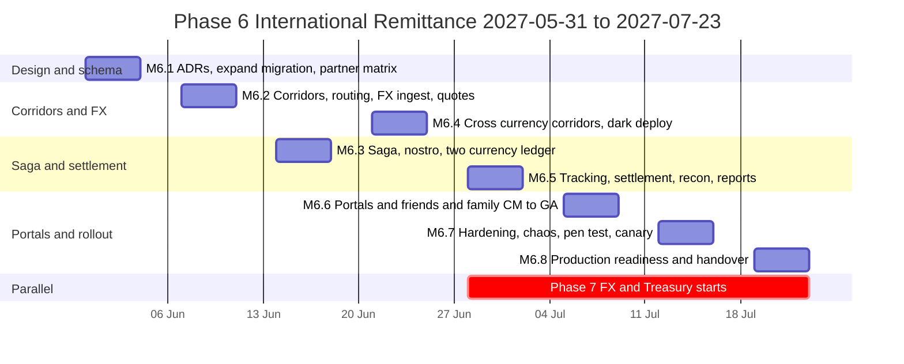
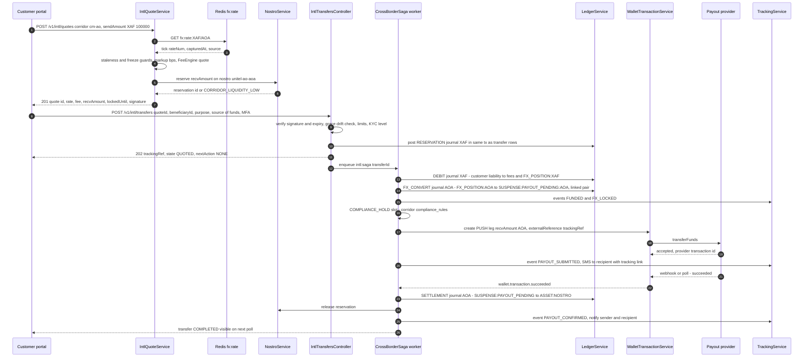
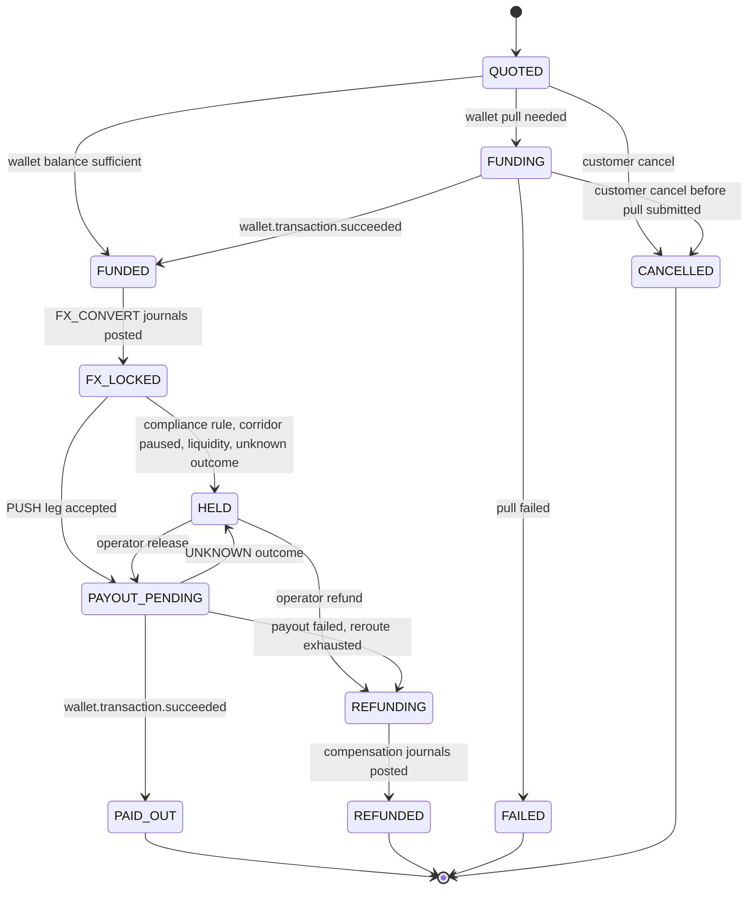
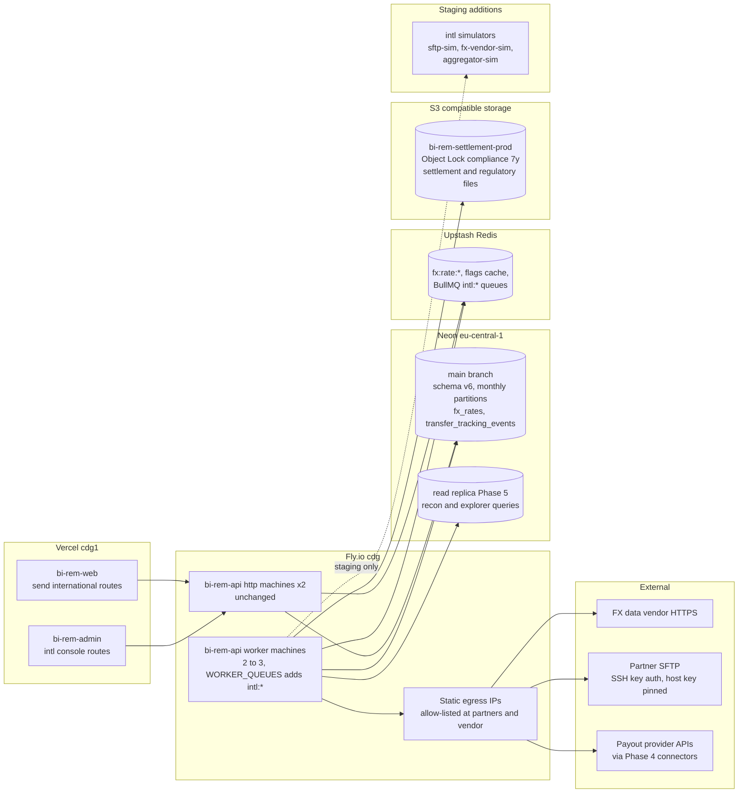

# Phase 6 — International Remittance

| Field                     | Value                                                                                                                                                                                                                                                                                                                                                                                                                                                                                                                                                    |
| ------------------------- | -------------------------------------------------------------------------------------------------------------------------------------------------------------------------------------------------------------------------------------------------------------------------------------------------------------------------------------------------------------------------------------------------------------------------------------------------------------------------------------------------------------------------------------------------------- |
| **Phase**                 | 6 of 13 — `international`                                                                                                                                                                                                                                                                                                                                                                                                                                                                                                                                |
| **Dates**                 | 2027-05-31 → 2027-07-23                                                                                                                                                                                                                                                                                                                                                                                                                                                                                                                                  |
| **Duration**              | 8 weeks (W1 = 2027-05-31, W8 = 2027-07-19 … 2027-07-23)                                                                                                                                                                                                                                                                                                                                                                                                                                                                                                  |
| **Team**                  | `core` — 4 backend W1–W4 then 2 backend W5–W8 (two move to Phase 7 on 2027-06-28), 2 frontend, 1 QA W1–W2 + 2 QA W3–W4 + 1 QA W5–W8, solution architect, DevOps/SRE, program manager, compliance analyst, product designer (50 % from W5), 0.5 security engineer, 1 mobile engineer for API review (W6–W8); treasury ops lead and head of compliance as business owners                                                                                                                                                                              |
| **Depends on**            | Phase 5 — Domestic Transfers (ended 2027-05-28): `Transfer` aggregate, `TransferSaga` step table with the `FX_CONVERT` / `COMPLIANCE_HOLD` slots, double-entry ledger (`LedgerService.post()` single-currency invariant with documented FX extension point), `FeeEngine` scopes, `LimitService`, receipts, notifications, `reconciliation_runs` / `reconciliation_breaks`. Transitively Phase 4 (`WalletTransaction` PUSH/PULL legs, `ProviderAccount` float wallets, connector SDK + simulator), Phase 3 (`Provider`/`Connection`, credential vault, static egress IPs, `worker` process group), Phase 2 (`CustomerProfile`, `KycLevelPolicy`, `Beneficiary`, `@RequiresRecentMfa`), Phase 1 (flags, settings, audit, outbox, BullMQ) |
| **Unlocks**               | Phase 7 — FX & Treasury (2027-06-28, overlaps our W5–W8) replaces the Phase 6 `FxRateProvider` table implementation with its engine from M7.3 and takes over nostro monitoring/rebalancing; Phase 8 — AML/Fraud (2027-07-26) consumes `intl.transfer.*` events, `transfer_cross_border_details` (purpose, source of funds, snapshots), the `HELD` state and the `regulatory_reports` store; Phase 10 — Reporting (2027-09-20) reads `corridors`, `corridor_routes`, `transfer_tracking_events`, `settlement_batches`; Phase 11 — Mobile (2027-08-09) consumes `/v1/intl/*` and the tracking API; Phase 12 — Go-Live drives corridor stages through `CorridorService`; Phase 13 — Expansion adds countries as corridor configuration and extends `CrossBorderSaga` with `INTER_REGION_HANDOFF` |
| **Runs in parallel with** | Phase 7 — FX & Treasury (platform team, from 2027-06-28)                                                                                                                                                                                                                                                                                                                                                                                                                                                                                                 |

---

## 1. Overview

### 1.1 Objective

Phase 6 turns BI-Rem from a domestic wallet into a **cross-border remittance platform**. A customer in one supported country sends money in their own currency; the recipient in another supported country receives it in theirs — into a mobile-money wallet on *any* network or into a bank account — with the exchange rate applied automatically, shown before confirmation and **locked for a validity window**. The phase delivers the corridor configuration model (which country pairs, which payout rails and partners, which limits, which regulator and licence basis), a first-generation FX rate table and quote-locking service behind a stable `FxRateProvider` interface that Phase 7 later implements with its engine, a cross-border saga on top of the Phase 5 transfer saga, pre-funded nostro accounts per payout currency and partner, daily settlement files, three-way reconciliation, the regulatory data capture that CEMAC (BEAC/COBAC), BNA, Banco de Moçambique, BCV, BCEAO and BCSTP expect, and the customer-facing transfer tracking that both portals and the Phase 11 mobile app consume.

Launch footprint: the **CEMAC** zone — Cameroon `CM`, Gabon `GA`, Chad `TD`, Congo-Brazzaville `CG`, Central African Republic `CF`, Equatorial Guinea `GQ` — all `XAF`; and the Portuguese-speaking markets plus Guinea-Bissau — Angola `AO` (`AOA`), Mozambique `MZ` (`MZN`), Cape Verde `CV` (`CVE`), Guinea-Bissau `GW` (`XOF`), São Tomé and Príncipe `ST` (`STN`). All eleven countries and six currencies already exist in `packages/shared/src/constants/countries.ts` (`CEMAC_COUNTRY_CODES`, `PALOP_COUNTRY_CODES`) and `currencies.ts` (XAF/XOF exponent 0; AOA/MZN/CVE/STN exponent 2), so no shared-constant change is needed to describe the footprint.

The two success criteria of the brief drive every milestone: **(1) a user can send money between supported countries** and **(2) the exchange rate is applied automatically** — the customer sees send amount, fee, rate and receive amount before confirming, the rate is honoured for the lock window, and the ledger, the payout leg, the settlement file and the regulatory report all carry the same locked rate.

### 1.2 In scope

| Area                              | Included                                                                                                                                                                                                                                                                                                                                                                                                                                                                                                                                                                                                                                                                                                                      |
| --------------------------------- | ----------------------------------------------------------------------------------------------------------------------------------------------------------------------------------------------------------------------------------------------------------------------------------------------------------------------------------------------------------------------------------------------------------------------------------------------------------------------------------------------------------------------------------------------------------------------------------------------------------------------------------------------------------------------------------------------------------------------------- |
| **Corridor configuration**        | `Corridor` = ordered pair (send country, receive country) with send/receive currency, key `<send>-<recv>` (e.g. `cm-ga`), status machine `DRAFT → SANDBOX → FRIENDS_FAMILY → LIVE → PAUSED → RETIRED`, per-corridor limits (single, daily, monthly in send currency, intersected with the sender's Phase 2 `KycLevelPolicy`), fee schedule reference (Phase 5 `FeeEngine` scope `corridorKey`), FX markup in bps, quote lock seconds and grace seconds, cut-off time and value-date rules, required regulatory fields, manual-review rules (`compliance_rules` JSON), regulator code, licence basis and partner model. `CorridorRoute` = ordered payout options per corridor (Phase 3 `Provider`, rail, nostro account, priority, caps, health gate) with automatic fallback.                                                                                                                                                                                                                     |
| **Cross-Currency Transfers**      | Send `XAF`, receive `AOA`, `MZN`, `CVE`, `XOF` or `STN` (and the reverse where the partner model allows); funding by Phase 5 mechanisms (BI-Rem wallet balance, or wallet pull via Phase 4 `PULL` leg); FX booked at the locked quote through two linked single-currency journals and per-currency `FX_POSITION` clearing accounts; receive amount guaranteed to the customer; refund of principal **and** fee on failure (Q6.7 default).                                                                                                                                                                                                                                                                                                 |
| **Cross-Network Transfers**       | Sender on MTN MoMo Cameroon → recipient on Airtel Money Gabon or Moov Money Chad; sender wallet → recipient bank account in Cape Verde or São Tomé via an aggregator/bank partner; the routing engine picks the payout `Provider` from `corridor_routes`, honours Phase 4 per-provider kill switches and circuit state, and falls back to the next route. Intra-CEMAC `XAF → XAF` corridors are cross-border and cross-network with **no FX**, still subject to corridor limits, purpose capture and BEAC statistics.                                                                                                                                                                                                                                                                      |
| **FX Conversion**                 | `FxRateProvider` interface (`getRate(pair, options)` → mid, bid/ask when available, source, `capturedAt`, `maxAgeSeconds`) with three Phase 6 implementations: `PeggedRateProvider` (EUR parities held in `Setting`: `EUR/XAF = 655.957`, `EUR/XOF = 655.957`, `EUR/CVE = 110.265`, `EUR/STN = 24.50`), `MarketRateProvider` (one commercial FX data vendor for `AOA`, `MZN`, `USD`, `EUR`; 60 s polling into `fx_rates` + Redis), `ManualRateProvider` (treasury-entered rate under four-eyes, used when the vendor is stale or for partner-quoted rates). Customer rate = mid × (1 − markup bps); quote locked for the corridor's window; staleness and deviation guards; `intl.fx.freeze` kill switch; shadow mode. Phase 7 plugs its engine in behind the same interface. |
| **Transfer Tracking**             | Non-guessable tracking reference `BIR-` + 8 Crockford base32 on every cross-border transfer; append-only `transfer_tracking_events` timeline (`QUOTE_LOCKED → TRANSFER_CREATED → FUNDED → FX_LOCKED → PAYOUT_SUBMITTED → PAYOUT_CONFIRMED`, plus `HELD`, `RELEASED`, `PAYOUT_FAILED`, `REFUND_INITIATED`, `REFUNDED`, `CANCELLED`); sender endpoints and a signed recipient tracking link (no login, masked data, 7-day token) sent by SMS; notifications in `en`, `fr`, `pt` to sender **and** recipient; ETA per corridor SLA; `nextAction` semantics compatible with the Phase 5 transfer API used by Phase 11.                                                                                                                                                                                 |
| **Pre-funding / nostro accounts** | `NostroAccount` per payout currency and partner (`nostro_accounts`): linked Phase 5 ledger asset account `ASSET:NOSTRO:<key>:<ccy>`, zero or more Phase 4 `ProviderAccount` float wallets and/or a partner bank account (encrypted reference); available liquidity = ledger balance − active reservations − in-flight payouts; a quote is refused with `CORRIDOR_LIQUIDITY_LOW` below the minimum reserve; `PrefundingInstruction` records top-ups (bank wire or float transfer) with maker-checker and expected vs received reconciliation; liquidity-low alerts to treasury ops.                                                                                                                                                                                         |
| **Settlement files**              | Daily `SettlementBatch` per nostro account and value date (cut-off per corridor, e.g. 16:00 WAT for CEMAC partners, 15:00 WAT for Luanda): outbound **payout instruction file** (CSV, optional ISO 20022 `pain.001.001.09` rendering for bank partners) and **settlement statement** (what BI-Rem owes / is owed, in both currencies at locked rates); delivery over SFTP from the Phase 3 static egress IPs; inbound partner statements ingested from SFTP, from Phase 4 `getStatement` or by manual upload; file hash, versioning, S3 Object Lock, line-level persistence.                                                                                                                                                                                                      |
| **Transfer Reconciliation**       | Nightly and on-demand three-way reconciliation per nostro and value date: ledger entries ↔ Phase 4 `WalletTransaction` legs ↔ partner statement lines; matching by `externalReference` / provider transaction id, then by amount + value-date tolerance; Phase 5 `ReconBreakKind` extended with `MISSING_AT_PARTNER`, `MISSING_IN_LEDGER`, `AMOUNT_MISMATCH`, `FX_MISMATCH`, `STATUS_MISMATCH`, `DUPLICATE`, `FEE_MISMATCH`; break workflow reuses Phase 5 `/v1/recon/*` with evidence and four-eyes above threshold; match-rate SLO ≥ 99.5 %.                                                                                                                                                                                                                        |
| **Regulatory fields & reporting** | Mandatory `purposeCode`, `sourceOfFundsCode` and `relationshipCode` from a versioned `regulatory_codes` catalogue (mapped to ISO 20022 `ExternalPurpose1Code` where one exists and to each regulator's nomenclature); immutable sender identity snapshot (ID type, last 4, nationality, KYC level, residence country) and recipient snapshot at transfer time; `regulatory_reports` store with table-driven generators: BEAC FX-transfer declaration file and monthly transfer statistics (Règlement n°02/18/CEMAC/UMAC/CM and its application instructions), BNA inbound remittance return, Banco de Moçambique inbound return, BCV / BCEAO / BCSTP inbound returns — all delivered through the licensed partner where BI-Rem is an agent.                                        |
| **Licensing / partner model**     | Per-country model (§8.4) encoded on the `Corridor` (`licenceBasis`, `regulatorCode`, `partnerProviderId`) and `CorridorRoute` (`contractRef`): BI-Rem operates as **principal** where licensed, otherwise as **agent of a licensed partner** (COBAC payment institution / EMI, sponsor bank, BNA- or BM-licensed EMI, aggregator → licensed bank). Intra-CEMAC flows route through the sponsor EMI's GIMAC membership (BEAC requires intra-CEMAC e-money interoperability through GIMAC).                                                                                                                                                                                                                                                                      |
| **Portals**                       | Admin: corridor console (matrix, detail, routes, limits, status workflow), FX console (rates, sources, markups, manual rate, freeze), nostro & pre-funding, settlement batches/files, reconciliation (Phase 5 screens extended), regulatory reports, cross-border transfer explorer with hold/release/refund. Customer: send-international flow (country → beneficiary → amount with live quote and countdown → purpose / source of funds / relationship → review → MFA → confirm), tracking timeline, recipient tracking page (`/track/<token>`), receipts.                                                                                                                                                                                                                |

### 1.3 Out of scope (explicitly deferred)

- **Treasury management** — multi-source rate composition, margin schedules by segment, hedging, P&L, automated rebalancing, liquidity forecasting: **Phase 7**. Phase 6 hands over `FxRateProvider`, `fx_rate_sources`, `fx_rates`, `intl_quotes`, `nostro_accounts`, `nostro_reservations`, `prefunding_instructions`.
- **AML screening and transaction monitoring** on cross-border flows (sanctions screening, velocity across corridors, travel-rule payloads, STR filing to ANIF / UIF / GIFiM): **Phase 8**. Phase 6 captures every field Phase 8 needs and emits `intl.transfer.*`; its only compliance gate is `HELD` for operator review when a corridor `compliance_rules` rule fires.
- **Outbound transfers from Angola and Mozambique** (AOA/MZN are not freely convertible; outbound needs BNA / BM approval flows) — modelled as corridors in `DRAFT`, never activated in this phase. CV, GW, ST send-side also start receive-only.
- Cash pick-up payout, card funding, bulk/business remittances, partner-initiated payouts — Phases 9 and 13.
- Direct GIMAC participation — intra-CEMAC corridors run as pre-funded payouts through partner EMIs/aggregator; direct participation is a Phase 13 option (Q6.6).
- Native mobile screens — Phase 11 consumes the APIs; Phase 6 provides OpenAPI examples and a mobile-responsive recipient tracking page.

### 1.4 Independent deployability strategy

"Deployable alone" for Phase 6 means: **the whole phase merges to `main` and deploys to production behind flags with every corridor `DRAFT` or `SANDBOX`; FX rates are ingested and quotes computed in shadow mode (logged, never shown); nostro ledger accounts exist at zero; settlement and reconciliation jobs run against staging SFTP only; no customer can see "Send internationally"; and every piece switches off within 30 seconds without a redeploy. Domestic transfers (Phase 5) must behave identically with Phase 6 deployed and dark.**

| Mechanism                                                                               | How it is used in Phase 6                                                                                                                                                                                                                                                                                                                                                                                                                                                                                                                                                                                                              |
| --------------------------------------------------------------------------------------- | -------------------------------------------------------------------------------------------------------------------------------------------------------------------------------------------------------------------------------------------------------------------------------------------------------------------------------------------------------------------------------------------------------------------------------------------------------------------------------------------------------------------------------------------------------------------------------------------------------------------------------------- |
| **Feature flags** (Phase 1 `FeatureFlag`, Redis-cached 30 s, `rules` + `rolloutPercentage`) | `intl.enabled` (master: `POST /v1/intl/quotes` and `POST /v1/intl/transfers` return 503 `INTL_DISABLED` when off; in-flight transfers continue); `intl.corridor.<send>-<recv>.enabled` (visible, quoting allowed) and `intl.corridor.<send>-<recv>.live` (real money; `rules` carry the friends-and-family user list, `rolloutPercentage` the canary bucket via `rolloutBucket(flagKey, userId)`); `intl.fx.quote-engine` (`shadow` vs `served`); `intl.fx.freeze`; `intl.fx.source.<key>.enabled`; `intl.routing.fallback`; `intl.tracking.public-link`; `intl.settlement.auto-generate`, `intl.settlement.auto-deliver`; `intl.recon.auto-match`; `intl.reports.auto-generate`; `admin.intl.console`; `portal.send-international`. |
| **Expand → migrate → contract**                                                         | One expand migration in W1 (`20270531090000_phase6_expand`): 17 new tables, 14 new enums, enum value additions (`TransferType.CROSS_BORDER`, `TransferStatus.HELD`, seven `ReconBreakKind` values, `ConnectorKind.AGGREGATOR`, `AuthScheme.SSH_KEY`), nullable columns on `transfers` (`corridor_id`, `intl_quote_id`, `tracking_ref`), `beneficiaries` (`bank_bic`), `ledger_journals` (`fx_pair_journal_id`), `reconciliation_runs` (`nostro_account_id`), `reconciliation_breaks` (`nostro_account_id`, `settlement_file_line_id`). Backfill: one domestic `Corridor` row per Phase 5 live country, `transfers.corridor_id` filled in batches. Contract (`corridor_id SET NOT NULL`) is deferred to Phase 9's W1 slot (2027-08-23) as agreed in the Phase 9 plan. |
| **Dark launch**                                                                         | From W4 (M6.4) production ingests FX rates every 60 s and computes shadow quotes for synthetic requests; from W5 production generates settlement files into a staging bucket (`intl.settlement.auto-deliver=false`) and reconciles partner UAT statements; from W6 the `CM→GA` corridor is `FRIENDS_FAMILY` with a hard cap (`XAF 50,000` per transfer, 20 named users).                                                                                                                                                                                                                                                                 |
| **Kill switches**                                                                       | `intl.enabled=false` → quotes and confirmations 503, workers finish in-flight payouts; `intl.fx.freeze=true` → new quotes refused with `FX_FROZEN`, existing locks honoured; corridor `PAUSED` → quoting refused and transfers at `FUNDED`/`FX_LOCKED` park as `HELD` (`CORRIDOR_PAUSED`) until resume or refund; Phase 4 `wallet.connector.<key>.live=false` removes a payout route (fallback takes over); `intl.settlement.auto-deliver=false` stops SFTP pushes within one scheduler tick.                                                                                                                                                 |
| **Worker isolation**                                                                    | New BullMQ queues `intl:saga`, `intl:fx-ingest`, `intl:payout-dispatch`, `intl:settlement`, `intl:recon`, `intl:reports`, `intl:notify` (each with `:dlq`) run only in the Phase 3 `worker` process group (`WORKER_QUEUES=intl:*,transfer:*,receipts,recon,wallet:*,notifications,outbox-relay`); the `http` group reads rates from Redis for quoting (≤ 5 ms) and never calls a payout provider or SFTP synchronously.                                                                                                                                                                                                                 |
| **Backward-compatible APIs**                                                            | New paths `/v1/intl/*`, `/v1/corridors*`, `/v1/fx/*`, `/v1/nostro/*`, `/v1/settlement/*`, `/v1/regulatory-reports*`, `/v1/track/:token`; Phase 5 `/v1/transfers/*` responses gain optional fields only (`corridorKey`, `trackingRef`, `crossBorder`). Zod schemas in `@bi-rem/shared` are additive (`.optional()`); portals tolerate absence.                                                                                                                                                                                                                                                                                             |
| **Data isolation**                                                                      | Cross-border detail lives in `transfer_cross_border_details` (1:1 with `transfers`), not in NOT NULL columns on `transfers`, so rolling back the API image leaves Phase 5 fully functional on the expanded schema.                                                                                                                                                                                                                                                                                                                                                                                                                      |
| **Rollback**                                                                            | Flags first (seconds); corridor `PAUSED` (seconds); Fly image rollback by digest (`infra/scripts/rollback-api.sh`) and Vercel instant rollback (minutes); migrations are forward-fix only once any cross-border transfer exists (ledger rows are never deleted).                                                                                                                                                                                                                                                                                                                                                                  |

---

## 2. Milestones

Phase start is Monday **2027-05-31**; week *n* runs Monday to Friday; milestone dates are the Friday of the week. Phase 7 (platform team) starts Monday 2027-06-28 (our W5) and its M7.3 (2027-07-16, our W7) is the earliest point its engine can serve a Phase 6 corridor on staging.

| ID       | Week | Target date | Deliverable                                                                                                                                                                                                                                                                                                                                                                                       | Acceptance criteria                                                                                                                                                                                                                                                                                                                                                                                                                                    | Owner role                        |
| -------- | ---- | ----------- | ------------------------------------------------------------------------------------------------------------------------------------------------------------------------------------------------------------------------------------------------------------------------------------------------------------------------------------------------------------------------------------------------- | ------------------------------------------------------------------------------------------------------------------------------------------------------------------------------------------------------------------------------------------------------------------------------------------------------------------------------------------------------------------------------------------------------------------------------------------------------ | --------------------------------- |
| **M6.1** | W1   | 2027-06-04  | Design freeze: corridor and routing model, `FxRateProvider` interface, quote-lock semantics, two-journal FX posting and `FX_POSITION` accounts, `CrossBorderSaga` step table, nostro model; ADR-0018 (corridors and routing), ADR-0019 (FX quote locking and shadow mode), ADR-0020 (settlement files and reconciliation); expand migration merged and applied to staging; licensing/partner matrix v1 (§8.4) reviewed by compliance; FX vendor and aggregator short-list | ADRs approved by architect + Phase 5 lead + Phase 7 lead; migration passes `up → down → up` on a Phase 5 production snapshot; Phase 5 regression suite green on the expanded schema; permissions, flags, `API_ROUTES.intl` registered in `@bi-rem/shared`; open questions Q6.1, Q6.5, Q6.9 closed                                                                                                                                                    | Solution Architect                |
| **M6.2** | W2   | 2027-06-11  | Corridor configuration service and admin API with status workflow and four-eyes; routing engine with health-gated fallback; FX ingestion (`PeggedRateProvider`, `MarketRateProvider`, `ManualRateProvider`) into `fx_rates` + Redis; `IntlQuoteService` with lock window, signature and shadow mode; domestic corridor backfill job                                                                        | `POST /v1/intl/quotes` p95 < 120 ms on staging with warmed Redis; quote reproducible from `fx_rates` row + corridor markup + fee schedule (property test); `fx_rates` rows every 60 s for every enabled pair with age metric; backfill fills 100 % of Phase 5 `transfers.corridor_id` on staging                                                                                                                                              | Backend lead                      |
| **M6.3** | W3   | 2027-06-18  | `CrossBorderSaga` registered in Phase 5 `SagaStepRegistry` for `TransferType.CROSS_BORDER` (reserve → debit → `FX_CONVERT` → `COMPLIANCE_HOLD` slot → payout leg → finalise, with compensations); nostro accounts, reservations and two-currency ledger postings; pre-funding instructions; intra-CEMAC `CM→GA` and `CM→TD` end-to-end in staging via Phase 4 simulator                               | Property test: for every completed transfer, the XAF journal and the AOA/XAF journal each balance and `FX_POSITION` entries equal `sendAmount` and `recvAmount` at the locked rate; chaos test: worker killed between every step × 3, every transfer ends `COMPLETED` or `REFUNDED`, trial balance zero per currency; `HELD` ↔ release/refund paths covered                                                                                      | Backend lead                      |
| **M6.4** | W4   | 2027-06-25  | Cross-currency corridors `CM→AO`, `CM→MZ`, `CM→GW`, `CM→CV`, `CM→ST` in staging (Phase 4 `unitel-money`, `emola`, `orange-money` GW adapters; new `@bi-rem/connector-aggregator-payout` for CV/ST bank payout); regulatory fields and snapshots enforced; purpose/source/relationship catalogue in `en/fr/pt`; **dark deploy to production** with FX ingestion and shadow quotes                       | Aggregator connector 100 % simulator conformance, ≥ 90 % vendor-sandbox conformance; `POST /v1/intl/transfers` rejects missing `purposeCode` / `sourceOfFundsCode` / declaration with 422; production shadow quotes logged for 48 h with age p99 < 90 s and no `FX_RATE_STALE`; Phase 5 production metrics unchanged after the deploy                                                                                                      | Backend lead / Compliance Analyst |
| **M6.5** | W5   | 2027-07-02  | Transfer tracking (timeline, tracking ref, recipient signed link, sender/recipient notifications `en/fr/pt`, push payload slot); settlement batch generation, SFTP delivery, inbound statement ingestion with per-partner parsers; reconciliation engine extension and break workflow; regulatory report generators v1 (BEAC declaration + statistics, BNA, BM); joint Phase 7 boundary review | Golden-file tests for every outbound layout and every partner inbound layout; recon match rate ≥ 99.5 % on seeded staging data with 2 % injected anomalies all classified correctly; recipient link token tamper tests pass; Phase 7 lead signs the `FxRateProvider` contract test suite                                                                                                                                                | Backend lead / QA lead            |
| **M6.6** | W6   | 2027-07-09  | Admin portal: corridor console, FX console, nostro & pre-funding, settlement, recon extensions, regulatory reports, cross-border explorer; customer portal: send-international flow, tracking, recipient page, receipts; **friends-and-family `CM→GA` live in production** (20 named users, `XAF 50,000` cap)                                                                                          | Playwright journeys green in `en/fr/pt` for customer and admin; axe-core no serious issues; first 20 real `CM→GA` transfers `PAID_OUT` with matching ledger, leg and partner statement lines; receipts show locked rate and markup disclosure                                                                                                                                                                                                 | Frontend lead / Program Manager   |
| **M6.7** | W7   | 2027-07-16  | Hardening: k6 (quotes 200 rps, 30 cross-border transfers/s sustained for 1 h), chaos (vendor outage, SFTP outage, duplicate statement lines, worker kill mid-FX-book, corridor pause mid-flight), external pen-test and fixes, report generators validated against partner layouts, runbooks; Phase 7 engine on staging behind `fx.corridor.<pair>.enabled`; canary `CM→GA`, `CM→TD` at 5 %   | Two consecutive k6 nights within budgets (quote p95 < 150 ms, confirm p95 < 400 ms, error rate < 0.1 %); zero High/Critical pen-test findings open; `FxRateProvider` contract suite green against the Phase 7 implementation; canary guardrails (`flag-guardrails.yml`) exercised with a forced rollback drill                                                                                                                             | QA lead / DevOps                  |
| **M6.8** | W8   | 2027-07-23  | Production readiness: wave A corridors (`CM→GA`, `CM→TD`, `CM→CG`, `GA→CM`) at 25 %; wave B (`CM→AO`, `CM→MZ`, `CM→GW`) in `FRIENDS_FAMILY` or `SANDBOX` per partner readiness; `CM→CV`, `CM→ST` `SANDBOX`; success criteria evidenced; §11 sign-offs; handover to Phases 7, 8, 10, 11                                                                                                             | §12 evidence collected from production; transfer success ≥ 98 % and payout p95 < 15 min over the canary week for wave A; recon match ≥ 99.5 % for 5 consecutive business days; first BEAC statistics file produced for the partner's July submission; sign-offs collected; Phase 8 team consuming `intl.transfer.created` fixtures on day one                                                                                                   | Program Manager                   |



Staffing note: two backend engineers and one frontend engineer move to Phase 7 on 2027-06-28, which is why the saga, ledger and settlement work (M6.3–M6.5) is front-loaded and W5–W8 is portals, hardening and rollout. One QA engineer joins Phase 7 at the same time; the remaining QA engineer owns the hardening week with the backend pair.

---

## 3. Deliverables

Each deliverable lists what is built and a precise definition of done (DoD). Every mutating endpoint writes an `AuditLog` row through the Phase 1 interceptor; every state change emits an outbox event; every amount is `BIGINT` minor units with an ISO-4217 `currency`.

### 3.1 Corridor configuration

- **What**: `apps/api/src/modules/corridors/*` — `CorridorService`, `CorridorRouteService`, `RoutingEngine`, admin controller, Zod schemas `@bi-rem/shared/schemas/corridors.ts`, seeds for the eleven countries (all `DRAFT`) and domestic corridors for the Phase 5 live countries.
- **DoD**: `corridors` row per ordered pair with `key`, currencies, `status`, limits, `feeScheduleId`, `fxMarkupBps`, `quoteLockSeconds` (default 180; 900 for pegged-pair corridors), `quoteGraceSeconds` (default 30), `cutoffLocalTime` + `timezone`, `valueDateOffsetDays`, `requiredFields`, `compliance_rules`, `regulatorCode`, `licenceBasis`, `partnerProviderId`, `slaMinutes`; status transitions validated by a state machine (`DRAFT → SANDBOX → FRIENDS_FAMILY → LIVE`, any active state → `PAUSED` → previous state, `LIVE|PAUSED → RETIRED`); moving to `FRIENDS_FAMILY` or `LIVE` requires `corridors:approve` by a second user and a checklist (routes healthy, nostro funded above `minReserveMinor`, fee schedule `ACTIVE`, licence evidence document attached, regulator fields configured); `GET /v1/corridors/public?from=CM` returns only corridors visible to the caller (status + flags) with limits, rails, indicative rate and ETA, cached 60 s; `RoutingEngine.select(corridor, beneficiary, amount)` returns the first route whose provider is `ACTIVE`, circuit closed, `wallet.connector.<key>.live=true`, within route caps and nostro liquidity, else the next, else `NO_ROUTE_AVAILABLE`; routes testable with `POST /v1/corridors/:id/routes/:rid/test` (name enquiry against a test MSISDN); 100 % unit coverage of the state machine and routing selection.

### 3.2 Cross-Currency Transfers

- **What**: `CrossBorderSaga` step definitions registered in the Phase 5 `SagaStepRegistry` for `TransferType.CROSS_BORDER`; `FxConversionStep` (`FX_CONVERT`) posting two linked journals; refund and compensation paths; limit reservation in send currency plus a USD-equivalent `CROSS_BORDER` counter.
- **DoD**: `POST /v1/intl/transfers` with a valid, unexpired `IntlQuote` creates a `Transfer(type=CROSS_BORDER)` + `transfer_cross_border_details` + reservation journal in one transaction and returns 202 with `trackingRef`, `state=QUOTED`, `nextAction`; the saga debits the sender (XAF journal: Dr `LIABILITY:CUSTOMER:<wallet>`, Cr `REVENUE:FEES:CROSS_BORDER:XAF`, Cr `LIABILITY:TAX:*` if applicable, Cr `FX_POSITION:XAF`), books the receive side (AOA journal: Dr `FX_POSITION:AOA`, Cr `SUSPENSE:PAYOUT_PENDING:AOA`) linked by `ledger_journals.fx_pair_journal_id`, then on `PAYOUT_CONFIRMED` moves `SUSPENSE:PAYOUT_PENDING:AOA → ASSET:NOSTRO:<key>:AOA`; `recvAmount` on the payout leg equals the quote's `recvAmount` exactly; failure after FX booking reverses both journals with `COMPENSATION` journals and refunds principal + fee to the sender; expired quote at confirmation → 409 `QUOTE_EXPIRED` with `nextAction=REQUOTE` unless within `quoteGraceSeconds` and the current rate moved less than `quoteGraceMaxDriftBps` (default 25) against BI-Rem; Phase 5 `LedgerService` single-currency invariant untouched (each journal is one currency).

### 3.3 Cross-Network Transfers

- **What**: Routing across networks and rails (`MOBILE_MONEY`, `BANK_ACCOUNT`) using Phase 4 `WalletTransaction` `PUSH` legs with `parentType='Transfer'`; `@bi-rem/connector-aggregator-payout` built with the Phase 4 connector SDK; beneficiary rail validation.
- **DoD**: A transfer funded on MTN MoMo CM pays out on Airtel Money GA, Moov Money TD, MTN MoMo CG, Orange Money GW, Unitel Money AO or e-Mola MZ with identical saga code; bank payouts to CV and ST go through the aggregator connector (`capabilities()` truthful; `transferFunds`, `getTransactionStatus`, `validateAccount`, `getBalance`, webhook verification); route fallback on `ConnectorUnavailableError` or open circuit emits `intl.transfer.rerouted` and never double-submits (leg `externalReference` = `trackingRef` + attempt); `UNKNOWN` leg outcomes hold the transfer (`HELD`, `PARTNER_UNKNOWN_OUTCOME`) until Phase 4 resolution emits `wallet.transaction.succeeded|failed`; beneficiaries for bank rails require `bankCode` or `bankBic` + account number and pass the aggregator `validateAccount` before the quote is confirmed.

### 3.4 FX Conversion

- **What**: `apps/api/src/modules/fx/*` (Phase 6 scope) — `FxRateProvider` interface, `PeggedRateProvider`, `MarketRateProvider`, `ManualRateProvider`, `FxRateIngestWorker` (queue `intl:fx-ingest`), `fx_rate_sources` and `fx_rates`, `IntlQuoteService`, freeze and staleness guards, shadow mode.
- **DoD**: `fx_rates` receives one row per enabled pair per poll (`rateNum` scaled by `RATE_SCALE = 10^9`, `source`, `capturedAt`, `validUntil`), latest cached in Redis `fx:rate:<pair>` with TTL = `maxAgeSeconds`; cross rates derived through `EUR` for pegged currencies and `USD`/`EUR` for AOA/MZN with the derivation path stored on the quote; quote refused with `FX_RATE_STALE` when the newest tick is older than the source's `maxAgeSeconds` (market 900 s, pegged ∞, manual per entry), and with `FX_FROZEN` when `intl.fx.freeze=true`; deviation guard rejects a tick that moves more than `maxDeviationBps` (default 300) from the previous one and opens an alert instead of publishing; manual rates require two different `fx:write` users and expire; shadow mode (`intl.fx.quote-engine=shadow`) computes and logs quotes without returning them; `GET /v1/fx/rates?pair=XAF/AOA` returns the latest tick, derivation and age; the `FxRateProvider` contract test suite (`packages/shared/test/fx-rate-provider.contract.ts`) is published for Phase 7.

### 3.5 Transfer Tracking

- **What**: `transfer_tracking_events` (append-only, partitioned monthly), `TrackingService`, tracking reference generator, signed recipient link, `intl:notify` queue, templates `intl.*` in `en/fr/pt`.
- **DoD**: Every state change of a cross-border transfer writes exactly one tracking event in the same transaction (trigger-enforced consistency test); `GET /v1/intl/transfers/:id/timeline` returns customer-safe copy keys, timestamps and ETA (`corridor.slaMinutes` from `FUNDED`); `GET /v1/track/:token` (public, 30 req/min/IP) resolves an HMAC-signed token (`INTL_TRACKING_TOKEN_KEY`, 7-day expiry, bound to transfer id) to masked sender name, receive amount, state and ETA, never the sender MSISDN or full names; sender notified at `TRANSFER_CREATED`, `PAYOUT_CONFIRMED`, `HELD`, `REFUNDED`; recipient notified by SMS at `PAYOUT_SUBMITTED` (with tracking link) and `PAYOUT_CONFIRMED`; dedupe via Phase 5 `notification_dedup`; Phase 11 push payload slot present in templates.

### 3.6 Pre-funding / nostro accounts per corridor

- **What**: `nostro_accounts`, `nostro_provider_accounts`, `nostro_reservations`, `prefunding_instructions`, `NostroService`, `LiquidityGuard`, liquidity snapshot and alerting.
- **DoD**: Each `CorridorRoute` references exactly one `NostroAccount` in the receive currency; `NostroService.available(nostroId)` = ledger balance of `ASSET:NOSTRO:<key>:<ccy>` − sum of active reservations − in-flight payouts, computed under `SELECT … FOR UPDATE` on the nostro row at reservation time; a quote above available liquidity (minus `minReserveMinor`) is refused with `CORRIDOR_LIQUIDITY_LOW`; reservations expire with the quote; `intl.nostro.liquidity_low` emitted when available < `alertThresholdMinor` or projected 24 h outflow (trailing 7-day average) exceeds available; pre-funding lifecycle `DRAFT → APPROVED → SENT → RECEIVED → RECONCILED` with maker-checker (`nostro:approve`), expected vs received amount, bank reference, and the receive journal (Dr `ASSET:NOSTRO:<key>:<ccy>`, Cr `FX_POSITION:<ccy>` for converted funding or Cr `ASSET:BANK:<ccy>` for same-currency top-ups); `GET /v1/nostro/:id/liquidity` serves the treasury dashboard tile.

### 3.7 Settlement files

- **What**: `settlement_batches`, `settlement_files`, `settlement_file_lines`, `SettlementBatchScheduler` (queue `intl:settlement`), renderers (`CsvPayoutInstructionRenderer`, `Pain001Renderer`, `SettlementStatementRenderer`), `SftpClient` (ssh2 with host-key pinning), inbound parsers per partner (`camt.053`, CSV layouts), S3 storage with Object Lock.
- **DoD**: At the corridor cut-off a batch per (nostro, value date) closes, generates the payout instruction file and settlement statement (both currencies, locked rate per line, totals), stores them with SHA-256 and version, and delivers over SFTP when `intl.settlement.auto-deliver=true`; redelivery produces a new file version, never a mutated file; inbound statements are fetched hourly, parsed to lines (amount, currency, value date, partner reference, our reference), de-duplicated by `(fileId, lineNo)` and by partner reference; parse failures quarantine the file and alert; every layout has golden files in `apps/api/test/fixtures/settlement/<partner>/`; manual upload path `POST /v1/settlement/files/ingest` for SFTP outages.

### 3.8 Transfer Reconciliation

- **What**: Extension of the Phase 5 `recon` module: `NostroReconciliationSource`, matcher, break classifier, `intl:recon` queue, break resolution with journals.
- **DoD**: Nightly run per nostro and value date (`recon.yml` schedule extended) matches ledger entries on `ASSET:NOSTRO:*`/`SUSPENSE:PAYOUT_PENDING:*`, Phase 4 legs and statement lines; exact match on reference, then amount + date (±1 day) tolerance; unmatched items become `reconciliation_breaks` with the new kinds and `nostro_account_id`/`settlement_file_line_id`; `PATCH /v1/recon/breaks/:id` resolution actions (`EXPLAIN`, `POST_CORRECTION`, `REQUEST_PARTNER_REVERSAL`, `MARK_DUPLICATE`) require evidence and a second approver above USD 500 equivalent; match rate, open breaks by age and amount exposed as Prometheus gauges; recon run summary e-mailed to finance ops.

### 3.9 Regulatory reporting fields and central-bank reporting

- **What**: `regulatory_codes` catalogue, `transfer_cross_border_details` snapshots, `regulatory_reports` + `regulatory_report_items`, generators per regulator, `regulatory-reports.yml` workflow.
- **DoD**: `POST /v1/intl/transfers` requires `purposeCode`, `sourceOfFundsCode`, `relationshipCode` and `declarationAccepted=true`; codes validated against the catalogue for the corridor (`regulatory_codes.allowedCorridors`); sender snapshot (`idType`, `idNumberLast4`, `nationality`, `residenceCountry`, `kycLevel`, `dateOfBirth` year) and recipient snapshot (name, country, rail, masked account) stored immutably; BEAC generators produce the FX-transfer declaration file (per transfer above the documentary threshold `Setting intl.beac.declaration-threshold-xaf`) and the monthly transfer statistics file (counts and amounts by corridor, purpose, residence), both table-driven with `layoutVersion`; inbound returns for BNA, BM, BCV, BCEAO, BCSTP generated from the same items; reports move `DRAFT → GENERATED → REVIEWED → SUBMITTED → ACCEPTED|REJECTED` with reviewer and submission reference; files stored with Object Lock; a report line always points back to transfer ids (`regulatory_report_items`).

### 3.10 Licensing / partner model per country

- **What**: §8.4 matrix maintained by compliance, encoded on corridors and routes; licence/partner evidence documents stored through the Phase 2 documents pipeline (`KycDocument` kind `LICENCE_EVIDENCE` is not reused — a `Setting`-referenced S3 key on the corridor `licenceEvidenceKey`).
- **DoD**: Every `FRIENDS_FAMILY`/`LIVE` corridor has `licenceBasis`, `regulatorCode`, `partnerProviderId` and `licenceEvidenceKey` set (checklist gate); the admin corridor detail shows the regulator, partner and contract reference; the matrix is exported to `docs/handbooks/licensing-matrix.md` and reviewed by counsel before M6.6.

### 3.11 Portals, observability, runbooks

- **What**: Admin and customer portal changes (§7), Grafana dashboards (`intl-overview`, `intl-fx`, `intl-nostro`, `intl-settlement-recon`), alerts, runbooks under `docs/runbooks/intl-*.md`.
- **DoD**: Dashboards show quotes/min, quote-to-confirm conversion, transfers by corridor and state, payout latency p50/p95, held transfers by reason and age, rate age per source, nostro available vs reserve, settlement deliveries, recon match rate; alerts for rate stale > `maxAgeSeconds`, freeze active > 30 min, liquidity low, SFTP delivery failed, held > SLA, recon match < 99 %; eleven runbooks (§15.4) reviewed in a game day at M6.7.

---

## 4. Architecture

### 4.1 Component diagram (Phase 6 additions)

```mermaid
flowchart TB
  subgraph clients["Clients"]
    WEB["Customer portal apps/web<br/>send international, tracking"]
    ADM["Admin portal apps/admin<br/>corridor, FX, nostro, settlement, reports"]
    RCP["Recipient browser<br/>public tracking page"]
    MOB["Phase 11 mobile app"]
  end

  subgraph api["Platform API apps/api - http process group"]
    CORR["CorridorsModule<br/>CorridorService, RoutingEngine"]
    FX["FxModule Phase 6 scope<br/>FxRateProvider, IntlQuoteService"]
    INTL["IntlTransfersModule<br/>IntlTransfersController, CrossBorderService"]
    TRACK["TrackingModule<br/>timeline, signed links"]
    NOS["NostroModule<br/>NostroService, LiquidityGuard, prefunding"]
    SETT["SettlementModule<br/>batches, renderers, parsers"]
    REG["RegulatoryReportsModule<br/>codes catalogue, generators"]
    RECON["Phase 5 recon module<br/>NostroReconciliationSource"]
  end

  subgraph workers["Worker process group - WORKER_QUEUES intl:*"]
    SAGA["CrossBorderSaga worker<br/>queue intl:saga"]
    INGEST["FxRateIngestWorker<br/>queue intl:fx-ingest"]
    DISPATCH["PayoutDispatcher<br/>queue intl:payout-dispatch"]
    SETTW["SettlementBatchScheduler<br/>queue intl:settlement"]
    RECW["Recon runner<br/>queue intl:recon"]
    REPW["Report generator<br/>queue intl:reports"]
    NOTW["Intl notifier<br/>queue intl:notify"]
  end

  subgraph p5["Phase 5 primitives"]
    LEDGER["LedgerService<br/>single currency journals, fx_pair_journal_id"]
    STEPS["SagaStepRegistry<br/>FX_CONVERT and COMPLIANCE_HOLD slots"]
    FEES["FeeEngine<br/>scope corridorKey"]
    LIMITS["LimitService<br/>send currency and USD counters"]
  end

  subgraph p4["Phase 4 and Phase 3"]
    WTX["WalletTransactionService<br/>PUSH and PULL legs"]
    CONN["Connectors<br/>mtn-momo, airtel-money, moov-money,<br/>orange-money, unitel-money, emola,<br/>aggregator-payout new"]
    VAULT["Credential vault and<br/>static egress IPs"]
  end

  subgraph data["Data"]
    PG[("Neon PostgreSQL<br/>corridors, fx_rates, intl_quotes,<br/>transfer_cross_border_details,<br/>nostro_*, settlement_*, regulatory_*")]
    REDIS[("Redis<br/>fx:rate:*, flags, BullMQ")]
    S3[("S3 bucket Object Lock<br/>settlement and report files")]
  end

  subgraph ext["External"]
    VENDOR["FX data vendor API"]
    SFTP["Partner SFTP servers"]
    PAYOUT["Payout provider APIs"]
  end

  WEB --> INTL
  WEB --> FX
  WEB --> TRACK
  ADM --> CORR
  ADM --> FX
  ADM --> NOS
  ADM --> SETT
  ADM --> REG
  ADM --> RECON
  RCP --> TRACK
  MOB --> INTL

  INTL --> CORR
  INTL --> FX
  INTL --> NOS
  INTL --> FEES
  INTL --> LIMITS
  INTL --> STEPS
  FX --> REDIS
  FX --> PG
  CORR --> PG
  NOS --> LEDGER

  SAGA --> STEPS
  SAGA --> LEDGER
  SAGA --> DISPATCH
  DISPATCH --> WTX
  WTX --> CONN
  CONN --> PAYOUT
  INGEST --> VENDOR
  INGEST --> PG
  INGEST --> REDIS
  SETTW --> S3
  SETTW --> SFTP
  SETTW --> VAULT
  RECW --> RECON
  REPW --> S3
  NOTW --> TRACK
  LEDGER --> PG
```



**Reading the diagram.** The synchronous request path never touches an external system: `POST /v1/intl/quotes` reads the latest rate from Redis, runs the fee engine and the liquidity guard, and writes an `intl_quotes` row with a reservation. `POST /v1/intl/transfers` validates the quote signature and expiry, creates the Phase 5 `Transfer` plus `transfer_cross_border_details` and the reservation journal in one transaction, enqueues the saga and returns 202. Everything that talks to a payout provider, the FX vendor or an SFTP server runs in the worker group.

### 4.2 Sequence — quote, lock, confirm, convert, pay out



Failure branches: provider `FAILED` after FX booking → saga runs the compensation table (reverse AOA journal, reverse XAF debit, refund fee, release reservation, release limits) and emits `REFUNDED`; provider `UNKNOWN` → `HELD` (`PARTNER_UNKNOWN_OUTCOME`) until Phase 4 resolution; corridor `PAUSED` between steps → `HELD` (`CORRIDOR_PAUSED`) with the AOA journal kept and reservation extended; `compliance_rules` match → `HELD` (`MANUAL_REVIEW_RULE`) before the payout leg, operator releases or refunds with evidence.

### 4.3 Cross-border state machine

`transfer_cross_border_details.state` is the customer-facing state; the Phase 5 `transfers.status` keeps its own values (`RESERVED`, `DEBITED`, `AWAITING_LEG`, `COMPLETED`, `COMPENSATING`, `FAILED`, `REFUNDED`, and new `HELD`). The mapping is deterministic and tested.



Rules enforced in code and tests: (1) every transition writes one `transfer_tracking_events` row and, when money moved, exactly one journal in the same transaction; (2) `PAID_OUT`, `REFUNDED`, `FAILED`, `CANCELLED` are terminal; (3) each saga step is idempotent (reads the transfer `FOR UPDATE`, checks the expected state, no-ops if applied) because BullMQ delivers at least once; (4) `HELD` always carries a `holdReason` and an SLA timestamp; (5) only `wallet.transaction.*` events can move money out of `SUSPENSE:PAYOUT_PENDING`.

### 4.4 Ledger model for cross-currency flows

Phase 5 keeps every journal in a single currency. Phase 6 therefore books a cross-currency transfer as **two balanced single-currency journals** linked by `ledger_journals.fx_pair_journal_id`, meeting in per-currency clearing accounts `FX_POSITION:<ccy>` (type `SUSPENSE`). The net balance of `FX_POSITION:XAF` and `FX_POSITION:AOA` at any time is BI-Rem's open position per currency; Phase 7 ADR-0021 formalises revaluation and P&L on these very accounts.

| Step                      | Journal (currency) | Debit                                           | Credit                                                   | Amount                        |
| ------------------------- | ------------------ | ----------------------------------------------- | -------------------------------------------------------- | ----------------------------- |
| Reserve (confirm)         | RESERVATION (XAF)  | `LIABILITY:CUSTOMER:<wallet>`                   | `SUSPENSE:RESERVED:XAF`                                  | `totalDebit`                  |
| Debit                     | DEBIT (XAF)        | `SUSPENSE:RESERVED:XAF`                         | `REVENUE:FEES:CROSS_BORDER:XAF`, `LIABILITY:TAX:*:XAF`, `FX_POSITION:XAF` | fee, tax, principal |
| FX convert                | FX_CONVERT (AOA)   | `FX_POSITION:AOA`                               | `SUSPENSE:PAYOUT_PENDING:AOA`                            | `recvAmount`                  |
| Payout confirmed          | SETTLEMENT (AOA)   | `SUSPENSE:PAYOUT_PENDING:AOA`                   | `ASSET:NOSTRO:<key>:AOA`                                 | `recvAmount`                  |
| Partner fee (statement)   | PROVIDER_FEE (AOA) | `EXPENSE:PROVIDER_FEES:<key>:AOA`               | `ASSET:NOSTRO:<key>:AOA`                                 | partner fee                   |
| Pre-funding received      | SETTLEMENT (AOA)   | `ASSET:NOSTRO:<key>:AOA`                        | `FX_POSITION:AOA`                                        | received AOA                  |
| Pre-funding paid          | SETTLEMENT (XAF)   | `FX_POSITION:XAF`                               | `ASSET:BANK:<sponsor>:XAF`                               | wired XAF                     |
| Refund after FX           | COMPENSATION (AOA) | `SUSPENSE:PAYOUT_PENDING:AOA`                   | `FX_POSITION:AOA`                                        | `recvAmount`                  |
| Refund after FX           | COMPENSATION (XAF) | `FX_POSITION:XAF`, `REVENUE:FEES:CROSS_BORDER:XAF` | `LIABILITY:CUSTOMER:<wallet>`                        | principal + fee               |

`LedgerJournalKind` gains `FX_CONVERT`; `fx_pair_journal_id` is set on both journals of a pair; the Phase 5 per-currency trial balance stays zero at all times because each journal balances in its own currency. The difference between XAF credited to `FX_POSITION:XAF` and the XAF actually wired to buy AOA is the realised spread, which Phase 7 sweeps to `REVENUE:FX_SPREAD:<ccy>` at EOD; in Phase 6 it simply accumulates in the position accounts and is reported on the treasury tile.

### 4.5 Deployment / infrastructure delta



Infrastructure delta list: (1) one additional Fly worker machine and `WORKER_QUEUES` extended with `intl:*`; (2) Neon: monthly partitions for `fx_rates` and `transfer_tracking_events`, `pg_partman`-style maintenance job added to `recon.yml`, read replica used for explorer and recon; (3) Upstash Redis key families `fx:*`, `intl:*` and seven new BullMQ queues; (4) S3-compatible bucket `bi-rem-settlement-<env>` with Object Lock (compliance mode, 7-year retention), separate IAM key with write-once policy, distinct from the Phase 2 documents bucket; (5) partner SFTP egress through the Phase 3 static IPs with known_hosts pinned in the credential vault; (6) new secrets: `INTL_QUOTE_SIGNING_KEY`, `INTL_TRACKING_TOKEN_KEY`, bucket credentials, SFTP private keys and FX vendor key stored as Phase 3 `ProviderCredential` rows (`AuthScheme.SSH_KEY`, `API_KEY_HEADER`); (7) staging simulators `sftp-sim` (atmoz/sftp), `fx-vendor-sim`, `aggregator-sim` added to `infra/docker/docker-compose.yml` under the `simulators` profile; (8) Grafana Cloud dashboards and alert rules; (9) Fly egress allow-list for the vendor host added to the environment docs.

### 4.6 Design decisions and alternatives rejected

| #   | Decision                                                                                                                                                                                                                                                                              | Alternatives rejected                                                                                                                                                                                                                         |
| --- | ------------------------------------------------------------------------------------------------------------------------------------------------------------------------------------------------------------------------------------------------------------------------------------- | ---------------------------------------------------------------------------------------------------------------------------------------------------------------------------------------------------------------------------------------------- |
| D1  | **Cross-border transfer is a Phase 5 `Transfer` of type `CROSS_BORDER` plus a 1:1 detail row**, not a new aggregate. Reuses saga, idempotency, receipts, limits, notifications, explorer.                                                                                             | Separate `international_transfers` table and saga (duplicated compensation logic, two explorers, two limit systems).                                                                                                                          |
| D2  | **Two linked single-currency journals through `FX_POSITION` clearing accounts** rather than relaxing the Phase 5 single-currency invariant.                                                                                                                                             | Multi-currency journal with an FX rate column (breaks the per-currency trial balance and every Phase 5 invariant test); recording FX off-ledger.                                                                                              |
| D3  | **Quote is a signed, persisted row with a reservation**; confirmation references the quote id, the server never trusts client-supplied amounts or rates.                                                                                                                              | Stateless signed token only (no liquidity reservation, no quote explorer); re-pricing at confirmation (violates success criterion 2).                                                                                                           |
| D4  | **`FxRateProvider` interface with a table-backed implementation now, Phase 7 engine later**, switched per corridor with `fx.corridor.<pair>.enabled`.                                                                                                                                   | Wait for Phase 7 (pushes any cross-border launch past 2027-08-06); build a full engine in Phase 6 (duplicates Phase 7).                                                                                                                       |
| D5  | **Pre-funded nostro per payout currency and partner** with a liquidity guard at quote time.                                                                                                                                                                                            | Post-paid settlement with partners (not offered by mobile-money partners for new entrants); a single pooled float across currencies (hides exposure, breaks recon).                                                                           |
| D6  | **Corridor as data** (status, limits, rails, regulator, licence basis) with a state machine and four-eyes, so Phases 12 and 13 launch countries by configuration.                                                                                                                       | Corridor rules in code per country; flags only.                                                                                                                                                                                              |
| D7  | **Routing with ordered routes and health-gated fallback**, one payout attempt in flight at a time, `externalReference` bound to tracking ref + attempt.                                                                                                                                | Parallel racing of providers; least-cost routing (needs Phase 7 cost data).                                                                                                                                                                   |
| D8  | **Settlement files generated from the ledger**, never from provider responses, and stored immutably with Object Lock.                                                                                                                                                                  | Files generated from `transfers` rows (can drift from money actually moved); mutable regeneration in place.                                                                                                                                   |
| D9  | **Reconciliation extends the Phase 5 `recon` module** with a new source and break kinds rather than a parallel module.                                                                                                                                                                 | Second reconciliation engine for cross-border only.                                                                                                                                                                                           |
| D10 | **Regulatory codes are a versioned catalogue** mapped per regulator, snapshots are immutable JSON, reports are table-driven generators with `layoutVersion`.                                                                                                                             | Free-text purpose; deriving regulatory fields at report time from mutable profiles.                                                                                                                                                           |
| D11 | **Recipient tracking link is a signed, expiring token resolved server-side**, the page shows masked data only.                                                                                                                                                                         | Public lookup by tracking ref alone (enumerable); requiring the recipient to register.                                                                                                                                                        |
| D12 | **Rate math in `BIGINT` with `RATE_SCALE = 10^9`** and banker's rounding to the receive currency exponent, documented in `@bi-rem/shared/utils/money.ts`.                                                                                                                                | Decimal strings parsed in each service; floats.                                                                                                                                                                                               |

---

## 5. Data Model & Migrations

### 5.1 Context from earlier phases (verified against the repo and sibling plans)

Phase 1 (in `packages/db/prisma/schema.prisma` today): `User`, `AuditLog`, `FeatureFlag` (`rolloutPercentage`, `rules`), `Setting`, `Outbox`, `Notification*`. Phase 2: `CustomerProfile` (`kycLevel`, `nationality`, `idType`, `idNumberLast4`, `sourceOfFundsCode`, `addressCountryCode`, `dateOfBirth`), `Beneficiary` (`countryCode`, `currency`, `msisdn`, `providerCode`, `bankCode`, `accountNumberEncrypted`, `accountNumberLast4`, `relationship`). Phase 3: `Provider` (`key`, `category`, `countries`, `currencies`), `Connection`, `ProviderCredential`. Phase 4: `ProviderAccount`, `WalletTransaction` (`PULL`/`PUSH`, `parentType`/`parentId`, `externalReference`), `IdempotencyKey`. Phase 5: `Wallet`, `LedgerAccount`, `LedgerJournal`, `LedgerEntry`, `Transfer`, `TransferEvent`, `TransferFeeLine`, `FeeSchedule`, `LimitCounter`, `ReconciliationRun`, `ReconciliationBreak`, enums `TransferType`, `TransferStatus`, `LedgerJournalKind`, `ReconBreakKind`.

### 5.2 Prisma additions (schema v6, `packages/db/prisma/schema.prisma`)

```prisma
// ---------------------------------------------------------------------------
// Phase 6 — International Remittance: enums
// ---------------------------------------------------------------------------

enum CorridorStatus {
  DRAFT
  SANDBOX
  FRIENDS_FAMILY
  LIVE
  PAUSED
  RETIRED

  @@map("corridor_status")
}

enum LicenceBasis {
  OWN_LICENCE
  AGENT_OF_PAYMENT_INSTITUTION
  AGENT_OF_EMI
  SPONSOR_BANK
  AGGREGATOR_PARTNER

  @@map("licence_basis")
}

enum PayoutRail {
  MOBILE_MONEY
  BANK_ACCOUNT

  @@map("payout_rail")
}

enum FxRateSourceKind {
  PEGGED
  MARKET
  MANUAL
  PARTNER

  @@map("fx_rate_source_kind")
}

enum IntlQuoteStatus {
  ACTIVE
  CONSUMED
  EXPIRED
  CANCELLED

  @@map("intl_quote_status")
}

enum CrossBorderState {
  QUOTED
  FUNDING
  FUNDED
  FX_LOCKED
  HELD
  PAYOUT_PENDING
  PAID_OUT
  REFUNDING
  REFUNDED
  FAILED
  CANCELLED

  @@map("cross_border_state")
}

enum HoldReason {
  CORRIDOR_PAUSED
  MANUAL_REVIEW_RULE
  LIQUIDITY_LOW
  PARTNER_UNAVAILABLE
  PARTNER_UNKNOWN_OUTCOME
  COMPLIANCE
  TRAVEL_RULE_INCOMPLETE

  @@map("hold_reason")
}

enum TrackingEventKind {
  QUOTE_LOCKED
  TRANSFER_CREATED
  FUNDING_REQUESTED
  FUNDED
  FX_LOCKED
  HELD
  RELEASED
  REROUTED
  PAYOUT_SUBMITTED
  PAYOUT_CONFIRMED
  PAYOUT_FAILED
  REFUND_INITIATED
  REFUNDED
  CANCELLED

  @@map("tracking_event_kind")
}

enum RegulatoryCodeKind {
  PURPOSE
  SOURCE_OF_FUNDS
  RELATIONSHIP

  @@map("regulatory_code_kind")
}

enum NostroAccountStatus {
  ACTIVE
  SUSPENDED
  CLOSED

  @@map("nostro_account_status")
}

enum PrefundingStatus {
  DRAFT
  APPROVED
  SENT
  RECEIVED
  RECONCILED
  CANCELLED

  @@map("prefunding_status")
}

enum SettlementBatchStatus {
  OPEN
  CLOSED
  GENERATED
  DELIVERED
  ACKNOWLEDGED
  FAILED

  @@map("settlement_batch_status")
}

enum SettlementFileKind {
  PAYOUT_INSTRUCTIONS
  SETTLEMENT_STATEMENT
  PARTNER_STATEMENT
  PREFUNDING_ADVICE

  @@map("settlement_file_kind")
}

enum SettlementFileDirection {
  OUTBOUND
  INBOUND

  @@map("settlement_file_direction")
}

enum SettlementFileFormat {
  CSV
  PAIN_001
  CAMT_053

  @@map("settlement_file_format")
}

enum SettlementLineMatchStatus {
  UNMATCHED
  MATCHED
  BREAK

  @@map("settlement_line_match_status")
}

enum RegulatoryReportType {
  BEAC_FX_TRANSFER_DECLARATION
  BEAC_MONTHLY_TRANSFER_STATISTICS
  BNA_INBOUND_REMITTANCE
  BM_INBOUND_REMITTANCE
  BCV_INBOUND_REMITTANCE
  BCEAO_INBOUND_REMITTANCE
  BCSTP_INBOUND_REMITTANCE

  @@map("regulatory_report_type")
}

enum RegulatoryReportStatus {
  DRAFT
  GENERATED
  REVIEWED
  SUBMITTED
  ACCEPTED
  REJECTED

  @@map("regulatory_report_status")
}

// Enum value additions to earlier phases (ALTER TYPE ... ADD VALUE, see 5.4):
//   TransferType      += CROSS_BORDER
//   TransferStatus    += HELD
//   LedgerJournalKind += FX_CONVERT
//   ReconBreakKind    += MISSING_AT_PARTNER, MISSING_IN_LEDGER, AMOUNT_MISMATCH,
//                        FX_MISMATCH, STATUS_MISMATCH, DUPLICATE, FEE_MISMATCH
//   ConnectorKind     += AGGREGATOR            (Phase 4)
//   AuthScheme        += SSH_KEY               (Phase 3)

// ---------------------------------------------------------------------------
// Corridors and routing
// ---------------------------------------------------------------------------

/// Ordered country pair. Key is `<send>-<recv>` lower-case, e.g. "cm-ga"; domestic
/// corridors ("gh-gh") exist so every transfer has a corridor dimension.
model Corridor {
  id                     String         @id @default(dbgenerated("gen_random_uuid()")) @db.Uuid
  key                    String         @unique @db.VarChar(8)
  sendCountryCode        String         @map("send_country_code") @db.Char(2)
  recvCountryCode        String         @map("recv_country_code") @db.Char(2)
  sendCurrency           String         @map("send_currency") @db.Char(3)
  recvCurrency           String         @map("recv_currency") @db.Char(3)
  status                 CorridorStatus @default(DRAFT)
  isDomestic             Boolean        @default(false) @map("is_domestic")
  /// Limits in send currency minor units; null = inherit KycLevelPolicy only.
  minPerTransferMinor    BigInt         @map("min_per_transfer_minor")
  maxPerTransferMinor    BigInt         @map("max_per_transfer_minor")
  dailyLimitMinor        BigInt?        @map("daily_limit_minor")
  monthlyLimitMinor      BigInt?        @map("monthly_limit_minor")
  /// Phase 2 KycLevel name required to send on this corridor.
  minKycLevel            String         @default("LEVEL_1") @map("min_kyc_level") @db.VarChar(16)
  /// Recent-MFA threshold in send currency minor units.
  mfaThresholdMinor      BigInt?        @map("mfa_threshold_minor")
  feeScheduleId          String?        @map("fee_schedule_id") @db.Uuid
  fxMarkupBps            Int            @default(0) @map("fx_markup_bps")
  quoteLockSeconds       Int            @default(180) @map("quote_lock_seconds")
  quoteGraceSeconds      Int            @default(30) @map("quote_grace_seconds")
  quoteGraceMaxDriftBps  Int            @default(25) @map("quote_grace_max_drift_bps")
  /// "HH:MM" local time at which the settlement batch closes.
  cutoffLocalTime        String         @default("16:00") @map("cutoff_local_time") @db.VarChar(5)
  timezone               String         @default("Africa/Douala") @db.VarChar(64)
  valueDateOffsetDays    Int            @default(1) @map("value_date_offset_days")
  slaMinutes             Int            @default(30) @map("sla_minutes")
  /// e.g. ["purposeCode","sourceOfFundsCode","relationshipCode","declaration"].
  requiredFields         String[]       @default([]) @map("required_fields")
  /// Rule list evaluated before payout: [{ rule: "AMOUNT_ABOVE", minor: 500000 }, { rule: "FIRST_TRANSFER_TO_COUNTRY" }, ...].
  complianceRules        Json           @default("[]") @map("compliance_rules")
  regulatorCode          String         @map("regulator_code") @db.VarChar(16)
  licenceBasis           LicenceBasis   @map("licence_basis")
  /// Phase 3 Provider acting as licensed principal / sponsor for this corridor.
  partnerProviderId      String?        @map("partner_provider_id") @db.Uuid
  licenceEvidenceKey     String?        @map("licence_evidence_key") @db.VarChar(255)
  /// Customer-facing disclosures per locale: { fr: "...", pt: "..." }.
  disclosures            Json           @default("{}")
  createdById            String?        @map("created_by_id") @db.Uuid
  approvedById           String?        @map("approved_by_id") @db.Uuid
  approvedAt             DateTime?      @map("approved_at") @db.Timestamptz(6)
  createdAt              DateTime       @default(now()) @map("created_at") @db.Timestamptz(6)
  updatedAt              DateTime       @updatedAt @map("updated_at") @db.Timestamptz(6)

  routes     CorridorRoute[]
  quotes     IntlQuote[]
  details    TransferCrossBorderDetail[]
  reports    RegulatoryReportItem[]

  @@unique([sendCountryCode, recvCountryCode, sendCurrency, recvCurrency])
  @@index([status])
  @@index([sendCountryCode, status])
  @@map("corridors")
}

/// Ordered payout option for a corridor.
model CorridorRoute {
  id                 String     @id @default(dbgenerated("gen_random_uuid()")) @db.Uuid
  corridorId         String     @map("corridor_id") @db.Uuid
  /// Phase 3 Provider used for the payout leg (mobile-money operator or aggregator).
  providerId         String     @map("provider_id") @db.Uuid
  rail               PayoutRail
  nostroAccountId    String     @map("nostro_account_id") @db.Uuid
  priority           Int        @default(100)
  enabled            Boolean    @default(true)
  maxPerTransferMinor BigInt?   @map("max_per_transfer_minor")
  /// Recipient-side fee disclosure in recv currency minor units, informational.
  recipientFeeMinor  BigInt?    @map("recipient_fee_minor")
  /// Partner contract / agreement reference, no secrets.
  contractRef        String?    @map("contract_ref") @db.VarChar(128)
  displayName        String     @map("display_name") @db.VarChar(120)
  createdAt          DateTime   @default(now()) @map("created_at") @db.Timestamptz(6)
  updatedAt          DateTime   @updatedAt @map("updated_at") @db.Timestamptz(6)

  corridor Corridor      @relation(fields: [corridorId], references: [id], onDelete: Cascade)
  nostro   NostroAccount @relation(fields: [nostroAccountId], references: [id], onDelete: Restrict)

  @@unique([corridorId, providerId, rail])
  @@index([corridorId, enabled, priority])
  @@map("corridor_routes")
}

// ---------------------------------------------------------------------------
// FX rates and quotes (Phase 6 table-backed FxRateProvider)
// ---------------------------------------------------------------------------

model FxRateSource {
  id              String           @id @default(dbgenerated("gen_random_uuid()")) @db.Uuid
  key             String           @unique @db.VarChar(32)
  kind            FxRateSourceKind
  /// Phase 3 Provider (category FX) for MARKET and PARTNER sources.
  providerId      String?          @map("provider_id") @db.Uuid
  /// Pairs served, e.g. ["EUR/AOA","EUR/MZN","EUR/USD"].
  pairs           String[]         @default([])
  pollSeconds     Int              @default(60) @map("poll_seconds")
  /// Ticks older than this are stale for quoting; null = never stale (PEGGED).
  maxAgeSeconds   Int?             @map("max_age_seconds")
  maxDeviationBps Int              @default(300) @map("max_deviation_bps")
  enabled         Boolean          @default(false)
  lastTickAt      DateTime?        @map("last_tick_at") @db.Timestamptz(6)
  lastError       String?          @map("last_error") @db.VarChar(300)
  createdAt       DateTime         @default(now()) @map("created_at") @db.Timestamptz(6)
  updatedAt       DateTime         @updatedAt @map("updated_at") @db.Timestamptz(6)

  rates FxRate[]

  @@map("fx_rate_sources")
}

/// Rate tick. rate_num is units of quote currency per 1 unit of base, scaled by 10^9.
/// Partitioned monthly by captured_at in SQL (see 5.4).
model FxRate {
  id            String       @id @default(dbgenerated("gen_random_uuid()")) @db.Uuid
  sourceId      String       @map("source_id") @db.Uuid
  baseCurrency  String       @map("base_currency") @db.Char(3)
  quoteCurrency String       @map("quote_currency") @db.Char(3)
  rateNum       BigInt       @map("rate_num")
  bidNum        BigInt?      @map("bid_num")
  askNum        BigInt?      @map("ask_num")
  capturedAt    DateTime     @map("captured_at") @db.Timestamptz(6)
  validUntil    DateTime?    @map("valid_until") @db.Timestamptz(6)
  /// MANUAL only: maker and checker.
  enteredById   String?      @map("entered_by_id") @db.Uuid
  approvedById  String?      @map("approved_by_id") @db.Uuid
  createdAt     DateTime     @default(now()) @map("created_at") @db.Timestamptz(6)

  source FxRateSource @relation(fields: [sourceId], references: [id], onDelete: Restrict)

  @@index([baseCurrency, quoteCurrency, capturedAt(sort: Desc)])
  @@index([sourceId, capturedAt])
  @@map("fx_rates")
}

/// Customer-facing locked quote: fee + FX + liquidity reservation for one corridor.
model IntlQuote {
  id                  String          @id @default(dbgenerated("gen_random_uuid()")) @db.Uuid
  corridorId          String          @map("corridor_id") @db.Uuid
  userId              String          @map("user_id") @db.Uuid
  beneficiaryId       String?         @map("beneficiary_id") @db.Uuid
  routeId             String?         @map("route_id") @db.Uuid
  status              IntlQuoteStatus @default(ACTIVE)
  sendCurrency        String          @map("send_currency") @db.Char(3)
  recvCurrency        String          @map("recv_currency") @db.Char(3)
  sendAmountMinor     BigInt          @map("send_amount_minor")
  feeTotalMinor       BigInt          @map("fee_total_minor")
  taxTotalMinor       BigInt          @default(0) @map("tax_total_minor")
  totalDebitMinor     BigInt          @map("total_debit_minor")
  recvAmountMinor     BigInt          @map("recv_amount_minor")
  /// Mid rate used and the customer rate after markup, both send->recv scaled 10^9.
  midRateNum          BigInt          @map("mid_rate_num")
  customerRateNum     BigInt          @map("customer_rate_num")
  markupBps           Int             @map("markup_bps")
  /// Derivation path, e.g. ["XAF/EUR:pegged","EUR/AOA:market@<fxRateId>"].
  rateDerivation      Json            @map("rate_derivation")
  fxRateId            String?         @map("fx_rate_id") @db.Uuid
  /// Phase 7 engine quote id once a corridor is on the engine.
  engineQuoteRef      String?         @map("engine_quote_ref") @db.VarChar(64)
  /// Phase 5 FeeEngine quote token for traceability.
  feeQuoteId          String?         @map("fee_quote_id") @db.VarChar(64)
  feeLines            Json            @map("fee_lines")
  reservationId       String?         @unique @map("reservation_id") @db.Uuid
  shadow              Boolean         @default(false)
  /// HMAC-SHA256(INTL_QUOTE_SIGNING_KEY, canonical quote fields).
  signature           String          @db.VarChar(128)
  idempotencyKeyId    String?         @map("idempotency_key_id") @db.Uuid
  lockedUntil         DateTime        @map("locked_until") @db.Timestamptz(6)
  consumedAt          DateTime?       @map("consumed_at") @db.Timestamptz(6)
  createdAt           DateTime        @default(now()) @map("created_at") @db.Timestamptz(6)

  corridor    Corridor          @relation(fields: [corridorId], references: [id], onDelete: Restrict)
  reservation NostroReservation? @relation(fields: [reservationId], references: [id], onDelete: SetNull)
  detail      TransferCrossBorderDetail?

  @@index([userId, createdAt(sort: Desc)])
  @@index([status, lockedUntil])
  @@index([corridorId, createdAt])
  @@map("intl_quotes")
}

// ---------------------------------------------------------------------------
// Regulatory codes and cross-border detail
// ---------------------------------------------------------------------------

/// Versioned catalogue of purpose / source-of-funds / relationship codes.
model RegulatoryCode {
  id               String             @id @default(dbgenerated("gen_random_uuid()")) @db.Uuid
  kind             RegulatoryCodeKind
  code             String             @db.VarChar(32)
  /// ISO 20022 ExternalPurpose1Code where one exists (e.g. SALA, STDY, MDCS).
  isoCode          String?            @map("iso_code") @db.VarChar(4)
  /// Regulator nomenclature: { BEAC: "...", BNA: "...", BM: "..." }.
  regulatorMapping Json               @default("{}") @map("regulator_mapping")
  labels           Json
  /// Empty = all corridors.
  allowedCorridors String[]           @default([]) @map("allowed_corridors")
  requiresEvidence Boolean            @default(false) @map("requires_evidence")
  sortOrder        Int                @default(100) @map("sort_order")
  active           Boolean            @default(true)
  version          Int                @default(1)
  createdAt        DateTime           @default(now()) @map("created_at") @db.Timestamptz(6)
  updatedAt        DateTime           @updatedAt @map("updated_at") @db.Timestamptz(6)

  @@unique([kind, code])
  @@map("regulatory_codes")
}

/// 1:1 extension of Phase 5 transfers for type CROSS_BORDER.
model TransferCrossBorderDetail {
  transferId             String           @id @map("transfer_id") @db.Uuid
  corridorId             String           @map("corridor_id") @db.Uuid
  quoteId                String           @unique @map("quote_id") @db.Uuid
  routeId                String?          @map("route_id") @db.Uuid
  nostroAccountId        String?          @map("nostro_account_id") @db.Uuid
  state                  CrossBorderState @default(QUOTED)
  trackingRef            String           @unique @map("tracking_ref") @db.VarChar(16)
  sendCurrency           String           @map("send_currency") @db.Char(3)
  recvCurrency           String           @map("recv_currency") @db.Char(3)
  sendAmountMinor        BigInt           @map("send_amount_minor")
  recvAmountMinor        BigInt           @map("recv_amount_minor")
  customerRateNum        BigInt           @map("customer_rate_num")
  midRateNum             BigInt           @map("mid_rate_num")
  markupBps              Int              @map("markup_bps")
  purposeCode            String           @map("purpose_code") @db.VarChar(32)
  sourceOfFundsCode      String           @map("source_of_funds_code") @db.VarChar(32)
  relationshipCode       String?          @map("relationship_code") @db.VarChar(32)
  declarationAcceptedAt  DateTime         @map("declaration_accepted_at") @db.Timestamptz(6)
  /// Immutable: { idType, idLast4, nationality, residenceCountry, kycLevel, birthYear }.
  senderIdentitySnapshot Json             @map("sender_identity_snapshot")
  /// Immutable: { name, country, rail, providerKey, accountMask }.
  recipientSnapshot      Json             @map("recipient_snapshot")
  holdReason             HoldReason?      @map("hold_reason")
  holdSlaAt              DateTime?        @map("hold_sla_at") @db.Timestamptz(6)
  heldAt                 DateTime?        @map("held_at") @db.Timestamptz(6)
  releasedById           String?          @map("released_by_id") @db.Uuid
  sendJournalId          String?          @unique @map("send_journal_id") @db.Uuid
  recvJournalId          String?          @unique @map("recv_journal_id") @db.Uuid
  payoutAttempts         Int              @default(0) @map("payout_attempts")
  providerTransactionId  String?          @map("provider_transaction_id") @db.VarChar(128)
  estimatedPayoutAt      DateTime?        @map("estimated_payout_at") @db.Timestamptz(6)
  paidOutAt              DateTime?        @map("paid_out_at") @db.Timestamptz(6)
  settlementBatchId      String?          @map("settlement_batch_id") @db.Uuid
  /// SHA-256 of the current recipient tracking token (rotatable).
  trackingTokenHash      String?          @map("tracking_token_hash") @db.VarChar(64)
  createdAt              DateTime         @default(now()) @map("created_at") @db.Timestamptz(6)
  updatedAt              DateTime         @updatedAt @map("updated_at") @db.Timestamptz(6)

  transfer  Transfer         @relation(fields: [transferId], references: [id], onDelete: Cascade)
  corridor  Corridor         @relation(fields: [corridorId], references: [id], onDelete: Restrict)
  quote     IntlQuote        @relation(fields: [quoteId], references: [id], onDelete: Restrict)
  batch     SettlementBatch? @relation(fields: [settlementBatchId], references: [id], onDelete: SetNull)
  tracking  TransferTrackingEvent[]
  reportItems RegulatoryReportItem[]

  @@index([corridorId, state, createdAt])
  @@index([state, holdSlaAt])
  @@index([settlementBatchId])
  @@map("transfer_cross_border_details")
}

/// Append-only customer-facing timeline (partitioned monthly by created_at).
model TransferTrackingEvent {
  id            String            @id @default(dbgenerated("gen_random_uuid()")) @db.Uuid
  transferId    String            @map("transfer_id") @db.Uuid
  kind          TrackingEventKind
  fromState     CrossBorderState? @map("from_state")
  toState       CrossBorderState  @map("to_state")
  /// Customer-safe i18n copy key, e.g. "intl.timeline.payout_submitted".
  copyKey       String            @map("copy_key") @db.VarChar(64)
  /// Redacted context: providerKey, attempt, holdReason, no PII.
  context       Json?
  actorUserId   String?           @map("actor_user_id") @db.Uuid
  journalId     String?           @map("journal_id") @db.Uuid
  walletTransactionId String?     @map("wallet_transaction_id") @db.Uuid
  correlationId String?           @map("correlation_id") @db.VarChar(128)
  createdAt     DateTime          @default(now()) @map("created_at") @db.Timestamptz(6)

  detail TransferCrossBorderDetail @relation(fields: [transferId], references: [transferId], onDelete: Cascade)

  @@index([transferId, createdAt])
  @@index([kind, createdAt])
  @@map("transfer_tracking_events")
}

// ---------------------------------------------------------------------------
// Nostro / pre-funding
// ---------------------------------------------------------------------------

model NostroAccount {
  id                   String              @id @default(dbgenerated("gen_random_uuid()")) @db.Uuid
  /// e.g. "unitel-ao-aoa", "sponsor-cm-xaf".
  key                  String              @unique @db.VarChar(64)
  currency             String              @db.Char(3)
  countryCode          String              @map("country_code") @db.Char(2)
  /// Phase 3 Provider holding the funds (operator, aggregator or bank).
  partnerProviderId    String              @map("partner_provider_id") @db.Uuid
  /// Phase 5 ledger account ASSET:NOSTRO:<key>:<ccy>.
  ledgerAccountId      String              @unique @map("ledger_account_id") @db.Uuid
  /// Partner bank account / IBAN, encrypted with ENCRYPTION_KEY; mask for display.
  bankAccountEncrypted String?             @map("bank_account_encrypted")
  bankAccountMask      String?             @map("bank_account_mask") @db.VarChar(16)
  minReserveMinor      BigInt              @default(0) @map("min_reserve_minor")
  alertThresholdMinor  BigInt              @default(0) @map("alert_threshold_minor")
  targetBalanceMinor   BigInt?             @map("target_balance_minor")
  status               NostroAccountStatus @default(ACTIVE)
  /// Settlement file configuration for this partner.
  settlementFormat     SettlementFileFormat @default(CSV) @map("settlement_format")
  statementFormat      SettlementFileFormat? @map("statement_format")
  sftpConnectionId     String?             @map("sftp_connection_id") @db.Uuid
  sftpOutboundPath     String?             @map("sftp_outbound_path") @db.VarChar(255)
  sftpInboundPath      String?             @map("sftp_inbound_path") @db.VarChar(255)
  createdAt            DateTime            @default(now()) @map("created_at") @db.Timestamptz(6)
  updatedAt            DateTime            @updatedAt @map("updated_at") @db.Timestamptz(6)

  routes           CorridorRoute[]
  providerAccounts NostroProviderAccount[]
  reservations     NostroReservation[]
  prefundings      PrefundingInstruction[]
  batches          SettlementBatch[]

  @@index([currency, status])
  @@map("nostro_accounts")
}

/// Links Phase 4 provider float wallets that back a nostro.
model NostroProviderAccount {
  nostroAccountId   String   @map("nostro_account_id") @db.Uuid
  providerAccountId String   @map("provider_account_id") @db.Uuid
  createdAt         DateTime @default(now()) @map("created_at") @db.Timestamptz(6)

  nostro NostroAccount @relation(fields: [nostroAccountId], references: [id], onDelete: Cascade)

  @@id([nostroAccountId, providerAccountId])
  @@unique([providerAccountId])
  @@map("nostro_provider_accounts")
}

/// Liquidity reservation held by an active quote or an in-flight transfer.
model NostroReservation {
  id              String    @id @default(dbgenerated("gen_random_uuid()")) @db.Uuid
  nostroAccountId String    @map("nostro_account_id") @db.Uuid
  amountMinor     BigInt    @map("amount_minor")
  currency        String    @db.Char(3)
  transferId      String?   @map("transfer_id") @db.Uuid
  expiresAt       DateTime  @map("expires_at") @db.Timestamptz(6)
  releasedAt      DateTime? @map("released_at") @db.Timestamptz(6)
  createdAt       DateTime  @default(now()) @map("created_at") @db.Timestamptz(6)

  nostro NostroAccount @relation(fields: [nostroAccountId], references: [id], onDelete: Restrict)
  quote  IntlQuote?

  @@index([nostroAccountId, releasedAt, expiresAt])
  @@map("nostro_reservations")
}

model PrefundingInstruction {
  id                  String           @id @default(dbgenerated("gen_random_uuid()")) @db.Uuid
  nostroAccountId     String           @map("nostro_account_id") @db.Uuid
  status              PrefundingStatus @default(DRAFT)
  /// WIRE or FLOAT_TRANSFER.
  method              String           @db.VarChar(16)
  expectedMinor       BigInt           @map("expected_minor")
  receivedMinor       BigInt?          @map("received_minor")
  currency            String           @db.Char(3)
  /// Funding-side amount and currency actually paid (e.g. XAF wired to buy AOA).
  fundingAmountMinor  BigInt?          @map("funding_amount_minor")
  fundingCurrency     String?          @map("funding_currency") @db.Char(3)
  fundingRateNum      BigInt?          @map("funding_rate_num")
  bankReference       String?          @map("bank_reference") @db.VarChar(128)
  receiveJournalId    String?          @unique @map("receive_journal_id") @db.Uuid
  fundingJournalId    String?          @unique @map("funding_journal_id") @db.Uuid
  createdById         String           @map("created_by_id") @db.Uuid
  approvedById        String?          @map("approved_by_id") @db.Uuid
  approvedAt          DateTime?        @map("approved_at") @db.Timestamptz(6)
  sentAt              DateTime?        @map("sent_at") @db.Timestamptz(6)
  receivedAt          DateTime?        @map("received_at") @db.Timestamptz(6)
  note                String?          @db.VarChar(500)
  createdAt           DateTime         @default(now()) @map("created_at") @db.Timestamptz(6)
  updatedAt           DateTime         @updatedAt @map("updated_at") @db.Timestamptz(6)

  nostro NostroAccount @relation(fields: [nostroAccountId], references: [id], onDelete: Restrict)

  @@index([nostroAccountId, status])
  @@map("prefunding_instructions")
}

// ---------------------------------------------------------------------------
// Settlement
// ---------------------------------------------------------------------------

model SettlementBatch {
  id               String                @id @default(dbgenerated("gen_random_uuid()")) @db.Uuid
  nostroAccountId  String                @map("nostro_account_id") @db.Uuid
  valueDate        DateTime              @map("value_date") @db.Date
  status           SettlementBatchStatus @default(OPEN)
  transferCount    Int                   @default(0) @map("transfer_count")
  recvTotalMinor   BigInt                @default(0) @map("recv_total_minor")
  recvCurrency     String                @map("recv_currency") @db.Char(3)
  sendTotalMinor   BigInt                @default(0) @map("send_total_minor")
  sendCurrency     String                @map("send_currency") @db.Char(3)
  partnerFeeMinor  BigInt                @default(0) @map("partner_fee_minor")
  closedAt         DateTime?             @map("closed_at") @db.Timestamptz(6)
  generatedAt      DateTime?             @map("generated_at") @db.Timestamptz(6)
  deliveredAt      DateTime?             @map("delivered_at") @db.Timestamptz(6)
  acknowledgedAt   DateTime?             @map("acknowledged_at") @db.Timestamptz(6)
  lastError        String?               @map("last_error") @db.VarChar(300)
  createdAt        DateTime              @default(now()) @map("created_at") @db.Timestamptz(6)
  updatedAt        DateTime              @updatedAt @map("updated_at") @db.Timestamptz(6)

  nostro  NostroAccount               @relation(fields: [nostroAccountId], references: [id], onDelete: Restrict)
  files   SettlementFile[]
  details TransferCrossBorderDetail[]

  @@unique([nostroAccountId, valueDate])
  @@index([status, valueDate])
  @@map("settlement_batches")
}

model SettlementFile {
  id              String                  @id @default(dbgenerated("gen_random_uuid()")) @db.Uuid
  batchId         String?                 @map("batch_id") @db.Uuid
  nostroAccountId String                  @map("nostro_account_id") @db.Uuid
  kind            SettlementFileKind
  direction       SettlementFileDirection
  format          SettlementFileFormat
  version         Int                     @default(1)
  fileName        String                  @map("file_name") @db.VarChar(255)
  storageKey      String                  @map("storage_key") @db.VarChar(512)
  sha256          String                  @db.VarChar(64)
  sizeBytes       Int                     @map("size_bytes")
  lineCount       Int                     @default(0) @map("line_count")
  /// For INBOUND: statement period covered.
  periodStart     DateTime?               @map("period_start") @db.Date
  periodEnd       DateTime?               @map("period_end") @db.Date
  deliveredAt     DateTime?               @map("delivered_at") @db.Timestamptz(6)
  ingestedAt      DateTime?               @map("ingested_at") @db.Timestamptz(6)
  quarantined     Boolean                 @default(false)
  parseError      String?                 @map("parse_error") @db.VarChar(500)
  uploadedById    String?                 @map("uploaded_by_id") @db.Uuid
  createdAt       DateTime                @default(now()) @map("created_at") @db.Timestamptz(6)

  batch SettlementBatch?     @relation(fields: [batchId], references: [id], onDelete: SetNull)
  lines SettlementFileLine[]

  @@unique([nostroAccountId, fileName, version])
  @@index([kind, direction, createdAt])
  @@map("settlement_files")
}

model SettlementFileLine {
  id               String                    @id @default(dbgenerated("gen_random_uuid()")) @db.Uuid
  fileId           String                    @map("file_id") @db.Uuid
  lineNo           Int                       @map("line_no")
  amountMinor      BigInt                    @map("amount_minor")
  currency         String                    @db.Char(3)
  valueDate        DateTime                  @map("value_date") @db.Date
  /// Our reference as seen by the partner (tracking ref or leg external reference).
  ourReference     String?                   @map("our_reference") @db.VarChar(64)
  partnerReference String?                   @map("partner_reference") @db.VarChar(128)
  /// CREDIT or DEBIT from the nostro's point of view.
  direction        String                    @db.VarChar(6)
  feeMinor         BigInt?                   @map("fee_minor")
  rateNum          BigInt?                   @map("rate_num")
  matchStatus      SettlementLineMatchStatus @default(UNMATCHED) @map("match_status")
  transferId       String?                   @map("transfer_id") @db.Uuid
  walletTransactionId String?                @map("wallet_transaction_id") @db.Uuid
  ledgerEntryId    String?                   @map("ledger_entry_id") @db.Uuid
  raw              Json?
  createdAt        DateTime                  @default(now()) @map("created_at") @db.Timestamptz(6)

  file SettlementFile @relation(fields: [fileId], references: [id], onDelete: Cascade)

  @@unique([fileId, lineNo])
  @@index([partnerReference])
  @@index([ourReference])
  @@index([matchStatus, valueDate])
  @@map("settlement_file_lines")
}

// ---------------------------------------------------------------------------
// Regulatory reports
// ---------------------------------------------------------------------------

model RegulatoryReport {
  id              String                 @id @default(dbgenerated("gen_random_uuid()")) @db.Uuid
  type            RegulatoryReportType
  regulatorCode   String                 @map("regulator_code") @db.VarChar(16)
  status          RegulatoryReportStatus @default(DRAFT)
  periodStart     DateTime               @map("period_start") @db.Date
  periodEnd       DateTime               @map("period_end") @db.Date
  layoutVersion   String                 @map("layout_version") @db.VarChar(16)
  rowCount        Int                    @default(0) @map("row_count")
  totalMinor      BigInt                 @default(0) @map("total_minor")
  currency        String                 @db.Char(3)
  storageKey      String?                @map("storage_key") @db.VarChar(512)
  sha256          String?                @db.VarChar(64)
  /// Partner / intermediary through which the report is filed.
  filedViaProviderId String?             @map("filed_via_provider_id") @db.Uuid
  generatedAt     DateTime?              @map("generated_at") @db.Timestamptz(6)
  reviewedById    String?                @map("reviewed_by_id") @db.Uuid
  reviewedAt      DateTime?              @map("reviewed_at") @db.Timestamptz(6)
  submittedById   String?                @map("submitted_by_id") @db.Uuid
  submittedAt     DateTime?              @map("submitted_at") @db.Timestamptz(6)
  submissionRef   String?                @map("submission_ref") @db.VarChar(128)
  rejectionReason String?                @map("rejection_reason") @db.VarChar(500)
  createdAt       DateTime               @default(now()) @map("created_at") @db.Timestamptz(6)
  updatedAt       DateTime               @updatedAt @map("updated_at") @db.Timestamptz(6)

  items RegulatoryReportItem[]

  @@unique([type, periodStart, periodEnd, layoutVersion])
  @@index([status, periodEnd])
  @@map("regulatory_reports")
}

/// Which transfers went into which report line.
model RegulatoryReportItem {
  id          String   @id @default(dbgenerated("gen_random_uuid()")) @db.Uuid
  reportId    String   @map("report_id") @db.Uuid
  transferId  String   @map("transfer_id") @db.Uuid
  corridorId  String   @map("corridor_id") @db.Uuid
  lineNo      Int      @map("line_no")
  amountMinor BigInt   @map("amount_minor")
  currency    String   @db.Char(3)
  createdAt   DateTime @default(now()) @map("created_at") @db.Timestamptz(6)

  report   RegulatoryReport          @relation(fields: [reportId], references: [id], onDelete: Cascade)
  detail   TransferCrossBorderDetail @relation(fields: [transferId], references: [transferId], onDelete: Restrict)
  corridor Corridor                  @relation(fields: [corridorId], references: [id], onDelete: Restrict)

  @@unique([reportId, transferId])
  @@index([transferId])
  @@map("regulatory_report_items")
}

// --- Extensions to existing models (fragments) -------------------------------------------

// model Transfer (Phase 5) gains:
//   corridorId    String?  @map("corridor_id") @db.Uuid        // backfilled, NOT NULL in Phase 9 contract
//   intlQuoteId   String?  @unique @map("intl_quote_id") @db.Uuid
//   trackingRef   String?  @unique @map("tracking_ref") @db.VarChar(16)
//   crossBorder   TransferCrossBorderDetail?
// model Beneficiary (Phase 2) gains:
//   bankBic       String?  @map("bank_bic") @db.VarChar(11)
// model LedgerJournal (Phase 5) gains:
//   fxPairJournalId String? @map("fx_pair_journal_id") @db.Uuid   // self relation, both directions set
// model ReconciliationRun (Phase 5) gains:
//   nostroAccountId String? @map("nostro_account_id") @db.Uuid
// model ReconciliationBreak (Phase 5) gains:
//   nostroAccountId      String? @map("nostro_account_id") @db.Uuid
//   settlementFileLineId String? @map("settlement_file_line_id") @db.Uuid
```

### 5.3 Migration plan (expand → migrate → contract)

| Step                        | When                           | Artefact                                             | Content                                                                                                                                                                                                                                                                                                                                                                                                                                          | Safety                                                                                                                                                                                                                                                        |
| --------------------------- | ------------------------------ | ---------------------------------------------------- | ------------------------------------------------------------------------------------------------------------------------------------------------------------------------------------------------------------------------------------------------------------------------------------------------------------------------------------------------------------------------------------------------------------------------------------------------ | ------------------------------------------------------------------------------------------------------------------------------------------------------------------------------------------------------------------------------------------------------------- |
| **Expand**                  | W1 (2027-06-01 staging, 2027-06-03 production) | `20270531090000_phase6_expand`                | 14 enums, 17 tables, enum value additions (each `ALTER TYPE … ADD VALUE` in its own transaction — Postgres forbids using a new value in the same transaction), nullable columns on `transfers`, `beneficiaries`, `ledger_journals`, `reconciliation_runs`, `reconciliation_breaks`; partition parents for `fx_rates` and `transfer_tracking_events` with 3 months of partitions; trigger `tracking_event_required()`; indexes `CREATE INDEX CONCURRENTLY` run by a post-migration script | Additive only; `db-migrate.yml` runs it with `prisma migrate deploy` against the Neon `main` branch after a branch-based `up → down → up` rehearsal on a production snapshot; Phase 5 regression suite runs against the expanded schema before production apply |
| **Migrate** (backfill/seed) | W1–W2                          | `packages/db/prisma/seed-data/phase6/*.json`, `scripts/backfill-corridors.ts` | Seed `regulatory_codes` (`en/fr/pt` labels), `fx_rate_sources` (`pegged-eur`, `market-vendor` disabled, `manual`), eleven cross-border `corridors` in `DRAFT` plus domestic corridors for Phase 5 live countries, `nostro_accounts` for pilot partners with ledger accounts `ASSET:NOSTRO:*` and `FX_POSITION:*` created through `LedgerService`; backfill `transfers.corridor_id` from `country_code` in batches of 5 000 with cursor in `Setting intl.backfill.corridors.cursor`, resumable | Backfill is idempotent (`WHERE corridor_id IS NULL`), runs in the worker group off-peak, verified by `SELECT count(*) FROM transfers WHERE corridor_id IS NULL` = 0 and a per-country sample check                                                               |
| **Contract**                | Phase 9 W1 slot (2027-08-23)   | `20270823100000_phase6_contract` (owned by Phase 9)  | `ALTER TABLE transfers ALTER COLUMN corridor_id SET NOT NULL` guarded by a precheck; FK `transfers.corridor_id → corridors.id` validated (`NOT VALID` added in expand, `VALIDATE CONSTRAINT` here)                                                                                                                                                                                                                                                  | Only after 30 days of zero NULLs; rollback is `DROP NOT NULL` (instant)                                                                                                                                                                                       |

### 5.4 Example SQL

```sql
-- 20270531090000_phase6_expand (excerpt)

-- 1. Enum value additions (one per transaction; Prisma generates separate statements)
ALTER TYPE transfer_type        ADD VALUE IF NOT EXISTS 'CROSS_BORDER';
ALTER TYPE transfer_status      ADD VALUE IF NOT EXISTS 'HELD';
ALTER TYPE ledger_journal_kind  ADD VALUE IF NOT EXISTS 'FX_CONVERT';
ALTER TYPE recon_break_kind     ADD VALUE IF NOT EXISTS 'MISSING_AT_PARTNER';
ALTER TYPE recon_break_kind     ADD VALUE IF NOT EXISTS 'MISSING_IN_LEDGER';
ALTER TYPE recon_break_kind     ADD VALUE IF NOT EXISTS 'AMOUNT_MISMATCH';
ALTER TYPE recon_break_kind     ADD VALUE IF NOT EXISTS 'FX_MISMATCH';
ALTER TYPE recon_break_kind     ADD VALUE IF NOT EXISTS 'STATUS_MISMATCH';
ALTER TYPE recon_break_kind     ADD VALUE IF NOT EXISTS 'DUPLICATE';
ALTER TYPE recon_break_kind     ADD VALUE IF NOT EXISTS 'FEE_MISMATCH';
ALTER TYPE connector_kind       ADD VALUE IF NOT EXISTS 'AGGREGATOR';
ALTER TYPE auth_scheme          ADD VALUE IF NOT EXISTS 'SSH_KEY';

-- 2. New enums and tables (one shown; the rest follow the Prisma block)
CREATE TYPE corridor_status AS ENUM ('DRAFT','SANDBOX','FRIENDS_FAMILY','LIVE','PAUSED','RETIRED');

CREATE TABLE corridors (
  id                        uuid PRIMARY KEY DEFAULT gen_random_uuid(),
  key                       varchar(8)  NOT NULL UNIQUE,
  send_country_code         char(2)     NOT NULL,
  recv_country_code         char(2)     NOT NULL,
  send_currency             char(3)     NOT NULL,
  recv_currency             char(3)     NOT NULL,
  status                    corridor_status NOT NULL DEFAULT 'DRAFT',
  is_domestic               boolean     NOT NULL DEFAULT false,
  min_per_transfer_minor    bigint      NOT NULL,
  max_per_transfer_minor    bigint      NOT NULL,
  daily_limit_minor         bigint,
  monthly_limit_minor       bigint,
  min_kyc_level             varchar(16) NOT NULL DEFAULT 'LEVEL_1',
  mfa_threshold_minor       bigint,
  fee_schedule_id           uuid REFERENCES fee_schedules(id) ON DELETE RESTRICT,
  fx_markup_bps             integer     NOT NULL DEFAULT 0 CHECK (fx_markup_bps BETWEEN 0 AND 2000),
  quote_lock_seconds        integer     NOT NULL DEFAULT 180 CHECK (quote_lock_seconds BETWEEN 30 AND 3600),
  quote_grace_seconds       integer     NOT NULL DEFAULT 30,
  quote_grace_max_drift_bps integer     NOT NULL DEFAULT 25,
  cutoff_local_time         varchar(5)  NOT NULL DEFAULT '16:00',
  timezone                  varchar(64) NOT NULL DEFAULT 'Africa/Douala',
  value_date_offset_days    integer     NOT NULL DEFAULT 1,
  sla_minutes               integer     NOT NULL DEFAULT 30,
  required_fields           text[]      NOT NULL DEFAULT '{}',
  compliance_rules          jsonb       NOT NULL DEFAULT '[]',
  regulator_code            varchar(16) NOT NULL,
  licence_basis             licence_basis NOT NULL,
  partner_provider_id       uuid REFERENCES providers(id) ON DELETE RESTRICT,
  licence_evidence_key      varchar(255),
  disclosures               jsonb       NOT NULL DEFAULT '{}',
  created_by_id             uuid REFERENCES users(id) ON DELETE SET NULL,
  approved_by_id            uuid REFERENCES users(id) ON DELETE SET NULL,
  approved_at               timestamptz,
  created_at                timestamptz NOT NULL DEFAULT now(),
  updated_at                timestamptz NOT NULL DEFAULT now(),
  CONSTRAINT corridors_pair_unique UNIQUE (send_country_code, recv_country_code, send_currency, recv_currency),
  CONSTRAINT corridors_limits_chk CHECK (min_per_transfer_minor >= 0 AND max_per_transfer_minor >= min_per_transfer_minor)
);
CREATE INDEX corridors_status_idx ON corridors (status);
CREATE INDEX corridors_send_status_idx ON corridors (send_country_code, status);

-- 3. Partitioned tick table
CREATE TABLE fx_rates (
  id             uuid        NOT NULL DEFAULT gen_random_uuid(),
  source_id      uuid        NOT NULL REFERENCES fx_rate_sources(id) ON DELETE RESTRICT,
  base_currency  char(3)     NOT NULL,
  quote_currency char(3)     NOT NULL,
  rate_num       bigint      NOT NULL CHECK (rate_num > 0),
  bid_num        bigint,
  ask_num        bigint,
  captured_at    timestamptz NOT NULL,
  valid_until    timestamptz,
  entered_by_id  uuid,
  approved_by_id uuid,
  created_at     timestamptz NOT NULL DEFAULT now(),
  PRIMARY KEY (id, captured_at)
) PARTITION BY RANGE (captured_at);
CREATE TABLE fx_rates_2027_06 PARTITION OF fx_rates FOR VALUES FROM ('2027-06-01') TO ('2027-07-01');
CREATE TABLE fx_rates_2027_07 PARTITION OF fx_rates FOR VALUES FROM ('2027-07-01') TO ('2027-08-01');
CREATE TABLE fx_rates_2027_08 PARTITION OF fx_rates FOR VALUES FROM ('2027-08-01') TO ('2027-09-01');
CREATE INDEX fx_rates_pair_captured_idx ON fx_rates (base_currency, quote_currency, captured_at DESC);

-- 4. Nullable columns on earlier tables
ALTER TABLE transfers
  ADD COLUMN corridor_id   uuid,
  ADD COLUMN intl_quote_id uuid,
  ADD COLUMN tracking_ref  varchar(16);
ALTER TABLE transfers
  ADD CONSTRAINT transfers_corridor_fk FOREIGN KEY (corridor_id) REFERENCES corridors(id) NOT VALID;
CREATE UNIQUE INDEX CONCURRENTLY transfers_intl_quote_uq ON transfers (intl_quote_id) WHERE intl_quote_id IS NOT NULL;
CREATE UNIQUE INDEX CONCURRENTLY transfers_tracking_ref_uq ON transfers (tracking_ref) WHERE tracking_ref IS NOT NULL;
ALTER TABLE beneficiaries ADD COLUMN bank_bic varchar(11);
ALTER TABLE ledger_journals ADD COLUMN fx_pair_journal_id uuid REFERENCES ledger_journals(id);
ALTER TABLE reconciliation_runs ADD COLUMN nostro_account_id uuid;
ALTER TABLE reconciliation_breaks
  ADD COLUMN nostro_account_id uuid,
  ADD COLUMN settlement_file_line_id uuid;

-- 5. Integrity trigger: every cross-border state change writes a tracking event
CREATE OR REPLACE FUNCTION tracking_event_required() RETURNS trigger AS $$
BEGIN
  IF NEW.state IS DISTINCT FROM OLD.state THEN
    IF NOT EXISTS (
      SELECT 1 FROM transfer_tracking_events e
      WHERE e.transfer_id = NEW.transfer_id AND e.to_state = NEW.state
        AND e.created_at >= now() - interval '5 seconds'
    ) THEN
      RAISE EXCEPTION 'cross-border state change without tracking event (transfer %)', NEW.transfer_id
        USING ERRCODE = 'integrity_constraint_violation';
    END IF;
  END IF;
  RETURN NEW;
END $$ LANGUAGE plpgsql;
CREATE CONSTRAINT TRIGGER transfer_cross_border_details_tracking_chk
  AFTER UPDATE OF state ON transfer_cross_border_details
  DEFERRABLE INITIALLY DEFERRED FOR EACH ROW EXECUTE FUNCTION tracking_event_required();

-- 6. Backfill (scripts/backfill-corridors.ts issues this in batches)
UPDATE transfers t
   SET corridor_id = c.id
  FROM corridors c
 WHERE t.corridor_id IS NULL
   AND c.is_domestic = true
   AND c.send_country_code = t.country_code
   AND c.send_currency = t.currency
   AND t.id IN (SELECT id FROM transfers WHERE corridor_id IS NULL ORDER BY created_at LIMIT 5000);

-- 7. Liquidity view used by the treasury tile and the guard (read path)
CREATE VIEW nostro_liquidity AS
SELECT n.id AS nostro_account_id,
       n.currency,
       la.balance_cache                                   AS ledger_balance_minor,
       COALESCE(SUM(r.amount_minor) FILTER (WHERE r.released_at IS NULL AND r.expires_at > now()), 0) AS reserved_minor,
       la.balance_cache
         - COALESCE(SUM(r.amount_minor) FILTER (WHERE r.released_at IS NULL AND r.expires_at > now()), 0)
         - n.min_reserve_minor                            AS available_minor
  FROM nostro_accounts n
  JOIN ledger_accounts la ON la.id = n.ledger_account_id
  LEFT JOIN nostro_reservations r ON r.nostro_account_id = n.id
 GROUP BY n.id, n.currency, la.balance_cache, n.min_reserve_minor;
```

### 5.5 Backfill & rollback strategy

- **Backfill**: domestic corridor rows are created by the seed; `scripts/backfill-corridors.ts` fills `transfers.corridor_id` in 5 000-row batches with a 200 ms pause, resumable from `Setting intl.backfill.corridors.cursor`, logged to `audit_logs` (`actorType=SYSTEM`). Verification: zero NULLs, `count(*) GROUP BY corridor_id` matches `count(*) GROUP BY country_code, currency`. Nostro ledger accounts and `FX_POSITION:<ccy>` accounts are created through `LedgerService.createAccount()` so the Phase 5 chart-of-accounts invariants hold.
- **Rollback before any real cross-border transfer (W1–W5)**: `down.sql` drops Phase 6 tables, the trigger, the view, the partitions and the nullable columns; enum values cannot be removed in Postgres and are left in place (harmless). Rehearsed on a Neon branch in `db-migrate.yml` dry-run.
- **Rollback after real transfers (W6+)**: **by flags and corridor status only**. Data is never deleted: ledger rows are immutable, `transfer_cross_border_details` rows stay, in-flight transfers are drained (`HELD` → operator release/refund) before an image rollback (`drain gate` in `deploy-api.yml`: zero transfers in `FX_LOCKED`/`PAYOUT_PENDING` for the affected corridors or explicit override).
- **Bad rate incident**: identify affected quotes by `fx_rate_id`/`rate_derivation`, list transfers via `intl_quotes.id → transfer_cross_border_details.quote_id`, remediate with `CORRECTION` journals under four-eyes; `intl.fx.freeze` while investigating.

### 5.6 Data classification & retention

| Data                                                             | Class            | Retention                                     | Notes                                                                                                   |
| ---------------------------------------------------------------- | ---------------- | --------------------------------------------- | ------------------------------------------------------------------------------------------------------- |
| `transfer_cross_border_details` incl. snapshots                  | Restricted (PII + financial) | 10 years after transfer (AML record-keeping; CEMAC 10 y, AO/MZ 10 y)        | Snapshots are JSON with last-4 / masked identifiers only; full ID numbers never copied                  |
| `transfer_tracking_events`                                       | Internal         | 10 years, partitions detached to cold storage after 24 months | No PII in `context`                                                                                      |
| `intl_quotes`                                                    | Internal         | 13 months (pricing disputes), shadow quotes 90 days | Aggregated for Phase 7 pricing analytics before purge                                                   |
| `fx_rates`                                                       | Internal         | 7 years (evidence of rate applied)            | Partitions compressed after 3 months                                                                    |
| `settlement_files`, `regulatory_reports` objects                 | Restricted       | 10 years, S3 Object Lock compliance mode 7 y + lifecycle to Glacier | Includes recipient names and account masks; signed URLs 5 min; download audited                  |
| `nostro_accounts.bank_account_encrypted`                         | Secret           | Life of account + 10 years                    | Encrypted with `ENCRYPTION_KEY`, mask for display                                                       |
| `prefunding_instructions`                                        | Internal (financial) | 10 years                                   | —                                                                                                       |
| Recipient tracking tokens                                        | Confidential     | 7 days validity, hash only stored             | Rotatable from the admin explorer                                                                       |

---

## 6. API & Integration Surface

### 6.1 Endpoints (all under `/v1`; customer endpoints require realm `CUSTOMER` and ownership, admin endpoints the listed permission; every mutation audited)

| Method   | Path                                                                         | Permission                                                                  | Description                                                                                                                                                                                                                 |
| -------- | ---------------------------------------------------------------------------- | --------------------------------------------------------------------------- | --------------------------------------------------------------------------------------------------------------------------------------------------------------------------------------------------------------------------- |
| GET      | `/corridors/public?from=CM`                                                  | `@Public()`, cached 60 s                                                    | Receive countries, rails, limits, indicative rate, ETA for the send-money UI; only corridors visible to the caller's flags and status                                                                                       |
| GET      | `/intl/regulatory-codes?corridor=cm-ao&locale=fr`                            | customer                                                                    | Allowed purpose, source-of-funds and relationship codes with labels                                                                                                                                                         |
| POST     | `/intl/quotes`                                                               | customer (`transfers:create`), `Idempotency-Key`                            | `{ corridorKey, sendAmountMinor \| recvAmountMinor, beneficiaryId? }` → rate, markup, fee lines, receive amount, `lockedUntil`, `signature`; 409 `CORRIDOR_LIQUIDITY_LOW`, 503 `FX_RATE_STALE` / `FX_FROZEN` / `INTL_DISABLED` |
| GET      | `/intl/quotes/:id`                                                           | customer (owner)                                                            | Quote state and remaining lock seconds computed server-side                                                                                                                                                                 |
| POST     | `/intl/transfers`                                                            | customer (`transfers:create`), `@RequiresRecentMfa` above `mfaThresholdMinor`, `Idempotency-Key` | `{ quoteId, beneficiaryId, purposeCode, sourceOfFundsCode, relationshipCode?, declarationAccepted: true }` → 202 `{ transferId, reference, trackingRef, state, nextAction }`; 409 `QUOTE_EXPIRED` with `nextAction=REQUOTE`; 422 missing regulatory fields |
| GET      | `/intl/transfers`                                                            | customer (owner)                                                            | Cursor-paginated list with corridor, state, amounts, tracking ref                                                                                                                                                           |
| GET      | `/intl/transfers/:id`                                                        | customer (owner)                                                            | Detail incl. quote, route display name, ETA, `reviewState` slot (Phase 8)                                                                                                                                                    |
| GET      | `/intl/transfers/:id/timeline`                                               | customer (owner)                                                            | `transfer_tracking_events` as copy keys + timestamps                                                                                                                                                                        |
| POST     | `/intl/transfers/:id/cancel`                                                 | customer (owner)                                                            | Allowed in `QUOTED` / `FUNDING` before the pull leg is submitted                                                                                                                                                            |
| GET      | `/intl/transfers/:id/receipt`                                                | customer (owner)                                                            | PDF receipt (Phase 5 renderer) with locked rate, markup disclosure, purpose, regulator notice                                                                                                                              |
| GET      | `/track/:token`                                                              | `@Public()`, 30 req/min/IP, flag `intl.tracking.public-link`                | Recipient tracking: masked sender, receive amount, state, ETA, provider display name                                                                                                                                        |
| GET      | `/corridors`, `/corridors/:id`                                               | `corridors:read`                                                            | Matrix and detail incl. routes, liquidity, flags                                                                                                                                                                            |
| POST/PATCH | `/corridors`, `/corridors/:id`                                             | `corridors:write`                                                           | Create / edit configuration (limits, markup, lock, cut-off, rules, disclosures)                                                                                                                                             |
| POST     | `/corridors/:id/status`                                                      | `corridors:write` + `corridors:approve` (second user) for `FRIENDS_FAMILY`/`LIVE` | Status transition with checklist evaluation; `PAUSED` with reason is single-user                                                                                                                                     |
| GET/POST/PATCH/DELETE | `/corridors/:id/routes`, `/corridors/:id/routes/:rid`           | `corridors:write`                                                           | Route management; `POST …/routes/:rid/test` runs `validateAccount` against a test identifier                                                                                                                               |
| GET      | `/fx/rates?pair=XAF/AOA&from=&to=`                                           | `fx:read`                                                                   | Latest tick, derivation, age, history                                                                                                                                                                                       |
| GET/PATCH | `/fx/sources`, `/fx/sources/:id`                                            | `fx:read` / `fx:write`                                                      | Sources, enable/disable, poll and staleness settings                                                                                                                                                                        |
| POST     | `/fx/rates/manual`, `/fx/rates/manual/:id/approve`                           | `fx:write` (maker) / `fx:approve` (checker, different user)                 | Manual rate entry with expiry                                                                                                                                                                                               |
| POST     | `/fx/freeze`, `/fx/unfreeze`                                                 | `fx:freeze`                                                                 | Sets `intl.fx.freeze` with reason (audited, alerts)                                                                                                                                                                         |
| GET      | `/fx/quotes?corridor=&status=&shadow=`                                       | `fx:read`                                                                   | Quote explorer                                                                                                                                                                                                              |
| GET/POST/PATCH | `/nostro`, `/nostro/:id`                                               | `nostro:read` / `nostro:write`                                              | Accounts, reserves, linked provider accounts, SFTP settings                                                                                                                                                                 |
| GET      | `/nostro/:id/liquidity`                                                      | `nostro:read`                                                               | Ledger balance, reserved, in-flight, available, 24 h projected outflow                                                                                                                                                      |
| POST     | `/nostro/:id/prefunding`                                                     | `nostro:write`                                                              | Draft a pre-funding instruction                                                                                                                                                                                             |
| POST     | `/nostro/prefunding/:pid/approve`, `…/sent`, `…/received`, `…/cancel`        | `nostro:approve` (approve, different user) / `nostro:write`                 | Pre-funding lifecycle; `received` posts the receive journal                                                                                                                                                                 |
| GET      | `/settlement/batches?nostro=&date=`, `/settlement/batches/:id`               | `settlement:read`                                                           | Batches with totals and files                                                                                                                                                                                               |
| POST     | `/settlement/batches/:id/close`, `…/generate`, `…/deliver`, `…/redeliver`    | `settlement:write`                                                          | Manual cut-off, (re)generation as a new file version, (re)delivery                                                                                                                                                          |
| POST     | `/settlement/files/ingest`                                                   | `settlement:write`                                                          | Manual partner statement upload (multipart) when SFTP is unavailable                                                                                                                                                       |
| GET      | `/settlement/files/:id/download`                                             | `settlement:read`                                                           | Signed URL (5 min), audited                                                                                                                                                                                                 |
| GET      | `/recon/runs?nostro=`, `/recon/breaks?kind=&nostro=`                         | `recon:read` (Phase 5)                                                      | Phase 5 endpoints gain nostro filters and new kinds                                                                                                                                                                         |
| POST     | `/recon/runs`                                                                | `recon:run` (Phase 5)                                                       | On-demand run for `(nostroAccountId, valueDate)`                                                                                                                                                                            |
| PATCH    | `/recon/breaks/:id`                                                          | `recon:resolve` (+ `recon:approve` above USD 500 equivalent)                | Resolution actions with evidence                                                                                                                                                                                            |
| GET      | `/intl/transfers/admin?state=&corridor=&trackingRef=&holdReason=`            | `intl-transfers:read`                                                       | Cross-border explorer                                                                                                                                                                                                       |
| GET      | `/intl/transfers/admin/:id`                                                  | `intl-transfers:read`                                                       | Full view: quote, both journals, legs, tracking events, snapshots, files                                                                                                                                                    |
| POST     | `/intl/transfers/:id/release`, `…/refund`, `…/retry-payout`, `…/rotate-tracking-token` | `intl-transfers:resolve` (+ second approver above threshold for refund) | Operator actions on `HELD`                                                                                                                                                                                                  |
| GET/POST | `/regulatory-reports`, `/regulatory-reports/generate`                        | `regulatory-reports:read` / `regulatory-reports:write`                      | List; generate for type + period (async, queue `intl:reports`)                                                                                                                                                              |
| PATCH    | `/regulatory-reports/:id`                                                    | `regulatory-reports:submit`                                                 | Mark reviewed / submitted / accepted / rejected with reference                                                                                                                                                              |
| GET      | `/regulatory-reports/:id/download`                                           | `regulatory-reports:read`                                                   | Signed URL, audited                                                                                                                                                                                                         |

`API_ROUTES.intl`, `.corridors`, `.fx`, `.nostro`, `.settlement`, `.regulatoryReports`, `.track` are added to `packages/shared/src/constants/api-routes.ts`; `PERMISSION_RESOURCES` gains `corridors`, `fx`, `nostro`, `settlement`, `regulatory-reports`, `intl-transfers`; `PERMISSIONS` gains the strings above with descriptions; roles `treasury_ops`, `finance_ops`, `compliance_officer` (Phase 5/2 seeds) receive the new permissions in the seed.

### 6.2 Events (transactional outbox, `aggregateType` in brackets)

| Event                                                                                         | Payload (no PII beyond ids / last4 / hashes)                                                                                                     | Consumers                                                   |
| --------------------------------------------------------------------------------------------- | ------------------------------------------------------------------------------------------------------------------------------------------------- | ----------------------------------------------------------- |
| `intl.quote.created` / `intl.quote.expired` / `intl.quote.consumed` [IntlQuote]              | quoteId, corridorKey, sendAmountMinor, recvAmountMinor, customerRateNum, midRateNum, markupBps, shadow                                             | Phase 7 pricing analytics, Phase 10                         |
| `intl.transfer.created` [Transfer]                                                            | transferId, trackingRef, corridorKey, sendAmount/ccy, recvAmount/ccy, purposeCode, sourceOfFundsCode, relationshipCode, senderKycLevel, recipientCountry, counterpartyHash | Phase 8 screening and velocity, notifications, Phase 10 |
| `intl.transfer.state_changed` [Transfer]                                                      | transferId, trackingRef, from, to, holdReason?, routeProviderKey?                                                                                 | Tracking, notifications, Phase 8, Phase 11 push             |
| `intl.transfer.held` / `intl.transfer.released` [Transfer]                                    | transferId, holdReason, holdSlaAt, actorUserId?                                                                                                  | Ops alerting, Phase 8 case management                       |
| `intl.transfer.rerouted` [Transfer]                                                           | transferId, fromProviderKey, toProviderKey, reason                                                                                               | Ops dashboards, Phase 10                                    |
| `intl.transfer.paid_out` / `.refunded` / `.failed` [Transfer]                                 | transferId, trackingRef, providerTransactionId, paidOutAt, sendJournalId, recvJournalId                                                           | Notifications, settlement, Phase 7 profitability, Phase 10  |
| `intl.fx.tick` [FxRateSource]                                                                 | sourceKey, pair, rateNum, capturedAt                                                                                                             | Phase 7 shadow comparison                                   |
| `intl.fx.rate_stale` / `intl.fx.deviation_rejected` / `intl.fx.frozen` / `intl.fx.unfrozen` [FxRateSource] | pair, ageSeconds, sourceKey, deviationBps?, actorUserId?                                                                           | Alerting, Phase 7                                           |
| `intl.nostro.liquidity_low` / `intl.nostro.liquidity_restored` [NostroAccount]               | nostroKey, availableMinor, minReserveMinor, projected24hMinor                                                                                    | Treasury ops, Phase 7                                       |
| `intl.prefunding.approved` / `.received` [PrefundingInstruction]                              | id, nostroKey, expectedMinor, receivedMinor                                                                                                      | Phase 7, recon                                              |
| `intl.settlement.batch_closed` / `.files_generated` / `.files_delivered` / `.delivery_failed` [SettlementBatch] | batchId, nostroKey, valueDate, totals, fileIds                                                                                 | Ops, Phase 10                                               |
| `intl.settlement.statement_ingested` / `.statement_quarantined` [SettlementFile]              | fileId, nostroKey, lineCount, parseError?                                                                                                        | Recon, ops                                                  |
| `recon.break.opened` / `recon.break.resolved` (Phase 5 events, new kinds)                     | breakId, kind, nostroKey, amountMinor                                                                                                            | Ops dashboards, Phase 8, Phase 10                           |
| `intl.regulatory.report_generated` / `.submitted` / `.rejected` [RegulatoryReport]            | reportId, type, period, rowCount                                                                                                                 | Compliance, Phase 8, Phase 10                               |

Payout provider webhooks keep flowing through Phase 4 `/v1/webhooks/wallet/:providerKey`; outbound partner webhooks arrive with the Phase 9 partner portal.

### 6.3 External integrations

| Integration                                                                                                                                  | Auth                                                                                            | Endpoints / protocol                                                                                                 | Sandbox                                                                      | Rate limits                                                              | Failure modes and handling                                                                                                                                                                  |
| -------------------------------------------------------------------------------------------------------------------------------------------- | ----------------------------------------------------------------------------------------------- | -------------------------------------------------------------------------------------------------------------------- | ---------------------------------------------------------------------------- | ------------------------------------------------------------------------ | ------------------------------------------------------------------------------------------------------------------------------------------------------------------------------------------- |
| **FX data vendor** (one commercial mid-market feed with AOA/MZN coverage; selected W1, Q6.1)                                                 | API key via Phase 3 `ProviderCredential` (`API_KEY_HEADER`)                                      | `GET /latest?base=EUR&symbols=AOA,MZN,USD` and `/historical/<date>` (vendor-specific), polled every 60 s               | Free/dev tier with delayed data for CI; `fx-vendor-sim` container on staging | Typically 1 000–100 000 req/month by tier; 60 s polling ≈ 45 000/month | Timeout/5xx → keep last good tick, age metric grows, `FX_RATE_STALE` after `maxAgeSeconds`; wrong tick → deviation guard rejects and alerts; outage → manual rate under four-eyes            |
| **Pegged parities**                                                                                                                          | —                                                                                               | `Setting intl.fx.peg.<base>-<quote>` rows (EUR/XAF, EUR/XOF, EUR/CVE, EUR/STN)                                           | n/a                                                                          | n/a                                                                      | Peg change is a legislative event; changing the setting requires `fx:approve` and emits an alert                                                                                             |
| **Payout providers** (Phase 4 connectors: `mtn-momo` CM/CG, `orange-money` CM/CF/GW, `airtel-money` GA/TD/CG, `moov-money` TD/CF, `unitel-money` AO, `emola` MZ) | Per Phase 4 adapter (OAuth2 client credentials, API key + HMAC, mTLS where required)            | `transferFunds` (PUSH), `getTransactionStatus`, `validateAccount`, `getStatement`, webhooks                            | Provider sandboxes where offered; Phase 4 simulator profiles everywhere      | Phase 3 `Provider.rateLimitPerSecond` / `maxConcurrency` enforced         | `UNKNOWN` → `HELD` until Phase 4 resolution; circuit open → route fallback; `LIMIT_EXCEEDED` → `FAILED` + refund                                                                           |
| **Aggregator / bank payout partner** (`@bi-rem/connector-aggregator-payout`; pan-African payout hub covering CV, ST and GW bank accounts)     | OAuth2 client credentials or HMAC-signed requests (SDK auth strategies)                         | Create payout, get payout status, list payouts, balance, bank list; webhook on completion with signature               | Vendor sandbox with test bank codes; `aggregator-sim` on staging             | Vendor-specific, typically 10–50 req/s                                   | Async completion (minutes to T+1 for bank rails) → `PAYOUT_PENDING` with longer SLA; rejects → refund; duplicate webhook → Phase 4 dedupe                                                     |
| **Partner SFTP** (sponsor bank, payout partners)                                                                                             | SSH key auth (`AuthScheme.SSH_KEY`), host key pinned, egress from Phase 3 static IPs             | `PUT <outboundPath>/<yyyymmdd>/<file>`, `GET <inboundPath>/<yyyymmdd>/*`, hourly poll                                   | `sftp-sim` (atmoz/sftp) on staging with partner folder layouts               | n/a                                                                      | Connection failure → retry with backoff, `delivery_failed` alert after 3 attempts, manual download/upload path; partial upload → write to `.tmp` then rename                                 |
| **S3-compatible object storage**                                                                                                             | IAM key with write-once policy, signed URLs for reads                                           | PUT/GET with Object Lock compliance mode                                                                               | MinIO locally                                                                | n/a                                                                      | PUT failure → batch stays `GENERATED`, retry; integrity by SHA-256 stored on the row                                                                                                         |
| **Phase 5 ledger and saga**                                                                                                                  | internal                                                                                        | `LedgerService.post(journal)` ×2 with `fxPairJournalId`, `SagaStepRegistry.register('CROSS_BORDER', steps)`             | —                                                                            | —                                                                        | Invariant violations raise before commit; chaos-tested                                                                                                                                      |
| **Phase 7 FX engine** (from M7.3, 2027-07-16)                                                                                                | internal                                                                                        | `FxRateProvider` implementation `EngineFxRateProvider` selected per corridor by `fx.corridor.<pair>.enabled`            | staging                                                                      | —                                                                        | Engine unavailable → fall back to the table provider; table stale > 24 h → corridor auto-`PAUSED`                                                                                            |

---

## 7. Portal Changes

### 7.1 Admin portal (`apps/admin`, module visible behind `admin.intl.console`)

| Route                                     | Screen / components                                                                                                                                                                                                                                                                                                                                                                                                       |
| ----------------------------------------- | ------------------------------------------------------------------------------------------------------------------------------------------------------------------------------------------------------------------------------------------------------------------------------------------------------------------------------------------------------------------------------------------------------------------------- |
| `/international`                          | **Overview dashboard**: tiles for transfers today by state, held transfers by reason and age, quote-to-confirm conversion, payout p95 by corridor, rate age per source with freeze banner, nostro available vs reserve (sparkline), last settlement delivery per partner, recon match rate; links to runbooks.                                                                                                             |
| `/international/corridors`                | **Corridor matrix** (send country × receive country) coloured by status with flag state; filters; `CorridorStatusBadge`, `CorridorFlagToggle` (flag edits go through Phase 1 flag API with audit).                                                                                                                                                                                                                       |
| `/international/corridors/[id]`           | **Corridor detail**: configuration form (limits with currency-aware inputs using `Money`, markup bps with resulting customer-rate preview, lock/grace seconds, cut-off/timezone, SLA, required fields, `compliance_rules` editor with JSON schema validation, disclosures per locale), routes table with drag-order priority, test-route drawer, **status workflow** with checklist and second-approver modal, licence/partner panel, liquidity panel of the routes' nostros, recent transfers. |
| `/international/fx`                       | **FX console**: pairs grid (latest tick, age, source, derivation), rate history chart (Phase 1 charting), sources table (enable/disable, poll, staleness), manual-rate maker-checker drawer, freeze/unfreeze with reason, quote explorer (incl. shadow quotes with "would have been" rate).                                                                                                                                 |
| `/international/nostro`                   | **Nostro & pre-funding**: accounts list with available/reserved/in-flight, threshold editing, linked provider accounts, SFTP settings (no secrets displayed), pre-funding instructions kanban (`DRAFT → APPROVED → SENT → RECEIVED → RECONCILED`) with approve/sent/received actions and journal links.                                                                                                                        |
| `/international/settlement`               | **Settlement**: batches by partner and value date, totals in both currencies, files with version, hash, delivery status, download (audited), redeliver, manual statement upload with parser preview before commit, quarantined files with parse errors.                                                                                                                                                                    |
| `/recon` (Phase 5, extended)              | Nostro filter, new break kinds, settlement line drill-down (`SettlementLineDrawer`), resolution actions with evidence upload and second approver.                                                                                                                                                                                                                                                                         |
| `/international/transfers`                | **Cross-border explorer**: filters (state, corridor, hold reason, tracking ref, provider, date), saved views ("held over SLA", "payout pending > 30 min").                                                                                                                                                                                                                                                              |
| `/international/transfers/[id]`           | **Transfer inspector**: header with tracking ref and state, quote card (rate, markup, derivation, lock timestamps), both journals with entries (links to Phase 5 ledger screens), Phase 4 legs, tracking timeline, snapshots (masked), hold panel with release/refund/retry actions and evidence, settlement batch and report membership, notifications sent, rotate recipient token.                                       |
| `/international/reports`                  | **Regulatory reports**: list by type/period/status, generate drawer, review/submit actions with submission reference, download, item drill-down to transfers, layout version shown.                                                                                                                                                                                                                                      |
| `/international/codes`                    | **Regulatory codes catalogue**: purpose / source-of-funds / relationship codes with labels in three locales, regulator mapping, corridor restrictions; edits create a new `version`.                                                                                                                                                                                                                                       |

Shared components: `MoneyInput` (exponent-aware), `RateDisplay` (scaled BIGINT → formatted, inverse shown), `CountdownBadge` (server time based), `FourEyesModal`, `EvidenceUploader` (reuses Phase 2 documents uploader).

### 7.2 Customer portal (`apps/web`, flag `portal.send-international`)

| Route                              | Screen / behaviour                                                                                                                                                                                                                                                                                                                                                                                                                     |
| ---------------------------------- | -------------------------------------------------------------------------------------------------------------------------------------------------------------------------------------------------------------------------------------------------------------------------------------------------------------------------------------------------------------------------------------------------------------------------------------- |
| `/send`                            | Phase 5 send entry gains a "Send to another country" card when `GET /corridors/public?from=<country>` returns at least one visible corridor.                                                                                                                                                                                                                                                                                             |
| `/send/international/country`      | Receive country picker (flags, currency, ETA, rails, "recipient's provider may charge cash-out fees" disclosure per corridor).                                                                                                                                                                                                                                                                                                         |
| `/send/international/recipient`    | Beneficiary picker filtered by country + rail; inline add-beneficiary (Phase 2 form with rail-specific fields: MSISDN + provider, or bank + account + BIC) with `validateAccount` name check.                                                                                                                                                                                                                                             |
| `/send/international/amount`       | Dual amount inputs (send / receive) with debounced quote (`POST /intl/quotes`), rate line with markup disclosure ("Our rate includes a 2.5 % margin over the mid-market rate" — wording from compliance), fee breakdown, limits remaining, `CountdownBadge` from `lockedUntil` using server time offset; auto-requote prompt on expiry; errors mapped to copy (`CORRIDOR_LIQUIDITY_LOW` → "temporarily unavailable, try a smaller amount or later"). |
| `/send/international/purpose`      | Purpose of transfer, source of funds, relationship (from `/intl/regulatory-codes`), declaration checkbox with regulator wording per corridor, link to help article.                                                                                                                                                                                                                                                                      |
| `/send/international/review`       | Summary, locked countdown, recent-MFA step-up when above threshold (Phase 2 `@RequiresRecentMfa` flow), confirm with `Idempotency-Key` (UUIDv7 persisted in `sessionStorage` until response).                                                                                                                                                                                                                                             |
| `/send/international/result`       | Tracking ref, timeline preview, share-tracking-link button (sends SMS to recipient again), receipt download.                                                                                                                                                                                                                                                                                                                           |
| `/activity`, `/activity/[id]`      | Phase 5 history shows cross-border transfers with corridor flag pair and receive amount; detail shows `TimelineStepper` from `/intl/transfers/:id/timeline`, ETA, hold explanation copy, cancel when allowed, receipt.                                                                                                                                                                                                                  |
| `/track/[token]` (public)          | Recipient page: masked sender first name + initial, receive amount, state, ETA, provider display name, "what to do if not received" help; mobile-responsive; no login; `noindex`.                                                                                                                                                                                                                                                      |
| Help centre                        | Articles in `en/fr/pt`: how rates are set, lock window, purpose codes explained, what `HELD` means, regulator notices.                                                                                                                                                                                                                                                                                                                 |

### 7.3 Mobile (inputs for Phase 11)

Phase 6 publishes the OpenAPI examples and `docs/handbooks/mobile-intl.md`: quote → confirm → poll contract with `nextAction` (`NONE`, `REQUOTE`, `CONFIRM_ON_PHONE`, `COMPLETE_PROFILE`), countdown semantics (server `lockedUntil` + `Date` header offset), push payload shape (`{ type: "intl.transfer.state_changed", transferId, trackingRef, state, copyKey }`), deep links `/send/intl/quote?corridor=cm-ga` and `/activity/<id>`, and the recipient tracking URL format. The mobile engineer reviews the API at M6.6 and M6.8.

---

## 8. Security & Compliance

### 8.1 Threats and controls

| ID    | Threat                                                                                    | Vector                                                                           | Controls                                                                                                                                                                                                                                                                                                 |
| ----- | ----------------------------------------------------------------------------------------- | -------------------------------------------------------------------------------- | -------------------------------------------------------------------------------------------------------------------------------------------------------------------------------------------------------------------------------------------------------------------------------------------------------- |
| T6.1  | Rate manipulation: client submits its own rate or amount, or replays an old quote          | Tampered request, replay                                                         | Server-side quote row is the only source of amounts; HMAC signature over canonical fields with `INTL_QUOTE_SIGNING_KEY`; quote bound to user id, corridor and beneficiary; single use (`CONSUMED`); expiry enforced on the server clock                                                                 |
| T6.2  | Stale or wrong market rate served to customers                                            | Vendor outage, bad tick, clock skew                                              | `maxAgeSeconds` guard, deviation guard, pegged pairs independent of vendor, `intl.fx.freeze`, alerting, shadow comparison against Phase 7 engine from W7                                                                                                                                                 |
| T6.3  | Double payout                                                                              | Worker redelivery, retry after `UNKNOWN`, reroute                                | One in-flight leg per transfer (`payoutAttempts` under `FOR UPDATE`), leg `externalReference` unique per attempt, Phase 4 idempotency store, `UNKNOWN` → `HELD` never auto-retried, recon backstop with `DUPLICATE` break kind                                                                            |
| T6.4  | Unbalanced ledger across currencies                                                       | Bug in FX journal pairing                                                        | Each journal balances in one currency (Phase 5 trigger); pair link mandatory for `FX_CONVERT`; property tests; nightly invariant job: for each pair, `send principal × customerRate = recv amount` within rounding                                                                                        |
| T6.5  | Liquidity exhaustion leading to failed payouts after debit                                | Burst of quotes, pre-funding late                                                | Reservation at quote time under lock, `minReserveMinor`, liquidity-low alerts, auto-pause corridor when available < 0 after reservations expire                                                                                                                                                         |
| T6.6  | Tracking link enumeration / PII leak to third parties                                     | Guessable refs, token sharing                                                    | Tracking ref is 40-bit random, link requires a signed 7-day token, page shows masked data only, 30 req/min/IP, `noindex`, token rotation from admin                                                                                                                                                      |
| T6.7  | Insider changes a corridor markup, limit or rate for gain                                 | Privileged admin                                                                 | Four-eyes on corridor activation, manual rates, pre-funding approval, refunds above threshold; all changes audited with before/after; weekly audit report to compliance; markup bounded by CHECK (0–2000 bps)                                                                                             |
| T6.8  | Malicious or malformed partner statement files                                             | SFTP inbound, manual upload                                                      | Parsers are streaming, size-capped (50 MB), schema-validated, fuzzed (`fast-check` + corpus); files quarantined on error; no XML external entities (`camt.053` parsed with XXE disabled); files stored in a bucket with no execution path                                                                 |
| T6.9  | SFTP credential or host spoofing                                                           | MITM, leaked key                                                                 | Host key pinning from the vault, SSH keys per partner and environment rotated with Phase 3 rotation policies, egress only from static IPs, no password auth                                                                                                                                              |
| T6.10 | Regulatory field falsification (purpose/source chosen to evade review)                     | Customer behaviour                                                               | `compliance_rules` (amount above threshold, first transfer to a country, purpose/relationship mismatch) → `HELD`; snapshots immutable; Phase 8 adds screening and velocity                                                                                                                              |
| T6.11 | Sensitive data in logs or events                                                           | Debug logging of quotes, snapshots                                               | pino redaction paths extended (`*.senderIdentitySnapshot`, `*.recipientSnapshot`, `*.bankAccount*`, `*.msisdn`); events carry hashes/last4 only; semgrep rule `intl/no-snapshot-in-log`                                                                                                                 |
| T6.12 | Object storage tampering with settlement or regulatory evidence                            | Compromised IAM key                                                              | Object Lock compliance mode, write-once IAM policy, SHA-256 on the row verified on download, separate key from the documents bucket                                                                                                                                                                      |

### 8.2 Data classification

Restricted: identity and recipient snapshots, bank account references, settlement and regulatory files. Confidential: quotes, rates, nostro balances, corridor configuration. Internal: tracking events, metrics. Public: `corridors/public` output, recipient page content (masked). Access to Restricted data requires `intl-transfers:read` or `settlement:read` and is logged; exports are signed URLs with 5-minute validity.

### 8.3 Regulatory notes (to be validated by counsel per country — owner: Compliance Analyst + PM, W1–W4)

- **CEMAC (BEAC / COBAC)** — Règlement n°02/18/CEMAC/UMAC/CM (foreign exchange regulation) and its BEAC application instructions: transfers out of the zone are FX operations that must be executed through an authorised intermediary (bank), carry a purpose and supporting documents above documentary thresholds, and are reported to BEAC; transfers within the zone in XAF are not FX operations but are still reported in e-money statistics. Règlement n°04/18/CEMAC/UMAC/COBAC (payment services) governs payment institutions, EMIs and their agents; BEAC requires intra-CEMAC e-money interoperability through GIMAC. Implications encoded: `requiredFields` includes purpose and source of funds for every corridor; `Setting intl.beac.declaration-threshold-xaf` drives per-transfer declaration lines; report `BEAC_FX_TRANSFER_DECLARATION` is produced for the sponsor bank to file; `BEAC_MONTHLY_TRANSFER_STATISTICS` covers all corridors including intra-CEMAC; annual per-person allowance tracking for undocumented transfers is a Phase 8 velocity rule using the USD counter.
- **Angola (BNA)** — AOA is not freely convertible; inbound remittances are allowed through licensed payment service providers / remittance companies; BNA collects statistical returns from the licensed entity. BI-Rem is receive-only in AO and files through the partner (`BNA_INBOUND_REMITTANCE` layout agreed with the partner).
- **Mozambique (Banco de Moçambique)** — e-money institutions licensed by BM; inbound remittances reported by the licensed EMI; identification of the beneficiary at payout (SIM registration) is the partner's responsibility; BI-Rem supplies sender data per transfer.
- **Cape Verde (BCV)** — CVE pegged to EUR; inbound via BCV-licensed bank through the aggregator; bank account payouts require IBAN/BIC; reporting via the bank.
- **Guinea-Bissau (BCEAO)** — WAEMU e-money instruction applies to Orange Money GW; inbound cross-border e-money transfers must pass through an authorised intermediary; XOF/XAF parity is 1:1 via EUR but the transfer is still an FX transfer between two monetary zones (declaration applies on the CEMAC side).
- **São Tomé and Príncipe (BCSTP)** — STN pegged to EUR; inbound via partner bank; low volume, `SANDBOX` in this phase.
- **Consumer protection / pricing transparency** — show total cost (fee + margin), the locked rate and the exact receive amount before confirmation; receipts keep this; wording reviewed by compliance in `fr`/`pt`.
- **Data protection** — Cameroon Law n°2024/017 on personal data, Angola Law 22/11, Mozambique (no comprehensive law; constitutional and sector rules), Cape Verde Law 133/V/2001 as amended: snapshots are minimised, cross-border transfer of recipient data to the partner is a contractual necessity documented in the DPIA addendum.

### 8.4 Licensing / partner model per country

| Country                       | Regulator                       | BI-Rem role in Phase 6                                                                                                          | Partner(s)                                                                             | Corridor direction                              | Status / blocking items                                                     |
| ----------------------------- | ------------------------------- | ------------------------------------------------------------------------------------------------------------------------------- | -------------------------------------------------------------------------------------- | ----------------------------------------------- | --------------------------------------------------------------------------- |
| Cameroon (CM)                 | BEAC / COBAC, MINFI             | `SPONSOR_BANK` + `AGENT_OF_PAYMENT_INSTITUTION`: agent of a COBAC-licensed payment institution; sponsor bank is the FX intermediary and files BEAC declarations; own payment-institution application started in parallel | Sponsor bank (FX, XAF nostro, declarations); MTN MoMo CM, Orange Money CM for funding and payout | Send + receive                                   | Sponsor bank agreement draft W1, signature target W4 (R6.1)                 |
| Gabon (GA)                    | BEAC / COBAC                    | `AGENT_OF_EMI`                                                                                                                  | Airtel Money GA (payout); sponsor bank for reporting                                   | Send + receive                                   | Airtel GA production credentials (Phase 4 adapter exists)                   |
| Chad (TD)                     | BEAC / COBAC                    | `AGENT_OF_EMI`                                                                                                                  | Airtel Money TD, Moov Money TD                                                         | Receive first, send in W8                        | Moov TD UAT                                                                 |
| Congo-Brazzaville (CG)        | BEAC / COBAC                    | `AGENT_OF_EMI`                                                                                                                  | MTN MoMo CG, Airtel Money CG                                                           | Receive first                                    | MTN CG onboarding                                                           |
| Central African Republic (CF) | BEAC / COBAC                    | `AGENT_OF_EMI`                                                                                                                  | Orange Money CF, Moov Money CF                                                         | Receive only (`SANDBOX`)                         | Partner availability; low volumes                                           |
| Equatorial Guinea (GQ)        | BEAC / COBAC                    | `AGGREGATOR_PARTNER`                                                                                                            | Aggregator → MTN GQ / partner bank                                                     | Receive only (`SANDBOX`)                         | Aggregator coverage                                                         |
| Angola (AO)                   | BNA                             | `AGENT_OF_EMI` (BNA-licensed payment service provider)                                                                          | Unitel Money (Phase 4 adapter) or bank via aggregator                                  | Receive only                                     | Unitel partner UAT; BNA return layout                                       |
| Mozambique (MZ)               | Banco de Moçambique             | `AGENT_OF_EMI`                                                                                                                  | e-Mola (Phase 4 adapter); M-Pesa MZ via aggregator                                     | Receive only                                     | e-Mola UAT; BM layout                                                       |
| Cape Verde (CV)               | BCV                             | `AGGREGATOR_PARTNER`                                                                                                            | Aggregator → BCV-licensed bank                                                         | Receive only (`SANDBOX` → `FRIENDS_FAMILY`)      | Aggregator contract                                                         |
| Guinea-Bissau (GW)            | BCEAO                           | `AGENT_OF_EMI`                                                                                                                  | Orange Money GW (Phase 4 Orange profile)                                               | Receive only                                     | Orange GW profile credentials                                               |
| São Tomé and Príncipe (ST)    | BCSTP                           | `AGGREGATOR_PARTNER`                                                                                                            | Aggregator → partner bank                                                              | Receive only (`SANDBOX`)                         | Aggregator coverage confirmation                                            |

---

## 9. Test Plan

### 9.1 Test pyramid

| Layer        | Scope                                                                                                                                                                                                                                                                                                                        | Tooling                                                                                           | Gate                                           |
| ------------ | ---------------------------------------------------------------------------------------------------------------------------------------------------------------------------------------------------------------------------------------------------------------------------------------------------------------------------- | ------------------------------------------------------------------------------------------------- | ---------------------------------------------- |
| Unit         | Rate math (`RATE_SCALE`, cross-rate derivation, rounding to exponent 0 and 2), markup application, quote signature, corridor state machine, routing selection, liquidity arithmetic, `CrossBorderSaga` transition table and compensation table, tracking ref/token generators, renderers (CSV, `pain.001`), parsers (`camt.053`, CSV layouts), report generators, Luxon cut-off/value-date logic | Jest 30, `fast-check` property tests (`sendAmount × rate` round-trips, parser fuzzing), golden files | ≥ 90 % lines on `modules/{corridors,fx,intl,nostro,settlement,regulatory}` |
| Integration  | Quote → confirm → saga against Postgres + Redis with Phase 4 simulator; both journals and pair link; reservation lifecycle; held/release/refund; reroute; settlement batch close → files → SFTP (`sftp-sim`) → ingest → recon; backfill script; partition maintenance                                                       | Jest + Testcontainers (Postgres, Redis, atmoz/sftp, MinIO), Phase 4 simulator profiles             | All green                                      |
| Contract     | OpenAPI diff (`oasdiff`) for `/intl/*`, `/corridors*`, `/fx/*`, `/nostro/*`, `/settlement/*`, `/regulatory-reports*`; event schema fixtures for every event in §6.2 (consumed by Phase 7/8/10/11 suites); `FxRateProvider` contract suite (run by Phase 7 against its engine); aggregator connector conformance (Phase 4 kit) | `oasdiff`, Zod fixtures, Phase 4 conformance runner                                               | No breaking change; conformance 100 % simulator |
| E2E          | Customer: country → beneficiary → quote → purpose → MFA → confirm → tracking → receipt in `en/fr/pt`; recipient tracking page; expiry → requote; liquidity-low copy. Admin: corridor create → routes → status with four-eyes; manual rate maker-checker; freeze; pre-funding lifecycle; settlement redeliver; break resolution; report generate → review → submit | Playwright against staging with simulators; axe-core                                              | All journeys green; no serious a11y issues      |
| Performance  | k6: quotes 200 rps p95 < 150 ms; confirmations 30/s p95 < 400 ms; saga throughput 30 transfers/s sustained 1 h with payout p95 < 60 s on simulator; recon of 100 000 lines < 10 min; report generation 1 M items < 15 min                                                                                                  | k6, Grafana                                                                                       | Two consecutive nights within budget           |
| Chaos        | Vendor outage (stale → freeze), bad tick (deviation guard), worker kill between every saga step, duplicate `wallet.transaction.succeeded`, provider `UNKNOWN`, corridor `PAUSED` mid-flight, SFTP down during delivery, duplicate statement lines, Redis flush (rate cache cold), Postgres failover during FX posting        | Toxiproxy, Fly machine kill scripts, Phase 5 chaos harness                                         | Every transfer terminal or `HELD`; trial balance zero |
| Security     | ZAP authenticated scan of `/v1/intl/*`, `/v1/track/*`, admin paths; semgrep rules `intl/no-snapshot-in-log`, `ledger/no-direct-prisma-write` (Phase 5), `intl/no-client-rate`; parser fuzzing corpus; external pen-test W7 (quote tampering, token forgery, four-eyes bypass, SFTP config, file upload)                   | ZAP, semgrep, external firm                                                                       | Zero High/Critical open                        |
| UAT          | Business owner scripts: 15 journeys (treasury ops, finance ops, compliance, support, customer); partner file validation with sponsor bank and two payout partners; regulator layout review by compliance                                                                                                                      | Staging + friends-and-family production                                                           | 100 % scripts passed, partner acceptance e-mails |

### 9.2 Test cases mapped to success criteria

| ID     | Test case                                                                                                                                                                                     | Layer         | Success criterion                 |
| ------ | --------------------------------------------------------------------------------------------------------------------------------------------------------------------------------------------- | ------------- | --------------------------------- |
| TC6.01 | `CM→GA` XAF→XAF: quote shows rate 1.0, fee, receive amount; confirm; recipient Airtel GA simulator credited exactly `recvAmount`; timeline reaches `PAYOUT_CONFIRMED`                       | E2E           | Send between countries            |
| TC6.02 | `CM→AO` XAF→AOA: quote applies market mid × (1 − markup); receive amount = floor to AOA exponent; receipt and `transfer_cross_border_details` carry identical `customerRateNum`              | Integration   | Rate applied automatically        |
| TC6.03 | Quote expired by 1 s outside grace → 409 `QUOTE_EXPIRED`, `nextAction=REQUOTE`, no journal, reservation released                                                                              | Integration   | Rate applied automatically        |
| TC6.04 | Quote expired within grace, rate drifted 10 bps against BI-Rem → honoured; 40 bps → `REQUOTE`                                                                                                 | Unit + Integ. | Rate applied automatically        |
| TC6.05 | Tampered `quoteId` signature or amount in confirm body → 400, audit row with outcome `DENIED`                                                                                                 | Security      | Rate applied automatically        |
| TC6.06 | Vendor tick older than `maxAgeSeconds` → `FX_RATE_STALE`; pegged `CM→GW` still quotes                                                                                                         | Integration   | Rate applied automatically        |
| TC6.07 | Tick deviating 400 bps → rejected, alert, previous tick kept                                                                                                                                  | Unit          | Rate applied automatically        |
| TC6.08 | `intl.fx.freeze=true` → new quote `FX_FROZEN`; existing active quote still confirmable                                                                                                        | Integration   | Rate applied automatically        |
| TC6.09 | Property: for 10 000 random (amount, rate, markup) tuples both journals balance and `FX_POSITION` entries equal principal and receive amount                                                  | Unit          | Both                              |
| TC6.10 | Worker killed after each of the 7 saga steps × 3 → all transfers `PAID_OUT` or `REFUNDED`; per-currency trial balance zero                                                                   | Chaos         | Send between countries            |
| TC6.11 | Payout provider `FAILED` after FX → compensation journals, sender refunded principal + fee, state `REFUNDED`, notifications sent                                                              | Integration   | Send between countries            |
| TC6.12 | Provider `UNKNOWN` → `HELD` (`PARTNER_UNKNOWN_OUTCOME`); Phase 4 resolution `succeeded` → `PAID_OUT`; no second leg                                                                           | Integration   | Send between countries            |
| TC6.13 | Primary route circuit open → fallback route used, `REROUTED` event, single leg in flight                                                                                                      | Integration   | Send between countries            |
| TC6.14 | Nostro available below amount → `CORRIDOR_LIQUIDITY_LOW`; pre-funding `RECEIVED` → quote succeeds                                                                                             | Integration   | Send between countries            |
| TC6.15 | Corridor `PAUSED` while transfer `FX_LOCKED` → `HELD` (`CORRIDOR_PAUSED`); resume → payout proceeds                                                                                            | Chaos         | Send between countries            |
| TC6.16 | Missing `purposeCode` → 422; purpose not allowed for corridor → 422; declaration false → 422                                                                                                   | Integration   | Compliance                        |
| TC6.17 | `compliance_rules` `AMOUNT_ABOVE` fires → `HELD` (`MANUAL_REVIEW_RULE`); operator release with evidence → payout; refund path                                                                 | E2E           | Compliance                        |
| TC6.18 | Settlement batch at cut-off: files generated, SHA-256 stored, delivered to `sftp-sim`, redeliver creates version 2; inbound statement ingested and 100 % matched                              | Integration   | Both                              |
| TC6.19 | Injected anomalies (missing line, amount off by 1, duplicate line, fee mismatch, wrong rate) → correct break kinds                                                                            | Integration   | Both                              |
| TC6.20 | BEAC declaration and monthly statistics generated for a seeded month → golden file equal; every item traces to a transfer                                                                      | Unit + Integ. | Compliance                        |
| TC6.21 | Recipient tracking: valid token → masked data; expired/forged token → 404; 31st request/min → 429                                                                                              | Security      | Send between countries            |
| TC6.22 | Customer journey in `fr` and `pt` incl. requote and receipt; axe-core clean                                                                                                                   | E2E           | Send between countries            |
| TC6.23 | k6: 200 rps quotes p95 < 150 ms with Redis warm; cold cache after flush recovers within one poll                                                                                              | Performance   | Rate applied automatically        |
| TC6.24 | Phase 5 regression suite on expanded schema with Phase 6 flags off: identical results                                                                                                          | Integration   | Deployable alone                  |
| TC6.25 | `FxRateProvider` contract suite against `EngineFxRateProvider` (Phase 7, staging) → green; `fx.corridor.cm-ao.enabled` toggles provider without restart                                        | Contract      | Rate applied automatically        |

### 9.3 Provider sandbox / simulator approach

Phase 4 simulator profiles are extended with Airtel GA/TD/CG, Moov TD, MTN CG, Orange GW, Unitel AO and e-Mola MZ behaviours (latency, `UNKNOWN` rate, limit codes). New simulators in `infra/docker/docker-compose.yml` profile `simulators`: `fx-vendor-sim` (deterministic ticks from a fixture with scripted outages and spikes), `sftp-sim` (atmoz/sftp with partner folder layouts and scripted late files), `aggregator-sim` (payout API + webhook with configurable settlement delay). Vendor sandboxes (FX vendor dev tier, aggregator sandbox, Unitel/e-Mola UAT) are used in the nightly `intl-sandbox-e2e.yml` only; CI uses simulators.

### 9.4 Test data strategy

Seeded corridors (eleven cross-border, Phase 5 domestic), regulatory codes, three nostros with opening balances via seed journals, 90 days of synthetic `fx_rates` (fixture committed), synthetic customers in CM/GA/TD with `LEVEL_1`/`LEVEL_2` KYC and beneficiaries per rail, k6 profile extended with cross-border transfers at 30/s, anomaly injector for statements (`scripts/inject-statement-anomalies.ts`), golden files per partner layout under `apps/api/test/fixtures/settlement/<partner>/` and `.../regulatory/<regulator>/`. No production PII is ever copied to staging; partner UAT files are scrubbed before being committed as fixtures.

### 9.5 Exit criteria

All TC6.* green on staging; k6 two-night rule; chaos suite green; zero High/Critical security findings; UAT 100 %; friends-and-family `CM→GA` ≥ 50 real transfers with 100 % ledger/leg/statement agreement; wave A canary metrics (§12) met for 5 business days; `FxRateProvider` contract suite accepted by Phase 7; §11 sign-offs.

---

## 10. CI/CD Pipeline

```mermaid
flowchart LR
  PR["Pull request<br/>feat intl"] --> LINT["lint + typecheck<br/>ci.yml"]
  LINT --> UNIT["unit + property tests<br/>fast-check, golden files"]
  UNIT --> MIG["migration check<br/>expand-only lint<br/>up-down-up on Phase 5 snapshot<br/>Phase 5 regression on v6 schema"]
  MIG --> INTEG["integration<br/>Testcontainers pg, redis, sftp-sim, minio<br/>Phase 4 simulator"]
  INTEG --> CONTRACT["contract<br/>oasdiff, event fixtures,<br/>FxRateProvider suite,<br/>aggregator conformance"]
  CONTRACT --> SEC["security<br/>semgrep intl rules, ZAP baseline,<br/>parser fuzz 2 min, SBOM"]
  SEC --> BUILD["build images<br/>api, web, admin"]
  BUILD --> CIOK["ci-ok gate"]
  CIOK --> MERGE["merge to main"]
  MERGE --> DBMIG["db-migrate.yml<br/>staging branch apply"]
  DBMIG --> STG["deploy-api.yml staging<br/>Fly worker + http"]
  STG --> E2E["Playwright e2e en fr pt<br/>axe-core"]
  E2E --> SANDBOX["intl-sandbox-e2e.yml nightly<br/>vendor + partner sandboxes"]
  E2E --> K6["k6 nightly<br/>quotes, confirms, saga"]
  SANDBOX --> PROD["deploy-api.yml production<br/>drain gate, flags off"]
  K6 --> PROD
  PROD --> SMOKE["smoke-test.sh<br/>+ intl shadow quote probe"]
  SMOKE --> FLAGS["flag rollout ladder<br/>flag-guardrails.yml"]
  FLAGS --> REG["regulatory-reports.yml<br/>monthly dry run and validation"]
```



### 10.1 Workflow changes (`.github/workflows`)

| Workflow                         | Change                                                                                                                                                                                                                                                                                                                                                                                      |
| -------------------------------- | ------------------------------------------------------------------------------------------------------------------------------------------------------------------------------------------------------------------------------------------------------------------------------------------------------------------------------------------------------------------------------------------- |
| `ci.yml`                         | `test` job gains Testcontainers services (`atmoz/sftp`, `minio/minio`) and the `simulators` profile; new `contract` job (oasdiff against `main` OpenAPI snapshot, event fixtures, `FxRateProvider` suite, aggregator conformance); `prisma` job runs the Phase 5 regression suite against the v6 schema and the expand-only lint (`scripts/check-migration-expand-only.ts`); `ci-ok` needs `contract`         |
| `security.yml`                   | semgrep rules `intl/*` added; parser fuzz step (2 min budget) on `settlement/parsers/**`; ZAP baseline includes `/v1/intl/*` and `/v1/track/*`; dependency review for `ssh2`, `fast-xml-parser`, `luxon`                                                                                                                                                                                      |
| `db-migrate.yml`                 | Pre-step: Neon branch from production snapshot, `up → down → up`, Phase 5 regression; post-step: `CREATE INDEX CONCURRENTLY` script and partition creation; backfill job dispatch input `run_backfill=true`                                                                                                                                                                                 |
| `deploy-api.yml`                 | Production job gains the **drain gate**: query `transfer_cross_border_details` for `FX_LOCKED`/`PAYOUT_PENDING` on corridors affected by the release (label `intl-breaking`) and wait or require `override=true`; `WORKER_QUEUES` includes `intl:*`; smoke test adds a shadow quote probe (`POST /v1/intl/quotes` with `X-Shadow: 1` as the synthetic tenant)                                   |
| `flag-guardrails.yml` (Phase 5)  | Guardrail metrics extended: `intl_transfer_success_ratio`, `intl_payout_p95_seconds`, `intl_held_over_sla_total`, `fx_rate_age_seconds`, `intl_recon_match_ratio`; auto-rollback sets `intl.corridor.<pair>.live.rolloutPercentage` to the previous step and pages                                                                                                                              |
| `recon.yml` (Phase 5)            | Nightly job extended with nostro runs per value date and partition maintenance (`fx_rates`, `transfer_tracking_events` next-month partitions)                                                                                                                                                                                                                                              |
| `intl-sandbox-e2e.yml` (new)     | Nightly against staging with vendor and partner sandboxes: quote/confirm per corridor in `SANDBOX`+, settlement round-trip with `sftp-sim`, aggregator sandbox payout; results posted to the `#intl-ops` channel                                                                                                                                                                              |
| `regulatory-reports.yml` (new)   | Monthly (1st, 05:00 UTC) dry-run generation of every report type for the previous month on staging data; layout validation against golden schemas; opens an issue on failure; in production the same workflow runs with `dry_run=false` only when `intl.reports.auto-generate=true`                                                                                                             |
| `release.yml`                    | Changelog section "International" generated from `feat(intl)`, `feat(corridors)`, `feat(fx)` commits                                                                                                                                                                                                                                                                                      |

Environments: `staging` (auto on merge), `production` (manual approval by Phase 6 lead + DevOps; drain gate). Secrets added per environment: `INTL_QUOTE_SIGNING_KEY`, `INTL_TRACKING_TOKEN_KEY`, `SETTLEMENT_BUCKET_*`; vendor, SFTP and aggregator credentials are Phase 3 vault rows, not GitHub secrets.

### 10.2 Rollout strategy

1. **Dark** (W4, 2027-06-25): production deploy with `intl.enabled=false`; FX ingestion on; shadow quotes from the synthetic tenant.
2. **Sandbox** (W5): corridors `SANDBOX`; `intl.enabled=true` with `intl.corridor.*.live=false`; settlement files to staging bucket; recon on partner UAT statements.
3. **Friends and family** (W6, 2027-07-09): `cm-ga` → `FRIENDS_FAMILY`; `intl.corridor.cm-ga.live` `rules: userIds in [20 staff]`, cap `XAF 50,000`; daily review of every transfer.
4. **Canary** (W7, 2027-07-16): `cm-ga`, `cm-td` → `LIVE` with `rolloutPercentage` 5 % (Mon) → 25 % (Wed); guardrails active; forced rollback drill on Tuesday.
5. **Wave A** (W8, 2027-07-23): `cm-ga`, `cm-td`, `cm-cg`, `ga-cm` at 25 %; 100 % handed to Phase 12's ladder; wave B corridors `FRIENDS_FAMILY`/`SANDBOX` per partner readiness.
6. **Phase 7 engine switch** (from 2027-08-06, Phase 7 M7.6): `fx.corridor.<pair>.enabled` per corridor, Phase 6 table remains the fallback.

A user outside the canary bucket sees no "Send to another country" card; a user inside sees it only for corridors whose flag and status allow it.

### 10.3 Rollback procedure

| Situation                                        | Action                                                                                                                                                                                                                                                                      | Time        |
| ------------------------------------------------ | --------------------------------------------------------------------------------------------------------------------------------------------------------------------------------------------------------------------------------------------------------------------------- | ----------- |
| Elevated failures on one corridor                | `intl.corridor.<pair>.live.rolloutPercentage` → previous step or corridor `PAUSED` (in-flight park `HELD`); investigate; resume                                                                                                                                             | < 1 min     |
| Wrong rates                                      | `POST /v1/fx/freeze`; identify quotes by `fx_rate_id`; `CORRECTION` journals under four-eyes; unfreeze with manual rate if vendor still bad                                                                                                                                 | < 1 min     |
| Liquidity shortfall                              | Corridor auto-`PAUSED` by guard; pre-funding runbook; resume                                                                                                                                                                                                                | minutes     |
| Saga / ledger defect                             | `intl.enabled=false` (new intake stops, in-flight continue), drain gate, `infra/scripts/rollback-api.sh <digest>`; held transfers resolved by operators; schema stays (expand-only)                                                                                         | 5–10 min    |
| Settlement file defect                           | `intl.settlement.auto-deliver=false`; regenerate as new version after fix; notify partner; never mutate delivered files                                                                                                                                                      | minutes     |
| Portal defect                                    | Vercel instant rollback; API unaffected                                                                                                                                                                                                                                     | < 2 min     |
| Migration problem before W6                      | Neon PITR / `down.sql` rehearsed; after W6 forward-fix only                                                                                                                                                                                                                 | 15–30 min   |

---

## 11. Production Readiness Checklist

**Observability**
- [ ] Grafana dashboards `intl-overview`, `intl-fx`, `intl-nostro`, `intl-settlement-recon` published and linked from runbooks.
- [ ] Metrics exported: `intl_quotes_total{corridor,outcome}`, `intl_transfers_total{corridor,state}`, `intl_payout_duration_seconds` histogram, `intl_held_total{reason}`, `fx_rate_age_seconds{pair,source}`, `fx_freeze_active`, `nostro_available_minor{key}`, `intl_settlement_delivery_total{partner,outcome}`, `intl_recon_match_ratio{nostro}`.
- [ ] Alerts: rate stale, freeze > 30 min, liquidity low, held over SLA, SFTP delivery failed, recon match < 99 %, quote error rate > 1 %, saga DLQ depth > 0.
- [ ] OTEL traces span quote → confirm → saga steps → leg with `trackingRef` attribute; pino redaction verified by test.
- [ ] Sentry release tagging for `apps/api` intl modules and both portals.

**Reliability**
- [ ] k6 two-night rule met; chaos suite green; worker autoscaling threshold for `intl:saga` set.
- [ ] Drain gate wired in `deploy-api.yml`; DLQ replay runbook tested.
- [ ] Reservation and quote expiry sweepers running; partition maintenance scheduled; backfill completed and verified.
- [ ] Vendor outage and SFTP outage game-day executed (M6.7).

**Security**
- [ ] External pen-test closed (zero High/Critical); semgrep `intl/*` rules in CI.
- [ ] `INTL_QUOTE_SIGNING_KEY`, `INTL_TRACKING_TOKEN_KEY` generated per environment with rotation procedure; SFTP keys per partner in the vault with host-key pins.
- [ ] Four-eyes verified for corridor activation, manual rate, pre-funding approval, refund above threshold, break resolution above threshold.
- [ ] Bucket Object Lock and write-once IAM policy verified by attempting an overwrite (must fail).

**Data**
- [ ] Expand migration applied; `transfers.corridor_id` NULL count zero; Phase 9 contract ticket created.
- [ ] Retention jobs and partition detachment configured; DPIA addendum signed.
- [ ] Backup/restore drill includes new tables and the settlement bucket.

**Compliance**
- [ ] Licensing matrix (§8.4) reviewed by counsel; licence evidence attached to every `FRIENDS_FAMILY`/`LIVE` corridor.
- [ ] BEAC declaration and statistics layouts confirmed with the sponsor bank; first monthly file produced and reviewed.
- [ ] Purpose/source/relationship catalogue approved by compliance in `en/fr/pt`; declaration and disclosure wording approved.
- [ ] Consumer pricing disclosure (rate, margin, fee, receive amount) verified on web and receipts.
- [ ] Phase 8 handover: `intl.transfer.*` fixtures, `HELD` operations, report store documented.

**Operations**
- [ ] Runbooks (§15.4) published under `docs/runbooks/intl-*.md` and rehearsed.
- [ ] Treasury ops and finance ops trained (pre-funding, liquidity, settlement, recon); support trained on tracking lookups and hold scripts.
- [ ] Partner escalation matrix (sponsor bank, payout partners, aggregator, vendor) with 24/7 contacts.
- [ ] On-call rota includes `intl` alerts; PagerDuty service created.

**Documentation**
- [ ] OpenAPI `/docs` complete for all Phase 6 endpoints with examples; Phase 7, 8, 10, 11 teams reviewed.
- [ ] ADR-0018/0019/0020 merged; `docs/handbooks/licensing-matrix.md`, `docs/handbooks/mobile-intl.md`, settlement file specifications per partner.
- [ ] `.env.example` documents every new variable; `infra/docker/docker-compose.yml` simulators documented.

**Sign-offs**
- [ ] Solution Architect — design and ADRs.
- [ ] Backend lead / QA lead — test exit criteria.
- [ ] Head of Compliance — regulatory fields, reports, licensing matrix.
- [ ] Treasury ops lead — nostro, pre-funding, liquidity procedures.
- [ ] Finance ops lead — settlement and reconciliation procedures.
- [ ] Security engineer — pen-test closure.
- [ ] DevOps / SRE — infrastructure, alerts, rollback.
- [ ] Program Manager — milestones, partner readiness, go/no-go record.
- [ ] Phase 7 Lead — `FxRateProvider` contract accepted; Phase 8 Lead — handover accepted.

---

## 12. Success Criteria Verification

| Criterion                                                     | How demonstrated                                                                                                                                                                                                                   | Evidence artifact                                                                                                                                      |
| ------------------------------------------------------------- | ---------------------------------------------------------------------------------------------------------------------------------------------------------------------------------------------------------------------------------- | ------------------------------------------------------------------------------------------------------------------------------------------------------ |
| User can send money between supported countries               | Friends-and-family `CM→GA` (≥ 50 real transfers) and canary `CM→GA`, `CM→TD`, `CM→CG`, `GA→CM` in production: transfer success ≥ 98 %, payout p95 < 15 min, every transfer `PAID_OUT` with ledger, leg and partner statement line in agreement | Grafana `intl-overview` export for the canary week; recon run reports; sampled transfer inspector screenshots; TC6.01, TC6.10–TC6.15 results        |
| Exchange rate applied automatically                           | Quote shows rate, markup, fee and receive amount without operator action; rate locked for the window; the same `customerRateNum` appears in quote, detail, journals, receipt, settlement line and BEAC declaration line                 | TC6.02–TC6.09 results; property-test report; sample receipt + settlement file + report line for one transfer; shadow comparison vs Phase 7 engine (W7) |
| Corridor configuration drives behaviour (brief)              | Changing limits, markup, lock window or pausing a corridor in the admin console takes effect within 30 s without deploy                                                                                                              | Admin audit log entries + before/after quotes; TC6.15                                                                                                 |
| Pre-funding and liquidity protect customers                   | Quotes refused at liquidity floor; pre-funding lifecycle restores quoting                                                                                                                                                            | TC6.14; nostro liquidity dashboard; pre-funding instruction records                                                                                    |
| Settlement and reconciliation                                 | Daily files delivered to partners; match rate ≥ 99.5 % for 5 consecutive business days; all breaks classified                                                                                                                       | Settlement batch list; recon run summaries; partner acceptance e-mails                                                                                 |
| Regulatory capture and reporting                              | Every cross-border transfer carries purpose, source of funds, relationship and snapshots; first BEAC statistics file produced for the partner's July submission                                                                      | DB check script output; report file + `regulatory_report_items` count; compliance review record                                                        |

---

## 13. Risks & Mitigations

| ID    | Risk                                                                                                                             | Likelihood | Impact | Mitigation                                                                                                                                                                                                                                  | Owner                      |
| ----- | -------------------------------------------------------------------------------------------------------------------------------- | ---------- | ------ | ------------------------------------------------------------------------------------------------------------------------------------------------------------------------------------------------------------------------------------------- | -------------------------- |
| R6.1  | Sponsor bank / payment-institution arrangement in Cameroon (COBAC) not signed by W6, blocking real CEMAC outbound transfers       | High       | High   | Two-bank short-list from W1; design is partner-agnostic (`licenceBasis` on corridor); friends-and-family can run under the partner EMI's licence with caps; phase remains shippable dark; wave A exit criterion can move to Phase 12 ladder | Program Manager / Compliance |
| R6.2  | BEAC FX declaration layout, documentary thresholds or submission channel not confirmed in time                                   | Med        | High   | Table-driven generators with `layoutVersion`; thresholds as `Setting`s; intra-CEMAC XAF corridors (statistics only) go first; cross-currency corridors stay `SANDBOX` until confirmed                                                       | Compliance Analyst         |
| R6.3  | AOA/MZN official vs parallel-market rate gap makes customer rates uncompetitive or loss-making                                    | Med        | Med    | Daily markup review by treasury ops; deviation guard; inbound-only AO/MZ limits exposure; Phase 7 margin engine from 2027-08-06                                                                                                             | Architect / Treasury ops   |
| R6.4  | Pre-funding capital tied up across six currencies; nostros run dry at month-end peaks                                            | Med        | High   | `minReserveMinor` + projected-outflow alerts; liquidity-low refusal protects customers; pre-funding runbook with partner cut-offs; Phase 7 automates rebalancing                                                                             | Treasury ops / PM          |
| R6.5  | Phase 5 artefacts (`SagaStepRegistry`, `LedgerService` pair link) need changes discovered late                                   | Low        | Med    | M6.1 verification with Phase 5 lead; Phase 5 handover explicitly lists the slots; changes confined to additive hooks                                                                                                                        | Solution Architect         |
| R6.6  | Phase 7 (from our W5) and Phase 6 both touch FX, causing duplicated or conflicting work                                           | Med        | Med    | Boundary fixed at M6.1 (Phase 6 = table provider, quotes, nostro records; Phase 7 = composition, margins, treasury); shared `FxRateProvider` interface + contract suite; joint review at M6.5                                               | Architect / PM             |
| R6.7  | Staffing drop from 4 to 2 backend engineers on 2027-06-28 delays hardening or wave B                                              | Med        | Med    | Saga/ledger/settlement front-loaded W1–W4; W5–W8 scope is portals, hardening, rollout; wave B is not an exit criterion; PM can borrow one platform engineer for W7 if Phase 7 is ahead                                                     | Program Manager            |
| R6.8  | Unitel Money / e-Mola Phase 4 adapters fail partner UAT                                                                          | Med        | Med    | Aggregator route as fallback for AO/MZ; corridors stay `SANDBOX`; wave B deferred                                                                                                                                                           | Backend lead               |
| R6.9  | Saga/ledger defect causes unbalanced position or double payout                                                                   | Low        | High   | Property and chaos tests, nightly pair invariant job, idempotency at three levels, drain gate, recon backstop with `DUPLICATE` kind                                                                                                          | Backend lead / QA          |
| R6.10 | Partner statements arrive late or in inconsistent layouts, breaking recon SLAs                                                   | High       | Med    | Per-partner parsers with golden files, tolerant matching, late-file re-run, manual ingest path, quarantine instead of failure                                                                                                               | Backend lead / Finance ops |
| R6.11 | FX vendor outage or wrong ticks                                                                                                  | Med        | Med    | Last-good + age guard, deviation guard, auto-freeze, pegged pairs unaffected, manual rate with four-eyes, second vendor in Phase 7                                                                                                           | DevOps / Treasury ops      |
| R6.12 | Recipient-side regulators (BNA, BM) require sender data fields not captured                                                      | Med        | Med    | Snapshot JSON extensible; partner onboarding questionnaires reviewed W1–W2; `requiredFields` per corridor                                                                                                                                   | Compliance Analyst         |
| R6.13 | Customer confusion about receive amount vs recipient-side cash-out fees                                                          | Med        | Low    | Per-route `recipientFeeMinor` disclosure; receive amount guaranteed at wallet credit; help articles                                                                                                                                         | Product / Design           |
| R6.14 | Time-zone / cut-off errors produce wrong value dates in files                                                                    | Low        | Med    | Corridor `timezone`, Luxon tests across WAT/CAT/CVT/GMT zones (no DST), golden files per partner                                                                                                                                            | Backend lead               |
| R6.15 | GIMAC routing requirement for intra-CEMAC flows enforced on the partner earlier than expected                                    | Low        | Med    | Partner EMI is a GIMAC member and routes on our behalf; `CorridorRoute` abstraction allows a GIMACPAY route later (Q6.6)                                                                                                                     | Architect / PM             |

---

## 14. Effort & Cost Drivers

### 14.1 Effort (person-weeks, 8-week phase)

| Role                                                     | PW       | Basis                                                                                                                                                                                                                                                                                                                                                                                                          |
| -------------------------------------------------------- | -------- | -------------------------------------------------------------------------------------------------------------------------------------------------------------------------------------------------------------------------------------------------------------------------------------------------------------------------------------------------------------------------------------------------------------- |
| Backend engineers (4 W1–W4, 2 W5–W8)                     | 24       | Corridors + routing + admin API (3); FX sources, ingestion, quote service, shadow mode, signing (3.5); `CrossBorderSaga`, two-journal FX posting, nostro + reservations + pre-funding, refunds (5.5); regulatory codes, snapshots, report generators (3); tracking, tokens, notifications (2); settlement batches, renderers, SFTP, parsers (3.5); recon extension (2); `aggregator-payout` connector (1.5) |
| Frontend engineers (2)                                   | 15       | Admin console: overview, corridor matrix/detail, FX, nostro, settlement, recon extensions, explorer/inspector, reports, codes (9.5); customer send-international flow, tracking, recipient page, receipts, help centre (5.5)                                                                                                                                                                                   |
| QA engineers (1 W1–W2, 2 W3–W4, 1 W5–W8)                 | 10       | Property/chaos harness with backend (2); integration incl. SFTP/MinIO Testcontainers (2.5); e2e three locales (2); performance (1); UAT, partner file validation, exit (2.5)                                                                                                                                                                                                                                   |
| Solution architect                                       | 5        | ADR-0018/19/20, ledger pairing design, Phase 5 verification, Phase 7 boundary and contract suite, partner API evaluation, game day                                                                                                                                                                                                                                                                             |
| Program manager                                          | 7        | Sponsor-bank and partner negotiations, licensing coordination, milestones, rollout ladder, sign-offs                                                                                                                                                                                                                                                                                                            |
| Compliance analyst                                       | 6        | Licensing matrix, regulator layouts, codes catalogue, declarations and disclosures, DPIA addendum, UAT of reports                                                                                                                                                                                                                                                                                              |
| Product designer (100 % W1–W4, 50 % W5–W8)               | 3        | Send-international flow, countdown/quote UX, declaration copy, tracking and recipient page, admin inspector and hold drawer                                                                                                                                                                                                                                                                                   |
| DevOps / SRE                                             | 4        | Worker scale, egress allow-listing with partners/vendor, bucket Object Lock, partitions, dashboards/alerts, workflows (`intl-sandbox-e2e.yml`, `regulatory-reports.yml`, guardrails), simulators                                                                                                                                                                                                               |
| Security engineer (0.5 FTE)                              | 2.5      | Threat model, quote/token design review, parser fuzzing scope, semgrep rules, pen-test coordination and closure                                                                                                                                                                                                                                                                                                |
| Mobile engineer                                          | 1        | API contract review, push payload and deep-link design, `mobile-intl.md`                                                                                                                                                                                                                                                                                                                                       |
| **Total**                                                | **77.5** |                                                                                                                                                                                                                                                                                                                                                                                                                |

Assumptions: 5-day weeks; no public holidays affecting the whole team between 2027-05-31 and 2027-07-23; Phase 5 close-out defects absorbed by the Phase 5 support rota, not this budget; two backend engineers, one frontend engineer and one QA engineer transfer to Phase 7 on 2027-06-28 as per the Phase 7 plan.

### 14.2 External costs (USD, ranges; assumptions below)

| Item                                                                        | Low          | High          | Recurring                                  | Assumptions                                                                                  |
| --------------------------------------------------------------------------- | ------------ | ------------- | ------------------------------------------ | -------------------------------------------------------------------------------------------- |
| FX market data API (commercial tier, 60 s polling, AOA/MZN coverage)        | 100          | 500           | monthly                                    | Redistribution in customer quotes permitted by the tier                                      |
| Aggregator / bank payout partner setup and minimums (CV, ST, GW bank rails) | 0            | 15,000        | one-off                                    | Setup fees often waived against volume commitments                                           |
| Legal and regulatory counsel (CEMAC/COBAC, AO, MZ, CV, GW, ST)              | 25,000       | 80,000        | one-off                                    | Six jurisdictions; licence opinions, partner agreement reviews, declaration wording           |
| Sponsor bank / payment-institution agency fees and application costs        | 5,000        | 40,000        | one-off                                    | Varies by bank; some charge annual agency fees; own-licence application mostly beyond phase  |
| Pre-funding capital across nostros (XAF, AOA, MZN, CVE, XOF, STN)           | 50,000       | 150,000       | one-off, returnable capital (not expense)  | Sized for pilot volumes; Phase 7 right-sizes                                                 |
| Provider and partner transaction fees during pilot                          | 300          | 1,500         | one-off                                    | ≈ 200–500 pilot transfers                                                                    |
| S3-compatible storage with Object Lock + SFTP simulator infra               | 30           | 120           | monthly                                    | ~50 GB, simulator container                                                                  |
| Fly worker group +1 machine                                                 | 80           | 200           | monthly                                    | Delta over Phase 5 baseline                                                                  |
| Neon compute delta (partitions, recon and explorer queries)                 | 50           | 150           | monthly                                    | —                                                                                            |
| Upstash Redis delta                                                         | 20           | 60            | monthly                                    | `fx:*` and `intl:*` keys, seven queues                                                       |
| Grafana Cloud delta                                                         | 30           | 100           | monthly                                    | Corridor label cardinality                                                                   |
| External penetration test (W7)                                              | 8,000        | 18,000        | one-off                                    | 5–7 days                                                                                     |
| Translation and legal copy (`fr`/`pt` declarations, disclosures, help)      | 1,000        | 3,000         | one-off                                    | Professional translation + counsel review                                                    |
| **Phase total (recurring × 2 months, excluding pre-funding capital)**       | **≈ 40,000** | **≈ 160,000** |                                            | Counsel dominates; low end assumes sponsor-bank route, high end includes own-licence filings |

---

## 15. Dependencies & Handover

### 15.1 Needs from earlier phases

- **Phase 1**: `FeatureFlag` (`rules`, `rolloutPercentage`, `rolloutBucket`), `Setting`, `AuditLog` interceptor, `Outbox` relay, BullMQ + ioredis, `prom-client`, pino redaction, Zod env validation, `CryptoService` with `ENCRYPTION_KEY`, `Money` helpers and currency exponents, locales `en/fr/pt`, notification templates and channels.
- **Phase 2**: `CustomerProfile` (`kycLevel`, `nationality`, `idType`, `idNumberLast4`, `dateOfBirth`, `addressCountryCode`, `sourceOfFundsCode` default), `KycLevelPolicy` limits, `Beneficiary` (bank fields, `providerCode`, `relationship`), `@RequiresRecentMfa`, documents uploader for evidence.
- **Phase 3**: `Provider` / `Connection` for payout providers, the FX vendor (`category=FX`) and SFTP partners (`AuthScheme.SSH_KEY` added here), credential vault and rotation policies, `ResilientHttpClient`, static egress IPs, provider health/circuit state, `worker` process group.
- **Phase 4**: `WalletTransaction` PUSH/PULL legs with `parentType='Transfer'`, `externalReference` idempotency, `UNKNOWN` semantics and operator resolution events, `ProviderAccount` float wallets and balance snapshots, connector SDK + conformance kit + simulator (for `aggregator-payout`), `ConnectorKind` (gains `AGGREGATOR`), webhook pipeline.
- **Phase 5**: `Transfer` aggregate, `TransferSaga` + `SagaStepRegistry` with `FX_CONVERT` / `COMPLIANCE_HOLD` slots and table-driven compensation, `LedgerService` single-currency journals and `createAccount`, `FeeEngine` scope `corridorKey`, `LimitService` per currency, receipts renderer, `notification_dedup`, `recon` module and `ReconciliationSource` interface, `TransferType` (gains `CROSS_BORDER`), `TransferStatus` (gains `HELD`), `LedgerJournalKind` (gains `FX_CONVERT`).
- **Gaps to close in W1**: register permissions, flags and `API_ROUTES`; add `intl` Zod schemas; add `packages/connectors/aggregator-payout` and simulator profiles to Turborepo and CODEOWNERS; add `ssh2`, `fast-xml-parser`, `luxon` dependencies (pinned, reviewed by `security.yml`).

### 15.2 Hands to later phases

| Phase                                         | What Phase 6 provides                                                                                                                                                                                                                                                                             | Interface                                                                                                   |
| --------------------------------------------- | ------------------------------------------------------------------------------------------------------------------------------------------------------------------------------------------------------------------------------------------------------------------------------------------------- | ----------------------------------------------------------------------------------------------------------- |
| **7 — FX & Treasury** (2027-06-28)            | `FxRateProvider` interface + contract suite; `fx_rate_sources`, `fx_rates` (fallback table); `intl_quotes` with `engineQuoteRef` slot; `FX_POSITION:<ccy>` accounts with open balances; `nostro_accounts`, `nostro_reservations`, `prefunding_instructions`; liquidity view and alerts; `fx.corridor.<pair>.enabled` switch point | Tables, `IntlQuoteService`, `NostroService`, events `intl.fx.*`, `intl.nostro.*`, ADR-0019                  |
| **8 — AML/Fraud/Compliance** (2027-07-26)     | `transfer_cross_border_details` (purpose, source of funds, relationship, snapshots, `hold_reason`, `state`); `corridors.compliance_rules`; `HELD` state with release/refund endpoints and `COMPLIANCE_HOLD` slot; `intl.transfer.*` events with `counterpartyHash`; USD-equivalent `CROSS_BORDER` counter; `regulatory_reports` store; `regulatory-reports.yml` | Tables + events + `/v1/intl/transfers/:id/release` and `/refund`                                            |
| **9 — Partner & Merchant** (2027-08-23)       | Corridor availability API for partner payouts, settlement file formats, Phase 6 contract migration executed in Phase 9's W1 slot                                                                                                                                                                 | `/v1/corridors/public`, ADR-0020, `20270823100000_phase6_contract`                                          |
| **10 — Reporting & BI** (2027-09-20)          | `corridors`, `corridor_routes`, `transfer_tracking_events` (`FX_LOCKED`, `PAYOUT_CONFIRMED` for settlement-time metrics), `settlement_batches`, `regulatory_reports` metadata, corridor dimension on every transfer                                                                              | Tables + Prometheus metrics                                                                                 |
| **11 — Mobile** (2027-08-09)                  | `/v1/intl/*` OpenAPI with `nextAction`, countdown semantics, push payloads, deep links, recipient tracking page                                                                                                                                                                                   | OpenAPI + `docs/handbooks/mobile-intl.md`                                                                   |
| **12 — Go-Live** (2027-11-01)                 | `CorridorService` status API for the launch ladder, runbooks, drain gate, flag rollout ladder, chaos templates, partner escalation matrix                                                                                                                                                         | `POST /v1/corridors/:id/status`, `docs/runbooks/intl-*.md`                                                  |
| **13 — Expansion** (2028-01-03)               | Country-as-configuration path (corridor rows + routes + nostro + licence evidence), `CrossBorderSaga` step table extensible with `INTER_REGION_HANDOFF`, aggregator connector pattern, licensing matrix template                                                                                   | Admin console + handbooks + `SagaStepRegistry`                                                              |

### 15.3 Open questions

| ID    | Question                                                                                                                                                                   | Owner                      | Needed by          |
| ----- | -------------------------------------------------------------------------------------------------------------------------------------------------------------------------- | -------------------------- | ------------------ |
| Q6.1  | Which FX data vendor (AOA/MZN coverage, redistribution licence, price tier)?                                                                                               | Architect / PM             | 2027-06-04 (M6.1)  |
| Q6.2  | Exact BEAC declaration layout, documentary thresholds and submission channel via the sponsor bank; BNA / BM return layouts                                                 | Compliance / sponsor bank  | 2027-06-18 layout v1; 2027-07-02 final |
| Q6.3  | Sponsor bank for Cameroon: which bank, agency model vs own COBAC payment-institution application timeline                                                                  | PM / Compliance            | 2027-06-11 (M6.2)  |
| Q6.4  | Will any partner require BI-Rem to host an SFTP endpoint (push model)? If yes, Fly `sftp` machine vs managed service                                                        | DevOps / PM                | 2027-06-25 (M6.4)  |
| Q6.5  | Confirm Phase 3 `AuthScheme` extension `SSH_KEY` and `ProviderCategory.FX` reuse for the vendor; category for SFTP partners (`BANK` vs `OTHER`)                             | Phase 3 lead / Architect   | 2027-06-04 (M6.1)  |
| Q6.6  | GIMACPAY route for intra-CEMAC interoperability — Phase 13 or earlier through the sponsor EMI?                                                                              | Architect / PM             | 2027-07-16 (M6.7)  |
| Q6.7  | Fee refund policy on failed payouts (default: full refund incl. fee) and who bears partner fees on reversals                                                               | Product / Finance          | 2027-06-18 (M6.3)  |
| Q6.8  | Friends-and-family user list ownership and cap (`XAF 50,000`); canary percentages                                                                                          | PM / Compliance            | 2027-07-02 (M6.5)  |
| Q6.9  | Phase 5 `SagaStepRegistry` API shape for registering a type-specific step table and compensation table; `LedgerService.post()` accepting `fxPairJournalId`                 | Phase 5 lead               | 2027-06-04 (M6.1)  |
| Q6.10 | Column naming alignment with Phase 7 (`transfers.intl_quote_id` here vs `fx_quote_id`/`fx_conversion_id` planned in Phase 7) — keep both or converge at the Phase 9 contract? | Architect / Phase 7 lead   | 2027-07-02 (M6.5)  |

### 15.4 Operational procedures established in Phase 6

1. Pause and resume a corridor (incl. handling of transfers parked `HELD`).
2. Promote a corridor `SANDBOX → FRIENDS_FAMILY → LIVE` with checklist, evidence and second approver.
3. Freeze and unfreeze FX; enter and approve a manual rate (four-eyes).
4. Respond to a stale-rate, deviation-rejected or vendor-outage alert.
5. Top up a nostro: pre-funding draft → approve → sent → received → reconciled, with partner cut-offs.
6. Respond to a liquidity-low alert and to an auto-paused corridor.
7. Release, refund or retry a `HELD` transfer with evidence and second approver.
8. Close, regenerate and redeliver a settlement batch; manual statement ingest when SFTP is down.
9. Daily reconciliation review and break resolution with journals.
10. Generate, review and submit a regulatory report; handle a rejection.
11. Rotate a recipient tracking token; respond to a suspected tracking-link leak.
12. Drain gate and API rollback with in-flight cross-border transfers.

### 15.5 Support scenarios this phase prepares for

- Sender asks where the money is → lookup by tracking ref → timeline → ETA vs corridor SLA → `HELD` reason script.
- Recipient says the money has not arrived although the sender sees `PAID_OUT` → leg detail and provider transaction id → partner enquiry → `STATUS_MISMATCH` break if needed.
- Customer disputes the rate → receipt shows locked rate, markup disclosure and quote timestamp vs `fx_rates` tick at that time.
- Quote keeps expiring before the customer can confirm → explain lock window, suggest confirming within the countdown; check for client clock issues via server-time countdown.
- Transfer refused with `CORRIDOR_LIQUIDITY_LOW` → explain temporary unavailability, suggest smaller amount or retry; treasury pre-funding in progress.
- Customer wants to cancel → allowed only before the pull leg is submitted; otherwise refund path after payout failure or `HELD` refund by operator.
- Recipient's provider charged a cash-out fee → disclosure per route; receive amount guaranteed at wallet credit.
- Customer asks why purpose of transfer and source of funds are required → regulator notice per corridor; help article.
- Transfer `HELD` for manual review → expected resolution time; operator contact path; no customer action required unless `COMPLETE_PROFILE`.
- Regulator or partner asks for the data behind a report line → `regulatory_report_items` drill-down to transfers.
