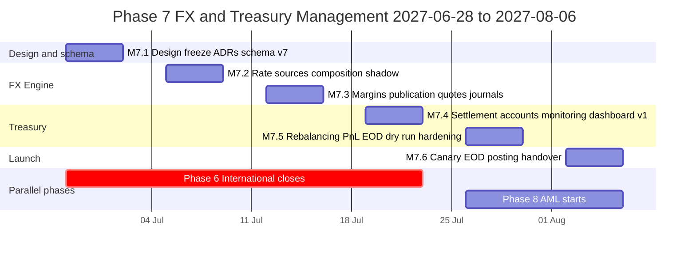
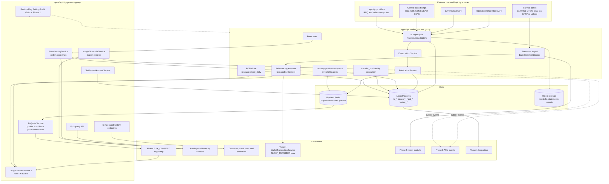
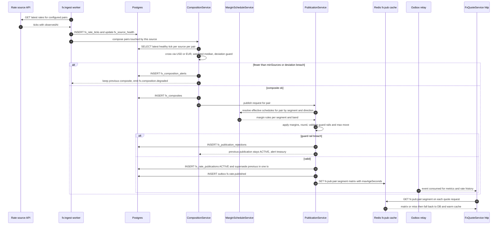
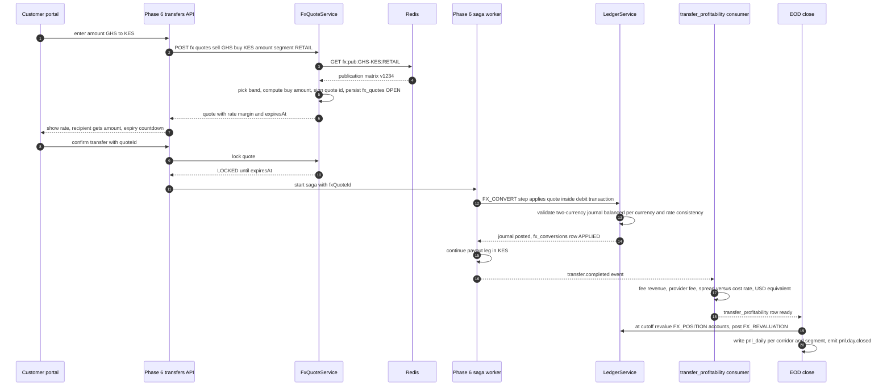
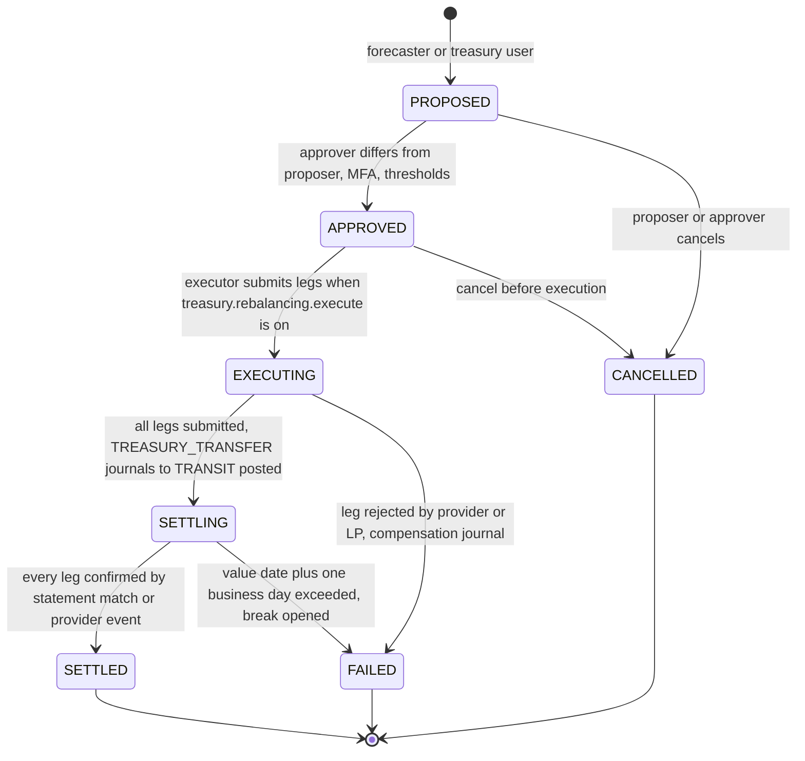
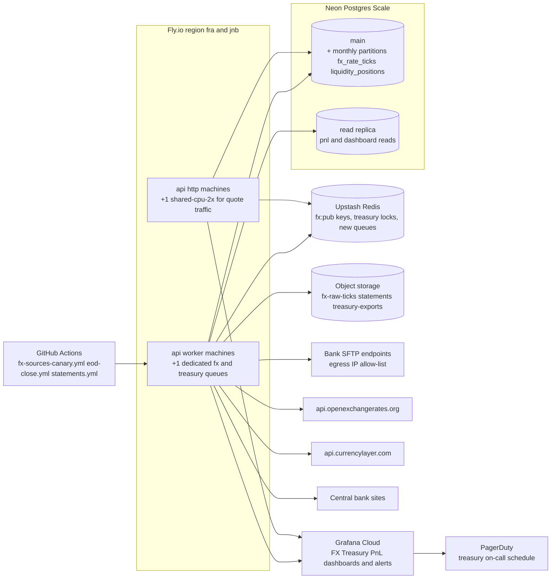
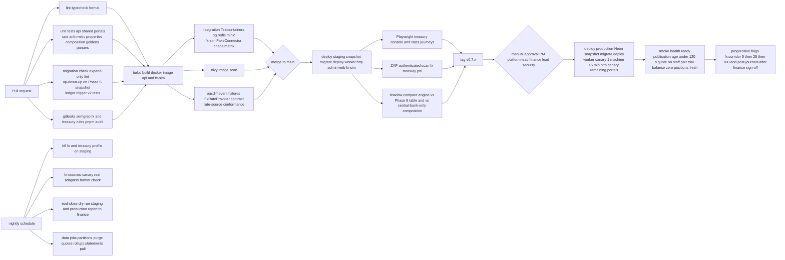

# Phase 7 — FX & Treasury Management

| Field                     | Value                                                                                                                                                                                                                                                                                                                                                                                                                                                                                                                                                                                                                                                                                                                                                                                                                                        |
| ------------------------- | -------------------------------------------------------------------------------------------------------------------------------------------------------------------------------------------------------------------------------------------------------------------------------------------------------------------------------------------------------------------------------------------------------------------------------------------------------------------------------------------------------------------------------------------------------------------------------------------------------------------------------------------------------------------------------------------------------------------------------------------------------------------------------------------------------------------------------------------- |
| **Phase**                 | 7 of 13 — `fx-treasury`                                                                                                                                                                                                                                                                                                                                                                                                                                                                                                                                                                                                                                                                                                                                                                                                                      |
| **Dates**                 | 2027-06-28 → 2027-08-06                                                                                                                                                                                                                                                                                                                                                                                                                                                                                                                                                                                                                                                                                                                                                                                                                      |
| **Duration**              | 6 weeks (W1 = 2027-06-28, W6 = 2027-08-02 … 2027-08-06)                                                                                                                                                                                                                                                                                                                                                                                                                                                                                                                                                                                                                                                                                                                                                                                      |
| **Team**                  | `platform` (2 backend W1–W4 growing to 4 from W5 when Phase 6 closes, 1 frontend W1–W4 + 1 from W5, 1 QA, solution architect, DevOps/SRE, PM, compliance analyst, product designer 50 %, 0.5 security engineer; finance/treasury ops lead as business owner)                                                                                                                                                                                                                                                                                                                                                                                                                                                                                                                                                                                 |
| **Depends on**            | Phase 5 — Domestic Transfers (ended 2027-05-28): double-entry ledger (`ledger_accounts`, `ledger_journals`, `ledger_entries`, `LedgerService.post()` with the single-currency invariant and the documented FX extension point), `ASSET:FLOAT:*` / `SUSPENSE:*` accounts and `ledger_account_daily_balances`, `recon` module (`ReconciliationSource`, `reconciliation_runs`, `reconciliation_breaks`), `PROVIDER_FEE` journals, `ledger.journal.posted` and `recon.*` events, `treasury_ops` / `finance_ops` roles, four-eyes manual journal pattern. Phase 4 (via 5): `provider_accounts` float wallets, `provider_balance_snapshots`, `wallet.float.low`, `FLOAT_TRANSFER` leg direction, `getStatement`. Phase 3 (via 5): `Provider` directory with `FX_RATES` category, connection credentials, health checks, `HttpConnector` resilience |
| **Unlocks**               | Phase 6 — International Remittance (ends 2027-07-23, overlaps W1–W4) consumes `FxQuoteService` for its `FX_CONVERT` saga step from M7.3; Phase 8 — AML/Fraud (2027-07-26) consumes `fx.trade.*` and `treasury.rebalance.*` events and the manual-override audit stream; Phase 9 — Partner & Merchant Portal (2027-08-23) reuses the `PARTNER` customer segment margins and settlement accounts for merchant payouts; Phase 10 — Reporting & BI (2027-09-20) reads `pnl_daily`, `fx_positions_daily`, `fx_rate_publications`; Phase 12 — Go-Live treasury runbooks and EOD close procedure; Phase 13 — Expansion adds currencies and corridors as data                                                                                                                                                                                        |
| **Runs in parallel with** | Phase 6 — International Remittance (core team, until 2027-07-23); Phase 8 — AML/Fraud (compliance team, from 2027-07-26)                                                                                                                                                                                                                                                                                                                                                                                                                                                                                                                                                                                                                                                                                                                     |

---

## 1. Overview

### 1.1 Objective

Phase 7 gives BI-Rem **control over liquidity and profitability**. Up to Phase 6 the platform can move money domestically and (from Phase 6) across borders, but the exchange rate applied to a cross-currency transfer is a manually maintained table, the float sitting at each mobile-money provider is only _observed_ (Phase 4 snapshots, Phase 5 float-vs-ledger check), bank settlement accounts are a placeholder in the chart of accounts, and nobody can say at the end of a day how much margin a corridor earned.

This phase ships an **FX Engine** that ingests rates from several **Rate Sources** (central bank fixings, market data APIs, liquidity-provider quotes, manual overrides under maker-checker), composes a reference mid per currency pair, applies configurable **margins by corridor and customer segment**, and publishes versioned customer rates through a **rate publication pipeline** with a lockable quote API that the Phase 6 `FX_CONVERT` saga step consumes. It makes **Settlement Accounts** (bank, nostro, liquidity provider, provider float) first-class ledger-mapped entities with statement import feeding the Phase 5 reconciliation framework. It adds **Liquidity Monitoring** (positions per currency and account, thresholds, runway forecast, alerts) and a **rebalancing workflow** (proposal → four-eyes approval → execution through Phase 4 `FLOAT_TRANSFER` legs, bank instructions or FX trades → settlement confirmation → ledger). It delivers a **Treasury Dashboard** in the admin portal and **Profit Analytics**: per-transfer profitability computed automatically at completion, an **end-of-day close** per currency with realised and unrealised FX result, and `pnl_daily` roll-ups per corridor that Phase 10 will report on.

The phase succeeds when, in production, treasury ops can change a corridor margin with a second approver and see the new customer rate published within one minute; the Treasury Dashboard shows every settlement account and float balance against its thresholds with a liquidity runway; and the EOD close produces a P&L per corridor for the previous day without any manual spreadsheet, reconciled to the ledger to the cent.

### 1.2 In scope

- **Rate Sources** — pluggable `RateSourceAdapter`s registered as Phase 3 `Provider` rows of category `FX_RATES`: central bank fixings (BCEAO for XOF, BEAC for XAF, Bank of Ghana, Central Bank of Kenya, Central Bank of Nigeria, Bank of Uganda, Bank of Tanzania, National Bank of Rwanda), market data APIs (Open Exchange Rates primary, apilayer `currencylayer` secondary), liquidity-provider indicative quotes (bank/OTC desks, manual or API), and **manual overrides with maker-checker**. Raw observations stored as `fx_rate_ticks`; source health, staleness and deviation checks.
- **FX Engine** — `apps/api/src/modules/fx/*`: mid composition per pair (weighted median of healthy sources with staleness and deviation guards), cross rates through `USD` (and `EUR` for CFA currencies pegged at 655.957), inverse derivation, rounding policy per currency exponent, **rate publication pipeline** (compose → margin → validate → publish → cache → event), **quotes** (`POST /v1/fx/quotes`) with a configurable lock window (default 120 s, up to 15 min for partner segment) and signed quote ids, **FX journals** in the ledger (two-currency journals balanced per currency with explicit rate entries and `FX_GAIN_LOSS` / `FX_POSITION` accounts, the extension point left by Phase 5 D6), and `fx_conversions` as the record of every applied rate.
- **Margin Configuration** — versioned `fx_margin_schedules` scoped by corridor (source country/currency → destination country/currency), customer segment (`RETAIL`, `PREMIUM`, `PARTNER`, `STAFF`), amount bands and direction; components in basis points plus optional flat minor-unit floor; maker-checker (`fx:margins:write` + `fx:margins:approve`), effective-from scheduling, simulation and diff; guard rails (min/max bps per corridor as `Setting`).
- **Settlement Accounts** — `settlement_accounts` (bank current accounts, nostro/pre-funding accounts at correspondent banks and liquidity providers, provider float accounts linked to Phase 4 `provider_accounts`, internal transit accounts) with ledger account mapping (`ASSET:BANK:<key>:<ccy>`, `ASSET:NOSTRO:<lp>:<ccy>`), balance sources (statement, API, manual), thresholds, statement import (ISO 20022 `camt.053`, SWIFT MT940, CSV templates) via `BankStatementSource implements ReconciliationSource`, and matching of statement lines to rebalancing legs, FX trade settlements and provider settlements.
- **Liquidity Monitoring** — `liquidity_positions` snapshots per currency and account every 5 minutes (ledger balance, external balance, in-flight, available), thresholds (`min`, `target`, `max`, `critical`) per account with alert routing, **runway forecast** (hours until `min` at the trailing 7-day same-weekday hourly outflow profile, Phase 6/5 pending transfers added), net open FX position per currency with limits, `liquidity.threshold.breached` / `liquidity.forecast.shortfall` events paging treasury ops.
- **Rebalancing workflow** — `rebalancing_orders` state machine (`PROPOSED → APPROVED → EXECUTING → SETTLING → SETTLED | FAILED | CANCELLED`), auto-proposals from the forecaster, legs of kind `FLOAT_TRANSFER` (Phase 4 leg between two provider float accounts), `BANK_TRANSFER` (instruction generated, executed by treasury at the bank, confirmed by statement match) and `FX_TRADE` (`fx_trades` with a liquidity provider: request-for-quote, deal confirmation, value date, settlement legs), four-eyes with thresholds, ledger journals per leg (`TREASURY_TRANSFER`, `FX_TRADE`, `FX_SETTLEMENT` kinds).
- **Treasury Dashboard** — admin portal `/treasury/*`: positions by currency and account, thresholds and runway, open rebalancing orders and approvals, rate board (sources, mid, published rates, margins), margin editor with simulation, settlement accounts and statements, P&L (daily, per corridor, drill-down to transfers), EOD close status, override and approval queues.
- **Profit Analytics** — `transfer_profitability` computed at transfer completion (fee revenue, tax, provider fees, commissions, FX spread captured = customer rate vs cost rate at execution, allocated hedging/rebalancing cost), **EOD close** per currency at the configured local cutoff (positions frozen, revaluation at EOD mid, realised vs unrealised FX result journals, `pnl_daily` per corridor × segment × currency, `fx_positions_daily`), intraday P&L estimate, exports and the `pnl.day.closed` event for Phase 10.
- **Hedging notes** — position limits and pre-funding policy, documented approach to forwards/NDFs (not executed in Phase 7), CFA peg handling, convertibility and repatriation constraints per currency.
- **Customer portal / Phase 6 integration** — rate display and quote lock in the international send flow (via Phase 6 screens), rate history page, rate alert placeholder; mobile consumes the same API in Phase 11.

### 1.3 Out of scope (deferred)

- Executing hedging instruments (forwards, NDFs, options) and margining with counterparties — **Phase 13** after treasury policy approval; Phase 7 documents the approach and ships position limits only.
- Automated bank payment initiation (e.g. ISO 20022 `pain.001` submission, bank APIs) — Phase 7 generates instructions and matches statements; execution is manual by treasury at the bank portal. API initiation is a Phase 9/13 candidate once bank partners are confirmed.
- Customer-facing rate alerts, rate guarantees beyond the quote lock window, multi-currency customer wallets (holding USD/EUR balances) — **Phase 13**.
- Regulatory FX returns and statutory reporting formats (e.g. Bank of Ghana forex bureau returns, CBK FX returns) — **Phase 10** reads `fx_trades`, `fx_conversions`, `pnl_daily`; Phase 7 ensures the data exists.
- Transaction-monitoring rules on FX trades and treasury movements — **Phase 8** consumes the events emitted here.
- Agent/merchant float financing and merchant FX pricing APIs — **Phase 9** reuses the `PARTNER` segment.
- Full general-ledger / accounting system integration (e.g. export to an ERP) — Phase 10 provides exports; Phase 7 keeps the BI-Rem ledger as the book of record for operations.

### 1.4 Independent deployability strategy

"Deployable alone" for Phase 7 means: **all migrations are expand-only and applied to production in W1; every FX, treasury and P&L code path ships dark behind flags; rates are ingested, composed and published in production in shadow mode for two weeks before any transfer uses them; the Phase 6 `FX_CONVERT` step keeps its manual rate table as a fallback and switches to the FX Engine per corridor by flag; the EOD close runs in dry-run mode producing reports without ledger journals until finance signs off; and every money-moving treasury action (rebalancing legs, FX trades) is gated by four-eyes and can be frozen in under 30 seconds without a redeploy.**

| Mechanism                                                                                   | Phase 7 application                                                                                                                                                                                                                                                                                                                                                                                                                                                                                                                                                                                                                                                                                                                                                                                                                                                                                                                                                                                                                                           |
| ------------------------------------------------------------------------------------------- | ------------------------------------------------------------------------------------------------------------------------------------------------------------------------------------------------------------------------------------------------------------------------------------------------------------------------------------------------------------------------------------------------------------------------------------------------------------------------------------------------------------------------------------------------------------------------------------------------------------------------------------------------------------------------------------------------------------------------------------------------------------------------------------------------------------------------------------------------------------------------------------------------------------------------------------------------------------------------------------------------------------------------------------------------------------- |
| **Feature flags** (Phase 1 `FeatureFlag`, Redis-cached 30 s, `rolloutPercentage` + `rules`) | `fx.engine.enabled` (master; off → sources still ingest but nothing is published and `POST /v1/fx/quotes` returns 503 `FX_UNAVAILABLE`), `fx.source.<key>.enabled` per rate source, `fx.publication.enabled` (compose and publish vs compose-only shadow), `fx.quotes.enabled`, `fx.corridor.<src>-<dst>.enabled` (Phase 6 `FX_CONVERT` reads the engine for this pair, else its fallback table; `rolloutPercentage` on sender user id), `fx.margins.v2` (schedule evaluation path), `fx.manual-override.enabled`, `treasury.monitoring.enabled`, `treasury.forecast.enabled`, `treasury.rebalancing.enabled` (orders can be proposed/approved), `treasury.rebalancing.execute` (legs are actually submitted — separate so approvals can be rehearsed), `treasury.statements.import.enabled`, `treasury.statements.<key>.enabled`, `pnl.transfer-profitability.enabled`, `pnl.eod.enabled`, `pnl.eod.post-journals` (dry-run vs posting revaluation journals), `admin.treasury.console`. Keys registered in `packages/shared/src/constants/feature-flags.ts`. |
| **Expand → migrate → contract**                                                             | W1 migration `20270628090000_phase7_expand` adds all new tables, enums and nullable columns (`ledger_journals.fx_rate_numerator/denominator/rate_source_id`, `transfers.fx_conversion_id`, `provider_accounts.settlement_account_id`); the `LedgerService` single-currency check becomes a journal-kind-aware check (two-currency allowed only for `FX_*` kinds with rate entries). Phase 7 introduces **no** contract migration; Phase 6 (if it adds a contract in its W1) is sequenced before ours. `fx_rate_ticks` and `liquidity_positions` are monthly partitioned from day one.                                                                                                                                                                                                                                                                                                                                                                                                                                                                         |
| **Dark launch**                                                                             | From W2 production ingests rates from every enabled source and composes mids with `fx.publication.enabled=false` (shadow): published rates are computed and stored with `status=SHADOW`, compared nightly against the Phase 6 manual table and against a second composition using only central-bank fixings. From W3 publication is on but no corridor flag is lit; Phase 6 staff transfers on the GHS→KES corridor use engine rates from W4 via `rules: userIds in [staff]`. EOD close runs in dry-run from W3, producing `pnl_daily` rows with `status=DRY_RUN` compared against finance's spreadsheet for two weeks.                                                                                                                                                                                                                                                                                                                                                                                                                                       |
| **Kill switches**                                                                           | `fx.engine.enabled=false` stops publication and quotes in ≤ 30 s (Phase 6 falls back to its table, or pauses the corridor if the table is stale > 24 h); `fx.source.<key>.enabled=false` removes a misbehaving source from composition immediately; `fx.corridor.<pair>.enabled=false` reverts one corridor; `treasury.rebalancing.execute=false` prevents any new leg submission while in-flight legs complete; `fx.publication.frozen=true` (Setting, `fx:publish:freeze` permission + MFA) freezes the last good publication (customers keep getting the frozen rate, flagged `FROZEN` on the rate board) for a suspected composition defect; `pnl.eod.post-journals=false` keeps close in dry-run.                                                                                                                                                                                                                                                                                                                                                        |
| **Worker isolation**                                                                        | Ingestion, composition, publication, monitoring, forecasting, statement import, rebalancing execution, EOD close run only in the `worker` process group (`WORKER_QUEUES` gains `fx:*`, `treasury:*`, `pnl:*`); the `http` group only serves cached published rates (Redis, 1 s TTL stampede-protected) and creates quotes/orders. Worker outage degrades to "published rates stay valid until `maxAgeSeconds` then quotes return 503", never to a stale rate silently applied.                                                                                                                                                                                                                                                                                                                                                                                                                                                                                                                                                                                |
| **Backward-compatible APIs**                                                                | New paths `/v1/fx/*`, `/v1/treasury/*`, `/v1/pnl/*`; Phase 5 `/v1/recon/*` gains a `source=BANK_STATEMENT` filter only; Phase 4 `/v1/wallet/accounts` responses gain an optional `settlementAccountId`.                                                                                                                                                                                                                                                                                                                                                                                                                                                                                                                                                                                                                                                                                                                                                                                                                                                       |
| **Rollback**                                                                                | Flags first; then Fly image rollback (`infra/scripts/rollback-api.sh`) and Vercel instant rollback. Published rates are versioned and immutable: a bad publication is superseded by a new one, never edited. FX and treasury journals are corrected only by `CORRECTION` journals with four-eyes (Phase 5 rule).                                                                                                                                                                                                                                                                                                                                                                                                                                                                                                                                                                                                                                                                                                                                              |

---

## 2. Milestones

Phase start is Monday **2027-06-28**; week _n_ runs Monday to Friday; milestone dates are the Friday of the week.

| ID       | Week | Target date | Deliverable                                                                                                                                                                                                                                                                                                                                                                                                                                                                                                                                                        | Acceptance criteria                                                                                                                                                                                                                                                                                                                                                                                                                                                                                                                                           | Owner                                   |
| -------- | ---- | ----------- | ------------------------------------------------------------------------------------------------------------------------------------------------------------------------------------------------------------------------------------------------------------------------------------------------------------------------------------------------------------------------------------------------------------------------------------------------------------------------------------------------------------------------------------------------------------------ | ------------------------------------------------------------------------------------------------------------------------------------------------------------------------------------------------------------------------------------------------------------------------------------------------------------------------------------------------------------------------------------------------------------------------------------------------------------------------------------------------------------------------------------------------------------- | --------------------------------------- |
| **M7.1** | W1   | 2027-07-02  | Design freeze: FX ledger journal design, rate composition algorithm, margin schedule model, settlement account and rebalancing state machines, EOD close procedure; ADR-0021 (FX journals and position accounting), ADR-0022 (rate sources, composition and publication), ADR-0023 (margin schedules and maker-checker), ADR-0024 (treasury rebalancing and settlement reconciliation); schema v7 _expand_ migration applied to staging and production; `FxRateProvider` interface agreed with Phase 6 lead; rate-source contracts signed or sandbox keys obtained | `pnpm db:migrate:dev` applies `20270628090000_phase7_expand` on a Phase 6 snapshot with `prisma migrate diff` empty; chart of accounts extended (`ASSET:BANK:*`, `ASSET:NOSTRO:*`, `FX_POSITION:<ccy>`, `REVENUE:FX_SPREAD:<corridor>`, `PNL:FX_REALISED:<ccy>`, `PNL:FX_UNREALISED:<ccy>`) seeded for GHS, KES, XOF, NGN, USD, EUR; ADRs accepted at the Thursday architecture review; Phase 6 `FX_CONVERT` step compiles against `FxRateProvider` with the Phase 6 table as implementation; OXR and currencylayer keys in Fly secrets (staging)             | Solution Architect                      |
| **M7.2** | W2   | 2027-07-09  | Rate Sources and FX Engine core: `RateSourceAdapter` for OXR, currencylayer, BoG, CBK, BCEAO fixings, manual override; `fx_rate_ticks` ingestion; composition service with staleness and deviation guards; shadow publication in production                                                                                                                                                                                                                                                                                                                        | Every adapter passes the rate-source conformance suite against the `fx-sim` simulator (≥ 40 cases); production ingests ≥ 95 % of scheduled ticks per source over 48 h; composed mids for the 8 pilot pairs deviate from the Phase 6 table by < 1.5 % or raise `fx.composition.deviation`; a source returning a 10 % outlier is excluded and alerted within one cycle; manual override creation without approval has no effect on composition                                                                                                                  | Backend Lead (platform)                 |
| **M7.3** | W3   | 2027-07-16  | Margin schedules with maker-checker and simulation; rate publication pipeline live (`fx.publication.enabled=true`, no corridor lit); quotes API with lock and signed ids; FX journals in `LedgerService`; `fx_conversions`; Phase 6 integration on staging                                                                                                                                                                                                                                                                                                         | Margin change by maker is invisible until approved by a different user with `fx:margins:approve`; approved change publishes a new rate version within 60 s p95 (`fx_publication_latency_seconds`); `POST /v1/fx/quotes` p95 < 50 ms from cache and a locked quote is honoured until `expiresAt` across a worker restart; property tests prove every FX journal balances per currency and the implied rate equals the quote rate (100 000 random journals); Phase 6 staging transfers on GHS→KES complete with engine quotes and produce `fx_conversions` rows | Backend Lead (platform)                 |
| **M7.4** | W4   | 2027-07-23  | Settlement Accounts and statement import (camt.053, MT940, CSV) through `BankStatementSource`; Liquidity Monitoring positions, thresholds, forecast and alerts; Treasury Dashboard v1 (positions, rate board, margins, accounts); GHS→KES staff corridor on engine rates in production                                                                                                                                                                                                                                                                             | Statement files for two pilot banks parse and match ≥ 95 % of lines automatically on staging fixtures, unmatched lines open `reconciliation_breaks` with `source=BANK_STATEMENT`; positions refresh every 5 min for every account; threshold breach pages treasury within 2 min in staging drill; forecast backtest on 30 days of Phase 5/6 data predicts `min` breach ≥ 4 h ahead for ≥ 80 % of synthetic events; 20 staff transfers GHS→KES in production priced by the engine with correct `fx_conversions` and `REVENUE:FX_SPREAD` postings               | Backend Lead (platform) / Frontend Lead |
| **M7.5** | W5   | 2027-07-30  | Rebalancing workflow (orders, four-eyes, `FLOAT_TRANSFER` / `BANK_TRANSFER` / `FX_TRADE` legs, settlement matching); Profit Analytics: `transfer_profitability`, EOD close dry-run in production, `pnl_daily`; dashboard v2 (rebalancing, P&L, EOD status); hardening, performance, security review, runbooks                                                                                                                                                                                                                                                      | Rebalancing `FLOAT_TRANSFER` between MTN GH float accounts executed end to end on staging via simulator and in production with the smallest unit under four-eyes; `BANK_TRANSFER` order settles when the matching statement line is imported; two consecutive EOD dry-runs match finance's spreadsheet within rounding (≤ 1 minor unit per corridor per day); `transfer_profitability` present for 100 % of completed transfers within 60 s of completion; k6 profile (§9.5) passes; pen-test findings ≥ High closed; Playwright treasury suites green        | QA Lead / Backend Lead / Security       |
| **M7.6** | W6   | 2027-08-06  | Production launch: `fx.corridor.*` canary 5 % → 25 % → 100 % for Phase 6 live corridors; EOD close posting journals (`pnl.eod.post-journals=true`) after finance sign-off; rebalancing execution enabled; UAT sign-off; phase exit review; handover to Phases 8/9/10                                                                                                                                                                                                                                                                                               | Success criteria (§12) evidenced with production data; rate publication p95 < 60 s from source tick to cache over the canary week; zero quotes honoured below cost (margin floor) in `fx_conversions`; EOD close posted for 5 consecutive business days with trial balance zero and `PNL:*` accounts reconciled to `pnl_daily`; sign-offs (§11) collected; Phase 8 consuming `fx.*` and `treasury.*` events in their W2; Phase 10 lead has read access to `pnl_daily` on the replica                                                                          | Program Manager                         |



Staffing note: the `core` team is on Phase 6 until 2027-07-23, so Phase 7 runs W1–W4 with two platform backend engineers and one frontend engineer and absorbs two more backend engineers and one frontend engineer from W5. The milestone order is chosen so that the parts Phase 6 needs (M7.1–M7.3) land before Phase 6 exits, and the people-heavy parts (rebalancing, P&L, dashboard v2) land when the team doubles.

---

## 3. Deliverables

Every item from the phase brief, each with a definition of done (DoD). Module paths are under `apps/api/src/modules/` unless stated; shared types under `packages/shared/src/schemas/`.

### 3.1 Rate Sources

- **What**: `fx/sources/*` — a `RateSourceAdapter` interface and adapters for central bank fixings, market data APIs, liquidity-provider indicative quotes and manual overrides; each source is a Phase 3 `Provider` row (`category=FX_RATES`) with connection credentials, health checks and the `HttpConnector` resilience stack.
- **DoD**: Interface `RateSourceAdapter { key, kind: CENTRAL_BANK | MARKET_DATA | LIQUIDITY_PROVIDER | MANUAL, capabilities(): { pairs, cadence, supportsHistorical }, fetch(ctx, pairs): RateTick[] }` where `RateTick = { base, quote, bid?, ask?, mid, observedAt, sourceRef }` with rates as `{ numerator: bigint, denominator: bigint }` scaled integers (10^12 denominator) — **no floats** anywhere in composition; adapters: `OxrAdapter` (Open Exchange Rates `/latest.json`, `base=USD`, hourly on Enterprise plan, 15 min on Unlimited), `CurrencylayerAdapter` (apilayer `/live`, hourly), `BogFixingAdapter` (Bank of Ghana daily interbank fixing, published HTML/CSV ~ 16:00 GMT), `CbkFixingAdapter` (Central Bank of Kenya indicative rates CSV, ~ 09:00 EAT), `BceaoPegAdapter` (XOF = EUR / 655.957 constant with daily BCEAO confirmation), `BeacPegAdapter` (XAF likewise), `CbnAdapter` (CBN published rates, NGN; NAFEM/NFEM closing), `LpQuoteAdapter` (indicative bid/ask from a liquidity provider via API or e-mail-to-form; manual entry for pilot), `ManualOverrideAdapter` (reads approved `fx_manual_overrides` in effect); every adapter is scheduled by BullMQ repeatable job `fx:ingest:<key>` at its cadence with jitter, writes `fx_rate_ticks` (partitioned monthly), records `fx_source_health` (last success, consecutive failures, staleness seconds, deviation vs composite) and emits `fx.source.degraded` after `fx.source.max-staleness-seconds` (Setting, default 2 × cadence); a rate-source conformance suite (`pnpm fx:source verify <key>`) runs ≥ 40 cases against `apps/fx-sim` (outlier, stale, missing pair, inverted pair, auth failure, rate limit 429, partial response, timezone/DST on fixing time); staleness and deviation are visible on the rate board; raw payloads retained 90 days in object storage for audit.

### 3.2 FX Engine (composition, publication pipeline, quotes, FX journals)

- **What**: `fx/engine/*` — `CompositionService`, `PublicationService`, `FxQuoteService`, `FxJournalService`, `FxConversionService`; the **rate publication pipeline** as a worker flow.
- **DoD**:
  - **Composition**: for each configured pair `(base, quote)` in `fx_pairs` take the latest tick per _healthy_ source within `maxStalenessSeconds`, convert to the pair through `USD` (or `EUR` for XOF/XAF) when a source lacks the direct pair, compute the **weighted median** of mids using `fx_source_weights` (central bank 1.0 when fresh, market data 1.0, LP indicative 1.5 when fresh < 10 min, manual override weight ∞ = replaces composition for that pair while in effect), discard sources deviating > `fx.composition.max-deviation-bps` (Setting, default 150 bps) from the preliminary median and alert; require `minSources` (default 2; 1 for pegged pairs); output `CompositeMid { pair, mid, sourcesUsed[], confidence, composedAt }`. Deterministic: same inputs → same output (golden tests).
  - **Publication pipeline**: trigger on new composite or approved margin version; for each `(pair, direction, segment, band)` apply the effective `fx_margin_schedule` → customer `buy`/`sell` rates; validate against guard rails (`minMarginBps`, `maxMarginBps`, max move vs previous publication `fx.publication.max-move-bps`, default 300 — larger moves require `fx:publish:force` with MFA); write immutable `fx_rate_publications` (versioned, `status ACTIVE|SHADOW|SUPERSEDED|FROZEN`, `validFrom`, `maxAgeSeconds`), update Redis `fx:pub:<pair>:<segment>` with the full matrix, emit `fx.rate.published` via outbox; p95 source tick → cache < 60 s; `fx.publication.frozen` Setting keeps the current version `FROZEN`.
  - **Quotes**: `POST /v1/fx/quotes` `{ sellCurrency, buyCurrency, amountMinor, side: SELL|BUY, segment?, corridorId? }` → `{ quoteId, rate (numerator/denominator), inverseRate, sellAmountMinor, buyAmountMinor, marginBps, publicationId, expiresAt, signature }`; quote ids are signed with `FX_QUOTE_KEY` (HMAC-SHA256, same pattern as Phase 5 `FEE_QUOTE_KEY`) and persisted in `fx_quotes` with status `OPEN|LOCKED|APPLIED|EXPIRED|CANCELLED`; lock window from `fx_margin_schedules.lockSeconds` (default 120 s retail, 900 s partner); a quote is applied at most once (`UNIQUE(quote_id)` on `fx_conversions`); rounding is half-up to the buy currency exponent with the residual booked to `REVENUE:FX_ROUNDING:<ccy>`.
  - **FX journals**: `LedgerService.post()` accepts two-currency journals only for kinds `FX_CONVERSION`, `FX_TRADE`, `FX_SETTLEMENT`, `FX_REVALUATION`, `FX_CORRECTION`; invariant: Σ debits = Σ credits **per currency**, exactly two currencies, `fx_rate_numerator/denominator` set and `amount_quote = round(amount_base × rate)` verified; customer conversion template (sell GHS, buy KES): Dr `LIABILITY:CUSTOMER:<wallet>` GHS / Cr `FX_POSITION:GHS` GHS; Dr `FX_POSITION:KES` KES / Cr `SUSPENSE:PENDING_PUSH:KES` (or recipient liability) KES; spread captured booked at EOD when the position is marked (see 3.8) or immediately when the conversion is back-to-back with an LP trade; DB trigger `ledger_journal_balanced()` extended for the per-currency rule; `FX_POSITION:<ccy>` accounts are `ASSET`-type contra accounts whose net across currencies at EOD mid defines the open position.
  - **Conversions**: `fx_conversions` row per applied quote with `transferId`, publicationId, mid at publication, customer rate, margin bps, cost rate (latest LP or composite mid at execution), spread minor units in `pnlCurrency` (USD), and `segment` — the single source for FX revenue analytics.

### 3.3 Margin Configuration

- **What**: `fx/margins/*` — `fx_margin_schedules` + `fx_margin_rules`, maker-checker, simulation, effective dating.
- **DoD**: Schedule scope `{ corridor: { sourceCountry, sourceCurrency, destCountry, destCurrency } | pair-only, segment: RETAIL|PREMIUM|PARTNER|STAFF|ALL, direction: SELL|BUY|BOTH }`; rules ordered by amount band (`fromMinor`, `toMinor` in sell currency) each with `marginBps`, optional `flatMinor` floor, `lockSeconds`, `roundingMode`; resolution picks the most specific scope (corridor+segment > corridor+ALL > pair+segment > pair+ALL > global default) and asserts exactly one match in tests; lifecycle `DRAFT → PENDING_APPROVAL → APPROVED (scheduled) → ACTIVE → RETIRED`, approver must differ from author (`fx:margins:approve`, step-up MFA, reason ≥ 20 chars), approval rejected if any rule breaches `fx.margins.guardrails.<pair>` (`minBps`, `maxBps`) unless approver also holds `fx:margins:override-guardrails`; `POST /v1/fx/margins/simulate` returns the customer rate matrix and a diff vs the active schedule for sample amounts; activation publishes within 60 s; every version immutable and linked from `fx_rate_publications.marginScheduleId`; segment resolution: `PARTNER` for Phase 9 API keys / merchant users, `PREMIUM` for Phase 2 `kycLevel ≥ LEVEL_3` or a `CustomerProfile.segment` override, `STAFF` for the staff allow-list, else `RETAIL`.

### 3.4 Settlement Accounts

- **What**: `treasury/accounts/*` — `settlement_accounts`, statement import, ledger mapping, balances.
- **DoD**: Kinds `BANK_CURRENT`, `NOSTRO` (pre-funding at a correspondent/LP), `LIQUIDITY_PROVIDER` (trading account), `PROVIDER_FLOAT` (1:1 with Phase 4 `provider_accounts`, created by backfill), `TRANSIT` (internal in-transit account per currency); fields: institution, country, currency, encrypted account identifier (IBAN/account number, KMS envelope per Phase 3), display mask, ledger account key (`ASSET:BANK:<key>:<ccy>` created on activation), balance source `STATEMENT|API|SNAPSHOT|MANUAL`, thresholds (`criticalMinor`, `minMinor`, `targetMinor`, `maxMinor`), cut-off times and value-date conventions (T+0/T+1, local holidays calendar key), status `DRAFT|ACTIVE|SUSPENDED|CLOSED`; `POST /v1/treasury/accounts` requires `treasury:accounts:write` and activation requires a second approver; **statement import**: upload (admin) or SFTP pull (`treasury:statements:pull:<key>` repeatable job) of `camt.053` XML, MT940 and bank-specific CSV mapped by a per-account `statementMapping` JSON; parser produces `settlement_statement_lines` (value date, booking date, amount, direction, counterparty, reference, bank ref, raw) with duplicate detection by `(accountId, bankRef)`; `BankStatementSource implements ReconciliationSource` (Phase 5) matches lines to `rebalancing_legs`, `fx_trade_settlements`, provider settlement credits (`PROVIDER_SETTLEMENT` expected amounts from Phase 4 statements) and fee debits; unmatched lines open `reconciliation_breaks(source=BANK_STATEMENT)`; closing balance per statement reconciled to `ASSET:BANK:*` ledger balance ± unmatched; manual balance entry allowed only with reason and shown as `MANUAL` on the dashboard; account identifiers never appear in logs or exports (last 4 only).

### 3.5 Liquidity Monitoring

- **What**: `treasury/liquidity/*` — positions, thresholds, forecast, alerts, open FX position limits.
- **DoD**: `treasury:positions:snapshot` every 5 min writes `liquidity_positions` per settlement account: `ledgerBalanceMinor` (from `ledger_accounts.balance_cache`), `externalBalanceMinor` (latest `provider_balance_snapshots` / statement closing / API), `inFlightOutMinor` (Phase 5 sagas in `AWAITING_LEG` + approved rebalancing legs not settled), `inFlightInMinor`, `availableMinor = external − inFlightOut`, `varianceMinor = external − ledger ± inFlight` with tolerance flag; per currency aggregate with `netOpenPositionMinor` across `FX_POSITION:<ccy>` and its `USD` equivalent at composite mid vs `fx.position.limit.<ccy>` (Setting); threshold evaluation per account produces `liquidity.threshold.breached` (`level CRITICAL|MIN|MAX`, with hysteresis 2 % to avoid flapping) routed to PagerDuty/Slack for `CRITICAL`, Slack + in-app for `MIN`/`MAX`; **forecast**: hourly outflow profile per account from trailing 28 days grouped by weekday × hour (robust mean excluding top/bottom 5 %), plus scheduled known outflows (pending Phase 5/6 sagas, approved rebalancing); `runwayHours` = time until `available` crosses `min` under the profile; `liquidity.forecast.shortfall` when runway < `treasury.forecast.alert-hours` (default 12) during business hours; backtest job reports precision/recall on synthetic events; dashboard shows runway and the forecast curve; positions and forecasts exposed by `GET /v1/treasury/positions`.

### 3.6 Rebalancing workflow

- **What**: `treasury/rebalancing/*` — `rebalancing_orders`, `rebalancing_legs`, `fx_trades`, approvals, execution adapters, settlement confirmation.
- **DoD**: Order `{ fromAccountId, toAccountId, amountMinor, currency, reason, proposedBy (USER|FORECASTER), urgency }` with legs of kind `FLOAT_TRANSFER` (Phase 4 `WalletTransactionService.create({ direction: FLOAT_TRANSFER, parentType: 'RebalancingOrder' })` between two provider float accounts of the same provider or via an aggregator), `BANK_TRANSFER` (generates an instruction PDF/`pain.001` draft with beneficiary from the settlement account, reference `RB-<shortId>`; marked `SUBMITTED` by treasury after executing at the bank; settles on statement match), `FX_TRADE` (links an `fx_trades` row: RFQ to LP with `fx:trade:request` permission, dealt rate recorded with LP confirmation ref, value date, two settlement legs — pay sell currency from nostro, receive buy currency to nostro — each confirmed by statement match or LP API); state machine `PROPOSED → APPROVED → EXECUTING → SETTLING → SETTLED | FAILED | CANCELLED` with every transition in `rebalancing_events`; four-eyes: approver ≠ proposer, step-up MFA, amounts above `treasury.rebalance.second-approver-threshold-usd` (default 25 000) require two approvers of which one has `treasury:rebalance:approve-senior`; auto-proposals from the forecaster target `target − available` rounded to `fx.rebalance.lot.<ccy>` and never auto-approve; ledger: `TREASURY_TRANSFER` journal on leg submission (Cr source `ASSET:*`, Dr `TRANSIT:<ccy>`) and on settlement (Cr `TRANSIT`, Dr destination `ASSET:*`), `FX_TRADE` journal at deal (positions) and `FX_SETTLEMENT` journals on each settlement leg; LP and bank fees booked to `EXPENSE:TREASURY_FEES:<ccy>`; timeouts: `SETTLING` > value date + 1 business day opens a break and alerts; cancellation allowed only before `EXECUTING`; `treasury.rebalancing.execute=false` blocks new submissions.

### 3.7 Treasury Dashboard

- **What**: admin portal `apps/admin/app/(portal)/treasury/*` screens and the aggregated API behind them.
- **DoD**: Screens listed in §7.1 shipped with Server Components reading `GET /v1/treasury/dashboard` (one aggregated query < 300 ms p95 with Redis snapshot 30 s) and client components for live tiles (React Query, 15 s refetch); role-based visibility (`treasury:read` for everything, action buttons by permission); every mutation goes through the maker-checker API with inline approval queue; Playwright suite covers the ten key journeys; accessible (WCAG 2.2 AA, keyboard-operable approvals); exports CSV/XLSX for positions and P&L via signed URLs.

### 3.8 Profit Analytics (per-transfer profitability, EOD P&L, end-of-day close)

- **What**: `pnl/*` — `transfer_profitability`, `pnl_daily`, `fx_positions_daily`, `eod_closes`, the EOD close worker, revaluation journals.
- **DoD**:
  - **Per transfer**: consumer of `transfer.completed` (Phase 5/6) computes within 60 s: `feeRevenueMinor` (from `transfer_fee_lines`), `taxMinor`, `providerFeeMinor` (Phase 5 `PROVIDER_FEE` journals linked to the transfer's legs), `commissionMinor` (agent/merchant), `fxSpreadMinor` = (customer rate − cost rate) × amount from `fx_conversions`, `roundingMinor`, `allocatedTreasuryCostMinor` (daily rebalancing/LP fees allocated pro rata to converted volume, applied at EOD), `grossMarginMinor` in transfer currency and `pnlCurrency` (USD at composite mid at completion), with `rateVersion` references; idempotent on `transferId`; missing inputs leave `status=PARTIAL` and are completed by the EOD job.
  - **EOD close** per currency at `treasury.eod.cutoff.<ccy>` (local time; GHS 23:59 GMT, KES 23:59 EAT, XOF 23:59 GMT, NGN 23:59 WAT, USD/EUR 22:00 UTC): freeze window (new conversions attach to the next business day), snapshot `FX_POSITION:<ccy>` balances, revalue at EOD composite mid → `FX_REVALUATION` journals Dr/Cr `FX_POSITION:<ccy>` vs `PNL:FX_UNREALISED:<ccy>`; realised result for positions closed by LP trades during the day → `PNL:FX_REALISED:<ccy>`; write `fx_positions_daily` and `pnl_daily` rows per `(businessDate, corridor, segment, currency)` with fee revenue, FX spread, realised/unrealised FX, provider fees, commissions, treasury fees, taxes, net; `eod_closes` row with status `DRY_RUN|POSTED|FAILED|REOPENED`, checksum of inputs, and operator; dry-run mode when `pnl.eod.post-journals=false`; re-run is idempotent (same business date supersedes `DRY_RUN`, never a `POSTED` close — reopening requires `pnl:eod:reopen` with four-eyes and posts reversing journals); `pnl.day.closed` event via outbox; intraday estimate `GET /v1/pnl/intraday` from `transfer_profitability` + live mark; reconciliation check: Σ `pnl_daily.net` for a date = Δ (`REVENUE:*` + `PNL:*` − `EXPENSE:*`) ledger balances for that date within 1 minor unit per currency, else the close is `FAILED` and pages finance.

### 3.9 Hedging notes (policy deliverable)

- **What**: `docs/handbooks/treasury-hedging-policy.md` and the position limit configuration — no instruments executed in Phase 7.
- **DoD**: Document approved by finance lead and compliance covering: (1) **natural hedging first** — pre-fund destination currencies in proportion to the trailing 7-day outflow so FX exposure is in the funding currency (USD/EUR) rather than in exotic pairs; (2) position limits per currency (`fx.position.limit.<ccy>` in USD equivalent; proposed GHS 150 k, KES 150 k, NGN 100 k, XOF 200 k) with intraday breach → rebalancing proposal and EOD breach → mandatory LP trade next morning; (3) **CFA franc** (XOF/XAF) is pegged to EUR at 655.957 — treat EUR as the hedge currency, keep margins thin, never source XOF rates from USD-based APIs alone; (4) **NGN** — official vs parallel market divergence; use CBN/NFEM closing with LP quotes weighted higher, wider guard rails, daily revaluation; (5) **GHS and KES** — onshore deliverable, NDF markets exist offshore (1–3 month tenors) and are the Phase 13 candidate instrument; (6) convertibility and repatriation constraints (central bank approval for outward remittance in some jurisdictions, documentation for LP settlements); (7) counterparty limits per LP and bank, settlement-risk window rules (pay-after-receive for new LPs); (8) what triggers a forward programme (monthly converted volume > USD 5 M in one currency and realised FX volatility > 2 % monthly), how it would be booked (`FX_FORWARD` journals, mark-to-market in `PNL:FX_UNREALISED`) so that Phase 13 extends the model rather than redesigns it.

### 3.10 Rate publication to customers (Phase 6 integration, customer portal)

- **What**: `FxRateProvider` implementation plugged into the Phase 6 `FX_CONVERT` saga step; customer-facing rate endpoints and components.
- **DoD**: `GET /v1/fx/rates?from=GHS&to=KES&segment=auto` returns the active published retail rate, mid-market reference (optional, flag `fx.rates.show-mid`), margin disclosure percentage (required by consumer-protection rules in KE/GH for remittance pricing transparency) and `expiresAt`; the Phase 6 send flow calls `POST /v1/fx/quotes` on amount entry and locks on confirmation (quote id stored on the transfer; saga step `FX_CONVERT` calls `FxConversionService.apply(quoteId, transferId, tx)` inside the debit transaction); if the quote expired the saga returns `nextAction=REQUOTE` instead of failing; receipts (Phase 5 PDF) show the rate, the margin disclosure and the publication id; `GET /v1/fx/rates/history` serves daily closes for the public rate history page (`apps/web/app/(portal)/rates`); fallback: when `fx.corridor.<pair>.enabled` is off, Phase 6 uses its manual table and marks the transfer `rateSource=FALLBACK_TABLE` so P&L can still compute spread against composite mid.

---

## 4. Architecture

### 4.1 Component view (Phase 7 additions)



### 4.2 Rate publication pipeline



Rules enforced in code and tests: (1) a publication is never mutated — a new row supersedes it in the same transaction; (2) a stale composite (older than `maxAgeSeconds`) is never published, and a quote against a stale publication fails with `FX_RATE_STALE` rather than using it; (3) margins are applied only from an `ACTIVE` approved schedule version, never from a draft; (4) every published rate records its inputs (`compositeId`, `marginScheduleId`, `sourcesUsed`) so any customer rate can be explained after the fact; (5) composition and margin arithmetic use scaled integers (`bigint`, 10^12), and the only rounding happens when a quote converts to minor units.

### 4.3 Quote → conversion → P&L (Phase 6 transfer using the engine)



### 4.4 Rebalancing order lifecycle



### 4.5 Deployment / infrastructure delta



Delta summary: one additional `http` machine (quote traffic is read-mostly, served from Redis); one additional `worker` machine dedicated to `fx:*`, `treasury:*`, `pnl:*` queues so rate ingestion is never starved by Phase 5/6 saga load; Neon read replica (ordered in Phase 5 R5.10) now carries dashboard and P&L reads; Redis key space `fx:*`, `treasury:lock:*` (≈ 5 MB); object storage buckets `fx-raw-ticks` (90-day lifecycle), `treasury-statements` (7-year retention, object lock), `treasury-exports` (30 days); outbound allow-list for OXR, currencylayer, central bank hosts and bank SFTP from the worker egress IPs; Fly secrets `FX_OXR_APP_ID`, `FX_CURRENCYLAYER_KEY`, `FX_QUOTE_KEY`, `TREASURY_SFTP_*` per bank (stored as Phase 3 connection credentials where possible); Grafana dashboards "FX Rates", "Treasury Liquidity", "P&L and EOD"; PagerDuty service `birem-treasury` with a treasury on-call rotation separate from engineering.

### 4.6 Design decisions and alternatives rejected

| #   | Decision                                                                                                                              | Alternative rejected                                                                                                         | Rationale                                                                                                                                                                                                                    |
| --- | ------------------------------------------------------------------------------------------------------------------------------------- | ---------------------------------------------------------------------------------------------------------------------------- | ---------------------------------------------------------------------------------------------------------------------------------------------------------------------------------------------------------------------------- |
| D1  | **Weighted median composition across several sources** with staleness and deviation guards.                                           | Single market-data provider as the truth.                                                                                    | A single API outage or a bad tick (observed historically for exotic African pairs) would mis-price every corridor; the median is robust to one outlier and lets central-bank fixings anchor pairs where market data is thin. |
| D2  | **Rates as scaled integers** (`bigint` numerator / 10^12) end to end, rounding only at minor-unit conversion.                         | `Decimal` library or `numeric` columns with floats in TypeScript.                                                            | Consistent with CLAUDE.md "never floats"; integer arithmetic is deterministic across workers and the DB trigger can verify `amount_quote = round(amount_base × rate)` in SQL.                                                |
| D3  | **FX journals as two-currency journals balanced per currency** with `FX_POSITION:<ccy>` contra accounts.                              | Convert everything to a USD functional currency per entry; or book conversions as two single-currency journals linked by id. | Per-currency balance keeps Phase 5's trial balance invariant intact per currency; the position accounts make open exposure a ledger fact rather than a report; a single linked pair could be half-posted on failure.         |
| D4  | **Spread recognised at EOD mark**, not at quote time, except back-to-back trades.                                                     | Recognise customer margin as revenue immediately.                                                                            | Until the position is covered the margin is unrealised; recognising at mark matches accounting treatment and avoids showing profit that an adverse move erases. Intraday estimate is still available.                        |
| D5  | **Publication is immutable and versioned; quotes reference a publication.**                                                           | Compute the customer rate on demand from the latest composite.                                                               | Explainability (which inputs produced this rate), reproducibility for disputes and regulators, and cache-friendliness (one matrix per pair per segment).                                                                     |
| D6  | **Quotes cached in Redis with signed ids and a lock window**, persisted in Postgres.                                                  | Stateless signed quotes only (no DB row).                                                                                    | A DB row makes "applied at most once" a unique constraint and gives support a lookup; signing prevents forged quotes if the DB is bypassed.                                                                                  |
| D7  | **Margin schedules as versioned data with maker-checker**, resolved by specificity.                                                   | Margins hard-coded per corridor in config.                                                                                   | Treasury must react to market moves without a deploy; regulators ask for approval evidence; Phase 13 adds corridors as data.                                                                                                 |
| D8  | **Settlement accounts as a new entity with ledger mapping**, provider float linked 1:1 to Phase 4 `provider_accounts`.                | Extend `provider_accounts` to cover banks.                                                                                   | Banks and LPs have different lifecycles, identifiers, statement formats and permissions; the Phase 4 D12 decision anticipated a treasury-owned entity.                                                                       |
| D9  | **Statement import feeds the Phase 5 reconciliation framework** via `ReconciliationSource`.                                           | A separate treasury reconciliation engine.                                                                                   | One break register, one resolution workflow, one dashboard; Phase 5 designed the interface for exactly this.                                                                                                                 |
| D10 | **Rebalancing executes `FLOAT_TRANSFER` through Phase 4 legs; bank transfers are instruction + statement match**, not API initiation. | Integrate bank payment APIs now.                                                                                             | Bank API availability differs per partner and country and needs separate onboarding; statement matching gives correctness today; API initiation is an additive adapter later.                                                |
| D11 | **EOD close per currency at local cutoff with dry-run mode** before posting journals.                                                 | Single UTC close for all currencies.                                                                                         | Business days and provider settlement cycles are local; dry-run against finance's spreadsheet is the acceptance path before the ledger carries P&L accounts.                                                                 |
| D12 | **No hedging instruments in Phase 7**; policy, limits and pre-funding only.                                                           | Execute forwards from day one.                                                                                               | Volumes at launch do not justify counterparty onboarding and margining; the model (position accounts, revaluation) is built so Phase 13 adds instruments without redesign.                                                   |
| D13 | **Forecast is a transparent weekday-hour profile**, not an ML model.                                                                  | Time-series ML forecasting.                                                                                                  | Explainable to treasury, works with 4–8 weeks of history, testable with backtests; ML is a Phase 10/13 improvement once data accumulates.                                                                                    |
| D14 | **Dedicated worker machine for FX/treasury queues.**                                                                                  | Share the Phase 5/6 worker pool.                                                                                             | Rate freshness is a customer-facing SLO; saga bursts must not delay ingestion or EOD close.                                                                                                                                  |

---

## 5. Data Model & Migrations

### 5.1 Context from earlier phases

Phase 1: `User`, `AuditLog`, `FeatureFlag`, `Setting`, `Outbox`, `Notification*`. Phase 3: `Provider` (`category=FX_RATES` already in the enum), `Connection`, credential versions. Phase 4: `ProviderAccount` (float wallets), `ProviderBalanceSnapshot`, `WalletTransaction` with `FLOAT_TRANSFER`. Phase 5: `LedgerAccount`, `LedgerJournal`, `LedgerEntry`, `LedgerAccountDailyBalance`, `ReconciliationRun`, `ReconciliationBreak`, `Transfer`, `TransferFeeLine`. Phase 6 (in flight): `Corridor` (country/currency pair) and the `FX_CONVERT` saga step with a fallback rate table — Phase 7 references `corridors.id` where Phase 6 has shipped it and falls back to the `(sourceCountry, sourceCurrency, destCountry, destCurrency)` tuple otherwise. All additions follow CLAUDE.md: uuid ids via `gen_random_uuid()`, `timestamptz(6)`, money as `BIGINT` minor units + ISO-4217 `currency`, rates as `BIGINT` numerator with a fixed 10^12 denominator, snake_case `@@map`/`@map`.

### 5.2 Prisma additions (schema v7)

```prisma
// ---------------------------------------------------------------------------
// Phase 7 — FX & Treasury Management
// Rates are stored as BIGINT `rate_num` with implicit denominator 10^12 (RATE_SCALE).
// ---------------------------------------------------------------------------

enum RateSourceKind {
  CENTRAL_BANK
  MARKET_DATA
  LIQUIDITY_PROVIDER
  MANUAL

  @@map("rate_source_kind")
}

enum FxPublicationStatus {
  SHADOW
  ACTIVE
  SUPERSEDED
  FROZEN
  REJECTED

  @@map("fx_publication_status")
}

enum CustomerSegment {
  RETAIL
  PREMIUM
  PARTNER
  STAFF
  ALL

  @@map("customer_segment")
}

enum FxDirection {
  SELL
  BUY
  BOTH

  @@map("fx_direction")
}

enum MarginScheduleStatus {
  DRAFT
  PENDING_APPROVAL
  APPROVED
  ACTIVE
  RETIRED
  REJECTED

  @@map("margin_schedule_status")
}

enum FxQuoteStatus {
  OPEN
  LOCKED
  APPLIED
  EXPIRED
  CANCELLED

  @@map("fx_quote_status")
}

enum ManualOverrideStatus {
  PENDING_APPROVAL
  ACTIVE
  EXPIRED
  REVOKED
  REJECTED

  @@map("manual_override_status")
}

enum SettlementAccountKind {
  BANK_CURRENT
  NOSTRO
  LIQUIDITY_PROVIDER
  PROVIDER_FLOAT
  TRANSIT

  @@map("settlement_account_kind")
}

enum SettlementAccountStatus {
  DRAFT
  ACTIVE
  SUSPENDED
  CLOSED

  @@map("settlement_account_status")
}

enum BalanceSource {
  STATEMENT
  API
  SNAPSHOT
  MANUAL

  @@map("balance_source")
}

enum StatementFormat {
  CAMT053
  MT940
  CSV

  @@map("statement_format")
}

enum StatementLineStatus {
  UNMATCHED
  MATCHED
  EXPLAINED
  IGNORED

  @@map("statement_line_status")
}

enum RebalancingStatus {
  PROPOSED
  APPROVED
  EXECUTING
  SETTLING
  SETTLED
  FAILED
  CANCELLED

  @@map("rebalancing_status")
}

enum RebalancingLegKind {
  FLOAT_TRANSFER
  BANK_TRANSFER
  FX_TRADE

  @@map("rebalancing_leg_kind")
}

enum RebalancingLegStatus {
  PENDING
  SUBMITTED
  CONFIRMED
  FAILED
  CANCELLED

  @@map("rebalancing_leg_status")
}

enum FxTradeStatus {
  RFQ
  QUOTED
  DEALT
  SETTLING
  SETTLED
  CANCELLED
  FAILED

  @@map("fx_trade_status")
}

enum EodCloseStatus {
  RUNNING
  DRY_RUN
  POSTED
  FAILED
  REOPENED

  @@map("eod_close_status")
}

enum ThresholdLevel {
  CRITICAL
  MIN
  MAX

  @@map("threshold_level")
}

/// Currency pair the engine composes and publishes. `via` is the cross currency used when
/// sources lack the direct pair (USD by default, EUR for XOF/XAF).
model FxPair {
  id                  String   @id @default(dbgenerated("gen_random_uuid()")) @db.Uuid
  baseCurrency        String   @map("base_currency") @db.Char(3)
  quoteCurrency       String   @map("quote_currency") @db.Char(3)
  viaCurrency         String?  @map("via_currency") @db.Char(3)
  minSources          Int      @default(2) @map("min_sources")
  maxStalenessSeconds Int      @default(3600) @map("max_staleness_seconds")
  maxDeviationBps     Int      @default(150) @map("max_deviation_bps")
  isPegged            Boolean  @default(false) @map("is_pegged")
  /// For pegged pairs: fixed rate numerator (e.g. EUR/XOF 655.957 → 655957000000000).
  peggedRateNum       BigInt?  @map("pegged_rate_num")
  enabled             Boolean  @default(true)
  createdAt           DateTime @default(now()) @map("created_at") @db.Timestamptz(6)
  updatedAt           DateTime @updatedAt @map("updated_at") @db.Timestamptz(6)

  ticks        FxRateTick[]
  composites   FxComposite[]
  publications FxRatePublication[]
  weights      FxSourceWeight[]

  @@unique([baseCurrency, quoteCurrency])
  @@map("fx_pairs")
}

/// A configured rate source; 1:1 with a Phase 3 `providers` row of category FX_RATES.
model FxRateSource {
  id              String         @id @default(dbgenerated("gen_random_uuid()")) @db.Uuid
  key             String         @unique @db.VarChar(64)
  providerId      String?        @unique @map("provider_id") @db.Uuid
  kind            RateSourceKind
  cadenceSeconds  Int            @map("cadence_seconds")
  defaultWeight   Int            @default(100) @map("default_weight")
  config          Json           @default("{}")
  enabled         Boolean        @default(false)
  lastSuccessAt   DateTime?      @map("last_success_at") @db.Timestamptz(6)
  lastFailureAt   DateTime?      @map("last_failure_at") @db.Timestamptz(6)
  consecutiveFailures Int        @default(0) @map("consecutive_failures")
  createdAt       DateTime       @default(now()) @map("created_at") @db.Timestamptz(6)
  updatedAt       DateTime       @updatedAt @map("updated_at") @db.Timestamptz(6)

  ticks   FxRateTick[]
  weights FxSourceWeight[]

  @@map("fx_rate_sources")
}

model FxSourceWeight {
  pairId   String @map("pair_id") @db.Uuid
  sourceId String @map("source_id") @db.Uuid
  /// Percent weight; 0 excludes the source for this pair.
  weight   Int

  pair   FxPair       @relation(fields: [pairId], references: [id], onDelete: Cascade)
  source FxRateSource @relation(fields: [sourceId], references: [id], onDelete: Cascade)

  @@id([pairId, sourceId])
  @@map("fx_source_weights")
}

/// Raw observation from a source. Partitioned monthly by observed_at (see migration).
model FxRateTick {
  id         String   @id @default(dbgenerated("gen_random_uuid()")) @db.Uuid
  pairId     String   @map("pair_id") @db.Uuid
  sourceId   String   @map("source_id") @db.Uuid
  bidNum     BigInt?  @map("bid_num")
  askNum     BigInt?  @map("ask_num")
  midNum     BigInt   @map("mid_num")
  observedAt DateTime @map("observed_at") @db.Timestamptz(6)
  receivedAt DateTime @default(now()) @map("received_at") @db.Timestamptz(6)
  sourceRef  String?  @map("source_ref") @db.VarChar(128)
  /// Object-storage key of the raw payload batch this tick came from.
  rawObjectKey String? @map("raw_object_key") @db.VarChar(256)

  pair   FxPair       @relation(fields: [pairId], references: [id], onDelete: Restrict)
  source FxRateSource @relation(fields: [sourceId], references: [id], onDelete: Restrict)

  @@index([pairId, sourceId, observedAt(sort: Desc)])
  @@index([observedAt])
  @@map("fx_rate_ticks")
}

/// Composite mid produced by the weighted-median algorithm; inputs recorded for explainability.
model FxComposite {
  id          String   @id @default(dbgenerated("gen_random_uuid()")) @db.Uuid
  pairId      String   @map("pair_id") @db.Uuid
  midNum      BigInt   @map("mid_num")
  /// 0-100 confidence from source agreement and freshness.
  confidence  Int
  sourcesUsed Json     @map("sources_used")
  composedAt  DateTime @default(now()) @map("composed_at") @db.Timestamptz(6)

  pair         FxPair              @relation(fields: [pairId], references: [id], onDelete: Restrict)
  publications FxRatePublication[]

  @@index([pairId, composedAt(sort: Desc)])
  @@map("fx_composites")
}

/// Versioned margin schedule (maker-checker). Rules live in `fx_margin_rules`.
model FxMarginSchedule {
  id              String               @id @default(dbgenerated("gen_random_uuid()")) @db.Uuid
  name            String               @db.VarChar(120)
  version         Int
  /// Scope: either a corridor or a bare pair.
  corridorId      String?              @map("corridor_id") @db.Uuid
  sourceCountry   String?              @map("source_country") @db.Char(2)
  sourceCurrency  String               @map("source_currency") @db.Char(3)
  destCountry     String?              @map("dest_country") @db.Char(2)
  destCurrency    String               @map("dest_currency") @db.Char(3)
  segment         CustomerSegment      @default(ALL)
  direction       FxDirection          @default(BOTH)
  status          MarginScheduleStatus @default(DRAFT)
  effectiveFrom   DateTime?            @map("effective_from") @db.Timestamptz(6)
  effectiveTo     DateTime?            @map("effective_to") @db.Timestamptz(6)
  createdById     String               @map("created_by_id") @db.Uuid
  approvedById    String?              @map("approved_by_id") @db.Uuid
  approvedAt      DateTime?            @map("approved_at") @db.Timestamptz(6)
  approvalReason  String?              @map("approval_reason")
  rejectionReason String?              @map("rejection_reason")
  createdAt       DateTime             @default(now()) @map("created_at") @db.Timestamptz(6)
  updatedAt       DateTime             @updatedAt @map("updated_at") @db.Timestamptz(6)

  rules        FxMarginRule[]
  publications FxRatePublication[]

  @@unique([name, version])
  @@index([sourceCurrency, destCurrency, segment, status])
  @@index([status, effectiveFrom])
  @@map("fx_margin_schedules")
}

model FxMarginRule {
  id           String  @id @default(dbgenerated("gen_random_uuid()")) @db.Uuid
  scheduleId   String  @map("schedule_id") @db.Uuid
  /// Amount band in sell-currency minor units; `to_minor` null = open-ended.
  fromMinor    BigInt  @default(0) @map("from_minor")
  toMinor      BigInt? @map("to_minor")
  marginBps    Int     @map("margin_bps")
  flatMinor    BigInt  @default(0) @map("flat_minor")
  lockSeconds  Int     @default(120) @map("lock_seconds")
  roundingMode String  @default("HALF_UP") @map("rounding_mode") @db.VarChar(16)
  position     Int

  schedule FxMarginSchedule @relation(fields: [scheduleId], references: [id], onDelete: Cascade)

  @@unique([scheduleId, position])
  @@map("fx_margin_rules")
}

/// Manual rate override (maker-checker). While ACTIVE it replaces composition for the pair.
model FxManualOverride {
  id             String               @id @default(dbgenerated("gen_random_uuid()")) @db.Uuid
  pairId         String               @map("pair_id") @db.Uuid
  midNum         BigInt               @map("mid_num")
  reason         String
  status         ManualOverrideStatus @default(PENDING_APPROVAL)
  validFrom      DateTime             @map("valid_from") @db.Timestamptz(6)
  validTo        DateTime             @map("valid_to") @db.Timestamptz(6)
  createdById    String               @map("created_by_id") @db.Uuid
  approvedById   String?              @map("approved_by_id") @db.Uuid
  approvedAt     DateTime?            @map("approved_at") @db.Timestamptz(6)
  revokedById    String?              @map("revoked_by_id") @db.Uuid
  revokedAt      DateTime?            @map("revoked_at") @db.Timestamptz(6)
  createdAt      DateTime             @default(now()) @map("created_at") @db.Timestamptz(6)

  @@index([pairId, status, validTo])
  @@map("fx_manual_overrides")
}

/// Immutable published rate matrix for one pair × segment. Superseded rows are kept forever.
model FxRatePublication {
  id               String              @id @default(dbgenerated("gen_random_uuid()")) @db.Uuid
  pairId           String              @map("pair_id") @db.Uuid
  compositeId      String              @map("composite_id") @db.Uuid
  marginScheduleId String?             @map("margin_schedule_id") @db.Uuid
  segment          CustomerSegment
  version          BigInt
  status           FxPublicationStatus @default(ACTIVE)
  midNum           BigInt              @map("mid_num")
  /// Rate matrix per band and direction: [{fromMinor,toMinor,sellRateNum,buyRateNum,marginBps,lockSeconds}].
  matrix           Json
  validFrom        DateTime            @default(now()) @map("valid_from") @db.Timestamptz(6)
  maxAgeSeconds    Int                 @map("max_age_seconds")
  supersededAt     DateTime?           @map("superseded_at") @db.Timestamptz(6)
  publishedById    String?             @map("published_by_id") @db.Uuid
  createdAt        DateTime            @default(now()) @map("created_at") @db.Timestamptz(6)

  pair      FxPair            @relation(fields: [pairId], references: [id], onDelete: Restrict)
  composite FxComposite       @relation(fields: [compositeId], references: [id], onDelete: Restrict)
  schedule  FxMarginSchedule? @relation(fields: [marginScheduleId], references: [id], onDelete: Restrict)
  quotes    FxQuote[]

  @@unique([pairId, segment, version])
  @@index([pairId, segment, status])
  @@map("fx_rate_publications")
}

model FxQuote {
  id              String        @id @default(dbgenerated("gen_random_uuid()")) @db.Uuid
  publicationId   String        @map("publication_id") @db.Uuid
  userId          String?       @map("user_id") @db.Uuid
  segment         CustomerSegment
  sellCurrency    String        @map("sell_currency") @db.Char(3)
  buyCurrency     String        @map("buy_currency") @db.Char(3)
  sellAmountMinor BigInt        @map("sell_amount_minor")
  buyAmountMinor  BigInt        @map("buy_amount_minor")
  rateNum         BigInt        @map("rate_num")
  marginBps       Int           @map("margin_bps")
  status          FxQuoteStatus @default(OPEN)
  signature       String        @db.VarChar(128)
  lockedAt        DateTime?     @map("locked_at") @db.Timestamptz(6)
  expiresAt       DateTime      @map("expires_at") @db.Timestamptz(6)
  createdAt       DateTime      @default(now()) @map("created_at") @db.Timestamptz(6)

  publication FxRatePublication @relation(fields: [publicationId], references: [id], onDelete: Restrict)
  conversion  FxConversion?

  @@index([userId, createdAt(sort: Desc)])
  @@index([status, expiresAt])
  @@map("fx_quotes")
}

/// The applied rate on a transfer; one per quote, one per transfer.
model FxConversion {
  id              String   @id @default(dbgenerated("gen_random_uuid()")) @db.Uuid
  quoteId         String   @unique @map("quote_id") @db.Uuid
  transferId      String   @unique @map("transfer_id") @db.Uuid
  journalId       String   @unique @map("journal_id") @db.Uuid
  publicationId   String   @map("publication_id") @db.Uuid
  sellCurrency    String   @map("sell_currency") @db.Char(3)
  buyCurrency     String   @map("buy_currency") @db.Char(3)
  sellAmountMinor BigInt   @map("sell_amount_minor")
  buyAmountMinor  BigInt   @map("buy_amount_minor")
  customerRateNum BigInt   @map("customer_rate_num")
  midRateNum      BigInt   @map("mid_rate_num")
  costRateNum     BigInt   @map("cost_rate_num")
  marginBps       Int      @map("margin_bps")
  /// Spread captured, in `pnl_currency` minor units at execution.
  spreadMinor     BigInt   @map("spread_minor")
  roundingMinor   BigInt   @default(0) @map("rounding_minor")
  pnlCurrency     String   @default("USD") @map("pnl_currency") @db.Char(3)
  segment         CustomerSegment
  appliedAt       DateTime @default(now()) @map("applied_at") @db.Timestamptz(6)

  quote FxQuote @relation(fields: [quoteId], references: [id], onDelete: Restrict)

  @@index([appliedAt])
  @@index([sellCurrency, buyCurrency, appliedAt])
  @@map("fx_conversions")
}

/// Bank, nostro, liquidity-provider, provider-float or transit account under treasury control.
model SettlementAccount {
  id                   String                  @id @default(dbgenerated("gen_random_uuid()")) @db.Uuid
  key                  String                  @unique @db.VarChar(64)
  kind                 SettlementAccountKind
  institutionName      String                  @map("institution_name") @db.VarChar(120)
  countryCode          String                  @map("country_code") @db.Char(2)
  currency             String                  @db.Char(3)
  /// Encrypted (KMS envelope) IBAN / account number / LP account id.
  accountRefEncrypted  String?                 @map("account_ref_encrypted")
  accountRefMask       String?                 @map("account_ref_mask") @db.VarChar(16)
  providerAccountId    String?                 @unique @map("provider_account_id") @db.Uuid
  ledgerAccountId      String?                 @unique @map("ledger_account_id") @db.Uuid
  balanceSource        BalanceSource           @default(STATEMENT) @map("balance_source")
  statementFormat      StatementFormat?        @map("statement_format")
  statementMapping     Json?                   @map("statement_mapping")
  criticalMinor        BigInt?                 @map("critical_minor")
  minMinor             BigInt?                 @map("min_minor")
  targetMinor          BigInt?                 @map("target_minor")
  maxMinor             BigInt?                 @map("max_minor")
  cutoffLocalTime      String?                 @map("cutoff_local_time") @db.VarChar(5)
  timezone             String                  @default("UTC") @db.VarChar(64)
  valueDateOffsetDays  Int                     @default(0) @map("value_date_offset_days")
  holidayCalendarKey   String?                 @map("holiday_calendar_key") @db.VarChar(32)
  status               SettlementAccountStatus @default(DRAFT)
  createdById          String                  @map("created_by_id") @db.Uuid
  activatedById        String?                 @map("activated_by_id") @db.Uuid
  activatedAt          DateTime?               @map("activated_at") @db.Timestamptz(6)
  createdAt            DateTime                @default(now()) @map("created_at") @db.Timestamptz(6)
  updatedAt            DateTime                @updatedAt @map("updated_at") @db.Timestamptz(6)

  statements     SettlementStatement[]
  positions      LiquidityPosition[]
  legsFrom       RebalancingLeg[]      @relation("LegFromAccount")
  legsTo         RebalancingLeg[]      @relation("LegToAccount")
  thresholdEvents LiquidityThresholdEvent[]

  @@index([kind, currency, status])
  @@map("settlement_accounts")
}

model SettlementStatement {
  id              String          @id @default(dbgenerated("gen_random_uuid()")) @db.Uuid
  accountId       String          @map("account_id") @db.Uuid
  format          StatementFormat
  statementRef    String?         @map("statement_ref") @db.VarChar(128)
  periodFrom      DateTime        @map("period_from") @db.Timestamptz(6)
  periodTo        DateTime        @map("period_to") @db.Timestamptz(6)
  openingMinor    BigInt?         @map("opening_minor")
  closingMinor    BigInt?         @map("closing_minor")
  currency        String          @db.Char(3)
  objectKey       String          @map("object_key") @db.VarChar(256)
  checksum        String          @db.VarChar(64)
  lineCount       Int             @map("line_count")
  importedById    String?         @map("imported_by_id") @db.Uuid
  importedAt      DateTime        @default(now()) @map("imported_at") @db.Timestamptz(6)

  account SettlementAccount       @relation(fields: [accountId], references: [id], onDelete: Restrict)
  lines   SettlementStatementLine[]

  @@unique([accountId, checksum])
  @@index([accountId, periodTo(sort: Desc)])
  @@map("settlement_statements")
}

model SettlementStatementLine {
  id              String              @id @default(dbgenerated("gen_random_uuid()")) @db.Uuid
  statementId     String              @map("statement_id") @db.Uuid
  accountId       String              @map("account_id") @db.Uuid
  bookingDate     DateTime            @map("booking_date") @db.Timestamptz(6)
  valueDate       DateTime            @map("value_date") @db.Timestamptz(6)
  amountMinor     BigInt              @map("amount_minor")
  currency        String              @db.Char(3)
  direction       LedgerEntryDirection
  counterparty    String?             @db.VarChar(200)
  reference       String?             @db.VarChar(256)
  bankRef         String?             @map("bank_ref") @db.VarChar(128)
  raw             Json
  status          StatementLineStatus @default(UNMATCHED)
  matchedType     String?             @map("matched_type") @db.VarChar(40)
  matchedId       String?             @map("matched_id") @db.Uuid
  breakId         String?             @map("break_id") @db.Uuid
  createdAt       DateTime            @default(now()) @map("created_at") @db.Timestamptz(6)

  statement SettlementStatement @relation(fields: [statementId], references: [id], onDelete: Cascade)

  @@unique([accountId, bankRef])
  @@index([accountId, status, valueDate])
  @@index([matchedType, matchedId])
  @@map("settlement_statement_lines")
}

/// Five-minute liquidity snapshot per settlement account. Partitioned monthly by taken_at.
model LiquidityPosition {
  id                  String   @id @default(dbgenerated("gen_random_uuid()")) @db.Uuid
  accountId           String   @map("account_id") @db.Uuid
  currency            String   @db.Char(3)
  ledgerBalanceMinor  BigInt   @map("ledger_balance_minor")
  externalBalanceMinor BigInt? @map("external_balance_minor")
  externalSource      BalanceSource? @map("external_source")
  externalAsOf        DateTime? @map("external_as_of") @db.Timestamptz(6)
  inFlightOutMinor    BigInt   @default(0) @map("in_flight_out_minor")
  inFlightInMinor     BigInt   @default(0) @map("in_flight_in_minor")
  availableMinor      BigInt   @map("available_minor")
  varianceMinor       BigInt?  @map("variance_minor")
  runwayHours         Int?     @map("runway_hours")
  takenAt             DateTime @default(now()) @map("taken_at") @db.Timestamptz(6)

  account SettlementAccount @relation(fields: [accountId], references: [id], onDelete: Restrict)

  @@index([accountId, takenAt(sort: Desc)])
  @@index([takenAt])
  @@map("liquidity_positions")
}

model LiquidityThresholdEvent {
  id          String         @id @default(dbgenerated("gen_random_uuid()")) @db.Uuid
  accountId   String         @map("account_id") @db.Uuid
  level       ThresholdLevel
  availableMinor BigInt      @map("available_minor")
  thresholdMinor BigInt      @map("threshold_minor")
  currency    String         @db.Char(3)
  openedAt    DateTime       @default(now()) @map("opened_at") @db.Timestamptz(6)
  clearedAt   DateTime?      @map("cleared_at") @db.Timestamptz(6)
  acknowledgedById String?   @map("acknowledged_by_id") @db.Uuid
  rebalancingOrderId String? @map("rebalancing_order_id") @db.Uuid

  account SettlementAccount @relation(fields: [accountId], references: [id], onDelete: Restrict)

  @@index([accountId, clearedAt])
  @@map("liquidity_threshold_events")
}

model RebalancingOrder {
  id                 String            @id @default(dbgenerated("gen_random_uuid()")) @db.Uuid
  reference          String            @unique @db.VarChar(24)
  status             RebalancingStatus @default(PROPOSED)
  currency           String            @db.Char(3)
  amountMinor        BigInt            @map("amount_minor")
  reason             String
  urgency            String            @default("NORMAL") @db.VarChar(16)
  proposedByType     String            @map("proposed_by_type") @db.VarChar(16)
  proposedById       String?           @map("proposed_by_id") @db.Uuid
  approvedById       String?           @map("approved_by_id") @db.Uuid
  approvedAt         DateTime?         @map("approved_at") @db.Timestamptz(6)
  seniorApprovedById String?           @map("senior_approved_by_id") @db.Uuid
  usdEquivalentMinor BigInt            @map("usd_equivalent_minor")
  thresholdEventId   String?           @map("threshold_event_id") @db.Uuid
  settledAt          DateTime?         @map("settled_at") @db.Timestamptz(6)
  failureReason      String?           @map("failure_reason")
  createdAt          DateTime          @default(now()) @map("created_at") @db.Timestamptz(6)
  updatedAt          DateTime          @updatedAt @map("updated_at") @db.Timestamptz(6)

  legs   RebalancingLeg[]
  events RebalancingEvent[]

  @@index([status, createdAt])
  @@map("rebalancing_orders")
}

model RebalancingLeg {
  id                  String               @id @default(dbgenerated("gen_random_uuid()")) @db.Uuid
  orderId             String               @map("order_id") @db.Uuid
  position            Int
  kind                RebalancingLegKind
  status              RebalancingLegStatus @default(PENDING)
  fromAccountId       String               @map("from_account_id") @db.Uuid
  toAccountId         String               @map("to_account_id") @db.Uuid
  amountMinor         BigInt               @map("amount_minor")
  currency            String               @db.Char(3)
  feeMinor            BigInt               @default(0) @map("fee_minor")
  walletTransactionId String?              @unique @map("wallet_transaction_id") @db.Uuid
  fxTradeId           String?              @unique @map("fx_trade_id") @db.Uuid
  instructionObjectKey String?             @map("instruction_object_key") @db.VarChar(256)
  externalRef         String?              @map("external_ref") @db.VarChar(128)
  valueDate           DateTime?            @map("value_date") @db.Timestamptz(6)
  submitJournalId     String?              @map("submit_journal_id") @db.Uuid
  settleJournalId     String?              @map("settle_journal_id") @db.Uuid
  submittedAt         DateTime?            @map("submitted_at") @db.Timestamptz(6)
  confirmedAt         DateTime?            @map("confirmed_at") @db.Timestamptz(6)
  statementLineId     String?              @unique @map("statement_line_id") @db.Uuid
  createdAt           DateTime             @default(now()) @map("created_at") @db.Timestamptz(6)

  order       RebalancingOrder  @relation(fields: [orderId], references: [id], onDelete: Cascade)
  fromAccount SettlementAccount @relation("LegFromAccount", fields: [fromAccountId], references: [id], onDelete: Restrict)
  toAccount   SettlementAccount @relation("LegToAccount", fields: [toAccountId], references: [id], onDelete: Restrict)
  fxTrade     FxTrade?          @relation(fields: [fxTradeId], references: [id], onDelete: Restrict)

  @@unique([orderId, position])
  @@index([status, valueDate])
  @@map("rebalancing_legs")
}

model RebalancingEvent {
  id        String   @id @default(dbgenerated("gen_random_uuid()")) @db.Uuid
  orderId   String   @map("order_id") @db.Uuid
  fromStatus RebalancingStatus? @map("from_status")
  toStatus  RebalancingStatus  @map("to_status")
  actorId   String?  @map("actor_id") @db.Uuid
  actorType String   @map("actor_type") @db.VarChar(16)
  detail    Json?
  createdAt DateTime @default(now()) @map("created_at") @db.Timestamptz(6)

  order RebalancingOrder @relation(fields: [orderId], references: [id], onDelete: Cascade)

  @@index([orderId, createdAt])
  @@map("rebalancing_events")
}

/// A trade with a liquidity provider. Settlement legs are `rebalancing_legs` of kind FX_TRADE.
model FxTrade {
  id                 String        @id @default(dbgenerated("gen_random_uuid()")) @db.Uuid
  reference          String        @unique @db.VarChar(24)
  counterpartyAccountId String     @map("counterparty_account_id") @db.Uuid
  status             FxTradeStatus @default(RFQ)
  sellCurrency       String        @map("sell_currency") @db.Char(3)
  buyCurrency        String        @map("buy_currency") @db.Char(3)
  sellAmountMinor    BigInt        @map("sell_amount_minor")
  buyAmountMinor     BigInt?       @map("buy_amount_minor")
  dealtRateNum       BigInt?       @map("dealt_rate_num")
  compositeMidNum    BigInt?       @map("composite_mid_num")
  lpRef              String?       @map("lp_ref") @db.VarChar(128)
  tradeDate          DateTime?     @map("trade_date") @db.Timestamptz(6)
  valueDate          DateTime?     @map("value_date") @db.Timestamptz(6)
  dealJournalId      String?       @unique @map("deal_journal_id") @db.Uuid
  requestedById      String        @map("requested_by_id") @db.Uuid
  dealtById          String?       @map("dealt_by_id") @db.Uuid
  approvedById       String?       @map("approved_by_id") @db.Uuid
  createdAt          DateTime      @default(now()) @map("created_at") @db.Timestamptz(6)
  updatedAt          DateTime      @updatedAt @map("updated_at") @db.Timestamptz(6)

  legs RebalancingLeg[]

  @@index([status, valueDate])
  @@map("fx_trades")
}

/// Profitability of one completed transfer, computed from fee lines, provider fees and FX spread.
model TransferProfitability {
  transferId               String   @id @map("transfer_id") @db.Uuid
  businessDate             DateTime @map("business_date") @db.Date
  corridorKey              String   @map("corridor_key") @db.VarChar(32)
  segment                  CustomerSegment
  currency                 String   @db.Char(3)
  feeRevenueMinor          BigInt   @map("fee_revenue_minor")
  taxMinor                 BigInt   @default(0) @map("tax_minor")
  providerFeeMinor         BigInt   @default(0) @map("provider_fee_minor")
  commissionMinor          BigInt   @default(0) @map("commission_minor")
  fxSpreadMinor            BigInt   @default(0) @map("fx_spread_minor")
  roundingMinor            BigInt   @default(0) @map("rounding_minor")
  allocatedTreasuryCostMinor BigInt @default(0) @map("allocated_treasury_cost_minor")
  grossMarginMinor         BigInt   @map("gross_margin_minor")
  pnlCurrency              String   @default("USD") @map("pnl_currency") @db.Char(3)
  grossMarginPnlMinor      BigInt   @map("gross_margin_pnl_minor")
  fxConversionId           String?  @map("fx_conversion_id") @db.Uuid
  status                   String   @default("COMPLETE") @db.VarChar(16)
  computedAt               DateTime @default(now()) @map("computed_at") @db.Timestamptz(6)

  @@index([businessDate, corridorKey, segment])
  @@map("transfer_profitability")
}

model EodClose {
  id               String         @id @default(dbgenerated("gen_random_uuid()")) @db.Uuid
  businessDate     DateTime       @map("business_date") @db.Date
  currency         String         @db.Char(3)
  status           EodCloseStatus @default(RUNNING)
  revaluationMidNum BigInt?       @map("revaluation_mid_num")
  inputChecksum    String?        @map("input_checksum") @db.VarChar(64)
  revaluationJournalId String?    @unique @map("revaluation_journal_id") @db.Uuid
  transferCount    Int            @default(0) @map("transfer_count")
  reconciledDeltaMinor BigInt?    @map("reconciled_delta_minor")
  startedAt        DateTime       @default(now()) @map("started_at") @db.Timestamptz(6)
  finishedAt       DateTime?      @map("finished_at") @db.Timestamptz(6)
  runById          String?        @map("run_by_id") @db.Uuid
  reopenedById     String?        @map("reopened_by_id") @db.Uuid
  failureReason    String?        @map("failure_reason")

  pnlRows      PnlDaily[]
  positionRows FxPositionDaily[]

  @@index([businessDate, currency, status])
  @@map("eod_closes")
}

model PnlDaily {
  id                 String   @id @default(dbgenerated("gen_random_uuid()")) @db.Uuid
  eodCloseId         String   @map("eod_close_id") @db.Uuid
  businessDate       DateTime @map("business_date") @db.Date
  corridorKey        String   @map("corridor_key") @db.VarChar(32)
  segment            CustomerSegment
  currency           String   @db.Char(3)
  transferCount      Int      @map("transfer_count")
  volumeMinor        BigInt   @map("volume_minor")
  feeRevenueMinor    BigInt   @map("fee_revenue_minor")
  fxSpreadMinor      BigInt   @map("fx_spread_minor")
  fxRealisedMinor    BigInt   @map("fx_realised_minor")
  fxUnrealisedMinor  BigInt   @map("fx_unrealised_minor")
  providerFeeMinor   BigInt   @map("provider_fee_minor")
  commissionMinor    BigInt   @map("commission_minor")
  treasuryFeeMinor   BigInt   @map("treasury_fee_minor")
  taxMinor           BigInt   @map("tax_minor")
  netMinor           BigInt   @map("net_minor")
  netPnlCurrencyMinor BigInt  @map("net_pnl_currency_minor")
  pnlCurrency        String   @default("USD") @map("pnl_currency") @db.Char(3)

  eodClose EodClose @relation(fields: [eodCloseId], references: [id], onDelete: Cascade)

  @@unique([eodCloseId, corridorKey, segment, currency])
  @@index([businessDate, corridorKey])
  @@map("pnl_daily")
}

model FxPositionDaily {
  id                String   @id @default(dbgenerated("gen_random_uuid()")) @db.Uuid
  eodCloseId        String   @map("eod_close_id") @db.Uuid
  businessDate      DateTime @map("business_date") @db.Date
  currency          String   @db.Char(3)
  openPositionMinor BigInt   @map("open_position_minor")
  closePositionMinor BigInt  @map("close_position_minor")
  midNum            BigInt   @map("mid_num")
  usdEquivalentMinor BigInt  @map("usd_equivalent_minor")
  limitUsdMinor     BigInt?  @map("limit_usd_minor")
  breached          Boolean  @default(false)

  eodClose EodClose @relation(fields: [eodCloseId], references: [id], onDelete: Cascade)

  @@unique([eodCloseId, currency])
  @@map("fx_positions_daily")
}
```

Additions to existing models (nullable, expand-only): `LedgerJournal.fxRateNum BigInt? @map("fx_rate_num")`, `LedgerJournal.fxBaseCurrency Char(3)?`, `LedgerJournal.fxQuoteCurrency Char(3)?`, `LedgerJournal.fxSourceType VarChar(24)?` / `fxSourceId Uuid?` (quote, trade, close); `LedgerJournalKind` gains `FX_CONVERSION`, `FX_TRADE`, `FX_SETTLEMENT`, `FX_REVALUATION`, `FX_CORRECTION`, `TREASURY_TRANSFER`, `TREASURY_FEE`; `LedgerAccountType` gains `FX_POSITION` and `PNL`; `Transfer.fxQuoteId Uuid?`, `Transfer.fxConversionId Uuid?`, `Transfer.rateSource VarChar(16)?`; `ProviderAccount.settlementAccountId Uuid? @unique`; `ReconciliationBreak.source` gains value `BANK_STATEMENT`; `CustomerProfile.segmentOverride CustomerSegment?`.

### 5.3 Migration plan (expand → migrate → contract)

| Step                        | Migration                                          | Content                                                                                                                                                                                                                                                                                                                                                                                                                                                                                                                                                                                                                                                                                                                                                                                                                                                                                                                  | Safety                                                                                                                                                               |
| --------------------------- | -------------------------------------------------- | ------------------------------------------------------------------------------------------------------------------------------------------------------------------------------------------------------------------------------------------------------------------------------------------------------------------------------------------------------------------------------------------------------------------------------------------------------------------------------------------------------------------------------------------------------------------------------------------------------------------------------------------------------------------------------------------------------------------------------------------------------------------------------------------------------------------------------------------------------------------------------------------------------------------------ | -------------------------------------------------------------------------------------------------------------------------------------------------------------------- |
| **Expand** (W1, 2027-06-28) | `20270628090000_phase7_expand`                     | All enums and tables above; nullable columns on `ledger_journals`, `transfers`, `provider_accounts`, `customer_profiles`; enum value additions (`ALTER TYPE … ADD VALUE`, each in its own transaction as Postgres requires); monthly partitions for `fx_rate_ticks` and `liquidity_positions` (parent + 6 months ahead); indexes `CREATE INDEX CONCURRENTLY` in a follow-up non-transactional migration `20270628091000_phase7_indexes`; `ledger_journal_balanced()` trigger replaced by `ledger_journal_balanced_v2()` (per-currency check, FX kinds allowed two currencies, rate consistency); grants: `birem_app` gets `INSERT/SELECT` on all new tables, **no** `UPDATE/DELETE` on `fx_rate_publications`, `fx_conversions`, `fx_rate_ticks`, `pnl_daily`, `fx_positions_daily` (immutable), `UPDATE` allowed on workflow tables (schedules, orders, legs, quotes, statement lines), forbidden on the immutable ones | Runs in < 60 s on production (all new objects, no table rewrites); verified on a Neon branch from the Phase 6 production snapshot; `down.sql` drops everything added |
| **Migrate** (W1–W2)         | Seeds and backfill scripts (not Prisma migrations) | Seed `fx_pairs` (GHS/USD, KES/USD, NGN/USD, XOF/EUR pegged, EUR/USD, GHS/KES, XOF/GHS, NGN/GHS and inverses derived), `fx_rate_sources` for 8 adapters disabled, default `fx_source_weights`, global default margin schedule (RETAIL 250 bps, PREMIUM 150, PARTNER 80, STAFF 0, pending approval), chart-of-account additions; backfill `settlement_accounts(kind=PROVIDER_FLOAT)` from `provider_accounts` with `ledger_account_id` = the existing `ASSET:FLOAT:*` account and `provider_accounts.settlement_account_id` set; backfill `transfer_profitability` for Phase 5/6 completed transfers since 2027-05-28 with `fxSpreadMinor=0` for domestic and spread vs composite mid for Phase 6 fallback-table conversions (status `BACKFILLED`)                                                                                                                                                                         | Idempotent scripts in `packages/db/src/backfills/phase7-*.ts`, batched 5 000 rows, resumable by cursor, run from `data-jobs.yml` manually                            |
| **Contract**                | **None in Phase 7.**                               | Candidates for Phase 8/9 W1: Phase 6 fallback rate table once every corridor is on the engine for 30 days; `transfers.fx_quote_id` once `fx_conversions` is proven sufficient                                                                                                                                                                                                                                                                                                                                                                                                                                                                                                                                                                                                                                                                                                                                            | —                                                                                                                                                                    |

### 5.4 Example SQL

```sql
-- 20270628090000_phase7_expand (excerpt)

CREATE TYPE fx_publication_status AS ENUM ('SHADOW','ACTIVE','SUPERSEDED','FROZEN','REJECTED');
CREATE TYPE customer_segment AS ENUM ('RETAIL','PREMIUM','PARTNER','STAFF','ALL');

ALTER TYPE ledger_journal_kind ADD VALUE IF NOT EXISTS 'FX_CONVERSION';
ALTER TYPE ledger_journal_kind ADD VALUE IF NOT EXISTS 'FX_TRADE';
ALTER TYPE ledger_journal_kind ADD VALUE IF NOT EXISTS 'FX_SETTLEMENT';
ALTER TYPE ledger_journal_kind ADD VALUE IF NOT EXISTS 'FX_REVALUATION';
ALTER TYPE ledger_journal_kind ADD VALUE IF NOT EXISTS 'FX_CORRECTION';
ALTER TYPE ledger_journal_kind ADD VALUE IF NOT EXISTS 'TREASURY_TRANSFER';
ALTER TYPE ledger_journal_kind ADD VALUE IF NOT EXISTS 'TREASURY_FEE';
ALTER TYPE ledger_account_type ADD VALUE IF NOT EXISTS 'FX_POSITION';
ALTER TYPE ledger_account_type ADD VALUE IF NOT EXISTS 'PNL';

ALTER TABLE ledger_journals
  ADD COLUMN fx_rate_num       BIGINT,
  ADD COLUMN fx_base_currency  CHAR(3),
  ADD COLUMN fx_quote_currency CHAR(3),
  ADD COLUMN fx_source_type    VARCHAR(24),
  ADD COLUMN fx_source_id      UUID;

-- Partitioned raw ticks (monthly), parent plus six months ahead.
CREATE TABLE fx_rate_ticks (
  id             UUID        NOT NULL DEFAULT gen_random_uuid(),
  pair_id        UUID        NOT NULL REFERENCES fx_pairs(id),
  source_id      UUID        NOT NULL REFERENCES fx_rate_sources(id),
  bid_num        BIGINT,
  ask_num        BIGINT,
  mid_num        BIGINT      NOT NULL CHECK (mid_num > 0),
  observed_at    TIMESTAMPTZ(6) NOT NULL,
  received_at    TIMESTAMPTZ(6) NOT NULL DEFAULT now(),
  source_ref     VARCHAR(128),
  raw_object_key VARCHAR(256),
  PRIMARY KEY (id, observed_at)
) PARTITION BY RANGE (observed_at);

CREATE TABLE fx_rate_ticks_2027_07 PARTITION OF fx_rate_ticks
  FOR VALUES FROM ('2027-07-01') TO ('2027-08-01');
CREATE TABLE fx_rate_ticks_2027_08 PARTITION OF fx_rate_ticks
  FOR VALUES FROM ('2027-08-01') TO ('2027-09-01');
-- … through 2028-01; data-jobs.yml adds 3 months ahead nightly.

-- Immutable publications: application role may insert and read only.
REVOKE UPDATE, DELETE ON fx_rate_publications, fx_conversions, fx_rate_ticks,
                        pnl_daily, fx_positions_daily FROM birem_app;

-- Exactly one ACTIVE publication per pair and segment.
CREATE UNIQUE INDEX fx_rate_publications_one_active
  ON fx_rate_publications (pair_id, segment) WHERE status = 'ACTIVE';

-- Per-currency balance check, FX journals may carry exactly two currencies.
CREATE OR REPLACE FUNCTION ledger_journal_balanced_v2() RETURNS trigger
LANGUAGE plpgsql AS $$
DECLARE
  v_kind        ledger_journal_kind;
  v_currencies  INT;
  v_unbalanced  INT;
BEGIN
  SELECT kind INTO v_kind FROM ledger_journals WHERE id = NEW.journal_id;

  SELECT COUNT(DISTINCT currency) INTO v_currencies
    FROM ledger_entries WHERE journal_id = NEW.journal_id;

  IF v_currencies > 1 AND v_kind NOT IN
     ('FX_CONVERSION','FX_TRADE','FX_SETTLEMENT','FX_REVALUATION','FX_CORRECTION') THEN
    RAISE EXCEPTION 'journal % kind % may not mix currencies', NEW.journal_id, v_kind;
  END IF;
  IF v_currencies > 2 THEN
    RAISE EXCEPTION 'journal % carries more than two currencies', NEW.journal_id;
  END IF;

  SELECT COUNT(*) INTO v_unbalanced FROM (
    SELECT currency,
           SUM(CASE WHEN direction = 'DEBIT'  THEN amount_minor ELSE 0 END) AS dr,
           SUM(CASE WHEN direction = 'CREDIT' THEN amount_minor ELSE 0 END) AS cr
      FROM ledger_entries WHERE journal_id = NEW.journal_id
     GROUP BY currency HAVING SUM(CASE WHEN direction = 'DEBIT' THEN amount_minor ELSE -amount_minor END) <> 0
  ) u;
  IF v_unbalanced > 0 THEN
    RAISE EXCEPTION 'journal % is unbalanced in % currency(ies)', NEW.journal_id, v_unbalanced;
  END IF;
  RETURN NULL;
END $$;

DROP TRIGGER IF EXISTS ledger_journal_balanced ON ledger_entries;
CREATE CONSTRAINT TRIGGER ledger_journal_balanced_v2
  AFTER INSERT ON ledger_entries
  DEFERRABLE INITIALLY DEFERRED
  FOR EACH ROW EXECUTE FUNCTION ledger_journal_balanced_v2();

-- Backfill: provider float accounts become settlement accounts (idempotent).
INSERT INTO settlement_accounts (key, kind, institution_name, country_code, currency,
                                 provider_account_id, ledger_account_id, balance_source,
                                 status, created_by_id, timezone)
SELECT 'float-' || pa.provider_key || '-' || lower(pa.country_code) || '-' || lower(pa.currency),
       'PROVIDER_FLOAT', p.name, pa.country_code, pa.currency,
       pa.id, la.id, 'SNAPSHOT', 'ACTIVE', :system_user_id, c.timezone
  FROM provider_accounts pa
  JOIN providers p ON p.id = pa.provider_id
  JOIN ledger_accounts la ON la.key = 'ASSET:FLOAT:' || upper(pa.provider_key) || ':' || pa.currency
  JOIN countries_ref c ON c.code = pa.country_code
ON CONFLICT (provider_account_id) DO NOTHING;

UPDATE provider_accounts pa
   SET settlement_account_id = sa.id
  FROM settlement_accounts sa
 WHERE sa.provider_account_id = pa.id AND pa.settlement_account_id IS NULL;
```

### 5.5 Backfill & rollback strategy

- **Backfill order**: (1) chart-of-account additions (`FX_POSITION:<ccy>`, `PNL:*`, `REVENUE:FX_SPREAD:*`, `TRANSIT:<ccy>`, `EXPENSE:TREASURY_FEES:<ccy>`) via the Phase 5 seed mechanism; (2) `fx_pairs`, `fx_rate_sources`, `fx_source_weights`; (3) `settlement_accounts` from `provider_accounts` (SQL above); (4) default margin schedule as `PENDING_APPROVAL` (approved by finance lead in the admin portal — not seeded as `ACTIVE`); (5) `transfer_profitability` for completed Phase 5/6 transfers (backfill status, excluded from "automatic" metrics); (6) 90 days of historical daily mids from OXR `historical` endpoint into `fx_rate_ticks` (source `oxr-historical`, weight 0) to give the forecaster and rate history a baseline.
- **Verification**: counts per step logged to `audit_logs` (`actorType=SYSTEM`); `settlement_accounts` count = `provider_accounts` count; every `FX_POSITION` account exists for every currency in `fx_pairs`; a dry composition on historical ticks produces mids within 1 % of Phase 6's table for every pilot pair.
- **Rollback**: before any production transfer uses the engine (W1–W3), `down.sql` drops the Phase 7 objects, restores `ledger_journal_balanced()` v1 and clears the nullable columns; after the engine is live, rollback is **by flags** (Phase 6 fallback table, EOD dry-run) and the data stays — `fx_rate_publications`, `fx_conversions`, journals are never deleted; a defective publication is superseded; a defective FX journal is reversed by `FX_CORRECTION` with four-eyes; a `POSTED` close is `REOPENED` with reversing journals. Neon PITR (30 days on Scale) is the last resort for the W1 window only.

### 5.6 Data classification and retention

| Table                                                                     | Classification                        | Retention                                                                                                                  | Mechanism                               |
| ------------------------------------------------------------------------- | ------------------------------------- | -------------------------------------------------------------------------------------------------------------------------- | --------------------------------------- |
| `fx_rate_ticks`                                                           | Internal                              | Raw 13 months (partitions dropped by `data-jobs.yml`), daily close aggregates in `fx_rate_daily` view materialised forever | Partition drop + materialised roll-up   |
| `fx_composites`, `fx_rate_publications`                                   | Internal — pricing evidence           | 7 years (regulatory record of customer pricing)                                                                            | Immutable, never purged in Phase 7      |
| `fx_margin_schedules`, `fx_manual_overrides`                              | Internal — governance evidence        | 7 years                                                                                                                    | Immutable versions                      |
| `fx_quotes`                                                               | Confidential (user id)                | `EXPIRED`/`CANCELLED` purged after 90 days; `APPLIED` kept 7 years with the conversion                                     | Nightly purge job                       |
| `fx_conversions`, `fx_trades`, `rebalancing_*`                            | Confidential — financial record       | 7 years                                                                                                                    | Immutable / append-only events          |
| `settlement_accounts.account_ref_encrypted`                               | Restricted                            | Life of account + 7 years                                                                                                  | KMS envelope, last-4 mask only in reads |
| `settlement_statements` (+ objects), `settlement_statement_lines`         | Confidential — bank data              | 7 years, object lock on bucket                                                                                             | Bucket lifecycle, no deletes            |
| `liquidity_positions`                                                     | Confidential (commercially sensitive) | Raw 13 months; hourly aggregates forever                                                                                   | Partition drop + roll-up                |
| `transfer_profitability`, `pnl_daily`, `fx_positions_daily`, `eod_closes` | Confidential — management accounts    | 10 years                                                                                                                   | Immutable                               |

---

## 6. API & Integration Surface

### 6.1 Endpoints (all under `/v1`, JWT realm `ADMIN` unless marked customer/public)

New permissions seeded in `packages/db/src/permissions.ts` and `packages/shared/src/constants/permissions.ts`: `fx:rates:read` (customer-safe published rates), `fx:read` (sources, composites, publications), `fx:sources:write`, `fx:margins:read`, `fx:margins:write`, `fx:margins:approve`, `fx:margins:override-guardrails`, `fx:override:write`, `fx:override:approve`, `fx:publish:freeze`, `fx:publish:force`, `fx:quotes:create` (customer), `fx:quotes:read`, `fx:trade:request`, `fx:trade:deal`, `fx:trade:approve`, `treasury:read`, `treasury:accounts:write`, `treasury:accounts:activate`, `treasury:statements:import`, `treasury:statements:read`, `treasury:positions:read`, `treasury:thresholds:write`, `treasury:rebalance:propose`, `treasury:rebalance:approve`, `treasury:rebalance:approve-senior`, `treasury:rebalance:execute`, `treasury:rebalance:cancel`, `pnl:read`, `pnl:eod:run`, `pnl:eod:reopen`, `pnl:export`. Roles: `treasury_ops` (Phase 5) gains the `treasury:*` propose/execute and `fx:*` read/write permissions; new system role `treasury_approver` (approve permissions only, never write/propose) to make four-eyes structural; `finance_ops` gains `pnl:*`; `customer` gains `fx:rates:read`, `fx:quotes:create`.

| Method | Path                                                | Permission                                                              | Description                                                                                                                          |
| ------ | --------------------------------------------------- | ----------------------------------------------------------------------- | ------------------------------------------------------------------------------------------------------------------------------------ |
| GET    | `/fx/rates`                                         | `fx:rates:read` (customer, cached 1 s)                                  | Published rate for `from`,`to`, optional `amountMinor`, segment resolved from the caller; includes margin disclosure and `expiresAt` |
| GET    | `/fx/rates/history`                                 | `@Public()`                                                             | Daily closing mids for a pair over `days` (≤ 365) for the rates page; cached 10 min                                                  |
| POST   | `/fx/quotes`                                        | `fx:quotes:create`                                                      | Create a quote (`sellCurrency`, `buyCurrency`, `amountMinor`, `side`); `Idempotency-Key` honoured                                    |
| GET    | `/fx/quotes/:id`                                    | `fx:quotes:create` (own) / `fx:quotes:read`                             | Quote detail and status                                                                                                              |
| POST   | `/fx/quotes/:id/lock`                               | `fx:quotes:create` (own)                                                | Lock the quote for the confirmation window; 409 if expired                                                                           |
| GET    | `/fx/pairs`                                         | `fx:read`                                                               | Pairs with composition settings and health summary                                                                                   |
| PATCH  | `/fx/pairs/:id`                                     | `fx:sources:write`                                                      | Change `minSources`, staleness, deviation, enabled                                                                                   |
| GET    | `/fx/sources`                                       | `fx:read`                                                               | Sources with kind, cadence, health, last tick, deviation vs composite                                                                |
| POST   | `/fx/sources`                                       | `fx:sources:write`                                                      | Register a source bound to a Phase 3 `FX_RATES` provider                                                                             |
| PATCH  | `/fx/sources/:id`                                   | `fx:sources:write`                                                      | Enable/disable, cadence, weights                                                                                                     |
| POST   | `/fx/sources/:id/fetch`                             | `fx:sources:write`                                                      | Trigger an immediate fetch (worker job)                                                                                              |
| GET    | `/fx/ticks`                                         | `fx:read`                                                               | Ticks by pair/source/time range; cursor pagination                                                                                   |
| GET    | `/fx/composites`                                    | `fx:read`                                                               | Composite history with `sourcesUsed`                                                                                                 |
| GET    | `/fx/publications`                                  | `fx:read`                                                               | Publications by pair/segment/status; `ACTIVE` matrix view                                                                            |
| GET    | `/fx/publications/:id/explain`                      | `fx:read`                                                               | Inputs → composite → margins → matrix explanation for one publication                                                                |
| POST   | `/fx/publications/freeze`                           | `fx:publish:freeze` + MFA                                               | Set/unset `fx.publication.frozen` with reason                                                                                        |
| POST   | `/fx/publications/force`                            | `fx:publish:force` + MFA                                                | Publish despite `max-move` guard rail (reason required)                                                                              |
| GET    | `/fx/margins/schedules`                             | `fx:margins:read`                                                       | Schedules with status, scope, versions                                                                                               |
| POST   | `/fx/margins/schedules`                             | `fx:margins:write`                                                      | Create draft (rules inline)                                                                                                          |
| PUT    | `/fx/margins/schedules/:id`                         | `fx:margins:write`                                                      | Edit draft                                                                                                                           |
| POST   | `/fx/margins/schedules/:id/submit`                  | `fx:margins:write`                                                      | `DRAFT → PENDING_APPROVAL`                                                                                                           |
| POST   | `/fx/margins/schedules/:id/approve`                 | `fx:margins:approve` + MFA                                              | Approve (approver ≠ author), optional `effectiveFrom`                                                                                |
| POST   | `/fx/margins/schedules/:id/reject`                  | `fx:margins:approve`                                                    | Reject with reason                                                                                                                   |
| POST   | `/fx/margins/schedules/:id/retire`                  | `fx:margins:approve` + MFA                                              | Retire; previous version re-activates                                                                                                |
| POST   | `/fx/margins/simulate`                              | `fx:margins:read`                                                       | Rate matrix and diff for a draft or hypothetical rules                                                                               |
| GET    | `/fx/overrides`                                     | `fx:read`                                                               | Manual overrides and statuses                                                                                                        |
| POST   | `/fx/overrides`                                     | `fx:override:write`                                                     | Propose manual mid for a pair with validity window ≤ 24 h                                                                            |
| POST   | `/fx/overrides/:id/approve`                         | `fx:override:approve` + MFA                                             | Approve (≠ author); composition switches on next cycle                                                                               |
| POST   | `/fx/overrides/:id/revoke`                          | `fx:override:approve`                                                   | Revoke early                                                                                                                         |
| GET    | `/fx/conversions`                                   | `fx:read`                                                               | Applied conversions with spread, filters by corridor/date/segment                                                                    |
| GET    | `/treasury/dashboard`                               | `treasury:read`                                                         | Aggregated tiles: positions by currency, accounts vs thresholds, runway, open orders, pending approvals, rate health, intraday P&L   |
| GET    | `/treasury/accounts`                                | `treasury:read`                                                         | Settlement accounts with latest position                                                                                             |
| POST   | `/treasury/accounts`                                | `treasury:accounts:write`                                               | Create (DRAFT)                                                                                                                       |
| PATCH  | `/treasury/accounts/:id`                            | `treasury:accounts:write`                                               | Edit metadata, thresholds (`treasury:thresholds:write`), statement mapping                                                           |
| POST   | `/treasury/accounts/:id/activate`                   | `treasury:accounts:activate` + MFA                                      | Activate (≠ creator); creates ledger account                                                                                         |
| POST   | `/treasury/accounts/:id/suspend`                    | `treasury:accounts:activate`                                            | Suspend/close                                                                                                                        |
| POST   | `/treasury/accounts/:id/balance`                    | `treasury:accounts:write`                                               | Manual balance entry with reason (shown as MANUAL)                                                                                   |
| GET    | `/treasury/accounts/:id/statements`                 | `treasury:statements:read`                                              | Statements for the account                                                                                                           |
| POST   | `/treasury/accounts/:id/statements`                 | `treasury:statements:import`                                            | Upload a statement file (multipart ≤ 20 MB); parsed asynchronously                                                                   |
| GET    | `/treasury/statements/:id/lines`                    | `treasury:statements:read`                                              | Lines with match status; filters `status`                                                                                            |
| POST   | `/treasury/statements/lines/:id/match`              | `treasury:statements:import`                                            | Manual match to a leg/trade/settlement or `explain`/`ignore` with reason                                                             |
| GET    | `/treasury/positions`                               | `treasury:positions:read`                                               | Latest positions per account and currency, runway, forecast curve (`hours` ≤ 72)                                                     |
| GET    | `/treasury/positions/history`                       | `treasury:positions:read`                                               | Position time series per account                                                                                                     |
| GET    | `/treasury/thresholds/events`                       | `treasury:read`                                                         | Open/cleared threshold events                                                                                                        |
| POST   | `/treasury/thresholds/events/:id/ack`               | `treasury:rebalance:propose`                                            | Acknowledge with optional link to an order                                                                                           |
| GET    | `/treasury/rebalancing`                             | `treasury:read`                                                         | Orders with status, legs                                                                                                             |
| POST   | `/treasury/rebalancing`                             | `treasury:rebalance:propose`                                            | Propose order with legs                                                                                                              |
| POST   | `/treasury/rebalancing/:id/approve`                 | `treasury:rebalance:approve` (+ `approve-senior` above threshold) + MFA | Approve (≠ proposer)                                                                                                                 |
| POST   | `/treasury/rebalancing/:id/cancel`                  | `treasury:rebalance:cancel`                                             | Cancel before execution                                                                                                              |
| POST   | `/treasury/rebalancing/:id/execute`                 | `treasury:rebalance:execute` + MFA                                      | Submit legs (requires `treasury.rebalancing.execute` flag)                                                                           |
| POST   | `/treasury/rebalancing/:id/legs/:legId/submitted`   | `treasury:rebalance:execute`                                            | Mark a `BANK_TRANSFER` leg as executed at the bank with external reference                                                           |
| GET    | `/treasury/rebalancing/:id/legs/:legId/instruction` | `treasury:read`                                                         | Signed URL to the generated payment instruction PDF                                                                                  |
| GET    | `/treasury/trades`                                  | `treasury:read`                                                         | FX trades                                                                                                                            |
| POST   | `/treasury/trades`                                  | `fx:trade:request`                                                      | Create RFQ                                                                                                                           |
| POST   | `/treasury/trades/:id/deal`                         | `fx:trade:deal` + MFA                                                   | Record dealt rate and LP reference; posts `FX_TRADE` journal                                                                         |
| POST   | `/treasury/trades/:id/approve`                      | `fx:trade:approve` + MFA                                                | Approve deal above `treasury.trade.approval-threshold-usd` (≠ dealer)                                                                |
| GET    | `/pnl/daily`                                        | `pnl:read`                                                              | `pnl_daily` by date range, corridor, segment, currency                                                                               |
| GET    | `/pnl/intraday`                                     | `pnl:read`                                                              | Live estimate from `transfer_profitability` + mark                                                                                   |
| GET    | `/pnl/transfers/:transferId`                        | `pnl:read`                                                              | Profitability breakdown of one transfer                                                                                              |
| GET    | `/pnl/eod`                                          | `pnl:read`                                                              | Close runs with status                                                                                                               |
| POST   | `/pnl/eod/run`                                      | `pnl:eod:run`                                                           | Run close for `businessDate`,`currency` (dry-run unless flag allows posting)                                                         |
| POST   | `/pnl/eod/:id/reopen`                               | `pnl:eod:reopen` + MFA + second approver                                | Reopen a `POSTED` close with reversing journals                                                                                      |
| GET    | `/pnl/export`                                       | `pnl:export`                                                            | CSV/XLSX export job → signed URL                                                                                                     |

All mutating endpoints write `audit_logs` via the Phase 1 interceptor; approval endpoints additionally record `approverId` on the resource. Error codes added to `API_ERROR_CODES`: `FX_UNAVAILABLE`, `FX_RATE_STALE`, `FX_PAIR_NOT_SUPPORTED`, `FX_QUOTE_EXPIRED`, `FX_QUOTE_ALREADY_APPLIED`, `FX_QUOTE_SIGNATURE_INVALID`, `FX_MARGIN_GUARDRAIL`, `FX_MAX_MOVE_EXCEEDED`, `FX_SAME_ACTOR_APPROVAL`, `TREASURY_ACCOUNT_INACTIVE`, `TREASURY_INSUFFICIENT_AVAILABLE`, `TREASURY_EXECUTION_DISABLED`, `TREASURY_STATEMENT_DUPLICATE`, `TREASURY_STATEMENT_PARSE_ERROR`, `PNL_CLOSE_ALREADY_POSTED`, `PNL_CLOSE_RECONCILIATION_FAILED`.

### 6.2 Events (transactional outbox → broker; consumed by Phases 6, 8, 10 and alerting)

| Event                                                                                         | Aggregate               | Payload (excerpt)                                                                 | Consumers                                          |
| --------------------------------------------------------------------------------------------- | ----------------------- | --------------------------------------------------------------------------------- | -------------------------------------------------- |
| `fx.tick.ingested` (sampled 1 %)                                                              | `FxRateSource`          | sourceKey, pair, midNum, observedAt                                               | Metrics                                            |
| `fx.source.degraded` / `fx.source.recovered`                                                  | `FxRateSource`          | sourceKey, stalenessSeconds, consecutiveFailures                                  | Alerting, rate board                               |
| `fx.composition.degraded`                                                                     | `FxPair`                | pair, reason (`MIN_SOURCES`, `DEVIATION`), excludedSources                        | Alerting                                           |
| `fx.rate.published`                                                                           | `FxRatePublication`     | publicationId, pair, segment, version, midNum, matrix summary                     | Phase 6 cache warm, rate history, Phase 10         |
| `fx.publication.rejected`                                                                     | `FxPair`                | pair, reason, attemptedMove                                                       | Alerting                                           |
| `fx.margin.schedule.submitted` / `approved` / `rejected` / `retired`                          | `FxMarginSchedule`      | scheduleId, version, scope, actorIds                                              | Audit stream, Phase 8                              |
| `fx.override.proposed` / `approved` / `revoked`                                               | `FxManualOverride`      | overrideId, pair, midNum, validity, actorIds                                      | Phase 8 (manual intervention monitoring), alerting |
| `fx.quote.created` (sampled) / `fx.quote.locked`                                              | `FxQuote`               | quoteId, pair, amount, marginBps                                                  | Metrics                                            |
| `fx.conversion.applied`                                                                       | `FxConversion`          | conversionId, transferId, pair, customerRateNum, midRateNum, spreadMinor, segment | Phase 8, Phase 10, P&L consumer                    |
| `treasury.account.activated` / `suspended`                                                    | `SettlementAccount`     | accountId, kind, currency                                                         | Audit, Phase 10                                    |
| `treasury.statement.imported`                                                                 | `SettlementStatement`   | statementId, accountId, lineCount, unmatched                                      | Recon dashboard                                    |
| `liquidity.position.snapshot` (per currency, every 5 min)                                     | `Currency`              | currency, available, ledger, variance, netOpenPositionUsd                         | Grafana via metrics bridge                         |
| `liquidity.threshold.breached` / `cleared`                                                    | `SettlementAccount`     | accountId, level, available, threshold                                            | PagerDuty, Slack, auto-proposal                    |
| `liquidity.forecast.shortfall`                                                                | `SettlementAccount`     | accountId, runwayHours, projectedBreachAt                                         | Treasury ops                                       |
| `treasury.rebalance.proposed` / `approved` / `executing` / `settled` / `failed` / `cancelled` | `RebalancingOrder`      | orderId, currency, amount, legs, actorIds                                         | Phase 8 (large internal movements), audit          |
| `fx.trade.dealt` / `settled`                                                                  | `FxTrade`               | tradeId, pair, amounts, dealtRateNum, lpRef, valueDate                            | Phase 8, Phase 10                                  |
| `pnl.transfer.computed`                                                                       | `TransferProfitability` | transferId, grossMarginPnlMinor                                                   | Phase 10                                           |
| `pnl.day.closed`                                                                              | `EodClose`              | businessDate, currency, status, netPnlCurrencyMinor                               | Phase 10, finance notifications                    |
| `pnl.day.reopened`                                                                            | `EodClose`              | businessDate, currency, actorIds, reason                                          | Audit, Phase 10                                    |

### 6.3 External provider integration details

| Provider                                                                                                               | Role                                                                                             | Auth                                                                                     | Endpoints used                                                                                                        | Sandbox / test                                                                           | Rate limits                                                                                            | Failure modes & handling                                                                                                                                                                                    |
| ---------------------------------------------------------------------------------------------------------------------- | ------------------------------------------------------------------------------------------------ | ---------------------------------------------------------------------------------------- | --------------------------------------------------------------------------------------------------------------------- | ---------------------------------------------------------------------------------------- | ------------------------------------------------------------------------------------------------------ | ----------------------------------------------------------------------------------------------------------------------------------------------------------------------------------------------------------- |
| **Open Exchange Rates** (`api.openexchangerates.org`)                                                                  | Primary market data, USD base, 170+ currencies incl. GHS, KES, NGN, XOF, XAF, UGX, TZS, RWF, ZAR | `app_id` query param (Fly secret `FX_OXR_APP_ID`, rotated quarterly)                     | `GET /latest.json?base=USD&symbols=…`, `GET /historical/{date}.json` (backfill), `GET /usage.json` (quota monitoring) | No sandbox; free tier key (1 000 req/month) used in staging with recorded fixtures in CI | Plan quota (Enterprise 100 000 req/month → one fetch per 15 min is ~ 3 000/month); HTTP 429 on overage | 401/403 → `fx.source.degraded` + page DevOps; 429 → back off to next cycle; stale `timestamp` (> 2 h) → tick marked stale; exotic pairs on OXR are indicative — weight 1.0 but central bank anchors GHS/KES |
| **currencylayer** by apilayer (`api.currencylayer.com`)                                                                | Secondary market data for cross-checking                                                         | `access_key` query/header (`FX_CURRENCYLAYER_KEY`)                                       | `GET /live?source=USD&currencies=…`, `GET /historical`                                                                | Free tier in staging with fixtures                                                       | Plan quota (Professional 100 000/month); 60-min update on lower tiers                                  | Same handling as OXR; if both market sources disagree > deviation threshold the composite falls back to central bank + LP or holds previous composite and alerts                                            |
| **Bank of Ghana** interbank fixing                                                                                     | Central bank anchor for GHS                                                                      | None (public page / CSV)                                                                 | Daily publication page scrape with schema check; fallback manual entry                                                | Fixture replay                                                                           | n/a (be polite: 1 fetch/hour, ETag)                                                                    | Page layout change → parse error → `fx.source.degraded` (not page); fixing published once a day at ~ 16:00 GMT so weight decays after 20 h                                                                  |
| **Central Bank of Kenya** indicative rates                                                                             | Anchor for KES                                                                                   | None (public CSV/XLS)                                                                    | Daily CSV download                                                                                                    | Fixture replay                                                                           | n/a                                                                                                    | Same as BoG; weekends/holidays → last fixing kept with decayed weight                                                                                                                                       |
| **Central Bank of Nigeria** / NFEM closing                                                                             | Anchor for NGN                                                                                   | None (public)                                                                            | Daily rates page                                                                                                      | Fixture replay                                                                           | n/a                                                                                                    | Official vs market divergence: LP indicative quotes weighted 1.5; wider guard rails (`maxDeviationBps` 400)                                                                                                 |
| **BCEAO / BEAC**                                                                                                       | Peg confirmation XOF/XAF ↔ EUR                                                                   | None                                                                                     | Peg constant 655.957 with weekly confirmation fetch                                                                   | Constant                                                                                 | n/a                                                                                                    | Peg change (extremely unlikely) would be a manual override + ADR; EUR/USD comes from market data                                                                                                            |
| **Liquidity provider(s)** (pilot: one regional bank treasury desk and one licensed FX aggregator — names pending Q7.3) | Indicative bid/ask, RFQ, dealing, settlement confirmations                                       | API key or mTLS via Phase 3 connection; e-mail/phone dealing for pilot with manual entry | `GET /quotes`, `POST /rfq`, `POST /deals`, webhook `deal.confirmed`, `settlement.received` where available            | LP UAT environment if offered; else `fx-sim` persona `lp-desk`                           | Per-LP                                                                                                 | Quote rejection, re-quote, settlement delay → trade `SETTLING` beyond value date opens a break; counterparty limit enforced before RFQ                                                                      |
| **Partner banks** (settlement accounts; pilot GH and KE banks pending Q7.3)                                            | Statements, manual payment execution                                                             | SFTP with key auth (Phase 3 credential vault) or portal download                         | `camt.053` daily files, MT940 where only that is offered, CSV export templates                                        | Sample files from banks + synthetic generator in `fx-sim`                                | Daily files                                                                                            | Missing file by cutoff + 2 h → alert; duplicate file → `TREASURY_STATEMENT_DUPLICATE` (checksum); parse failure → statement `FAILED`, treasury notified, manual mapping fix                                 |
| **Phase 4 connectors** (MTN MoMo, Daraja, Airtel …)                                                                    | `FLOAT_TRANSFER` legs and float balances                                                         | Existing                                                                                 | `WalletTransactionService.create()`                                                                                   | `FakeConnector` + `apps/simulator`                                                       | Existing                                                                                               | Existing Phase 4 semantics (`UNKNOWN`, reversal); leg `FAILED` → order `FAILED` with compensation journal                                                                                                   |

### 6.4 Rate source simulator (`apps/fx-sim`)

Extends the Phase 3/4 simulator pattern: personas `oxr-like`, `currencylayer-like`, `central-bank-page`, `lp-desk`, `bank-sftp` (serves `camt.053`/MT940 files); scenario triggers via `POST /__scenario` — `outlier(pair, bps)`, `stale(source, seconds)`, `auth_fail(source)`, `rate_limit(source)`, `peg_break`, `lp_requote`, `settlement_delay(days)`, `statement_duplicate`, `statement_missing_line`. Used by the conformance suite, integration tests and the staging environment.

---

## 7. Portal Changes

### 7.1 Admin portal (`apps/admin`, Next.js 16 App Router) — Treasury console under `/treasury`

| Screen                  | Route                                                 | Permission                | Content / components                                                                                                                                                                                                                                                                                                                                                                                                                                                                  |
| ----------------------- | ----------------------------------------------------- | ------------------------- | ------------------------------------------------------------------------------------------------------------------------------------------------------------------------------------------------------------------------------------------------------------------------------------------------------------------------------------------------------------------------------------------------------------------------------------------------------------------------------------- |
| **Treasury overview**   | `/treasury`                                           | `treasury:read`           | Tiles per currency: available vs min/target/max (stacked bar with threshold markers), runway hours, net open FX position vs limit, variance flags; open threshold events; pending approvals (margins, overrides, orders, trades, account activations) with inline approve/reject (MFA step-up modal); rate health strip (sources stale/degraded, last publication age); intraday P&L estimate; 24 h sparkline per currency. Server Component shell + client tiles (React Query 15 s). |
| **Rate board**          | `/treasury/rates`                                     | `fx:read`                 | Matrix pairs × segments: mid, retail sell/buy, margin bps, publication version/age, frozen badge; per-pair drawer: sources table (last tick, staleness, deviation, weight, enabled toggle), composite history chart (24 h / 7 d), publication list with _Explain_ view; actions: fetch now, freeze/unfreeze (MFA), force publish (MFA).                                                                                                                                               |
| **Margin schedules**    | `/treasury/margins`, `/treasury/margins/[id]`         | `fx:margins:*`            | List by scope/status/version; editor with rule bands (from/to amount, bps, flat, lock seconds), scope picker (corridor or pair, segment, direction), guard-rail indicators; _Simulate_ panel (sample amounts → rate, recipient gets, diff vs active); submit → approval queue; approver view shows author, diff, reason field, MFA.                                                                                                                                                   |
| **Manual overrides**    | `/treasury/overrides`                                 | `fx:override:*`           | Propose override (pair, mid, validity ≤ 24 h, reason), approval queue, active overrides with countdown and revoke; banner on rate board when an override is active.                                                                                                                                                                                                                                                                                                                   |
| **Settlement accounts** | `/treasury/accounts`, `/treasury/accounts/[id]`       | `treasury:*`              | List with kind, institution, currency, status, latest balance/source/as-of, threshold chips; detail tabs: _Overview_ (masked identifier, ledger account, cut-offs, value date), _Thresholds_ (edit), _Statements_ (upload dropzone, parse status, lines with match status, manual match dialog), _Positions_ (history chart), _Activity_ (audit). Activation requires second user.                                                                                                    |
| **Liquidity**           | `/treasury/liquidity`                                 | `treasury:positions:read` | Per currency: forecast curve (next 72 h) with min/critical lines, scheduled outflows list, auto-proposal suggestions; per account drill-down; threshold events timeline; ack action.                                                                                                                                                                                                                                                                                                  |
| **Rebalancing**         | `/treasury/rebalancing`, `/treasury/rebalancing/[id]` | `treasury:rebalance:*`    | Orders table (status, currency, amount, legs, proposer, approvers, age); _New order_ wizard (from/to account, amount, legs auto-suggested, urgency, reason); detail: state timeline (`rebalancing_events`), legs with kind-specific panels (`FLOAT_TRANSFER` → Phase 4 transaction link; `BANK_TRANSFER` → instruction PDF, _Mark submitted_ with bank ref; `FX_TRADE` → trade link), ledger journals, matching statement lines; approve/execute/cancel with MFA.                     |
| **FX trades**           | `/treasury/trades`, `/treasury/trades/[id]`           | `fx:trade:*`              | RFQ list, deal entry form (dealt rate, LP ref, value date) with composite comparison (bps vs mid), approval, settlement legs status.                                                                                                                                                                                                                                                                                                                                                  |
| **P&L**                 | `/treasury/pnl`                                       | `pnl:read`                | Date range, corridor, segment filters; table + stacked bars (fee revenue, FX spread, realised/unrealised FX, provider fees, commissions, treasury fees, tax, net) in USD with currency toggle; drill-down to transfers (`transfer_profitability`) and to one transfer breakdown; export.                                                                                                                                                                                              |
| **EOD close**           | `/treasury/eod`                                       | `pnl:read`, `pnl:eod:*`   | Calendar of business dates × currencies with status chips; run detail (inputs checksum, revaluation mid, journals, reconciliation delta); _Run dry-run_, _Post_ (flag-gated), _Reopen_ (MFA + second approver).                                                                                                                                                                                                                                                                       |
| **Alerts & on-call**    | `/treasury/alerts`                                    | `treasury:read`           | Threshold events, source degradations, publication rejections, close failures with ack and links to runbooks.                                                                                                                                                                                                                                                                                                                                                                         |

Shared components: `MoneyWithThreshold`, `RateCell` (shows scaled integer as decimal with pair exponent), `MakerCheckerBanner`, `ApprovalQueue`, `MfaStepUpDialog` (Phase 2), `ForecastChart`, `StatementLineMatcher`. Navigation: new "Treasury" section visible to `treasury:read`; Phase 5 "Reconciliation" dashboard gains the `BANK_STATEMENT` source filter.

### 7.2 Customer portal (`apps/web`)

| Screen / component                               | Route            | Change                                                                                                                                                                                                                                                                                                                                                          |
| ------------------------------------------------ | ---------------- | --------------------------------------------------------------------------------------------------------------------------------------------------------------------------------------------------------------------------------------------------------------------------------------------------------------------------------------------------------------- |
| **Send money (international)** — Phase 6 screens | `/send`          | Amount step shows live rate (`GET /fx/rates`), "recipient gets" updating on input (debounced quote), margin disclosure line ("Our rate includes a 2.5 % margin over the mid-market rate" — wording from compliance), lock countdown on review step, _Rate expired — refresh_ state (`nextAction=REQUOTE`), rate and publication id on confirmation and receipt. |
| **Rates page**                                   | `/rates`         | Public page: current retail rates for live corridors, 30/90/365-day history chart from `GET /fx/rates/history`, disclaimer; SSR with 10-min revalidation.                                                                                                                                                                                                       |
| **Transfer detail**                              | `/activity/[id]` | FX section: rate applied, mid reference (if `fx.rates.show-mid`), amounts both currencies, quote id.                                                                                                                                                                                                                                                            |
| **Rate alert placeholder**                       | —                | Not in Phase 7 (deferred to Phase 13); copy slot reserved.                                                                                                                                                                                                                                                                                                      |

### 7.3 Mobile (Phase 11)

Consumes the same `GET /fx/rates`, `POST /fx/quotes`, `/lock` endpoints; quote `expiresAt` and `REQUOTE` semantics are designed for intermittent connectivity (quote valid across app backgrounding; lock extends to 180 s for mobile segment via schedule `lockSeconds`).

---

## 8. Security & Compliance

### 8.1 Threats specific to this phase

| ID    | Threat                                                                                               | Vector                                             | Controls                                                                                                                                                                                                                                                                                                                                                 |
| ----- | ---------------------------------------------------------------------------------------------------- | -------------------------------------------------- | -------------------------------------------------------------------------------------------------------------------------------------------------------------------------------------------------------------------------------------------------------------------------------------------------------------------------------------------------------- |
| T7.1  | **Rate manipulation by an insider** (publishing a favourable rate, then transacting)                 | Manual override, margin edit, source weight change | Maker-checker on overrides, schedules and weights (approver ≠ author, structural `treasury_approver` role), step-up MFA, guard rails and max-move limits, every publication explainable and immutable, daily report of overrides/forced publications to compliance, staff segment transactions flagged for Phase 8 review                                |
| T7.2  | **Poisoned or spoofed rate source** (MITM, compromised API key, scraped page tampering)              | Source responses                                   | TLS pinning via Phase 3 connection config where supported, API keys in secrets with rotation, deviation guard excludes outliers, minimum two independent sources for non-pegged pairs, central bank anchors, alerts on composition degradation                                                                                                           |
| T7.3  | **Quote replay / forgery** (reusing a locked quote on another transfer, crafting quote ids)          | Transfer API                                       | HMAC-signed quote ids (`FX_QUOTE_KEY`), `UNIQUE(quote_id)` on conversions, quote bound to user id and amounts, lock window enforced server-side, expiry checked inside the ledger transaction                                                                                                                                                            |
| T7.4  | **Stale-rate arbitrage** (market moves while publication is stale or frozen)                         | Customer traffic during outages                    | `maxAgeSeconds` per publication → `FX_RATE_STALE` rather than serving old rates; frozen publications visibly flagged and time-boxed (`fx.publication.freeze-max-minutes`, default 120); max-move guard rail prevents a single bad tick swinging rates; Phase 8 velocity rules on FX volume per user                                                      |
| T7.5  | **Unauthorised treasury movement** (fraudulent rebalancing order or FX trade to an attacker account) | Admin API / console                                | Settlement accounts can only be created by `treasury:accounts:write` and activated by a different user; legs only between `ACTIVE` settlement accounts (no free-text beneficiaries); four-eyes with senior approver above USD 25 000; execution flag separate from approval; bank-side dual control for manual payments; all events to Phase 8 and audit |
| T7.6  | **Statement tampering** (altered file to hide a shortfall)                                           | Upload path                                        | SFTP pull preferred over upload; checksum and object lock; closing balance reconciled to ledger; unmatched lines create breaks that cannot be deleted; manual matches require reason and are reviewed daily                                                                                                                                              |
| T7.7  | **Exposure of bank account identifiers / LP credentials**                                            | Logs, exports, UI                                  | KMS envelope encryption (Phase 3), last-4 masks, pino redaction paths for `accountRef*`, no identifiers in instruction PDFs beyond what the bank requires (PDF stored encrypted, signed URL 10 min)                                                                                                                                                      |
| T7.8  | **P&L misstatement** (wrong cost rate, double-counted spread)                                        | Computation bugs                                   | Reconciliation of `pnl_daily` to ledger deltas is a hard gate of the close; dry-run period vs finance spreadsheet; property tests on spread arithmetic; immutable `fx_conversions` as the single source                                                                                                                                                  |
| T7.9  | **Denial of service on quote endpoint** (scraping rates, exhausting quotes)                          | Public/customer API                                | `@nestjs/throttler` per user (30 quotes/min) and per IP on `/fx/rates`; rates served from Redis; `fx_quotes` purge; anomaly alert on quote/convert ratio                                                                                                                                                                                                 |
| T7.10 | **Privilege escalation via role drift**                                                              | RBAC                                               | `treasury_approver` role has no write/propose permissions by construction; CI test asserts no role holds both `fx:margins:write` and `fx:margins:approve` except `SUPER_ADMIN`, whose use is alerted                                                                                                                                                     |

### 8.2 Data classification

| Data                                           | Class                                 | Access                                                                                                 |
| ---------------------------------------------- | ------------------------------------- | ------------------------------------------------------------------------------------------------------ |
| Published customer rates, rate history         | Public                                | Anyone                                                                                                 |
| Raw ticks, composites, source weights, margins | Internal — commercially sensitive     | `fx:read`, `fx:margins:read`                                                                           |
| Quotes and conversions (user-linked)           | Confidential                          | Own user; `fx:quotes:read`, `fx:read`                                                                  |
| Liquidity positions, thresholds, forecasts     | Confidential — commercially sensitive | `treasury:*`                                                                                           |
| Settlement account identifiers, LP credentials | Restricted                            | Encrypted; `treasury:accounts:write` sees mask only; decrypt only in worker for instruction generation |
| Bank statements                                | Confidential — bank data              | `treasury:statements:read`                                                                             |
| P&L, EOD closes                                | Confidential — management accounts    | `pnl:read`, finance roles                                                                              |

### 8.3 Regulatory notes

- **Pricing transparency**: Kenya (CBK Money Remittance Regulations and consumer protection guidance) and Ghana (Bank of Ghana payment service provider guidelines) expect disclosure of the exchange rate and fees before the customer commits; the EU-style "margin over mid-market" disclosure is adopted platform-wide. World Bank Remittance Prices / UN SDG 10.c (3 % total cost target) is tracked as a KPI in `pnl_daily` (total cost % per corridor).
- **FX dealing licences**: holding and converting currency for customers may require a forex bureau or money remittance licence class per country (BoG, CBK, CBN for NGN inflows under IMTO rules with mandatory naira payout at NFEM rates, BCEAO for XOF outward remittances with documentation). Counsel confirms per corridor before `fx.corridor.<pair>.enabled` is lit (Q7.2); until then conversions remain with licensed LP partners and BI-Rem books spread only where permitted.
- **Record keeping**: 7-year retention of pricing and dealing evidence (publications, conversions, trades, approvals) aligns with AML record-keeping periods in all pilot jurisdictions; `fx_manual_overrides` and forced publications form part of the compliance monthly report.
- **Capital and safeguarding**: customer funds vs treasury float segregation is preserved — rebalancing moves BI-Rem-owned float and nostro balances only; `LIABILITY:CUSTOMER:*` is never a leg of a rebalancing order (enforced by account kind validation).
- **Open position limits**: internal policy (`fx.position.limit.<ccy>`) approved by the finance lead; breaches reported in the EOD close and to compliance weekly.
- **Data protection**: no new personal data categories; quotes carry user ids (existing DPIA covers) and are purged after 90 days when unused.

---

## 9. Test Plan

### 9.1 Test pyramid for the phase

| Layer           | Scope                                                                                                                                                                                                                                                                                                                                                                                      | Tooling                                                                          | Volume / gate                                                                                                                                                                                                                                                                                                      |
| --------------- | ------------------------------------------------------------------------------------------------------------------------------------------------------------------------------------------------------------------------------------------------------------------------------------------------------------------------------------------------------------------------------------------ | -------------------------------------------------------------------------------- | ------------------------------------------------------------------------------------------------------------------------------------------------------------------------------------------------------------------------------------------------------------------------------------------------------------------ |
| **Unit**        | Scaled-integer rate arithmetic (`Rate`, cross, inverse, rounding per exponent incl. XOF/UGX exponent 0), weighted-median composition, staleness/deviation guards, margin resolution by specificity, band selection, quote amount computation, spread computation, forecast profile, statement parsers (camt.053, MT940, CSV mappings), state machines (order, leg, trade, schedule, close) | Jest 30 (api), Vitest (shared, portals), `fast-check` properties                 | ≥ 90 % lines in `modules/fx`, `modules/treasury`, `modules/pnl`; properties: composition is permutation-invariant and bounded by min/max of inputs; `inverse(inverse(r)) == r` within 1 unit of 10^12; margin applied then removed recovers mid within rounding; FX journal generator always balances per currency |
| **Integration** | Ingestion → composition → publication → Redis on Testcontainers (pg, redis) with `fx-sim`; FX journals through `LedgerService` and the v2 trigger; quote lock across worker restart; statement import → matching → breaks; rebalancing legs via `FakeConnector`; EOD close dry-run and post with reconciliation gate; backfills idempotent                                                 | Jest + Testcontainers + `fx-sim`                                                 | All scenarios in §9.3 green on PR                                                                                                                                                                                                                                                                                  |
| **Contract**    | OpenAPI diff (`oasdiff`) for `/fx/*`, `/treasury/*`, `/pnl/*`; event schema fixtures for every event in §6.2 (consumed by Phase 6/8/10 test suites); `FxRateProvider` interface contract tests run inside Phase 6's suite against our implementation; rate-source conformance suite per adapter                                                                                            | `oasdiff`, Zod fixture tests, `pnpm fx:source verify`                            | No breaking change without ADR; ≥ 40 conformance cases per adapter                                                                                                                                                                                                                                                 |
| **E2E**         | Admin: margin maker-checker → publication → rate board; override lifecycle; account activation; statement upload → match → break; order propose → approve → execute → settle; EOD dry-run → post. Customer: quote → lock → send (Phase 6 flow on staging) → receipt shows rate                                                                                                             | Playwright against staging (Vercel preview + staging API + `fx-sim` + simulator) | 12 journeys green nightly and before tag                                                                                                                                                                                                                                                                           |
| **Performance** | k6: `GET /fx/rates` 500 rps, `POST /fx/quotes` 200 rps p95 < 50 ms; publication latency under 8 sources × 24 pairs every minute; positions snapshot for 100 accounts < 10 s; EOD close for 100 000 transfers/day < 10 min; dashboard aggregate < 300 ms p95 on replica                                                                                                                     | k6, Grafana                                                                      | Nightly on staging; two-night rule before tag                                                                                                                                                                                                                                                                      |
| **Security**    | ZAP authenticated scans (`/fx/*`, `/treasury/*`, `/pnl/*`), semgrep rules (`fx/no-float-arithmetic`, `treasury/no-account-ref-in-log`, `fx/no-unsigned-quote`), RBAC separation test (no role holds write+approve), pen test W5 focused on maker-checker bypass, quote forgery and statement upload                                                                                        | ZAP, semgrep, external pen test                                                  | No High/Critical open at M7.6                                                                                                                                                                                                                                                                                      |
| **UAT**         | Treasury ops and finance walk runbooks on staging: rate change day, source outage day, low-float morning (threshold → proposal → approval → execution → statement match), month-end close, dispute explanation using _Explain_                                                                                                                                                             | Scripted UAT with PM + treasury lead + finance lead                              | 100 % script passed; feedback triaged                                                                                                                                                                                                                                                                              |

### 9.2 Concrete test cases mapped to success criteria

| ID     | Test                                                                                                                                                                                                                                          | Layer                             | Success criterion                      |
| ------ | --------------------------------------------------------------------------------------------------------------------------------------------------------------------------------------------------------------------------------------------- | --------------------------------- | -------------------------------------- |
| TC7.01 | Create draft schedule GHS→KES RETAIL 250 bps, submit, approve by different user with MFA → publication within 60 s; same user approval → 403 `FX_SAME_ACTOR_APPROVAL`                                                                         | Integration + E2E                 | FX rates configurable                  |
| TC7.02 | Rule breaching guard rail (`maxBps` 400) rejected unless approver has `override-guardrails`; audit row records both                                                                                                                           | Integration                       | FX rates configurable                  |
| TC7.03 | Simulation for draft returns matrix identical to the publication produced after approval (golden)                                                                                                                                             | Unit + Integration                | FX rates configurable                  |
| TC7.04 | Manual override approved → composite equals override within one cycle; revoked → composition resumes; expired automatically at `validTo`                                                                                                      | Integration                       | FX rates configurable                  |
| TC7.05 | Source outlier +10 % excluded, `fx.composition.degraded` emitted, composite within 5 bps of remaining median                                                                                                                                  | Integration (fx-sim)              | FX rates configurable (robustness)     |
| TC7.06 | All sources stale → publication not refreshed, quotes return `FX_RATE_STALE` after `maxAgeSeconds`; Phase 6 falls back to table when corridor flag is off                                                                                     | Integration                       | FX rates configurable (safety)         |
| TC7.07 | Quote → lock → apply inside ledger tx: journal balanced per currency, `fx_conversions` row, implied rate = quote rate; second apply → `FX_QUOTE_ALREADY_APPLIED`                                                                              | Integration + property            | Profitability calculated automatically |
| TC7.08 | Forged quote id (valid shape, wrong signature) → 422 `FX_QUOTE_SIGNATURE_INVALID`                                                                                                                                                             | Unit + Security                   | — (control)                            |
| TC7.09 | Expired quote at confirmation → saga returns `nextAction=REQUOTE`, no debit                                                                                                                                                                   | E2E (Phase 6 staging)             | FX rates configurable                  |
| TC7.10 | Positions snapshot for every settlement account every 5 min; variance beyond tolerance flagged                                                                                                                                                | Integration                       | Treasury visibility                    |
| TC7.11 | Available drops below `min` → `liquidity.threshold.breached` within 2 min, PagerDuty event (staging drill), auto-proposal created with `target − available`                                                                                   | Integration + E2E                 | Treasury visibility                    |
| TC7.12 | Forecast backtest on 30 synthetic days: ≥ 80 % of breaches predicted ≥ 4 h ahead, false alerts < 1/day                                                                                                                                        | Unit (backtest harness)           | Treasury visibility                    |
| TC7.13 | Statement camt.053 with 200 lines: ≥ 95 % auto-matched to legs/settlements, unmatched create `BANK_STATEMENT` breaks, closing balance = ledger ± unmatched                                                                                    | Integration                       | Treasury visibility                    |
| TC7.14 | Duplicate statement (same checksum) → `TREASURY_STATEMENT_DUPLICATE`; MT940 and CSV mapping variants parse                                                                                                                                    | Unit + Integration                | Treasury visibility                    |
| TC7.15 | Rebalancing `FLOAT_TRANSFER` order: propose → approve (≠ proposer) → execute → Phase 4 leg `SUCCEEDED` → `TREASURY_TRANSFER` journals submit+settle → `SETTLED`                                                                               | Integration (FakeConnector) + E2E | Treasury visibility                    |
| TC7.16 | Order above USD 25 000 requires senior approver; execute with `treasury.rebalancing.execute=false` → `TREASURY_EXECUTION_DISABLED`                                                                                                            | Integration                       | — (control)                            |
| TC7.17 | `BANK_TRANSFER` leg settles only when a statement line matches amount, currency and reference; value date + 1 BD exceeded → `FAILED` + break                                                                                                  | Integration                       | Treasury visibility                    |
| TC7.18 | FX trade dealt → `FX_TRADE` journal moves position; both settlement legs confirmed → `SETTLED`; realised result equals (dealt − EOD-previous mid) × amount                                                                                    | Integration                       | Profitability calculated automatically |
| TC7.19 | `transfer.completed` for a Phase 6 transfer → `transfer_profitability` within 60 s with fee, provider fee, spread vs cost rate, USD equivalent                                                                                                | Integration                       | Profitability calculated automatically |
| TC7.20 | EOD close dry-run for GHS on a day with 1 000 transfers: `pnl_daily` rows per corridor × segment, Σ net = ledger Δ(REVENUE+PNL−EXPENSE) within 1 minor unit; posting mode writes `FX_REVALUATION` journal and `FX_POSITION` balances revalued | Integration + property            | Profitability calculated automatically |
| TC7.21 | Re-running a `POSTED` close is refused; reopen with MFA + second approver posts reversing journals and allows re-close                                                                                                                        | Integration + E2E                 | Profitability calculated automatically |
| TC7.22 | Close fails reconciliation (injected missing provider fee journal) → status `FAILED`, page, no `pnl_daily` rows                                                                                                                               | Integration                       | Profitability calculated automatically |
| TC7.23 | Dashboard aggregate p95 < 300 ms with 100 accounts and 6 currencies on replica                                                                                                                                                                | Performance                       | Treasury visibility                    |
| TC7.24 | `GET /fx/rates` 500 rps from cache p95 < 20 ms; `POST /fx/quotes` 200 rps p95 < 50 ms; Redis loss → DB fallback and cache warm without errors                                                                                                 | Performance + chaos               | FX rates configurable                  |
| TC7.25 | Publication _Explain_ reproduces matrix from stored inputs byte-for-byte                                                                                                                                                                      | Unit                              | FX rates configurable (explainability) |
| TC7.26 | RBAC: no seeded role except `SUPER_ADMIN` holds both write and approve on margins/overrides/orders                                                                                                                                            | Unit (seed test)                  | — (control)                            |
| TC7.27 | Rate history page renders 365 days for GHS/KES; margin disclosure wording present in send flow                                                                                                                                                | E2E                               | FX rates configurable (transparency)   |

### 9.3 Chaos and failure scenarios (integration matrix)

Worker killed mid-publication (publication either fully `ACTIVE` or absent — unique partial index guarantees one active); Redis flushed (cache rebuilt from DB on next quote); source returns inverted pair (detected by sanity bounds per pair `[0.5×, 2×]` of last composite); clock skew on fixing time (DST); Phase 4 leg `UNKNOWN` on `FLOAT_TRANSFER` (order stays `EXECUTING`, resolves on Phase 4 terminal event); statement arrives before leg marked submitted (line stays `UNMATCHED`, matched retroactively on submission); EOD close runs while a conversion commits at cutoff (freeze window assigns it to next business day deterministically by `applied_at`); two approvers click simultaneously (row lock, second gets 409).

### 9.4 Provider sandbox / simulator approach

CI and PR environments use `apps/fx-sim` only (deterministic). Staging ingests from OXR and currencylayer free-tier keys (rate-limited, hourly) plus `fx-sim` personas for central banks and LP; nightly `fx-sources-canary.yml` runs each real adapter once against production keys from a workflow (not from staging workers) to detect upstream format changes. Bank statement formats are validated with real sample files provided under NDA by the pilot banks, anonymised into fixtures. LP dealing is manual-entry in the pilot; the `lp-desk` persona simulates RFQ/deal/settle webhooks.

### 9.5 Test data strategy

Seeded pairs and sources; 90 days of historical mids (OXR historical, downloaded once, committed as fixture for CI); synthetic transfer streams from the Phase 5 k6 profile extended with Phase 6 cross-currency transfers (GHS→KES, XOF→GHS, NGN→GHS) at 100 000/day to exercise P&L; synthetic statements generated from executed legs with configurable noise (missing lines, fee lines, duplicate refs); finance spreadsheet for two dry-run weeks exported as CSV fixture for TC7.20 comparisons.

### 9.6 Exit criteria

All TC7.* green on staging; k6 two-night rule; zero High/Critical security findings; UAT 100 %; two consecutive production EOD dry-runs reconciled; Phase 6 corridor on engine rates for ≥ 5 business days with zero `FX_RATE_STALE` served to customers outside planned drills; §11 sign-offs.

---

## 10. CI/CD Pipeline

### 10.1 Pipeline



### 10.2 Workflow changes (`.github/workflows`)

| Workflow                | Trigger                                                                                                                     | Jobs / gates added in Phase 7                                                                                                                                                                                                                                                                                                                                                                                                                                                                                                                          |
| ----------------------- | --------------------------------------------------------------------------------------------------------------------------- | ------------------------------------------------------------------------------------------------------------------------------------------------------------------------------------------------------------------------------------------------------------------------------------------------------------------------------------------------------------------------------------------------------------------------------------------------------------------------------------------------------------------------------------------------------ |
| `ci.yml`                | PR, push `main`                                                                                                             | `unit` gains `fast-check` rate/composition properties (2 000 runs CI, 100 000 nightly) and parser fixtures; new job `fx-conformance` runs `pnpm fx:source verify --all` against `fx-sim`; `migration-safety` asserts immutable-table grants (`fx_rate_publications`, `fx_conversions`, `pnl_daily`) and the one-active-publication partial index; new required check `ci / rbac-separation` (no write+approve role)                                                                                                                                    |
| `integration.yml`       | PR (paths `apps/api/**`, `packages/db/**`, `packages/shared/**`, `apps/fx-sim/**`)                                          | Adds `fx-sim` service, runs `test:integration` for fx/treasury/pnl and the chaos matrix (§9.3); uploads `fx_rate_publications` and `eod_closes` dumps on failure                                                                                                                                                                                                                                                                                                                                                                                       |
| `security.yml`          | PR, nightly                                                                                                                 | semgrep rules `fx/no-float-arithmetic`, `fx/no-unsigned-quote`, `treasury/no-account-ref-in-log`, `treasury/approver-not-author`; ZAP contexts for `treasury_ops`, `treasury_approver`, `finance_ops`, customer; gitleaks patterns for `FX_OXR_APP_ID`, `FX_CURRENCYLAYER_KEY`, `FX_QUOTE_KEY`                                                                                                                                                                                                                                                         |
| `perf.yml`              | nightly, manual                                                                                                             | k6 §9.1 profile; two-night rule for `v0.7.*`                                                                                                                                                                                                                                                                                                                                                                                                                                                                                                           |
| `fx-sources-canary.yml` | nightly 04:10 UTC, manual                                                                                                   | Runs each real adapter once with production keys from the workflow (OIDC-scoped secrets), validates schema and sanity bounds, posts a diff vs yesterday to `#birem-treasury`; two consecutive failures page DevOps                                                                                                                                                                                                                                                                                                                                     |
| `eod-close.yml`         | nightly per currency cutoff (cron per currency: 00:05 GMT GHS/XOF, 21:05 UTC KES, 23:05 UTC NGN, 22:05 UTC USD/EUR), manual | Calls `POST /v1/pnl/eod/run` in staging and production (API key with `pnl:eod:run` only); dry-run unless `pnl.eod.post-journals` is on; uploads summary; opens GitHub issue + Slack on `FAILED`; e-mails finance the daily P&L summary                                                                                                                                                                                                                                                                                                                 |
| `statements.yml`        | hourly 06:00–20:00 local windows, manual                                                                                    | Triggers SFTP pulls per bank (`treasury:statements:pull:<key>` job) in production; alert on missing file past cutoff + 2 h                                                                                                                                                                                                                                                                                                                                                                                                                             |
| `deploy-staging.yml`    | push `main`                                                                                                                 | Adds `pnpm db:seed --only fx-pairs,fx-sources,chart-of-accounts-fx`, deploys `fx-sim`, runs shadow compare job, warms Redis publication cache                                                                                                                                                                                                                                                                                                                                                                                                          |
| `deploy-prod.yml`       | tag `v0.7.*`                                                                                                                | Environment `production` reviewers PM + platform lead + finance lead + security; order: Neon snapshot → `migrate deploy` → **worker canary** (1 machine, 15 min soak watching `fx_publication_latency_seconds`, `fx_composition_degraded_total`, `ledger_unbalanced_attempts_total`) → http canary (10 %) → remaining → portals; post-deploy smoke: publication age < 120 s for every enabled pair, one staff-segment quote on GHS/KES, trial balance zero per currency, positions snapshot < 10 min old; flag-state table posted to `#birem-releases` |
| `data-jobs.yml`         | nightly 01:00 UTC                                                                                                           | Adds partitions for `fx_rate_ticks` and `liquidity_positions` (+3 months), drops partitions > 13 months after roll-up, `fx_quotes` purge (expired > 90 days), `fx_rate_daily` and `liquidity_hourly` roll-ups, raw tick object lifecycle check                                                                                                                                                                                                                                                                                                         |
| `flag-guardrails.yml`   | every 5 min (production)                                                                                                    | Adds: `fx_publication_age_seconds > maxAgeSeconds` for any enabled pair 10 min → `fx.corridor.*` off for that pair + page; `fx_composition_degraded_total` rising for 15 min → freeze publication + page treasury; `fx_quotes_below_cost_total > 0` → `fx.quotes.enabled=false` + page; EOD `FAILED` → Slack + issue                                                                                                                                                                                                                                   |

Environments: `staging` holds free-tier market data keys, `fx-sim`, bank sample files; `production` secrets added: `FX_OXR_APP_ID`, `FX_CURRENCYLAYER_KEY`, `FX_QUOTE_KEY`, `TREASURY_SFTP_<bank>_HOST/USER/KEY` (prefer Phase 3 credential vault), `TREASURY_STATEMENTS_BUCKET`, `FX_RAW_TICKS_BUCKET`, `PAGERDUTY_TREASURY_KEY`. `infra/scripts/check-env.ts` and `.env.example` updated.

### 10.3 Rollout strategy

1. **Dark deploy** (W1–W2): migrations applied; sources enabled one by one (`fx.source.<key>.enabled`) with `fx.publication.enabled=false`; composites stored; nightly shadow compare report to treasury.
2. **Shadow publication** (W3): `fx.publication.enabled=true` → `ACTIVE` publications exist but no corridor flag is lit; `GET /fx/rates` serves them to staff only (`rules: userIds in [staff]`); quotes allowed for staff.
3. **Staff corridor** (W4): `fx.corridor.ghs-kes.enabled` with staff rule; Phase 6 staff transfers priced by the engine; positions, thresholds and alerts live (`treasury.monitoring.enabled=true`); statements imported for the two pilot banks; EOD dry-run nightly.
4. **Rebalancing rehearsal** (W5): `treasury.rebalancing.enabled=true`, `execute=false` — orders proposed and approved as drills; then `execute=true` for `FLOAT_TRANSFER` of the smallest unit under four-eyes; `BANK_TRANSFER` with one real small transfer matched to statement.
5. **Canary** (W6): `fx.corridor.<pair>.enabled` `rolloutPercentage` 5 % (Mon) → 25 % (Wed) → 100 % (Fri) for each Phase 6 live corridor, gated by §12 metrics (publication age, stale-quote rate, below-cost quotes = 0, Phase 6 success rate unchanged); `pnl.eod.post-journals=true` from Wednesday after finance signs two reconciled dry-runs; `treasury.rebalancing.execute=true` permanently with thresholds.
6. **Guardrails** (automatic): as in `flag-guardrails.yml`; a user outside the canary bucket keeps the Phase 6 fallback rate and sees no difference beyond the rate value.

### 10.4 Rollback procedure

| Situation                                        | Action                                                                                                                                                                                                                                                                                           | Time to effect |
| ------------------------------------------------ | ------------------------------------------------------------------------------------------------------------------------------------------------------------------------------------------------------------------------------------------------------------------------------------------------ | -------------- |
| Bad rate published for one pair                  | `fx.publication.frozen` on the last good version via `POST /fx/publications/freeze` or `fx.corridor.<pair>.enabled=false` (Phase 6 fallback); supersede with corrected publication; identify affected `fx_conversions` by publication id; remediation by `REFUND`/goodwill script with four-eyes | ≤ 30 s         |
| Rate source compromised or broken                | `fx.source.<key>.enabled=false`; composition continues with remaining sources or holds                                                                                                                                                                                                           | ≤ 30 s         |
| Composition defect                               | `fx.publication.frozen=true` + `fx.engine.enabled=false` (Phase 6 falls back to table)                                                                                                                                                                                                           | ≤ 30 s         |
| Margin schedule wrong                            | `POST /fx/margins/schedules/:id/retire` → previous version re-activates and republishes                                                                                                                                                                                                          | ≤ 1 min        |
| Treasury execution defect                        | `treasury.rebalancing.execute=false`; in-flight legs complete via Phase 4 semantics; orders can be cancelled before execution                                                                                                                                                                    | ≤ 30 s         |
| EOD close wrong after posting                    | `POST /pnl/eod/:id/reopen` (MFA + second approver) posts reversing journals; fix forward; re-close                                                                                                                                                                                               | 15 min         |
| Worker bug                                       | `fly scale count worker-fx=0`, fix forward; publications stay valid until `maxAgeSeconds` then quotes 503 and Phase 6 falls back                                                                                                                                                                 | 1–3 min        |
| API regression                                   | `infra/scripts/rollback-api.sh`; Vercel instant rollback                                                                                                                                                                                                                                         | 3–5 min        |
| Bad expand migration (W1, before any engine use) | `down.sql` + `prisma migrate resolve --rolled-back`, previous image, trigger v1 restored                                                                                                                                                                                                         | 10 min         |
| Redis loss                                       | Cache rebuilt from `fx_rate_publications` on demand; locks re-acquired; queues re-enqueued by repeatable job definitions                                                                                                                                                                         | 2 min          |

---

## 11. Production Readiness Checklist

**Observability**

- [ ] Grafana dashboards "FX Rates" (source health, publication age per pair, composition confidence, quotes/min, stale-quote rate, margin bps realised), "Treasury Liquidity" (available vs thresholds per account, runway, variance, open orders by status, settlement ageing), "P&L and EOD" (daily net per corridor, close status, reconciliation delta) live.
- [ ] Alerts: publication age > `maxAgeSeconds` (page), `fx_composition_degraded_total` rising 15 min (page treasury), `fx_source_stale` > 2 sources (alert), `fx_quotes_below_cost_total > 0` (page), threshold `CRITICAL` (page treasury on-call), `MIN`/`MAX` (Slack), forecast shortfall < 12 h (Slack + e-mail), rebalancing leg `SETTLING` > value date + 1 BD (alert), statement missing past cutoff + 2 h (alert), EOD `FAILED` (page finance + eng), `ledger_unbalanced_attempts_total > 0` (page, Phase 5), open FX position > limit (alert, daily digest).
- [ ] Metrics exported: `fx_publication_latency_seconds`, `fx_publication_age_seconds{pair}`, `fx_source_staleness_seconds{source}`, `fx_quotes_total{segment,status}`, `fx_conversions_spread_bps` histogram, `treasury_available_minor{account}`, `treasury_runway_hours{account}`, `treasury_orders{status}`, `pnl_eod_duration_seconds`, `pnl_eod_reconciliation_delta_minor`.
- [ ] OTEL traces for quote → conversion and for EOD close steps; `publication.id` and `order.id` as span attributes; pino redaction for `accountRef*`, LP credentials, statement raw lines.

**Reliability**

- [ ] Dedicated `worker-fx` machine group with `WORKER_QUEUES=fx:*,treasury:*,pnl:*`; autoscaling thresholds set; queue depth alerts.
- [ ] Redis publication cache fallback to Postgres tested; stampede protection verified under k6.
- [ ] Chaos matrix (§9.3) green; worker kill during publication leaves exactly one `ACTIVE` publication per pair/segment.
- [ ] Partition maintenance jobs scheduled and verified for `fx_rate_ticks`, `liquidity_positions`.
- [ ] Neon replica lag < 5 s monitored; dashboard reads degrade to primary if replica unavailable.
- [ ] Backup/PITR confirmed to cover new tables; restore drill includes `fx_rate_publications` integrity check.

**Security**

- [ ] Maker-checker enforced server-side for schedules, overrides, account activation, orders, trades, close reopen; RBAC separation test green.
- [ ] `FX_QUOTE_KEY` rotated into production with key versioning; quote signature verification tested.
- [ ] Market data keys stored as Fly secrets / Phase 3 credential vault; rotation schedule documented; `fx-sources-canary` uses OIDC-scoped secrets.
- [ ] Settlement account identifiers encrypted (KMS envelope), masks only in API/UI/logs; instruction PDFs in object storage with 10-min signed URLs.
- [ ] Pen-test findings ≥ High closed; ZAP scan clean for treasury/pnl contexts.
- [ ] Threshold and limit settings changes require `treasury:thresholds:write` + MFA and are audited.

**Data**

- [ ] Expand migration and index migration applied to staging and production with snapshot markers; `down.sql` tested.
- [ ] Backfills complete and verified (settlement accounts = provider accounts; chart-of-account additions; historical mids; `transfer_profitability` backfill).
- [ ] Immutable-table grants verified (`REVOKE UPDATE, DELETE` on publications, conversions, ticks, pnl tables).
- [ ] Retention jobs and bucket lifecycles (raw ticks 90 d, statements object lock 7 y) configured.
- [ ] Default margin schedule approved by finance lead through the portal (not seeded active).

**Compliance**

- [ ] Counsel confirmation per live corridor that BI-Rem may apply its own FX margin and hold positions, or that conversions are executed by the licensed LP (Q7.2).
- [ ] Margin disclosure wording approved by compliance for GH/KE/SN/CI/NG; receipts show rate and publication id.
- [ ] Hedging policy and position limits approved by finance lead and compliance; weekly open-position report scheduled.
- [ ] Monthly compliance report of overrides, forced publications, guard-rail overrides and senior approvals configured.
- [ ] DPIA addendum: quotes linked to users, 90-day purge.

**Operations**

- [ ] Runbooks: rate source outage, composition degraded, freeze/unfreeze publication, emergency margin change, manual override lifecycle, low-float morning (threshold → order → execution → statement match), bank transfer instruction and confirmation, FX trade with LP (RFQ → deal → settle), statement parse failure and mapping fix, break resolution for bank statements, EOD close failure and reopen, position limit breach, rebalancing leg stuck/UNKNOWN, Redis loss, replica lag.
- [ ] Treasury on-call rotation in PagerDuty (`birem-treasury`) separate from engineering; escalation to finance lead.
- [ ] Treasury ops trained on console, approvals and runbooks; finance ops trained on P&L, EOD and reopen; support trained on rate explanation (_Explain_ view) for customer disputes.
- [ ] Bank cut-offs, holiday calendars and value-date conventions configured per settlement account.
- [ ] LP counterparty limits and contacts recorded; dealing procedure (who may deal, who approves) signed.

**Documentation**

- [ ] ADR-0021–0024 accepted and linked; `docs/architecture/fx-engine.md`, `docs/architecture/treasury.md`, `docs/handbooks/treasury-operations.md`, `docs/handbooks/treasury-hedging-policy.md`, `docs/handbooks/eod-close.md` published.
- [ ] OpenAPI `/docs` complete for `/fx/*`, `/treasury/*`, `/pnl/*` with examples; Phase 6, 8, 9, 10, 11 teams reviewed.
- [ ] Event catalogue updated with §6.2; fixtures published to `packages/shared`.
- [ ] `.env.example`, `check-env.ts`, `FEATURE_FLAG_KEYS`, `SETTING_KEYS`, `PERMISSIONS`, `API_ROUTES` updated.

**Sign-offs**

- [ ] Solution Architect — design and ADRs.
- [ ] Platform Backend Lead — engine, treasury, P&L.
- [ ] Frontend Lead — treasury console and customer rate surfaces.
- [ ] QA Lead — exit criteria met.
- [ ] DevOps/SRE — infra delta, alerts, runbooks.
- [ ] Security Engineer — threat model controls, pen test closure.
- [ ] Finance Lead — margin defaults, hedging policy, two reconciled dry-runs, EOD posting go-ahead.
- [ ] Compliance Analyst — corridor licensing confirmation, disclosure wording, reporting.
- [ ] Treasury Ops Lead — UAT, on-call readiness.
- [ ] Phase 6 Lead — engine integration accepted; Phase 8 / Phase 10 Leads — handover accepted.
- [ ] Program Manager — go/no-go for canary and EOD posting.

---

## 12. Success Criteria Verification

| Criterion                                               | How demonstrated                                                                                                                                                                                                                                                                                                                                                                                                                                                                                                                                                             | Evidence artifact                                                                                                                                                                                                                               |
| ------------------------------------------------------- | ---------------------------------------------------------------------------------------------------------------------------------------------------------------------------------------------------------------------------------------------------------------------------------------------------------------------------------------------------------------------------------------------------------------------------------------------------------------------------------------------------------------------------------------------------------------------------- | ----------------------------------------------------------------------------------------------------------------------------------------------------------------------------------------------------------------------------------------------- |
| **FX rates configurable**                               | In production, treasury ops creates a new GHS→KES RETAIL margin version, a `treasury_approver` approves with MFA, and the customer rate on `GET /fx/rates` and in the Phase 6 send flow changes within 60 s; a manual override is proposed, approved, takes effect and expires; a source is disabled and composition continues; _Explain_ reproduces the published matrix from inputs; same-actor approval is rejected                                                                                                                                                       | Admin audit diff for schedule and override; `fx_rate_publications` rows with `marginScheduleId` and versions; `fx_publication_latency_seconds` panel for canary week; TC7.01–TC7.06, TC7.25 run logs; screen recording of UAT "rate change day" |
| **Treasury visibility available**                       | Treasury Dashboard in production shows every settlement account (bank, nostro, LP, provider float) with available balance vs thresholds, as-of time and source, runway hours per currency, net open FX position vs limit, open orders and approvals; a staging drill drops a float below `min` and pages treasury within 2 min with an auto-proposal; two pilot banks' statements imported daily with ≥ 95 % auto-match and breaks visible in the Phase 5 recon dashboard; one `FLOAT_TRANSFER` and one `BANK_TRANSFER` rebalancing order settled end to end under four-eyes | Dashboard screenshots and `GET /treasury/dashboard` JSON for 5 business days; PagerDuty incident from drill; `liquidity_threshold_events` and `rebalancing_orders` exports; `settlement_statements` import summaries; TC7.10–TC7.17 run logs    |
| **Profitability calculated automatically**              | 100 % of transfers completed in the canary week have a `transfer_profitability` row within 60 s; EOD close posted for 5 consecutive business days per live currency with `pnl_daily` per corridor × segment, reconciliation delta ≤ 1 minor unit, trial balance zero per currency, `FX_POSITION` revalued; two prior dry-runs matched finance's spreadsheet; no manual spreadsheet used for the daily P&L from the posting date                                                                                                                                              | `eod_closes` and `pnl_daily` exports; `pnl_eod_reconciliation_delta_minor` panel; finance sign-off memo with spreadsheet comparison; TC7.19–TC7.22 run logs; `ledger` trial balance per currency after each close                               |
| _Supporting_: rate publication pipeline                 | Source tick → cache p95 < 60 s over the canary week; zero `FX_RATE_STALE` served outside drills                                                                                                                                                                                                                                                                                                                                                                                                                                                                              | Grafana "FX Rates" export; `fx_quotes_total{status}` query                                                                                                                                                                                      |
| _Supporting_: spread/margin by corridor and segment     | `fx_conversions` show distinct margin bps for RETAIL vs STAFF vs PARTNER on the same pair; zero conversions below cost                                                                                                                                                                                                                                                                                                                                                                                                                                                       | `fx_conversions` aggregate query; `fx_quotes_below_cost_total == 0` panel                                                                                                                                                                       |
| _Supporting_: liquidity thresholds and alerts, forecast | Backtest report ≥ 80 % recall at 4 h; production alerts routed and acknowledged                                                                                                                                                                                                                                                                                                                                                                                                                                                                                              | Backtest report artifact; PagerDuty/Slack history                                                                                                                                                                                               |
| _Supporting_: hedging notes                             | Policy approved; position limits configured; weekly open-position report delivered                                                                                                                                                                                                                                                                                                                                                                                                                                                                                           | Signed policy document; `fx_positions_daily` export; report e-mail                                                                                                                                                                              |

---

## 13. Risks & Mitigations

| ID    | Risk                                                                                                                    | Likelihood | Impact | Mitigation                                                                                                                                                                                                                                                                                                             | Owner              |
| ----- | ----------------------------------------------------------------------------------------------------------------------- | ---------- | ------ | ---------------------------------------------------------------------------------------------------------------------------------------------------------------------------------------------------------------------------------------------------------------------------------------------------------------------- | ------------------ |
| R7.1  | Phase 6 slips past 2027-07-23 so no live cross-currency corridor exists to price during our canary                      | Med        | High   | Engine value is independent of Phase 6 for shadow/staff use; canary criteria can be met on staff transfers; P&L and treasury deliverables do not depend on Phase 6; joint stand-up with core team W1–W4; descoping order agreed at M7.1: LP API dealing → forecast backtest polish → FX trades UI (manual entry stays) | Program Manager    |
| R7.2  | Market data APIs unreliable or inaccurate for exotic African pairs (NGN, XOF crosses)                                   | High       | Med    | Multi-source weighted median with central-bank anchors and LP quotes; deviation guards; pegged handling for XOF/XAF; `fx-sources-canary` detects format drift; manual override path                                                                                                                                    | Backend Lead       |
| R7.3  | Licensing constraints prevent BI-Rem from applying its own margin or holding positions in a corridor                    | Med        | High   | Counsel confirmation per corridor before lighting the flag (Q7.2); design supports "LP executes conversion, BI-Rem books agreed spread" by setting cost rate = LP dealt rate per transfer; compliance sign-off gate                                                                                                    | Compliance Analyst |
| R7.4  | Composition or margin bug publishes a rate below cost → immediate financial loss                                        | Low        | High   | Guard rails (min margin, max move), below-cost detector on quotes (`fx_quotes_below_cost_total`) with automatic `fx.quotes.enabled=false`, shadow period, property tests, explainable publications, freeze switch                                                                                                      | Backend Lead       |
| R7.5  | Partner banks cannot provide machine-readable statements (camt.053/MT940) or SFTP in time                               | Med        | Med    | CSV mapping per account; manual upload path; pilot with two banks only; manual balance entry flagged `MANUAL`; bank API initiation deferred                                                                                                                                                                            | Program Manager    |
| R7.6  | Treasury ops capacity: four-eyes requires two available approvers around the clock                                      | Med        | Med    | `treasury_approver` role granted to ≥ 3 people across time zones; on-call rotation; auto-proposals pre-staged; thresholds tuned so `CRITICAL` is rare; emergency procedure with `SUPER_ADMIN` alert                                                                                                                    | Treasury Ops Lead  |
| R7.7  | EOD close reconciliation fails repeatedly due to Phase 5/6 journals lacking linkage (provider fees without transfer id) | Med        | Med    | Dry-run period surfaces gaps; backfill links; close tolerates `UNALLOCATED` bucket per currency with alert rather than failing when delta is explained; fix forward in Phase 5/6 modules                                                                                                                               | Solution Architect |
| R7.8  | Team is only two backend engineers for W1–W4 while Phase 6 closes                                                       | High       | Med    | Milestones front-load what Phase 6 needs; dashboard v2, FX trades and rebalancing land W5 with the enlarged team; architect pairs on composition; QA builds fx-sim from W1                                                                                                                                             | Program Manager    |
| R7.9  | Rate publication latency or quote endpoint load degrades Phase 6 send flow                                              | Low        | Med    | Redis-cached matrices, dedicated worker, k6 gates, `maxAgeSeconds` semantics, Phase 6 fallback table                                                                                                                                                                                                                   | DevOps/SRE         |
| R7.10 | Settlement/LP counterparty risk (LP fails to deliver after we pay)                                                      | Low        | High   | Pay-after-receive for new LPs, counterparty limits, value-date monitoring opening breaks, small pilot amounts, two LPs where possible                                                                                                                                                                                  | Finance Lead       |
| R7.11 | Forecast false alerts erode trust and cause alert fatigue                                                               | Med        | Low    | Hysteresis, business-hours gating, backtest-tuned thresholds, Slack-only for `MIN`, weekly review of alert precision                                                                                                                                                                                                   | Backend Lead       |
| R7.12 | Pricing-transparency wording or margin levels draw regulator/consumer complaints                                        | Low        | Med    | Compliance-approved wording, mid-market reference shown where allowed, total-cost KPI vs 3 % target tracked, margins as approved data with evidence                                                                                                                                                                    | Compliance Analyst |
| R7.13 | Scaled-integer rate arithmetic errors (overflow, rounding drift)                                                        | Low        | High   | `bigint` everywhere, bounds tests for extreme pairs (UGX/EUR), property tests for inverse and composition, DB trigger verifies `amount_quote = round(amount_base × rate)`                                                                                                                                              | Backend Lead       |

---

## 14. Effort & Cost Drivers

### 14.1 Effort (person-weeks, 6-week phase)

| Role                                            | PW       | Main drivers                                                                                                                                                                                                                                                                                                                                                                                                                                                                   |
| ----------------------------------------------- | -------- | ------------------------------------------------------------------------------------------------------------------------------------------------------------------------------------------------------------------------------------------------------------------------------------------------------------------------------------------------------------------------------------------------------------------------------------------------------------------------------ |
| Backend engineers (2 platform W1–W4, 4 from W5) | 20       | Rate source adapters + conformance + fx-sim (3.5); composition + publication pipeline + cache (3); margin schedules, maker-checker, simulation (2); quotes, FX journals, ledger trigger v2, conversions (3); settlement accounts + statement parsers + matching (3); liquidity positions, thresholds, forecast (2); rebalancing orders/legs/trades + Phase 4 integration (2.5); profitability consumer + EOD close + pnl tables (1) — EOD partially overlapping with architect |
| Frontend engineers (1 W1–W4, 2 from W5)         | 8        | Treasury overview + rate board + explain (2.5); margin editor + simulation + approval queues (1.5); accounts + statements + matcher (1.5); liquidity + rebalancing + trades (1.5); P&L + EOD + customer rate surfaces (1)                                                                                                                                                                                                                                                      |
| QA engineer (1)                                 | 6        | fx-sim personas and scenarios (1.5); property/chaos harness with backend (1.5); integration + contract (1); Playwright journeys (1); performance + UAT + exit (1)                                                                                                                                                                                                                                                                                                              |
| Solution architect                              | 3.5      | ADR-0021–0024, FX journal design, composition algorithm, EOD procedure, Phase 6/8/10 alignment, reviews, game day                                                                                                                                                                                                                                                                                                                                                              |
| DevOps / SRE                                    | 3        | worker-fx machine group, replica routing, buckets with object lock, SFTP egress, secrets, dashboards/alerts, PagerDuty service, workflows (`fx-sources-canary`, `eod-close`, `statements`), runbooks                                                                                                                                                                                                                                                                           |
| Program manager                                 | 4        | Market data contracts, bank and LP onboarding, counsel coordination, finance dry-run reviews, UAT, canary go/no-go, sign-offs                                                                                                                                                                                                                                                                                                                                                  |
| Compliance analyst                              | 2.5      | Licensing per corridor, disclosure wording, hedging policy review, monthly reporting design, DPIA addendum                                                                                                                                                                                                                                                                                                                                                                     |
| Product designer (50 %)                         | 2        | Treasury console IA, rate board, approval flows, forecast chart, customer rate surfaces                                                                                                                                                                                                                                                                                                                                                                                        |
| Security engineer (0.5 FTE)                     | 1.5      | Threat model, quote signing review, maker-checker bypass testing, semgrep rules, pen-test coordination and closure                                                                                                                                                                                                                                                                                                                                                             |
| **Total**                                       | **50.5** |                                                                                                                                                                                                                                                                                                                                                                                                                                                                                |

Assumptions: 5-day weeks; no public holidays affecting the platform team in the window except 2027-07-01 (Republic Day, Ghana — pilot bank contacts unavailable, no team impact); Phase 6 hands over its `FX_CONVERT` step and fallback table interface by 2027-07-02; market data keys and two bank sample statement sets available by W2; LP dealing is manual entry in Phase 7 (API dealing is the first descoping candidate).

### 14.2 External costs (USD; ranges with assumptions)

| Item                                                                                        | Low   | High   | Recurring       | Assumptions                                                                                                                |
| ------------------------------------------------------------------------------------------- | ----- | ------ | --------------- | -------------------------------------------------------------------------------------------------------------------------- |
| Open Exchange Rates (Enterprise → Unlimited plan)                                           | 100   | 1 000  | monthly         | Enterprise ~ USD 97/month suffices for 15-min cadence; Unlimited ~ USD 997/month if 1-min cadence or more pairs are needed |
| currencylayer / apilayer Professional                                                       | 50    | 200    | monthly         | Secondary source, hourly cadence                                                                                           |
| Central bank fixings                                                                        | 0     | 0      | —               | Public data; engineering time only                                                                                         |
| Liquidity provider onboarding and minimums                                                  | 0     | 5 000  | one-off         | Account opening, KYC on BI-Rem, possible minimum monthly volume fees; spread is a cost of sales not a licence              |
| Partner bank account fees (GH, KE) + statement/SFTP service                                 | 100   | 600    | monthly         | Two banks, business account fees, SFTP or API module where charged                                                         |
| SWIFT / transfer fees during rebalancing pilot                                              | 200   | 1 000  | one-off (pilot) | 5–10 small test transfers and one LP settlement cycle                                                                      |
| Fly.io additional machines (`worker-fx` + 1 http, `shared-cpu-2x`)                          | 120   | 200    | monthly         | 2 machines at ~ USD 60–100/month                                                                                           |
| Neon storage/compute growth (ticks, positions, replica reads)                               | 100   | 300    | monthly         | ~ 2 GB/month ticks + positions, replica already in plan                                                                    |
| Object storage (raw ticks, statements with object lock, exports)                            | 10    | 40     | monthly         | < 50 GB/month growth                                                                                                       |
| Grafana Cloud metrics/traces delta                                                          | 30    | 120    | monthly         | ~ 40 new series per account/pair                                                                                           |
| PagerDuty seats for treasury on-call (3 users)                                              | 60    | 150    | monthly         | Professional tier                                                                                                          |
| External penetration test (FX engine, maker-checker, treasury)                              | 6 000 | 12 000 | one-off         | 4–6 days, W5                                                                                                               |
| Legal/regulatory counsel (FX margin and position licensing per corridor: GH, KE, SN/CI, NG) | 6 000 | 15 000 | one-off         | 3–4 jurisdictions, written opinions                                                                                        |
| Treasury/FX advisory for hedging policy and limits                                          | 3 000 | 8 000  | one-off         | 3–5 consultant days                                                                                                        |
| Pre-funding working capital for nostro/LP accounts                                          | —     | —      | balance sheet   | Not an expense; sized by forecast (target = 1.5 days of outflow per currency); noted for CFO planning                      |

---

## 15. Dependencies & Handover

### 15.1 Needs from earlier phases (verified against the repo and sibling plans)

- **Phase 1**: `FeatureFlag` service (`rolloutPercentage`, `rules` for staff allow-lists), `Setting` (thresholds, guard rails, cutoffs, limits), `AuditLog` interceptor, `OutboxService`, BullMQ + ioredis, `prom-client`, pino redaction, `@nestjs/throttler`, Zod env (`apps/api/src/config/env.ts` gains `FX_*`, `TREASURY_*`), `ApiException` + `API_ERROR_CODES`, `Money` helpers and `CURRENCIES` (exponent 0 handling), `SETTLEMENT_CURRENCIES` (`USD`, `EUR`) already declared in `packages/shared/src/constants/currencies.ts`, `Provider.category` enum with `FX_RATES` (Phase 3), permissions catalogue, Fly/Vercel/Neon/Upstash/Grafana baseline, `deploy-production.yml` protection.
- **Phase 2**: `CustomerProfile.kycLevel` for `PREMIUM` segment resolution; `@RequiresRecentMfa` for approvals; staff allow-list mechanism.
- **Phase 3**: `Provider` directory and `Connection` credentials/vault for market data keys, LP APIs and bank SFTP; `HttpConnector` resilience; health checks for `FX_RATES` providers surfaced on the rate board; `provider-sim` pattern extended by `fx-sim`.
- **Phase 4**: `provider_accounts` (1:1 settlement accounts), `provider_balance_snapshots` as external balance source, `WalletTransactionService.create()` with `FLOAT_TRANSFER` and `parentType='RebalancingOrder'`, `wallet.transaction.*` events for leg confirmation, `wallet.float.low` (superseded by `liquidity.threshold.breached` but still consumed), `FakeConnector`.
- **Phase 5**: `LedgerService.post()` with the documented FX extension point (D6), chart of accounts and seed mechanism, `ledger_account_daily_balances`, `recon` module (`ReconciliationSource`, breaks, runs, dashboard), `PROVIDER_FEE` journals linked to legs, `transfer.completed` events with fee lines, `treasury_ops`/`finance_ops` roles, four-eyes manual journal pattern, `FEE_QUOTE_KEY` signing pattern, `worker` process group and `WORKER_QUEUES`, `flag-guardrails.yml`, `data-jobs.yml`, k6 profiles.
- **Phase 6 (parallel)**: `FX_CONVERT` saga step accepting an `FxRateProvider` (agreed at M7.1), fallback rate table and `rateSource` marker, `Corridor` entity id, `transfer.completed` payload with `sellCurrency/buyCurrency/fxQuoteId`, receipt template slots for rate and publication id, send-flow quote hooks.
- **Gaps to close in W1**: register `FEATURE_FLAG_KEYS` for `fx.*`, `treasury.*`, `pnl.*`; `SETTING_KEYS` for guard rails, cutoffs, limits, thresholds; `API_ROUTES.fx|treasury|pnl`; new permissions and `treasury_approver` role; `Rate` scaled-integer helper in `packages/shared/src/utils/rate.ts`; `fx-sim` scaffold; Neon replica routing in `PrismaService` for read-only treasury queries; bucket creation with object lock.

### 15.2 Hands to later phases

| Phase                                                | What Phase 7 provides                                                                                                                                                                                                                         | Interface                                         |
| ---------------------------------------------------- | --------------------------------------------------------------------------------------------------------------------------------------------------------------------------------------------------------------------------------------------- | ------------------------------------------------- |
| **6 — International Remittance** (closes 2027-07-23) | `FxRateProvider` implementation (`FxQuoteService`), quote lock semantics, `FxConversionService.apply()` inside the debit transaction, `REQUOTE` handling, rate and publication id for receipts                                                | `@bi-rem/shared/schemas/fx.ts`, OpenAPI `/fx/*`   |
| **8 — AML, Fraud & Compliance** (2027-07-26)         | Events `fx.override.*`, `fx.margin.schedule.*`, `fx.conversion.applied`, `treasury.rebalance.*`, `fx.trade.*` for monitoring of manual interventions and large internal movements; staff-segment conversions flagged; monthly override report | Events, `fx_conversions` read access              |
| **9 — Partner & Merchant Portal** (2027-08-23)       | `PARTNER` segment margins and longer lock windows, settlement accounts for merchant payouts, rebalancing to merchant settlement banks, partner rate API (`GET /fx/rates` with API-key segment resolution)                                     | Schedules as data, `/fx/*`, `settlement_accounts` |
| **10 — Reporting & BI** (2027-09-20)                 | `pnl_daily`, `fx_positions_daily`, `transfer_profitability`, `fx_rate_publications`, `fx_conversions`, `fx_trades`, `eod_closes` on the replica; `pnl.day.closed` stream; total-cost KPI per corridor; regulatory FX return inputs            | Tables + events                                   |
| **11 — Mobile** (2027-08-09)                         | Rate and quote API designed for intermittent connectivity (`expiresAt`, `REQUOTE`), rate history endpoint, margin disclosure strings                                                                                                          | OpenAPI, `@bi-rem/shared`                         |
| **12 — Go-Live**                                     | Treasury runbooks, EOD close procedure, on-call rotation, hedging policy, canary procedure for FX corridors                                                                                                                                   | `docs/handbooks/*`                                |
| **13 — Expansion**                                   | Pairs, sources, weights, margin schedules, settlement accounts and position limits as data per new currency/country; `FX_FORWARD` journal design notes for hedging instruments; LP API dealing adapter slot                                   | Seeds + flags + ADR-0021                          |

### 15.3 Open questions

| ID    | Question                                                                                                                                                                                                | Owner                    | Needed by         |
| ----- | ------------------------------------------------------------------------------------------------------------------------------------------------------------------------------------------------------- | ------------------------ | ----------------- |
| Q7.1  | Which Phase 6 corridors are live by 2027-07-23 (assumed GHS↔KES first, then XOF→GHS, NGN→GHS)? Determines pilot pairs and seeds                                                                         | Phase 6 Lead / PM        | 2027-07-02 (M7.1) |
| Q7.2  | Per corridor: may BI-Rem apply its own FX margin and hold intraday positions, or must conversions be executed by the licensed LP with BI-Rem booking an agreed spread?                                  | Compliance / Counsel     | 2027-07-16 (M7.3) |
| Q7.3  | Which two pilot banks (GH, KE) and which liquidity provider(s) are contracted; statement formats and SFTP availability                                                                                  | PM / Finance Lead        | 2027-07-09 (M7.2) |
| Q7.4  | P&L reporting currency: USD (default) or EUR given CFA peg and EU investor reporting?                                                                                                                   | Finance Lead             | 2027-07-02 (M7.1) |
| Q7.5  | Default retail margins per corridor at launch and guard-rail bounds; who are the ≥ 3 `treasury_approver` holders?                                                                                       | Finance Lead / PM        | 2027-07-09 (M7.2) |
| Q7.6  | Show mid-market reference to customers (`fx.rates.show-mid`) in all corridors or only where regulation requires?                                                                                        | Compliance / Product     | 2027-07-16 (M7.3) |
| Q7.7  | Open position limits per currency (proposed GHS 150 k, KES 150 k, NGN 100 k, XOF 200 k USD-equivalent) and pre-funding target (1.5 days of outflow)                                                     | Finance Lead             | 2027-07-23 (M7.4) |
| Q7.8  | EOD cutoffs per currency and treatment of weekends/holidays (close daily including non-business days, or business days only with carry)? Default: daily, every calendar day                             | Finance Lead             | 2027-07-16 (M7.3) |
| Q7.9  | Market data plan tier: 15-min cadence (Enterprise) sufficient, or 1-min (Unlimited) required for NGN volatility?                                                                                        | Architect / Finance      | 2027-07-09 (M7.2) |
| Q7.10 | Does Phase 6 `transfer.completed` carry fee lines and provider fee links sufficient for per-transfer profitability, or does P&L need to join `transfer_fee_lines` and `PROVIDER_FEE` journals directly? | Phase 6 Lead / Architect | 2027-07-02 (M7.1) |

### 15.4 Operational procedures established in Phase 7

Author, simulate, submit, approve and retire a margin schedule version; propose, approve, revoke a manual rate override; disable/enable a rate source and trigger a fetch; freeze and unfreeze publication, force a publication past the max-move guard rail; explain a customer's rate from publication inputs for a dispute; register and activate a settlement account with four-eyes, edit thresholds; import a bank statement (upload or SFTP), fix a statement mapping, match or explain unmatched lines, resolve a `BANK_STATEMENT` break; acknowledge a threshold event and convert the auto-proposal into an order; propose, approve (incl. senior approval), execute and cancel a rebalancing order; execute a `BANK_TRANSFER` leg at the bank and mark it submitted; request, deal, approve and settle an FX trade with an LP; handle a leg stuck in `SETTLING` past value date; run, review and post the EOD close, investigate a `FAILED` close, reopen a posted close with reversing journals; review the weekly open-position report and act on a limit breach; rotate market data keys and SFTP credentials; recover after Redis loss (cache warm, repeatable jobs) and replica lag (route to primary); respond to `fx-sources-canary` format-change alerts.

### 15.5 Support scenarios this phase prepares for

Customer says "the rate I was shown is not the rate I got" (lookup transfer → `fx_conversions` → quote id, publication id, lock time vs confirmation time → _Explain_ view; if quote expired and re-quoted, show both quotes; goodwill script if a defect is confirmed); customer compares our rate with a Google mid-market rate (explain margin disclosure, show mid reference and total cost %, point to rates page history); customer sees "rate temporarily unavailable" (publication stale or frozen → status page banner, expected recovery, Phase 6 fallback behaviour); partner asks for a better rate (segment resolution, PARTNER schedule, who approves); treasury sees a `CRITICAL` float alert at night (runbook: check variance, in-flight legs, auto-proposal, approve and execute `FLOAT_TRANSFER`, or bank transfer next morning with instruction); finance sees EOD `FAILED` (reconciliation delta → identify unlinked journals → fix linkage or explain in `UNALLOCATED` → re-run); a statement line nobody recognises (break workflow, bank enquiry, explain/ignore with reason, compliance notified if unexplained > 5 business days); a suspected insider rate manipulation (freeze publication, pull override/approval history, Phase 8 case, compliance report); a rate source shows a wild tick (confirm exclusion by deviation guard, disable source if persistent, note in daily treasury log).
