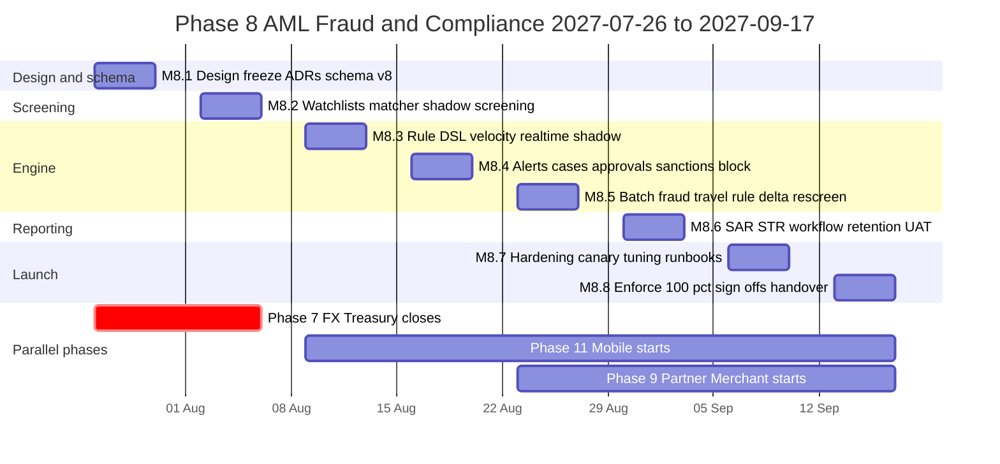
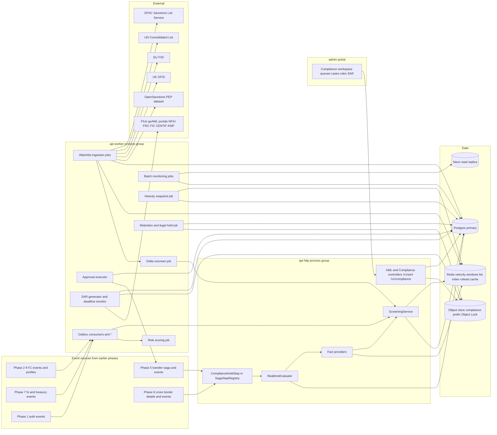
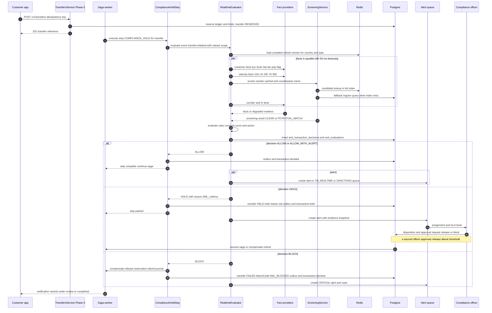
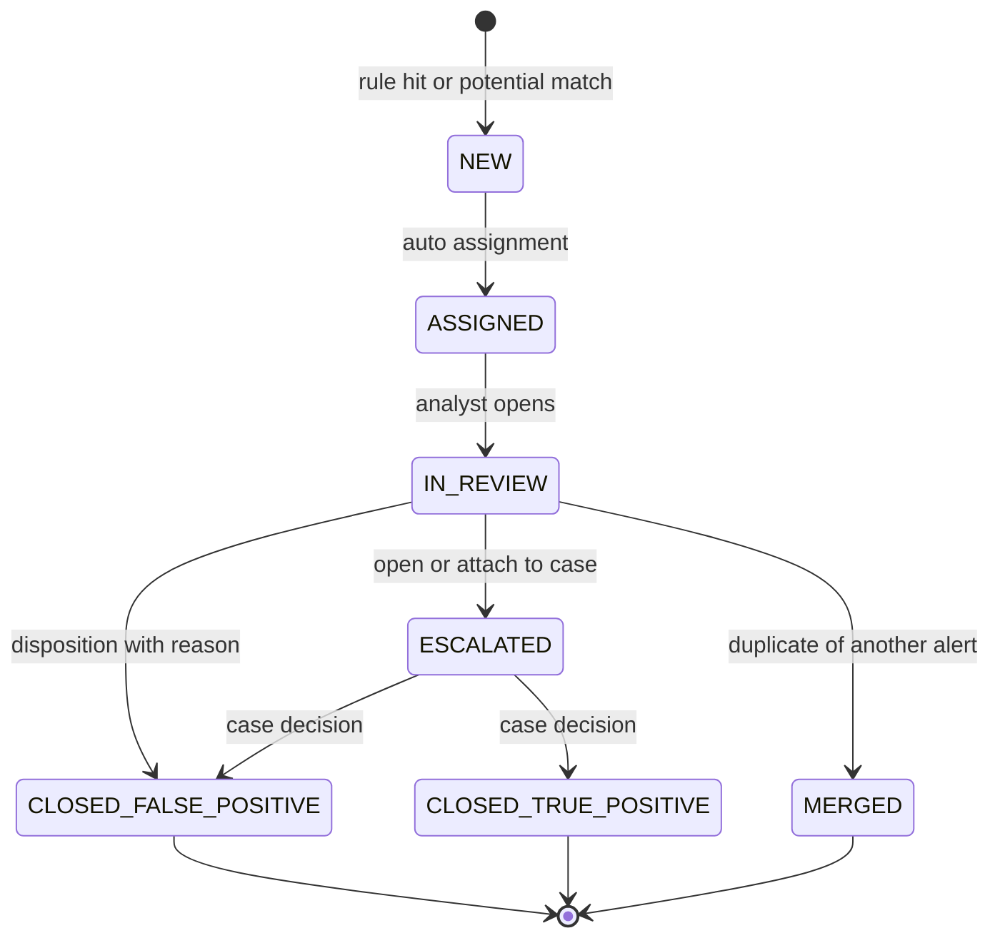
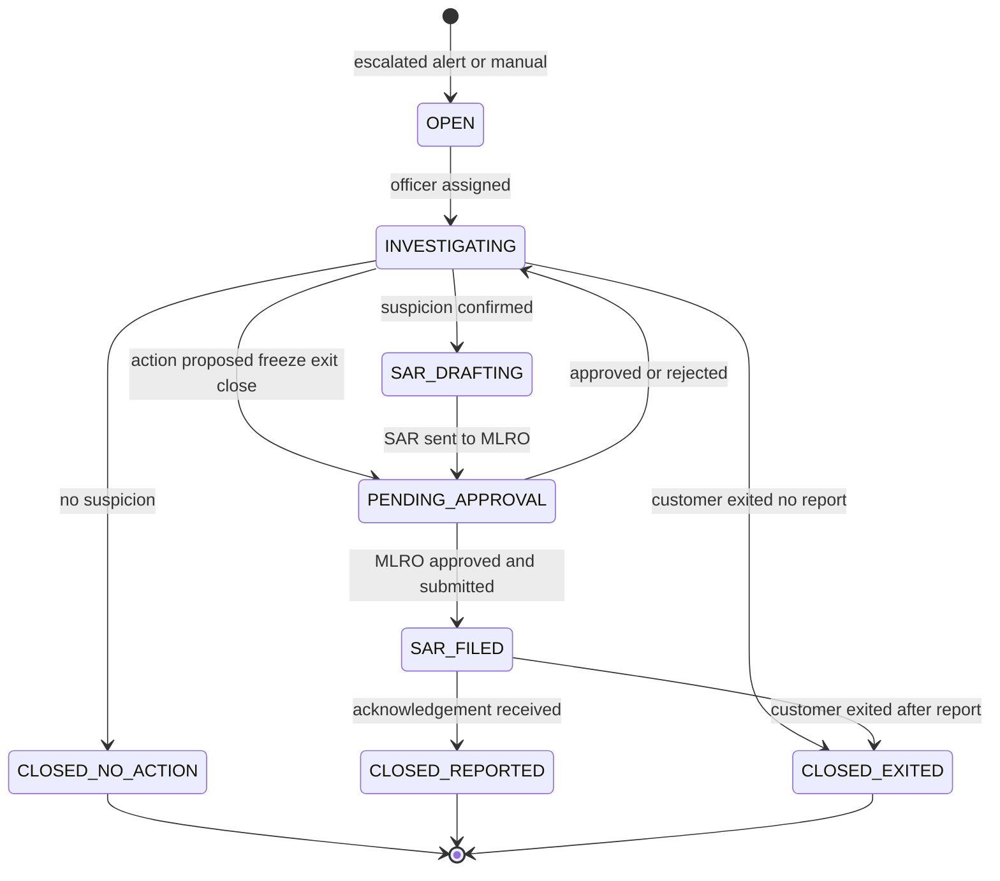
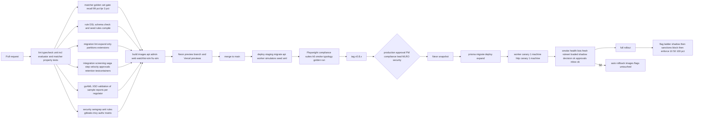

# Phase 8 — AML, Fraud & Compliance

| Field                     | Value                                                                                                                                                                                                                                                                                                                                                                                                                                                                                                                                                                                                                                                                                                                                                                                                                                                                                                                                                                                                                                                                                                                                                                                                                             |
| ------------------------- | --------------------------------------------------------------------------------------------------------------------------------------------------------------------------------------------------------------------------------------------------------------------------------------------------------------------------------------------------------------------------------------------------------------------------------------------------------------------------------------------------------------------------------------------------------------------------------------------------------------------------------------------------------------------------------------------------------------------------------------------------------------------------------------------------------------------------------------------------------------------------------------------------------------------------------------------------------------------------------------------------------------------------------------------------------------------------------------------------------------------------------------------------------------------------------------------------------------------------------- |
| **Phase**                 | 8 of 13 — `aml-compliance`                                                                                                                                                                                                                                                                                                                                                                                                                                                                                                                                                                                                                                                                                                                                                                                                                                                                                                                                                                                                                                                                                                                                                                                                        |
| **Dates**                 | 2027-07-26 → 2027-09-17                                                                                                                                                                                                                                                                                                                                                                                                                                                                                                                                                                                                                                                                                                                                                                                                                                                                                                                                                                                                                                                                                                                                                                                                           |
| **Duration**              | 8 weeks (W1 = 2027-07-26 … 2027-07-30, W8 = 2027-09-13 … 2027-09-17)                                                                                                                                                                                                                                                                                                                                                                                                                                                                                                                                                                                                                                                                                                                                                                                                                                                                                                                                                                                                                                                                                                                                                              |
| **Team**                  | `compliance` (3 backend W1–W4 from the `core` team freed by Phase 6, 2 backend W5–W8 when Phase 9 starts, plus 1 platform backend engineer joining W3–W8 as Phase 7 closes on 2027-08-06; 2 frontend W1–W4, 1 W5–W8; 1 QA throughout + 1 QA W6–W8 for UAT; compliance analyst 100 % as product owner; MLRO designate as business owner; solution architect 50 %; DevOps/SRE 40 %; PM 50 %; product designer 40 % W1–W5; 0.5 security engineer W4–W7; 1 mobile engineer for API contract review in W6)                                                                                                                                                                                                                                                                                                                                                                                                                                                                                                                                                                                                                                                                                                                             |
| **Depends on**            | Phase 2 — Customer Management & KYC (ended 2027-02-19): `customer_profiles` with reserved `pep_flag` / `sanctions_flag`, `risk_rating` / `risk_score`, `RiskRule` / `RiskAssessment` engine, `screening.requested` event, `KycCheckType.SANCTIONS_PEP` reserved, `VerificationQueueItem` review-queue pattern, `beneficiaries` and `beneficiary.*` events, document store with Object Lock, step-up MFA guard. Phase 6 — International Remittance (ended 2027-07-23): `transfer_cross_border_details` with purpose / source-of-funds / relationship codes and immutable sender-identity and recipient snapshots, `HELD` state with `/v1/intl/transfers/:id/release` and `/refund`, corridor `complianceRules`, `intl.transfer.*` events with `counterpartyHash`, `regulatory_reports` store. Transitively Phase 5 (ended 2027-05-28): `transfers`, `transfer.*` events, `limit_counters`, `COMPLIANCE_HOLD` saga step slot (no-op), `WalletsService.freeze`, `compliance_supervisor` role and the four-eyes override pattern; Phase 7 (overlaps W1–W2): `fx.trade.*` and `treasury.rebalance.*` events and manual-override audit stream; Phase 3/4: `Provider` directory and credential store for FIU and data-vendor credentials |
| **Unlocks**               | Phase 9 — Partner & Merchant Portal (2027-08-23, overlaps W5–W8): reuses `ScreeningService` for KYB screening of merchants, agents and partner directors and the case workspace for partner disputes; Phase 10 — Reporting & BI (2027-09-20): reads `aml_alerts`, `aml_cases`, `sar_reports`, `aml_risk_profiles`, `screening_requests` aggregates and the `aml.*` event stream; Phase 11 — Mobile (2027-08-09, overlaps W3–W8): consumes neutral "under review" transfer states and the device-signal ingestion endpoint; Phase 12 — Production Go-Live (2027-11-01): requires every criterion in §12 and the MLRO sign-off; Phase 13 — Expansion: new country = regulator profile + ruleset scope + watchlist scope, no code                                                                                                                                                                                                                                                                                                                                                                                                                                                                                                    |
| **Runs in parallel with** | Phase 7 — FX & Treasury (platform, until 2027-08-06); Phase 11 — Mobile (from 2027-08-09); Phase 9 — Partner & Merchant (core, from 2027-08-23)                                                                                                                                                                                                                                                                                                                                                                                                                                                                                                                                                                                                                                                                                                                                                                                                                                                                                                                                                                                                                                                                                   |

---

## 1. Overview

### 1.1 Objective

Up to Phase 7 BI-Rem can onboard customers with tiered KYC, move money domestically and across borders, and price FX — but it has **no automated AML/CFT controls beyond KYC limits and conservative velocity guardrails**. Phase 5 and Phase 6 went live under the explicit compliance condition (Phase 5 §8, Phase 6 §1.3) that limits stay low and that sanctions screening, transaction monitoring and suspicious-activity reporting arrive in Phase 8. Every event and column those phases reserved for us (`screening.requested`, `pep_flag` / `sanctions_flag`, `counterparty_hash`, the `COMPLIANCE_HOLD` saga step, `HELD` cross-border state, purpose / source-of-funds codes, identity snapshots) exists; nothing consumes them yet.

Phase 8 delivers the **compliance control plane**: an **AML Engine** that evaluates a declarative, versioned **rule DSL** in real time inside the transfer saga and in nightly **batch** passes; **Sanctions Screening** against OFAC (SDN + Consolidated), UN Security Council Consolidated List, EU Consolidated Financial Sanctions File and UK HMT/OFSI Consolidated List with in-house **fuzzy matching** (normalisation, transliteration, trigram candidate generation, phonetic keys, Jaro-Winkler scoring with secondary-attribute weighting); **PEP Screening** from the OpenSanctions PEP dataset; a composite **Risk Scoring** model per customer that combines Phase 2 onboarding risk with behavioural signals; **Velocity Monitoring** on Redis sliding windows; **Transaction Monitoring** producing **alerts** into prioritised **triage queues**; **Fraud Cases** fed by device, account-takeover and mule typologies; **Case Management** with evidence, notes, timeline and **four-eyes approvals** on every consequential action (freeze, release, whitelist, rule activation, SAR filing, customer exit); and a **SAR/STR workflow** that drafts reports from case evidence, generates goAML XML or the FIU's prescribed format, tracks submission, acknowledgement and deadlines, and enforces tipping-off controls. **Screening runs at onboarding, on every beneficiary change, on every transaction, and as delta re-screening whenever a list changes.** **Travel-rule data** (FATF R.16 originator / beneficiary information, IVMS101-shaped) is validated on every cross-border transfer and attached to the payout instruction. **Records are retained for 10 years** (regulatory minimum 5 years under FATF R.11, longer under every pilot regulator), with legal hold and Object Lock.

The phase succeeds when, in production, a seeded structuring pattern and a seeded sanctions-list name are flagged automatically within the real-time budget and land in the right queue with the right severity; and when a compliance officer can take an alert through triage, open a case, freeze a wallet under four-eyes, draft an STR from the case, have the MLRO approve it, submit it to the FIU (test environment where the FIU offers one), and record the acknowledgement — all from the admin portal, with every step audited.

### 1.2 In scope

| Area                              | Scope                                                                                                                                                                                                                                                                                                                                                                                                                                                                                                                                                                                                                                                                                                                                                                                                                                          |
| --------------------------------- | ---------------------------------------------------------------------------------------------------------------------------------------------------------------------------------------------------------------------------------------------------------------------------------------------------------------------------------------------------------------------------------------------------------------------------------------------------------------------------------------------------------------------------------------------------------------------------------------------------------------------------------------------------------------------------------------------------------------------------------------------------------------------------------------------------------------------------------------------- |
| **AML Engine**                    | `apps/api/src/modules/aml/*`: rule DSL (`@bi-rem/shared/schemas/aml-rules.ts`, Zod-validated JSON, compiled to a safe evaluator — no `eval`), **rulesets** versioned and scoped by country / corridor / customer segment, rule lifecycle `DRAFT → PENDING_APPROVAL → SHADOW → ACTIVE → DISABLED → RETIRED` under maker-checker, fact providers (transaction, customer, counterparty, velocity, screening, device, corridor, FX), actions `SCORE`, `ALERT`, `HOLD`, `BLOCK`, `FLAG_REVIEW`, **simulation / backtest** against historical events with precision-recall report, **shadow mode** per rule, real-time evaluation inside the Phase 5/6 `COMPLIANCE_HOLD` saga step with a hard latency budget and an explicit fail policy per rule severity, batch evaluation (nightly and hourly) over partitioned tables on the Neon read replica. |
| **Sanctions Screening**           | `watchlists` ingestion adapters for OFAC SDN + Consolidated (Sanctions List Service), UN Consolidated List, EU FSF, UK HMT/OFSI Consolidated List, and an `INTERNAL_BLOCKLIST`; versioned ingestion runs with diff; normalised name variants, identifiers, DOBs, nationalities, addresses; **fuzzy matcher** in Postgres (`pg_trgm`, `fuzzystrmatch`, `unaccent`) + application scoring; configurable thresholds per list and subject type; **whitelist** (false-positive suppression per subject ↔ entry with expiry, four-eyes); **delta re-screening** of the whole customer and beneficiary base when a list version changes.                                                                                                                                                                                                              |
| **PEP Screening**                 | OpenSanctions `peps` dataset ingestion (commercial licence), PEP classes (domestic / foreign / international-organisation, position, RCA — relatives and close associates), PEP status on `customer_profiles.pep_flag`, enhanced due diligence (EDD) task creation, senior-management approval to continue the relationship (four-eyes), periodic review schedule.                                                                                                                                                                                                                                                                                                                                                                                                                                                                             |
| **Risk Scoring**                  | `aml_risk_profiles`: composite score 0–1000 and `RiskRating` tier combining Phase 2 onboarding factors, behavioural factors (velocity, corridor risk, counterparty diversity, cash-out patterns, alert history, PEP / sanctions proximity), weights in a versioned **risk model** editable by the compliance analyst; tier changes emit events, drive limits (via Phase 5 `limit_overrides`), rule scope and periodic KYC review cadence.                                                                                                                                                                                                                                                                                                                                                                                                      |
| **Velocity Monitoring**           | Redis sliding-window counters (`count`, `sum`, `distinct`) keyed by sender, recipient, counterparty hash, device, IP /24, beneficiary, agent, merchant, corridor; windows 10 m / 1 h / 24 h / 7 d / 30 d; hourly snapshots to Postgres for audit and batch; replaces Phase 5 interim guardrails (max 10 transfers per 10 min, 3 new recipients per day) which become rules in the DSL.                                                                                                                                                                                                                                                                                                                                                                                                                                                         |
| **Transaction Monitoring**        | Real-time: every `transfer.initiated`, `intl.transfer.created`, wallet funding, cash-out, merchant payment, FX trade (Phase 7) is scored before the money moves. Batch: structuring (sub-threshold aggregation in local currency and USD equivalent), rapid in-out (pass-through), dormancy then burst, many-to-one / one-to-many funnels, round amounts, corridor anomaly vs. customer profile, agent cash-out anomalies, threshold reporting (CTR-type) per regulator. `aml_transaction_decisions` per transfer (`ALLOW`, `ALLOW_WITH_ALERT`, `HOLD`, `BLOCK`) with reasons and rule hits.                                                                                                                                                                                                                                                   |
| **Fraud Cases**                   | `fraud_signals` ingestion (device fingerprint, new device, SIM-swap indicator from Phase 4 connector where providers expose it, IP geolocation mismatch, impossible travel, credential-stuffing from Phase 1 auth, beneficiary added then large transfer, OTP failures); fraud typology rules (`ACCOUNT_TAKEOVER`, `MULE`, `SOCIAL_ENGINEERING`, `AGENT_COLLUSION`, `MERCHANT_BUST_OUT`); fraud alerts into the `FRAUD` queue with their own SLA; immediate protective actions (wallet freeze, session revocation via Phase 1 refresh-token revoke, step-up MFA requirement).                                                                                                                                                                                                                                                                  |
| **Case Management**               | `aml_cases` linking alerts, subjects (customers, beneficiaries, counterparties, merchants, agents), transactions and evidence; timeline, notes (append-only), attachments in the Phase 2 document store under `compliance/` with Object Lock; assignment, SLA, escalation ladder L1 analyst → L2 officer → MLRO; case decisions (`CLOSED_NO_ACTION`, `CLOSED_REPORTED`, `CLOSED_EXITED`); customer exit (off-boarding) workflow; regulator-request cases (production orders, FIU information requests) with response tracking.                                                                                                                                                                                                                                                                                                                 |
| **Four-eyes approvals**           | Generic `aml_approvals`: a maker proposes an action, a different checker with the matching `*:approve` permission and recent MFA approves or rejects; execution by the worker on approval; thresholds and mandatory-approval actions configurable; expiry; evidence of both identities on the audit row. Used for freeze / unfreeze, hold release above threshold, block, whitelist, rule activation / ruleset publish, risk-model publish, SAR filing, customer exit, PEP relationship continuation, case closure of `HIGH` / `CRITICAL` cases.                                                                                                                                                                                                                                                                                               |
| **Alert triage queues**           | Queues `SANCTIONS`, `PEP`, `TM_REALTIME`, `TM_BATCH`, `VELOCITY`, `FRAUD`, `TRAVEL_RULE`, `REGULATOR`; priority score from severity × amount × customer risk × age; SLA per queue (sanctions 2 h, fraud 1 h, real-time TM 24 h, batch TM 5 business days); auto-assignment by skill and load; de-duplication and alert merging; bulk actions limited to `LOW` severity.                                                                                                                                                                                                                                                                                                                                                                                                                                                                        |
| **SAR/STR Workflow**              | `regulator_profiles` per country (FIU, report types, format, goAML schema version, deadlines, channel, contact); report drafting from case (subjects, transactions, narrative with templates in en/fr/pt); validation against goAML XSD; MLRO approval (four-eyes); submission via goAML web upload or API where offered, portal/manual or encrypted e-mail otherwise; tracking of submission, acknowledgement, FIU rejection, amendment; deadline alarms; tipping-off controls; threshold reports (CTR / cash reports) generated on schedule where regulators require.                                                                                                                                                                                                                                                                        |
| **Travel rule**                   | `travel_rule_payloads` per cross-border transfer: originator (name, account / wallet id, address or national id or DOB and place of birth), beneficiary (name, account); IVMS101-shaped JSON; completeness rule (`HOLD` when a required field is missing above the regulator's threshold, default USD/EUR 1,000 equivalent); transmitted to payout partner in the Phase 6 payout instruction metadata; inbound validation for received remittances; data minimisation (beneficiary institution only receives required fields).                                                                                                                                                                                                                                                                                                                 |
| **Record retention & legal hold** | Retention policy table and enforcement: alerts, cases, screening results, decisions, SARs and evidence retained **10 years** after case closure or relationship end (≥ 5 years FATF R.11); `legal_holds` suspend any deletion or anonymisation (overrides the Phase 2 erasure job); Object Lock compliance mode on `compliance/` prefix; export packs for regulators.                                                                                                                                                                                                                                                                                                                                                                                                                                                                          |
| **Portals**                       | Admin compliance workspace `/compliance/*`; customer portal and mobile receive only neutral "under review" states and no case data.                                                                                                                                                                                                                                                                                                                                                                                                                                                                                                                                                                                                                                                                                                            |
| **Observability & runbooks**      | Metrics, dashboards, alerts, `docs/handbooks/aml-operations.md`, `docs/handbooks/sar-filing.md`, `docs/handbooks/sanctions-list-outage.md`, typology catalogue.                                                                                                                                                                                                                                                                                                                                                                                                                                                                                                                                                                                                                                                                                |

### 1.3 Out of scope (deferred)

- **Machine-learning anomaly models** (unsupervised or supervised scoring) — Phase 13 after 6 months of labelled alert outcomes exist; Phase 8 stores every alert disposition with features so a model can be trained later.
- **Adverse-media screening** and continuous negative-news monitoring — Phase 13; the `WatchlistKind.ADVERSE_MEDIA` enum value is reserved and the `ScreeningProvider` interface accepts a vendor adapter behind a flag.
- **Commercial screening vendor as primary** (ComplyAdvantage, Refinitiv World-Check, Dow Jones) — rejected for Phase 8 (§4.6); an optional `VendorScreeningAdapter` can be lit per country if a regulator demands a named vendor.
- **Transaction-monitoring of partner / merchant settlement batches** (Phase 9 flows) — Phase 9 consumes the same engine by emitting its events; Phase 8 ships the engine and merchant/agent typologies for Phase 5 flows only.
- **Regulatory returns other than SAR/STR/CTR** (central-bank statistical returns, FX returns) — Phase 10 (`regulatory_reports` store from Phase 6 remains the home).
- **Customer-facing dispute management and chargeback flows** — Phase 9 (merchant) and Phase 12 (support tooling); Phase 8 fraud cases cover the compliance side only.
- **In-country hosting of the compliance database** where a regulator requires it — Phase 13 per country; Phase 8 keeps data in the primary region with documented data-residency assessment.
- **Automated FIU API submission for FIUs without goAML web services** — manual upload stays; Phase 13 if an FIU exposes an API.

### 1.4 Independent deployability strategy

"Deployable alone" for Phase 8 means: **all migrations are expand-only and applied in W1; watchlist ingestion and screening run in production in shadow from W2 without affecting any customer; the real-time engine is wired into the `COMPLIANCE_HOLD` saga step but returns `ALLOW` for every transfer until `aml.realtime.enforce` is lit; every rule has its own shadow mode and every ruleset publish is four-eyes; blocking actions are introduced in a strict ladder (confirmed sanctions true match → high-severity real-time rules → the rest); every blocking path has a kill switch that falls back to the Phase 5/6 behaviour (no hold) within 30 seconds; and SAR submission is rehearsed against FIU test environments or validated XML before any production filing.**

| Mechanism                                                                                   | Phase 8 application                                                                                                                                                                                                                                                                                                                                                                                                                                                                                                                                                                                                                                                                                                                                                                                                                                                                                                                                                                                                                                                                                                                                                                                                                                                                                                                                                     |
| ------------------------------------------------------------------------------------------- | ----------------------------------------------------------------------------------------------------------------------------------------------------------------------------------------------------------------------------------------------------------------------------------------------------------------------------------------------------------------------------------------------------------------------------------------------------------------------------------------------------------------------------------------------------------------------------------------------------------------------------------------------------------------------------------------------------------------------------------------------------------------------------------------------------------------------------------------------------------------------------------------------------------------------------------------------------------------------------------------------------------------------------------------------------------------------------------------------------------------------------------------------------------------------------------------------------------------------------------------------------------------------------------------------------------------------------------------------------------------------- |
| **Feature flags** (Phase 1 `FeatureFlag`, Redis-cached 30 s, `rolloutPercentage` + `rules`) | `aml.enabled` (master; off → consumers ack events without side effects, saga step returns `ALLOW`), `aml.watchlists.ingest.enabled`, `aml.watchlists.<source>.enabled` per list, `aml.screening.onboarding.enabled` (shadow/enforce via `aml.screening.onboarding.enforce`), `aml.screening.beneficiary.enabled`, `aml.screening.transaction.enabled` / `.enforce`, `aml.screening.delta.enabled`, `aml.pep.enabled`, `aml.realtime.enabled` / `aml.realtime.enforce` (`rolloutPercentage` on sender user id, `rules: countryCode in [...]`), `aml.realtime.block.enabled` (BLOCK action honoured; HOLD only otherwise), `aml.batch.enabled`, `aml.velocity.enabled`, `aml.velocity.replace-limits-guardrails` (switches Phase 5 guardrails off once DSL equivalents are `ACTIVE`), `aml.fraud.enabled`, `aml.fraud.auto-freeze` (protective freeze without approval for `CRITICAL` fraud, else approval required), `aml.risk-model.v1`, `aml.cases.enabled`, `aml.approvals.enforce` (always true in production; false only in local dev), `aml.sar.enabled`, `aml.sar.submit.enabled` (draft/validate vs. actually transmit), `aml.sar.goaml.<country>.enabled`, `aml.travel-rule.enabled` / `.enforce`, `aml.retention.enforce`, `admin.compliance.workspace`, `portal.review-state-messaging`. Keys registered in `packages/shared/src/constants/feature-flags.ts`. |
| **Expand → migrate → contract**                                                             | W1 migration `20270726090000_phase8_expand` adds every table, enum, extension (`pg_trgm`, `fuzzystrmatch`, `unaccent`), index and nullable column (`transfers.aml_decision_id`, `transfers.aml_score`, `customer_profiles.aml_risk_profile_id`, `beneficiaries.screening_status`, `beneficiaries.last_screened_at`). Phase 8 introduces **no contract migration**; the only contract candidate (removing Phase 5's velocity guardrail settings once `aml.velocity.replace-limits-guardrails` has been on for a month) is handed to Phase 10's W1 slot. Partitioned from day one: `aml_evaluations`, `screening_requests`, `screening_matches`, `fraud_signals`, `velocity_counter_snapshots`, `aml_alert_events`.                                                                                                                                                                                                                                                                                                                                                                                                                                                                                                                                                                                                                                                       |
| **Dark launch**                                                                             | W2: lists ingest in production; onboarding screening runs on every new and existing customer in shadow (`screening_status` stored, no flag set, no queue item); W3: real-time engine evaluates every transfer in shadow writing `aml_evaluations` and `aml_transaction_decisions` with `enforced=false`; nightly report compares what _would_ have been held against the actual Phase 6 `HELD` decisions and Phase 5 guardrail trips; W4: sanctions `CONFIRMED_MATCH` blocks (after a compliance officer confirms the match — never on the matcher alone); W5–W7: rules move to `ACTIVE` individually once their shadow false-positive rate is within the per-rule target; W8: `aml.realtime.enforce` 100 %.                                                                                                                                                                                                                                                                                                                                                                                                                                                                                                                                                                                                                                                            |
| **Kill switches**                                                                           | `aml.realtime.enforce=false` → saga step returns `ALLOW` for new transfers in ≤ 30 s, in-flight `HOLD`s remain for operator release; `aml.screening.transaction.enforce=false` → screening still runs and alerts, never holds; `aml.watchlists.<source>.enabled=false` → a corrupt list version is excluded and the previous version stays active (`watchlist_versions.status=SUPERSEDED` reverts to `ACTIVE`); `aml.rules.freeze=true` (Setting, `aml:config:write` + MFA) blocks any ruleset publish; `aml.sar.submit.enabled=false` → drafts only; per-rule `DISABLED` without a deploy; `aml.fraud.auto-freeze=false`.                                                                                                                                                                                                                                                                                                                                                                                                                                                                                                                                                                                                                                                                                                                                              |
| **Worker isolation**                                                                        | Ingestion, screening fan-out, delta re-screen, batch monitoring, approvals execution, SAR generation and retention jobs run only in the `worker` process group (`WORKER_QUEUES` gains `aml:*`, `screening:*`, `tm:*`, `sar:*`); the `http` group evaluates real-time rules in-process (it must — latency) but reads compiled rulesets and the screening index from Redis with a local LRU; worker outage degrades to "batch and re-screen are late" and is alerted, never to "real-time decisions stop".                                                                                                                                                                                                                                                                                                                                                                                                                                                                                                                                                                                                                                                                                                                                                                                                                                                                |
| **Fail policy**                                                                             | Real-time evaluation has a 150 ms p95 / 400 ms hard budget. If a fact provider times out: rules with action `BLOCK` or `HOLD` and severity `CRITICAL` fail **closed** (`HOLD` with reason `AML_EVAL_TIMEOUT`, released by operator); every other rule fails **open** with an alert `aml.evaluation.degraded` and a batch re-evaluation within the hour. Sanctions screening of the counterparty failing → `HOLD` for cross-border transfers above the travel-rule threshold, `ALLOW_WITH_ALERT` below.                                                                                                                                                                                                                                                                                                                                                                                                                                                                                                                                                                                                                                                                                                                                                                                                                                                                  |
| **Backward-compatible APIs**                                                                | New paths `/v1/aml/*`, `/v1/compliance/*`; Phase 5 `/v1/transfers/:id` and Phase 6 tracking responses gain an optional `reviewState` (`NONE`, `UNDER_REVIEW`) and no other field; Phase 6 `/v1/intl/transfers/:id/release` becomes callable only through an approval when the hold reason is `AML_*`.                                                                                                                                                                                                                                                                                                                                                                                                                                                                                                                                                                                                                                                                                                                                                                                                                                                                                                                                                                                                                                                                   |
| **Rollback**                                                                                | Flags first; Fly image rollback (`infra/scripts/rollback-api.sh`) and Vercel instant rollback; schema stays. Alerts, cases, decisions and SARs are append-only or versioned — a bad rule produces alerts that are bulk-closed with reason `RULE_DEFECT` (audited), never deleted.                                                                                                                                                                                                                                                                                                                                                                                                                                                                                                                                                                                                                                                                                                                                                                                                                                                                                                                                                                                                                                                                                       |

---

## 2. Milestones

Phase start is Monday **2027-07-26**; week _n_ runs Monday to Friday; milestone dates are the Friday of the week.

| ID       | Week | Target date | Deliverable                                                                                                                                                                                                                                                                                                                                                                                                                                                                                                                                                                         | Acceptance criteria                                                                                                                                                                                                                                                                                                                                                                                                                                                                                                                                                                                                                                                                    | Owner                             |
| -------- | ---- | ----------- | ----------------------------------------------------------------------------------------------------------------------------------------------------------------------------------------------------------------------------------------------------------------------------------------------------------------------------------------------------------------------------------------------------------------------------------------------------------------------------------------------------------------------------------------------------------------------------------- | -------------------------------------------------------------------------------------------------------------------------------------------------------------------------------------------------------------------------------------------------------------------------------------------------------------------------------------------------------------------------------------------------------------------------------------------------------------------------------------------------------------------------------------------------------------------------------------------------------------------------------------------------------------------------------------- | --------------------------------- |
| **M8.1** | W1   | 2027-07-30  | Design freeze: rule DSL grammar and evaluator, screening architecture and matcher scoring, case / approval state machines, SAR workflow and regulator matrix v1; ADR-0025 (rule DSL and evaluation engine), ADR-0026 (watchlist ingestion and fuzzy matching), ADR-0027 (case management and four-eyes approvals), ADR-0028 (SAR/STR workflow, retention and legal hold); schema v8 _expand_ migration applied to staging and production; FIU registration requests and goAML test-environment access requested for NG, KE, GH; OpenSanctions licence signed; EU FSF token obtained | `pnpm db:migrate:dev` applies `20270726090000_phase8_expand` on a Phase 7 snapshot with `prisma migrate diff` empty; extensions present on Neon staging and production; `packages/shared/src/schemas/aml-rules.ts` compiles and validates the 25 seed rules in `packages/db/prisma/seed-data/aml-rules.json`; ADRs accepted at the Thursday architecture review; regulator matrix (§8.3) has an owner and date per country; permissions and roles seeded                                                                                                                                                                                                                               | Solution Architect                |
| **M8.2** | W2   | 2027-08-06  | Watchlist ingestion for OFAC SDN + Consolidated, UN, EU FSF, UK OFSI, internal blocklist with versioning and diff; OpenSanctions PEP dataset loaded; fuzzy matcher with golden-set calibration; `ScreeningService` + whitelist; onboarding and beneficiary screening consumers in production **shadow**; screening console v1                                                                                                                                                                                                                                                       | Every adapter parses the current live file and the frozen fixtures in CI; ingestion run produces a diff (added / removed / changed entries) and a `watchlist_versions` row; matcher golden set (2,000 labelled pairs incl. transliteration, name order, initials, diacritics) reaches recall ≥ 99 % at the default threshold with false-positive rate ≤ 3 % of screened subjects on the staging customer sample; full shadow screening of the production customer and beneficiary base completes in < 2 h; p95 single-subject screening < 300 ms; a seeded OFAC name registered in staging produces `POTENTIAL_MATCH` within 5 s                                                       | Backend Lead (compliance)         |
| **M8.3** | W3   | 2027-08-13  | Rule DSL evaluator; rulesets with maker-checker lifecycle; simulation / backtest on 90 days of Phase 5/6 history; fact providers; velocity counters in Redis with snapshots; real-time engine wired into `COMPLIANCE_HOLD` saga step in **shadow**; rules studio v1 in admin                                                                                                                                                                                                                                                                                                        | 25 seed rules compile; property tests prove evaluator determinism and that no rule can call outside its fact whitelist; backtest of the structuring rule over 90 days produces a precision-recall report in < 10 min on the replica; real-time evaluation p95 < 150 ms and p99 < 400 ms under k6 at 50 decisions/s in staging with all fact providers; shadow decisions written for 100 % of production transfers for 48 h with zero saga latency regression > 20 ms p95; a rule in `DRAFT` edited by the maker is not evaluated; publish without a distinct approver is rejected with 403                                                                                             | Backend Lead (compliance)         |
| **M8.4** | W4   | 2027-08-20  | Alerts and triage queues with SLA and auto-assignment; case management v1 (case, subjects, notes, attachments, timeline); generic four-eyes approvals; freeze / unfreeze / hold release / block through approvals; **sanctions blocking live** for confirmed true matches; composite risk scoring v1; compliance workspace v2 (queues, case view, approvals inbox)                                                                                                                                                                                                                  | Alert → case → approval → freeze executed end to end in staging by two distinct users; same user attempting to approve own request → 403 and audit `DENIED`; SLA breach pages the compliance on-call in staging drill within 2 min; in production a compliance officer confirms a seeded true match and the transfer moves to `BLOCKED` with a `COMPLIANCE_HOLD` compensation and refund; `aml_risk_profiles` exist for 100 % of customers with a score and an explainable factor breakdown; Playwright suite for queues and cases green                                                                                                                                               | Backend Lead / Frontend Lead      |
| **M8.5** | W5   | 2027-08-27  | Batch monitoring jobs (structuring, pass-through, dormancy burst, funnels, round amounts, agent anomalies, threshold reports); fraud signals ingestion and fraud typology rules with protective actions; travel-rule payload capture and validation integrated with Phase 6 payout metadata; delta re-screening on list updates; Phase 5/6 hold and release integration complete; velocity DSL rules replace Phase 5 guardrails on staging                                                                                                                                          | Nightly batch over 30 days of production-sized synthetic data completes in < 60 min on the replica; each typology has ≥ 3 positive and ≥ 3 negative golden scenarios passing; a seeded account-takeover scenario (new device + new beneficiary + large transfer) produces a `CRITICAL` fraud alert and protective freeze within 10 s; a UN list delta touching 40 entries re-screens only affected subjects (≤ 5 min); a cross-border transfer above the threshold missing originator address is `HELD` with reason `TRAVEL_RULE_INCOMPLETE` and released after the customer completes the profile; Phase 5 guardrail trips and DSL velocity rule trips agree on 7 days of shadow data | Backend Lead (compliance)         |
| **M8.6** | W6   | 2027-09-03  | SAR/STR workflow: regulator profiles, report drafting from case, narrative templates (en/fr/pt), goAML XML generation validated against XSD per FIU schema version, MLRO approval, submission tracking, acknowledgement, deadlines; CTR scheduler; retention policies and legal holds; regulator export packs; UAT begins with compliance analyst and MLRO                                                                                                                                                                                                                          | goAML XML for NG, KE, GH validates against the respective XSDs and is accepted by the FIU test environment where available (else validated by XSD + manual review by counsel); STR deadline alarm fires at 50 % and 90 % of the regulator window; SAR content endpoints return 403 to every role except `mlro` and `compliance_officer` assigned to the case, and every read is audited; a legal hold on a closed case blocks the retention job and the Phase 2 anonymisation job; export pack reproduces the case with hashes; UAT scripts `docs/uat/phase-08.md` started                                                                                                             | Compliance Analyst / Backend Lead |
| **M8.7** | W7   | 2027-09-10  | Hardening: performance, chaos (worker kill during fan-out, Redis loss, replica lag), security review and pen-test on approvals and SAR confidentiality, false-positive tuning from shadow data, rules moved to `ACTIVE` with `aml.realtime.enforce` canary 10 % → 50 %, runbooks, Grafana dashboards and alerts, training for compliance team                                                                                                                                                                                                                                       | k6 profile (§9.1) passes two consecutive nights; chaos suite shows zero lost decisions and zero duplicate alerts; pen-test findings ≥ High closed; shadow-vs-enforce comparison shows alert volume within capacity (≤ 60 alerts per analyst per day at 50 %); all 12 runbook procedures rehearsed; compliance team completes training checklist                                                                                                                                                                                                                                                                                                                                        | QA Lead / Security / Backend Lead |
| **M8.8** | W8   | 2027-09-17  | Production launch: `aml.realtime.enforce` 100 %, `aml.screening.*.enforce` on, batch jobs active, PEP flags set, Phase 5 guardrails replaced, SAR workflow live (first production filing if a reportable case exists, otherwise FIU test filing evidenced); success criteria evidenced; sign-offs; handover to Phases 9, 10, 11, 12                                                                                                                                                                                                                                                 | §12 criteria evidenced with production data; 5 consecutive production days with every transfer carrying an `aml_transaction_decisions` row and decision latency p95 < 150 ms; zero sanctions `CONFIRMED_MATCH` transfers completed; alert SLA compliance ≥ 95 %; MLRO, compliance analyst, PM, security sign-offs collected; Phase 10 lead has replica access to `aml_*`, `sar_*` aggregates; Phase 9 consuming `ScreeningService` for KYB on staging                                                                                                                                                                                                                                  | Program Manager                   |



Staffing note: the three core backend engineers arrive from Phase 6 on day one, which is why the screening and engine foundations (M8.2–M8.4) are front-loaded; when Phase 9 pulls two of them on 2027-08-23, the platform engineer freed by Phase 7 has already joined (W3) and the remaining work (batch jobs, SAR workflow, hardening) is less parallel. The compliance analyst is the product owner for the whole phase and the MLRO designate must be named by M8.1 — without an MLRO no SAR can be approved.

---

## 3. Deliverables

Each deliverable lists the definition of done (DoD) that M8.x acceptance refers to.

### 3.1 AML Engine (rules + scoring)

- **What**: `apps/api/src/modules/aml/engine/*` — rule DSL schema, compiler, evaluator, fact providers, ruleset registry, real-time and batch runners.
- **DoD**: DSL (§4.4) validated by Zod in `@bi-rem/shared/schemas/aml-rules.ts` with a JSON Schema export for the admin editor; compiler produces a closure tree (no `eval`, no `Function`), rejects unknown facts and operators, enforces a maximum depth (16) and fact count (40) per rule; evaluator is deterministic (property-tested with fast-check, 100,000 random rule × fact combinations) and returns `{ hits: RuleHit[], score, action, reasons, durationMs, degradedFacts }`; fact providers: `transaction`, `customer`, `counterparty`, `beneficiary`, `velocity`, `screening`, `device`, `corridor`, `fx`, `history`; each with a timeout (default 50 ms) and a cached variant; rulesets versioned, immutable once published, scoped by `countryCode`, `corridorKey`, `transferType`, `customerSegment`; real-time runner is the `COMPLIANCE_HOLD` saga step implementation registered in the Phase 5 `SagaStepRegistry` with compensation = release reservation + refund journal (Phase 5 pattern); batch runner uses BullMQ repeatable jobs on the worker group and reads the replica; every evaluation writes `aml_evaluations` (hits only beyond 30 days) and `aml_transaction_decisions`; simulation endpoint runs a draft rule over a historical window and returns precision / recall against alert dispositions; 25 seed rules cover the §4.4 typology catalogue; `aml_rule_evaluations_total`, `aml_decision_latency_seconds`, `aml_fact_timeouts_total` metrics.

### 3.2 PEP Screening

- **What**: PEP dataset ingestion, PEP matching with position / country / RCA semantics, EDD workflow.
- **DoD**: OpenSanctions `peps` dataset (FollowTheMoney JSON) ingested weekly into `watchlists` with `kind=PEP`, including positions, countries, start / end dates and RCA links; matcher uses the same pipeline as sanctions with a PEP-specific threshold and a nationality / residence boost; a confirmed PEP sets `customer_profiles.pep_flag=true`, creates an `EDD_REQUIRED` task on the case, requires senior-management (`mlro` or `compliance_supervisor`) approval to continue the relationship, sets the periodic review to 6 months (`HIGH` tier) and emits `aml.customer.pep_confirmed`; de-PEP after 12 months out of office follows a configurable rule (FATF "once a PEP" guidance documented in the handbook, default: keep `HIGH` for 12 months then re-assess); customer never sees PEP status.

### 3.3 Sanctions Screening (OFAC, UN, EU, UK HMT; fuzzy matching)

- **What**: `apps/api/src/modules/aml/watchlists/*` and `apps/api/src/modules/aml/screening/*`.
- **DoD**: adapters `OfacSlsAdapter` (SDN and Consolidated via Sanctions List Service, XML `sdn_advanced` format with aliases, IDs, DOBs, places of birth, addresses, programs), `UnConsolidatedAdapter` (XML), `EuFsfAdapter` (XML 1.1 full list with token), `UkOfsiAdapter` (XML / CSV consolidated list), `InternalBlocklistAdapter` (CSV upload with four-eyes), `OpenSanctionsPepAdapter`; every run records source URL, ETag / hash, entry counts and diff; a run that changes > 20 % of entries or fails schema validation is quarantined (`watchlist_versions.status=QUARANTINED`) and alerted, previous version stays active; normalisation pipeline (NFKD + `unaccent`, lower, strip punctuation and honorifics, Arabic / Cyrillic / Chinese transliteration tables, token sort, initials expansion) applied identically to list entries and subjects and unit-tested with a published fixture; candidate generation by trigram similarity (GIN index on `name_normalized`), Double Metaphone token keys, and exact identifier hash match; scoring: token-aligned Jaro-Winkler, token-set ratio, DOB (exact +, year ±1 neutral, conflict > 2 years −), nationality / country (+/−), gender (−), identifier exact (+ large); thresholds configurable per `watchlist` and `subjectType` (`Setting` `aml.screening.thresholds`), default `≥ 0.92 → POTENTIAL_MATCH severity HIGH`, `0.80–0.92 → POTENTIAL_MATCH severity MEDIUM`, `< 0.80 → CLEAR`; a `POTENTIAL_MATCH` creates an alert in the `SANCTIONS` queue; only a human disposition `TRUE_MATCH` sets `sanctions_flag`, blocks the transaction and freezes the wallet (four-eyes); whitelist entries suppress a specific subject ↔ entry pair with expiry (default 12 months) and are revalidated when the entry changes; delta re-screen compares subjects against changed entries only; `aml_screening_requests_total{trigger,result}`, `aml_screening_latency_seconds`, `aml_watchlist_age_hours{source}` metrics; staleness alert when any list is older than its expected cadence + 24 h.

### 3.4 Risk Scoring

- **What**: composite customer risk model and profiles.
- **DoD**: `aml_risk_models` versioned (weights, factor definitions, tier cut-offs) under maker-checker; factors: Phase 2 onboarding score, country risk (sender residence, nationality, corridors used, counterpart countries — table maintained by compliance with FATF grey / black list, Basel AML Index band), product risk (cash-out, agent, merchant, cross-border), behavioural (30-day volume vs. declared `expectedMonthlyVolumeMinor`, counterparty count, new-beneficiary rate, night-time ratio, alert count and dispositions), PEP / sanctions proximity (RCA, shared device or counterparty with a confirmed subject); score 0–1000 mapped to `RiskRating` (`LOW` < 300, `MEDIUM` < 600, `HIGH` < 850, `PROHIBITED` ≥ 850); recomputed on events and nightly; tier change emits `aml.risk.tier_changed`, writes a Phase 5 `limit_overrides` proposal (approval required to lower limits? no — lowering is automatic, raising requires approval), sets KYC periodic review cadence (LOW 36 months, MEDIUM 24, HIGH 12, PEP 6); explainable factor breakdown stored per computation; back-compat: Phase 2 `risk_rating` column keeps being written so Phase 5 limit logic is unchanged.

### 3.5 Velocity Monitoring

- **What**: sliding-window counters and velocity facts.
- **DoD**: `VelocityService` with Redis sorted sets per `(dimension, key, metric)` trimmed to the largest window, `count`, `sum` (minor units in a single currency and USD equivalent via Phase 7 mid), `distinct` (HyperLogLog for large cardinalities, exact set below 1,000); dimensions: sender, recipient, counterparty hash, beneficiary, device id, IP /24, agent, merchant, corridor, sender country; windows 10 m, 1 h, 24 h, 7 d, 30 d; writes happen in the saga after reservation and are compensated on failure; hourly snapshots to `velocity_counter_snapshots`; Redis loss → counters rebuilt from `transfers` for the last 30 days by a worker job (< 20 min at 100 k tx/day) while rules depending on velocity fail open with `degradedFacts`; Phase 5 guardrails (10 per 10 min, 3 new recipients per day) expressed as DSL rules `vel.burst.10m` and `vel.new-recipients.24h` with identical thresholds, proven equivalent on 7 days of shadow data before `aml.velocity.replace-limits-guardrails` is lit.

### 3.6 Transaction Monitoring (real-time + batch)

- **What**: typology coverage, decisions and alerts for every money movement.
- **DoD**: real-time decision for `transfer.initiated` (all Phase 5 types), `intl.transfer.created`, wallet funding, agent cash-out confirmation, merchant payment, Phase 7 `fx.trade.*` (alert-only); decision persisted before the saga proceeds; `HOLD` parks the transfer in Phase 5 `HELD` / Phase 6 `HELD` with `holdReason=AML_<ruleKey>` and SLA; release / refund only through approvals; `BLOCK` compensates immediately; batch typologies (§4.4) run nightly 02:00 UTC and hourly for pass-through; batch alerts carry the evidence window (transactions, counters) as a frozen JSON snapshot; CTR / threshold report generation where a regulator profile defines a cash or value threshold (e.g. NFIU currency transaction reports above the statutory NGN threshold for individuals and corporates — figures confirmed per regulator profile, Q8.3); `aml_decisions_total{decision,enforced}`, `aml_holds_open`, `aml_alerts_open{queue,severity}` metrics.

### 3.7 Fraud Cases

- **What**: fraud signal ingestion, typologies, protective actions, `FRAUD` queue and `FRAUD` case type.
- **DoD**: `POST /v1/aml/signals` (API key or internal) and consumers for Phase 1 auth events (`auth.login.failed`, `auth.password.changed`, `auth.mfa.disabled`), Phase 2 device signals (`device_country_mismatch`, `multiple_accounts_same_device`), Phase 4 connector signals (SIM-swap indicator where MNO exposes it, e.g. MTN / Safaricom SIM-swap check APIs via Phase 3 connections), Phase 11 mobile SDK device attestation (contract agreed W6); typology rules `fraud.ato.new-device-new-beneficiary`, `fraud.ato.credential-change-then-transfer`, `fraud.mule.rapid-in-out`, `fraud.mule.many-senders-one-recipient`, `fraud.agent.cashout-ring`, `fraud.merchant.bust-out`, `fraud.social.first-transfer-max-amount`; protective actions on `CRITICAL`: wallet freeze (auto when `aml.fraud.auto-freeze`, else approval), refresh-token revocation (Phase 1), step-up MFA requirement flag on the user, outbound notification to the customer through a neutral template ("we paused a transaction for security; call us"); fraud SLA 1 h; fraud losses recorded on the case with amounts (minor units + currency) for Phase 10.

### 3.8 Case Management

- **What**: `apps/api/src/modules/compliance/cases/*` and admin case workspace.
- **DoD**: case types `AML`, `FRAUD`, `SANCTIONS`, `PEP_REVIEW`, `REGULATOR_REQUEST`; states `OPEN → INVESTIGATING → PENDING_APPROVAL → SAR_DRAFTING → SAR_FILED | CLOSED_*`; subjects polymorphic (customer, beneficiary, counterparty hash, merchant, agent, external person); linked alerts (many-to-many, alert merge), linked transactions, notes append-only with mentions, attachments (Phase 2 `DocumentsModule` pipeline: AV scan, envelope encryption, Object Lock on `compliance/` prefix), timeline derived from `aml_case_events`; assignment, watchers, SLA by priority, escalation ladder with auto-escalation at 80 % SLA; customer-exit workflow (close wallet after refund, block re-registration by id hash, retain records) with approval; regulator-request cases with request document, response deadline and delivered-items checklist; every read of a case is audited (`aml:cases:read`) with correlation id; search by subject, reference, counterparty hash, status, queue.

### 3.9 SAR/STR Workflow (report generation, regulator submission tracking)

- **What**: `apps/api/src/modules/compliance/sar/*`.
- **DoD**: `regulator_profiles` per country (FIU name, report types STR / SAR / CTR, format `GOAML_XML` with schema version or `FORM_PDF` / `PORTAL`, deadlines in hours from suspicion, submission channel, contact, test-environment availability, legal basis); report drafted from a case: subjects (from Phase 2 profile and snapshots), transactions (selected from case), indicators (FIU indicator codes mapped from rule keys), narrative generated from a template (`en`, `fr`, `pt`) that the officer edits; goAML XML generator table-driven per schema version validated against bundled XSDs; four-eyes: drafter (`aml:sar:write`) ≠ approver (`aml:sar:approve`, role `mlro`); submission by `aml:sar:submit` records channel, timestamp, external reference, acknowledgement receipt (upload), FIU feedback; amendments create a new version linked to the original; deadline alarms at 50 % / 90 % / breach; the submitted artefact (XML / PDF) stored immutable with hash; "tipping-off" controls: SAR existence never exposed outside `mlro` / assigned officer, customer-facing templates reviewed, support agents see only `UNDER_REVIEW`; a monthly SAR register export for the board.

### 3.10 Rule DSL / configuration

- **What**: declarative rule language and the rules studio.
- **DoD**: grammar in §4.4 documented in `docs/handbooks/aml-rule-authoring.md` with 25 worked examples; editor with schema validation, fact autocompletion, dry-run against a sample event, simulation over a window, diff between versions; ruleset publish requires approval; configuration (thresholds, queue SLAs, country risk table, regulator profiles, retention policies) editable from admin with maker-checker and stored in Phase 1 `Setting` or dedicated tables as specified in §5.

### 3.11 Alert triage queues

- **DoD**: queues and SLAs as §1.2; priority score formula `severityWeight × log(amountUsd + 1) × riskTierWeight × ageFactor` documented and unit-tested; auto-assignment round-robin by queue skill with load cap (configurable, default 40 open per analyst); de-duplication key `(subjectId, ruleKey, dayBucket)`; merge keeps every alert's evidence; bulk close only for `LOW` severity and only with a mandatory reason; queue dashboards with SLA burn-down; keyboard-first triage screen.

### 3.12 Four-eyes approvals

- **DoD**: `aml_approvals` generic (action type, payload, maker, checker, status, expiry, MFA evidence); server enforces `maker ≠ checker`, checker permission, recent MFA (≤ 10 min, Phase 2 `@RequiresRecentMfa`), expiry 72 h; execution by worker job with idempotency; thresholds configurable (`aml.approvals.thresholds` Setting: hold release above USD 500 equivalent, every freeze / unfreeze, every whitelist, every rule / model publish, every SAR filing, every customer exit, closure of `HIGH` / `CRITICAL` cases); approvals inbox in admin; audit row carries both identities and the payload hash.

### 3.13 Record retention (5+ years)

- **DoD**: `retention_policies` table seeded with 10 years for every AML record class (policy minimum 5 years FATF R.11; CBN / BoG / BCEAO / CEMAC require 5–10 years — 10 chosen to cover the strictest pilot regulator and align with Phase 5/6); `legal_holds` on cases, customers or transactions suspend deletion and anonymisation; weekly retention job computes `retention_until`, exports expiring records to cold storage (Parquet via Phase 10 pattern) before deletion, refuses to delete under legal hold; Phase 2 anonymisation job calls `LegalHoldService.isHeld(userId)` and skips held subjects; Object Lock compliance mode 10 years on `compliance/`; retention report monthly.

### 3.14 Screening on onboarding and per transaction

- **DoD**: onboarding — consumer of `customer.registered`, `kyc.application_submitted`, `customer.profile_updated`, `screening.requested` screens the customer (name, DOB, nationality, id hash) and writes `screening_requests`; `POTENTIAL_MATCH` creates an alert and sets the Phase 2 `VerificationQueueItem` reason `SCREENING_REVIEW` so KYC approval waits; beneficiary — `beneficiary.created|updated` screens the beneficiary name and sets `beneficiaries.screening_status`; per transaction — `COMPLIANCE_HOLD` step screens sender (cached 24 h unless the list changed), recipient / beneficiary / counterparty name (from Phase 5 `counterpartyName`, Phase 6 `recipientSnapshot`) synchronously against the Redis-cached list index with Postgres fallback; result cached per `(subjectHash, watchlistVersion)`.

### 3.15 Travel rule data

- **DoD**: `travel_rule_payloads` built at `intl.transfer.created` from the Phase 6 snapshots and the Phase 2 profile; required-field matrix per regulator profile (default FATF R.16: originator name, account identifier, and one of address / national id / DOB + place of birth; beneficiary name and account identifier); validation rule `tr.incomplete.above-threshold` → `HOLD` with customer prompt to complete profile; payload included in the Phase 6 payout instruction metadata to the partner (`CorridorRoute` capability flag `acceptsTravelRule`); inbound remittance payload stored and validated; payloads encrypted at rest with the Phase 3 envelope pattern; access audited.

### 3.16 Portals, observability, runbooks

- **DoD**: admin compliance workspace (§7.1) with Playwright coverage; customer portal and mobile neutral messaging (§7.2); 6 Grafana dashboards and 14 alerts (§11); handbooks listed in §15.4.

---

## 4. Architecture

### 4.1 Component diagram (Phase 8 additions)



Module layout in `apps/api/src/modules/`:

| Module                   | Responsibility                                                                                                                                                                         |
| ------------------------ | -------------------------------------------------------------------------------------------------------------------------------------------------------------------------------------- |
| `aml/engine`             | DSL schema, compiler, evaluator, ruleset registry (Redis-cached compiled rulesets, 30 s TTL, version-stamped), fact providers, `RealtimeEvaluator`, `BatchRunner`, `SimulationService` |
| `aml/watchlists`         | Source adapters, ingestion runs, versioning, diff, quarantine, list index builder (Redis hash of normalised names → entry ids per version)                                             |
| `aml/screening`          | Normalisation pipeline, candidate generation, scoring, `ScreeningService.screen(subject, trigger)`, whitelist, delta re-screen, caching                                                |
| `aml/velocity`           | `VelocityService`, Redis windows, snapshots, rebuild                                                                                                                                   |
| `aml/risk`               | Risk models, profile computation, tier change effects                                                                                                                                  |
| `aml/signals`            | Fraud signal ingestion and normalisation                                                                                                                                               |
| `aml/alerts`             | Alert creation, de-duplication, queues, priority, SLA, assignment                                                                                                                      |
| `compliance/cases`       | Cases, subjects, notes, attachments, timeline, escalation, customer exit                                                                                                               |
| `compliance/approvals`   | Generic four-eyes approvals and executor                                                                                                                                               |
| `compliance/sar`         | Regulator profiles, report drafting, goAML generation, submission tracking, deadlines                                                                                                  |
| `compliance/travel-rule` | Payload build, validation, transmission hooks                                                                                                                                          |
| `compliance/retention`   | Policies, legal holds, retention job, export packs                                                                                                                                     |

### 4.2 Sequence — real-time decision inside the transfer saga



### 4.3 Alert and case state machines





### 4.4 Rule DSL

Rules are JSON documents (authored as YAML in the studio, stored as JSON) validated by `AmlRuleSchema` in `@bi-rem/shared`. The grammar is deliberately small: a rule has a scope, a boolean condition tree over typed **facts**, and an outcome. Facts are provided by whitelisted providers; a rule cannot reference anything else.

```yaml
key: tm.structuring.sub-threshold-24h
version: 3
kind: REALTIME # REALTIME | BATCH | SCREENING
severity: HIGH # LOW | MEDIUM | HIGH | CRITICAL
action: HOLD # SCORE | ALERT | HOLD | BLOCK | FLAG_REVIEW
queue: TM_REALTIME
failPolicy: CLOSED # OPEN | CLOSED (what to do when a fact is degraded)
scope:
  eventTypes: [transfer.initiated, intl.transfer.created]
  countryCodes: [NG, GH, KE, CM]
  transferTypes: [W2W_EXTERNAL, INTL_SEND, AGENT_CASHOUT]
when:
  all:
    - fact: transaction.amountUsdMinor
      op: between
      value: [80000, 99999] # USD 800.00 to 999.99 equivalent
    - fact: velocity.count
      args: { dimension: SENDER, window: 24h, filter: { amountUsdMinorBetween: [80000, 99999] } }
      op: gte
      value: 3
    - any:
        - fact: customer.kycLevel
          op: in
          value: [LEVEL_1, LEVEL_2]
        - fact: customer.riskTier
          op: gte
          value: MEDIUM
    - not:
        fact: counterparty.isWhitelisted
        op: eq
        value: true
outcome:
  score: { add: 40 }
  reason: 'Three or more sub-threshold transfers in 24h'
  indicatorCodes: [STR_IND_STRUCTURING]
  evidence: [velocity.count, transaction.amountUsdMinor, customer.kycLevel]
shadow: false
```

| Element               | Semantics                                                                                                                                                                                                                                                                                                                                                                                                                                                                                                                                                                                                                                                                                                                                                                                                                                                                                        |
| --------------------- | ------------------------------------------------------------------------------------------------------------------------------------------------------------------------------------------------------------------------------------------------------------------------------------------------------------------------------------------------------------------------------------------------------------------------------------------------------------------------------------------------------------------------------------------------------------------------------------------------------------------------------------------------------------------------------------------------------------------------------------------------------------------------------------------------------------------------------------------------------------------------------------------------ |
| `facts`               | Dotted names `provider.name`, typed (`int`, `bigint`, `string`, `enum`, `bool`, `datetime`, `duration`); providers: `transaction` (amount, currency, usd equivalent via Phase 7 mid, type, corridor, purpose, hour of day, is first transfer, counterparty age), `customer` (kycLevel, riskTier, riskScore, pepFlag, sanctionsFlag, ageDays, countryCode, nationality, expectedMonthlyUsdMinor, alertCount30d), `counterparty` (hash, isCustomer, kycLevel, countryCode, firstSeenDays, isWhitelisted, screeningResult), `beneficiary` (ageDays, screeningStatus, countryCode), `velocity.{count,sum,distinct}` with `args`, `screening.{sender,counterparty}.{result,score}`, `device` (isNew, countryMismatch, simSwapRecentDays, sharedAccounts), `corridor` (riskBand, isNewForCustomer), `fx` (deviationBps), `history` (daysSinceLastTransfer, avgAmountUsdMinor90d, maxAmountUsdMinor90d) |
| `op`                  | `eq`, `neq`, `gt`, `gte`, `lt`, `lte`, `between`, `in`, `notIn`, `matches` (anchored regex from an allowlist), `ratioGte` (fact ÷ other fact), `isNull`, `isNotNull`                                                                                                                                                                                                                                                                                                                                                                                                                                                                                                                                                                                                                                                                                                                             |
| `all` / `any` / `not` | Boolean tree, max depth 16                                                                                                                                                                                                                                                                                                                                                                                                                                                                                                                                                                                                                                                                                                                                                                                                                                                                       |
| `outcome.score`       | `add`, `set`, `multiply` on the event score; rules of action `SCORE` contribute only to the score; the ruleset defines score bands → action (`≥ 70 HOLD`, `≥ 90 BLOCK` default)                                                                                                                                                                                                                                                                                                                                                                                                                                                                                                                                                                                                                                                                                                                  |
| `failPolicy`          | `CLOSED` → degraded fact means the rule fires with reason `DEGRADED`; `OPEN` → rule skipped and `aml.evaluation.degraded` emitted                                                                                                                                                                                                                                                                                                                                                                                                                                                                                                                                                                                                                                                                                                                                                                |
| `shadow`              | Rule evaluated and recorded, outcome not applied                                                                                                                                                                                                                                                                                                                                                                                                                                                                                                                                                                                                                                                                                                                                                                                                                                                 |

Seed typology catalogue (25 rules): `vel.burst.10m`, `vel.new-recipients.24h`, `vel.sum.24h.kyc-cap-ratio`, `tm.structuring.sub-threshold-24h`, `tm.structuring.sub-threshold-7d` (batch), `tm.pass-through.in-out-1h`, `tm.dormant.burst` (batch), `tm.funnel.many-to-one.7d` (batch), `tm.funnel.one-to-many.24h`, `tm.round-amounts.ratio` (batch), `tm.corridor.first-use-high-risk`, `tm.purpose.mismatch-occupation`, `tm.expected-volume.exceeded` (batch), `tm.night-ratio` (batch), `tm.agent.cashout-ring` (batch), `tm.merchant.refund-ratio` (batch), `tm.fx.deviation` (alert-only on Phase 7 events), `scr.sanctions.potential-match`, `scr.pep.potential-match`, `scr.counterparty.sanctioned-country`, `tr.incomplete.above-threshold`, `fraud.ato.new-device-new-beneficiary`, `fraud.ato.credential-change-then-transfer`, `fraud.mule.rapid-in-out`, `fraud.social.first-transfer-max-amount`.

### 4.5 Deployment / infrastructure delta

```mermaid
flowchart TB
  subgraph Fly["Fly.io region as Phases 5 to 7"]
    HTTP["api http machines existing plus RealtimeEvaluator in process"]
    WORK["api worker machines existing"]
    WORK2["api worker machines new 2 x shared-cpu-4x WORKER_QUEUES aml screening tm sar"]
  end
  subgraph Neon["Neon Postgres"]
    PRIM[("primary schema v8 extensions pg_trgm fuzzystrmatch unaccent")]
    REP[("read replica new endpoint for batch monitoring and simulation")]
  end
  subgraph Redis["Upstash or Fly Redis"]
    RD[("keyspace aml vel scr plus about 600 MB")]
  end
  subgraph Obj["Object storage"]
    BK[("bucket prefix compliance Object Lock compliance mode 10 years")]
  end
  subgraph Ext["Egress allow list"]
    L1["sanctionslistservice.ofac.treas.gov"]
    L2["scsanctions.un.org"]
    L3["webgate.ec.europa.eu"]
    L4["ofsistorage.blob.core.windows.net"]
    L5["data.opensanctions.org"]
    L6["FIU goAML hosts per country"]
  end
  subgraph Obs["Observability"]
    GF["Grafana 6 dashboards 14 alerts"]
    PD["On call compliance rotation"]
  end
  HTTP --> PRIM
  HTTP --> RD
  WORK2 --> PRIM
  WORK2 --> REP
  WORK2 --> RD
  WORK2 --> BK
  WORK2 --> L1
  WORK2 --> L2
  WORK2 --> L3
  WORK2 --> L4
  WORK2 --> L5
  WORK2 --> L6
  GF --> PD
```



Infra delta summary: (a) worker group +2 machines (`shared-cpu-4x`, 4 GB) dedicated to `aml:*`, `screening:*`, `tm:*`, `sar:*` queues; http machines unchanged in count but memory +256 MB headroom for the in-process ruleset and list-index LRU; (b) Neon: extensions enabled, a **read replica** endpoint (`DATABASE_REPLICA_URL`) used by batch monitoring and simulation, monthly partitions for six new tables via Phase 4 `data-jobs.yml` maintenance, +~40 GB/year storage at 100 k tx/day; (c) Redis +~600 MB (velocity windows ~350 MB at 1 M users with 30-day trimming, list index ~150 MB, caches); (d) object storage prefix `compliance/` with Object Lock compliance mode 10 years, separate IAM policy allowing writes only from the worker role; (e) egress allow-list entries for the list sources and FIU hosts (Fly static egress IPs from Phase 4 registered with FIUs that allow-list); (f) secrets via the Phase 3 credential store (never env): `EU_FSF_TOKEN`, `OPENSANCTIONS_API_KEY` (bulk download auth), per-FIU goAML credentials kind `BASIC` or `CERT`; env: `AML_CASE_ENCRYPTION_KEY_ID` (KMS key for travel-rule and SAR payload envelopes), `DATABASE_REPLICA_URL`, `AML_REALTIME_BUDGET_MS=400`; (g) staging-only simulators `watchlist-sim` (serves frozen and mutated list files, injects a planted name) and `fiu-sim` (goAML XSD validation endpoint returning acknowledgements); (h) Grafana dashboards: AML decisions, screening and lists, alert queues and SLA, cases and approvals, SAR deadlines, batch jobs; (i) a `compliance` on-call rotation (compliance analyst + backend) receiving SLA and list-staleness pages.

### 4.6 Design decisions and alternatives rejected

| Decision               | Chosen                                                                                                                                                                                                                                              | Rejected                                                                                                            | Rationale                                                                                                                                                                                                                                                                                                                                                                                                                                                                                       |
| ---------------------- | --------------------------------------------------------------------------------------------------------------------------------------------------------------------------------------------------------------------------------------------------- | ------------------------------------------------------------------------------------------------------------------- | ----------------------------------------------------------------------------------------------------------------------------------------------------------------------------------------------------------------------------------------------------------------------------------------------------------------------------------------------------------------------------------------------------------------------------------------------------------------------------------------------- |
| D1 Screening engine    | **In-house matcher** on Postgres (`pg_trgm`, `fuzzystrmatch`, `unaccent`) + application scoring, with free primary sources (OFAC, UN, EU, UK) and a licensed PEP dataset (OpenSanctions); `ScreeningProvider` interface keeps a vendor adapter slot | Commercial screening vendor as primary (ComplyAdvantage, World-Check, Dow Jones); self-hosted yente + Elasticsearch | Vendors cost USD 30–120 k/year at our volume, add a data processor outside Africa and leave the match logic opaque to regulators who ask "why did you clear this name"; sanctions lists are public, and owning normalisation and scoring gives us an auditable, tunable pipeline. Elasticsearch adds an operational component Phase 2 already declined (ADR-0009); trigram GIN indexes on ~60 k entries answer candidate lookup in milliseconds. A vendor adapter remains possible per country. |
| D2 Rule DSL            | **Declarative JSON DSL** compiled to closures, versioned rulesets, maker-checker, simulation                                                                                                                                                        | Rules as TypeScript code deployed with releases; embedded scripting (JS sandbox, Lua); a commercial TM platform     | Compliance must change thresholds without a deploy and regulators must read the rule; code rules need engineers in the loop, scripting sandboxes are an injection and determinism risk, and a TM platform duplicates our ledger and customer model. The DSL is small enough to formally validate and property-test.                                                                                                                                                                             |
| D3 Real-time placement | **In-process in the http group** inside the `COMPLIANCE_HOLD` saga step, facts fetched in parallel with timeouts                                                                                                                                    | Separate decision microservice over HTTP; asynchronous post-authorisation monitoring only                           | The saga already has the step slot (Phase 5 D-decision); a network hop would eat the latency budget; post-authorisation-only monitoring cannot stop a sanctioned payout. Worker outage must not affect decisions, hence http-side evaluation with a Redis-cached ruleset.                                                                                                                                                                                                                       |
| D4 Velocity counters   | **Redis sorted-set sliding windows** with hourly Postgres snapshots and a rebuild job                                                                                                                                                               | Postgres-only counters (Phase 5 `limit_counters` style); streaming engine (Flink/Kafka Streams)                     | Phase 5 counters are fixed calendar windows for limits; sliding windows per many dimensions at 100 k tx/day are a Redis-shaped problem; a streaming cluster is a new platform we do not need at this scale.                                                                                                                                                                                                                                                                                     |
| D5 Blocking policy     | **Humans confirm sanctions matches before a block**; machine `HOLD`s, machine never `BLOCK`s on fuzzy screening alone; `BLOCK` only on exact identifier match or rule score ≥ 90                                                                    | Auto-block on any `POTENTIAL_MATCH`                                                                                 | Fuzzy false positives on common names (e.g. Mohamed Ali, Jean Pierre) would block legitimate customers; a hold with a 2 h SLA protects both sides. Exact identifier matches (passport hash) are precise enough to block.                                                                                                                                                                                                                                                                        |
| D6 Four-eyes           | **Generic approval entity** reused for every consequential action                                                                                                                                                                                   | Per-feature approval columns (Phase 5/6 pattern)                                                                    | Phase 8 has ten approval-gated actions; one table, one inbox, one executor, one audit shape. Phase 5/6 approvals stay as they are; new AML-triggered releases of Phase 6 `HELD` transfers go through the generic entity.                                                                                                                                                                                                                                                                        |
| D7 SAR formats         | **goAML XML generator** table-driven per FIU schema version, plus PDF form fallback                                                                                                                                                                 | Vendor regulatory-reporting service; manual-only                                                                    | Most pilot FIUs (NFIU, FRC, FIC, UIF, GIFiM) run goAML; a table-driven generator handles schema differences; FIUs without goAML get the prescribed form. Manual-only cannot meet 24 h deadlines reliably.                                                                                                                                                                                                                                                                                       |
| D8 PEP data            | OpenSanctions PEP dataset under commercial licence, weekly                                                                                                                                                                                          | Vendor PEP database; none                                                                                           | OpenSanctions is the only affordable PEP source with African coverage and a machine-readable licence; vendor PEP data costs more than the rest of the phase.                                                                                                                                                                                                                                                                                                                                    |
| D9 Retention period    | **10 years** for every AML record class                                                                                                                                                                                                             | 5 years (FATF minimum)                                                                                              | CEMAC (Règlement 01/16) and BCEAO require 10 years; Phase 5/6 already keep ledger and cross-border records 10 years; one period avoids per-country logic.                                                                                                                                                                                                                                                                                                                                       |
| D10 Batch workload     | Neon **read replica** for batch monitoring and simulation                                                                                                                                                                                           | Primary; Phase 10 warehouse                                                                                         | Batch scans 30-day windows across partitions and must not compete with saga latency; the warehouse does not exist until Phase 10.                                                                                                                                                                                                                                                                                                                                                               |

---

## 5. Data Model & Migrations

### 5.1 Assumptions about earlier phases (verified against sibling plans)

- Phase 2: `customer_profiles(id, user_id, display_name, date_of_birth, nationality, id_number_hash, pep_self_declared, risk_rating, risk_score, pep_flag, sanctions_flag, expected_monthly_volume_minor, expected_volume_currency)`; `beneficiaries(id, owner user, type, country_code, display name, provider_code, name_match_score)`; `verification_queue_items` with a `reason` column; `RiskRating` enum `LOW | MEDIUM | HIGH | PROHIBITED`.
- Phase 5: `transfers(id, reference, type, status, sender_user_id, recipient_user_id, beneficiary_id, merchant_id, agent_id, counterparty_hash, counterparty_name, country_code, currency, amount, kyc_level_at_init, current_step)`; `TransferStatus` includes `HELD` (added by Phase 6 or present as compliance hold state — confirm at M8.1, Q8.1); `limit_overrides` with approval; `wallets` with `WalletsService.freeze(reason)`.
- Phase 6: `transfer_cross_border_details(transfer_id, corridor_id, purpose_code, source_of_funds_code, relationship_code, sender_identity_snapshot, recipient_snapshot, hold_reason, state)`; `corridors.compliance_rules`; `regulatory_reports`.
- Phase 7: `fx_rate_publications` or equivalent mid-rate lookup for USD equivalents (`FxQuoteService.mid(pair)`); if Phase 7 lands late, the `transaction.amountUsdMinor` fact falls back to the Phase 6 `fx_rates` table.

### 5.2 Prisma additions (schema v8, `packages/db/prisma/schema.prisma`)

```prisma
// ---------------------------------------------------------------------------
// Phase 8 — AML, Fraud & Compliance: enums
// ---------------------------------------------------------------------------

enum WatchlistKind {
  SANCTIONS
  PEP
  ADVERSE_MEDIA
  INTERNAL

  @@map("watchlist_kind")
}

enum WatchlistSource {
  OFAC_SDN
  OFAC_CONSOLIDATED
  UN_CONSOLIDATED
  EU_FSF
  UK_HMT_OFSI
  OPENSANCTIONS_PEP
  INTERNAL_BLOCKLIST
  VENDOR

  @@map("watchlist_source")
}

enum WatchlistVersionStatus {
  INGESTING
  ACTIVE
  SUPERSEDED
  QUARANTINED
  FAILED

  @@map("watchlist_version_status")
}

enum WatchlistEntryType {
  INDIVIDUAL
  ENTITY
  VESSEL
  AIRCRAFT
  UNKNOWN

  @@map("watchlist_entry_type")
}

enum ScreeningSubjectType {
  CUSTOMER
  BENEFICIARY
  COUNTERPARTY
  MERCHANT
  AGENT
  PARTNER_PERSON
  EXTERNAL_PERSON

  @@map("screening_subject_type")
}

enum ScreeningTrigger {
  ONBOARDING
  KYC_UPDATE
  BENEFICIARY_CHANGE
  TRANSACTION
  LIST_UPDATE
  PERIODIC
  MANUAL

  @@map("screening_trigger")
}

enum ScreeningStatus {
  PENDING
  CLEAR
  POTENTIAL_MATCH
  CONFIRMED_MATCH
  ERROR

  @@map("screening_status")
}

enum MatchDisposition {
  UNREVIEWED
  FALSE_POSITIVE
  TRUE_MATCH
  ESCALATED

  @@map("match_disposition")
}

enum AmlRuleKind {
  REALTIME
  BATCH
  SCREENING

  @@map("aml_rule_kind")
}

enum AmlRuleAction {
  SCORE
  ALERT
  HOLD
  BLOCK
  FLAG_REVIEW

  @@map("aml_rule_action")
}

enum AmlSeverity {
  LOW
  MEDIUM
  HIGH
  CRITICAL

  @@map("aml_severity")
}

enum AmlRuleStatus {
  DRAFT
  PENDING_APPROVAL
  SHADOW
  ACTIVE
  DISABLED
  RETIRED

  @@map("aml_rule_status")
}

enum AmlRulesetStatus {
  DRAFT
  PENDING_APPROVAL
  PUBLISHED
  SUPERSEDED

  @@map("aml_ruleset_status")
}

enum AmlFailPolicy {
  OPEN
  CLOSED

  @@map("aml_fail_policy")
}

enum AmlDecision {
  ALLOW
  ALLOW_WITH_ALERT
  HOLD
  BLOCK

  @@map("aml_decision")
}

enum AlertQueue {
  SANCTIONS
  PEP
  TM_REALTIME
  TM_BATCH
  VELOCITY
  FRAUD
  TRAVEL_RULE
  REGULATOR

  @@map("alert_queue")
}

enum AlertStatus {
  NEW
  ASSIGNED
  IN_REVIEW
  ESCALATED
  CLOSED_FALSE_POSITIVE
  CLOSED_TRUE_POSITIVE
  MERGED

  @@map("alert_status")
}

enum CaseType {
  AML
  FRAUD
  SANCTIONS
  PEP_REVIEW
  REGULATOR_REQUEST

  @@map("case_type")
}

enum CaseStatus {
  OPEN
  INVESTIGATING
  PENDING_APPROVAL
  SAR_DRAFTING
  SAR_FILED
  CLOSED_NO_ACTION
  CLOSED_REPORTED
  CLOSED_EXITED

  @@map("case_status")
}

enum CasePriority {
  P1
  P2
  P3
  P4

  @@map("case_priority")
}

enum CaseSubjectKind {
  CUSTOMER
  BENEFICIARY
  COUNTERPARTY_HASH
  MERCHANT
  AGENT
  EXTERNAL_PERSON

  @@map("case_subject_kind")
}

enum ApprovalActionType {
  FREEZE_WALLET
  UNFREEZE_WALLET
  RELEASE_HOLD
  BLOCK_TRANSFER
  WHITELIST_MATCH
  CONFIRM_TRUE_MATCH
  RULE_PUBLISH
  RULESET_PUBLISH
  RISK_MODEL_PUBLISH
  SAR_FILE
  CUSTOMER_EXIT
  PEP_CONTINUE_RELATIONSHIP
  CASE_CLOSE
  LIMIT_RAISE
  LEGAL_HOLD_RELEASE

  @@map("approval_action_type")
}

enum ApprovalStatus {
  PENDING
  APPROVED
  REJECTED
  EXPIRED
  EXECUTED
  EXECUTION_FAILED

  @@map("approval_status")
}

enum SarReportType {
  STR
  SAR
  CTR
  TFR

  @@map("sar_report_type")
}

enum SarStatus {
  DRAFT
  PENDING_APPROVAL
  APPROVED
  SUBMITTED
  ACKNOWLEDGED
  REJECTED_BY_FIU
  AMENDED
  WITHDRAWN

  @@map("sar_status")
}

enum SarFormat {
  GOAML_XML
  FORM_PDF
  PORTAL_MANUAL

  @@map("sar_format")
}

enum SubmissionChannel {
  GOAML_WEB_UPLOAD
  GOAML_API
  PORTAL_MANUAL
  ENCRYPTED_EMAIL
  PAPER

  @@map("submission_channel")
}

enum FraudSignalKind {
  NEW_DEVICE
  DEVICE_COUNTRY_MISMATCH
  SHARED_DEVICE
  SIM_SWAP_RECENT
  IMPOSSIBLE_TRAVEL
  CREDENTIAL_CHANGE
  MFA_DISABLED
  LOGIN_FAILURES_BURST
  OTP_FAILURES_BURST
  BENEFICIARY_ADDED
  IP_REPUTATION
  MOBILE_ATTESTATION_FAILED

  @@map("fraud_signal_kind")
}

enum TravelRuleDirection {
  OUTBOUND
  INBOUND

  @@map("travel_rule_direction")
}

enum TravelRuleStatus {
  COMPLETE
  INCOMPLETE
  WAIVED_BELOW_THRESHOLD
  TRANSMITTED
  RECEIVED

  @@map("travel_rule_status")
}

enum LegalHoldScope {
  CASE
  CUSTOMER
  TRANSFER
  SAR

  @@map("legal_hold_scope")
}

enum VelocityDimension {
  SENDER
  RECIPIENT
  COUNTERPARTY
  BENEFICIARY
  DEVICE
  IP_PREFIX
  AGENT
  MERCHANT
  CORRIDOR
  SENDER_COUNTRY

  @@map("velocity_dimension")
}

// ---------------------------------------------------------------------------
// Watchlists & screening
// ---------------------------------------------------------------------------

model Watchlist {
  id              String          @id @default(dbgenerated("gen_random_uuid()")) @db.Uuid
  key             String          @unique @db.VarChar(64)
  kind            WatchlistKind
  source          WatchlistSource
  name            String          @db.VarChar(200)
  /// Expected refresh cadence in hours; staleness alert fires at cadence + 24 h.
  cadenceHours    Int             @map("cadence_hours")
  sourceUrl       String?         @map("source_url") @db.VarChar(512)
  /// Default matcher thresholds { potentialHigh: 0.92, potentialMedium: 0.80 } overridable per subject type.
  thresholds      Json            @default("{}")
  enabled         Boolean         @default(true)
  activeVersionId String?         @unique @map("active_version_id") @db.Uuid
  createdAt       DateTime        @default(now()) @map("created_at") @db.Timestamptz(6)
  updatedAt       DateTime        @updatedAt @map("updated_at") @db.Timestamptz(6)

  activeVersion WatchlistVersion? @relation("WatchlistActiveVersion", fields: [activeVersionId], references: [id], onDelete: SetNull)
  versions      WatchlistVersion[] @relation("WatchlistVersions")
  entries       WatchlistEntry[]
  whitelist     ScreeningWhitelist[]

  @@map("watchlists")
}

/// One ingestion of a list. Entries reference the version that introduced them and the version that removed them.
model WatchlistVersion {
  id              String                 @id @default(dbgenerated("gen_random_uuid()")) @db.Uuid
  watchlistId     String                 @map("watchlist_id") @db.Uuid
  sequence        Int
  status          WatchlistVersionStatus @default(INGESTING)
  sourceEtag      String?                @map("source_etag") @db.VarChar(128)
  sourceHash      String                 @map("source_hash") @db.VarChar(64)
  sourcePublishedAt DateTime?            @map("source_published_at") @db.Timestamptz(6)
  entryCount      Int                    @default(0) @map("entry_count")
  addedCount      Int                    @default(0) @map("added_count")
  removedCount    Int                    @default(0) @map("removed_count")
  changedCount    Int                    @default(0) @map("changed_count")
  /// Raw file stored in the compliance bucket for audit.
  rawObjectKey    String?                @map("raw_object_key") @db.VarChar(512)
  quarantineReason String?               @map("quarantine_reason") @db.VarChar(300)
  startedAt       DateTime               @default(now()) @map("started_at") @db.Timestamptz(6)
  completedAt     DateTime?              @map("completed_at") @db.Timestamptz(6)
  activatedAt     DateTime?              @map("activated_at") @db.Timestamptz(6)

  watchlist     Watchlist        @relation("WatchlistVersions", fields: [watchlistId], references: [id], onDelete: Restrict)
  activeFor     Watchlist?       @relation("WatchlistActiveVersion")
  introduced    WatchlistEntry[] @relation("EntryIntroducedIn")
  removed       WatchlistEntry[] @relation("EntryRemovedIn")

  @@unique([watchlistId, sequence])
  @@index([status])
  @@map("watchlist_versions")
}

model WatchlistEntry {
  id                 String             @id @default(dbgenerated("gen_random_uuid()")) @db.Uuid
  watchlistId        String             @map("watchlist_id") @db.Uuid
  /// Source identifier, e.g. OFAC uid, UN dataid, EU logical id, OFSI group id, OpenSanctions entity id.
  externalId         String             @map("external_id") @db.VarChar(128)
  entryType          WatchlistEntryType @default(UNKNOWN) @map("entry_type")
  primaryName        String             @map("primary_name") @db.VarChar(400)
  /// Sanctions programmes or PEP positions, source-specific.
  programs           String[]           @default([])
  /// ISO-3166-1 alpha-2 codes of nationalities / countries.
  countries          String[]           @default([])
  /// Dates of birth as ISO strings or partial (YYYY, YYYY-MM) — sources are inconsistent.
  datesOfBirth       String[]           @default([]) @map("dates_of_birth")
  placesOfBirth      String[]           @default([]) @map("places_of_birth")
  gender             String?            @db.VarChar(16)
  addresses          Json               @default("[]")
  /// PEP: { positions: [{ title, country, startDate, endDate }], rcaOf: [externalId] }.
  pepDetails         Json?              @map("pep_details")
  remarks            String?
  sourceRecord       Json               @map("source_record")
  introducedVersionId String            @map("introduced_version_id") @db.Uuid
  removedVersionId   String?            @map("removed_version_id") @db.Uuid
  contentHash        String             @map("content_hash") @db.VarChar(64)
  createdAt          DateTime           @default(now()) @map("created_at") @db.Timestamptz(6)
  updatedAt          DateTime           @updatedAt @map("updated_at") @db.Timestamptz(6)

  watchlist         Watchlist        @relation(fields: [watchlistId], references: [id], onDelete: Restrict)
  introducedVersion WatchlistVersion @relation("EntryIntroducedIn", fields: [introducedVersionId], references: [id], onDelete: Restrict)
  removedVersion    WatchlistVersion? @relation("EntryRemovedIn", fields: [removedVersionId], references: [id], onDelete: SetNull)
  names             WatchlistEntryName[]
  identifiers       WatchlistEntryIdentifier[]
  matches           ScreeningMatch[]
  whitelist         ScreeningWhitelist[]

  @@unique([watchlistId, externalId])
  @@index([removedVersionId])
  @@index([entryType])
  @@map("watchlist_entries")
}

/// Every name variant (primary, aliases, weak aliases) in normalised and phonetic form.
/// GIN trigram index on name_normalized and btree on phonetic_key are created in SQL.
model WatchlistEntryName {
  id             String  @id @default(dbgenerated("gen_random_uuid()")) @db.Uuid
  entryId        String  @map("entry_id") @db.Uuid
  nameOriginal   String  @map("name_original") @db.VarChar(400)
  /// Lower, unaccented, punctuation and honorifics stripped, transliterated, token-sorted.
  nameNormalized String  @map("name_normalized") @db.VarChar(400)
  /// Space-joined Double Metaphone keys of tokens.
  phoneticKey    String  @map("phonetic_key") @db.VarChar(200)
  tokenCount     Int     @map("token_count")
  isPrimary      Boolean @default(false) @map("is_primary")
  /// Source quality: strong alias vs weak alias (OFAC "a.k.a." weak).
  isWeak         Boolean @default(false) @map("is_weak")
  script         String? @db.VarChar(16)

  entry WatchlistEntry @relation(fields: [entryId], references: [id], onDelete: Cascade)

  @@index([entryId])
  @@index([phoneticKey])
  @@map("watchlist_entry_names")
}

model WatchlistEntryIdentifier {
  id        String @id @default(dbgenerated("gen_random_uuid()")) @db.Uuid
  entryId   String @map("entry_id") @db.Uuid
  /// PASSPORT, NATIONAL_ID, TAX_ID, REGISTRATION, IMO, OTHER.
  kind      String @db.VarChar(32)
  country   String? @db.Char(2)
  /// HMAC-SHA256(ID_HASH_KEY, normalised value) — comparable with customer_profiles.id_number_hash.
  valueHash String @map("value_hash") @db.VarChar(64)
  valueLast4 String? @map("value_last4") @db.VarChar(4)

  entry WatchlistEntry @relation(fields: [entryId], references: [id], onDelete: Cascade)

  @@index([valueHash])
  @@index([entryId])
  @@map("watchlist_entry_identifiers")
}

/// One screening of one subject against the active versions (partitioned monthly by created_at in SQL).
model ScreeningRequest {
  id              String               @id @default(dbgenerated("gen_random_uuid()")) @db.Uuid
  subjectType     ScreeningSubjectType @map("subject_type")
  /// uuid of customer/beneficiary/merchant/agent, or counterparty hash for COUNTERPARTY.
  subjectRef      String               @map("subject_ref") @db.VarChar(128)
  /// HMAC of normalised name + dob + nationality for cache keys; never the name itself for counterparties.
  subjectHash     String               @map("subject_hash") @db.VarChar(64)
  trigger         ScreeningTrigger
  transferId      String?              @map("transfer_id") @db.Uuid
  /// { watchlistId: versionId } screened against.
  versionsScreened Json                @map("versions_screened")
  status          ScreeningStatus      @default(PENDING)
  bestScore       Int?                 @map("best_score")
  matchCount      Int                  @default(0) @map("match_count")
  enforced        Boolean              @default(false)
  durationMs      Int?                 @map("duration_ms")
  errorCode       String?              @map("error_code") @db.VarChar(64)
  correlationId   String?              @map("correlation_id") @db.VarChar(128)
  createdAt       DateTime             @default(now()) @map("created_at") @db.Timestamptz(6)

  matches ScreeningMatch[]

  @@index([subjectType, subjectRef, createdAt(sort: Desc)])
  @@index([subjectHash, createdAt(sort: Desc)])
  @@index([status, createdAt])
  @@index([transferId])
  @@map("screening_requests")
}

/// Candidate hit with its score breakdown and human disposition (partitioned monthly by created_at in SQL).
model ScreeningMatch {
  id             String           @id @default(dbgenerated("gen_random_uuid()")) @db.Uuid
  requestId      String           @map("request_id") @db.Uuid
  entryId        String           @map("entry_id") @db.Uuid
  /// 0-1000 composite.
  score          Int
  /// { nameJw, tokenSet, dob, country, gender, identifier, weakAliasPenalty, matchedName }.
  scoreBreakdown Json             @map("score_breakdown")
  severity       AmlSeverity
  disposition    MatchDisposition @default(UNREVIEWED)
  dispositionReason String?       @map("disposition_reason") @db.VarChar(300)
  dispositionById String?         @map("disposition_by_id") @db.Uuid
  dispositionAt  DateTime?        @map("disposition_at") @db.Timestamptz(6)
  alertId        String?          @map("alert_id") @db.Uuid
  whitelistId    String?          @map("whitelist_id") @db.Uuid
  createdAt      DateTime         @default(now()) @map("created_at") @db.Timestamptz(6)

  request   ScreeningRequest   @relation(fields: [requestId], references: [id], onDelete: Cascade)
  entry     WatchlistEntry     @relation(fields: [entryId], references: [id], onDelete: Restrict)
  whitelist ScreeningWhitelist? @relation(fields: [whitelistId], references: [id], onDelete: SetNull)

  @@index([requestId])
  @@index([entryId, createdAt])
  @@index([disposition, createdAt])
  @@index([alertId])
  @@map("screening_matches")
}

/// Suppresses future matches between one subject and one entry. Four-eyes on create.
model ScreeningWhitelist {
  id            String               @id @default(dbgenerated("gen_random_uuid()")) @db.Uuid
  subjectType   ScreeningSubjectType @map("subject_type")
  subjectRef    String               @map("subject_ref") @db.VarChar(128)
  watchlistId   String               @map("watchlist_id") @db.Uuid
  entryId       String               @map("entry_id") @db.Uuid
  /// Content hash of the entry when whitelisted; a changed entry invalidates the whitelist.
  entryContentHash String            @map("entry_content_hash") @db.VarChar(64)
  reason        String               @db.VarChar(500)
  approvalId    String               @map("approval_id") @db.Uuid
  createdById   String               @map("created_by_id") @db.Uuid
  expiresAt     DateTime             @map("expires_at") @db.Timestamptz(6)
  revokedAt     DateTime?            @map("revoked_at") @db.Timestamptz(6)
  createdAt     DateTime             @default(now()) @map("created_at") @db.Timestamptz(6)

  watchlist Watchlist        @relation(fields: [watchlistId], references: [id], onDelete: Restrict)
  entry     WatchlistEntry   @relation(fields: [entryId], references: [id], onDelete: Restrict)
  approval  AmlApproval      @relation(fields: [approvalId], references: [id], onDelete: Restrict)
  matches   ScreeningMatch[]

  @@unique([subjectType, subjectRef, entryId])
  @@index([expiresAt])
  @@map("screening_whitelist")
}

// ---------------------------------------------------------------------------
// Rules, rulesets, evaluations, decisions
// ---------------------------------------------------------------------------

model AmlRuleset {
  id            String           @id @default(dbgenerated("gen_random_uuid()")) @db.Uuid
  key           String           @db.VarChar(64)
  version       Int
  status        AmlRulesetStatus @default(DRAFT)
  /// { countryCodes: [], corridorKeys: [], transferTypes: [], customerSegments: [] } — empty means all.
  scope         Json             @default("{}")
  /// Score bands → action, e.g. { hold: 70, block: 90 }.
  scoreBands    Json             @map("score_bands")
  description   String?
  createdById   String           @map("created_by_id") @db.Uuid
  approvalId    String?          @map("approval_id") @db.Uuid
  publishedAt   DateTime?        @map("published_at") @db.Timestamptz(6)
  supersededAt  DateTime?        @map("superseded_at") @db.Timestamptz(6)
  createdAt     DateTime         @default(now()) @map("created_at") @db.Timestamptz(6)
  updatedAt     DateTime         @updatedAt @map("updated_at") @db.Timestamptz(6)

  rules       AmlRule[]
  evaluations AmlEvaluation[]
  backtests   AmlRuleBacktest[]

  @@unique([key, version])
  @@index([status])
  @@map("aml_rulesets")
}

model AmlRule {
  id           String        @id @default(dbgenerated("gen_random_uuid()")) @db.Uuid
  rulesetId    String        @map("ruleset_id") @db.Uuid
  key          String        @db.VarChar(96)
  version      Int
  kind         AmlRuleKind
  severity     AmlSeverity
  action       AmlRuleAction
  queue        AlertQueue
  failPolicy   AmlFailPolicy @default(OPEN) @map("fail_policy")
  status       AmlRuleStatus @default(DRAFT)
  shadow       Boolean       @default(true)
  /// Full DSL document validated by AmlRuleSchema.
  definition   Json
  definitionHash String      @map("definition_hash") @db.VarChar(64)
  /// FIU indicator codes attached to alerts from this rule.
  indicatorCodes String[]    @default([]) @map("indicator_codes")
  /// Target false-positive rate used by the shadow-to-active gate.
  targetFpRateBps Int?       @map("target_fp_rate_bps")
  createdById  String        @map("created_by_id") @db.Uuid
  approvalId   String?       @map("approval_id") @db.Uuid
  activatedAt  DateTime?     @map("activated_at") @db.Timestamptz(6)
  disabledAt   DateTime?     @map("disabled_at") @db.Timestamptz(6)
  createdAt    DateTime      @default(now()) @map("created_at") @db.Timestamptz(6)
  updatedAt    DateTime      @updatedAt @map("updated_at") @db.Timestamptz(6)

  ruleset AmlRuleset @relation(fields: [rulesetId], references: [id], onDelete: Restrict)
  alerts  AmlAlert[]

  @@unique([rulesetId, key])
  @@index([key, status])
  @@map("aml_rules")
}

/// Simulation of a rule or ruleset over a historical window on the replica.
model AmlRuleBacktest {
  id            String     @id @default(dbgenerated("gen_random_uuid()")) @db.Uuid
  rulesetId     String     @map("ruleset_id") @db.Uuid
  /// Draft rule definition if testing a single unsaved rule.
  ruleDefinition Json?     @map("rule_definition")
  windowStart   DateTime   @map("window_start") @db.Timestamptz(6)
  windowEnd     DateTime   @map("window_end") @db.Timestamptz(6)
  eventsScanned Int        @default(0) @map("events_scanned")
  hits          Int        @default(0)
  /// Compared with alert dispositions in the window: { truePositives, falsePositives, unknown, precision, recall }.
  metrics       Json?
  status        String     @default("QUEUED") @db.VarChar(16)
  requestedById String     @map("requested_by_id") @db.Uuid
  startedAt     DateTime?  @map("started_at") @db.Timestamptz(6)
  completedAt   DateTime?  @map("completed_at") @db.Timestamptz(6)
  createdAt     DateTime   @default(now()) @map("created_at") @db.Timestamptz(6)

  ruleset AmlRuleset @relation(fields: [rulesetId], references: [id], onDelete: Restrict)

  @@index([rulesetId, createdAt])
  @@map("aml_rule_backtests")
}

/// One engine evaluation of one event (partitioned monthly by created_at in SQL; rows with no hits are purged after 30 days).
model AmlEvaluation {
  id            String      @id @default(dbgenerated("gen_random_uuid()")) @db.Uuid
  rulesetId     String      @map("ruleset_id") @db.Uuid
  eventType     String      @map("event_type") @db.VarChar(64)
  /// transfer id, wallet transaction id, fx trade id.
  aggregateId   String      @map("aggregate_id") @db.VarChar(128)
  subjectUserId String?     @map("subject_user_id") @db.Uuid
  kind          AmlRuleKind
  score         Int
  decision      AmlDecision
  enforced      Boolean     @default(false)
  /// [{ ruleKey, ruleVersion, severity, action, reason, evidence }].
  hits          Json        @default("[]")
  /// Facts that timed out or errored.
  degradedFacts String[]    @default([]) @map("degraded_facts")
  durationMs    Int         @map("duration_ms")
  correlationId String?     @map("correlation_id") @db.VarChar(128)
  createdAt     DateTime    @default(now()) @map("created_at") @db.Timestamptz(6)

  ruleset AmlRuleset @relation(fields: [rulesetId], references: [id], onDelete: Restrict)

  @@index([aggregateId])
  @@index([subjectUserId, createdAt(sort: Desc)])
  @@index([decision, createdAt])
  @@map("aml_evaluations")
}

/// The decision applied to a money movement. Exactly one per transfer attempt.
model AmlTransactionDecision {
  id             String      @id @default(dbgenerated("gen_random_uuid()")) @db.Uuid
  transferId     String      @unique @map("transfer_id") @db.Uuid
  evaluationId   String?     @map("evaluation_id") @db.Uuid
  decision       AmlDecision
  enforced       Boolean
  score          Int
  holdReason     String?     @map("hold_reason") @db.VarChar(96)
  /// Minor units + currency of the transfer for reporting.
  amount         BigInt
  currency       String      @db.Char(3)
  amountUsdMinor BigInt?     @map("amount_usd_minor")
  senderUserId   String      @map("sender_user_id") @db.Uuid
  alertId        String?     @map("alert_id") @db.Uuid
  releasedApprovalId String? @map("released_approval_id") @db.Uuid
  releasedAt     DateTime?   @map("released_at") @db.Timestamptz(6)
  blockedAt      DateTime?   @map("blocked_at") @db.Timestamptz(6)
  slaAt          DateTime?   @map("sla_at") @db.Timestamptz(6)
  createdAt      DateTime    @default(now()) @map("created_at") @db.Timestamptz(6)
  updatedAt      DateTime    @updatedAt @map("updated_at") @db.Timestamptz(6)

  @@index([decision, createdAt])
  @@index([senderUserId, createdAt(sort: Desc)])
  @@index([slaAt])
  @@map("aml_transaction_decisions")
}

// ---------------------------------------------------------------------------
// Velocity & risk
// ---------------------------------------------------------------------------

/// Hourly snapshot of Redis sliding windows for audit and batch facts (partitioned monthly by snapshot_at in SQL).
model VelocityCounterSnapshot {
  id         String            @id @default(dbgenerated("gen_random_uuid()")) @db.Uuid
  dimension  VelocityDimension
  key        String            @db.VarChar(128)
  /// 10m, 1h, 24h, 7d, 30d.
  window     String            @db.VarChar(8)
  count      Int
  sumMinor   BigInt            @map("sum_minor")
  currency   String?           @db.Char(3)
  sumUsdMinor BigInt?          @map("sum_usd_minor")
  distinct   Int
  snapshotAt DateTime          @map("snapshot_at") @db.Timestamptz(6)

  @@index([dimension, key, window, snapshotAt(sort: Desc)])
  @@map("velocity_counter_snapshots")
}

model AmlRiskModel {
  id           String   @id @default(dbgenerated("gen_random_uuid()")) @db.Uuid
  version      Int      @unique
  /// { factors: [{ key, weight, source, bands }], tierCutoffs: { medium: 300, high: 600, prohibited: 850 } }.
  definition   Json
  status       String   @default("DRAFT") @db.VarChar(20)
  createdById  String   @map("created_by_id") @db.Uuid
  approvalId   String?  @map("approval_id") @db.Uuid
  publishedAt  DateTime? @map("published_at") @db.Timestamptz(6)
  createdAt    DateTime @default(now()) @map("created_at") @db.Timestamptz(6)

  profiles AmlRiskProfile[]

  @@map("aml_risk_models")
}

model AmlRiskProfile {
  id               String     @id @default(dbgenerated("gen_random_uuid()")) @db.Uuid
  userId           String     @unique @map("user_id") @db.Uuid
  modelId          String     @map("model_id") @db.Uuid
  score            Int
  /// Mirrors Phase 2 RiskRating values.
  tier             String     @db.VarChar(16)
  previousTier     String?    @map("previous_tier") @db.VarChar(16)
  /// [{ key, value, contribution, explanation }].
  factors          Json
  pepFlag          Boolean    @default(false) @map("pep_flag")
  sanctionsFlag    Boolean    @default(false) @map("sanctions_flag")
  openAlerts       Int        @default(0) @map("open_alerts")
  nextReviewAt     DateTime?  @map("next_review_at") @db.Timestamptz(6)
  computedAt       DateTime   @map("computed_at") @db.Timestamptz(6)
  createdAt        DateTime   @default(now()) @map("created_at") @db.Timestamptz(6)
  updatedAt        DateTime   @updatedAt @map("updated_at") @db.Timestamptz(6)

  model   AmlRiskModel          @relation(fields: [modelId], references: [id], onDelete: Restrict)
  history AmlRiskScoreHistory[]

  @@index([tier, nextReviewAt])
  @@index([score])
  @@map("aml_risk_profiles")
}

model AmlRiskScoreHistory {
  id         String   @id @default(dbgenerated("gen_random_uuid()")) @db.Uuid
  profileId  String   @map("profile_id") @db.Uuid
  score      Int
  tier       String   @db.VarChar(16)
  factors    Json
  triggerEvent String? @map("trigger_event") @db.VarChar(64)
  computedAt DateTime @map("computed_at") @db.Timestamptz(6)

  profile AmlRiskProfile @relation(fields: [profileId], references: [id], onDelete: Cascade)

  @@index([profileId, computedAt(sort: Desc)])
  @@map("aml_risk_score_history")
}

/// Normalised fraud / device signals from auth, KYC, connectors, mobile (partitioned monthly by occurred_at in SQL).
model FraudSignal {
  id          String          @id @default(dbgenerated("gen_random_uuid()")) @db.Uuid
  userId      String?         @map("user_id") @db.Uuid
  kind        FraudSignalKind
  /// Source system: AUTH, KYC, CONNECTOR, MOBILE, PORTAL, MANUAL.
  source      String          @db.VarChar(32)
  deviceId    String?         @map("device_id") @db.VarChar(128)
  /// /24 for IPv4, /48 for IPv6; full IP never stored here.
  ipPrefix    String?         @map("ip_prefix") @db.VarChar(64)
  countryCode String?         @map("country_code") @db.Char(2)
  /// 0-100 confidence from the source.
  confidence  Int             @default(100)
  details     Json            @default("{}")
  occurredAt  DateTime        @map("occurred_at") @db.Timestamptz(6)
  createdAt   DateTime        @default(now()) @map("created_at") @db.Timestamptz(6)

  @@index([userId, occurredAt(sort: Desc)])
  @@index([deviceId, occurredAt(sort: Desc)])
  @@index([kind, occurredAt])
  @@map("fraud_signals")
}

// ---------------------------------------------------------------------------
// Alerts, cases, approvals
// ---------------------------------------------------------------------------

model AmlAlert {
  id             String      @id @default(dbgenerated("gen_random_uuid()")) @db.Uuid
  /// Human reference AL-<10 Crockford base32>.
  reference      String      @unique @db.VarChar(16)
  queue          AlertQueue
  severity       AmlSeverity
  status         AlertStatus @default(NEW)
  ruleId         String?     @map("rule_id") @db.Uuid
  ruleKey        String?     @map("rule_key") @db.VarChar(96)
  subjectUserId  String?     @map("subject_user_id") @db.Uuid
  subjectType    ScreeningSubjectType? @map("subject_type")
  subjectRef     String?     @map("subject_ref") @db.VarChar(128)
  transferId     String?     @map("transfer_id") @db.Uuid
  evaluationId   String?     @map("evaluation_id") @db.Uuid
  screeningRequestId String? @map("screening_request_id") @db.Uuid
  /// (subjectRef, ruleKey, dayBucket) used to de-duplicate.
  dedupKey       String      @map("dedup_key") @db.VarChar(200)
  /// Priority score for queue ordering.
  priority       Int         @default(0)
  amountMinor    BigInt?     @map("amount_minor")
  currency       String?     @db.Char(3)
  amountUsdMinor BigInt?     @map("amount_usd_minor")
  title          String      @db.VarChar(200)
  /// Frozen evidence snapshot: facts, counters, matches, transactions in window.
  evidence       Json
  assigneeId     String?     @map("assignee_id") @db.Uuid
  assignedAt     DateTime?   @map("assigned_at") @db.Timestamptz(6)
  slaAt          DateTime    @map("sla_at") @db.Timestamptz(6)
  escalatedAt    DateTime?   @map("escalated_at") @db.Timestamptz(6)
  caseId         String?     @map("case_id") @db.Uuid
  mergedIntoId   String?     @map("merged_into_id") @db.Uuid
  closedById     String?     @map("closed_by_id") @db.Uuid
  closedAt       DateTime?   @map("closed_at") @db.Timestamptz(6)
  closeReason    String?     @map("close_reason") @db.VarChar(64)
  closeNote      String?     @map("close_note") @db.VarChar(1000)
  createdAt      DateTime    @default(now()) @map("created_at") @db.Timestamptz(6)
  updatedAt      DateTime    @updatedAt @map("updated_at") @db.Timestamptz(6)

  rule       AmlRule?      @relation(fields: [ruleId], references: [id], onDelete: SetNull)
  case       AmlCase?      @relation(fields: [caseId], references: [id], onDelete: SetNull)
  mergedInto AmlAlert?     @relation("AlertMerge", fields: [mergedIntoId], references: [id], onDelete: SetNull)
  merged     AmlAlert[]    @relation("AlertMerge")
  events     AmlAlertEvent[]

  @@unique([dedupKey])
  @@index([queue, status, priority(sort: Desc)])
  @@index([assigneeId, status])
  @@index([subjectUserId, createdAt(sort: Desc)])
  @@index([slaAt])
  @@index([transferId])
  @@map("aml_alerts")
}

/// Append-only alert history (partitioned monthly by created_at in SQL).
model AmlAlertEvent {
  id        String   @id @default(dbgenerated("gen_random_uuid()")) @db.Uuid
  alertId   String   @map("alert_id") @db.Uuid
  type      String   @db.VarChar(48)
  actorId   String?  @map("actor_id") @db.Uuid
  payload   Json?
  createdAt DateTime @default(now()) @map("created_at") @db.Timestamptz(6)

  alert AmlAlert @relation(fields: [alertId], references: [id], onDelete: Cascade)

  @@index([alertId, createdAt])
  @@map("aml_alert_events")
}

model AmlCase {
  id            String       @id @default(dbgenerated("gen_random_uuid()")) @db.Uuid
  /// Human reference CS-<10 Crockford base32>.
  reference     String       @unique @db.VarChar(16)
  type          CaseType
  status        CaseStatus   @default(OPEN)
  priority      CasePriority @default(P3)
  title         String       @db.VarChar(200)
  summary       String?
  countryCode   String       @map("country_code") @db.Char(2)
  primaryUserId String?      @map("primary_user_id") @db.Uuid
  assigneeId    String?      @map("assignee_id") @db.Uuid
  supervisorId  String?      @map("supervisor_id") @db.Uuid
  slaAt         DateTime     @map("sla_at") @db.Timestamptz(6)
  escalationLevel Int        @default(1) @map("escalation_level")
  /// Totals of linked transactions for reporting (minor units in reporting currency USD).
  exposureUsdMinor BigInt    @default(0) @map("exposure_usd_minor")
  lossUsdMinor  BigInt?      @map("loss_usd_minor")
  legalHoldId   String?      @map("legal_hold_id") @db.Uuid
  closedById    String?      @map("closed_by_id") @db.Uuid
  closedAt      DateTime?    @map("closed_at") @db.Timestamptz(6)
  closeApprovalId String?    @map("close_approval_id") @db.Uuid
  /// Set at closure; retention job uses it.
  retentionUntil DateTime?   @map("retention_until") @db.Timestamptz(6)
  createdById   String       @map("created_by_id") @db.Uuid
  createdAt     DateTime     @default(now()) @map("created_at") @db.Timestamptz(6)
  updatedAt     DateTime     @updatedAt @map("updated_at") @db.Timestamptz(6)

  alerts       AmlAlert[]
  subjects     AmlCaseSubject[]
  transactions AmlCaseTransaction[]
  notes        AmlCaseNote[]
  attachments  AmlCaseAttachment[]
  events       AmlCaseEvent[]
  approvals    AmlApproval[]
  sarReports   SarReport[]

  @@index([status, priority, slaAt])
  @@index([assigneeId, status])
  @@index([primaryUserId])
  @@index([retentionUntil])
  @@map("aml_cases")
}

model AmlCaseSubject {
  id          String          @id @default(dbgenerated("gen_random_uuid()")) @db.Uuid
  caseId      String          @map("case_id") @db.Uuid
  kind        CaseSubjectKind
  /// uuid or counterparty hash.
  ref         String          @db.VarChar(128)
  /// Encrypted display details for EXTERNAL_PERSON (name, identifiers) — envelope encryption.
  detailsEncrypted String?    @map("details_encrypted")
  role        String          @default("SUBJECT") @db.VarChar(32)
  createdAt   DateTime        @default(now()) @map("created_at") @db.Timestamptz(6)

  case AmlCase @relation(fields: [caseId], references: [id], onDelete: Cascade)

  @@unique([caseId, kind, ref])
  @@index([kind, ref])
  @@map("aml_case_subjects")
}

model AmlCaseTransaction {
  caseId     String   @map("case_id") @db.Uuid
  transferId String   @map("transfer_id") @db.Uuid
  /// Snapshot of amount/currency/counterparty/date at link time.
  snapshot   Json
  addedById  String   @map("added_by_id") @db.Uuid
  createdAt  DateTime @default(now()) @map("created_at") @db.Timestamptz(6)

  case AmlCase @relation(fields: [caseId], references: [id], onDelete: Cascade)

  @@id([caseId, transferId])
  @@index([transferId])
  @@map("aml_case_transactions")
}

/// Append-only. Editing creates a new note that supersedes the previous one.
model AmlCaseNote {
  id           String   @id @default(dbgenerated("gen_random_uuid()")) @db.Uuid
  caseId       String   @map("case_id") @db.Uuid
  authorId     String   @map("author_id") @db.Uuid
  body         String
  supersedesId String?  @unique @map("supersedes_id") @db.Uuid
  /// true for notes visible only to mlro and assigned officer (SAR deliberations).
  restricted   Boolean  @default(false)
  createdAt    DateTime @default(now()) @map("created_at") @db.Timestamptz(6)

  case       AmlCase     @relation(fields: [caseId], references: [id], onDelete: Cascade)
  supersedes AmlCaseNote? @relation("NoteSupersedes", fields: [supersedesId], references: [id], onDelete: SetNull)
  supersededBy AmlCaseNote? @relation("NoteSupersedes")

  @@index([caseId, createdAt])
  @@map("aml_case_notes")
}

/// Attachment stored through the Phase 2 document pipeline under compliance/ with Object Lock.
model AmlCaseAttachment {
  id           String   @id @default(dbgenerated("gen_random_uuid()")) @db.Uuid
  caseId       String   @map("case_id") @db.Uuid
  objectKey    String   @map("object_key") @db.VarChar(512)
  fileName     String   @map("file_name") @db.VarChar(255)
  contentType  String   @map("content_type") @db.VarChar(128)
  sizeBytes    Int      @map("size_bytes")
  sha256       String   @db.VarChar(64)
  dekWrapped   String   @map("dek_wrapped")
  avScanStatus String   @default("PENDING") @map("av_scan_status") @db.VarChar(16)
  uploadedById String   @map("uploaded_by_id") @db.Uuid
  restricted   Boolean  @default(false)
  createdAt    DateTime @default(now()) @map("created_at") @db.Timestamptz(6)

  case AmlCase @relation(fields: [caseId], references: [id], onDelete: Cascade)

  @@index([caseId])
  @@map("aml_case_attachments")
}

model AmlCaseEvent {
  id        String   @id @default(dbgenerated("gen_random_uuid()")) @db.Uuid
  caseId    String   @map("case_id") @db.Uuid
  type      String   @db.VarChar(48)
  actorId   String?  @map("actor_id") @db.Uuid
  payload   Json?
  createdAt DateTime @default(now()) @map("created_at") @db.Timestamptz(6)

  case AmlCase @relation(fields: [caseId], references: [id], onDelete: Cascade)

  @@index([caseId, createdAt])
  @@map("aml_case_events")
}

/// Generic four-eyes approval. Executed by the worker once APPROVED.
model AmlApproval {
  id             String             @id @default(dbgenerated("gen_random_uuid()")) @db.Uuid
  actionType     ApprovalActionType @map("action_type")
  status         ApprovalStatus     @default(PENDING)
  caseId         String?            @map("case_id") @db.Uuid
  /// Resource the action applies to (transfer id, wallet id, rule id, sar id, user id).
  targetType     String             @map("target_type") @db.VarChar(48)
  targetId       String             @map("target_id") @db.VarChar(128)
  /// Action parameters; hashed into payload_hash for the audit row.
  payload        Json
  payloadHash    String             @map("payload_hash") @db.VarChar(64)
  justification  String             @db.VarChar(1000)
  amountUsdMinor BigInt?            @map("amount_usd_minor")
  makerId        String             @map("maker_id") @db.Uuid
  makerMfaAt     DateTime           @map("maker_mfa_at") @db.Timestamptz(6)
  checkerId      String?            @map("checker_id") @db.Uuid
  checkerMfaAt   DateTime?          @map("checker_mfa_at") @db.Timestamptz(6)
  decisionNote   String?            @map("decision_note") @db.VarChar(1000)
  decidedAt      DateTime?          @map("decided_at") @db.Timestamptz(6)
  expiresAt      DateTime           @map("expires_at") @db.Timestamptz(6)
  executedAt     DateTime?          @map("executed_at") @db.Timestamptz(6)
  executionError String?            @map("execution_error") @db.VarChar(500)
  correlationId  String?            @map("correlation_id") @db.VarChar(128)
  createdAt      DateTime           @default(now()) @map("created_at") @db.Timestamptz(6)
  updatedAt      DateTime           @updatedAt @map("updated_at") @db.Timestamptz(6)

  case       AmlCase?            @relation(fields: [caseId], references: [id], onDelete: SetNull)
  whitelists ScreeningWhitelist[]

  @@index([status, expiresAt])
  @@index([targetType, targetId])
  @@index([makerId])
  @@index([checkerId])
  @@map("aml_approvals")
}

// ---------------------------------------------------------------------------
// SAR / STR, travel rule, retention
// ---------------------------------------------------------------------------

model RegulatorProfile {
  id                 String    @id @default(dbgenerated("gen_random_uuid()")) @db.Uuid
  countryCode        String    @unique @map("country_code") @db.Char(2)
  fiuName            String    @map("fiu_name") @db.VarChar(200)
  fiuCode            String    @map("fiu_code") @db.VarChar(32)
  /// Supported report types and per-type config: { STR: { format, schemaVersion, deadlineHours, channel }, CTR: { thresholdMinor, currency, cadence } }.
  reportTypes        Json      @map("report_types")
  goamlSchemaVersion String?   @map("goaml_schema_version") @db.VarChar(16)
  goamlHost          String?   @map("goaml_host") @db.VarChar(255)
  hasTestEnvironment Boolean   @default(false) @map("has_test_environment")
  /// Phase 3 ProviderCredential id for the FIU portal.
  credentialId       String?   @map("credential_id") @db.Uuid
  /// Reporting-entity identifiers issued by the FIU (goAML rentity id, registration number).
  reportingEntityRef String?   @map("reporting_entity_ref") @db.VarChar(64)
  mlroUserId         String?   @map("mlro_user_id") @db.Uuid
  /// Travel-rule required fields and threshold: { thresholdUsdMinor, originatorFields, beneficiaryFields }.
  travelRuleConfig   Json      @default("{}") @map("travel_rule_config")
  retentionYears     Int       @default(10) @map("retention_years")
  legalBasis         String?   @map("legal_basis")
  locale             String    @default("en") @db.VarChar(10)
  isActive           Boolean   @default(true) @map("is_active")
  createdAt          DateTime  @default(now()) @map("created_at") @db.Timestamptz(6)
  updatedAt          DateTime  @updatedAt @map("updated_at") @db.Timestamptz(6)

  reports SarReport[]

  @@map("regulator_profiles")
}

model SarReport {
  id               String        @id @default(dbgenerated("gen_random_uuid()")) @db.Uuid
  /// Human reference SR-<10 Crockford base32>.
  reference        String        @unique @db.VarChar(16)
  caseId           String        @map("case_id") @db.Uuid
  regulatorId      String        @map("regulator_id") @db.Uuid
  type             SarReportType
  format           SarFormat
  status           SarStatus     @default(DRAFT)
  version          Int           @default(1)
  amendsId         String?       @unique @map("amends_id") @db.Uuid
  /// Timestamp from which the regulator deadline runs (suspicion formed).
  suspicionFormedAt DateTime     @map("suspicion_formed_at") @db.Timestamptz(6)
  deadlineAt       DateTime      @map("deadline_at") @db.Timestamptz(6)
  /// Structured content: subjects, transactions, indicators, narrative — encrypted at rest (envelope).
  contentEncrypted String        @map("content_encrypted")
  contentHash      String        @map("content_hash") @db.VarChar(64)
  indicatorCodes   String[]      @default([]) @map("indicator_codes")
  totalAmountUsdMinor BigInt?    @map("total_amount_usd_minor")
  drafterId        String        @map("drafter_id") @db.Uuid
  approvalId       String?       @map("approval_id") @db.Uuid
  approvedById     String?       @map("approved_by_id") @db.Uuid
  approvedAt       DateTime?     @map("approved_at") @db.Timestamptz(6)
  /// Generated artefact (XML/PDF) in the compliance bucket, immutable.
  artefactObjectKey String?      @map("artefact_object_key") @db.VarChar(512)
  artefactSha256   String?       @map("artefact_sha256") @db.VarChar(64)
  xsdValidatedAt   DateTime?     @map("xsd_validated_at") @db.Timestamptz(6)
  withdrawnReason  String?       @map("withdrawn_reason") @db.VarChar(500)
  createdAt        DateTime      @default(now()) @map("created_at") @db.Timestamptz(6)
  updatedAt        DateTime      @updatedAt @map("updated_at") @db.Timestamptz(6)

  case        AmlCase          @relation(fields: [caseId], references: [id], onDelete: Restrict)
  regulator   RegulatorProfile @relation(fields: [regulatorId], references: [id], onDelete: Restrict)
  amends      SarReport?       @relation("SarAmendment", fields: [amendsId], references: [id], onDelete: Restrict)
  amendedBy   SarReport?       @relation("SarAmendment")
  submissions SarSubmission[]

  @@index([status, deadlineAt])
  @@index([regulatorId, createdAt])
  @@index([caseId])
  @@map("sar_reports")
}

model SarSubmission {
  id               String            @id @default(dbgenerated("gen_random_uuid()")) @db.Uuid
  reportId         String            @map("report_id") @db.Uuid
  attempt          Int
  channel          SubmissionChannel
  submittedById    String            @map("submitted_by_id") @db.Uuid
  submittedAt      DateTime          @map("submitted_at") @db.Timestamptz(6)
  /// FIU reference / goAML report id.
  externalRef      String?           @map("external_ref") @db.VarChar(128)
  acknowledgedAt   DateTime?         @map("acknowledged_at") @db.Timestamptz(6)
  acknowledgementObjectKey String?   @map("acknowledgement_object_key") @db.VarChar(512)
  rejectedAt       DateTime?         @map("rejected_at") @db.Timestamptz(6)
  rejectionReason  String?           @map("rejection_reason") @db.VarChar(1000)
  responseRaw      Json?             @map("response_raw")
  createdAt        DateTime          @default(now()) @map("created_at") @db.Timestamptz(6)

  report SarReport @relation(fields: [reportId], references: [id], onDelete: Restrict)

  @@unique([reportId, attempt])
  @@map("sar_submissions")
}

/// FATF R.16 originator/beneficiary information for a cross-border transfer.
model TravelRulePayload {
  id             String              @id @default(dbgenerated("gen_random_uuid()")) @db.Uuid
  transferId     String              @unique @map("transfer_id") @db.Uuid
  direction      TravelRuleDirection
  status         TravelRuleStatus
  thresholdApplied Boolean           @map("threshold_applied")
  /// IVMS101-shaped payload, envelope-encrypted; required-field check result in missing_fields.
  payloadEncrypted String            @map("payload_encrypted")
  payloadHash    String              @map("payload_hash") @db.VarChar(64)
  missingFields  String[]            @default([]) @map("missing_fields")
  /// Partner provider key the payload was transmitted to / received from.
  counterpartyInstitution String?    @map("counterparty_institution") @db.VarChar(64)
  transmittedAt  DateTime?           @map("transmitted_at") @db.Timestamptz(6)
  receivedAt     DateTime?           @map("received_at") @db.Timestamptz(6)
  createdAt      DateTime            @default(now()) @map("created_at") @db.Timestamptz(6)
  updatedAt      DateTime            @updatedAt @map("updated_at") @db.Timestamptz(6)

  @@index([status, createdAt])
  @@map("travel_rule_payloads")
}

model RetentionPolicy {
  id            String   @id @default(dbgenerated("gen_random_uuid()")) @db.Uuid
  /// Record class: ALERT, CASE, SCREENING, DECISION, SAR, EVIDENCE, SIGNAL, EVALUATION.
  recordClass   String   @unique @map("record_class") @db.VarChar(32)
  retentionYears Int     @map("retention_years")
  /// Anchor: CASE_CLOSED, RELATIONSHIP_ENDED, CREATED.
  anchor        String   @db.VarChar(32)
  /// What happens at expiry: DELETE, ANONYMISE, ARCHIVE_THEN_DELETE.
  disposition   String   @db.VarChar(32)
  updatedById   String?  @map("updated_by_id") @db.Uuid
  createdAt     DateTime @default(now()) @map("created_at") @db.Timestamptz(6)
  updatedAt     DateTime @updatedAt @map("updated_at") @db.Timestamptz(6)

  @@map("retention_policies")
}

/// Suspends deletion/anonymisation for a scope. Release requires four-eyes.
model LegalHold {
  id           String         @id @default(dbgenerated("gen_random_uuid()")) @db.Uuid
  scope        LegalHoldScope
  scopeRef     String         @map("scope_ref") @db.VarChar(128)
  reason       String         @db.VarChar(500)
  /// Regulator / court reference.
  externalRef  String?        @map("external_ref") @db.VarChar(128)
  placedById   String         @map("placed_by_id") @db.Uuid
  placedAt     DateTime       @default(now()) @map("placed_at") @db.Timestamptz(6)
  releasedById String?        @map("released_by_id") @db.Uuid
  releaseApprovalId String?   @map("release_approval_id") @db.Uuid
  releasedAt   DateTime?      @map("released_at") @db.Timestamptz(6)

  @@index([scope, scopeRef])
  @@index([releasedAt])
  @@map("legal_holds")
}

/// Run log of retention executions for the compliance register.
model RetentionRun {
  id             String   @id @default(dbgenerated("gen_random_uuid()")) @db.Uuid
  recordClass    String   @map("record_class") @db.VarChar(32)
  candidates     Int
  archived       Int
  deleted        Int
  skippedLegalHold Int    @map("skipped_legal_hold")
  archiveObjectKey String? @map("archive_object_key") @db.VarChar(512)
  startedAt      DateTime @map("started_at") @db.Timestamptz(6)
  completedAt    DateTime? @map("completed_at") @db.Timestamptz(6)

  @@index([recordClass, startedAt(sort: Desc)])
  @@map("retention_runs")
}
```

Additive columns on existing models (expand, nullable):

```prisma
// Transfer (Phase 5)
//   amlDecisionId  String?  @map("aml_decision_id") @db.Uuid
//   amlScore       Int?     @map("aml_score")
// CustomerProfile (Phase 2)
//   amlRiskProfileId String? @map("aml_risk_profile_id") @db.Uuid
//   lastScreenedAt   DateTime? @map("last_screened_at") @db.Timestamptz(6)
//   screeningStatus  ScreeningStatus? @map("screening_status")
// Beneficiary (Phase 2)
//   screeningStatus  ScreeningStatus? @map("screening_status")
//   lastScreenedAt   DateTime? @map("last_screened_at") @db.Timestamptz(6)
// VerificationQueueItem (Phase 2): reason gains value SCREENING_REVIEW (string column, no enum change)
```

New permissions seeded in `packages/db/src/permissions.ts`: `aml:rules:read`, `aml:rules:write`, `aml:rules:approve`, `aml:rules:simulate`, `aml:alerts:read`, `aml:alerts:triage`, `aml:alerts:bulk-close`, `aml:cases:read`, `aml:cases:write`, `aml:cases:approve`, `aml:cases:export`, `aml:screening:read`, `aml:screening:run`, `aml:screening:dispose`, `aml:whitelist:write`, `aml:whitelist:approve`, `aml:lists:read`, `aml:lists:manage`, `aml:risk:read`, `aml:risk:models:write`, `aml:risk:models:approve`, `aml:holds:release`, `aml:holds:approve`, `aml:freeze:write`, `aml:freeze:approve`, `aml:signals:write`, `aml:sar:read`, `aml:sar:write`, `aml:sar:approve`, `aml:sar:submit`, `aml:travel-rule:read`, `aml:retention:write`, `aml:legal-hold:write`, `aml:legal-hold:approve`, `aml:config:write`, `aml:regulators:write`. Roles: new system roles `compliance_analyst` (L1: triage, dispose screening matches, propose actions, read cases), `compliance_officer` (L2: cases, approve L1 proposals except SAR, draft SAR), `fraud_analyst` (fraud queue, protective actions proposal), `mlro` (everything plus `aml:sar:approve`, `aml:sar:submit`, `aml:rules:approve`, `aml:legal-hold:approve`); existing `compliance_supervisor` gains `aml:rules:approve`, `aml:risk:models:approve`, `aml:cases:approve`; `customer` gains nothing (no customer-facing AML endpoints).

### 5.3 Migration plan (expand → migrate → contract)

| Step                   | When            | Migration / job                                                                                                              | Content                                                                                                                                                                                                                                                                                                                                                                                                                                                                                                                                                  | Reversible                                     |
| ---------------------- | --------------- | ---------------------------------------------------------------------------------------------------------------------------- | -------------------------------------------------------------------------------------------------------------------------------------------------------------------------------------------------------------------------------------------------------------------------------------------------------------------------------------------------------------------------------------------------------------------------------------------------------------------------------------------------------------------------------------------------------- | ---------------------------------------------- |
| **Expand**             | W1 (M8.1)       | `20270726090000_phase8_expand`                                                                                               | `CREATE EXTENSION IF NOT EXISTS pg_trgm, fuzzystrmatch, unaccent`; all enums and tables above; partitioned parents for `screening_requests`, `screening_matches`, `aml_evaluations`, `aml_alert_events`, `fraud_signals`, `velocity_counter_snapshots` with partitions for the next 3 months; GIN trigram index and phonetic index on `watchlist_entry_names`; nullable columns on `transfers`, `customer_profiles`, `beneficiaries`; immutable-name SQL function `aml_normalize_name(text)` wrapping `unaccent` + regexp for use in indexes and queries | Yes — drop objects; no existing column touched |
| **Migrate (seed)**     | W1              | `packages/db/prisma/seed-data/{watchlists,aml-rules,aml-risk-model,regulator-profiles,retention-policies,country-risk}.json` | Six watchlists (disabled until flags), 25 rules in ruleset `global` v1 status `SHADOW`, risk model v1 `DRAFT`, regulator profiles for NG, KE, GH, CM, SN, CI, AO, MZ (deadlines and formats marked `TO_CONFIRM` where Q8.3 is open), retention policies (10 years), country risk table. Idempotent upserts on keys.                                                                                                                                                                                                                                      | Re-runnable                                    |
| **Migrate (backfill)** | W2–W3           | Worker jobs `aml:backfill-risk-profiles`, `screening:initial-sweep`                                                          | Risk profile for every `customer_profiles` row from Phase 2 assessment; initial shadow screening of every customer and beneficiary (batched 500, replica reads, primary writes, resumable by cursor in `Setting aml.backfill.cursor`)                                                                                                                                                                                                                                                                                                                    | Idempotent                                     |
| **Migrate (flip)**     | W4–W8           | Flags                                                                                                                        | `pep_flag` / `sanctions_flag` set only by human disposition; `aml.velocity.replace-limits-guardrails` after equivalence proof                                                                                                                                                                                                                                                                                                                                                                                                                            | Flag off restores Phase 5 behaviour            |
| **Contract**           | none in Phase 8 | —                                                                                                                            | Candidate for Phase 10 W1: remove Phase 5 velocity guardrail settings; no column drops                                                                                                                                                                                                                                                                                                                                                                                                                                                                   | —                                              |

### 5.4 Example SQL

```sql
-- 20270726090000_phase8_expand (excerpt)
CREATE EXTENSION IF NOT EXISTS pg_trgm;
CREATE EXTENSION IF NOT EXISTS fuzzystrmatch;
CREATE EXTENSION IF NOT EXISTS unaccent;

CREATE TYPE watchlist_kind AS ENUM ('SANCTIONS','PEP','ADVERSE_MEDIA','INTERNAL');
CREATE TYPE screening_status AS ENUM ('PENDING','CLEAR','POTENTIAL_MATCH','CONFIRMED_MATCH','ERROR');
CREATE TYPE aml_decision AS ENUM ('ALLOW','ALLOW_WITH_ALERT','HOLD','BLOCK');
-- ... remaining enums

-- Immutable wrapper so the normalisation can be used in expression indexes.
CREATE OR REPLACE FUNCTION aml_normalize_name(input text) RETURNS text
LANGUAGE sql IMMUTABLE PARALLEL SAFE AS $$
  SELECT regexp_replace(lower(public.unaccent('public.unaccent', coalesce(input, ''))), '[^a-z0-9 ]+', ' ', 'g')
$$;

CREATE TABLE watchlist_entry_names (
  id               uuid PRIMARY KEY DEFAULT gen_random_uuid(),
  entry_id         uuid NOT NULL REFERENCES watchlist_entries(id) ON DELETE CASCADE,
  name_original    varchar(400) NOT NULL,
  name_normalized  varchar(400) NOT NULL,
  phonetic_key     varchar(200) NOT NULL,
  token_count      integer NOT NULL,
  is_primary       boolean NOT NULL DEFAULT false,
  is_weak          boolean NOT NULL DEFAULT false,
  script           varchar(16)
);
CREATE INDEX watchlist_entry_names_entry_idx ON watchlist_entry_names (entry_id);
CREATE INDEX watchlist_entry_names_trgm_idx ON watchlist_entry_names USING gin (name_normalized gin_trgm_ops);
CREATE INDEX watchlist_entry_names_phonetic_idx ON watchlist_entry_names (phonetic_key);

-- Partitioned screening requests.
CREATE TABLE screening_requests (
  id                uuid NOT NULL DEFAULT gen_random_uuid(),
  subject_type      screening_subject_type NOT NULL,
  subject_ref       varchar(128) NOT NULL,
  subject_hash      varchar(64) NOT NULL,
  trigger           screening_trigger NOT NULL,
  transfer_id       uuid,
  versions_screened jsonb NOT NULL,
  status            screening_status NOT NULL DEFAULT 'PENDING',
  best_score        integer,
  match_count       integer NOT NULL DEFAULT 0,
  enforced          boolean NOT NULL DEFAULT false,
  duration_ms       integer,
  error_code        varchar(64),
  correlation_id    varchar(128),
  created_at        timestamptz(6) NOT NULL DEFAULT now(),
  PRIMARY KEY (id, created_at)
) PARTITION BY RANGE (created_at);
CREATE TABLE screening_requests_2027_07 PARTITION OF screening_requests
  FOR VALUES FROM ('2027-07-01') TO ('2027-08-01');
CREATE TABLE screening_requests_2027_08 PARTITION OF screening_requests
  FOR VALUES FROM ('2027-08-01') TO ('2027-09-01');
CREATE TABLE screening_requests_2027_09 PARTITION OF screening_requests
  FOR VALUES FROM ('2027-09-01') TO ('2027-10-01');
CREATE INDEX screening_requests_subject_idx ON screening_requests (subject_type, subject_ref, created_at DESC);
CREATE INDEX screening_requests_hash_idx ON screening_requests (subject_hash, created_at DESC);

-- Additive columns on earlier-phase tables.
ALTER TABLE transfers
  ADD COLUMN aml_decision_id uuid,
  ADD COLUMN aml_score integer;
ALTER TABLE customer_profiles
  ADD COLUMN aml_risk_profile_id uuid,
  ADD COLUMN last_screened_at timestamptz(6),
  ADD COLUMN screening_status screening_status;
ALTER TABLE beneficiaries
  ADD COLUMN screening_status screening_status,
  ADD COLUMN last_screened_at timestamptz(6);

-- Four-eyes invariant at the database level as a last line of defence.
ALTER TABLE aml_approvals
  ADD CONSTRAINT aml_approvals_maker_ne_checker CHECK (checker_id IS NULL OR checker_id <> maker_id);

-- Candidate lookup used by the matcher (parameters: normalised subject name, min similarity).
-- SELECT n.entry_id, n.name_normalized, similarity(n.name_normalized, $1) AS sim
-- FROM watchlist_entry_names n
-- JOIN watchlist_entries e ON e.id = n.entry_id AND e.removed_version_id IS NULL
-- WHERE n.name_normalized % $1 OR n.phonetic_key = $2
-- ORDER BY sim DESC LIMIT 50;
```

```sql
-- Nightly batch typology example: structuring over 7 days, run on the replica.
WITH window_tx AS (
  SELECT t.sender_user_id, t.id, t.created_at,
         d.amount_usd_minor
  FROM transfers t
  JOIN aml_transaction_decisions d ON d.transfer_id = t.id
  WHERE t.created_at >= now() - interval '7 days'
    AND t.status IN ('COMPLETED','HELD')
    AND d.amount_usd_minor BETWEEN 80000 AND 99999
)
SELECT sender_user_id, count(*) AS n, sum(amount_usd_minor) AS total_usd_minor,
       array_agg(id ORDER BY created_at) AS transfer_ids
FROM window_tx
GROUP BY sender_user_id
HAVING count(*) >= 5;
```

### 5.5 Backfill & rollback strategy

- **Backfill** runs on the worker with a cursor stored in `Setting` (`aml.backfill.risk.cursor`, `aml.backfill.screening.cursor`), batches of 500, replica reads for facts, primary writes; throttled to keep primary write IOPS under 30 % of headroom; resumable after restart; progress metric `aml_backfill_progress_ratio`. Initial screening of ~1 M customers + beneficiaries at ~300 subjects/s per worker finishes in under 2 h with two workers.
- **Rollback**: expand migration reversible by dropping the new objects (`20270726090000_phase8_expand/down.sql` kept in `packages/db/prisma/rollback/`), new columns dropped with no data loss to earlier phases; flags off return every consumer to no-op and the saga step to `ALLOW`; Redis keyspaces `aml:*`, `vel:*`, `scr:*` can be flushed and rebuilt; Neon snapshot before W1 migration (RTO ≤ 60 min per Phase 1 DR plan).
- **Data correctness**: alerts created by a defective rule are bulk-closed with `close_reason=RULE_DEFECT` by a scripted, audited job — never deleted; decisions are never edited; a wrongly blocked transfer is refunded through the Phase 5 compensation path and the decision row keeps `BLOCK` with a linked approval `RELEASE_HOLD` showing the correction.

### 5.6 Data classification & retention

| Data                                                                                 | Classification                                                                                              | Retention                                                | Mechanism                                                                                                        |
| ------------------------------------------------------------------------------------ | ----------------------------------------------------------------------------------------------------------- | -------------------------------------------------------- | ---------------------------------------------------------------------------------------------------------------- |
| `sar_reports`, `sar_submissions`, artefacts                                          | **Restricted — SAR-confidential** (tipping-off offence): `mlro` + assigned officer only; every read audited | 10 years after submission, legal hold overrides          | Envelope encryption, Object Lock compliance mode, `aml:sar:read` with ownership check, access log review monthly |
| `aml_cases`, notes, attachments, subjects                                            | Restricted                                                                                                  | 10 years after closure                                   | Encryption for external-person details, Object Lock, retention job                                               |
| `aml_alerts`, `aml_transaction_decisions`, `screening_requests`, `screening_matches` | Restricted (PII via subject refs)                                                                           | 10 years                                                 | Partitions detached to cold storage (Parquet) after 3 years, deleted at 10 unless held                           |
| `aml_evaluations` without hits                                                       | Internal                                                                                                    | 30 days                                                  | Partition purge                                                                                                  |
| `fraud_signals`                                                                      | Restricted (device, IP prefix)                                                                              | 2 years, then anonymised to aggregates                   | Partition purge                                                                                                  |
| `velocity_counter_snapshots`                                                         | Internal                                                                                                    | 13 months                                                | Partition purge                                                                                                  |
| `watchlists`, entries, versions, raw files                                           | Public source data, Internal handling                                                                       | Versions never deleted (prove what was screened against) | Append-only                                                                                                      |
| `aml_risk_profiles`, history                                                         | Restricted                                                                                                  | Life of relationship + 10 years                          | Retention job                                                                                                    |
| `travel_rule_payloads`                                                               | Restricted (PII)                                                                                            | 10 years                                                 | Envelope encryption, retention job                                                                               |
| `aml_approvals`, `legal_holds`, `retention_runs`                                     | Internal (audit)                                                                                            | 10 years                                                 | Append-only                                                                                                      |

Erasure requests: `LegalHoldService.isHeld()` and the retention policy make AML records exempt from Phase 2 anonymisation (legal basis: AML/CFT record-keeping obligations); the response letter template in `docs/handbooks/data-subject-requests.md` is extended with the AML exemption wording per country.

---

## 6. API & Integration Surface

### 6.1 Endpoints (all under `/v1`; admin realm; every mutation audited; approvals-gated actions return `202` with an `approvalId`)

| Method   | Path                                                         | Permission                                | Description                                                                                                                                       |
| -------- | ------------------------------------------------------------ | ----------------------------------------- | ------------------------------------------------------------------------------------------------------------------------------------------------- |
| GET      | `/aml/rulesets`                                              | `aml:rules:read`                          | List rulesets with status, scope, rule counts                                                                                                     |
| POST     | `/aml/rulesets`                                              | `aml:rules:write`                         | Create draft ruleset (or new version from an existing one)                                                                                        |
| GET      | `/aml/rulesets/:id`                                          | `aml:rules:read`                          | Ruleset with rules and diff vs. previous version                                                                                                  |
| POST     | `/aml/rulesets/:id/publish`                                  | `aml:rules:write`                         | Request publish → approval `RULESET_PUBLISH`                                                                                                      |
| POST     | `/aml/rules`                                                 | `aml:rules:write`                         | Create draft rule in a draft ruleset (DSL validated)                                                                                              |
| PATCH    | `/aml/rules/:id`                                             | `aml:rules:write`                         | Edit draft rule definition / metadata                                                                                                             |
| POST     | `/aml/rules/:id/status`                                      | `aml:rules:write`                         | Request `SHADOW→ACTIVE`, `DISABLED` (`ACTIVE` requires approval `RULE_PUBLISH`; `DISABLED` immediate)                                             |
| POST     | `/aml/rules/validate`                                        | `aml:rules:read`                          | Validate a DSL document, return compiled fact list                                                                                                |
| POST     | `/aml/rules/dry-run`                                         | `aml:rules:simulate`                      | Evaluate a draft rule against a sample event or a transfer id                                                                                     |
| POST     | `/aml/backtests`                                             | `aml:rules:simulate`                      | Queue a simulation over a window on the replica                                                                                                   |
| GET      | `/aml/backtests/:id`                                         | `aml:rules:read`                          | Backtest status and metrics                                                                                                                       |
| GET      | `/aml/decisions`                                             | `aml:alerts:read`                         | Search decisions by transfer, user, decision, period                                                                                              |
| GET      | `/aml/decisions/:transferId`                                 | `aml:alerts:read`                         | Decision with evaluation hits and evidence                                                                                                        |
| POST     | `/aml/holds/:transferId/release`                             | `aml:holds:release`                       | Propose release → approval `RELEASE_HOLD` above threshold, direct below                                                                           |
| POST     | `/aml/holds/:transferId/block`                               | `aml:holds:release`                       | Propose block + refund → approval `BLOCK_TRANSFER`                                                                                                |
| GET      | `/aml/alerts`                                                | `aml:alerts:read`                         | Queue listing with filters (queue, status, severity, assignee, SLA state), sorted by priority                                                     |
| GET      | `/aml/alerts/:id`                                            | `aml:alerts:read`                         | Alert with evidence, subject summary, related alerts                                                                                              |
| POST     | `/aml/alerts/:id/assign`                                     | `aml:alerts:triage`                       | Assign / claim                                                                                                                                    |
| POST     | `/aml/alerts/:id/close`                                      | `aml:alerts:triage`                       | Close with disposition and reason                                                                                                                 |
| POST     | `/aml/alerts/:id/escalate`                                   | `aml:alerts:triage`                       | Open a case or attach to an existing one                                                                                                          |
| POST     | `/aml/alerts/:id/merge`                                      | `aml:alerts:triage`                       | Merge into another alert                                                                                                                          |
| POST     | `/aml/alerts/bulk-close`                                     | `aml:alerts:bulk-close`                   | Bulk close `LOW` severity with mandatory reason                                                                                                   |
| GET      | `/aml/queues/stats`                                          | `aml:alerts:read`                         | Per-queue counts, SLA burn-down, analyst load                                                                                                     |
| POST     | `/aml/screening/run`                                         | `aml:screening:run`                       | Ad-hoc screening of a subject (customer id, beneficiary id or free text name + DOB + country)                                                     |
| GET      | `/aml/screening/requests`                                    | `aml:screening:read`                      | Search screening requests                                                                                                                         |
| GET      | `/aml/screening/requests/:id`                                | `aml:screening:read`                      | Request with matches and score breakdowns                                                                                                         |
| POST     | `/aml/screening/matches/:id/disposition`                     | `aml:screening:dispose`                   | `FALSE_POSITIVE` (direct) or `TRUE_MATCH` (→ approval `CONFIRM_TRUE_MATCH`)                                                                       |
| POST     | `/aml/screening/whitelist`                                   | `aml:whitelist:write`                     | Propose whitelist → approval `WHITELIST_MATCH`                                                                                                    |
| DELETE   | `/aml/screening/whitelist/:id`                               | `aml:whitelist:write`                     | Revoke whitelist (immediate)                                                                                                                      |
| GET      | `/aml/watchlists`                                            | `aml:lists:read`                          | Lists with active version, age, counts                                                                                                            |
| GET      | `/aml/watchlists/:id/versions`                               | `aml:lists:read`                          | Ingestion history with diffs                                                                                                                      |
| POST     | `/aml/watchlists/:id/ingest`                                 | `aml:lists:manage`                        | Trigger ingestion now                                                                                                                             |
| POST     | `/aml/watchlists/:id/versions/:vid/activate`                 | `aml:lists:manage`                        | Activate a quarantined version after review (approval not required; audited; MFA)                                                                 |
| POST     | `/aml/watchlists/internal/entries`                           | `aml:lists:manage`                        | Add / import internal blocklist entries (CSV) → approval `WHITELIST_MATCH` inverse (`RULE_PUBLISH` type reused as `INTERNAL_LIST_CHANGE` payload) |
| GET      | `/aml/risk/profiles/:userId`                                 | `aml:risk:read`                           | Profile with factor breakdown and history                                                                                                         |
| POST     | `/aml/risk/profiles/:userId/recompute`                       | `aml:risk:read`                           | Recompute now                                                                                                                                     |
| GET/POST | `/aml/risk/models`                                           | `aml:risk:models:write`                   | Risk model versions; publish → approval `RISK_MODEL_PUBLISH`                                                                                      |
| POST     | `/aml/signals`                                               | `aml:signals:write` (API key or internal) | Ingest fraud signals (batch up to 100)                                                                                                            |
| GET      | `/compliance/cases`                                          | `aml:cases:read`                          | Search cases                                                                                                                                      |
| POST     | `/compliance/cases`                                          | `aml:cases:write`                         | Open a case                                                                                                                                       |
| GET      | `/compliance/cases/:id`                                      | `aml:cases:read`                          | Case with subjects, alerts, transactions, timeline (read audited)                                                                                 |
| PATCH    | `/compliance/cases/:id`                                      | `aml:cases:write`                         | Update priority, assignee, summary, status transitions not requiring approval                                                                     |
| POST     | `/compliance/cases/:id/subjects`                             | `aml:cases:write`                         | Add subject                                                                                                                                       |
| POST     | `/compliance/cases/:id/transactions`                         | `aml:cases:write`                         | Link transfers                                                                                                                                    |
| POST     | `/compliance/cases/:id/notes`                                | `aml:cases:write`                         | Add note (restricted flag)                                                                                                                        |
| POST     | `/compliance/cases/:id/attachments/presign`                  | `aml:cases:write`                         | Presigned upload via Phase 2 document pipeline                                                                                                    |
| POST     | `/compliance/cases/:id/actions`                              | `aml:cases:write`                         | Propose action (freeze, unfreeze, exit, close, PEP continue) → approval                                                                           |
| POST     | `/compliance/cases/:id/close`                                | `aml:cases:write`                         | Close (`HIGH`/`CRITICAL` → approval `CASE_CLOSE`)                                                                                                 |
| GET      | `/compliance/cases/:id/export`                               | `aml:cases:export`                        | Regulator export pack (zip with manifest and hashes)                                                                                              |
| GET      | `/compliance/approvals`                                      | any `*:approve`                           | Inbox for the caller's permissions                                                                                                                |
| GET      | `/compliance/approvals/:id`                                  | maker or eligible checker                 | Approval with payload                                                                                                                             |
| POST     | `/compliance/approvals/:id/approve`                          | matching `*:approve` + recent MFA         | Approve (403 if caller is maker)                                                                                                                  |
| POST     | `/compliance/approvals/:id/reject`                           | matching `*:approve`                      | Reject with note                                                                                                                                  |
| GET      | `/compliance/regulators`                                     | `aml:sar:read`                            | Regulator profiles                                                                                                                                |
| PUT      | `/compliance/regulators/:countryCode`                        | `aml:regulators:write`                    | Update profile (MFA)                                                                                                                              |
| POST     | `/compliance/sar`                                            | `aml:sar:write`                           | Draft report from case (type, regulator)                                                                                                          |
| GET      | `/compliance/sar/:id`                                        | `aml:sar:read` (mlro or assigned)         | Report content (decrypted server-side, audited)                                                                                                   |
| PATCH    | `/compliance/sar/:id`                                        | `aml:sar:write`                           | Edit draft content / narrative                                                                                                                    |
| POST     | `/compliance/sar/:id/validate`                               | `aml:sar:write`                           | Generate artefact and validate against XSD                                                                                                        |
| POST     | `/compliance/sar/:id/submit-for-approval`                    | `aml:sar:write`                           | → approval `SAR_FILE` (checker must hold `aml:sar:approve`)                                                                                       |
| POST     | `/compliance/sar/:id/submissions`                            | `aml:sar:submit`                          | Record / perform submission (channel, external ref, upload ack)                                                                                   |
| POST     | `/compliance/sar/:id/amend`                                  | `aml:sar:write`                           | New version amending a submitted report                                                                                                           |
| GET      | `/compliance/sar/register`                                   | `aml:sar:read`                            | SAR register for a period (counts, deadlines, statuses)                                                                                           |
| GET      | `/compliance/travel-rule/:transferId`                        | `aml:travel-rule:read`                    | Payload status, missing fields (content audited)                                                                                                  |
| GET/PUT  | `/compliance/retention/policies`                             | `aml:retention:write`                     | Policies                                                                                                                                          |
| POST     | `/compliance/legal-holds`                                    | `aml:legal-hold:write`                    | Place hold                                                                                                                                        |
| POST     | `/compliance/legal-holds/:id/release`                        | `aml:legal-hold:write`                    | → approval `LEGAL_HOLD_RELEASE`                                                                                                                   |
| GET      | `/compliance/dashboard`                                      | `aml:alerts:read`                         | Aggregates for the workspace home                                                                                                                 |
| GET      | `/transfers/:id` (Phase 5) / `/intl/transfers/:id` (Phase 6) | existing                                  | Response gains `reviewState: NONE                                                                                                                 | UNDER_REVIEW` only |

### 6.2 Events (transactional outbox, `aggregateType` in brackets)

| Event                                                                                      | Payload (no PII beyond ids and hashes)                         | Consumers                                                                 |
| ------------------------------------------------------------------------------------------ | -------------------------------------------------------------- | ------------------------------------------------------------------------- |
| `aml.transaction.decided` [Transfer]                                                       | transferId, decision, score, enforced, ruleKeys, durationMs    | Phase 10, notifications (none to customer), metrics                       |
| `aml.transaction.held` / `.released` / `.blocked` [Transfer]                               | transferId, holdReason, slaAt, approvalId?                     | Phase 5/6 saga, notifications (neutral template), Phase 11 push, Phase 10 |
| `aml.screening.completed` [ScreeningRequest]                                               | requestId, subjectType, subjectRef, trigger, status, bestScore | Phase 2 KYC orchestrator (queue hold), Phase 9 KYB                        |
| `aml.screening.true_match` [ScreeningRequest]                                              | requestId, subjectRef, watchlistKey, approvalId                | Wallet freeze executor, Phase 2 profile flags, Phase 10                   |
| `aml.watchlist.version_activated` / `.quarantined` [Watchlist]                             | watchlistKey, versionId, added, removed, changed               | Delta re-screen job, ops alerting                                         |
| `aml.alert.created` / `.assigned` / `.escalated` / `.closed` [AmlAlert]                    | alertId, queue, severity, ruleKey, assigneeId?, closeReason?   | Workspace live updates, Phase 10                                          |
| `aml.alert.sla_breached` [AmlAlert]                                                        | alertId, queue, minutesOver                                    | Paging                                                                    |
| `aml.case.opened` / `.status_changed` / `.closed` [AmlCase]                                | caseId, type, status, priority                                 | Phase 10, workspace                                                       |
| `aml.approval.requested` / `.decided` / `.executed` / `.failed` [AmlApproval]              | approvalId, actionType, makerId, checkerId?, status            | Inbox notifications, executor, audit                                      |
| `aml.customer.pep_confirmed` / `.sanctions_confirmed` / `.exited` [CustomerProfile]        | userId, approvalId                                             | Phase 2 flags, Phase 5 limits (zero), Phase 11                            |
| `aml.risk.tier_changed` [AmlRiskProfile]                                                   | userId, from, to, score, modelVersion                          | Phase 5 `limit_overrides`, Phase 2 review scheduling, Phase 10            |
| `aml.ruleset.published` / `aml.rule.activated` / `.disabled` [AmlRuleset]                  | rulesetKey, version, ruleKeys                                  | Ruleset cache invalidation on http machines, audit                        |
| `aml.sar.drafted` / `.approved` / `.submitted` / `.acknowledged` / `.rejected` [SarReport] | reportId (no content), regulator, type, deadlineAt             | MLRO notifications, register, Phase 10 counts only                        |
| `aml.sar.deadline_warning` [SarReport]                                                     | reportId, deadlineAt, pct                                      | Paging MLRO                                                               |
| `aml.travel_rule.incomplete` / `.transmitted` [Transfer]                                   | transferId, missingFields                                      | Phase 6 payout, customer prompt                                           |
| `aml.evaluation.degraded` [Transfer]                                                       | transferId, degradedFacts                                      | Ops alerting                                                              |
| `aml.retention.run_completed` [RetentionRun]                                               | recordClass, archived, deleted, skippedLegalHold               | Compliance register                                                       |

Consumed events (from earlier phases): `customer.registered`, `kyc.application_submitted`, `kyc.check_completed`, `kyc.level_changed`, `customer.profile_updated`, `risk.assessed`, `risk.rating_changed`, `screening.requested`, `beneficiary.created|updated|deleted` (Phase 2); `transfer.initiated|completed|failed`, `wallet.created|frozen|unfrozen`, `ledger.journal.posted` (Phase 5); `intl.transfer.created|state_changed|held`, `intl.recon.break_opened`, `intl.regulatory.report_generated` (Phase 6); `fx.trade.*`, `treasury.rebalance.*` (Phase 7); `auth.login.failed`, `auth.password.changed`, `auth.mfa.disabled`, `auth.refresh.reuse_detected` (Phase 1 — names confirmed at M8.1, Q8.5).

### 6.3 External integrations

| Integration                                                                                                                                                 | Auth                                                                                                                    | Endpoints / format                                                                                                                                                                                                                                 | Sandbox                                                                                                                                      | Rate limits / cadence                                                                                                    | Failure modes & handling                                                                                                                            |
| ----------------------------------------------------------------------------------------------------------------------------------------------------------- | ----------------------------------------------------------------------------------------------------------------------- | -------------------------------------------------------------------------------------------------------------------------------------------------------------------------------------------------------------------------------------------------- | -------------------------------------------------------------------------------------------------------------------------------------------- | ------------------------------------------------------------------------------------------------------------------------ | --------------------------------------------------------------------------------------------------------------------------------------------------- |
| **OFAC Sanctions List Service** (SDN, Consolidated)                                                                                                         | None (public)                                                                                                           | `https://sanctionslistservice.ofac.treas.gov/api/PublicationPreview/exports/SDN_ADVANCED.XML` and `CONS_ADVANCED.XML` (Advanced XML with aliases, IDs, DOBs, addresses, programmes); `.../changes` delta feed; publication date in the file header | n/a — CI uses frozen fixtures; `watchlist-sim` serves mutated copies                                                                         | Irregular updates (several per month); we poll every 6 h with `If-None-Match`                                            | 5xx or schema drift → ingestion `FAILED`, previous version stays active, alert at cadence + 24 h staleness; unexpected > 20 % delta → `QUARANTINED` |
| **UN Security Council Consolidated List**                                                                                                                   | None                                                                                                                    | `https://scsanctions.un.org/resources/xml/en/consolidated.xml` (XML; INDIVIDUALS and ENTITIES with aliases, DOBs, nationality, documents)                                                                                                          | n/a — fixtures                                                                                                                               | Poll every 6 h                                                                                                           | As above; UN site occasionally slow → 60 s timeout, 3 retries with backoff                                                                          |
| **EU Consolidated Financial Sanctions File**                                                                                                                | Token (free registration on EU webgate)                                                                                 | `https://webgate.ec.europa.eu/fsd/fsf/public/files/xmlFullSanctionsList_1_1/content?token=<EU_FSF_TOKEN>` (XML 1.1)                                                                                                                                | n/a — fixtures                                                                                                                               | Poll every 6 h                                                                                                           | Token expiry → 401 → alert `aml.watchlist.auth_failed`; token stored in Phase 3 credential store with rotation reminder                             |
| **UK HMT / OFSI Consolidated List**                                                                                                                         | None                                                                                                                    | `https://ofsistorage.blob.core.windows.net/publishlive/2022format/ConList.xml` (XML; also CSV)                                                                                                                                                     | n/a — fixtures                                                                                                                               | Poll every 6 h                                                                                                           | As OFAC; format version pinned, new format → quarantine                                                                                             |
| **OpenSanctions PEP dataset**                                                                                                                               | API key / licence (commercial use licence; bulk download)                                                               | `https://data.opensanctions.org/datasets/latest/peps/entities.ftm.json` (FollowTheMoney JSON lines; Person with `position`, `country`, `birthDate`, `topics`)                                                                                      | Public sample data; staging uses a trimmed copy                                                                                              | Daily publication; we ingest weekly (Sunday 02:00 UTC) and on demand                                                     | Licence lapse → stop ingestion, keep last version, alert; large file (~1 GB) streamed, resumable                                                    |
| **Internal blocklist**                                                                                                                                      | Admin upload                                                                                                            | CSV (name, type, country, dob, identifier hash, reason)                                                                                                                                                                                            | Staging                                                                                                                                      | On demand                                                                                                                | Four-eyes on change; versioned like external lists                                                                                                  |
| **FIU goAML portals** (NFIU Nigeria, FRC Kenya, FIC Ghana, UIF Angola, GIFiM Mozambique; CENTIF Senegal / Côte d'Ivoire and ANIF Cameroon to confirm, Q8.3) | Reporting-entity credentials issued after registration (BASIC or client certificate) stored in Phase 3 credential store | Web upload of goAML XML (schema version per FIU; XSDs bundled under `packages/shared/src/goaml/xsd/<country>/<version>/`); some FIUs expose a goAML web-service for XML submission; acknowledgement as web message / e-mail                        | Several FIUs provide a UAT/test instance to registered entities — requested at M8.1; where none, XSD validation + counsel review is the test | Manual uploads; deadlines per `regulator_profiles` (e.g. NFIU STR within 24 h of suspicion, FRC within 7 days — confirm) | Portal outage → `PORTAL_MANUAL` fallback recorded with evidence; XSD rejection → fix and re-validate before deadline alarm; `fiu-sim` in staging    |
| **Phase 4 connector SIM-swap checks** (MTN, Safaricom where exposed)                                                                                        | Phase 3 connections                                                                                                     | Provider-specific "SIM swap date" lookups                                                                                                                                                                                                          | Provider sandboxes (Phase 4)                                                                                                                 | Per provider                                                                                                             | Unavailable → fact `device.simSwapRecentDays` degraded (fail open)                                                                                  |
| **Optional vendor screening** (ComplyAdvantage / Sumsub AML)                                                                                                | API key                                                                                                                 | `VendorScreeningAdapter` behind `aml.screening.vendor.enabled`; not contracted in Phase 8                                                                                                                                                          | Vendor sandbox                                                                                                                               | n/a                                                                                                                      | Adapter conformance tests only                                                                                                                      |

Secrets and configuration: `EU_FSF_TOKEN`, `OPENSANCTIONS_API_KEY`, FIU credentials → Phase 3 credential store (kinds `API_KEY`, `BASIC`, `CERT`); env (Zod-validated in `apps/api/src/config/env.ts`, documented in `.env.example`): `DATABASE_REPLICA_URL`, `AML_REALTIME_BUDGET_MS`, `AML_FACT_TIMEOUT_MS`, `AML_CASE_ENCRYPTION_KEY_ID`, `AML_LIST_INDEX_TTL_SECONDS`, `WORKER_QUEUES` additions. All optional at boot when `aml.enabled` is off.

---

## 7. Portal Changes

### 7.1 Admin portal (`apps/admin`, flag `admin.compliance.workspace`)

| Screen                              | Route                     | Content                                                                                                                                                                                                                                                                                                                                                                                                     |
| ----------------------------------- | ------------------------- | ----------------------------------------------------------------------------------------------------------------------------------------------------------------------------------------------------------------------------------------------------------------------------------------------------------------------------------------------------------------------------------------------------------- |
| Compliance home                     | `/compliance`             | Queue tiles with open counts and SLA burn-down, approvals awaiting me, SAR deadlines, list freshness badges, decision volume (24 h), held transfers, risk tier distribution                                                                                                                                                                                                                                 |
| Alert queues                        | `/compliance/alerts`      | Queue tabs, filters, priority-sorted table, keyboard navigation (j/k, a assign, c close, e escalate), bulk close for LOW, SLA colour bands                                                                                                                                                                                                                                                                  |
| Alert detail                        | `/compliance/alerts/[id]` | Evidence panel (facts, counters as mini-charts, matched rule with DSL excerpt, screening matches with score breakdown and side-by-side subject vs. entry), subject 360 (Phase 2 profile summary, KYC level, risk tier, recent transfers, devices, related alerts), disposition form with mandatory reason codes, escalate-to-case drawer                                                                    |
| Screening console                   | `/compliance/screening`   | Ad-hoc screen form, request history, match review workbench (candidate list, score explanation, disposition, whitelist proposal), delta re-screen status                                                                                                                                                                                                                                                    |
| Watchlists                          | `/compliance/watchlists`  | Lists with age, active version, last diff; version history with added/removed/changed; quarantine review and activation; internal blocklist CSV import with preview and approval                                                                                                                                                                                                                            |
| Rules studio                        | `/compliance/rules`       | Rulesets and versions; rule editor (YAML with schema validation, fact autocompletion, inline docs), dry-run against a transfer id or sample event, simulation launcher and precision/recall report, version diff, publish request                                                                                                                                                                           |
| Cases                               | `/compliance/cases`       | Case list with SLA, priority, type; saved views per analyst                                                                                                                                                                                                                                                                                                                                                 |
| Case workspace                      | `/compliance/cases/[id]`  | Header (status, priority, SLA, assignee, supervisor), tabs: Overview (summary, subjects, exposure), Alerts, Transactions (link picker from Phase 5/6 search, timeline chart), Evidence (attachments with AV status), Notes (append-only, restricted toggle), Actions (propose freeze / unfreeze / exit / PEP continue / close with approval status), SAR (draft list), Timeline (events), Legal hold banner |
| Approvals inbox                     | `/compliance/approvals`   | Pending approvals I can decide, payload diff view, MFA step-up prompt, approve/reject with note; my requests and their status                                                                                                                                                                                                                                                                               |
| SAR workbench                       | `/compliance/sar/[id]`    | Structured form (subjects, transactions, indicators), narrative editor with template insertion (en/fr/pt), validation results (XSD errors inline), artefact preview, approval status, submission recording (channel, reference, acknowledgement upload), deadline countdown, amendment                                                                                                                      |
| SAR register                        | `/compliance/sar`         | Register by period and regulator, exports (CSV for board pack)                                                                                                                                                                                                                                                                                                                                              |
| Risk profiles                       | `/compliance/risk`        | Tier distribution, profile search, factor breakdown, model versions and publish                                                                                                                                                                                                                                                                                                                             |
| Regulators & settings               | `/compliance/settings`    | Regulator profiles, thresholds, queue SLAs, approval thresholds, country risk table, retention policies, legal holds                                                                                                                                                                                                                                                                                        |
| Customer detail (Phase 2 screen)    | `/customers/[id]`         | New "Compliance" tab: risk profile, screening status, open alerts/cases (visible to compliance roles only; support roles see `UNDER_REVIEW` flags only)                                                                                                                                                                                                                                                     |
| Transfer detail (Phase 5/6 screens) | `/transfers/[id]`         | AML decision badge, hold reason (compliance roles), release/block via approval                                                                                                                                                                                                                                                                                                                              |

Components: `EvidencePanel`, `ScoreBreakdown`, `SubjectCompare`, `RuleEditor` (CodeMirror 6 with JSON Schema), `ApprovalBanner`, `SlaBadge`, `QueueTable` (virtualised), `NarrativeEditor`, `DeadlineCountdown`. Server Components by default; live updates via SSE on `aml.alert.*` for the queue page.

### 7.2 Customer portal (`apps/web`, flag `portal.review-state-messaging`) and mobile (Phase 11 inputs)

- Transfer status and tracking screens show a neutral `UNDER_REVIEW` state: "Your transfer is being reviewed. This usually takes up to 2 hours. We will notify you." No reason, no rule, no screening information (tipping-off).
- Travel-rule completeness prompt: when a cross-border transfer is held with `TRAVEL_RULE_INCOMPLETE`, the portal shows a "complete your profile" task (address or date and place of birth) that resumes the transfer on completion.
- Security pause notice for fraud protective actions: "We paused a transaction to protect your account. Please confirm it is you" with step-up MFA; wallet frozen banner with support contact.
- Notification templates (`aml.review.started`, `aml.review.completed`, `aml.security.paused`, `aml.profile.complete_required`) in en/fr/pt reviewed by compliance for tipping-off.
- Mobile (Phase 11): same states and templates; device attestation and device id in the auth headers feed `fraud_signals` (contract in `docs/handbooks/mobile-compliance.md` agreed W6).

---

## 8. Security & Compliance

### 8.1 Threats and controls

| ID    | Threat                                                                                   | Vector                                                      | Controls                                                                                                                                                                                                                                                           |
| ----- | ---------------------------------------------------------------------------------------- | ----------------------------------------------------------- | ------------------------------------------------------------------------------------------------------------------------------------------------------------------------------------------------------------------------------------------------------------------ |
| T8.1  | **Tipping-off** — customer or outsider learns a SAR exists                               | Support agent view, notification wording, API leakage, logs | SAR tables readable only by `mlro` and assigned officer with ownership check; `restricted` notes; neutral templates reviewed; `reviewState` is the only customer-visible field; SAR ids never in logs or events payloads; access audit reviewed monthly            |
| T8.2  | **Insider abuse of approvals** — one person freezes/unfreezes, whitelists or files alone | Shared accounts, role accumulation                          | DB check constraint `maker <> checker`; checker permission + recent MFA; roles designed so `compliance_analyst` cannot approve; alert if a user holds both maker and checker roles for the same action type; approvals expire                                      |
| T8.3  | **Rule tampering** to let specific transactions through                                  | Editing an active rule, disabling a rule                    | Rules immutable once published (new version only); publish via approval; `DISABLED` emits `aml.rule.disabled` to a Slack compliance channel and is listed on the home dashboard; `aml.rules.freeze` setting; nightly diff of active ruleset hash vs. approved hash |
| T8.4  | **Watchlist poisoning** — corrupted or tampered list file removes names                  | MITM, upstream compromise, bad parse                        | HTTPS with pinned CA bundle, ETag + content hash, quarantine on > 20 % delta or schema failure, raw file retained, diff visible before activation, internal blocklist four-eyes                                                                                    |
| T8.5  | **Screening evasion** — spelling variants, transliteration, split names                  | Customer input                                              | Normalisation + phonetic + trigram + identifier hash; DOB / nationality weighting; golden set includes evasion patterns; name changes in Phase 2 trigger re-screen; beneficiary names screened on every change                                                     |
| T8.6  | **Structuring and limit evasion** across wallets, corridors, beneficiaries               | Many small transfers                                        | Velocity dimensions by sender, counterparty hash, device, IP prefix; USD-equivalent aggregation across currencies; batch typologies with 7/30-day windows; one-wallet-per-currency from Phase 5                                                                    |
| T8.7  | **Denial of service on the decision path** (slow facts stall transfers)                  | Redis latency, replica lag, list source outage              | Per-fact timeouts, overall 400 ms budget, fail policy per rule, local LRU for rulesets and list index, decision latency SLO alert                                                                                                                                  |
| T8.8  | **PII exfiltration** from cases, SAR, travel-rule payloads                               | Export, attachments, API                                    | Envelope encryption (KMS), Object Lock, `aml:cases:export` restricted and audited with manifest hashes, rate-limited exports, DLP review of attachments (AV + type allow-list)                                                                                     |
| T8.9  | **Alert fatigue leading to rubber-stamping**                                             | Volume                                                      | Shadow-to-active gate on false-positive rate, per-analyst load cap, bulk-close limited to LOW with reason, QA sampling of 5 % closed alerts by supervisor, metrics on close reasons                                                                                |
| T8.10 | **Evidence integrity disputes** with regulators                                          | Edited notes, altered artefacts                             | Append-only notes, immutable artefacts with SHA-256, decision rows never edited, audit interceptor on every mutation, export pack with manifest                                                                                                                    |
| T8.11 | **Fraud protective action abuse** (freeze a competitor's customer)                       | Fraud analyst role                                          | Freeze via approval unless `CRITICAL` auto-freeze by the engine; auto-freezes reviewed within 1 h SLA; unfreeze requires approval                                                                                                                                  |
| T8.12 | **Regulatory deadline miss**                                                             | Process                                                     | Deadline computed at suspicion time, alarms at 50 % / 90 %, MLRO paging, register                                                                                                                                                                                  |

### 8.2 Data classification

See §5.6. Additional handling rules: SAR narratives and travel-rule payloads are decrypted only server-side for authorised reads; the admin UI never caches SAR content in browser storage; screenshots of SAR screens are discouraged by watermark overlay with user id and timestamp; exports are zip files encrypted with a per-export passphrase delivered out of band.

### 8.3 Regulatory notes (to be validated by counsel per country — owner: Compliance Analyst + MLRO, W1–W4)

- **FATF**: R.10 CDD (screening at onboarding and ongoing), R.11 record-keeping (≥ 5 years; we keep 10), R.12 PEPs (risk management systems, senior-management approval, source of wealth/funds, enhanced monitoring), R.16 wire transfers / travel rule (originator and beneficiary information, USD/EUR 1,000 de minimis), R.20 STR reporting, R.21 tipping-off and confidentiality, R.6/7 targeted financial sanctions (freeze without delay — our `CONFIRMED_MATCH` → freeze path with 2 h SLA). GIABA (West Africa), GABAC (Central Africa), ESAAMLG (East and Southern Africa) are the FATF-style regional bodies whose mutual evaluations shape local expectations.
- **Nigeria — NFIU / CBN**: Money Laundering (Prevention and Prohibition) Act 2022; CBN AML/CFT/CPF Regulations 2022; STRs filed to the NFIU via goAML within 24 hours of suspicion; currency transaction reports above statutory thresholds (individual and corporate thresholds confirmed in the regulator profile, Q8.3); SCUML registration not applicable to licensed payment institutions; NDPA 2023 for data handling.
- **Kenya — FRC / CBK**: Proceeds of Crime and Anti-Money Laundering Act (POCAMLA) and Regulations; STRs to the Financial Reporting Centre via goAML within 7 days; cash transaction reports above USD 15,000 equivalent (confirm); record-keeping 7 years (we keep 10); Data Protection Act 2019.
- **Ghana — FIC / BoG**: Anti-Money Laundering Act 2020 (Act 1044); STRs to the FIC within 24 hours of suspicion via goAML; BoG AML/CFT Guidelines for payment service providers; Data Protection Act 2012.
- **Senegal / Côte d'Ivoire — CENTIF / BCEAO**: UEMOA uniform AML/CFT law (Loi uniforme 2018 transposition); STR ("déclaration de soupçon") to the national CENTIF, submission channel to confirm (goAML adoption varies); 10-year record-keeping; French-language narratives.
- **Cameroon and CEMAC — ANIF / COBAC**: Règlement CEMAC 01/16/CEMAC/UMAC/CM on AML/CFT; STR to ANIF; 10-year record-keeping; channel to confirm (likely prescribed form); French.
- **Angola — UIF / BNA** and **Mozambique — GIFiM / BM**: Lei 5/20 (AO) and Lei 14/2013 (MZ); goAML in use at both FIUs (confirm versions); Portuguese narratives.
- **Sanctions**: OFAC, UN, EU and UK lists screened for all customers regardless of residence because corridors settle through USD/EUR correspondent banking and partners require it; local sanctions lists (e.g. Nigeria Sanctions Committee designations, Kenya POTA lists) added as `INTERNAL` lists maintained by compliance until automated ingestion is justified (Phase 13).
- **Data residency**: compliance data remains in the primary region with the Phase 2 DPIA addendum covering AML processing; in-country hosting requests are tracked per regulator profile for Phase 13.
- **MLRO**: a named MLRO (and deputy) is required by every pilot regulator; the `mlro` role maps to that person; the SAR approval record is the MLRO's decision evidence.

---

## 9. Test Plan

### 9.1 Test pyramid

| Level       | Scope                                                                                                                                                                                                                                                                                                                                                                    | Tooling                                                                                                   | Target                                                                                               |
| ----------- | ------------------------------------------------------------------------------------------------------------------------------------------------------------------------------------------------------------------------------------------------------------------------------------------------------------------------------------------------------------------------ | --------------------------------------------------------------------------------------------------------- | ---------------------------------------------------------------------------------------------------- |
| Unit        | Name normalisation and transliteration tables, phonetic keys, Jaro-Winkler and token-set scoring, DSL schema and compiler (rejects unknown facts/operators, depth and size limits), evaluator semantics per operator, priority formula, deadline computation, goAML XML builders per schema version, retention date computation, approval invariants                     | Jest 30, fast-check property tests (evaluator determinism, score monotonicity, normalisation idempotence) | ≥ 90 % lines on `modules/aml/**` and `modules/compliance/**`; 100 % on evaluator and matcher scoring |
| Integration | Ingestion adapters against frozen fixtures and `watchlist-sim`; full screening pipeline on Postgres with real indexes; delta re-screen; real-time step inside the Phase 5 saga with Postgres + Redis (testcontainers); velocity windows and rebuild; approvals executor; batch typologies on seeded datasets; retention job with legal holds; Phase 2 anonymisation skip | Jest + testcontainers (Postgres 17 with extensions, Redis 7), BullMQ in-process                           | All typologies with ≥ 3 positive and ≥ 3 negative golden scenarios                                   |
| Contract    | Live list files parse nightly (schema drift detection) in `watchlist-contract.yml`; goAML XML validates against bundled XSDs; `fiu-sim` acknowledgement flow; OpenAPI snapshot for `/v1/aml/*` and `/v1/compliance/*`; Phase 5/6 `reviewState` additive-only check                                                                                                       | Nightly workflow, `xmllint`/`libxmljs2` XSD validation, OpenAPI diff                                      | Zero breaking changes; live parse success                                                            |
| E2E         | Admin flows: triage alert → escalate → case → propose freeze → second user approves → wallet frozen → SAR draft → MLRO approves → submission recorded → acknowledgement; rules studio publish with approval; screening match disposition and whitelist; customer portal neutral state and travel-rule completion                                                         | Playwright against staging with seeded scenarios and two admin identities                                 | Suites green on every `main` deploy                                                                  |
| Performance | k6: 50 decisions/s sustained 30 min with p95 < 150 ms, p99 < 400 ms (http machines); single-subject screening p95 < 300 ms; initial sweep 1 M subjects < 2 h on 2 workers; delta re-screen of 40 changed entries < 5 min; nightly batch over 30 days of 100 k tx/day synthetic data < 60 min on replica; queue page with 50 k alerts p95 < 500 ms                        | k6 in `perf.yml`, synthetic data generator `packages/db/scripts/synth-aml.ts`                             | Two consecutive nights pass                                                                          |
| Security    | Authz matrix tests for every endpoint × role; maker = checker rejection at API and DB; IDOR on cases and SAR; SAR read by non-assigned officer → 403 + audit; export rate limit; semgrep rules `aml/no-sar-in-logs`, `aml/no-name-in-events`; pen-test on approvals, SAR confidentiality, rules studio input                                                             | Jest authz matrix, semgrep, external pen-test W6–W7                                                       | Zero High/Critical open                                                                              |
| Chaos       | Worker kill during fan-out (no duplicate alerts, no lost requests), Redis flush (fail policy honoured, counters rebuilt), replica lag 5 min (batch waits, flags), list source 5xx for 48 h (staleness alert, previous version active)                                                                                                                                    | Scripted game day W7                                                                                      | Zero inconsistent states                                                                             |
| UAT         | Compliance analyst and MLRO run `docs/uat/phase-08.md`: 15 scripted scenarios on staging and production shadow data; FIU test filing where available                                                                                                                                                                                                                     | Staging + production (flags)                                                                              | Sign-offs §11                                                                                        |

### 9.2 Test cases mapped to success criteria

| ID     | Scenario                                                                                                                                                                                                                   | Level                 | Success criterion                 |
| ------ | -------------------------------------------------------------------------------------------------------------------------------------------------------------------------------------------------------------------------- | --------------------- | --------------------------------- |
| TC8.01 | OFAC fixture entry "ABD AL-RAHMAN, Mohammed" registered as customer "Mohamed Abdelrahman", DOB match → `POTENTIAL_MATCH` severity HIGH, alert in `SANCTIONS` queue within 5 s, KYC queue item `SCREENING_REVIEW`           | Integration / E2E     | Flagged automatically             |
| TC8.02 | Same name, DOB differs by 15 years, different nationality → score below threshold → `CLEAR`                                                                                                                                | Unit / Integration    | Flagged automatically (precision) |
| TC8.03 | Golden set 2,000 pairs → recall ≥ 99 %, FPR ≤ 3 % at default thresholds                                                                                                                                                    | Unit (matcher golden) | Flagged automatically             |
| TC8.04 | Officer disposes `TRUE_MATCH` → approval `CONFIRM_TRUE_MATCH` → second officer approves → `sanctions_flag=true`, wallet frozen, in-flight transfer `BLOCKED` and refunded, case `SANCTIONS` opened                         | E2E                   | Workflow operational              |
| TC8.05 | Whitelist proposed by analyst, approved by officer → subsequent screening of same subject vs. same entry is `CLEAR`; entry content changes → whitelist invalid → match again                                               | Integration           | Workflow operational              |
| TC8.06 | UN list delta adds 40 entries → only subjects with candidate similarity re-screened; completes < 5 min; new match alerts created                                                                                           | Integration / Perf    | Flagged automatically             |
| TC8.07 | Corrupt EU file (30 % entries missing) → version `QUARANTINED`, previous active, alert fired                                                                                                                               | Integration           | Flagged automatically (safety)    |
| TC8.08 | Four transfers of USD 850–990 equivalent within 24 h by LEVEL_1 sender → 4th transfer `HOLD` reason `AML_tm.structuring.sub-threshold-24h`, alert `TM_REALTIME` HIGH, evidence snapshot includes the three prior transfers | Integration / E2E     | Flagged automatically             |
| TC8.09 | Same pattern with `aml.realtime.enforce=false` → decision recorded `HOLD enforced=false`, transfer completes, alert still created                                                                                          | Integration           | Deployable alone                  |
| TC8.10 | Velocity fact times out → rule `failPolicy=OPEN` skipped with `degradedFacts`, `CLOSED` rule holds; `aml.evaluation.degraded` emitted                                                                                      | Integration           | Fail policy                       |
| TC8.11 | New device + new beneficiary + transfer > 5× 90-day average within 15 min → `CRITICAL` fraud alert, auto-freeze (flag on), refresh tokens revoked, neutral SMS sent                                                        | E2E                   | Flagged automatically             |
| TC8.12 | Phase 5 guardrail (10 transfers / 10 min) vs DSL `vel.burst.10m` on 7 days of shadow data → identical trip sets                                                                                                            | Integration (data)    | Replacement safety                |
| TC8.13 | Nightly batch: dormant account 120 days then 6 transfers in 2 days → `TM_BATCH` alert with window evidence                                                                                                                 | Integration           | Flagged automatically             |
| TC8.14 | Many-to-one funnel: 12 distinct senders to one recipient in 7 days, each first-time → alert on recipient as subject                                                                                                        | Integration           | Flagged automatically             |
| TC8.15 | Analyst attempts to approve own freeze request → 403, audit `DENIED`; DB constraint blocks direct insert                                                                                                                   | Security              | Four-eyes                         |
| TC8.16 | Alert SLA breached (sanctions 2 h) in staging drill → page within 2 min, alert auto-escalated                                                                                                                              | Integration           | Workflow operational              |
| TC8.17 | Draft STR for NG from case → XML validates against NFIU goAML XSD; MLRO approves; submission recorded with external ref; acknowledgement uploaded → `ACKNOWLEDGED`, case `CLOSED_REPORTED`                                 | E2E                   | Workflow operational              |
| TC8.18 | SAR read by officer not assigned to the case → 403 + audit row; `mlro` read → 200 + audit row                                                                                                                              | Security              | Tipping-off control               |
| TC8.19 | Deadline alarms at 50 % and 90 % of 24 h window; breach pages MLRO                                                                                                                                                         | Integration           | Workflow operational              |
| TC8.20 | Cross-border transfer above USD 1,000 equivalent with sender missing address and DOB → `HOLD TRAVEL_RULE_INCOMPLETE`; customer completes profile → payload `COMPLETE`, transfer resumes, payload in payout metadata        | E2E                   | Travel rule                       |
| TC8.21 | Legal hold on closed case → retention job skips, Phase 2 anonymisation skips user; hold release requires approval                                                                                                          | Integration           | Retention                         |
| TC8.22 | Rule published with approval; cache on http machines refreshes within 30 s; decisions carry the new ruleset version                                                                                                        | Integration           | Rule DSL / config                 |
| TC8.23 | k6 50 decisions/s with screening → p95 < 150 ms, p99 < 400 ms, zero saga step failures                                                                                                                                     | Performance           | Real-time budget                  |
| TC8.24 | PEP confirmed → `pep_flag=true`, EDD task, continuation approval by `mlro`, review in 6 months scheduled                                                                                                                   | E2E                   | PEP screening                     |
| TC8.25 | Export pack for a case reproduces alerts, decisions, notes, attachments with manifest hashes verifiable offline                                                                                                            | Integration           | Evidence integrity                |

### 9.3 Provider sandbox / simulator approach

- `watchlist-sim` (staging profile in `infra/docker/docker-compose.yml` and a Fly staging machine): serves frozen copies of each list format, supports scripted mutations (add planted names, remove 30 % of entries, change schema version, return 5xx, slow responses) via an admin endpoint, so ingestion, quarantine and delta re-screen are testable deterministically.
- `fiu-sim`: validates uploaded goAML XML against the configured XSD, returns an acknowledgement or a scripted rejection, simulates portal downtime.
- Planted names: a `TEST_` watchlist (kind `INTERNAL`) exists in staging and production (disabled for scoring unless the subject is a staff test account) so the production shadow and enforce paths can be exercised end to end without using real sanctioned names in customer records.
- FIU test environments: requested at M8.1 for NG, KE, GH; results recorded in the regulator profile; where unavailable, XSD validation plus counsel review is the acceptance path and the first production filing is treated as a supervised event.

### 9.4 Test data strategy

- Golden matcher set: 2,000 labelled pairs built from public list aliases (OFAC alias pairs are true matches), common African and diaspora names with transliteration variants (Arabic, French, Portuguese spellings), initials, name-order swaps, diacritics, plus hard negatives (common names with different DOB/nationality). Stored in `packages/db/test-data/aml/golden-matcher.json` with provenance.
- Typology scenario generator `synth-aml.ts` produces labelled transfer histories per typology at configurable noise levels; used in integration and performance tests and for backtest validation.
- Shadow production data: 90 days of Phase 5/6 history scored in shadow provide the baseline false-positive rates; no synthetic data is written to production.
- No real PII in fixtures; staff test accounts for production rehearsals; planted-name list for screening rehearsals.

### 9.5 Exit criteria

Unit ≥ 90 % on AML and compliance modules with 100 % on evaluator and scoring; TC8.01–TC8.25 green; golden matcher thresholds met; perf thresholds two consecutive nights; chaos game day zero inconsistent states; pen-test High/Critical closed; UAT scenarios signed by compliance analyst and MLRO; 5 consecutive production days at `aml.realtime.enforce=100 %` with decision p95 < 150 ms and alert SLA compliance ≥ 95 %; at least one STR validated against an FIU test environment or counsel-reviewed XSD-valid artefact.

---

## 10. CI/CD Pipeline



### 10.1 Workflow changes (`.github/workflows`)

| Workflow                           | Trigger                                                           | Phase 8 changes                                                                                                                                                                                                                                                                                                                                                                                                                                                                                                                                                            |
| ---------------------------------- | ----------------------------------------------------------------- | -------------------------------------------------------------------------------------------------------------------------------------------------------------------------------------------------------------------------------------------------------------------------------------------------------------------------------------------------------------------------------------------------------------------------------------------------------------------------------------------------------------------------------------------------------------------------- |
| `ci.yml`                           | PR, push `main`                                                   | New jobs `aml-unit` (evaluator and matcher property tests, fails on any `eval`/`new Function` in `modules/aml/**` via ESLint rule), `matcher-golden` (recall/FPR gate from `golden-matcher.json`), `dsl-check` (seed rules compile, JSON Schema export unchanged or versioned), `migration-lint` extended to require partitions for the six partitioned tables for the next 3 months and to allow `CREATE EXTENSION` only in `*_expand` files                                                                                                                              |
| `integration.yml`                  | PR touching `apps/api/**`, `packages/db/**`, `packages/shared/**` | Postgres 17 service image with `pg_trgm`, `fuzzystrmatch`, `unaccent`; `watchlist-sim` and `fiu-sim` services; runs `test:integration:aml`, `test:chaos:aml` (worker kill during fan-out, Redis flush), typology golden scenarios                                                                                                                                                                                                                                                                                                                                          |
| `watchlist-contract.yml` (new)     | nightly 03:30 UTC, manual                                         | Fetches the live OFAC, UN, EU, UK and OpenSanctions files, parses with the production adapters, reports entry counts and schema diffs, fails on parse error (alerts the compliance channel)                                                                                                                                                                                                                                                                                                                                                                                |
| `goaml-xsd.yml` (new)              | PR touching `packages/shared/src/goaml/**`, nightly               | Validates sample reports per regulator profile against bundled XSDs; checks XSD checksums against the versions recorded in `regulator_profiles` seed                                                                                                                                                                                                                                                                                                                                                                                                                       |
| `security.yml`                     | PR, nightly                                                       | semgrep `aml/no-sar-in-logs`, `aml/no-name-in-events`, `aml/approval-required` (mutating compliance handlers must declare `@RequiresApproval` or `@NoApprovalReason`); gitleaks patterns for EU FSF tokens and OpenSanctions keys; authz matrix test; trivy on simulator images                                                                                                                                                                                                                                                                                            |
| `perf.yml`                         | nightly, manual                                                   | k6 scenarios §9.1 (decisions, screening, queue page, sweep) with two-night rule; synthetic data generator step                                                                                                                                                                                                                                                                                                                                                                                                                                                             |
| `deploy-staging.yml`               | push `main`                                                       | Seeds watchlists from fixtures, loads planted `TEST_` list, seeds rules/regulators, runs typology golden run and an end-to-end approval flow as post-deploy checks                                                                                                                                                                                                                                                                                                                                                                                                         |
| `deploy-prod.yml`                  | tag `v0.8.*`                                                      | Environment `production` requires PM + compliance lead + **MLRO** + security reviewer; steps: Neon snapshot → `prisma migrate deploy` → worker canary → http canary → smoke (`/health/ready` reports `aml-lists` fresh and `aml-ruleset` loaded, shadow decision on a staff test transfer succeeds, approvals inbox responds) → full rollout → post-deploy check that no transfer is in `HELD` with `AML_*` reason older than its SLA without an alert; **pre-deploy gate**: refuses to deploy if any approval is `APPROVED` but not `EXECUTED` (drain the executor first) |
| `data-jobs.yml`                    | nightly 01:00 UTC                                                 | Partition maintenance for the six partitioned tables; purge of hit-less `aml_evaluations` > 30 days; `velocity_counter_snapshots` and `fraud_signals` partition expiry; verifies the previous night's batch run completed                                                                                                                                                                                                                                                                                                                                                  |
| `compliance-retention.yml` (new)   | weekly Sunday 04:00 UTC                                           | Runs the retention job in dry-run, posts the candidate counts and legal-hold skips to the compliance channel; the real run is triggered from the worker cron only when `aml.retention.enforce` is on                                                                                                                                                                                                                                                                                                                                                                       |
| `regulatory-reports.yml` (Phase 6) | monthly                                                           | Adds the SAR register export and CTR scheduler verification                                                                                                                                                                                                                                                                                                                                                                                                                                                                                                                |

### 10.2 Rollout strategy

1. **W1 dark deploy** (`v0.8.0`): migration applied; all `aml.*` flags off except `aml.watchlists.ingest.enabled` in staging.
2. **W2 shadow screening** (`v0.8.1`): `aml.watchlists.ingest.enabled`, `aml.watchlists.<source>.enabled`, `aml.pep.enabled`, `aml.screening.onboarding.enabled`, `aml.screening.beneficiary.enabled` in production with `enforce=false`; initial sweep; results reviewed by compliance for FPR.
3. **W3 shadow real-time** (`v0.8.2`): `aml.realtime.enabled=true`, `aml.realtime.enforce=false`, `aml.velocity.enabled=true`; 48 h comparison report.
4. **W4 sanctions blocking** (`v0.8.3`): `aml.screening.transaction.enabled=true`, `aml.screening.transaction.enforce=true` (human-confirmed true matches block and freeze), `aml.cases.enabled`, `aml.approvals.enforce`, `admin.compliance.workspace` for compliance roles.
5. **W5–W6 rules to ACTIVE individually**: a rule leaves `SHADOW` when its shadow FPR ≤ `targetFpRateBps` over ≥ 7 days and the queue has capacity; `aml.batch.enabled`, `aml.fraud.enabled` (auto-freeze off), `aml.travel-rule.enabled` (enforce for corridors whose partners accept payloads), `aml.sar.enabled` with `aml.sar.submit.enabled=false`.
6. **W7 enforce canary** (`v0.8.5`): `aml.realtime.enforce` `rolloutPercentage=10` (stable hash of sender user id) → 50 % after 48 h clean (no SLA breach, held-transfer release time p50 < 1 h, zero customer complaints attributable to false holds); `aml.velocity.replace-limits-guardrails=true` after the equivalence proof; `aml.fraud.auto-freeze=true`.
7. **W8 100 %** (`v0.8.6`): `aml.realtime.enforce=100`, `aml.sar.submit.enabled=true` per regulator profile with credentials, `aml.retention.enforce=true`, `portal.review-state-messaging=true` for all.

### 10.3 Rollback procedure

| Situation                               | Action                                                                                                                                                                        | Time                                    |
| --------------------------------------- | ----------------------------------------------------------------------------------------------------------------------------------------------------------------------------- | --------------------------------------- |
| Spike in false holds from one rule      | Rule `DISABLED` from the studio (no approval needed to disable); held transfers released by batch approval with reason `RULE_DEFECT`; alerts bulk-closed with the same reason | < 5 min                                 |
| Decision latency regression             | `aml.realtime.enforce=false` (decisions still recorded in shadow); if evaluation itself is slow, `aml.realtime.enabled=false` → step returns `ALLOW` immediately              | < 1 min                                 |
| Corrupt or hostile list version         | Version `QUARANTINED` (automatic or manual), previous version re-activated, `aml.watchlists.<source>.enabled=false` while investigating                                       | < 5 min                                 |
| Screening blocking legitimate customers | `aml.screening.transaction.enforce=false`; confirmed matches require human disposition anyway so this is a last resort                                                        | < 1 min                                 |
| Approval executor defect                | `aml.approvals.execute=false` (Setting) pauses execution; approvals stay `APPROVED`; images rolled back via `deploy-prod.yml` rollback job; drain then resume                 | ≤ 30 min                                |
| Migration failure                       | Expand migration transactional per file; deploy stops before images; Neon snapshot restore if partially applied (RTO ≤ 60 min)                                                | ≤ 60 min                                |
| SAR generator producing invalid XML     | `aml.sar.submit.enabled=false`; drafts remain; fix generator; deadlines tracked manually with `PORTAL_MANUAL` submissions                                                     | < 1 min to stop, deadline-driven to fix |

---

## 11. Production Readiness Checklist

**Observability**

- [ ] Dashboards: AML decisions (volume, decision mix, latency p50/p95/p99, degraded facts), Screening & lists (requests, match rate, list age per source, ingestion runs), Alert queues (open by queue/severity, SLA burn-down, analyst load, close reasons), Cases & approvals (open by status, pending approvals age, executor failures), SAR deadlines (open reports by regulator, time to deadline), Batch jobs (duration, rows scanned, alerts produced).
- [ ] Alerts: `AmlDecisionLatencyHigh` (p95 > 150 ms 10 min), `AmlEvaluationDegraded` (> 1 % decisions degraded 15 min), `WatchlistStale` (age > cadence + 24 h), `WatchlistQuarantined`, `WatchlistAuthFailed`, `ScreeningErrorRate` (> 0.5 %), `AlertSlaBreach` (any `SANCTIONS` / `FRAUD` breach, > 5 % others), `ApprovalExecutionFailed`, `ApprovalPendingTooLong` (> 24 h for freeze/release), `SarDeadline50`, `SarDeadline90`, `SarDeadlineBreached`, `BatchJobMissed` (no run by 06:00 UTC), `RulesetHashMismatch` (active ruleset differs from approved hash).
- [ ] Metrics exported: `aml_decisions_total`, `aml_decision_latency_seconds`, `aml_fact_timeouts_total`, `aml_screening_requests_total`, `aml_screening_latency_seconds`, `aml_watchlist_age_hours`, `aml_alerts_open`, `aml_alert_sla_breaches_total`, `aml_cases_open`, `aml_approvals_pending`, `aml_sar_open_by_deadline_bucket`, `aml_batch_duration_seconds`, `aml_backfill_progress_ratio`.
- [ ] Logs: structured with correlation id; no names, no SAR content, no payload bodies (semgrep enforced).

**Reliability**

- [ ] Real-time step fail policy verified in chaos game day; Redis loss drill passed; replica lag drill passed.
- [ ] Worker queues isolated; concurrency limits set per queue; dead-letter handling for screening fan-out with replay script.
- [ ] Ruleset and list-index caches warm on boot; cold-start decision latency measured.
- [ ] Idempotency: decisions unique per transfer; alerts de-duplicated; approvals executed once.
- [ ] Backfill resumable; initial sweep completed in production.

**Security**

- [ ] Authz matrix tests green for every endpoint × role; `maker <> checker` enforced at API and DB.
- [ ] SAR and case access audited; monthly access review scheduled with the MLRO.
- [ ] Envelope encryption for SAR content, travel-rule payloads and external-person details with KMS key `AML_CASE_ENCRYPTION_KEY_ID`; key rotation procedure documented.
- [ ] Object Lock compliance mode on `compliance/` verified by attempting a delete.
- [ ] Pen-test High/Critical closed; semgrep rules active; secrets in Phase 3 credential store, none in env.
- [ ] Admin roles reviewed: no user holds both `compliance_analyst` and `mlro`; MLRO and deputy named.

**Data**

- [ ] Expand migration applied; extensions present; partitions for next 3 months; `data-jobs.yml` maintaining them.
- [ ] Seeds applied: watchlists, ruleset `global` v1, risk model v1, regulator profiles, retention policies, country risk table, permissions and roles.
- [ ] Watchlist versions active for OFAC SDN, OFAC Consolidated, UN, EU, UK, PEP; raw files retained.
- [ ] Replica endpoint configured; batch jobs confirmed reading the replica.
- [ ] Rollback SQL tested on a Neon branch.

**Compliance**

- [ ] Regulator profiles confirmed by counsel for NG, KE, GH (deadlines, formats, thresholds); others marked `TO_CONFIRM` with owner and date.
- [ ] FIU registrations completed or in progress with evidence; goAML test filings evidenced where available.
- [ ] Rules catalogue, thresholds and typology rationale approved by the MLRO; shadow FPR report filed.
- [ ] Tipping-off review of all customer templates and portal copy signed by compliance.
- [ ] DPIA addendum for AML processing completed; data-subject-request runbook updated with AML exemption wording.
- [ ] Retention policies (10 years) and legal-hold procedure approved; Phase 2 anonymisation integration verified.
- [ ] Travel-rule required-field matrix confirmed per corridor partner; partners accepting payloads listed.
- [ ] Phase 5 guardrail replacement equivalence report signed.

**Operations**

- [ ] Runbooks: list staleness / outage, quarantined version review, decision latency incident, Redis counter rebuild, held-transfer release, bulk close after rule defect, approval executor stuck, SAR deadline at risk, FIU portal outage, legal hold placement, retention run failure, planted-name rehearsal.
- [ ] Compliance on-call rotation and escalation ladder (analyst → officer → MLRO) configured in paging.
- [ ] Compliance team trained (workspace, rules studio read-only for analysts, SAR workbench for officers/MLRO); training checklist signed.
- [ ] Capacity: alert volume projection vs analyst headcount (≤ 60 alerts/analyst/day) reviewed; hiring plan if exceeded.
- [ ] Support scripts for "transfer under review" and "account paused for security" published to the support team.

**Documentation**

- [ ] ADR-0025 … ADR-0028 accepted; `docs/handbooks/aml-operations.md`, `aml-rule-authoring.md`, `sar-filing.md`, `sanctions-list-outage.md`, `mobile-compliance.md`, typology catalogue; OpenAPI updated; `.env.example` updated.

**Sign-offs**

- [ ] MLRO — rules, thresholds, SAR workflow, regulator profiles, tipping-off controls.
- [ ] Compliance analyst — UAT scenarios, queues and SLAs, retention.
- [ ] Program Manager — milestones and success criteria.
- [ ] Security engineer — pen-test and authz.
- [ ] Solution Architect — ADRs and handover.
- [ ] Phase 9 lead — `ScreeningService` KYB contract; Phase 10 lead — replica access and aggregates; Phase 11 lead — review-state and signal contract; Phase 12 lead — go-live checklist inputs.

---

## 12. Success Criteria Verification

| Criterion                                                              | How demonstrated                                                                                                                                                                                                                                      | Evidence artifact                                                                                                                                 |
| ---------------------------------------------------------------------- | ----------------------------------------------------------------------------------------------------------------------------------------------------------------------------------------------------------------------------------------------------- | ------------------------------------------------------------------------------------------------------------------------------------------------- |
| Suspicious transactions flagged automatically — sanctions              | Planted `TEST_` list name on a staff account in production: onboarding screening → `POTENTIAL_MATCH` alert; transfer attempt → `HOLD` within budget; officer confirms → block and freeze                                                              | Alert and decision rows, Grafana screenshot of `aml_decision_latency_seconds`, audit log export (`docs/evidence/phase-08/sanctions-rehearsal.md`) |
| Suspicious transactions flagged automatically — transaction monitoring | Staff accounts execute the structuring and account-takeover scripts in production under `aml.realtime.enforce`; alerts land in `TM_REALTIME` and `FRAUD` with correct severity; nightly batch produces the dormant-burst alert on seeded staging data | Alert references, evidence snapshots, batch run log, shadow-vs-enforce comparison report                                                          |
| Suspicious transactions flagged automatically — coverage and quality   | 5 consecutive production days: 100 % of transfers have a decision row; decision p95 < 150 ms; shadow FPR per active rule ≤ target; golden matcher metrics                                                                                             | `docs/evidence/phase-08/decision-coverage.sql` output, CI golden gate run, FPR report                                                             |
| Compliance officer workflow operational — triage to case               | UAT scenario: alert → assign → investigate → escalate → case → propose freeze → approval by second officer → wallet frozen → case notes and evidence attached                                                                                         | Playwright recording, approval rows showing two identities, audit rows                                                                            |
| Compliance officer workflow operational — SAR/STR                      | STR drafted from a case, XSD-valid goAML XML generated, approved by MLRO, submitted to FIU test environment (or counsel-reviewed artefact), acknowledgement recorded, deadline tracked                                                                | `sar_reports` / `sar_submissions` rows, artefact hash, FIU acknowledgement file, register export                                                  |
| Four-eyes and tipping-off controls                                     | Authz matrix tests; attempted self-approval and unauthorised SAR read produce 403 and audit `DENIED`; template review signed                                                                                                                          | CI authz report, audit log export, signed template review                                                                                         |
| Record retention 5+ years                                              | Retention policies seeded at 10 years; dry-run report; legal hold blocks deletion; Object Lock verified                                                                                                                                               | `retention_runs` dry-run output, Object Lock delete-attempt log, policy export                                                                    |
| Screening on onboarding and per transaction                            | 100 % of new customers and beneficiaries in W8 have `screening_status` set within 60 s; 100 % of transfers have sender and counterparty screening in their evaluation                                                                                 | SQL coverage queries, dashboard                                                                                                                   |
| Travel rule                                                            | Cross-border transfers above threshold carry `COMPLETE` payloads transmitted to partners that accept them; incomplete ones held and completed                                                                                                         | `travel_rule_payloads` status distribution, Phase 6 payout metadata sample                                                                        |

---

## 13. Risks & Mitigations

| ID    | Risk                                                                                                           | Likelihood | Impact | Mitigation                                                                                                                                                                          | Owner                             |
| ----- | -------------------------------------------------------------------------------------------------------------- | ---------- | ------ | ----------------------------------------------------------------------------------------------------------------------------------------------------------------------------------- | --------------------------------- |
| R8.1  | Fuzzy matcher false-positive rate too high for common African and Arabic names, flooding the `SANCTIONS` queue | High       | High   | Golden set with regional names; DOB / nationality weighting; per-list thresholds; whitelist; shadow period in W2–W3 to calibrate; analyst capacity planned at 60 alerts/day         | Backend Lead / Compliance Analyst |
| R8.2  | Real-time decision latency breaches budget under screening load, slowing every transfer                        | Med        | High   | In-process evaluation with Redis list index and local LRU; parallel facts with timeouts; k6 gate; `enforce=false` kill switch; fail policy                                          | Backend Lead                      |
| R8.3  | FIU registration / goAML test access not granted by W6, blocking an end-to-end SAR test                        | High       | Med    | Requests sent at M8.1 via counsel; XSD validation + counsel review as fallback acceptance; first production filing supervised                                                       | Compliance Analyst / PM           |
| R8.4  | Regulator deadlines, thresholds and formats differ from assumptions (Q8.3)                                     | Med        | High   | Everything is data in `regulator_profiles`; `TO_CONFIRM` markers; counsel review W1–W4; deadlines configurable per report type                                                      | Compliance Analyst                |
| R8.5  | OpenSanctions commercial licence terms or cost unacceptable                                                    | Low        | Med    | Budget range agreed at M8.1; fallback to a reduced PEP scope (domestic PEP lists maintained internally) with `PEP` queue manual review; vendor adapter slot                         | PM                                |
| R8.6  | List source format change breaks ingestion silently                                                            | Med        | High   | Nightly `watchlist-contract.yml`; schema validation; quarantine; staleness alerts; raw file retention                                                                               | DevOps / Backend                  |
| R8.7  | Alert volume exceeds compliance team capacity after enforce                                                    | High       | Med    | Shadow FPR gates per rule; priority scoring; de-duplication; bulk close for LOW; hiring trigger in §11; rules disabled individually                                                 | Compliance Analyst / PM           |
| R8.8  | Staffing: core engineers pulled to Phase 9 at W5 before batch and SAR are complete                             | Med        | Med    | Front-loaded engine work; platform engineer joins W3; SAR generator table-driven to limit code; scope guard: CTR scheduler and export packs can slip to W8 without blocking enforce | PM                                |
| R8.9  | MLRO not appointed in time; no one can approve SARs or rule publishes                                          | Med        | High   | Name MLRO and deputy by M8.1 (exit criterion); `compliance_supervisor` can approve rules in the interim but not SARs                                                                | PM / Executive sponsor            |
| R8.10 | Tipping-off through support staff or notification wording                                                      | Low        | High   | Role separation, neutral templates, audit of case reads, training, semgrep on logs/events                                                                                           | Compliance Analyst / Security     |
| R8.11 | Travel-rule payload rejected or unsupported by payout partners                                                 | Med        | Med    | `acceptsTravelRule` per route; payloads stored regardless; partner onboarding questionnaire updated (Phase 6 handbook); enforce only where partners accept                          | Phase 6 lead / Compliance         |
| R8.12 | Redis loss corrupts velocity view leading to missed or false velocity alerts                                   | Low        | Med    | Hourly snapshots, rebuild job from `transfers`, degraded-fact handling, alert on rebuild                                                                                            | Backend Lead                      |
| R8.13 | Legal / data-protection conflict between erasure requests and AML retention                                    | Med        | Med    | Legal basis documented per country; `LegalHoldService` integration; DPIA addendum; response templates                                                                               | Compliance Analyst                |
| R8.14 | Rules studio misuse (overly broad rule published) causing mass holds                                           | Low        | High   | Simulation mandatory before publish (gate in approval payload shows backtest id), approval by `mlro`/`compliance_supervisor`, rule `DISABLED` in < 5 min, bulk release procedure    | Compliance Analyst                |

---

## 14. Effort & Cost Drivers

### 14.1 Effort (person-weeks, 8-week phase)

| Role                               | Person-weeks | Notes                                                                                                                                                                                                                  |
| ---------------------------------- | ------------ | ---------------------------------------------------------------------------------------------------------------------------------------------------------------------------------------------------------------------- |
| Backend engineers                  | 22           | 3 × W1–W4 (12) + 2 × W5–W8 (8) + platform engineer W3–W4 overlap (2); watchlists and matcher 5, DSL and engine 5, velocity and risk 2, alerts/cases/approvals 4, batch and fraud 2, SAR and travel rule 3, hardening 1 |
| Frontend engineers                 | 12           | 2 × W1–W4 + 1 × W5–W8; compliance workspace, rules studio, SAR workbench, portal review states                                                                                                                         |
| QA engineers                       | 11           | 1 × 8 + 1 × W6–W8; golden sets, typology scenarios, Playwright, k6, UAT support                                                                                                                                        |
| Solution architect                 | 4            | 50 %; ADRs, DSL and matcher design, reviews                                                                                                                                                                            |
| DevOps / SRE                       | 3            | ~40 %; worker machines, replica, extensions, simulators, dashboards, egress, Object Lock                                                                                                                               |
| Program manager                    | 4            | 50 %; FIU registrations, vendor contract, cross-phase staffing                                                                                                                                                         |
| Compliance analyst (product owner) | 8            | 100 %; typologies, thresholds, regulator profiles, templates, UAT, training, DPIA addendum                                                                                                                             |
| Product designer                   | 2            | ~40 % W1–W5; workspace, triage ergonomics, neutral customer copy                                                                                                                                                       |
| Security engineer                  | 2            | 0.5 × W4–W7; threat model, authz matrix, pen-test coordination                                                                                                                                                         |
| Mobile engineer                    | 0.5          | W6 contract review for review states and device signals                                                                                                                                                                |
| **Total**                          | **68.5**     | MLRO time (business owner) not counted as delivery effort                                                                                                                                                              |

### 14.2 External costs (USD, ranges; assumptions below)

| Item                                                                                                     | Low          | High          | Recurring | Assumption                                                                                |
| -------------------------------------------------------------------------------------------------------- | ------------ | ------------- | --------- | ----------------------------------------------------------------------------------------- |
| OpenSanctions commercial data licence (PEP + consolidated)                                               | 7,200        | 20,000        | yearly    | Published tiers for commercial bulk use at a small financial institution; confirm at M8.1 |
| AML counsel: regulator profile confirmation (8 countries), SAR template review, FIU registration support | 12,000       | 30,000        | one-off   | Local counsel per country at 1–2 days each plus coordination                              |
| MLRO / compliance consultant for typology review and rule calibration                                    | 8,000        | 20,000        | one-off   | 10–20 consultant days during W1–W7                                                        |
| Pen-test extension for approvals, SAR confidentiality and rules studio                                   | 8,000        | 15,000        | one-off   | 5–8 tester days, same firm as earlier phases                                              |
| Worker machines (+2 `shared-cpu-4x`, 4 GB)                                                               | 1,440        | 2,400         | yearly    | Fly pricing, always-on                                                                    |
| Neon read replica and storage growth (+40 GB/year, replica compute)                                      | 1,800        | 4,800         | yearly    | Replica compute 1–2 CU autoscaling, storage                                               |
| Redis (+600 MB)                                                                                          | 600          | 1,200         | yearly    | Upstash or Fly Redis tier step                                                            |
| Object storage `compliance/` with Object Lock (+50 GB/year incl. raw list files and artefacts)           | 240          | 720           | yearly    | S3-compatible with Object Lock (R2 lacks parity, see Phase 2 Q1)                          |
| KMS key operations for envelope encryption                                                               | 120          | 600           | yearly    | Low volume                                                                                |
| Compliance team training and certification support (e.g. ACAMS-type course for 2 staff)                  | 3,000        | 8,000         | one-off   | Optional but recommended before go-live                                                   |
| FIU registration fees                                                                                    | 0            | 2,000         | one-off   | Most FIUs charge nothing; some require notarised documents                                |
| Optional vendor screening pilot (ComplyAdvantage / Sumsub AML)                                           | 0            | 30,000        | yearly    | Only if a regulator or partner demands a named vendor; not budgeted by default            |
| **Total excluding optional vendor**                                                                      | **≈ 42,400** | **≈ 104,720** |           | first year                                                                                |

Assumptions: USD figures; 1 M users and 100 k transactions/day target scale drives screening volume (~250 k screening requests/day at two subjects per transaction with caching, plus onboarding); list ingestion traffic negligible; goAML submission has no per-report cost; staff costs excluded (internal).

---

## 15. Dependencies & Handover

### 15.1 Needs from earlier phases (verified against the repo and sibling plans)

- **Phase 1** (repo): `User`/`Role`/`Permission` RBAC with `PermissionsGuard`, `AuditLog` interceptor, `FeatureFlag` service with `rolloutPercentage` + `rules`, `Setting`, `Outbox` + relay, `Notification` templates (en/fr/pt), BullMQ + ioredis, `prom-client`, Zod env, Prisma 7 + `@prisma/adapter-pg`. Gaps to close W1: auth event names for fraud signals (Q8.5), `WORKER_QUEUES` convention from Phase 4, Redis module exposing a second client for sorted-set heavy workloads.
- **Phase 2**: `customer_profiles` fields listed in §5.1, `screening.requested` and other events, `VerificationQueueItem` reason extension, `DocumentsModule` pipeline (AV scan, envelope encryption, presigned uploads, Object Lock), `@RequiresRecentMfa`, anonymisation job hook for legal holds, `RiskRating` enum.
- **Phase 3**: `Provider` directory rows for list sources and FIUs (category for data vendors / regulators — confirm enum value, Q8.4), credential store kinds `API_KEY`, `BASIC`, `CERT`, `HttpConnector` resilience for list downloads.
- **Phase 4**: static egress IPs for FIU allow-lists; SIM-swap lookups where connectors expose them; partition maintenance in `data-jobs.yml`.
- **Phase 5**: `COMPLIANCE_HOLD` step slot in `SagaStepRegistry` with compensation semantics; `HELD` status (Q8.1); `WalletsService.freeze/unfreeze`; `limit_overrides` with approval; `transfer.*` events; `counterparty_hash`; `compliance_supervisor` role.
- **Phase 6**: cross-border details and snapshots; `HELD` with release/refund endpoints; corridor `complianceRules` and `requiresManualReview` (Phase 8 decisions supersede these rules where both fire — the stricter outcome wins); payout instruction metadata extension point for travel-rule payloads; `regulatory_reports` store.
- **Phase 7**: mid-rate lookup for USD equivalents (`FxQuoteService.mid`), `fx.trade.*` and `treasury.rebalance.*` events for alert-only rules; if Phase 7 slips, fallback to Phase 6 `fx_rates`.

### 15.2 Hands to later phases

| Phase                                   | What Phase 8 provides                                                                                                                                                                                                                                                                                                   | Interface                                                                   |
| --------------------------------------- | ----------------------------------------------------------------------------------------------------------------------------------------------------------------------------------------------------------------------------------------------------------------------------------------------------------------------- | --------------------------------------------------------------------------- |
| **9 — Partner & Merchant** (2027-08-23) | `ScreeningService.screen()` for KYB subjects (`PARTNER_PERSON`, `MERCHANT`, `AGENT`), case workspace for partner disputes and agent fraud, approvals entity for partner onboarding sign-off, merchant/agent typology rules, velocity dimensions `MERCHANT` / `AGENT`                                                    | `ScreeningService`, `/v1/aml/screening/run`, `AmlApproval`, rules catalogue |
| **10 — Reporting & BI** (2027-09-20)    | Replica access to `aml_alerts`, `aml_cases`, `aml_transaction_decisions`, `screening_requests`, `aml_risk_profiles`, `sar_reports` (counts only, no content), `aml.*` events; SAR register and retention registers; suggested marts: alerts by typology and disposition, decision latency, FPR per rule, SLA compliance | Tables + outbox + `/compliance/sar/register`                                |
| **11 — Mobile** (2027-08-09)            | `reviewState` on transfer APIs, neutral push templates, `POST /v1/aml/signals` contract and device-attestation header spec, travel-rule completion deep link                                                                                                                                                            | OpenAPI + `docs/handbooks/mobile-compliance.md`                             |
| **12 — Go-Live** (2027-11-01)           | MLRO sign-off package, runbooks, on-call rotation, compliance readiness checklist items, planted-name rehearsal script, regulator contact matrix                                                                                                                                                                        | `docs/handbooks/*`, §11                                                     |
| **13 — Expansion**                      | New country = regulator profile + ruleset scope + country risk row + local `INTERNAL` lists; ML scoring on labelled dispositions; adverse-media adapter slot; in-country hosting assessment template                                                                                                                    | Admin settings + ADR-0025/0026                                              |

### 15.3 Open questions

| ID    | Question                                                                                                                                                                                                                 | Owner                        | Needed by                                                |
| ----- | ------------------------------------------------------------------------------------------------------------------------------------------------------------------------------------------------------------------------ | ---------------------------- | -------------------------------------------------------- |
| Q8.1  | Does Phase 5 `TransferStatus` already include `HELD` (Phase 6 introduced it for cross-border) and does the `COMPLIANCE_HOLD` step support parking a domestic transfer for hours without expiring the ledger reservation? | Phase 5 lead / Architect     | 2027-07-30 (M8.1)                                        |
| Q8.2  | OpenSanctions licence tier and whether redistribution of PEP positions in case exports is permitted                                                                                                                      | PM / Counsel                 | 2027-07-30 (M8.1)                                        |
| Q8.3  | Per regulator: STR deadline, CTR thresholds, goAML schema version, test environment availability, submission channel (NG, KE, GH first; CM, SN, CI, AO, MZ next)                                                         | Compliance Analyst / Counsel | 2027-08-13 (M8.3) for NG/KE/GH; 2027-09-03 (M8.6) others |
| Q8.4  | Phase 3 `ProviderCategory` value for list sources and FIUs (`DATA_VENDOR`, `REGULATOR`) — reuse or add                                                                                                                   | Phase 3 lead                 | 2027-07-30 (M8.1)                                        |
| Q8.5  | Exact Phase 1 auth event names and whether `auth.refresh.reuse_detected` is emitted to the outbox                                                                                                                        | Phase 1 maintainer           | 2027-07-30 (M8.1)                                        |
| Q8.6  | Hold SLA and customer messaging: is a 2 h sanctions review SLA acceptable for domestic instant transfers, or should sub-threshold domestic transfers be `ALLOW_WITH_ALERT` only?                                         | Compliance / Product         | 2027-08-13 (M8.3)                                        |
| Q8.7  | Travel-rule threshold per corridor (FATF USD/EUR 1,000 vs. stricter local rules) and which partners accept IVMS101-shaped payloads                                                                                       | Compliance / Phase 6 lead    | 2027-08-20 (M8.4)                                        |
| Q8.8  | Compliance staffing at go-live: number of analysts and officers per time zone; determines SLA defaults and load caps                                                                                                     | PM / MLRO                    | 2027-08-20 (M8.4)                                        |
| Q8.9  | Should `PROHIBITED` risk tier auto-freeze wallets or only block new transactions pending exit review?                                                                                                                    | MLRO                         | 2027-08-27 (M8.5)                                        |
| Q8.10 | Data residency: do NG or KE regulators require compliance records hosted in-country for licensed PSPs?                                                                                                                   | Counsel                      | 2027-09-03 (M8.6)                                        |

### 15.4 Operational procedures established in Phase 8

Daily queue stand-up and SLA review by the compliance analyst; watchlist freshness check and quarantine review; held-transfer review with release/block decisions under approvals; weekly rule performance review (FPR, hit counts, shadow candidates) and ruleset change requests; weekly PEP/EDD review list; monthly SAR register review and access-log review with the MLRO; monthly retention dry-run review and legal-hold register check; quarterly typology calibration with backtests; planted-name rehearsal on every production deploy of `modules/aml/**`; incident procedures for list source outage, decision latency, Redis rebuild, approval executor stuck, FIU portal outage and SAR deadline at risk; regulator information-request handling via `REGULATOR_REQUEST` cases with export packs; customer exit procedure.

### 15.5 Support scenarios this phase prepares for

Customer says a transfer is "under review" and asks why (support sees `UNDER_REVIEW` only; script: expected time, no reason given, escalate to compliance if SLA passed); customer's account was paused for security (verify identity, step-up MFA, compliance unfreeze via approval); customer asked to complete profile for a cross-border transfer (explain travel-rule requirement, how to complete, transfer resumes automatically); customer with a common name repeatedly reviewed (compliance whitelists the subject-entry pair after disposition, support confirms resolution without details); partner bank asks for originator information (travel-rule payload retrieval by `aml:travel-rule:read`); regulator or law-enforcement request for records (open `REGULATOR_REQUEST` case, legal hold, export pack); a rule defect caused mass holds (bulk release and close with `RULE_DEFECT`, customer apology template); list ingestion failed for 24 h (runbook, previous version active, manual check of any new designations); a SAR deadline is at risk (MLRO paging, manual portal submission with evidence); staff member attempts to approve their own request (denied, security review).
