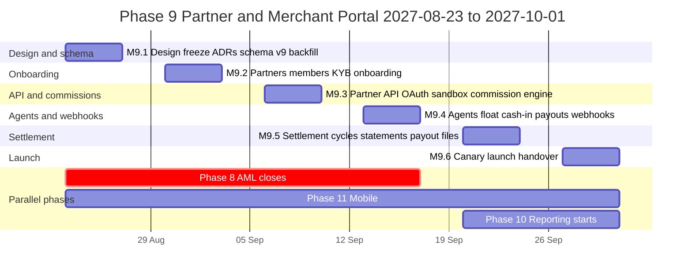
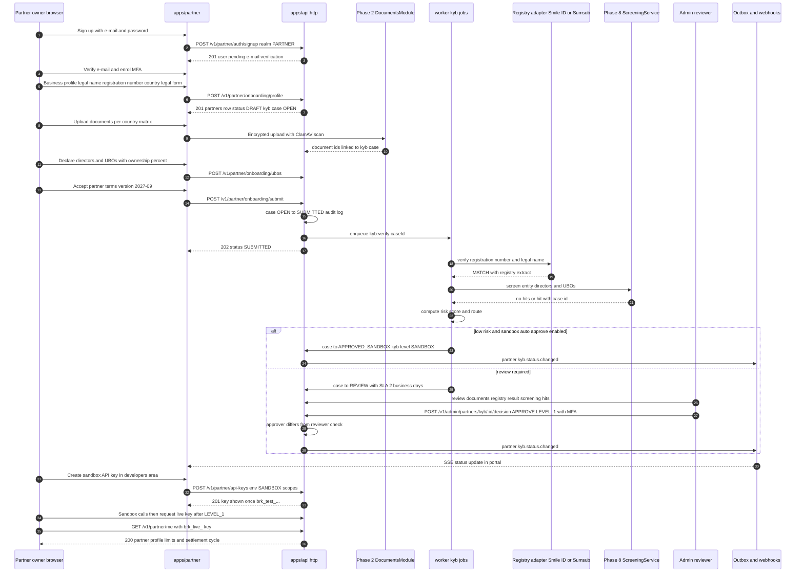
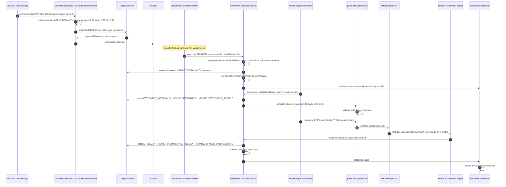
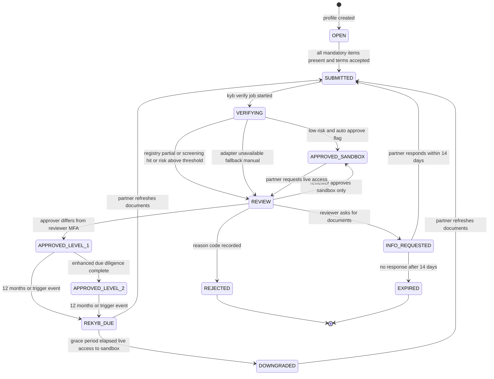
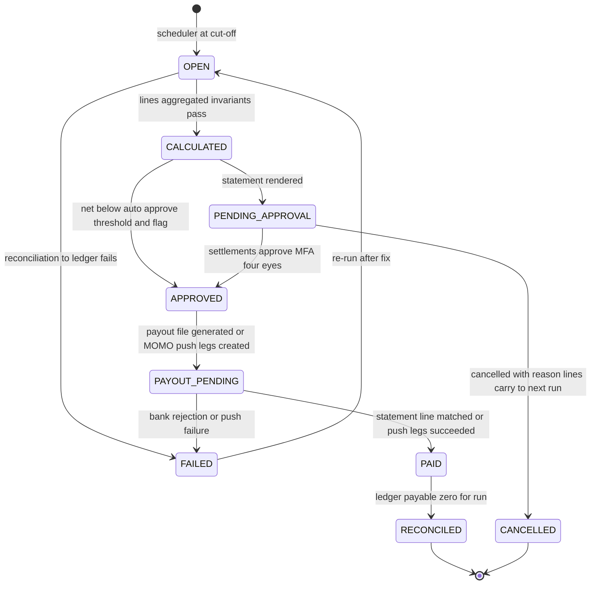
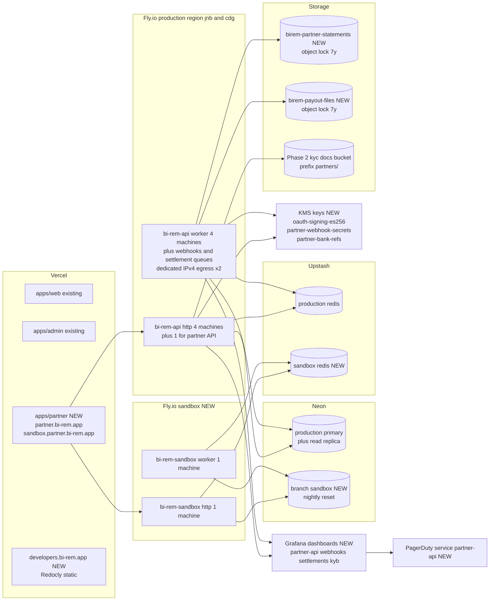
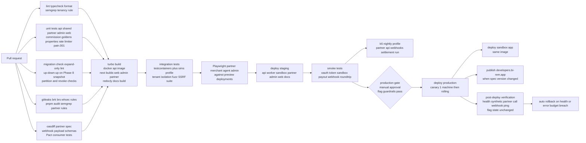

# Phase 9 — Partner & Merchant Portal

| Field                     | Value                                                                                                                                                                                                                                                                                                                                                                                                                                                                                                                                                                                                                                                                                                                                                                                                                                                                                                                                                                                                                                                                                                                                                                                                                                                                                                                                                        |
| ------------------------- | ------------------------------------------------------------------------------------------------------------------------------------------------------------------------------------------------------------------------------------------------------------------------------------------------------------------------------------------------------------------------------------------------------------------------------------------------------------------------------------------------------------------------------------------------------------------------------------------------------------------------------------------------------------------------------------------------------------------------------------------------------------------------------------------------------------------------------------------------------------------------------------------------------------------------------------------------------------------------------------------------------------------------------------------------------------------------------------------------------------------------------------------------------------------------------------------------------------------------------------------------------------------------------------------------------------------------------------------------------------ |
| **Phase**                 | 9 of 13 — `partner-merchant`                                                                                                                                                                                                                                                                                                                                                                                                                                                                                                                                                                                                                                                                                                                                                                                                                                                                                                                                                                                                                                                                                                                                                                                                                                                                                                                                 |
| **Dates**                 | 2027-08-23 → 2027-10-01                                                                                                                                                                                                                                                                                                                                                                                                                                                                                                                                                                                                                                                                                                                                                                                                                                                                                                                                                                                                                                                                                                                                                                                                                                                                                                                                      |
| **Duration**              | 6 weeks (W1 = 2027-08-23 … 2027-08-27, W6 = 2027-09-27 … 2027-10-01)                                                                                                                                                                                                                                                                                                                                                                                                                                                                                                                                                                                                                                                                                                                                                                                                                                                                                                                                                                                                                                                                                                                                                                                                                                                                                         |
| **Team**                  | `core` (4 backend, 3 frontend, 1.5 QA — one QA shared with Phase 11 Mobile, solution architect, DevOps/SRE, PM, compliance analyst 50 %, product designer, 0.5 security engineer; 1 mobile engineer 25 % for agent-mode API alignment with Phase 11; head of partnerships as business owner, finance lead for settlements)                                                                                                                                                                                                                                                                                                                                                                                                                                                                                                                                                                                                                                                                                                                                                                                                                                                                                                                                                                                                                                   |
| **Depends on**            | Phase 5 — Domestic Transfers (ended 2027-05-28): `merchants` / `agents` pilot registries (`code`, `settlement_wallet_id`, `float_wallet_id`, `commission_schedule_id`, `PartyStatus`), `TransferType.W2M` / `W2A` sagas, `LedgerService.post()`, `LIABILITY:MERCHANT:*` / `LIABILITY:AGENT:*` / `EXPENSE:COMMISSION:AGENT:*` accounts, fee engine with `merchantId`/`agentId` scope, `Receipt` PDF worker, `recon` module, four-eyes manual journal pattern, `Idempotency-Key` handling, `worker` process group. Phase 7 — FX & Treasury (ended 2027-08-06): `settlement_accounts` (`ASSET:BANK:<key>:<ccy>`), `BankStatementSource` statement import and matching, `PARTNER` customer segment margins and 15-minute quote lock, `treasury_ops` / `finance_ops` roles, rebalancing to merchant settlement banks. Via 5/7: Phase 4 `WalletTransaction` `PULL`/`PUSH` legs and `IdempotencyKey`; Phase 3 `Provider`/`Connection` registry, vault (`CredentialResolver`), inbound webhook ingress on `hooks.bi-rem.app`, `HttpConnector` resilience; Phase 2 `DocumentsModule` (encrypted upload pipeline, ClamAV, previews), admin `ReviewWorkspace`, `OtpCode` (`CASH_OUT`), `@RequiresRecentMfa`; Phase 1 `User`/`Role`/`Permission`, `ApiKey` (admin service accounts), `FeatureFlag`, `Setting`, `AuditLog`, `Outbox`, BullMQ/ioredis, `@nestjs/throttler` |
| **Unlocks**               | Phase 10 — Reporting & BI (2027-09-20, overlaps W5–W6) reads `settlement_runs`, `commission_accruals`, `partner_api_usage_daily`, `partners`; Phase 11 — Mobile (2027-08-09 → 2027-10-15) ships "agent mode" on `/v1/partner/agents/*` and merchant QR scanning on `payment_requests`; Phase 12 — Go-Live (2027-11-01) needs partner support runbooks, settlement day procedure, API status page and SLA; Phase 13 — Expansion onboards partners per new country as data (KYB document matrix, commission plans, payout file formats, settlement cycles)                                                                                                                                                                                                                                                                                                                                                                                                                                                                                                                                                                                                                                                                                                                                                                                                     |
| **Runs in parallel with** | Phase 8 — AML, Fraud & Compliance (compliance team, until 2027-09-17): we consume its `ScreeningService` for KYB entity/UBO screening and emit `partner.*`, `agent.*`, `settlement.*` events to its monitoring; Phase 11 — Mobile (mobile team); Phase 10 — Reporting (platform team, from 2027-09-20)                                                                                                                                                                                                                                                                                                                                                                                                                                                                                                                                                                                                                                                                                                                                                                                                                                                                                                                                                                                                                                                       |

---

## 1. Overview

### 1.1 Objective

Phase 9 turns BI-Rem from a consumer remittance product into a **B2B ecosystem**. Until now every merchant and agent is hand-created by an administrator (Phase 5 "pilot registry": 3 merchants and 5 agents in Accra), commission is a single fee-schedule line applied inside the cash-out saga, merchants are paid by a treasury operator running a manual bank transfer, and no third party can call BI-Rem programmatically. The target scale in `schedule.json` (1 M users, 100 k transactions/day across 20 countries) is not reachable through hand-onboarded partners.

This phase ships:

- a **Partner organisation model** (`partners`, members, roles) shared by merchants, agent networks and API partners, with a third user realm `PARTNER` and a new Next.js app `apps/partner` (`partner.bi-rem.app`) that hosts the **Partner Dashboard** and the **Merchant Dashboard**;
- **self-serve onboarding with KYB** (business profile → documents → directors and beneficial owners → registry verification → sanctions/PEP screening through Phase 8 → risk rating → admin review → tiered approval), so that a partner goes from sign-up to a live API key without an operator typing anything;
- a **Commission Engine** (`CommissionEngine.compute()` — pure, versioned plans, maker-checker, monthly agent tiering, clawbacks) that replaces the Phase 5 `commission_schedule_id` shortcut and accrues every commission into the ledger within seconds of `transfer.completed`;
- **Agent Management**: agent networks (super-agent → agent → teller), float management (top-ups by mobile-money pull or bank transfer, float transfers inside a network, thresholds and low-float alerts, daily float reconciliation), **cash-in** (`TransferType.CASH_IN`, new) next to the Phase 5 cash-out, and an agent operator web app usable on a feature phone browser;
- **Settlement Management**: configurable settlement cycles per partner, automated settlement runs with statements (PDF + CSV), rolling reserve and holds, four-eyes approval, **payout files** (`pain.001`, bank CSV templates, mobile-money push) and matching against Phase 7 bank statements;
- **API Access**: partner API keys (`brk_live_…` / `brk_test_…`), OAuth 2.0 client credentials with ES256 JWTs and JWKS, scoped permissions, tiered rate limits with standard headers, a fully isolated **sandbox** (`sandbox.api.bi-rem.app`) backed by the Phase 3/4/7 simulators and deterministic "magic values", versioned OpenAPI (`BI-Rem-Version: 2027-09-01`) and a public developer portal;
- **Webhooks** to partners: subscriptions per environment, signed deliveries (`BI-Rem-Signature: t=…,v1=…`), exponential retries with jitter, automatic disabling, replay from the dashboard and SSRF-safe egress from worker machines with published IPs.

The phase succeeds when, in production, a merchant in Accra and an agent network in Nairobi complete onboarding with no human involvement beyond the KYB reviewer's decision, obtain sandbox then live credentials, receive their first signed webhook, and — at the end of the first settlement cycle — receive a statement whose commission and fee lines were computed, posted and paid without anyone opening a spreadsheet.

### 1.2 In scope

- **Partner organisation model** — `partners` (kind `MERCHANT`, `AGENT_NETWORK`, `API_PARTNER`, `HYBRID`), `partner_members` with partner-realm roles (`partner_owner`, `partner_admin`, `partner_finance`, `partner_developer`, `partner_operator`, `partner_viewer`, `agent_operator`), invitations, MFA enforcement, `UserRealm.PARTNER`; Phase 5 `merchants` and `agents` gain `partner_id` and are backfilled into partner organisations.
- **Self-serve onboarding with KYB** — sign-up on `partner.bi-rem.app`, business profile, document upload through the Phase 2 `DocumentsModule` (certificate of incorporation, tax registration, proof of address, directors' IDs, bank confirmation letter, licence where required), UBO and director declaration (≥ 25 % ownership), registry verification adapters (Smile ID Business Verification for Nigeria CAC and Kenya BRS, Sumsub KYB for other countries, manual fallback), sanctions/PEP screening of entity, directors and UBOs via Phase 8 `ScreeningService`, risk rating, admin review in the Phase 2 `ReviewWorkspace`, tiered approval (`SANDBOX`, `LEVEL_1` live with limits, `LEVEL_2` full), periodic re-KYB reminders, partner agreement e-acceptance with versioned terms.
- **Partner Dashboard** (`apps/partner`) — overview, balances and upcoming settlement, payments, payouts, agents and float, settlements and statements, commissions, developers (keys, OAuth clients, webhooks, sandbox, usage), team, compliance, settings; fully responsive, `fr`/`en`/`pt`.
- **Merchant Dashboard** — payments explorer with refunds, static and dynamic QR / **payment requests** (`payment_requests`: amount, reference, expiry, QR and link), settlement statements and bank accounts, MDR and fee transparency, exports.
- **Commission Management** — `commission_plans` / `commission_plan_rules` (scope by partner kind, partner, agent tier, transfer type, country, currency; bands, flat + bps, floors/caps; beneficiaries `AGENT`, `SUPER_AGENT`, `PARTNER`, `REFERRER` with share splits), maker-checker, effective dating, simulation, `commission_accruals` per transfer × beneficiary posted to the ledger, monthly agent tiering (`BRONZE`/`SILVER`/`GOLD`), clawbacks on refund/reversal, monthly commission statements, withholding tax lines where applicable.
- **Agent Management** — network hierarchy (`agents.parent_agent_id`, tellers as `partner_members` with `agent_operator`), agent onboarding by the network with Phase 2 individual KYC, float management (`partner_funding_requests`: `MOBILE_MONEY_PULL`, `BANK_TRANSFER`, `NETWORK_TRANSFER`; `agent_float_movements`; thresholds, `agent.float.low` alerts), **cash-in** (`CASH_IN` saga: agent float → customer wallet with OTP confirmation by the customer), cash-out via Phase 5 `W2A` initiated from the agent app, daily agent summary and float reconciliation, caps and velocity controls, agent locator data for Phase 11.
- **Settlement Management** — `settlement_cycles` (frequency, `T+n`, cut-off and timezone, minimum payout, rolling reserve bps and hold days, auto-approve threshold, payout method), `settlement_runs` with lines, adjustments (four-eyes), statements (PDF/CSV, object-locked storage), `payout_files` (`PAIN_001`, `CSV_GENERIC`, bank-specific CSV templates for the two pilot banks, `MOMO_PUSH` via Phase 4 legs) with approval and submission tracking, `payout_instructions` matched to Phase 7 statement lines by end-to-end id, settlement ledger journals, netting for `HYBRID` partners.
- **API Access** — `/v1/partner/*` resource API (payments, payment requests, refunds, payouts single and batch, balances, settlements, agents cash-in/cash-out, FX rates with `PARTNER` segment, webhooks and keys management), `partner_api_keys`, `oauth_clients` with rotating secrets, `POST /v1/oauth/token`, JWKS, scopes, IP allow-lists, tiered rate limiting (Redis token bucket, `RateLimit-*` headers), `Idempotency-Key` on every money-moving POST, API versioning by date header, usage analytics (`partner_api_usage_daily`), developer portal with OpenAPI, guides and SDK snippets, dedicated sandbox deployment.
- **Webhooks (outbound)** — `partner_webhook_subscriptions`, `partner_webhook_events`, `partner_webhook_attempts`; event catalogue (`payment.*`, `payout.*`, `refund.*`, `settlement.*`, `cashin.*`, `cashout.*`, `float.*`, `kyb.*`); HMAC-SHA256 signing with timestamp, secret rotation with overlap, retries, auto-disable, replay, test events, delivery log in dashboard and admin portal.
- **Admin portal** — partners directory and 360° view, KYB review queue, commission plan editor and approvals, settlement console (runs, approvals, payout files, submission, reconciliation), agent network console with float adjustments, partner API console (keys, tiers, usage, revocation), outbound webhook console, sandbox administration.
- **Customer portal / mobile** — pay a dynamic QR or payment link, cash-in receipt and confirmation OTP, "find an agent" list (map in Phase 11).

### 1.3 Out of scope (deferred)

- Card acquiring, card-present terminals and PCI-DSS scope — not planned; BI-Rem acquires mobile-money and wallet payments only.
- Merchant lending, float financing, agent overdraft — **Phase 13** after six months of settlement and float data.
- Partner-hosted checkout pages / hosted payment page, e-commerce plugins (WooCommerce, Shopify) — **Phase 13**; Phase 9 ships the payment-request API and QR that plugins will call.
- Request signing (HMAC) and mTLS for partner API calls — **Phase 13** (enterprise tier); Phase 9 ships keys, OAuth, IP allow-lists and TLS 1.2+.
- Automated bank payment initiation through bank APIs (Phase 7 D-note): Phase 9 **generates** payout files and tracks submission; a treasury operator uploads them to the bank portal. API submission is a Phase 13 candidate per bank.
- Agent cash management beyond BI-Rem float (physical cash counting, vault, insurance) — agent network's responsibility; we provide the float and cash-in/out records they reconcile against.
- Partner-level FX hedging or guaranteed rates beyond the Phase 7 `PARTNER` lock window; multi-currency partner balances (one balance per currency only).
- Reseller / white-label partner portals — Phase 13.
- Dispute and chargeback workflows — mobile money has no chargeback scheme; refunds and the Phase 5 complaint channel cover Phase 9; a dispute module is a Phase 13 option.

### 1.4 Independent deployability strategy

"Deployable alone" for Phase 9 means: **every migration is expand-only except Phase 6's deferred contract executed in our W1 slot; the partner portal, partner API, sandbox and webhooks ship dark behind flags and are invisible to customers and existing merchants until lit; the Commission Engine runs in shadow against the Phase 5 schedule path for two weeks before it posts a single journal; settlement runs are produced in dry-run (statements without journals or payout files) until finance signs off; and every money-moving B2B action (payout batch, settlement payout, float adjustment) is behind four-eyes and can be frozen in under 30 seconds without a redeploy.**

| Mechanism                                                                                   | Phase 9 application                                                                                                                                                                                                                                                                                                                                                                                                                                                                                                                                                                                                                                                                                                                                                                                                                                                                                                                                                                                                                                                                                                                                                                                                                                        |
| ------------------------------------------------------------------------------------------- | ---------------------------------------------------------------------------------------------------------------------------------------------------------------------------------------------------------------------------------------------------------------------------------------------------------------------------------------------------------------------------------------------------------------------------------------------------------------------------------------------------------------------------------------------------------------------------------------------------------------------------------------------------------------------------------------------------------------------------------------------------------------------------------------------------------------------------------------------------------------------------------------------------------------------------------------------------------------------------------------------------------------------------------------------------------------------------------------------------------------------------------------------------------------------------------------------------------------------------------------------------------- |
| **Feature flags** (Phase 1 `FeatureFlag`, Redis-cached 30 s, `rolloutPercentage` + `rules`) | `partner.portal.enabled` (master for `apps/partner`; off → maintenance page), `partner.onboarding.self-serve` (sign-up open vs invite-only), `partner.kyb.registry-verification` and `partner.kyb.screening` (adapters on vs manual), `partner.kyb.auto-approve-sandbox`, `partner.api.enabled` (master for `/v1/partner/*`; off → 404), `partner.api.oauth`, `partner.api.payouts`, `partner.api.payouts.batch`, `partner.api.payouts.international` (Phase 6 corridors), `partner.api.rate-limit.enforce` (enforce vs log-only), `partner.sandbox.enabled`, `webhooks.outbound.enabled`, `webhooks.outbound.event.<type>`, `commissions.engine.v2` (`rolloutPercentage` on transfer id — engine posts; else Phase 5 path), `commissions.engine.shadow` (compute and store `SHADOW` accruals without journals), `commissions.clawback.enabled`, `agents.cash-in.enabled` (per country via `rules`), `agents.float.self-service`, `agents.network.transfers`, `settlement.auto-run`, `settlement.post-journals` (dry-run vs posting), `settlement.auto-approve` (below threshold), `settlement.payout-files.generate`, `merchant.payment-requests.enabled`, `admin.partners.console`. Keys registered in `packages/shared/src/constants/feature-flags.ts`. |
| **Expand → migrate → contract**                                                             | W1 migration `20270823090000_phase9_expand` adds all tables, enums and nullable columns (`merchants.partner_id`, `merchants.settlement_cycle_id`, `merchants.bank_account_id`, `agents.partner_id`, `agents.parent_agent_id`, `agents.tier`, `agents.float_min_minor`, `transfers.partner_id`, `transfers.payout_batch_id`, `transfers.payment_request_id`, `transfers.agent_operator_user_id`, `users.realm` value `PARTNER`, `TransferType` values `CASH_IN`, `PARTNER_PAYOUT`). Phase 6's deferred contract `20270823100000_phase6_contract` (`transfers.corridor_id SET NOT NULL`) runs in the same slot after a Neon snapshot and the backfill check. Phase 9's own contract (drop `agents.commission_schedule_id`, make `merchants.partner_id` / `agents.partner_id` NOT NULL) is **deferred to Phase 10 W1** after the commission engine has posted for four weeks.                                                                                                                                                                                                                                                                                                                                                                                 |
| **Dark launch**                                                                             | From W2 production has the partner tables, the Phase 5 pilot merchants/agents backfilled into `partners` and the partner portal deployed with `partner.portal.enabled=false` for everyone except a staff allow-list. From W3 the Commission Engine computes `SHADOW` accruals for every completed W2A/W2M transfer and a nightly job diffs them against the Phase 5 commission journals. From W4 settlement runs execute in dry-run against the pilot merchants and finance compares statements with the manual bank transfers they already made. From W4 the sandbox is public for invited developers. From W5 pilot partners go live under `rules: partnerIds`.                                                                                                                                                                                                                                                                                                                                                                                                                                                                                                                                                                                          |
| **Kill switches**                                                                           | `partner.api.enabled=false` returns 404 on `/v1/partner/*` within 30 s (sandbox unaffected); `partner.api.payouts=false` returns 503 `PAYOUTS_PAUSED` with `Retry-After` while in-flight sagas complete; `webhooks.outbound.enabled=false` pauses dispatch (events keep being stored and are delivered on resume, ordered by `sequence`); `commissions.engine.v2=false` reverts to the Phase 5 path immediately for new transfers (accruals already posted stay); `settlement.post-journals=false` keeps runs in dry-run; `settlement.payout-files.generate=false` blocks new payout files; per-partner `status=SUSPENDED` (admin, `partners:suspend`, MFA) rejects API calls with 403 `PARTNER_SUSPENDED`, pauses webhooks and holds settlements; `agents.cash-in.enabled` per country.                                                                                                                                                                                                                                                                                                                                                                                                                                                                   |
| **Worker isolation**                                                                        | Commission accrual, settlement runs, statement rendering, payout file generation, webhook dispatch, KYB screening jobs, float reconciliation, usage roll-ups and sandbox resets run only in the `worker` process group (`WORKER_QUEUES` gains `commission:*`, `settlement:*`, `payouts:*`, `webhooks:outbound`, `kyb:*`, `float:*`, `partner-usage`). The `http` group serves the partner API, verifies auth and rate limits, and enqueues. The sandbox is a separate Fly app with its own `http` and `worker`.                                                                                                                                                                                                                                                                                                                                                                                                                                                                                                                                                                                                                                                                                                                                            |
| **Backward-compatible APIs**                                                                | New paths under `/v1/partner/*`, `/v1/oauth/*`, `/v1/admin/partners/*`, `/v1/admin/commissions/*`, `/v1/admin/settlements/*`, `/v1/admin/outbound-webhooks/*`, `/v1/payment-requests/*` (customer). Phase 5 `/v1/merchants/*` and `/v1/agents/*` keep their contracts; responses gain optional `partnerId`. `oasdiff` gate stays green; the partner API has its own spec file `openapi/partner-2027-09-01.json`.                                                                                                                                                                                                                                                                                                                                                                                                                                                                                                                                                                                                                                                                                                                                                                                                                                           |
| **Rollback**                                                                                | Flags first; then Fly image rollback (`infra/scripts/rollback-api.sh`) and Vercel instant rollback for `apps/partner`. Accruals and settlement journals are immutable: corrections are `COMMISSION_CLAWBACK` / `CORRECTION` journals with four-eyes (Phase 5 rule). Payout files already submitted to a bank cannot be rolled back by software — the runbook covers bank recall.                                                                                                                                                                                                                                                                                                                                                                                                                                                                                                                                                                                                                                                                                                                                                                                                                                                                           |

---

## 2. Milestones

Phase start is Monday **2027-08-23**; week _n_ runs Monday to Friday; milestone dates are the Friday of the week.

| ID       | Week | Target date | Deliverable                                                                                                                                                                                                                                                                                                                                                                                                                                                                                                                                                                                                                                                   | Acceptance criteria                                                                                                                                                                                                                                                                                                                                                                                                                                                                                                                                                                                                                        | Owner                               |
| -------- | ---- | ----------- | ------------------------------------------------------------------------------------------------------------------------------------------------------------------------------------------------------------------------------------------------------------------------------------------------------------------------------------------------------------------------------------------------------------------------------------------------------------------------------------------------------------------------------------------------------------------------------------------------------------------------------------------------------------- | ------------------------------------------------------------------------------------------------------------------------------------------------------------------------------------------------------------------------------------------------------------------------------------------------------------------------------------------------------------------------------------------------------------------------------------------------------------------------------------------------------------------------------------------------------------------------------------------------------------------------------------------ | ----------------------------------- |
| **M9.1** | W1   | 2027-08-27  | Design freeze: partner organisation and realm model, KYB state machine and document matrix per country, commission plan model, settlement cycle and run state machine, partner API auth and rate limiting, outbound webhook contract; ADR-0029 (partner organisations, `PARTNER` realm and tenant isolation), ADR-0030 (partner API authentication, scopes, rate limits and sandbox), ADR-0031 (outbound webhooks), ADR-0032 (commission engine and settlement cycles); schema v9 _expand_ migration and Phase 6 contract applied to staging and production; `apps/partner` scaffold deployed dark; Phase 5 pilot merchants/agents backfilled into `partners` | `pnpm db:migrate:dev` applies `20270823090000_phase9_expand` and `20270823100000_phase6_contract` on a Phase 8 snapshot with `prisma migrate diff` empty; backfill creates one `partners` row per Phase 5 merchant/agent with `partner_members` for their users and `kyb_level=LEVEL_1` (grandfathered, re-KYB due in 90 days); ADRs accepted at the Thursday architecture review; `partner.bi-rem.app` returns the maintenance page publicly and the sign-in page for the staff allow-list; KYB document matrix for GH, KE, NG, SN, CI approved by compliance; Smile ID and Sumsub KYB sandbox keys in Fly secrets (staging)              | Solution Architect                  |
| **M9.2** | W2   | 2027-09-03  | Partner organisations, members, invitations and partner-realm auth; self-serve onboarding flow (profile, documents, UBOs, agreement) end to end on staging; registry verification adapters (`SmileIdBusinessAdapter`, `SumsubKybAdapter`, `ManualRegistryAdapter`) and `kyb-sim`; Phase 8 screening integration behind `partner.kyb.screening`; admin KYB review queue on the Phase 2 `ReviewWorkspace`                                                                                                                                                                                                                                                       | A new partner completes sign-up → MFA → profile → 5 documents → 2 UBOs → agreement in < 15 min on staging with zero admin input; `partner_kyb_cases` transitions follow §4.4 with every transition audited; registry adapters pass the conformance suite (≥ 30 cases incl. not-found, mismatch, timeout); screening hit routes the case to `REVIEW` with the Phase 8 case id; reviewer approves to `SANDBOX` and the partner sees the change in the portal within 5 s (SSE); tenant isolation suite (200 cross-partner requests) returns 404/403 for every one                                                                             | Backend Lead (core) / Frontend Lead |
| **M9.3** | W3   | 2027-09-10  | Partner API v`2027-09-01`: keys, OAuth client credentials + JWKS, scopes, rate limiting, idempotency, payments/payment requests/refunds/balances/settlements read endpoints; **sandbox** Fly app with simulators and magic values; Commission Engine with plans, rules, maker-checker, simulation; shadow accruals in production; developer portal v1                                                                                                                                                                                                                                                                                                         | `POST /v1/oauth/token` p95 < 40 ms, JWT verifies against `/.well-known/jwks.json`, revoked client secret fails within 60 s; rate limiter enforces tier limits within ±2 % at 500 rps in k6 with correct `RateLimit-*` headers and `Retry-After`; sandbox returns deterministic outcomes for all 8 magic MSISDNs and resets nightly; 100 000 random commission computations balance to the minor unit and match golden cases (GH W2A, KE CASH_IN, NG payout); production shadow accruals for 7 days diverge from Phase 5 commission journals by exactly the plan differences documented, otherwise zero                                     | Backend Lead (core)                 |
| **M9.4** | W4   | 2027-09-17  | Agent Management: network hierarchy, agent onboarding, float requests (pull, bank reference, network transfer), float movements and thresholds, **cash-in saga**, agent operator app; Partner payouts (single, batch, prefunded `LIABILITY:PARTNER`) behind flag; Merchant Dashboard (payments, refunds, payment requests, QR); Partner Dashboard v1 (overview, payments, payouts, agents, team, developers); outbound webhooks dispatcher with signing, retries, replay, test events; staff pilots in production                                                                                                                                             | Cash-in of GHS 10 in production between a staff agent and a staff customer completes < 5 s with balanced journals and commission accrual; float top-up via MTN MoMo pull credits the agent float on leg settlement; network transfer super-agent → agent is atomic; a batch of 1 000 sandbox payouts completes < 3 min with per-item status and one `payout.batch.completed` webhook; webhook delivery p95 < 2 s from `transfer.completed` to partner 2xx on staging, retries follow the schedule within jitter, a 410 disables the subscription, SSRF suite (30 hostile URLs) rejects all; Playwright merchant and partner journeys green | Backend Lead (core) / Frontend Lead |
| **M9.5** | W5   | 2027-09-24  | Settlement Management: cycles, runs, statements (PDF/CSV), adjustments, approval, payout files (`pain.001`, bank CSV, MoMo push), instructions matched to Phase 7 statements, settlement journals; dry-run in production for pilot merchants; admin consoles (partners 360°, commissions, settlements, agents, API, webhooks); hardening: performance, security review, pen test, runbooks; Phase 10 read access                                                                                                                                                                                                                                              | Two consecutive dry-run settlement cycles for the 3 pilot merchants match finance's manual statements to the minor unit; `pain.001` validates against the ISO 20022 XSD and the pilot bank's test harness accepts it; a paid instruction is matched to the imported statement line and the run reaches `RECONCILED` without manual action; settlement run for a synthetic 100 000-line day completes < 10 min; k6 profile (§9.5) passes; pen-test findings ≥ High closed; every mutating admin action yields an `audit_logs` row; Playwright admin suites green                                                                            | QA Lead / Backend Lead / Security   |
| **M9.6** | W6   | 2027-10-01  | Production launch: self-serve onboarding open (`partner.onboarding.self-serve=true`), 5 pilot partners live (3 merchants, 1 agent network with 20 agents in Nairobi, 1 API partner), `commissions.engine.v2` 10 % → 50 % → 100 %, `settlement.post-journals=true` and first real payout files after finance sign-off, webhooks live; UAT sign-off; phase exit review; handover to Phases 10/11/12                                                                                                                                                                                                                                                             | Success criteria (§12) evidenced with production data: ≥ 5 partners onboarded with zero admin edits to partner-entered data, median sign-up → approval < 2 business days; 100 % of commission-eligible transfers in the canary week carry `commission_accruals` within 60 s and zero manual commission journals; first settlement cycle paid through generated files and reconciled; webhook delivery success ≥ 99.5 % first-attempt to pilot partners; sign-offs (§11) collected; Phase 10 reading `settlement_runs` / `commission_accruals` on the replica; Phase 11 agent mode passing contract tests against `/v1/partner/agents/*`    | Program Manager                     |



Staffing note: the `core` team returns whole from Phase 7 (which borrowed two backend and one frontend engineer until 2027-08-06), so Phase 9 starts at full strength. `apps/partner` is a new application, so the three frontend engineers split: one on `apps/partner` shell, auth, onboarding and developers area; one on merchant and agent surfaces; one on admin consoles and customer-portal touches. Phase 8's compliance team is available for KYB policy until 2027-09-17; the screening adapter interface is agreed in W1 so that Phase 9 is not blocked if Phase 8 slips (fallback: direct provider call behind the same interface, §15.3 Q9.2).

---

## 3. Deliverables

### 3.1 Partner organisation model and `PARTNER` realm

- **What**: `PartnersModule` (`apps/api/src/modules/partners/*`), `partners`, `partner_members`, `UserRealm.PARTNER`, partner-realm roles and permissions, tenant isolation.
- **DoD**: `partners` carries legal identity (`legalName`, `tradingName`, `registrationNumber`, `taxId`, `countryCode`, `legalForm`, `industryCode` MCC, `website`), `kind`, `status` (`DRAFT → PENDING_KYB → ACTIVE | SUSPENDED | CLOSED`), `kybLevel`, `rateLimitTier`, `settlementCurrency`, `referenceCode` (`PRT-` + 8 Crockford base32, printed on statements); `partner_members` links `users` (realm `PARTNER`) to partners with a role and status (`INVITED → ACTIVE | DISABLED`), invitation tokens (24 h, single use), owner transfer with MFA; a user belongs to exactly one partner in Phase 9 (multi-org deferred, column `partner_id` on member not on user so it can change). **Tenant isolation**: `PartnerContext` (partner id, member role, environment, scopes) is resolved once per request by `PartnerAuthGuard`; every Prisma query in partner-realm modules goes through `PartnerScopedRepository` which injects `partnerId` and throws `TenantScopeMissing` in tests if a query lacks it; a semgrep rule (`birem/partner-query-without-scope`) fails CI for raw `prisma.<partnerModel>.find*` outside the repository. Phase 5 `merchants.user_id` / `agents.user_id` users are migrated to realm `PARTNER` by the backfill (refresh tokens revoked, re-login with same password, e-mail sent). Permissions seeded in `packages/db/src/permissions.ts` (§6.4). ADR-0029 accepted.

### 3.2 Self-serve onboarding with KYB

- **What**: Onboarding wizard in `apps/partner`, `KybModule` (`partner_kyb_cases`, `partner_kyb_documents`, `partner_ubos`), registry verification adapters, screening integration, admin review.
- **DoD**: Sign-up requires e-mail verification and TOTP/SMS MFA enrolment before the wizard; wizard steps persist independently (resume any time); document matrix per `countryCode` × `legalForm` lives in `packages/shared/src/constants/kyb-documents.ts` (e.g. GH `LIMITED`: certificate of incorporation, Form 3 / company regulations, TIN certificate, business operating permit, directors' Ghana Card, proof of address ≤ 3 months, bank confirmation letter; KE `LIMITED`: CR12, certificate of incorporation, KRA PIN, business permit, directors' IDs; NG `LIMITED`: CAC certificate, CAC status report / Form CAC 1.1, TIN, directors' NIN/BVN consent; sole proprietors: business name registration + owner KYC through Phase 2 `KycModule`); uploads reuse Phase 2 `DocumentsModule` (encryption, ClamAV, previews, retention) with `ownerType='Partner'`; UBOs captured with ownership percentage (sum validated ≤ 100 %, every natural person ≥ 25 % mandatory) and screened individually; `RegistryVerificationAdapter.verify(partner): RegistryResult` (`MATCH | PARTIAL | NO_MATCH | UNAVAILABLE`) with Smile ID (NG CAC, KE BRS), Sumsub KYB (GH, SN, CI, others), manual; Phase 8 `ScreeningService.screen({ kind: 'ENTITY' | 'PERSON' })` for entity, directors and UBOs; `riskScore` (0–100) from country, industry, screening, ownership complexity and registry result drives `AUTO_APPROVE_SANDBOX`, `REVIEW` or `REJECT_RECOMMENDED`; state machine §4.4 with SLA timers (reviewer 2 business days, partner info request 14 days then `EXPIRED`); approval to `LEVEL_1` requires `partners:kyb:approve` by a user other than the reviewer; partner agreement (versioned Markdown in `docs/legal/partner-terms/<version>.md`, hash stored) accepted with timestamp, IP and user; re-KYB due date (`kybExpiresAt`, 12 months; 90 days for grandfathered pilots) with reminders at 30/7/0 days and automatic `LEVEL_1 → SANDBOX` downgrade after grace; every decision writes `AuditLog` with reason code; partner sees status, outstanding items and reviewer messages in the portal; event `partner.kyb.status.changed`.

### 3.3 Partner Dashboard (`apps/partner`)

- **What**: New Next.js 16 app `@bi-rem/partner`, port 3002, `partner.bi-rem.app`, App Router, Server Components, Tailwind 4, `@tanstack/react-query`, shared `@bi-rem/shared` schemas and a `@bi-rem/ui` extraction of the admin/customer component primitives (buttons, tables, forms, charts) to avoid a third copy.
- **DoD**: Routes `/onboarding/*`, `/overview`, `/payments`, `/payment-requests`, `/payouts`, `/agents`, `/agents/float`, `/settlements`, `/settlements/:id`, `/commissions`, `/developers/keys`, `/developers/oauth`, `/developers/webhooks`, `/developers/sandbox`, `/developers/usage`, `/team`, `/compliance`, `/settings`, `/agent/*` (operator app); environment switch (Sandbox/Live) in the header with colour and `BI-Rem-Environment` on every request; role-based navigation; `fr`/`en`/`pt`; WCAG 2.2 AA; Lighthouse ≥ 90 on `/overview`; Zod env (`apps/partner/src/env.ts`); Playwright journeys; Vercel project with preview deployments; CSP, no third-party scripts except the status page widget.

### 3.4 Merchant Dashboard

- **What**: Merchant-kind partner surfaces in `apps/partner` plus `PaymentRequestsModule`.
- **DoD**: Payments explorer (Phase 5 `W2M` transfers filtered by `merchant_id` within the partner) with status, payer masked MSISDN, fee/MDR breakdown, reference, settlement run link; refunds (`POST /v1/partner/payments/:id/refunds`, full or partial, within 180 days, `partner:refunds:create`, MFA for > settlement-cycle average × 3) creating the Phase 5 linked `REFUND` transfer; **payment requests**: `payment_requests` (`amountMinor` optional, `currency`, `reference`, `description`, `expiresAt` ≤ 7 days, `callbackUrl`, status `OPEN → PAID | EXPIRED | CANCELLED`) rendered as dynamic EMVCo-style QR (tag 62 carrying the request code) and `pay.bi-rem.app/r/<code>` link that opens the customer portal (or Phase 11 app deep link); static QR regeneration; CSV/XLSX export of payments and settlements; fee transparency panel showing the active fee schedule and MDR; multi-store support via `merchants` per partner (store = Phase 5 `merchants` row; partner may have many).

### 3.5 Commission Management

- **What**: `CommissionsModule` (`commission_plans`, `commission_plan_rules`, `commission_accruals`), `CommissionEngine`, `CommissionProvider` interface consumed by the Phase 5 saga, admin editor, monthly jobs.
- **DoD**: `CommissionEngine.compute(input): CommissionResult` is pure and deterministic (no I/O), resolves the most specific `ACTIVE` plan (partner > agent tier > partner kind > country default; ties by latest `effectiveFrom`), evaluates rules per beneficiary with bands on the transaction amount, `flatMinor + percentBps` with `minMinor`/`maxMinor`, rounding half-up per beneficiary then summed, `shareBps` splits (e.g. agent 70 % / super-agent 30 %), source `FEE` (commission funded from the fee collected, cannot exceed fee), `AMOUNT` (platform pays, expense) or `PLATFORM_MARGIN` (from Phase 7 FX spread for `PARTNER_PAYOUT` international); withholding tax rule per country (`whtBps`, e.g. GH 7.5 % on commission paid to resident agents, KE 5 %, NG 5 %) producing a `LIABILITY:TAX:WHT:<ccy>` leg; `CommissionProvider.accrue(transfer, tx)` is called by the Phase 5 saga inside the completion transaction (`commissions.engine.v2`) or by the `commission:accrue` consumer of `transfer.completed` (shadow); journals of kind `COMMISSION` — Dr `EXPENSE:COMMISSION:<AGENT|SUPER_AGENT|PARTNER>:<ccy>` Cr `LIABILITY:AGENT:<id>` / `LIABILITY:PARTNER:<id>:<ccy>` (and Cr `LIABILITY:TAX:WHT:<ccy>`); clawback on `transfer.refunded` / `transfer.reversed` within `clawbackWindowDays` (30) posts `COMMISSION_CLAWBACK`; maker-checker (`commissions:write` + `commissions:approve`, different users) with diff view, effective-from scheduling and simulation against a CSV of amounts (`POST /v1/admin/commissions/plans/:id/simulate`); monthly `commission:retier` job computes agent tiers from trailing 30-day cash-in + cash-out volume (`Setting commissions.tiers.<ccy>` thresholds) and emits `agent.tier.changed`; monthly commission statements per agent/network (PDF via Phase 5 receipt renderer, CSV) with WHT certificate lines; golden tests: GH W2A GHS 200.00 cash-out with plan `GH-AGENT-DEFAULT` → fee 2.00 → agent commission 1.00 (50 % of fee), super-agent 0.30 (15 %), WHT 7.5 % → agent net 0.925 → rounded 0.93 and 0.28 credited, 0.09 WHT; KE CASH_IN KES 5 000.00 → flat 20.00 + 0.2 % = 30.00 → WHT 5 % 1.50 → agent 28.50. ADR-0032 accepted.

### 3.6 Agent Management

- **What**: `AgentsModule` extension (network hierarchy, onboarding, limits), `FloatModule` (`partner_funding_requests`, `agent_float_movements`), `CASH_IN` saga, agent operator app.
- **DoD**: `agents` gains `partner_id`, `parent_agent_id` (max depth 3: network → super-agent → agent), `tier`, `float_min_minor`, `float_target_minor`, `kyc_case_id` (Phase 2 individual KYC of the agent principal), `geo_lat`/`geo_lng`, `opening_hours`, `operator_limit`; agent network onboards agents from the portal (`partner:agents:manage`): principal KYC via Phase 2 flow, agent code issued, float wallet and `LIABILITY:AGENT:<id>` created, status `PENDING_KYC → ACTIVE`; tellers are `partner_members` with `agent_operator` assigned to one agent, with per-operator daily caps; **float top-up**: `partner_funding_requests` of method `MOBILE_MONEY_PULL` (Phase 4 `PULL` leg from the agent's registered MSISDN → Dr `SUSPENSE:PENDING_PULL` → on settlement Dr `ASSET:FLOAT:<provider>` Cr `LIABILITY:AGENT`), `BANK_TRANSFER` (reference `FLT-<code>` printed; matched by Phase 7 statement import → Dr `ASSET:BANK` Cr `LIABILITY:AGENT`), `NETWORK_TRANSFER` (super-agent → agent, Dr `LIABILITY:AGENT:<super>` Cr `LIABILITY:AGENT:<agent>`, atomic, `agents.network.transfers`); `agent_float_movements` denormalised from ledger entries for the portal and Phase 11; thresholds → `agent.float.low` (SMS + push to agent and network, Phase 1 notifications) and `agent.float.critical` (cash-in disabled until top-up); **cash-in** (`TransferType.CASH_IN`): operator enters customer MSISDN or scans wallet QR and amount → customer receives OTP (Phase 2 `OtpCode` purpose `CASH_IN`) and confirms to the operator → saga reserves agent float, posts Dr `LIABILITY:AGENT` Cr `LIABILITY:CUSTOMER` + fee (`REVENUE:FEES:CASH_IN`, payer configurable, default platform-absorbed) + commission accrual → receipts and notifications to both; cash-out reuses Phase 5 `W2A` with the operator confirming via the agent app; velocity controls (per operator per hour count/amount, per customer per day, same-customer-same-agent repeat) from `Setting` and Phase 8 rules; daily agent summary (`GET /v1/partner/agents/:id/summary?date=`) with opening float, top-ups, cash-in, cash-out, commissions, closing float and expected cash position; float reconciliation job `float:reconcile` compares `LIABILITY:AGENT` balances with `agent_float_movements` sums and raises Phase 5 `reconciliation_breaks` (`source=AGENT_FLOAT`); agent operator app at `/agent/*` works on a 360 px viewport over 2G (≤ 150 kB JS, no images) with PIN re-auth every 15 min.

### 3.7 Settlement Management

- **What**: `SettlementsModule` (`settlement_cycles`, `settlement_runs`, `settlement_run_lines`, `settlement_adjustments`, `payout_files`, `payout_instructions`), statement renderer, payout file generators, matching with Phase 7.
- **DoD**: `settlement_cycles` per partner × currency: `frequency` (`DAILY`, `WEEKLY`, `SEMI_MONTHLY`, `MONTHLY`), `lagDays` (`T+0..T+5`), `cutoffLocalTime` + `timezone`, `weekday`, `minPayoutMinor` (carry-over below), `rollingReserveBps` + `reserveHoldDays`, `autoApproveBelowMinor`, `payoutMethod` (`BANK_TRANSFER`, `MOBILE_MONEY`, `WALLET_CREDIT`, `NETTING`), `bankAccountId`; `settlement:scheduler` opens a run at cut-off, `settlement:calculate` aggregates `transfer_fee_lines`, refunds, `commission_accruals`, adjustments, reserve holds/releases for the period into `settlement_run_lines` and totals (`grossMinor`, `feesMinor`, `taxesMinor`, `commissionsMinor`, `refundsMinor`, `adjustmentsMinor`, `reserveHeldMinor`, `reserveReleasedMinor`, `netMinor`), with an invariant check `net = gross − fees − taxes − refunds + commissions ± adjustments − reserveHeld + reserveReleased` and a reconciliation of `gross` to `LIABILITY:MERCHANT:<id>` movements in the period; state machine `OPEN → CALCULATED → PENDING_APPROVAL → APPROVED → PAYOUT_PENDING → PAID → RECONCILED | FAILED | CANCELLED`; approval by `settlements:approve` (different from the user who added adjustments; auto-approve below threshold when `settlement.auto-approve`); on approval journal `SETTLEMENT_ACCRUAL` Dr `LIABILITY:MERCHANT:<id>` Cr `LIABILITY:SETTLEMENT_PAYABLE:<partner>:<ccy>`; statement PDF (partner logo, period, lines, totals, VAT on fees, WHT, bank details masked, run reference `STL-<code>`) and CSV written to `birem-partner-statements` (object lock 7 years) and exposed via signed URLs; `payout_files` group approved runs by bank account and format: `PAIN_001` (ISO 20022 `pain.001.001.09`, validated against XSD, one `PmtInf` per debtor account, `EndToEndId = STL-<code>`), `CSV_GENERIC`, bank templates for the two pilot banks (Phase 7 Q7.3), `MOMO_PUSH` (Phase 4 `PUSH` legs per instruction, `parentType='SettlementRun'`); file checksum (SHA-256) and totals shown at approval; `settlements:payout:release` + MFA marks `SUBMITTED` with bank reference; payout confirmation by Phase 7 `BankStatementSource` matching `end_to_end_id` or by `PUSH` leg success posts `SETTLEMENT_PAYOUT` Dr `LIABILITY:SETTLEMENT_PAYABLE` Cr `ASSET:BANK:<key>:<ccy>` / `ASSET:FLOAT:<provider>:<ccy>` and moves the run to `PAID` then `RECONCILED`; bank rejection (`REJECTED` file or returned funds) → `FAILED` with reason and re-run; netting for `HYBRID` partners offsets payables against prefunded `LIABILITY:PARTNER` balance; events `settlement.statement.available`, `settlement.paid`, `settlement.failed`.

### 3.8 API Access

- **What**: `PartnerApiModule` (`/v1/partner/*`), `OAuthModule` (`/v1/oauth/token`, JWKS), `partner_api_keys`, `oauth_clients`, `oauth_client_secrets`, `RateLimitGuard`, `PartnerIdempotencyInterceptor`, usage roll-up, sandbox deployment, developer portal.
- **DoD**: API keys `brk_live_<22 base62>` / `brk_test_<22 base62>` generated server-side, shown once, stored as `HMAC-SHA256(PARTNER_API_KEY_PEPPER, key)` with 12-char `prefix`; scopes subset of §6.4 catalogue, optional CIDR allow-list, expiry, `lastUsedAt` (debounced 60 s), revocation propagates in ≤ 30 s (Redis negative cache); OAuth 2.0 client credentials (RFC 6749 §4.4): `client_id = brc_<env>_<16>`, secrets `brs_…` argon2id-hashed, two active secrets during rotation, `POST /v1/oauth/token` (`client_secret_basic` or body) returns ES256 JWT (`iss=https://api.bi-rem.app`, `aud=bi-rem-partner-api`, `sub=client_id`, `pid`, `env`, `scope`, `jti`, `exp` 900 s), keys in KMS with `kid` rotation every 90 days and JWKS at `/.well-known/jwks.json` (cache 1 h); revocation via `jti` denylist (Redis, TTL = remaining life) and client `status`; `PartnerAuthGuard` accepts `Authorization: Bearer <key | jwt>` and resolves `PartnerContext`; **rate limiting**: Redis token bucket (Lua, atomic) keyed by credential id with tier limits (`SANDBOX` 10 rps / burst 20, `STARTER` 25 / 50, `GROWTH` 100 / 200, `ENTERPRISE` 500 / 1 000; overrides in `Setting partner.rate-limit.overrides`), endpoint weights (`POST /payouts/batches` = 20, `POST /payouts` = 5, reads = 1), per-partner global cap = 2 × tier, `/oauth/token` 10 / min per client; responses carry `RateLimit-Limit`, `RateLimit-Remaining`, `RateLimit-Reset` and `429` with `Retry-After`; Redis outage → per-instance in-memory bucket (degraded, metric `partner_rate_limit_degraded`), never fail open without limit; **idempotency**: `Idempotency-Key` (UUID) mandatory on `POST /payouts*`, `/refunds`, `/payment-requests`, `/agents/cash-in|cash-out`, `/float/requests` via Phase 4 `IdempotencyKey` scoped `(partnerId, env, key)`, 24 h, replay returns original response with `Idempotent-Replayed: true`, body mismatch → 422 `IDEMPOTENCY_KEY_REUSED`; **versioning**: `BI-Rem-Version` header (default = partner's pinned version, initial `2027-09-01`), breaking changes only in a new dated version; **payouts**: `POST /v1/partner/payouts` creates a Phase 5 transfer of type `PARTNER_PAYOUT` funded from `LIABILITY:PARTNER:<id>:<ccy>` (prefunded via `partner_funding_requests`), destination wallet, mobile money (Phase 4 `PUSH`) or, behind `partner.api.payouts.international`, a Phase 6 corridor payout with a Phase 7 `PARTNER` quote; `POST /v1/partner/payouts/batches` (JSON ≤ 1 000 items or CSV upload) creates `partner_payout_batches` processed by `payouts:batch` with per-item status, duplicate detection by `externalId`, approval threshold (`partner_finance` approval in dashboard above `Setting`), Phase 8 screening of beneficiaries; **usage**: `partner_api_usage_daily` roll-up per credential × route class × status class from pino access logs (worker `partner-usage`), surfaced in dashboard and admin; **sandbox**: Fly app `bi-rem-sandbox` (`sandbox.api.bi-rem.app`, `sandbox.partner.bi-rem.app` via environment switch), same image with `SANDBOX_MODE=true`, Neon branch `sandbox`, Upstash `sandbox`, connectors forced to Phase 3/4 `provider-sim` and Phase 7 `fx-sim`, magic values (MSISDN suffix `0000` success, `0001` `INSUFFICIENT_FUNDS`, `0002` pending 60 s then success, `0003` provider timeout → `UNKNOWN` → success, `0004` `BENEFICIARY_NOT_FOUND`, `0005` permanent failure after retries, `0006` webhook duplicate, `0007` slow 15 s; amounts ≥ 1 000 000 minor → `LIMIT_EXCEEDED`), `POST /v1/partner/sandbox/fund` to credit prefunded balance, `POST /v1/partner/sandbox/settlements/run-now` to force a cycle, nightly data reset (opt-out per partner), sandbox KYB auto-approved at `SANDBOX` level; **developer portal** `developers.bi-rem.app` (Redocly static build from `openapi/partner-2027-09-01.json` + guides: authentication, idempotency, webhooks verification in Node/Python/PHP/Java, sandbox testing, going live checklist, changelog), published by CI; ADR-0030 accepted.

### 3.9 Webhooks (outbound)

- **What**: `OutboundWebhooksModule` (`partner_webhook_subscriptions`, `partner_webhook_events`, `partner_webhook_attempts`), `webhooks:outbound` BullMQ consumer, fan-out from Phase 1 `Outbox`, signing, retries, dashboard and admin consoles.
- **DoD**: Subscription per partner × environment with `url` (https only, port 443 or 8443, no userinfo, resolved host must be public unicast — re-resolved at every attempt), `events[]` from the catalogue (§6.3) or `*`, `secret` `whsec_<32 bytes base64url>` shown once and stored encrypted via the Phase 3 vault (kind `PARTNER_WEBHOOK_SECRET`), rotation with 24 h overlap (both secrets sign; `v1=` listed twice), `apiVersion`, `status` (`ACTIVE`, `PAUSED`, `DISABLED`), description, up to 10 subscriptions per environment; `OutboxFanout` consumer maps internal events to partner events only when the resource belongs to the partner (`partner_id` on transfer/run/agent) and the subscription matches, writing one `partner_webhook_events` row (`eventId` `evt_<ulid>`, `type`, `occurredAt`, `sequence` per partner, `payload` = resource snapshot rendered through the partner API serializer at the subscription's `apiVersion`, redacted of other parties' PII); delivery `POST` with headers `BI-Rem-Event-Id`, `BI-Rem-Event-Type`, `BI-Rem-Delivery-Id`, `BI-Rem-Attempt`, `BI-Rem-Environment`, `BI-Rem-Signature: t=<unix>,v1=<hex HMAC-SHA256(secret, t + "." + rawBody)>`, `Content-Type: application/json`, `User-Agent: BI-Rem-Webhooks/1.0`, timeout 10 s connect+read, response body read ≤ 64 kB, redirects not followed (3xx = failure), success = 2xx; retry schedule 0 s, 1 min, 5 min, 30 min, 2 h, 6 h, 12 h, 24 h (8 attempts) with ±20 % jitter via BullMQ `backoffStrategy`, concurrency ≤ 4 in flight per subscription, 410 → `DISABLED` immediately, > 48 h of 100 % failure → `DISABLED` with e-mails at first failure, 25 %, 75 % of the schedule and on disable; exhausted events → `FAILED`, retained 30 days, replayable (`partner:webhooks:manage` or admin `webhooks:outbound:replay`); `POST .../test` sends a synthetic `ping` event; egress only from `worker` machines with Fly dedicated IPv4s published on the developer portal; SSRF suite with 30 hostile URLs (loopback, RFC 1918, link-local, metadata `169.254.169.254`, IPv6 ULA, DNS rebinding to private after first resolve, `0.0.0.0`, decimal IPs, redirects to private) all rejected; ordering not guaranteed (documented; `sequence` provided); dashboard shows deliveries with request/response (headers redacted, body for `partner_developer`), filters and replay; metrics `webhook_delivery_duration_seconds`, `webhook_attempts_total{outcome}`, `webhook_subscriptions_disabled_total`; ADR-0031 accepted.

### 3.10 Admin portal consoles

- **What**: `/partners/*`, `/kyb/*`, `/commissions/*`, `/settlements/*`, `/agent-networks/*`, `/partner-api/*`, `/outbound-webhooks/*`, `/sandbox` in `apps/admin`.
- **DoD**: Partners directory with filters (kind, country, status, KYB level, tier), 360° view (profile, members, KYB timeline, merchants/agents, balances by currency from ledger, settlements, API credentials, webhooks, usage, audit trail), suspend/reactivate with reason and MFA; KYB queue on the Phase 2 `ReviewWorkspace` (document viewer, registry result, screening hits with Phase 8 case link, UBO graph, risk score explanation, request-info, approve/reject with reason codes, SLA countdown); commission plan editor (scope builder, rules table, simulation upload, diff, approval queue, retirement, accrual explorer with "explain this commission"); settlement console (cycle editor, run list with totals, run detail with lines and adjustments, approve, payout file preview with checksum and totals, mark submitted with bank reference, reconciliation status, failed-run re-run, calendar of upcoming cut-offs); agent network console (tree, float balances vs thresholds, float adjustment with four-eyes and reason, operator caps, suspend agent/operator, cash-in/out explorer, float reconciliation breaks); partner API console (credentials list with prefix, scopes, tier, last used, revoke; usage charts; rate-limit override; OAuth client status); outbound webhook console (subscriptions across partners, failing endpoints, disabled list with reasons, replay, dead-letter view); sandbox admin (reset a partner, view sandbox partners, simulator scenario toggles). Every mutating action audited; Playwright suites.

### 3.11 Customer portal and mobile touch points

- **What**: Minimal customer-facing surfaces so merchant payment requests and agent cash-in work end to end.
- **DoD**: `pay.bi-rem.app/r/<code>` and `/pay/<code>` in `apps/web` resolve a `payment_request` (merchant name, amount, reference, expiry) and run the Phase 5 `W2M` flow with the request id; QR scan via camera in the browser where supported; cash-in confirmation screen (OTP entry, amount, agent name and code) and receipt in history (`CASH_IN` type with agent details); "Find an agent" list by distance (`GET /v1/agents/nearby?lat=&lng=`) — map in Phase 11; notifications `cashin.otp`, `cashin.completed`, `payment_request.paid`. Phase 11 consumes the same endpoints.

---

## 4. Architecture

### 4.1 Component / container diagram (Phase 9 additions)

```mermaid
flowchart TB
  subgraph Clients
    PP["Partner portal apps/partner<br/>partner.bi-rem.app<br/>dashboard merchant agents developers"]
    AO["Agent operator app<br/>partner.bi-rem.app/agent<br/>feature-phone browser"]
    PS["Partner systems<br/>API keys or OAuth JWT"]
    AP["Admin portal apps/admin<br/>partners kyb commissions settlements"]
    CP["Customer portal apps/web<br/>pay request cash-in OTP"]
    MB["Mobile app Phase 11<br/>agent mode and QR"]
  end

  subgraph HTTP["apps/api http process group on Fly"]
    PAG["PartnerAuthGuard<br/>key or JWT to PartnerContext"]
    RLG["RateLimitGuard<br/>Redis token bucket"]
    PAPI["PartnerApiModule /v1/partner/*"]
    OAUTH["OAuthModule /v1/oauth/token jwks"]
    PRT["PartnersModule and KybModule"]
    CMM["CommissionsModule"]
    STM["SettlementsModule"]
    AGM["AgentsModule and FloatModule"]
    OWH["OutboundWebhooksModule"]
    PRQ["PaymentRequestsModule"]
  end

  subgraph Worker["apps/api worker process group"]
    CAC["commission accrue and retier"]
    SRN["settlement scheduler calculate render payout files"]
    WHD["webhooks outbound dispatcher<br/>dedicated egress IPs"]
    KYBW["kyb screening and registry jobs"]
    FLR["float reconcile and usage rollup"]
    PBW["payouts batch processor"]
  end

  subgraph Sandbox["bi-rem-sandbox Fly app"]
    SBX["same image SANDBOX_MODE=true<br/>provider-sim fx-sim kyb-sim"]
    SDB[("Neon branch sandbox")]
    SRD[("Upstash sandbox")]
  end

  subgraph Data
    PG[("Neon Postgres<br/>partners kyb commissions settlements<br/>webhooks api keys oauth")]
    RD[("Upstash Redis<br/>rate limits jti denylist key cache")]
    OBJ[("Object storage<br/>statements payout files kyb docs")]
    KMS["KMS<br/>JWT signing keys webhook secrets bank refs"]
  end

  subgraph Earlier["Earlier phases"]
    LDG["Phase 5 LedgerService and TransferSaga"]
    FEE["Phase 5 FeeEngine"]
    OUTB["Phase 1 Outbox"]
    TRS["Phase 7 settlement accounts and statement import"]
    FX["Phase 7 FxQuoteService PARTNER segment"]
    WLT["Phase 4 WalletTransaction PULL PUSH"]
    SCR["Phase 8 ScreeningService"]
    DOC["Phase 2 DocumentsModule and KycModule"]
    CON["Phase 3 vault and HttpConnector"]
  end

  subgraph External
    SMILE["Smile ID Business Verification"]
    SUMS["Sumsub KYB"]
    BANKS["Pilot banks<br/>pain.001 and CSV upload portals"]
    PWH["Partner webhook endpoints"]
    DEVP["developers.bi-rem.app<br/>Redocly static"]
  end

  PP --> PAG
  AO --> PAG
  PS --> PAG
  PS --> OAUTH
  MB --> PAG
  AP --> PRT
  AP --> CMM
  AP --> STM
  AP --> AGM
  AP --> OWH
  CP --> PRQ
  PAG --> RLG --> PAPI
  PAPI --> PRT
  PAPI --> AGM
  PAPI --> STM
  PAPI --> OWH
  PAPI --> FX
  PAPI --> LDG
  AGM --> LDG
  AGM --> WLT
  PRQ --> LDG
  PRT --> DOC
  PRT --> KYBW
  KYBW --> SCR
  KYBW --> SMILE
  KYBW --> SUMS
  KYBW --> CON
  LDG --> OUTB
  OUTB --> CAC
  OUTB --> WHD
  CAC --> LDG
  CAC --> FEE
  SRN --> LDG
  SRN --> OBJ
  SRN --> TRS
  SRN --> BANKS
  WHD --> PWH
  PBW --> LDG
  PBW --> WLT
  FLR --> PG
  HTTP --> PG
  HTTP --> RD
  Worker --> PG
  Worker --> RD
  OAUTH --> KMS
  OWH --> KMS
  STM --> KMS
  SBX --> SDB
  SBX --> SRD
  PS -. sandbox .-> SBX
  DEVP -. docs .-> PS
```



Module placement: `apps/api/src/modules/partners`, `kyb`, `partner-api`, `oauth`, `commissions`, `settlements`, `agents` (extended), `float`, `outbound-webhooks`, `payment-requests`, `sandbox`. Shared contracts in `packages/shared/src/schemas/partners.ts`, `commissions.ts`, `settlements.ts`, `partner-api.ts`, `webhooks-outbound.ts`; constants `kyb-documents.ts`, `webhook-events.ts`, `partner-scopes.ts`. New app `apps/partner`; new package `packages/ui` (`@bi-rem/ui`) extracted from `apps/admin` and `apps/web` primitives in W1–W2 (no behaviour change for those apps; Storybook not introduced — Playwright component snapshots instead).

### 4.2 Sequence — self-serve onboarding with KYB to first live API call



### 4.3 Sequence — commission accrual, settlement run and payout



### 4.4 KYB case state machine



### 4.5 Settlement run state machine



### 4.6 Deployment / infrastructure delta



Infra delta summary: (a) new Vercel project `bi-rem-partner` with domains `partner.bi-rem.app` and `sandbox.partner.bi-rem.app` (same build, `NEXT_PUBLIC_ENV` switch resolved by host) and a static `developers.bi-rem.app` project; (b) `http` group +1 machine (`shared-cpu-2x`) for partner API headroom and `worker` group `WORKER_QUEUES` extended, two Fly dedicated IPv4 addresses on worker machines for webhook egress (published to partners, static); (c) new Fly app `bi-rem-sandbox` (1 http + 1 worker `shared-cpu-1x`) deployed from the same image with `SANDBOX_MODE=true`, own secrets, Neon branch `sandbox` created from a scrubbed schema-only snapshot and reset nightly by `sandbox-reset.yml`, Upstash `sandbox` database; (d) object storage buckets `birem-partner-statements` and `birem-payout-files` with object lock (compliance mode, 7 years) and lifecycle to cold tier after 90 days; KYB documents reuse the Phase 2 bucket under `partners/`; (e) KMS keys: `oauth-signing-es256` (asymmetric, 90-day rotation with two active `kid`s), `partner-webhook-secrets` and `partner-bank-refs` envelope keys registered in the Phase 3 vault; (f) Grafana dashboards and alert rules (§11), PagerDuty service `partner-api` (business hours for partner issues, 24×7 for payout/settlement failures); (g) Postgres role `birem_sandbox` and the Phase 5 rule that `birem_app` cannot `UPDATE`/`DELETE` ledger tables extended to `commission_accruals`, `settlement_run_lines`, `partner_webhook_events`.

### 4.7 Design decisions and alternatives rejected

| #   | Decision                                                                                                                                              | Alternative rejected                                                                                              | Rationale                                                                                                                                                                                                                                                                                                                                                                     |
| --- | ----------------------------------------------------------------------------------------------------------------------------------------------------- | ----------------------------------------------------------------------------------------------------------------- | ----------------------------------------------------------------------------------------------------------------------------------------------------------------------------------------------------------------------------------------------------------------------------------------------------------------------------------------------------------------------------- |
| D1  | **Separate `apps/partner` application and `PARTNER` realm** rather than a section of `apps/web` with the `CUSTOMER` realm                             | Partner screens inside the customer portal; merchants/agents as customers with roles (Phase 5 pilot shortcut)     | Different audiences, auth policy (mandatory MFA, org membership, API credentials), release cadence and attack surface; a realm keeps JWT audiences and session cookies distinct so a stolen customer session can never reach partner data; Phase 5's shortcut is migrated, not extended.                                                                                      |
| D2  | **One `partners` organisation model for merchants, agent networks and API partners** with `kind` and optional `HYBRID`                                | Three separate entity models                                                                                      | Onboarding, KYB, members, API access, webhooks and settlements are identical across kinds; the difference is which products are enabled; one model keeps tenant isolation and reporting simple.                                                                                                                                                                               |
| D3  | **Pure `CommissionEngine` behind a `CommissionProvider` interface invoked inside the Phase 5 saga transaction**, with shadow mode first               | Commission computed asynchronously from `transfer.completed` only; or keep commission as a fee-schedule component | Posting in the same transaction guarantees the commission journal exists when the transfer is `COMPLETED` (agents see earnings instantly, no reconciliation drift); the pure engine is testable with goldens and property tests; the interface mirrors the Phase 7 `FxRateProvider` pattern already known to the team. Shadow mode protects the Phase 5 path during cut-over. |
| D4  | **API keys and OAuth client credentials both supported**, keys as the default developer experience, OAuth for enterprises and for Phase 11 agent mode | OAuth only; keys only; mTLS                                                                                       | Most African fintech integrators expect a bearer key; OAuth JWTs allow short-lived tokens, scoped delegation and stateless verification at the edge; mTLS adds certificate operations not justified before Phase 13.                                                                                                                                                          |
| D5  | **Dedicated sandbox deployment** (own Fly app, Neon branch, Redis) running the same image with simulators                                             | Environment discriminator inside production tables                                                                | Hard isolation prevents sandbox load, data or bugs from touching production money; Neon branches make it cheap; partners can be given deterministic simulator behaviour and nightly resets without production flags.                                                                                                                                                          |
| D6  | **Redis token bucket (Lua) with tiered limits and endpoint weights**, degrading to a per-instance bucket                                              | `@nestjs/throttler` default storage per route; edge WAF limits only                                               | Per-credential, weighted and tier-aware limits need atomic Redis scripts; `@nestjs/throttler` remains for unauthenticated routes. Edge limits (if a CDN is added in Phase 12) are complementary.                                                                                                                                                                              |
| D7  | **Outbound webhooks fan out from the Phase 1 `Outbox`** with a per-partner event table and Stripe-style signing                                       | Direct HTTP calls from the saga; a third-party webhook service (Svix, Hookdeck)                                   | The outbox already guarantees at-least-once publication with ordering per aggregate; building on it keeps one event pipeline. A SaaS would add a vendor processing partner payment data and cost at 100 k events/day; revisit if operating burden proves high (Q9.7).                                                                                                         |
| D8  | **Settlement = ledger-driven aggregation with a payable account and generated payout files**; bank submission manual in Phase 9                       | Direct bank API payment initiation; paying merchants straight from float by mobile money only                     | Bank APIs differ per bank and need separate contracts (Phase 7 D-note); the payable account makes the liability explicit between approval and payment and reconciles with Phase 7 statements. Mobile-money push is supported as a method where merchants prefer it.                                                                                                           |
| D9  | **Cash-in confirmed by the customer OTP, not only by the agent**                                                                                      | Agent-only confirmation                                                                                           | Prevents an agent crediting a wallet without receiving cash and then disputing; symmetric with Phase 5 cash-out OTP; regulators' agent guidelines require customer confirmation of deposits.                                                                                                                                                                                  |
| D10 | **Prefunded partner balance (`LIABILITY:PARTNER`) for payouts**, no credit                                                                            | Post-paid invoicing; credit lines                                                                                 | Zero credit risk at launch; aligns with mobile-money float practice; funding by bank transfer reference matched through Phase 7 import or by pull. Credit is a Phase 13 product decision.                                                                                                                                                                                     |
| D11 | **Partner-realm permissions reuse the Phase 1 RBAC catalogue** with `partner:` prefixed strings and API scopes as a documented subset                 | A separate authorisation system for partners                                                                      | One `PermissionsGuard`, one audit model, one seed; scopes map 1:1 to permissions so a key can never exceed its creator's role.                                                                                                                                                                                                                                                |
| D12 | **`@bi-rem/ui` package extracted now**                                                                                                                | Copy components into the third app                                                                                | A third copy would triple maintenance of accessibility and theming; extraction is limited to primitives already duplicated between admin and web.                                                                                                                                                                                                                             |
| D13 | **KYB registry verification via adapters with manual fallback**, Smile ID for NG/KE, Sumsub for the rest                                              | Single vendor; manual only                                                                                        | Coverage of African registries is fragmented; adapters let compliance switch vendors per country as data; manual fallback keeps onboarding possible where no API exists (XOF countries at launch).                                                                                                                                                                            |
| D14 | **Developer portal as static Redocly build in CI**                                                                                                    | Hosted API docs SaaS                                                                                              | No vendor, versioned with the spec, zero runtime; a hosted product is a Phase 13 option if interactive consoles are demanded.                                                                                                                                                                                                                                                 |

---

## 5. Data Model & Migrations

### 5.1 Context

Phase 1: `User` (gains realm `PARTNER`), `ApiKey` (admin service accounts — unchanged, partner keys are a separate table), `FeatureFlag`, `Setting`, `AuditLog`, `Outbox`. Phase 2: `KycCase`, `Document*`, `OtpCode` (purpose gains `CASH_IN`). Phase 4: `WalletTransaction`, `IdempotencyKey`. Phase 5: `Merchant`, `Agent`, `Transfer`, `TransferFeeLine`, `FeeSchedule`, `LedgerAccount`, `LedgerJournal` (kinds gain `COMMISSION_CLAWBACK`, `SETTLEMENT_ACCRUAL`, `SETTLEMENT_PAYOUT`, `AGENT_FLOAT`), `ReconciliationBreak` (source gains `AGENT_FLOAT`). Phase 7: `SettlementAccount`, `SettlementStatementLine` (gains `payout_instruction_id`). All additions follow CLAUDE.md: uuid ids via `gen_random_uuid()`, `timestamptz(6)`, money as `BIGINT` minor units + ISO-4217 `currency`, snake_case `@@map`/`@map`.

### 5.2 Prisma additions

```prisma
// ---------------------------------------------------------------------------
// Phase 9 — Partner & Merchant: enums
// ---------------------------------------------------------------------------

enum PartnerKind {
  MERCHANT
  AGENT_NETWORK
  API_PARTNER
  HYBRID

  @@map("partner_kind")
}

enum PartnerStatus {
  DRAFT
  PENDING_KYB
  ACTIVE
  SUSPENDED
  CLOSED

  @@map("partner_status")
}

enum KybLevel {
  NONE
  SANDBOX
  LEVEL_1
  LEVEL_2

  @@map("kyb_level")
}

enum PartnerMemberRole {
  PARTNER_OWNER
  PARTNER_ADMIN
  PARTNER_FINANCE
  PARTNER_DEVELOPER
  PARTNER_OPERATOR
  PARTNER_VIEWER
  AGENT_OPERATOR

  @@map("partner_member_role")
}

enum PartnerMemberStatus {
  INVITED
  ACTIVE
  DISABLED

  @@map("partner_member_status")
}

enum KybCaseStatus {
  OPEN
  SUBMITTED
  VERIFYING
  REVIEW
  INFO_REQUESTED
  APPROVED_SANDBOX
  APPROVED_LEVEL_1
  APPROVED_LEVEL_2
  REKYB_DUE
  DOWNGRADED
  REJECTED
  EXPIRED

  @@map("kyb_case_status")
}

enum KybDocumentKind {
  CERTIFICATE_OF_INCORPORATION
  BUSINESS_NAME_REGISTRATION
  COMPANY_REGULATIONS
  REGISTRY_EXTRACT
  TAX_REGISTRATION
  OPERATING_PERMIT
  REGULATORY_LICENCE
  PROOF_OF_ADDRESS
  BANK_CONFIRMATION_LETTER
  DIRECTOR_ID
  UBO_ID
  BOARD_RESOLUTION
  OTHER

  @@map("kyb_document_kind")
}

enum RegistryResult {
  MATCH
  PARTIAL
  NO_MATCH
  UNAVAILABLE
  NOT_RUN

  @@map("registry_result")
}

enum UboRole {
  BENEFICIAL_OWNER
  DIRECTOR
  SIGNATORY
  BOTH

  @@map("ubo_role")
}

enum BankAccountStatus {
  PENDING_VERIFICATION
  ACTIVE
  COOLING_OFF
  DISABLED

  @@map("bank_account_status")
}

enum FundingRequestKind {
  AGENT_FLOAT_TOPUP
  PARTNER_PREFUND

  @@map("funding_request_kind")
}

enum FundingMethod {
  MOBILE_MONEY_PULL
  BANK_TRANSFER
  NETWORK_TRANSFER

  @@map("funding_method")
}

enum FundingRequestStatus {
  PENDING
  AWAITING_FUNDS
  SETTLED
  EXPIRED
  FAILED
  CANCELLED

  @@map("funding_request_status")
}

enum AgentTier {
  BRONZE
  SILVER
  GOLD

  @@map("agent_tier")
}

enum FloatMovementKind {
  TOPUP
  NETWORK_IN
  NETWORK_OUT
  CASH_IN_DEBIT
  CASH_OUT_CREDIT
  COMMISSION
  CLAWBACK
  ADJUSTMENT
  WITHDRAWAL

  @@map("float_movement_kind")
}

enum CommissionPlanStatus {
  DRAFT
  PENDING_APPROVAL
  ACTIVE
  RETIRED
  REJECTED

  @@map("commission_plan_status")
}

enum CommissionBeneficiary {
  AGENT
  SUPER_AGENT
  PARTNER
  REFERRER

  @@map("commission_beneficiary")
}

enum CommissionSource {
  FEE
  AMOUNT
  PLATFORM_MARGIN

  @@map("commission_source")
}

enum CommissionAccrualStatus {
  SHADOW
  ACCRUED
  SETTLED
  CLAWED_BACK
  VOID

  @@map("commission_accrual_status")
}

enum SettlementFrequency {
  DAILY
  WEEKLY
  SEMI_MONTHLY
  MONTHLY

  @@map("settlement_frequency")
}

enum PayoutMethod {
  BANK_TRANSFER
  MOBILE_MONEY
  WALLET_CREDIT
  NETTING

  @@map("payout_method")
}

enum SettlementRunStatus {
  OPEN
  CALCULATED
  PENDING_APPROVAL
  APPROVED
  PAYOUT_PENDING
  PAID
  RECONCILED
  FAILED
  CANCELLED

  @@map("settlement_run_status")
}

enum SettlementLineKind {
  PAYMENT
  REFUND
  FEE
  TAX
  COMMISSION
  ADJUSTMENT
  RESERVE_HOLD
  RESERVE_RELEASE
  CARRY_OVER
  PAYOUT

  @@map("settlement_line_kind")
}

enum PayoutFileFormat {
  PAIN_001
  CSV_GENERIC
  CSV_BANK_GH_PILOT
  CSV_BANK_KE_PILOT
  MOMO_PUSH

  @@map("payout_file_format")
}

enum PayoutFileStatus {
  GENERATED
  APPROVED
  SUBMITTED
  ACKNOWLEDGED
  SETTLED
  REJECTED

  @@map("payout_file_status")
}

enum PayoutInstructionStatus {
  PENDING
  SUBMITTED
  PAID
  RETURNED
  FAILED

  @@map("payout_instruction_status")
}

enum ApiEnvironment {
  SANDBOX
  LIVE

  @@map("api_environment")
}

enum CredentialStatus {
  ACTIVE
  REVOKED
  EXPIRED

  @@map("credential_status")
}

enum RateLimitTier {
  SANDBOX
  STARTER
  GROWTH
  ENTERPRISE

  @@map("rate_limit_tier")
}

enum WebhookSubscriptionStatus {
  ACTIVE
  PAUSED
  DISABLED

  @@map("webhook_subscription_status")
}

enum WebhookEventStatus {
  PENDING
  DELIVERED
  FAILED
  SKIPPED

  @@map("webhook_event_status")
}

enum WebhookAttemptOutcome {
  SUCCESS
  HTTP_ERROR
  TIMEOUT
  CONNECTION_ERROR
  REJECTED_URL
  GONE

  @@map("webhook_attempt_outcome")
}

enum PaymentRequestStatus {
  OPEN
  PAID
  EXPIRED
  CANCELLED

  @@map("payment_request_status")
}

enum PayoutBatchStatus {
  RECEIVED
  VALIDATING
  PENDING_APPROVAL
  PROCESSING
  COMPLETED
  COMPLETED_WITH_FAILURES
  REJECTED
  CANCELLED

  @@map("payout_batch_status")
}

// ---------------------------------------------------------------------------
// Partner organisations
// ---------------------------------------------------------------------------

/// A B2B organisation: merchant, agent network, API partner or a combination.
model Partner {
  id                  String        @id @default(dbgenerated("gen_random_uuid()")) @db.Uuid
  /// Human reference printed on statements, e.g. PRT-7Q3M9K2A.
  referenceCode       String        @unique @map("reference_code") @db.VarChar(12)
  kind                PartnerKind
  status              PartnerStatus @default(DRAFT)
  kybLevel            KybLevel      @default(NONE) @map("kyb_level")
  kybExpiresAt        DateTime?     @map("kyb_expires_at") @db.Timestamptz(6)
  legalName           String        @map("legal_name") @db.VarChar(200)
  tradingName         String?       @map("trading_name") @db.VarChar(200)
  registrationNumber  String?       @map("registration_number") @db.VarChar(64)
  taxId               String?       @map("tax_id") @db.VarChar(64)
  legalForm           String        @map("legal_form") @db.VarChar(32)
  countryCode         String        @map("country_code") @db.Char(2)
  /// Merchant category code (ISO 18245) or industry code.
  industryCode        String?       @map("industry_code") @db.VarChar(4)
  website             String?       @db.VarChar(255)
  addressJson         Json?         @map("address_json")
  settlementCurrency  String        @map("settlement_currency") @db.Char(3)
  rateLimitTier       RateLimitTier @default(STARTER) @map("rate_limit_tier")
  /// Pinned partner API version, e.g. 2027-09-01.
  apiVersion          String        @default("2027-09-01") @map("api_version") @db.VarChar(10)
  riskScore           Int?          @map("risk_score")
  termsVersion        String?       @map("terms_version") @db.VarChar(16)
  termsAcceptedAt     DateTime?     @map("terms_accepted_at") @db.Timestamptz(6)
  termsAcceptedById   String?       @map("terms_accepted_by_id") @db.Uuid
  suspendedReason     String?       @map("suspended_reason") @db.VarChar(255)
  suspendedAt         DateTime?     @map("suspended_at") @db.Timestamptz(6)
  createdAt           DateTime      @default(now()) @map("created_at") @db.Timestamptz(6)
  updatedAt           DateTime      @updatedAt @map("updated_at") @db.Timestamptz(6)

  members          PartnerMember[]
  kybCases         PartnerKybCase[]
  ubos             PartnerUbo[]
  bankAccounts     PartnerBankAccount[]
  merchants        Merchant[]
  agents           Agent[]
  fundingRequests  PartnerFundingRequest[]
  commissionPlans  CommissionPlan[]
  settlementCycles SettlementCycle[]
  settlementRuns   SettlementRun[]
  apiKeys          PartnerApiKey[]
  oauthClients     OAuthClient[]
  webhookSubs      PartnerWebhookSubscription[]
  webhookEvents    PartnerWebhookEvent[]
  paymentRequests  PaymentRequest[]
  payoutBatches    PartnerPayoutBatch[]
  transfers        Transfer[]

  @@index([kind, status])
  @@index([countryCode, status])
  @@index([kybLevel])
  @@map("partners")
}

model PartnerMember {
  id             String              @id @default(dbgenerated("gen_random_uuid()")) @db.Uuid
  partnerId      String              @map("partner_id") @db.Uuid
  userId         String?             @map("user_id") @db.Uuid
  email          String              @db.VarChar(255)
  role           PartnerMemberRole
  status         PartnerMemberStatus @default(INVITED)
  /// For AGENT_OPERATOR: the agent this teller operates.
  agentId        String?             @map("agent_id") @db.Uuid
  inviteTokenHash String?            @map("invite_token_hash") @db.VarChar(128)
  inviteExpiresAt DateTime?          @map("invite_expires_at") @db.Timestamptz(6)
  invitedById    String?             @map("invited_by_id") @db.Uuid
  acceptedAt     DateTime?           @map("accepted_at") @db.Timestamptz(6)
  lastSeenAt     DateTime?           @map("last_seen_at") @db.Timestamptz(6)
  createdAt      DateTime            @default(now()) @map("created_at") @db.Timestamptz(6)
  updatedAt      DateTime            @updatedAt @map("updated_at") @db.Timestamptz(6)

  partner Partner @relation(fields: [partnerId], references: [id], onDelete: Restrict)
  user    User?   @relation("PartnerMemberUser", fields: [userId], references: [id], onDelete: Restrict)
  agent   Agent?  @relation(fields: [agentId], references: [id], onDelete: SetNull)

  @@unique([partnerId, email])
  @@unique([userId])
  @@index([partnerId, role, status])
  @@map("partner_members")
}

// ---------------------------------------------------------------------------
// KYB
// ---------------------------------------------------------------------------

model PartnerKybCase {
  id                 String         @id @default(dbgenerated("gen_random_uuid()")) @db.Uuid
  partnerId          String         @map("partner_id") @db.Uuid
  status             KybCaseStatus  @default(OPEN)
  requestedLevel     KybLevel       @default(LEVEL_1) @map("requested_level")
  /// Snapshot of the required document matrix at submission (country x legal form).
  requiredDocuments  Json           @map("required_documents")
  registryResult     RegistryResult @default(NOT_RUN) @map("registry_result")
  registryProvider   String?        @map("registry_provider") @db.VarChar(32)
  registryPayload    Json?          @map("registry_payload")
  /// Phase 8 screening case id when a hit was raised.
  screeningCaseId    String?        @map("screening_case_id") @db.Uuid
  screeningSummary   Json?          @map("screening_summary")
  riskScore          Int?           @map("risk_score")
  riskFactors        Json?          @map("risk_factors")
  reviewerId         String?        @map("reviewer_id") @db.Uuid
  approverId         String?        @map("approver_id") @db.Uuid
  decisionReasonCode String?        @map("decision_reason_code") @db.VarChar(32)
  decisionNote       String?        @map("decision_note")
  slaDueAt           DateTime?      @map("sla_due_at") @db.Timestamptz(6)
  infoRequestedAt    DateTime?      @map("info_requested_at") @db.Timestamptz(6)
  submittedAt        DateTime?      @map("submitted_at") @db.Timestamptz(6)
  decidedAt          DateTime?      @map("decided_at") @db.Timestamptz(6)
  createdAt          DateTime       @default(now()) @map("created_at") @db.Timestamptz(6)
  updatedAt          DateTime       @updatedAt @map("updated_at") @db.Timestamptz(6)

  partner   Partner              @relation(fields: [partnerId], references: [id], onDelete: Restrict)
  documents PartnerKybDocument[]

  @@index([status, slaDueAt])
  @@index([partnerId, createdAt])
  @@map("partner_kyb_cases")
}

model PartnerKybDocument {
  id           String          @id @default(dbgenerated("gen_random_uuid()")) @db.Uuid
  kybCaseId    String          @map("kyb_case_id") @db.Uuid
  kind         KybDocumentKind
  /// Phase 2 documents table id (encrypted object, previews, scan result).
  documentId   String          @map("document_id") @db.Uuid
  /// For DIRECTOR_ID / UBO_ID: the person it belongs to.
  uboId        String?         @map("ubo_id") @db.Uuid
  issuedAt     DateTime?       @map("issued_at") @db.Date
  expiresAt    DateTime?       @map("expires_at") @db.Date
  reviewStatus String          @default("PENDING") @map("review_status") @db.VarChar(16)
  reviewNote   String?         @map("review_note")
  createdAt    DateTime        @default(now()) @map("created_at") @db.Timestamptz(6)

  kybCase PartnerKybCase @relation(fields: [kybCaseId], references: [id], onDelete: Cascade)
  ubo     PartnerUbo?    @relation(fields: [uboId], references: [id], onDelete: SetNull)

  @@index([kybCaseId, kind])
  @@map("partner_kyb_documents")
}

/// Directors and beneficial owners declared by the partner.
model PartnerUbo {
  id               String    @id @default(dbgenerated("gen_random_uuid()")) @db.Uuid
  partnerId        String    @map("partner_id") @db.Uuid
  role             UboRole
  fullName         String    @map("full_name") @db.VarChar(200)
  dateOfBirth      DateTime? @map("date_of_birth") @db.Date
  nationality      String?   @db.Char(2)
  /// Ownership in basis points (2500 = 25 %). Null for directors without ownership.
  ownershipBps     Int?      @map("ownership_bps")
  idType           String?   @map("id_type") @db.VarChar(32)
  /// HMAC of the id number (Phase 2 ID_HASH_KEY); never the plaintext.
  idNumberHash     String?   @map("id_number_hash") @db.VarChar(128)
  idNumberMask     String?   @map("id_number_mask") @db.VarChar(16)
  /// Phase 2 individual KYC case when the person was verified.
  kycCaseId        String?   @map("kyc_case_id") @db.Uuid
  screeningStatus  String    @default("NOT_RUN") @map("screening_status") @db.VarChar(16)
  screeningCaseId  String?   @map("screening_case_id") @db.Uuid
  isPep            Boolean   @default(false) @map("is_pep")
  createdAt        DateTime  @default(now()) @map("created_at") @db.Timestamptz(6)
  updatedAt        DateTime  @updatedAt @map("updated_at") @db.Timestamptz(6)

  partner   Partner              @relation(fields: [partnerId], references: [id], onDelete: Restrict)
  documents PartnerKybDocument[]

  @@index([partnerId])
  @@map("partner_ubos")
}

/// Settlement destination bank accounts (encrypted, cooling-off on change).
model PartnerBankAccount {
  id                  String            @id @default(dbgenerated("gen_random_uuid()")) @db.Uuid
  partnerId           String            @map("partner_id") @db.Uuid
  label               String            @db.VarChar(80)
  bankCode            String            @map("bank_code") @db.VarChar(16)
  bankName            String            @map("bank_name") @db.VarChar(120)
  countryCode         String            @map("country_code") @db.Char(2)
  currency            String            @db.Char(3)
  accountName         String            @map("account_name") @db.VarChar(200)
  /// KMS envelope-encrypted account number / IBAN.
  accountRefEncrypted String            @map("account_ref_encrypted")
  accountRefMask      String            @map("account_ref_mask") @db.VarChar(16)
  swiftBic            String?           @map("swift_bic") @db.VarChar(11)
  status              BankAccountStatus @default(PENDING_VERIFICATION)
  /// Changes are usable only after this instant (24 h cooling-off).
  usableFrom          DateTime?         @map("usable_from") @db.Timestamptz(6)
  verifiedById        String?           @map("verified_by_id") @db.Uuid
  verifiedAt          DateTime?         @map("verified_at") @db.Timestamptz(6)
  createdById         String            @map("created_by_id") @db.Uuid
  createdAt           DateTime          @default(now()) @map("created_at") @db.Timestamptz(6)
  updatedAt           DateTime          @updatedAt @map("updated_at") @db.Timestamptz(6)

  partner      Partner             @relation(fields: [partnerId], references: [id], onDelete: Restrict)
  cycles       SettlementCycle[]
  payoutFiles  PayoutFile[]
  instructions PayoutInstruction[]

  @@index([partnerId, status])
  @@map("partner_bank_accounts")
}

// ---------------------------------------------------------------------------
// Float and prefunding
// ---------------------------------------------------------------------------

model PartnerFundingRequest {
  id              String               @id @default(dbgenerated("gen_random_uuid()")) @db.Uuid
  partnerId       String               @map("partner_id") @db.Uuid
  /// Target agent for AGENT_FLOAT_TOPUP; null for PARTNER_PREFUND.
  agentId         String?              @map("agent_id") @db.Uuid
  kind            FundingRequestKind
  method          FundingMethod
  status          FundingRequestStatus @default(PENDING)
  amountMinor     BigInt               @map("amount_minor")
  currency        String               @db.Char(3)
  /// Bank reference the partner must quote, e.g. FLT-7Q3M9K2A; matched by Phase 7 statement import.
  bankReference   String?              @unique @map("bank_reference") @db.VarChar(20)
  /// Phase 4 PULL leg for MOBILE_MONEY_PULL.
  walletTransactionId String?          @unique @map("wallet_transaction_id") @db.Uuid
  /// Source agent for NETWORK_TRANSFER.
  sourceAgentId   String?              @map("source_agent_id") @db.Uuid
  ledgerJournalId String?              @unique @map("ledger_journal_id") @db.Uuid
  requestedById   String               @map("requested_by_id") @db.Uuid
  expiresAt       DateTime?            @map("expires_at") @db.Timestamptz(6)
  settledAt       DateTime?            @map("settled_at") @db.Timestamptz(6)
  failureReason   String?              @map("failure_reason") @db.VarChar(255)
  idempotencyKey  String?              @map("idempotency_key") @db.VarChar(64)
  createdAt       DateTime             @default(now()) @map("created_at") @db.Timestamptz(6)
  updatedAt       DateTime             @updatedAt @map("updated_at") @db.Timestamptz(6)

  partner Partner @relation(fields: [partnerId], references: [id], onDelete: Restrict)
  agent   Agent?  @relation("FundingTargetAgent", fields: [agentId], references: [id], onDelete: Restrict)

  @@index([partnerId, status, createdAt])
  @@index([agentId, status])
  @@map("partner_funding_requests")
}

/// Denormalised float history per agent (one row per ledger entry touching LIABILITY:AGENT:<id>).
model AgentFloatMovement {
  id              String            @id @default(dbgenerated("gen_random_uuid()")) @db.Uuid
  agentId         String            @map("agent_id") @db.Uuid
  kind            FloatMovementKind
  amountMinor     BigInt            @map("amount_minor")
  currency        String            @db.Char(3)
  /// Float balance after this movement (minor units).
  balanceAfterMinor BigInt          @map("balance_after_minor")
  ledgerEntryId   String            @unique @map("ledger_entry_id") @db.Uuid
  transferId      String?           @map("transfer_id") @db.Uuid
  fundingRequestId String?          @map("funding_request_id") @db.Uuid
  operatorUserId  String?           @map("operator_user_id") @db.Uuid
  occurredAt      DateTime          @map("occurred_at") @db.Timestamptz(6)
  createdAt       DateTime          @default(now()) @map("created_at") @db.Timestamptz(6)

  agent Agent @relation(fields: [agentId], references: [id], onDelete: Restrict)

  @@index([agentId, occurredAt])
  @@map("agent_float_movements")
}

// ---------------------------------------------------------------------------
// Commissions
// ---------------------------------------------------------------------------

model CommissionPlan {
  id             String               @id @default(dbgenerated("gen_random_uuid()")) @db.Uuid
  key            String               @db.VarChar(64)
  version        Int
  status         CommissionPlanStatus @default(DRAFT)
  /// Scope: most specific active plan wins (partner > agentTier > partnerKind > country default).
  partnerId      String?              @map("partner_id") @db.Uuid
  partnerKind    PartnerKind?         @map("partner_kind")
  agentTier      AgentTier?           @map("agent_tier")
  transferType   TransferType         @map("transfer_type")
  countryCode    String?              @map("country_code") @db.Char(2)
  currency       String               @db.Char(3)
  corridorId     String?              @map("corridor_id") @db.Uuid
  /// Withholding tax applied to beneficiary commission, basis points.
  whtBps         Int                  @default(0) @map("wht_bps")
  clawbackWindowDays Int              @default(30) @map("clawback_window_days")
  effectiveFrom  DateTime             @map("effective_from") @db.Timestamptz(6)
  effectiveTo    DateTime?            @map("effective_to") @db.Timestamptz(6)
  description    String?              @db.VarChar(255)
  createdById    String               @map("created_by_id") @db.Uuid
  approvedById   String?              @map("approved_by_id") @db.Uuid
  approvedAt     DateTime?            @map("approved_at") @db.Timestamptz(6)
  retiredAt      DateTime?            @map("retired_at") @db.Timestamptz(6)
  createdAt      DateTime             @default(now()) @map("created_at") @db.Timestamptz(6)
  updatedAt      DateTime             @updatedAt @map("updated_at") @db.Timestamptz(6)

  partner  Partner?             @relation(fields: [partnerId], references: [id], onDelete: Restrict)
  rules    CommissionPlanRule[]
  accruals CommissionAccrual[]

  @@unique([key, version])
  @@index([status, transferType, currency, countryCode])
  @@index([partnerId, status])
  @@map("commission_plans")
}

model CommissionPlanRule {
  id           String                @id @default(dbgenerated("gen_random_uuid()")) @db.Uuid
  planId       String                @map("plan_id") @db.Uuid
  beneficiary  CommissionBeneficiary
  source       CommissionSource      @default(FEE)
  /// Ordered amount bands: [{ upToMinor, flatMinor, percentBps }]; last band upToMinor null.
  bands        Json
  minMinor     BigInt?               @map("min_minor")
  maxMinor     BigInt?               @map("max_minor")
  /// Share of the computed commission to this beneficiary when several share one rule (10000 = 100 %).
  shareBps     Int                   @default(10000) @map("share_bps")
  sortOrder    Int                   @default(0) @map("sort_order")

  plan CommissionPlan @relation(fields: [planId], references: [id], onDelete: Cascade)

  @@index([planId, sortOrder])
  @@map("commission_plan_rules")
}

/// One row per transfer x beneficiary. Append-only; status changes via new journals.
model CommissionAccrual {
  id                String                  @id @default(dbgenerated("gen_random_uuid()")) @db.Uuid
  transferId        String                  @map("transfer_id") @db.Uuid
  planId            String                  @map("plan_id") @db.Uuid
  ruleId            String                  @map("rule_id") @db.Uuid
  beneficiary       CommissionBeneficiary
  /// Exactly one of agentId / partnerId is set.
  agentId           String?                 @map("agent_id") @db.Uuid
  partnerId         String?                 @map("partner_id") @db.Uuid
  grossMinor        BigInt                  @map("gross_minor")
  whtMinor          BigInt                  @default(0) @map("wht_minor")
  netMinor          BigInt                  @map("net_minor")
  currency          String                  @db.Char(3)
  status            CommissionAccrualStatus @default(ACCRUED)
  ledgerJournalId   String?                 @map("ledger_journal_id") @db.Uuid
  clawbackJournalId String?                 @map("clawback_journal_id") @db.Uuid
  settlementRunId   String?                 @map("settlement_run_id") @db.Uuid
  /// Inputs snapshot for "explain this commission".
  explain           Json
  accruedAt         DateTime                @default(now()) @map("accrued_at") @db.Timestamptz(6)

  plan  CommissionPlan  @relation(fields: [planId], references: [id], onDelete: Restrict)
  agent Agent?          @relation(fields: [agentId], references: [id], onDelete: Restrict)
  run   SettlementRun?  @relation(fields: [settlementRunId], references: [id], onDelete: SetNull)

  @@unique([transferId, beneficiary, status])
  @@index([agentId, accruedAt])
  @@index([partnerId, accruedAt])
  @@index([status, accruedAt])
  @@map("commission_accruals")
}

// ---------------------------------------------------------------------------
// Settlements
// ---------------------------------------------------------------------------

model SettlementCycle {
  id                   String              @id @default(dbgenerated("gen_random_uuid()")) @db.Uuid
  partnerId            String              @map("partner_id") @db.Uuid
  currency             String              @db.Char(3)
  frequency            SettlementFrequency
  lagDays              Int                 @default(1) @map("lag_days")
  cutoffLocalTime      String              @default("23:59") @map("cutoff_local_time") @db.VarChar(5)
  timezone             String              @db.VarChar(64)
  /// 1-7 for WEEKLY; 1-28 for MONTHLY day; null otherwise.
  anchorDay            Int?                @map("anchor_day")
  minPayoutMinor       BigInt              @default(0) @map("min_payout_minor")
  rollingReserveBps    Int                 @default(0) @map("rolling_reserve_bps")
  reserveHoldDays      Int                 @default(0) @map("reserve_hold_days")
  autoApproveBelowMinor BigInt?            @map("auto_approve_below_minor")
  payoutMethod         PayoutMethod
  bankAccountId        String?             @map("bank_account_id") @db.Uuid
  /// Phase 7 settlement account the payout is debited from.
  sourceSettlementAccountId String?        @map("source_settlement_account_id") @db.Uuid
  payoutMsisdnEncrypted String?            @map("payout_msisdn_encrypted")
  enabled              Boolean             @default(true)
  createdById          String              @map("created_by_id") @db.Uuid
  approvedById         String?             @map("approved_by_id") @db.Uuid
  createdAt            DateTime            @default(now()) @map("created_at") @db.Timestamptz(6)
  updatedAt            DateTime            @updatedAt @map("updated_at") @db.Timestamptz(6)

  partner     Partner             @relation(fields: [partnerId], references: [id], onDelete: Restrict)
  bankAccount PartnerBankAccount? @relation(fields: [bankAccountId], references: [id], onDelete: Restrict)
  runs        SettlementRun[]
  merchants   Merchant[]

  @@unique([partnerId, currency])
  @@map("settlement_cycles")
}

model SettlementRun {
  id                   String              @id @default(dbgenerated("gen_random_uuid()")) @db.Uuid
  /// Human reference, also the payment EndToEndId: STL-7Q3M9K2A.
  referenceCode        String              @unique @map("reference_code") @db.VarChar(12)
  partnerId            String              @map("partner_id") @db.Uuid
  cycleId              String              @map("cycle_id") @db.Uuid
  currency             String              @db.Char(3)
  periodStart          DateTime            @map("period_start") @db.Timestamptz(6)
  periodEnd            DateTime            @map("period_end") @db.Timestamptz(6)
  status               SettlementRunStatus @default(OPEN)
  dryRun               Boolean             @default(false) @map("dry_run")
  paymentCount         Int                 @default(0) @map("payment_count")
  refundCount          Int                 @default(0) @map("refund_count")
  grossMinor           BigInt              @default(0) @map("gross_minor")
  feesMinor            BigInt              @default(0) @map("fees_minor")
  taxesMinor           BigInt              @default(0) @map("taxes_minor")
  commissionsMinor     BigInt              @default(0) @map("commissions_minor")
  refundsMinor         BigInt              @default(0) @map("refunds_minor")
  adjustmentsMinor     BigInt              @default(0) @map("adjustments_minor")
  reserveHeldMinor     BigInt              @default(0) @map("reserve_held_minor")
  reserveReleasedMinor BigInt              @default(0) @map("reserve_released_minor")
  carryOverInMinor     BigInt              @default(0) @map("carry_over_in_minor")
  netMinor             BigInt              @default(0) @map("net_minor")
  statementPdfKey      String?             @map("statement_pdf_key") @db.VarChar(255)
  statementCsvKey      String?             @map("statement_csv_key") @db.VarChar(255)
  accrualJournalId     String?             @unique @map("accrual_journal_id") @db.Uuid
  payoutJournalId      String?             @unique @map("payout_journal_id") @db.Uuid
  payoutFileId         String?             @map("payout_file_id") @db.Uuid
  approvedById         String?             @map("approved_by_id") @db.Uuid
  approvedAt           DateTime?           @map("approved_at") @db.Timestamptz(6)
  paidAt               DateTime?           @map("paid_at") @db.Timestamptz(6)
  failureReason        String?             @map("failure_reason") @db.VarChar(255)
  createdAt            DateTime            @default(now()) @map("created_at") @db.Timestamptz(6)
  updatedAt            DateTime            @updatedAt @map("updated_at") @db.Timestamptz(6)

  partner      Partner                @relation(fields: [partnerId], references: [id], onDelete: Restrict)
  cycle        SettlementCycle        @relation(fields: [cycleId], references: [id], onDelete: Restrict)
  lines        SettlementRunLine[]
  adjustments  SettlementAdjustment[]
  accruals     CommissionAccrual[]
  instructions PayoutInstruction[]
  payoutFile   PayoutFile?            @relation(fields: [payoutFileId], references: [id], onDelete: SetNull)

  @@unique([cycleId, periodStart])
  @@index([partnerId, status, periodEnd])
  @@index([status, periodEnd])
  @@map("settlement_runs")
}

/// Append-only statement lines (monthly partitions by period_end).
model SettlementRunLine {
  id           String             @id @default(dbgenerated("gen_random_uuid()")) @db.Uuid
  runId        String             @map("run_id") @db.Uuid
  kind         SettlementLineKind
  transferId   String?            @map("transfer_id") @db.Uuid
  accrualId    String?            @map("accrual_id") @db.Uuid
  adjustmentId String?            @map("adjustment_id") @db.Uuid
  /// Signed: positive increases what BI-Rem owes the partner.
  amountMinor  BigInt             @map("amount_minor")
  currency     String             @db.Char(3)
  description  String?            @db.VarChar(255)
  occurredAt   DateTime           @map("occurred_at") @db.Timestamptz(6)
  periodEnd    DateTime           @map("period_end") @db.Timestamptz(6)

  run SettlementRun @relation(fields: [runId], references: [id], onDelete: Restrict)

  @@index([runId, kind])
  @@index([transferId])
  @@map("settlement_run_lines")
}

model SettlementAdjustment {
  id            String        @id @default(dbgenerated("gen_random_uuid()")) @db.Uuid
  runId         String        @map("run_id") @db.Uuid
  amountMinor   BigInt        @map("amount_minor")
  currency      String        @db.Char(3)
  reasonCode    String        @map("reason_code") @db.VarChar(32)
  note          String
  evidenceKey   String?       @map("evidence_key") @db.VarChar(255)
  createdById   String        @map("created_by_id") @db.Uuid
  approvedById  String?       @map("approved_by_id") @db.Uuid
  approvedAt    DateTime?     @map("approved_at") @db.Timestamptz(6)
  createdAt     DateTime      @default(now()) @map("created_at") @db.Timestamptz(6)

  run SettlementRun @relation(fields: [runId], references: [id], onDelete: Restrict)

  @@index([runId])
  @@map("settlement_adjustments")
}

model PayoutFile {
  id               String           @id @default(dbgenerated("gen_random_uuid()")) @db.Uuid
  referenceCode    String           @unique @map("reference_code") @db.VarChar(12)
  format           PayoutFileFormat
  status           PayoutFileStatus @default(GENERATED)
  currency         String           @db.Char(3)
  /// Debtor side: Phase 7 settlement account (bank) or provider float for MOMO_PUSH.
  sourceSettlementAccountId String? @map("source_settlement_account_id") @db.Uuid
  /// Destination bank for bank formats (grouping key).
  bankAccountId    String?          @map("bank_account_id") @db.Uuid
  instructionCount Int              @map("instruction_count")
  totalMinor       BigInt           @map("total_minor")
  objectKey        String?          @map("object_key") @db.VarChar(255)
  sha256           String?          @db.VarChar(64)
  generatedById    String           @map("generated_by_id") @db.Uuid
  approvedById     String?          @map("approved_by_id") @db.Uuid
  releasedById     String?          @map("released_by_id") @db.Uuid
  submittedAt      DateTime?        @map("submitted_at") @db.Timestamptz(6)
  bankReference    String?          @map("bank_reference") @db.VarChar(64)
  rejectionReason  String?          @map("rejection_reason") @db.VarChar(255)
  createdAt        DateTime         @default(now()) @map("created_at") @db.Timestamptz(6)
  updatedAt        DateTime         @updatedAt @map("updated_at") @db.Timestamptz(6)

  bankAccount  PartnerBankAccount? @relation(fields: [bankAccountId], references: [id], onDelete: Restrict)
  instructions PayoutInstruction[]
  runs         SettlementRun[]

  @@index([status, createdAt])
  @@map("payout_files")
}

model PayoutInstruction {
  id                 String                  @id @default(dbgenerated("gen_random_uuid()")) @db.Uuid
  payoutFileId       String                  @map("payout_file_id") @db.Uuid
  runId              String                  @map("run_id") @db.Uuid
  bankAccountId      String?                 @map("bank_account_id") @db.Uuid
  /// EndToEndId placed in the file; equals the run reference.
  endToEndId         String                  @unique @map("end_to_end_id") @db.VarChar(35)
  amountMinor        BigInt                  @map("amount_minor")
  currency           String                  @db.Char(3)
  status             PayoutInstructionStatus @default(PENDING)
  /// Phase 7 statement line that confirmed payment, or Phase 4 PUSH leg for MOMO_PUSH.
  statementLineId    String?                 @unique @map("statement_line_id") @db.Uuid
  walletTransactionId String?                @unique @map("wallet_transaction_id") @db.Uuid
  valueDate          DateTime?               @map("value_date") @db.Date
  returnReason       String?                 @map("return_reason") @db.VarChar(255)
  createdAt          DateTime                @default(now()) @map("created_at") @db.Timestamptz(6)
  updatedAt          DateTime                @updatedAt @map("updated_at") @db.Timestamptz(6)

  file        PayoutFile          @relation(fields: [payoutFileId], references: [id], onDelete: Restrict)
  run         SettlementRun       @relation(fields: [runId], references: [id], onDelete: Restrict)
  bankAccount PartnerBankAccount? @relation(fields: [bankAccountId], references: [id], onDelete: Restrict)

  @@index([runId])
  @@index([status])
  @@map("payout_instructions")
}

// ---------------------------------------------------------------------------
// API access
// ---------------------------------------------------------------------------

model PartnerApiKey {
  id            String           @id @default(dbgenerated("gen_random_uuid()")) @db.Uuid
  partnerId     String           @map("partner_id") @db.Uuid
  environment   ApiEnvironment
  name          String           @db.VarChar(100)
  /// HMAC-SHA256(PARTNER_API_KEY_PEPPER, raw key).
  keyHash       String           @unique @map("key_hash") @db.VarChar(128)
  /// First 12 characters, e.g. brk_live_7Q3M.
  prefix        String           @db.VarChar(16)
  scopes        String[]         @default([])
  /// CIDR allow-list; empty = any.
  allowedCidrs  String[]         @default([]) @map("allowed_cidrs")
  status        CredentialStatus @default(ACTIVE)
  expiresAt     DateTime?        @map("expires_at") @db.Timestamptz(6)
  lastUsedAt    DateTime?        @map("last_used_at") @db.Timestamptz(6)
  lastUsedIp    String?          @map("last_used_ip") @db.VarChar(45)
  revokedAt     DateTime?        @map("revoked_at") @db.Timestamptz(6)
  revokedReason String?          @map("revoked_reason") @db.VarChar(255)
  createdById   String           @map("created_by_id") @db.Uuid
  createdAt     DateTime         @default(now()) @map("created_at") @db.Timestamptz(6)
  updatedAt     DateTime         @updatedAt @map("updated_at") @db.Timestamptz(6)

  partner Partner @relation(fields: [partnerId], references: [id], onDelete: Restrict)

  @@index([partnerId, environment, status])
  @@index([prefix])
  @@map("partner_api_keys")
}

model OAuthClient {
  id            String           @id @default(dbgenerated("gen_random_uuid()")) @db.Uuid
  partnerId     String           @map("partner_id") @db.Uuid
  environment   ApiEnvironment
  /// Public identifier, e.g. brc_live_8f3k2m9q1z7x4c6v.
  clientId      String           @unique @map("client_id") @db.VarChar(40)
  name          String           @db.VarChar(100)
  scopes        String[]         @default([])
  allowedCidrs  String[]         @default([]) @map("allowed_cidrs")
  status        CredentialStatus @default(ACTIVE)
  /// Access token lifetime in seconds (default 900, max 3600).
  tokenTtlSeconds Int            @default(900) @map("token_ttl_seconds")
  lastTokenAt   DateTime?        @map("last_token_at") @db.Timestamptz(6)
  createdById   String           @map("created_by_id") @db.Uuid
  createdAt     DateTime         @default(now()) @map("created_at") @db.Timestamptz(6)
  updatedAt     DateTime         @updatedAt @map("updated_at") @db.Timestamptz(6)

  partner Partner             @relation(fields: [partnerId], references: [id], onDelete: Restrict)
  secrets OAuthClientSecret[]

  @@index([partnerId, environment, status])
  @@map("oauth_clients")
}

/// Up to two active secrets per client during rotation.
model OAuthClientSecret {
  id          String    @id @default(dbgenerated("gen_random_uuid()")) @db.Uuid
  clientId    String    @map("client_id") @db.Uuid
  /// argon2id hash of the secret.
  secretHash  String    @map("secret_hash") @db.VarChar(255)
  prefix      String    @db.VarChar(12)
  expiresAt   DateTime? @map("expires_at") @db.Timestamptz(6)
  revokedAt   DateTime? @map("revoked_at") @db.Timestamptz(6)
  createdById String    @map("created_by_id") @db.Uuid
  createdAt   DateTime  @default(now()) @map("created_at") @db.Timestamptz(6)

  client OAuthClient @relation(fields: [clientId], references: [id], onDelete: Cascade)

  @@index([clientId, revokedAt])
  @@map("oauth_client_secrets")
}

/// Daily roll-up of partner API usage per credential and route class.
model PartnerApiUsageDaily {
  id             String         @id @default(dbgenerated("gen_random_uuid()")) @db.Uuid
  partnerId      String         @map("partner_id") @db.Uuid
  environment    ApiEnvironment
  /// 'key:<uuid>' or 'oauth:<uuid>'.
  credentialRef  String         @map("credential_ref") @db.VarChar(48)
  day            DateTime       @db.Date
  /// e.g. payments.read, payouts.write, webhooks.manage.
  routeClass     String         @map("route_class") @db.VarChar(40)
  requests2xx    Int            @default(0) @map("requests_2xx")
  requests4xx    Int            @default(0) @map("requests_4xx")
  requests429    Int            @default(0) @map("requests_429")
  requests5xx    Int            @default(0) @map("requests_5xx")
  p95LatencyMs   Int?           @map("p95_latency_ms")

  @@unique([credentialRef, day, routeClass])
  @@index([partnerId, day])
  @@map("partner_api_usage_daily")
}

// ---------------------------------------------------------------------------
// Outbound webhooks
// ---------------------------------------------------------------------------

model PartnerWebhookSubscription {
  id              String                    @id @default(dbgenerated("gen_random_uuid()")) @db.Uuid
  partnerId       String                    @map("partner_id") @db.Uuid
  environment     ApiEnvironment
  url             String                    @db.VarChar(2048)
  description     String?                   @db.VarChar(255)
  /// Event types or ['*'].
  events          String[]
  apiVersion      String                    @map("api_version") @db.VarChar(10)
  status          WebhookSubscriptionStatus @default(ACTIVE)
  /// Phase 3 vault credential ids (kind PARTNER_WEBHOOK_SECRET); two during rotation.
  secretCredentialId         String        @map("secret_credential_id") @db.Uuid
  previousSecretCredentialId String?       @map("previous_secret_credential_id") @db.Uuid
  previousSecretExpiresAt    DateTime?     @map("previous_secret_expires_at") @db.Timestamptz(6)
  consecutiveFailures Int                   @default(0) @map("consecutive_failures")
  failingSince    DateTime?                 @map("failing_since") @db.Timestamptz(6)
  disabledReason  String?                   @map("disabled_reason") @db.VarChar(255)
  disabledAt      DateTime?                 @map("disabled_at") @db.Timestamptz(6)
  createdById     String                    @map("created_by_id") @db.Uuid
  createdAt       DateTime                  @default(now()) @map("created_at") @db.Timestamptz(6)
  updatedAt       DateTime                  @updatedAt @map("updated_at") @db.Timestamptz(6)

  partner Partner               @relation(fields: [partnerId], references: [id], onDelete: Restrict)
  events_ PartnerWebhookEvent[]

  @@index([partnerId, environment, status])
  @@map("partner_webhook_subscriptions")
}

/// One row per event x subscription (monthly partitions by occurred_at; retained 30 days after terminal).
model PartnerWebhookEvent {
  id             String             @id @default(dbgenerated("gen_random_uuid()")) @db.Uuid
  /// Public id, e.g. evt_01J8ZK3M9QX7R2V4C6B8N0P1T3.
  eventId        String             @map("event_id") @db.VarChar(30)
  partnerId      String             @map("partner_id") @db.Uuid
  subscriptionId String             @map("subscription_id") @db.Uuid
  environment    ApiEnvironment
  type           String             @db.VarChar(64)
  /// Monotonic per partner x environment.
  sequence       BigInt
  outboxId       String             @map("outbox_id") @db.Uuid
  resourceType   String             @map("resource_type") @db.VarChar(32)
  resourceId     String             @map("resource_id") @db.Uuid
  payload        Json
  status         WebhookEventStatus @default(PENDING)
  attemptCount   Int                @default(0) @map("attempt_count")
  nextAttemptAt  DateTime?          @map("next_attempt_at") @db.Timestamptz(6)
  deliveredAt    DateTime?          @map("delivered_at") @db.Timestamptz(6)
  replayOfId     String?            @map("replay_of_id") @db.Uuid
  occurredAt     DateTime           @map("occurred_at") @db.Timestamptz(6)
  createdAt      DateTime           @default(now()) @map("created_at") @db.Timestamptz(6)

  partner      Partner                    @relation(fields: [partnerId], references: [id], onDelete: Restrict)
  subscription PartnerWebhookSubscription @relation(fields: [subscriptionId], references: [id], onDelete: Restrict)
  attempts     PartnerWebhookAttempt[]

  @@unique([eventId, subscriptionId])
  @@unique([outboxId, subscriptionId])
  @@index([subscriptionId, status, nextAttemptAt])
  @@index([partnerId, occurredAt])
  @@map("partner_webhook_events")
}

model PartnerWebhookAttempt {
  id              String                @id @default(dbgenerated("gen_random_uuid()")) @db.Uuid
  /// Public id sent as BI-Rem-Delivery-Id.
  deliveryId      String                @unique @map("delivery_id") @db.VarChar(30)
  eventId         String                @map("event_id") @db.Uuid
  attemptNumber   Int                   @map("attempt_number")
  outcome         WebhookAttemptOutcome
  httpStatus      Int?                  @map("http_status")
  durationMs      Int                   @map("duration_ms")
  resolvedIp      String?               @map("resolved_ip") @db.VarChar(45)
  /// First 2 kB of response body, headers redacted.
  responseExcerpt String?               @map("response_excerpt") @db.VarChar(2048)
  errorClass      String?               @map("error_class") @db.VarChar(64)
  signedAt        DateTime              @map("signed_at") @db.Timestamptz(6)
  createdAt       DateTime              @default(now()) @map("created_at") @db.Timestamptz(6)

  event PartnerWebhookEvent @relation(fields: [eventId], references: [id], onDelete: Cascade)

  @@index([eventId, attemptNumber])
  @@map("partner_webhook_attempts")
}

// ---------------------------------------------------------------------------
// Merchant payment requests and partner payout batches
// ---------------------------------------------------------------------------

model PaymentRequest {
  id           String               @id @default(dbgenerated("gen_random_uuid()")) @db.Uuid
  /// Public code in QR and link, e.g. PR7Q3M9K2A.
  code         String               @unique @db.VarChar(12)
  partnerId    String               @map("partner_id") @db.Uuid
  merchantId   String               @map("merchant_id") @db.Uuid
  amountMinor  BigInt?              @map("amount_minor")
  currency     String               @db.Char(3)
  reference    String?              @db.VarChar(64)
  description  String?              @db.VarChar(255)
  externalId   String?              @map("external_id") @db.VarChar(64)
  status       PaymentRequestStatus @default(OPEN)
  expiresAt    DateTime             @map("expires_at") @db.Timestamptz(6)
  paidTransferId String?            @unique @map("paid_transfer_id") @db.Uuid
  qrPayload    String               @map("qr_payload") @db.VarChar(512)
  createdById  String?              @map("created_by_id") @db.Uuid
  createdAt    DateTime             @default(now()) @map("created_at") @db.Timestamptz(6)
  updatedAt    DateTime             @updatedAt @map("updated_at") @db.Timestamptz(6)

  partner  Partner  @relation(fields: [partnerId], references: [id], onDelete: Restrict)
  merchant Merchant @relation(fields: [merchantId], references: [id], onDelete: Restrict)

  @@unique([partnerId, externalId])
  @@index([merchantId, status, expiresAt])
  @@map("payment_requests")
}

model PartnerPayoutBatch {
  id              String            @id @default(dbgenerated("gen_random_uuid()")) @db.Uuid
  referenceCode   String            @unique @map("reference_code") @db.VarChar(12)
  partnerId       String            @map("partner_id") @db.Uuid
  environment     ApiEnvironment
  status          PayoutBatchStatus @default(RECEIVED)
  currency        String            @db.Char(3)
  itemCount       Int               @map("item_count")
  totalMinor      BigInt            @map("total_minor")
  succeededCount  Int               @default(0) @map("succeeded_count")
  failedCount     Int               @default(0) @map("failed_count")
  /// Raw items as submitted (validated), with per-item status and transfer id.
  items           Json
  sourceFileKey   String?           @map("source_file_key") @db.VarChar(255)
  idempotencyKey  String            @map("idempotency_key") @db.VarChar(64)
  credentialRef   String            @map("credential_ref") @db.VarChar(48)
  approvedById    String?           @map("approved_by_id") @db.Uuid
  approvedAt      DateTime?         @map("approved_at") @db.Timestamptz(6)
  completedAt     DateTime?         @map("completed_at") @db.Timestamptz(6)
  rejectionReason String?           @map("rejection_reason") @db.VarChar(255)
  createdAt       DateTime          @default(now()) @map("created_at") @db.Timestamptz(6)
  updatedAt       DateTime          @updatedAt @map("updated_at") @db.Timestamptz(6)

  partner Partner @relation(fields: [partnerId], references: [id], onDelete: Restrict)

  @@unique([partnerId, environment, idempotencyKey])
  @@index([partnerId, status, createdAt])
  @@map("partner_payout_batches")
}

// ---------------------------------------------------------------------------
// Changes to earlier models (expand only)
// ---------------------------------------------------------------------------

// enum UserRealm (Phase 1) gains PARTNER.
// enum TransferType (Phase 5) gains CASH_IN, PARTNER_PAYOUT.
// enum LedgerJournalKind (Phase 5) gains COMMISSION_CLAWBACK, SETTLEMENT_ACCRUAL, SETTLEMENT_PAYOUT, AGENT_FLOAT.
// enum OtpPurpose (Phase 2) gains CASH_IN.
// enum ReconciliationSource (Phase 5/7) gains AGENT_FLOAT.
//
// model User (Phase 1) gains:
//   partnerMembership PartnerMember? @relation("PartnerMemberUser")
//
// model Merchant (Phase 5) gains:
//   partnerId          String?          @map("partner_id") @db.Uuid          // NOT NULL in Phase 10 W1 contract
//   settlementCycleId  String?          @map("settlement_cycle_id") @db.Uuid
//   mdrBps             Int?             @map("mdr_bps")
//   partner            Partner?         @relation(fields: [partnerId], references: [id], onDelete: Restrict)
//   settlementCycle    SettlementCycle? @relation(fields: [settlementCycleId], references: [id], onDelete: SetNull)
//   paymentRequests    PaymentRequest[]
//
// model Agent (Phase 5) gains:
//   partnerId          String?     @map("partner_id") @db.Uuid               // NOT NULL in Phase 10 W1 contract
//   parentAgentId      String?     @map("parent_agent_id") @db.Uuid
//   tier               AgentTier   @default(BRONZE)
//   floatMinMinor      BigInt?     @map("float_min_minor")
//   floatTargetMinor   BigInt?     @map("float_target_minor")
//   kycCaseId          String?     @map("kyc_case_id") @db.Uuid
//   geoLat             Decimal?    @map("geo_lat") @db.Decimal(9, 6)
//   geoLng             Decimal?    @map("geo_lng") @db.Decimal(9, 6)
//   openingHours       Json?       @map("opening_hours")
//   operatorDailyCapMinor BigInt?  @map("operator_daily_cap_minor")
//   commissionScheduleId  — kept nullable, unused once commissions.engine.v2 = 100 %; dropped in Phase 10 W1 contract
//   partner            Partner?    @relation(fields: [partnerId], references: [id], onDelete: Restrict)
//   parent             Agent?      @relation("AgentHierarchy", fields: [parentAgentId], references: [id], onDelete: Restrict)
//   children           Agent[]     @relation("AgentHierarchy")
//   members            PartnerMember[]
//   floatMovements     AgentFloatMovement[]
//   fundingRequests    PartnerFundingRequest[] @relation("FundingTargetAgent")
//   accruals           CommissionAccrual[]
//
// model Transfer (Phase 5) gains:
//   partnerId            String?  @map("partner_id") @db.Uuid
//   payoutBatchId        String?  @map("payout_batch_id") @db.Uuid
//   paymentRequestId     String?  @map("payment_request_id") @db.Uuid
//   agentOperatorUserId  String?  @map("agent_operator_user_id") @db.Uuid
//   externalId           String?  @map("external_id") @db.VarChar(64)       // partner-supplied, unique per partner+env
//   partner              Partner? @relation(fields: [partnerId], references: [id], onDelete: Restrict)
//   @@unique([partnerId, externalId])
//   @@index([partnerId, createdAt])
//
// model SettlementStatementLine (Phase 7) gains:
//   payoutInstructionId String? @unique @map("payout_instruction_id") @db.Uuid
```

### 5.3 Migration plan

| Step                 | When                                              | Migration                                           | Content                                                                                                                                                                                                                                                                                                                                                                                                                                                                                                                                                                                                                                                                                                                                                                                                                                                                                                                                                |
| -------------------- | ------------------------------------------------- | --------------------------------------------------- | ------------------------------------------------------------------------------------------------------------------------------------------------------------------------------------------------------------------------------------------------------------------------------------------------------------------------------------------------------------------------------------------------------------------------------------------------------------------------------------------------------------------------------------------------------------------------------------------------------------------------------------------------------------------------------------------------------------------------------------------------------------------------------------------------------------------------------------------------------------------------------------------------------------------------------------------------------ |
| Expand               | W1 (2027-08-24, after Neon snapshot `pre-phase9`) | `20270823090000_phase9_expand`                      | 27 new tables (26 Prisma models + `partner_webhook_sequences`), 34 new enums, enum value additions (`user_realm.PARTNER`, `transfer_type.CASH_IN`/`PARTNER_PAYOUT`, `ledger_journal_kind` × 4, `otp_purpose.CASH_IN`, `reconciliation_source.AGENT_FLOAT`), nullable columns on `merchants`, `agents`, `transfers`, `settlement_statement_lines`, partial unique index on `transfers(partner_id, external_id)`, monthly partitions for `settlement_run_lines` (by `period_end`) and `partner_webhook_events` (by `occurred_at`), `birem_app` revoke `UPDATE`/`DELETE` on `commission_accruals`, `settlement_run_lines`, `partner_webhook_events`, `partner_webhook_attempts`. Enum value additions use `ALTER TYPE … ADD VALUE` in their own transaction-less migration step (Postgres requirement) ordered before any use.                                                                                                                            |
| Contract (Phase 6's) | W1, same slot, after expand                       | `20270823100000_phase6_contract`                    | `ALTER TABLE transfers ALTER COLUMN corridor_id SET NOT NULL` guarded by a precheck `SELECT count(*) FROM transfers WHERE corridor_id IS NULL` = 0 (Phase 6 backfilled domestic corridors); aborts otherwise.                                                                                                                                                                                                                                                                                                                                                                                                                                                                                                                                                                                                                                                                                                                                          |
| Migrate (data)       | W1 (backfill job, idempotent)                     | `pnpm --filter @bi-rem/db backfill:phase9-partners` | For each Phase 5 `merchants` row: create `partners` (`kind=MERCHANT`, `status=ACTIVE`, `kybLevel=LEVEL_1`, `kybExpiresAt = now + 90 days`, `referenceCode`), `partner_members` (`PARTNER_OWNER` for `merchants.user_id`), `settlement_cycles` (WEEKLY, T+1, `BANK_TRANSFER`, bank account `PENDING_VERIFICATION` from ops spreadsheet), set `merchants.partner_id`; for each `agents` row: one `partners` (`kind=AGENT_NETWORK`) per pilot network (mapping file `seed-data/phase9-pilot-networks.json`), `partner_members` `AGENT_OPERATOR` for `agents.user_id`, `agents.partner_id`, `tier=BRONZE`; users moved to realm `PARTNER` with refresh tokens revoked; `agent_float_movements` rebuilt from `ledger_entries` on `LIABILITY:AGENT:*`; `commission_plans` seeded from the Phase 5 agent commission fee schedules (`GH-AGENT-DEFAULT v1`, `KE-AGENT-DEFAULT v1`) as `ACTIVE` with `effectiveFrom = 2027-08-23`. Verification queries in §5.4. |
| Verify               | W1–W2                                             | —                                                   | `commissions.engine.shadow` accruals vs Phase 5 `COMMISSION` journals nightly diff report; `float:reconcile` zero breaks on backfilled movements; `prisma migrate diff` empty.                                                                                                                                                                                                                                                                                                                                                                                                                                                                                                                                                                                                                                                                                                                                                                         |
| Contract (Phase 9's) | **Phase 10 W1** (2027-09-20 slot or later)        | `20270920100000_phase9_contract`                    | `merchants.partner_id` and `agents.partner_id` `SET NOT NULL`; drop `agents.commission_schedule_id`; drop Phase 5 commission fee-schedule components with `payer=PLATFORM` and `kind=COMMISSION` (retired). Executed only after `commissions.engine.v2` has been 100 % for ≥ 4 weeks and finance has signed the September commission statements.                                                                                                                                                                                                                                                                                                                                                                                                                                                                                                                                                                                                       |

### 5.4 Example SQL

```sql
-- 20270823090000_phase9_expand (excerpt)
ALTER TYPE user_realm ADD VALUE IF NOT EXISTS 'PARTNER';
ALTER TYPE transfer_type ADD VALUE IF NOT EXISTS 'CASH_IN';
ALTER TYPE transfer_type ADD VALUE IF NOT EXISTS 'PARTNER_PAYOUT';
ALTER TYPE ledger_journal_kind ADD VALUE IF NOT EXISTS 'COMMISSION_CLAWBACK';
ALTER TYPE ledger_journal_kind ADD VALUE IF NOT EXISTS 'SETTLEMENT_ACCRUAL';
ALTER TYPE ledger_journal_kind ADD VALUE IF NOT EXISTS 'SETTLEMENT_PAYOUT';
ALTER TYPE ledger_journal_kind ADD VALUE IF NOT EXISTS 'AGENT_FLOAT';

CREATE TYPE partner_kind AS ENUM ('MERCHANT', 'AGENT_NETWORK', 'API_PARTNER', 'HYBRID');
CREATE TYPE partner_status AS ENUM ('DRAFT', 'PENDING_KYB', 'ACTIVE', 'SUSPENDED', 'CLOSED');
CREATE TYPE kyb_level AS ENUM ('NONE', 'SANDBOX', 'LEVEL_1', 'LEVEL_2');

CREATE TABLE partners (
  id                  uuid PRIMARY KEY DEFAULT gen_random_uuid(),
  reference_code      varchar(12) NOT NULL UNIQUE,
  kind                partner_kind NOT NULL,
  status              partner_status NOT NULL DEFAULT 'DRAFT',
  kyb_level           kyb_level NOT NULL DEFAULT 'NONE',
  kyb_expires_at      timestamptz(6),
  legal_name          varchar(200) NOT NULL,
  trading_name        varchar(200),
  registration_number varchar(64),
  tax_id              varchar(64),
  legal_form          varchar(32) NOT NULL,
  country_code        char(2) NOT NULL,
  industry_code       varchar(4),
  website             varchar(255),
  address_json        jsonb,
  settlement_currency char(3) NOT NULL,
  rate_limit_tier     rate_limit_tier NOT NULL DEFAULT 'STARTER',
  api_version         varchar(10) NOT NULL DEFAULT '2027-09-01',
  risk_score          integer,
  terms_version       varchar(16),
  terms_accepted_at   timestamptz(6),
  terms_accepted_by_id uuid,
  suspended_reason    varchar(255),
  suspended_at        timestamptz(6),
  created_at          timestamptz(6) NOT NULL DEFAULT now(),
  updated_at          timestamptz(6) NOT NULL
);
CREATE INDEX partners_kind_status_idx ON partners (kind, status);
CREATE INDEX partners_country_status_idx ON partners (country_code, status);

-- Partitioned append-only tables
CREATE TABLE settlement_run_lines (
  id            uuid NOT NULL DEFAULT gen_random_uuid(),
  run_id        uuid NOT NULL REFERENCES settlement_runs(id) ON DELETE RESTRICT,
  kind          settlement_line_kind NOT NULL,
  transfer_id   uuid,
  accrual_id    uuid,
  adjustment_id uuid,
  amount_minor  bigint NOT NULL,
  currency      char(3) NOT NULL,
  description   varchar(255),
  occurred_at   timestamptz(6) NOT NULL,
  period_end    timestamptz(6) NOT NULL,
  PRIMARY KEY (id, period_end)
) PARTITION BY RANGE (period_end);
CREATE TABLE settlement_run_lines_2027_09 PARTITION OF settlement_run_lines
  FOR VALUES FROM ('2027-09-01') TO ('2027-10-01');
CREATE TABLE settlement_run_lines_2027_10 PARTITION OF settlement_run_lines
  FOR VALUES FROM ('2027-10-01') TO ('2027-11-01');
CREATE INDEX settlement_run_lines_run_kind_idx ON settlement_run_lines (run_id, kind);

CREATE TABLE partner_webhook_events (
  id              uuid NOT NULL DEFAULT gen_random_uuid(),
  event_id        varchar(30) NOT NULL,
  partner_id      uuid NOT NULL REFERENCES partners(id) ON DELETE RESTRICT,
  subscription_id uuid NOT NULL REFERENCES partner_webhook_subscriptions(id) ON DELETE RESTRICT,
  environment     api_environment NOT NULL,
  type            varchar(64) NOT NULL,
  sequence        bigint NOT NULL,
  outbox_id       uuid NOT NULL,
  resource_type   varchar(32) NOT NULL,
  resource_id     uuid NOT NULL,
  payload         jsonb NOT NULL,
  status          webhook_event_status NOT NULL DEFAULT 'PENDING',
  attempt_count   integer NOT NULL DEFAULT 0,
  next_attempt_at timestamptz(6),
  delivered_at    timestamptz(6),
  replay_of_id    uuid,
  occurred_at     timestamptz(6) NOT NULL,
  created_at      timestamptz(6) NOT NULL DEFAULT now(),
  PRIMARY KEY (id, occurred_at),
  UNIQUE (event_id, subscription_id, occurred_at),
  UNIQUE (outbox_id, subscription_id, occurred_at)
) PARTITION BY RANGE (occurred_at);
CREATE INDEX partner_webhook_events_due_idx
  ON partner_webhook_events (subscription_id, status, next_attempt_at)
  WHERE status = 'PENDING';

-- Per-partner monotonic sequence for webhook events
CREATE TABLE partner_webhook_sequences (
  partner_id  uuid NOT NULL,
  environment api_environment NOT NULL,
  last_value  bigint NOT NULL DEFAULT 0,
  PRIMARY KEY (partner_id, environment)
);

-- Expand earlier tables
ALTER TABLE merchants ADD COLUMN partner_id uuid REFERENCES partners(id) ON DELETE RESTRICT;
ALTER TABLE merchants ADD COLUMN settlement_cycle_id uuid;
ALTER TABLE merchants ADD COLUMN mdr_bps integer;
ALTER TABLE agents ADD COLUMN partner_id uuid REFERENCES partners(id) ON DELETE RESTRICT;
ALTER TABLE agents ADD COLUMN parent_agent_id uuid REFERENCES agents(id) ON DELETE RESTRICT;
ALTER TABLE agents ADD COLUMN tier agent_tier NOT NULL DEFAULT 'BRONZE';
ALTER TABLE agents ADD COLUMN float_min_minor bigint;
ALTER TABLE agents ADD COLUMN float_target_minor bigint;
ALTER TABLE transfers ADD COLUMN partner_id uuid REFERENCES partners(id) ON DELETE RESTRICT;
ALTER TABLE transfers ADD COLUMN payout_batch_id uuid;
ALTER TABLE transfers ADD COLUMN payment_request_id uuid;
ALTER TABLE transfers ADD COLUMN agent_operator_user_id uuid;
ALTER TABLE transfers ADD COLUMN external_id varchar(64);
CREATE UNIQUE INDEX CONCURRENTLY transfers_partner_external_id_key
  ON transfers (partner_id, external_id) WHERE partner_id IS NOT NULL AND external_id IS NOT NULL;
CREATE INDEX CONCURRENTLY transfers_partner_created_idx
  ON transfers (partner_id, created_at) WHERE partner_id IS NOT NULL;

-- Append-only protection (Phase 5 pattern)
REVOKE UPDATE, DELETE ON commission_accruals, settlement_run_lines,
  partner_webhook_events, partner_webhook_attempts, agent_float_movements FROM birem_app;

-- 20270823100000_phase6_contract
DO $$
BEGIN
  IF (SELECT count(*) FROM transfers WHERE corridor_id IS NULL) > 0 THEN
    RAISE EXCEPTION 'phase6 contract aborted: transfers.corridor_id has NULLs';
  END IF;
END $$;
ALTER TABLE transfers ALTER COLUMN corridor_id SET NOT NULL;

-- Backfill verification (run by backfill:phase9-partners --verify)
SELECT count(*) AS merchants_without_partner FROM merchants WHERE partner_id IS NULL;   -- expect 0
SELECT count(*) AS agents_without_partner FROM agents WHERE partner_id IS NULL;         -- expect 0
SELECT count(*) AS partner_users_wrong_realm
  FROM users u JOIN partner_members m ON m.user_id = u.id
 WHERE u.realm <> 'PARTNER';                                                            -- expect 0
SELECT a.id, la.balance_cache, coalesce(sum(fm.amount_minor), 0) AS movements_sum
  FROM agents a
  JOIN ledger_accounts la ON la.code = 'LIABILITY:AGENT:' || a.id::text
  LEFT JOIN agent_float_movements fm ON fm.agent_id = a.id
 GROUP BY a.id, la.balance_cache
HAVING la.balance_cache <> coalesce(sum(fm.amount_minor), 0);                           -- expect no rows

-- Shadow commission diff (nightly, W3-W5)
SELECT t.id, j.amount_minor AS phase5_commission, ca.gross_minor AS engine_commission
  FROM transfers t
  JOIN ledger_journals j ON j.transfer_id = t.id AND j.kind = 'COMMISSION'
  JOIN commission_accruals ca ON ca.transfer_id = t.id AND ca.beneficiary = 'AGENT' AND ca.status = 'SHADOW'
 WHERE t.completed_at >= now() - interval '1 day'
   AND j.amount_minor <> ca.gross_minor;                                                -- expect explained rows only
```

### 5.5 Backfill and rollback strategy

- **Backfill** runs as an idempotent script (`packages/db/src/backfill/phase9-partners.ts`) in batches of 500 with a `backfill_progress` row per table (Phase 5 pattern); it never rewrites `transfers` except to set `partner_id` from `merchant_id`/`agent_id` (`UPDATE … WHERE partner_id IS NULL`, batched, `CONCURRENTLY` index first). Every created row carries `created_by_id = <system backfill user>` and an `AuditLog` row with `action=partners:backfill`.
- **Rollback of the expand migration** is a no-op for existing features: new tables are unused by Phase 5–8 code paths; nullable columns are ignored. If Phase 9 must be reverted after launch, flags off first (§1.4), then the application image rolled back; tables stay (dropping them is a separate, snapshot-protected decision at Phase 10). Users moved to realm `PARTNER` are reverted by a companion script (`backfill:phase9-partners --revert-realm`) only if the partner portal is abandoned — otherwise they stay in `PARTNER` even while flags are off (they can still log into the Phase 5 admin agent screen through a realm-aware shim kept until Phase 10).
- **Phase 6 contract rollback**: `ALTER COLUMN corridor_id DROP NOT NULL` (instant); PITR snapshot taken before the slot.
- **Ledger safety**: commission, settlement and float journals are append-only; a wrong accrual is corrected by `COMMISSION_CLAWBACK`/`CORRECTION` journals, never by editing rows; `commission_accruals` rows keep `status` history through new rows (`unique(transferId, beneficiary, status)` allows `SHADOW` and `ACCRUED` to coexist for diffing).

### 5.6 Data retention

| Data                                                                                                    | Retention                                                                                                             | Mechanism                                                                                                                                                           |
| ------------------------------------------------------------------------------------------------------- | --------------------------------------------------------------------------------------------------------------------- | ------------------------------------------------------------------------------------------------------------------------------------------------------------------- |
| `partners`, `partner_members`, `partner_ubos`, KYB cases and decisions                                  | Life of the relationship + 7 years (AML record-keeping: GH Anti-Money Laundering Act 2020, KE POCAMLA, NG MLPPA 2022) | Soft-close (`status=CLOSED`), no deletion; DSAR erasure applies only to fields not required by law (website, trading name), documented in the Phase 2 DPIA addendum |
| KYB documents (Phase 2 bucket `partners/`)                                                              | 7 years after relationship end                                                                                        | Phase 2 lifecycle rules; object lock                                                                                                                                |
| `commission_accruals`, `settlement_runs`, `settlement_run_lines`, `payout_files`, `payout_instructions` | 10 years (accounting records)                                                                                         | Append-only; monthly partitions detached to cold storage after 24 months, never dropped before 10 years                                                             |
| Statements and payout files (object storage)                                                            | 7 years, object lock compliance mode                                                                                  | Bucket policy; signed URLs 15 min                                                                                                                                   |
| `partner_webhook_events` / `partner_webhook_attempts`                                                   | 30 days after terminal status; `FAILED` events 30 days for replay                                                     | Partition drop job `webhooks:outbound:prune` (monthly partitions, rows older than 30 days deleted daily inside the active partition)                                |
| `partner_api_usage_daily`                                                                               | 25 months                                                                                                             | Monthly prune                                                                                                                                                       |
| API keys and OAuth secrets (hashes)                                                                     | Revoked credentials kept 24 months for audit, then hash nulled                                                        | Job `partner-api:prune-credentials`                                                                                                                                 |
| `partner_funding_requests`, `agent_float_movements`                                                     | 10 years                                                                                                              | Append-only                                                                                                                                                         |
| `payment_requests`                                                                                      | 24 months after terminal status                                                                                       | Monthly prune                                                                                                                                                       |
| Access logs (pino) with partner credential prefix                                                       | 90 days hot, 13 months cold                                                                                           | Phase 1 logging retention                                                                                                                                           |

---

## 6. API & Integration Surface

### 6.1 Partner API (`/v1/partner/*`, auth: API key or OAuth JWT; permission column = required scope)

| Method          | Path                                                 | Scope                     | Description                                                                                                                      |
| --------------- | ---------------------------------------------------- | ------------------------- | -------------------------------------------------------------------------------------------------------------------------------- |
| GET             | `/v1/partner/me`                                     | any                       | Partner profile, KYB level, limits, pinned API version, settlement cycles, enabled products                                      |
| GET             | `/v1/partner/balances`                               | `balance:read`            | Prefunded balance per currency (`LIABILITY:PARTNER`), pending payouts, next settlement net                                       |
| GET             | `/v1/partner/payments`                               | `payments:read`           | List `W2M` payments to the partner's merchants (filters: merchant, status, date, reference, cursor pagination)                   |
| GET             | `/v1/partner/payments/:id`                           | `payments:read`           | Payment detail with fee/MDR breakdown and settlement run reference                                                               |
| POST            | `/v1/partner/payments/:id/refunds`                   | `refunds:write`           | Full/partial refund (`Idempotency-Key` required) → Phase 5 `REFUND` transfer                                                     |
| POST            | `/v1/partner/payment-requests`                       | `payments:write`          | Create dynamic QR / payment link (`amountMinor?`, `currency`, `reference`, `externalId`, `expiresAt`)                            |
| GET             | `/v1/partner/payment-requests/:code`                 | `payments:read`           | Status and paid transfer                                                                                                         |
| POST            | `/v1/partner/payment-requests/:code/cancel`          | `payments:write`          | Cancel an `OPEN` request                                                                                                         |
| POST            | `/v1/partner/payouts`                                | `payouts:write`           | Single payout (`PARTNER_PAYOUT`) to wallet / mobile money / bank (Phase 6 corridor behind flag); `Idempotency-Key`, `externalId` |
| GET             | `/v1/partner/payouts/:id`                            | `payouts:read`            | Payout status, timeline, failure reason, receipt URL                                                                             |
| POST            | `/v1/partner/payouts/batches`                        | `payouts:write`           | Batch (JSON ≤ 1 000 or `multipart/form-data` CSV); returns batch reference and validation report                                 |
| GET             | `/v1/partner/payouts/batches/:id`                    | `payouts:read`            | Batch status, per-item statuses (paged)                                                                                          |
| POST            | `/v1/partner/payouts/batches/:id/approve`            | `payouts:approve`         | Approve a batch above the approval threshold (dashboard MFA or OAuth client with `payouts:approve`)                              |
| POST            | `/v1/partner/funding-requests`                       | `balance:write`           | Prefund instruction (`BANK_TRANSFER` returns reference and bank details; `MOBILE_MONEY_PULL` triggers pull)                      |
| GET             | `/v1/partner/settlements`                            | `settlements:read`        | Settlement runs with totals and status                                                                                           |
| GET             | `/v1/partner/settlements/:id`                        | `settlements:read`        | Run detail with lines (paged)                                                                                                    |
| GET             | `/v1/partner/settlements/:id/statement.pdf` / `.csv` | `settlements:read`        | Signed URL redirect (15 min)                                                                                                     |
| GET             | `/v1/partner/commissions/accruals`                   | `commissions:read`        | Accruals for the network's agents (filters: agent, period, status)                                                               |
| GET             | `/v1/partner/commissions/statements`                 | `commissions:read`        | Monthly commission statements                                                                                                    |
| GET             | `/v1/partner/agents`                                 | `agents:read`             | Agents in the network with tier, float balance, thresholds, status                                                               |
| POST            | `/v1/partner/agents`                                 | `agents:manage`           | Onboard an agent (principal details → Phase 2 KYC link)                                                                          |
| PATCH           | `/v1/partner/agents/:id`                             | `agents:manage`           | Update limits, location, hours, parent, status                                                                                   |
| GET             | `/v1/partner/agents/:id/summary`                     | `agents:read`             | Daily summary (float opening/closing, cash-in/out, commissions)                                                                  |
| POST            | `/v1/partner/agents/:id/cash-in`                     | `agents:operate`          | Initiate cash-in (customer MSISDN or wallet QR, amount) → OTP to customer; `Idempotency-Key`                                     |
| POST            | `/v1/partner/agents/:id/cash-in/:transferId/confirm` | `agents:operate`          | Confirm with the customer's OTP                                                                                                  |
| POST            | `/v1/partner/agents/:id/cash-out/confirm`            | `agents:operate`          | Confirm a Phase 5 `W2A` cash-out with the customer's OTP                                                                         |
| POST            | `/v1/partner/agents/:id/float/requests`              | `float:request`           | Float top-up request (`MOBILE_MONEY_PULL`, `BANK_TRANSFER`)                                                                      |
| POST            | `/v1/partner/agents/float/transfers`                 | `float:transfer`          | Network transfer between agents (super-agent → agent)                                                                            |
| GET             | `/v1/partner/agents/:id/float/movements`             | `agents:read`             | Float movements (paged)                                                                                                          |
| GET             | `/v1/partner/fx/rates`                               | `fx:read`                 | Phase 7 published rates for the `PARTNER` segment; `POST /v1/partner/fx/quotes` with 15-min lock                                 |
| GET/POST/DELETE | `/v1/partner/webhooks` `/:id`                        | `webhooks:manage`         | Subscriptions CRUD; `POST /:id/rotate-secret`, `POST /:id/test`, `GET /:id/events`, `POST /events/:eventId/replay`               |
| GET/POST/DELETE | `/v1/partner/api-keys` `/:id`                        | dashboard session only    | Keys cannot create keys; OAuth clients likewise managed from the dashboard                                                       |
| POST            | `/v1/partner/sandbox/fund`                           | sandbox only              | Credit sandbox prefunded balance                                                                                                 |
| POST            | `/v1/partner/sandbox/settlements/run-now`            | sandbox only              | Force a settlement cycle                                                                                                         |
| POST            | `/v1/oauth/token`                                    | `@Public()` + client auth | Client credentials grant; 10/min per client                                                                                      |
| GET             | `/.well-known/jwks.json`                             | `@Public()`               | Signing keys (`kid`, ES256)                                                                                                      |

Partner dashboard session endpoints (realm `PARTNER` JWT, permissions `partner:*`) mirror the above under the same paths plus `/v1/partner/auth/*` (signup, verify-email, mfa), `/v1/partner/onboarding/*` (profile, documents, ubos, bank-accounts, submit, status), `/v1/partner/members` (invite, role, disable), `/v1/partner/oauth-clients` (create, rotate, revoke), `/v1/partner/usage`.

Error model: Phase 1 `ApiException` envelope `{ error: { code, message, details, requestId } }`; new codes `PARTNER_SUSPENDED`, `KYB_LEVEL_INSUFFICIENT`, `SCOPE_MISSING`, `RATE_LIMITED`, `IDEMPOTENCY_KEY_REUSED`, `INSUFFICIENT_PREFUNDED_BALANCE`, `PAYOUTS_PAUSED`, `BATCH_APPROVAL_REQUIRED`, `AGENT_FLOAT_INSUFFICIENT`, `AGENT_FLOAT_CRITICAL`, `OPERATOR_CAP_EXCEEDED`, `CASH_IN_OTP_INVALID`, `WEBHOOK_URL_REJECTED`, `SANDBOX_ONLY`, `API_VERSION_UNSUPPORTED`.

### 6.2 Admin API (`/v1/admin/*`, realm `ADMIN`)

| Method         | Path                                                                       | Permission                                                            | Description                                                  |
| -------------- | -------------------------------------------------------------------------- | --------------------------------------------------------------------- | ------------------------------------------------------------ |
| GET            | `/v1/admin/partners`                                                       | `partners:read`                                                       | Directory with filters                                       |
| GET            | `/v1/admin/partners/:id`                                                   | `partners:read`                                                       | 360° view                                                    |
| PATCH          | `/v1/admin/partners/:id`                                                   | `partners:write`                                                      | Tier, API version, settlement currency, notes                |
| POST           | `/v1/admin/partners/:id/suspend` / `reactivate`                            | `partners:suspend` + MFA                                              | Suspension with reason                                       |
| GET            | `/v1/admin/partners/kyb/queue`                                             | `partners:kyb:review`                                                 | Review queue with SLA                                        |
| POST           | `/v1/admin/partners/kyb/:caseId/claim` / `request-info` / `decision`       | `partners:kyb:review` / `partners:kyb:approve` (+ MFA for `LEVEL_1+`) | Review workflow; approver ≠ reviewer                         |
| POST           | `/v1/admin/partners/:id/bank-accounts/:baId/verify`                        | `partners:write` + MFA                                                | Verify a bank account (ends cooling-off)                     |
| GET/POST/PATCH | `/v1/admin/commissions/plans` `/:id`                                       | `commissions:read` / `commissions:write`                              | Plan CRUD (drafts)                                           |
| POST           | `/v1/admin/commissions/plans/:id/submit` / `approve` / `reject` / `retire` | `commissions:write` / `commissions:approve`                           | Maker-checker                                                |
| POST           | `/v1/admin/commissions/plans/:id/simulate`                                 | `commissions:read`                                                    | CSV of amounts → breakdown                                   |
| GET            | `/v1/admin/commissions/accruals`                                           | `commissions:read`                                                    | Accrual explorer with `explain`                              |
| GET/POST/PATCH | `/v1/admin/settlements/cycles` `/:id`                                      | `settlements:read` / `settlements:write`                              | Cycle configuration (approval for payout method/bank change) |
| GET            | `/v1/admin/settlements/runs` `/:id`                                        | `settlements:read`                                                    | Runs, lines, adjustments, invariants                         |
| POST           | `/v1/admin/settlements/runs/:id/adjustments`                               | `settlements:write`                                                   | Adjustment (approved by a different user at run approval)    |
| POST           | `/v1/admin/settlements/runs/:id/approve` / `cancel` / `rerun`              | `settlements:approve` + MFA                                           | Run approval and recovery                                    |
| POST           | `/v1/admin/settlements/payout-files`                                       | `settlements:run`                                                     | Generate files for approved runs (grouping)                  |
| POST           | `/v1/admin/settlements/payout-files/:id/approve` / `release` / `reject`    | `settlements:approve` / `settlements:payout:release` + MFA            | Four-eyes on files; release records bank reference           |
| GET            | `/v1/admin/agent-networks` `/:partnerId/tree`                              | `agents:read`                                                         | Hierarchy with float                                         |
| POST           | `/v1/admin/agents/:id/float/adjust`                                        | `agents:float:adjust` + MFA                                           | Adjustment with reason, four-eyes above threshold            |
| GET            | `/v1/admin/partner-api/credentials`                                        | `partner-api:read`                                                    | Keys and clients across partners                             |
| POST           | `/v1/admin/partner-api/credentials/:ref/revoke`                            | `partner-api:revoke`                                                  | Emergency revocation                                         |
| GET            | `/v1/admin/partner-api/usage`                                              | `partner-api:read`                                                    | Usage and 429 rates                                          |
| GET            | `/v1/admin/outbound-webhooks/subscriptions` / `events`                     | `webhooks:outbound:read`                                              | Cross-partner delivery health                                |
| POST           | `/v1/admin/outbound-webhooks/events/:id/replay`                            | `webhooks:outbound:replay`                                            | Replay                                                       |
| POST           | `/v1/admin/sandbox/partners/:id/reset`                                     | `sandbox:reset`                                                       | Reset a sandbox partner                                      |

Customer endpoints (realm `CUSTOMER`): `GET /v1/payment-requests/:code` (public summary), `POST /v1/transfers` with `paymentRequestCode` (Phase 5 `W2M`), `POST /v1/cash-in/:transferId/otp` (customer confirmation path when the operator cannot read the OTP aloud — the customer confirms in their own app), `GET /v1/agents/nearby`.

### 6.3 Events

Internal (Phase 1 `Outbox`, consumed by Phases 8/10 and the webhook fan-out): `partner.created`, `partner.kyb.submitted`, `partner.kyb.status.changed`, `partner.suspended`, `partner.member.invited|joined|disabled`, `partner.bank_account.added|verified`, `partner.api_key.created|revoked`, `partner.oauth_client.secret_rotated`, `agent.onboarded`, `agent.tier.changed`, `agent.float.low|critical`, `agent.float.topup.settled`, `agent.float.transferred`, `commission.accrued`, `commission.clawed_back`, `commission.plan.activated`, `settlement.run.calculated|approved|paid|reconciled|failed`, `payout_file.generated|released|rejected`, `payment_request.created|paid|expired`, `payout.batch.received|completed`, `webhook.subscription.disabled`.

Partner-facing webhook catalogue (`packages/shared/src/constants/webhook-events.ts`): `payment.completed`, `payment.failed`, `refund.completed`, `refund.failed`, `payment_request.paid`, `payment_request.expired`, `payout.processing`, `payout.completed`, `payout.failed`, `payout.batch.completed`, `cashin.completed`, `cashout.completed`, `float.low`, `float.topup.settled`, `settlement.statement.available`, `settlement.paid`, `settlement.failed`, `kyb.status.changed`, `ping`. Payload envelope:

```json
{
  "id": "evt_01J8ZK3M9QX7R2V4C6B8N0P1T3",
  "type": "payment.completed",
  "apiVersion": "2027-09-01",
  "environment": "live",
  "occurredAt": "2027-09-28T14:03:11.412Z",
  "sequence": 10422,
  "data": {
    "object": "payment",
    "id": "…",
    "merchantId": "…",
    "amountMinor": 20000,
    "currency": "GHS",
    "reference": "INV-1042",
    "payer": { "msisdnMask": "+233•••••1234" },
    "fee": { "mdrMinor": 300 },
    "settlementRunId": null
  }
}
```

### 6.4 Permissions and scopes

Admin permissions seeded: `partners:read|write|suspend`, `partners:kyb:review|approve`, `commissions:read|write|approve`, `settlements:read|write|run|approve`, `settlements:payout:release`, `agents:float:adjust`, `partner-api:read|revoke`, `webhooks:outbound:read|replay`, `sandbox:reset`. New admin roles: `partner_ops` (read + write + kyb review), `kyb_approver`, `settlement_ops` (read, write, run), `settlement_approver` (approve + release), `commission_admin` (write), `commission_approver`. Partner-realm permissions (`partner:` prefix, checked against the member role and the partner context): `partner:profile:read|write`, `partner:members:manage`, `partner:keys:manage`, `partner:webhooks:manage`, `partner:payments:read`, `partner:refunds:create`, `partner:payouts:create|approve`, `partner:settlements:read`, `partner:agents:manage|operate`, `partner:float:request|transfer`, `partner:commissions:read`. API scopes: `balance:read`, `balance:write`, `payments:read`, `payments:write`, `refunds:write`, `payouts:read`, `payouts:write`, `payouts:approve`, `settlements:read`, `commissions:read`, `agents:read`, `agents:manage`, `agents:operate`, `float:request`, `float:transfer`, `fx:read`, `webhooks:manage`. A key's scopes ⊆ the creator's permissions, enforced at creation and at use (scope removed from role → key loses it).

### 6.5 External integrations

| Integration                                                                         | Auth                                                                                                          | Endpoints used                                                                                                                                           | Sandbox                                                | Rate limits                          | Failure modes and handling                                                                                                                                                                           |
| ----------------------------------------------------------------------------------- | ------------------------------------------------------------------------------------------------------------- | -------------------------------------------------------------------------------------------------------------------------------------------------------- | ------------------------------------------------------ | ------------------------------------ | ---------------------------------------------------------------------------------------------------------------------------------------------------------------------------------------------------- |
| **Smile ID Business Verification** (NG CAC, KE BRS; GH where available)             | `partner_id` + API key → HMAC-SHA256 signature over timestamp (Phase 2 pattern, credentials in Phase 3 vault) | `POST /v2/business_verification` (registration number, country, company type) → registered name, status, directors/shareholders                          | Yes (test partner id; fixed test registration numbers) | Contractual; design 5 rps            | `UNAVAILABLE` → case to `REVIEW` with `registryResult=UNAVAILABLE`, retry 3× over 30 min; `NO_MATCH` → `REVIEW` with mismatch highlight; cost per check tracked as metric                            |
| **Sumsub KYB** (GH, SN, CI, others)                                                 | `X-App-Token` + HMAC signature (Phase 2)                                                                      | `POST /resources/applicants` (type company), beneficial owners, `GET /resources/applicants/{id}/status`, webhook `applicantReviewed` via Phase 3 ingress | Yes (test environment)                                 | Published per endpoint family        | Webhook missing → poll every 15 min up to 24 h; review `RED` → `REVIEW` with Sumsub reasons; adapters interchangeable per country via `Setting partner.kyb.registry-adapter.<cc>`                    |
| **Phase 8 `ScreeningService`** (sanctions/PEP, internal)                            | In-process module                                                                                             | `screen({ kind, name, dob, nationality, idHash })` → hits + case id                                                                                      | Simulator `screening-sim` from Phase 8                 | n/a                                  | Module unavailable (Phase 8 slip) → `ManualScreeningAdapter` queues a compliance task; KYB cannot pass `VERIFYING` without a screening result (manual or automatic)                                  |
| **Pilot banks** (GH, KE — Phase 7 Q7.3)                                             | Operator upload on bank portal (Phase 9), statements via Phase 7 SFTP/camt.053                                | `pain.001.001.09` upload; bank CSV templates; `camt.053` return                                                                                          | Bank UAT portals / test harness for `pain.001`         | n/a                                  | File rejected → `payout_files.status=REJECTED` with reason, runs back to `APPROVED`, regenerate; funds returned → instruction `RETURNED`, run `FAILED`, bank account `DISABLED` pending verification |
| **Phase 4 mobile-money connectors** (MTN MoMo, Airtel, M-Pesa via Phase 3 registry) | Phase 3 connections                                                                                           | `PULL` (float top-up, prefund), `PUSH` (`MOMO_PUSH` settlement, payouts)                                                                                 | `provider-sim` with magic values                       | Per Phase 3 connection               | Phase 4/5 saga semantics (`UNKNOWN` → `AWAITING_LEG`)                                                                                                                                                |
| **Phase 7 FX**                                                                      | In-process                                                                                                    | `FxQuoteService.quote({ segment: PARTNER })`, `GET /fx/rates`                                                                                            | `fx-sim`                                               | n/a                                  | `FX_UNAVAILABLE` → international payout rejected with `Retry-After`                                                                                                                                  |
| **Partner webhook endpoints**                                                       | HMAC signature we produce                                                                                     | Partner URL `POST`                                                                                                                                       | Partner's own; `partner-sim` receiver for our tests    | We cap 4 concurrent per subscription | §3.9 retries, auto-disable, SSRF guard                                                                                                                                                               |
| **Developer portal** (Redocly CLI)                                                  | CI token                                                                                                      | Static build to Vercel                                                                                                                                   | n/a                                                    | n/a                                  | Build failure blocks docs publish only                                                                                                                                                               |

---

## 7. Portal Changes

### 7.1 Partner portal (`apps/partner`, new)

| Area                          | Screens / components                                                                                                                                                                                                                                                                                                                                                              | Notes                                             |
| ----------------------------- | --------------------------------------------------------------------------------------------------------------------------------------------------------------------------------------------------------------------------------------------------------------------------------------------------------------------------------------------------------------------------------- | ------------------------------------------------- |
| Auth & onboarding             | Sign-up, e-mail verification, MFA enrolment (TOTP/SMS), `OnboardingWizard` (profile, documents with per-country checklist, UBOs with ownership sum validation, bank account, terms), `KybStatusCard` with reviewer messages and SSE updates                                                                                                                                       | `partner_owner` only during onboarding; resumable |
| Overview                      | `BalanceTiles` per currency, next settlement, 7/30-day volume charts, failed webhooks and 429s badges, KYB and re-KYB banners                                                                                                                                                                                                                                                     | Server Components; react-query for live tiles     |
| Payments (merchant)           | `PaymentsTable` with filters and export, `PaymentDetail` (fee/MDR breakdown, settlement link, refund action with MFA), `PaymentRequestsList`, `CreatePaymentRequestDialog` (QR preview, link copy, expiry), static QR download per store                                                                                                                                          | `partner_finance`, `partner_admin`                |
| Payouts (API partner)         | `PayoutsTable`, `PayoutDetail` timeline, `BatchUpload` (CSV template, validation report), `BatchApproval` with MFA, prefunding instructions card (bank reference, pull)                                                                                                                                                                                                           | Approval threshold banner                         |
| Agents (network)              | `AgentTree`, `AgentDetail` (float vs thresholds, operators, summary by day, movements), `OnboardAgentWizard`, `FloatRequestDialog`, `NetworkTransferDialog`, `CommissionStatements`                                                                                                                                                                                               | `partner_admin`, `partner_finance`                |
| Agent operator app `/agent/*` | `CashInScreen` (MSISDN/QR, amount, OTP entry), `CashOutConfirmScreen` (code + OTP), `FloatBalanceCard`, `DaySummary`, PIN re-auth                                                                                                                                                                                                                                                 | ≤ 150 kB JS, works at 360 px, offline banner      |
| Settlements                   | `SettlementRunsTable`, `RunDetail` (totals, lines paged, adjustments, statement downloads), `BankAccounts` (masked, cooling-off state, add with MFA), cycle summary (read-only)                                                                                                                                                                                                   | —                                                 |
| Developers                    | `ApiKeysTable` (create with scopes/env/expiry/CIDR, shown-once modal, revoke), `OAuthClients` (create, rotate secret with overlap, revoke), `WebhooksList` and `WebhookDetail` (events, attempts with request/response, replay, test, rotate secret), `SandboxPanel` (fund, run settlement, reset, magic values cheat-sheet), `UsageCharts` (requests, 429s, latency), docs links | `partner_developer`, `partner_admin`              |
| Team                          | Members table, invite dialog, role change, disable, MFA status, owner transfer                                                                                                                                                                                                                                                                                                    | `partner_owner`, `partner_admin`                  |
| Compliance                    | KYB level, expiry, documents list, UBOs, request upgrade to `LEVEL_2`                                                                                                                                                                                                                                                                                                             | —                                                 |
| Settings                      | Notification preferences (settlement, webhook failures, float alerts), API version pin, language                                                                                                                                                                                                                                                                                  | —                                                 |

### 7.2 Admin portal (`apps/admin`)

`/partners` directory and `/partners/:id` 360° (tabs: profile, members, KYB timeline, merchants/agents, balances, settlements, credentials, webhooks, usage, audit); `/kyb` queue with claim, SLA countdown, `ReviewWorkspace` (Phase 2) extended with registry extract panel, screening hits, UBO graph, risk score explanation, decision dialog with reason codes and MFA; `/commissions/plans` list, editor (scope builder, rules grid with band editor, WHT, clawback window), simulation upload and results table, diff view, approval queue; `/commissions/accruals` explorer with "explain"; `/settlements/cycles` editor, `/settlements/runs` list and detail (lines, adjustments, invariants, approve, cancel, rerun), `/settlements/payout-files` (generate, preview totals and checksum, approve, release with bank reference, reject), `/settlements/calendar`; `/agent-networks/:partnerId` tree, agent detail, float adjustment dialog (four-eyes), operator caps, cash-in/out explorer, float reconciliation breaks; `/partner-api/credentials`, `/partner-api/usage`, rate-limit override dialog; `/outbound-webhooks` health board, failing subscriptions, replay; `/sandbox` administration. Phase 5 `/merchants` and `/agents` screens redirect into the partner 360° view.

### 7.3 Customer portal (`apps/web`) and mobile

`/pay/:code` payment-request landing (merchant, amount, reference, expiry) → Phase 5 send flow prefilled; camera QR scan (where supported); cash-in confirmation screen and `CASH_IN` receipts in history; "Find an agent" list with distance and hours. Phase 11 implements agent mode (cash-in/out, float, summary) and merchant QR scanning against the same endpoints; contract tests in Phase 11 W7–W8 run against our sandbox.

---

## 8. Security & Compliance

### 8.1 Threats and controls

| Threat                                                   | Control                                                                                                                                                                                                                                                                                                         |
| -------------------------------------------------------- | --------------------------------------------------------------------------------------------------------------------------------------------------------------------------------------------------------------------------------------------------------------------------------------------------------------- |
| Leaked partner API key (repo, logs, support ticket)      | Keys shown once; `brk_live_`/`brk_test_` prefix registered with GitHub secret scanning partner program (W5); hashed storage with pepper; scopes and CIDR allow-lists; revocation ≤ 30 s; `lastUsedIp` anomaly alert (new ASN) → e-mail; pino redaction of `Authorization`; keys never accepted in query strings |
| OAuth client secret brute force / replay                 | argon2id hashes, 10 token requests/min per client, lockout after 20 failures/hour with e-mail, short-lived JWTs (15 min), `jti` denylist, `aud`/`iss` strict, ES256 keys in KMS with rotation and JWKS cache-control                                                                                            |
| Cross-tenant data access (IDOR)                          | `PartnerScopedRepository` injects `partnerId` on every query; semgrep rule fails CI on unscoped queries; 404 (not 403) for foreign ids; tenant isolation fuzz suite (§9) mandatory gate; realm-separated JWT audiences and cookies                                                                              |
| Webhook SSRF / internal network probing                  | HTTPS only, allowed ports, DNS resolved per attempt and checked against private/link-local/metadata ranges (IPv4 and IPv6), no redirects, egress only from worker machines with dedicated IPs, response size cap, 10 s timeout                                                                                  |
| Webhook forgery to partners                              | HMAC-SHA256 with timestamp, 5-min tolerance documented, secret rotation with overlap, verification snippets in docs, `ping` test events                                                                                                                                                                         |
| Settlement bank account takeover                         | Bank account changes require MFA and enter 24 h `COOLING_OFF` with e-mail/SMS to owner and all admins; admin verification for first account; payouts only to `ACTIVE` accounts; account changes within 48 h of a settlement run flag the run for manual approval                                                |
| Payout file tampering between generation and bank upload | SHA-256 shown at approval and release; file stored object-locked; operator confirms checksum on bank portal; totals cross-checked with run totals; four-eyes (generator ≠ approver ≠ releaser allowed to coincide only generator/releaser)                                                                      |
| Commission plan manipulation (insider)                   | Maker-checker, effective-dating, diff view, every activation audited and emitted to Phase 8 monitoring; plan key/version immutable once `ACTIVE`; accrual `explain` snapshot                                                                                                                                    |
| Agent fraud (fake cash-in, collusion, float theft)       | Customer OTP on cash-in; operator and agent caps; velocity rules; same-customer-same-agent repeat detection; Phase 8 rules consume `cashin.*`/`cashout.*`; geo-fence optional (agent location vs operator device, Phase 11); float adjustments four-eyes; daily float reconciliation breaks                     |
| KYB document forgery / shell companies                   | Registry verification, UBO declaration with screening, risk scoring, manual review for medium/high risk, periodic re-KYB, `LEVEL_2` EDD for high volumes                                                                                                                                                        |
| Bulk payout abuse (mule payouts, AML)                    | Prefunded only; per-batch approval threshold; Phase 8 screening of beneficiaries; batch velocity limits per partner; `KYB_LEVEL_INSUFFICIENT` below `LEVEL_1`; `partner.api.payouts` kill switch                                                                                                                |
| Rate-limit bypass (many keys)                            | Per-partner global cap in addition to per-credential; key creation limit (20 per env); edge WAF optional in Phase 12                                                                                                                                                                                            |
| Sandbox/live confusion                                   | Separate hosts and apps; key/client prefixes carry env; `BI-Rem-Environment` header on every response and webhook; dashboard colour banner; live keys rejected by sandbox and vice versa                                                                                                                        |
| Statement/PII leakage via signed URLs                    | 15-min signed URLs bound to requester; statements show masked payer MSISDN only; access audited                                                                                                                                                                                                                 |
| Denial of service through slow partner endpoints         | Per-subscription concurrency cap, timeouts, isolation of webhook queue from saga queues, auto-disable                                                                                                                                                                                                           |

### 8.2 Data classification

| Class        | Data                                                                                                          | Handling                                                                                      |
| ------------ | ------------------------------------------------------------------------------------------------------------- | --------------------------------------------------------------------------------------------- |
| Restricted   | KYB documents, UBO identity data, bank account numbers, API key/secret plaintext (transient), webhook secrets | Encrypted at rest (Phase 2/3 vault, KMS envelope), masked in UI, access audited, never logged |
| Confidential | Partner legal/financial profile, commission plans, settlement statements, payout files, usage data            | Role-gated, signed URLs, object lock                                                          |
| Internal     | Accruals, run lines, webhook delivery metadata                                                                | Replica access for Phase 10                                                                   |
| Public       | Developer docs, JWKS, webhook egress IPs, API status                                                          | —                                                                                             |

### 8.3 Regulatory notes

- **Agent banking / agent network rules**: Bank of Ghana Agent Guidelines and E-Money Issuer Guidelines (agent due diligence, exclusivity constraints, customer confirmation of deposits, agent transaction limits, display of tariffs); CBK Guidelines on Agent Banking and the National Payment System Regulations 2014 (agent registration, float, grievance handling); CBN Guidelines for the Regulation of Agent Banking (super-agent licensing, agent KYC, transaction limits). Phase 9 encodes caps, OTP confirmation, agent KYC and tariff display; the compliance analyst maps each guideline clause to a control in `docs/compliance/agent-controls-matrix.md` (M9.2).
- **Business KYC/KYB and beneficial ownership**: GH Companies Act 2019 BO register and AML Act 2020; KE POCAMLA and Companies (Beneficial Ownership Information) Regulations 2020 (≥ 10 % threshold — we capture ≥ 10 % for KE, ≥ 25 % elsewhere, parameter per country); NG MLPPA 2022 and CAMA 2020 Persons with Significant Control; FATF R.10/R.22. Records 7 years.
- **Merchant acquiring**: mobile-money merchant payment rules per operator and regulator (tariff display, refund timelines); E-Levy (GH) exemption for merchant payments encoded in Phase 5 fee taxes; KE excise on fees; VAT on MDR where applicable (GH 15 % + levies, KE 16 %) shown on statements.
- **Withholding tax on commissions**: GH 7.5 % (resident commission), KE 5 %, NG 5 % (companies) / 5 % (individuals) — rates as `Setting` per country, confirmed by tax advisor (Q9.5); WHT certificates in monthly statements.
- **Data protection**: GH Data Protection Act 843, KE DPA 2019, NG NDPA 2023 — DPIA addendum for KYB and agent location data; partners act as independent controllers for their customers' data in webhook payloads (DPA clause in partner terms).
- **Open API / consumer protection**: API terms, SLA (99.9 % monthly, Phase 12 status page), incident notification clauses; no card data → PCI-DSS out of scope.
- **Phase 8 alignment**: partner, UBO and payout beneficiary screening; STR triggers on agent patterns; monthly report of commission plan changes and float adjustments to compliance.

---

## 9. Test Plan

### 9.1 Pyramid

| Layer               | Scope                                                                                                                                                                                                                                                                                                                                                                                                                                                | Tooling                                                    |
| ------------------- | ---------------------------------------------------------------------------------------------------------------------------------------------------------------------------------------------------------------------------------------------------------------------------------------------------------------------------------------------------------------------------------------------------------------------------------------------------- | ---------------------------------------------------------- |
| Unit (≈ 900 cases)  | `CommissionEngine` goldens + property tests (`fast-check`: Σ beneficiary shares ≤ source, rounding invariants, WHT), settlement calculator invariants, rate limiter Lua (redis-mock + real Redis), signature builder/verifier, URL validator (SSRF), KYB state machine, risk scorer, scope ⊆ permission checks, `pain.001` builder vs XSD, CSV templates, QR payload codec, retry schedule                                                           | Jest 30, Vitest for portals                                |
| Integration (≈ 180) | Key/OAuth auth paths against Postgres + Redis, idempotency replay, `PartnerScopedRepository`, cash-in saga with `provider-sim`, float top-up pull, network transfer atomicity, accrual in saga transaction, settlement run on seeded week, payout file generation + statement match via Phase 7 `BankStatementSource` fixtures, webhook dispatcher against `partner-sim` (latency/status matrix), KYB adapters against `kyb-sim`, screening fallback | Jest + Testcontainers (Postgres 16, Redis 7)               |
| Contract            | `oasdiff` on `openapi/partner-2027-09-01.json` (breaking = fail), JSON-schema snapshots for every webhook payload, Pact consumer tests from `apps/partner` and from Phase 11 agent-mode client against the API, SDK snippet compile check (Node/Python/PHP)                                                                                                                                                                                          | oasdiff, ajv, Pact                                         |
| E2E (Playwright)    | Partner: sign-up → onboarding → sandbox key → webhook subscription → test event; Merchant: payment request → customer pays (web) → refund → statement download; Network: onboard agent → float top-up → cash-in with OTP → day summary; Developer: OAuth client create → token → payout → webhook received by `partner-sim`; Admin: KYB review/approve, plan approve, settlement approve → payout file release → reconcile                           | Playwright across `apps/partner`, `apps/web`, `apps/admin` |
| Performance (k6)    | Partner API 500 rps mixed (p95 < 150 ms reads, < 400 ms writes), `/oauth/token` 100 rps, payouts 50 TPS sustained with 1 000-item batch, webhook dispatch 2 000 events/min with 30 % slow receivers (p95 delivery < 5 s for healthy endpoints), settlement run 100 000 lines < 10 min, rate limiter accuracy ±2 %                                                                                                                                    | k6 against staging, `partner-sim`                          |
| Security            | ZAP API scan on partner API, tenant isolation fuzz (every endpoint × 200 foreign ids), SSRF suite (30 URLs), secret scanning (gitleaks with `brk_`/`brs_`/`whsec_` rules), semgrep tenancy rule, dependency audit, external pen test W5 (API auth, OAuth, webhooks, portal, settlement four-eyes)                                                                                                                                                    | ZAP, custom harness, gitleaks, semgrep                     |
| UAT (W5–W6)         | 3 pilot merchants, 1 agent network (20 agents), 1 API partner on sandbox then live; finance validates statements; compliance validates KYB flow and controls matrix                                                                                                                                                                                                                                                                                  | Scripts in `docs/uat/phase-09/`                            |

### 9.2 Concrete test cases mapped to success criteria

| ID    | Test                                                                    | Expected                                                                                                          | Criterion                    |
| ----- | ----------------------------------------------------------------------- | ----------------------------------------------------------------------------------------------------------------- | ---------------------------- |
| T9.1  | New partner completes onboarding on staging with 5 documents and 2 UBOs | Case `SUBMITTED` → `VERIFYING` → `APPROVED_SANDBOX` in < 2 min with zero admin actions; audit rows per transition | SC-1                         |
| T9.2  | Registry `NO_MATCH` or screening hit                                    | Case to `REVIEW`, reviewer sees highlight, decision requires approver ≠ reviewer and MFA                          | SC-1                         |
| T9.3  | Partner requests info response after 15 days                            | Case `EXPIRED`, partner notified, re-submission possible                                                          | SC-1                         |
| T9.4  | Partner with `SANDBOX` level calls live endpoint                        | `403 KYB_LEVEL_INSUFFICIENT`                                                                                      | SC-1                         |
| T9.5  | 200 cross-partner requests with foreign ids                             | 200 × 404/403, zero data leakage                                                                                  | SC-1 (safety)                |
| T9.6  | Sandbox magic MSISDN matrix                                             | 8 deterministic outcomes, webhooks delivered with `environment=sandbox`                                           | SC-1                         |
| T9.7  | `commissions.engine.shadow` for 7 days                                  | Diff vs Phase 5 journals = documented plan differences only                                                       | SC-2                         |
| T9.8  | GH W2A GHS 200.00 golden                                                | Agent 0.93, super-agent 0.28, WHT 0.09, journal balanced, accrual `explain` populated                             | SC-2                         |
| T9.9  | 100 000 random commission inputs                                        | Σ beneficiary gross ≤ source amount; rounding never creates/destroys minor units; WHT ≤ gross                     | SC-2                         |
| T9.10 | Refund of a commissioned payment within 30 days                         | `COMMISSION_CLAWBACK` journal, accrual `CLAWED_BACK`, settlement line negative                                    | SC-2                         |
| T9.11 | Plan edit by maker without approval                                     | No effect on accruals; activation by same user rejected                                                           | SC-2                         |
| T9.12 | Monthly retier job                                                      | Agents crossing thresholds change tier, event emitted, next accruals use new plan                                 | SC-2                         |
| T9.13 | Settlement run for seeded week                                          | Totals invariant holds; gross reconciles to `LIABILITY:MERCHANT` movements; statement PDF/CSV rendered            | SC-2 (settlement automation) |
| T9.14 | `pain.001` for 3 runs                                                   | XSD valid, bank harness accepts, checksum matches at release                                                      | —                            |
| T9.15 | Statement line import with `EndToEndId`                                 | Instruction `PAID`, run `PAID` → `RECONCILED`, payable zero                                                       | —                            |
| T9.16 | Webhook receiver returns 500 then 200                                   | Attempts follow 0 s/1 m/5 m schedule within jitter; event `DELIVERED` on attempt 3                                | —                            |
| T9.17 | Receiver returns 410                                                    | Subscription `DISABLED` immediately, e-mail sent                                                                  | —                            |
| T9.18 | Hostile webhook URLs (30)                                               | All rejected `WEBHOOK_URL_REJECTED` or attempt `REJECTED_URL`                                                     | —                            |
| T9.19 | Rate limit STARTER at 60 rps                                            | ≈ 25 rps accepted ±2 %, headers correct, `Retry-After` present                                                    | —                            |
| T9.20 | Cash-in with wrong OTP ×3                                               | Transfer `FAILED`, float reservation released, operator notified                                                  | —                            |
| T9.21 | Cash-in when float below critical                                       | `AGENT_FLOAT_CRITICAL`, no reservation                                                                            | —                            |
| T9.22 | Bank account changed then settlement within 48 h                        | Run forced to `PENDING_APPROVAL`, payout blocked until `usableFrom`                                               | —                            |
| T9.23 | Batch of 1 000 payouts with 3 duplicates and 2 invalid MSISDNs          | Validation report lists 5 items, 995 processed, `payout.batch.completed` with counts                              | —                            |
| T9.24 | Worker killed mid settlement calculation                                | Run resumes idempotently, no duplicate lines                                                                      | —                            |

### 9.3 Simulators

`partner-sim` (webhook receiver with per-path behaviour: status, latency, drop, 410; records signatures for verification tests), `kyb-sim` (Smile ID / Sumsub shaped responses keyed by registration-number patterns: `*-MATCH`, `*-PARTIAL`, `*-NOMATCH`, `*-TIMEOUT`), `bank-payout-sim` (accepts `pain.001`, returns ack/reject and generates `camt.053` lines for Phase 7 import), Phase 3/4 `provider-sim`, Phase 7 `fx-sim`, Phase 8 `screening-sim`. All run in CI (docker compose profile `sims`) and in the sandbox deployment.

### 9.4 Test data strategy

Synthetic companies (`seed-data/phase9-partners.json`: 12 partners across GH/KE/NG/SN with kinds and KYB levels), synthetic UBOs (Faker names, patterned id hashes), synthetic agents (3 networks × 10 agents) with float, one month of synthetic W2M/W2A/CASH_IN transfers generated by `pnpm --filter @bi-rem/db seed:phase9-activity`; no production data in staging/sandbox (Neon branch from scrubbed schema-only snapshot); golden fixtures in `apps/api/test/fixtures/commissions/*.json` and `settlements/*.json`; statement fixtures reused from Phase 7.

### 9.5 Exit criteria

All unit/integration/contract suites green; Playwright journeys green on staging for 3 consecutive days; k6 profile passed; tenant isolation and SSRF suites 100 %; pen-test findings ≥ High closed, Medium with owner and date; shadow commission diff explained for 7 days; two dry-run settlement cycles matched by finance; UAT sign-off from partnerships, finance and compliance; runbooks reviewed by on-call.

---

## 10. CI/CD Pipeline

### 10.1 Pipeline



### 10.2 Workflow changes (`.github/workflows`)

| Workflow                   | Change                                                                                                                                                                                                                                                                                                                                                                                                                                                                                                                           |
| -------------------------- | -------------------------------------------------------------------------------------------------------------------------------------------------------------------------------------------------------------------------------------------------------------------------------------------------------------------------------------------------------------------------------------------------------------------------------------------------------------------------------------------------------------------------------- |
| `ci.yml`                   | Matrix gains `apps/partner` (lint, typecheck, Vitest, `next build`), `packages/ui`; `prisma` job runs up-down-up on a Phase 8 snapshot fixture and asserts partitions and `REVOKE` grants exist; new job `contract` (oasdiff on `openapi/partner-*.json` vs `main`, ajv validation of `docs/webhooks/schemas/*.json` against fixtures, Pact); new job `tenancy` (semgrep `birem/partner-query-without-scope`, tenant isolation fuzz on Testcontainers) required in `ci-ok`; `sims` compose profile started for integration tests |
| `security.yml`             | gitleaks custom rules for `brk_live_`, `brk_test_`, `brs_`, `whsec_`, `brc_`; semgrep rules for webhook URL validation bypass and unsigned webhook send; ZAP API scan job against staging partner API (weekly)                                                                                                                                                                                                                                                                                                                   |
| `deploy-api.yml`           | After production success, trigger `deploy-sandbox.yml` with the same image digest; post-deploy synthetic: `POST /v1/oauth/token` with a staff client, `GET /v1/partner/me`, webhook `ping` to the internal canary receiver; flag snapshot diff (`flag-guardrails.yml` from Phase 5)                                                                                                                                                                                                                                              |
| `deploy-partner.yml` (new) | Vercel deploy of `apps/partner` (preview per PR, production on `main` after `ci-ok`), Lighthouse budget check on `/overview` and `/agent`, CSP header check                                                                                                                                                                                                                                                                                                                                                                      |
| `deploy-sandbox.yml` (new) | Fly deploy of `bi-rem-sandbox` (http + worker) from the production image digest; runs `prisma migrate deploy` on the Neon `sandbox` branch; smoke: magic MSISDN matrix                                                                                                                                                                                                                                                                                                                                                           |
| `sandbox-reset.yml` (new)  | Nightly 02:00 UTC: recreate Neon `sandbox` branch from schema-only snapshot, re-seed sandbox partners that opted in to reset, flush sandbox Redis                                                                                                                                                                                                                                                                                                                                                                                |
| `developer-docs.yml` (new) | On change to `openapi/partner-*.json` or `docs/developers/**`: Redocly lint + build → Vercel `developers.bi-rem.app`; fails on lint errors                                                                                                                                                                                                                                                                                                                                                                                       |
| `data-jobs.yml` (Phase 5)  | Adds scheduled checks: shadow commission diff report (W3–W5), settlement dry-run comparison export, float reconciliation summary, webhook health digest to Slack                                                                                                                                                                                                                                                                                                                                                                 |
| `webhook-canary.yml` (new) | Hourly: sends a `ping` from production to the internal canary receiver and asserts signature and latency; alerts on failure                                                                                                                                                                                                                                                                                                                                                                                                      |
| `release.yml`              | Changelog sections for partner API (`openapi` diff summary) and docs version                                                                                                                                                                                                                                                                                                                                                                                                                                                     |

### 10.3 Rollout strategy

1. **W1–W2 (dark)**: migrations and backfill in production; `partner.portal.enabled` with `rules: userIds in [staff]`; all other flags off.
2. **W3**: `commissions.engine.shadow=true`; `partner.sandbox.enabled=true` for invited developers; `partner.api.enabled=true` with `rules: partnerIds in [staff partner]`.
3. **W4**: `webhooks.outbound.enabled=true` (staff partner); `agents.cash-in.enabled` for GH with `rules: agentIds in [staff agents]`; `partner.api.payouts=true` for the staff partner with a GHS 50 cap (`Setting partner.payouts.pilot-cap`).
4. **W5**: `settlement.auto-run=true` with `settlement.post-journals=false` (dry-run) for the 3 pilot merchants; pilot partners onboarded under `rules: partnerIds`; `partner.api.rate-limit.enforce=true`.
5. **W6 canary**: `commissions.engine.v2` at 10 % of transfers (by transfer id hash) for 24 h → 50 % → 100 %, with the nightly diff as go/no-go; `settlement.post-journals=true` and `settlement.payout-files.generate=true` after finance sign-off, first payout files released under four-eyes; `partner.onboarding.self-serve=true` for GH and KE; `webhooks.outbound.enabled` for all partners; `agents.cash-in.enabled` for GH 100 %, KE 25 % → 100 %.
6. **Post-phase**: `partner.api.payouts.international` stays off until Phase 10 reporting of corridor P&L includes partner volumes (Q9.6).

Each step is a `flag-guardrails.yml` change with a linked ticket, a dashboards check (error rate, 429 rate, webhook success, settlement invariant failures) and a 30-minute soak before the next step.

### 10.4 Rollback procedure

1. Flip the relevant flag(s) off (§1.4 kill switches) — propagation ≤ 30 s; confirm via `/v1/admin/feature-flags` snapshot.
2. If the defect is in code: `infra/scripts/rollback-api.sh <previous image>` (Fly, http then worker), Vercel instant rollback for `apps/partner`/`apps/admin`/`apps/web`, `deploy-sandbox.yml` with the previous digest.
3. Data: commission or settlement journals posted in error are reversed with `COMMISSION_CLAWBACK` / `CORRECTION` journals under four-eyes; `commission_accruals` get `VOID` rows; settlement runs are `CANCELLED` and re-run (lines carry over). Payout files already released: runbook "bank recall" (contact bank within the same-day window, mark instructions `RETURNED`, run `FAILED`, notify partner).
4. Webhooks: paused events are delivered on resume; if a bad payload version was sent, publish a corrective event type `event.corrected` referencing the original `eventId` (documented).
5. Migrations are not rolled back; the expand set is inert when flags are off. Phase 6 contract rollback is `DROP NOT NULL` if a Phase 6 code path regresses (owner: Phase 6 lead).

---

## 11. Production Readiness Checklist

**Observability**

- [ ] Grafana dashboards: partner API (RPS by tier, latency by route class, 4xx/429/5xx, auth failures), OAuth (token issuance, failures, lockouts), webhooks (attempts by outcome, delivery latency, failing/disabled subscriptions), commissions (accruals/min, shadow diff count, retier results), settlements (runs by status, invariant failures, time to `RECONCILED`, payout files by status), agents (cash-in/out volumes, float below min, reconciliation breaks), KYB (queue size, SLA breaches, auto-approve rate, adapter errors), sandbox health.
- [ ] Alerts: `partner_api_5xx_ratio > 1 % 5 m`, `oauth_token_failures > 50/min`, `webhook_first_attempt_success < 95 % 15 m`, `webhook_subscription_disabled_total` increase, `settlement_run_failed_total` > 0, `settlement_invariant_violation` > 0 (page), `payout_file_rejected` (page business hours), `commission_accrual_lag_seconds p95 > 60`, `agent_float_critical_total` increase, `kyb_sla_breach_total` > 0, sandbox down > 10 min (ticket).
- [ ] Traces span saga → commission accrual → outbox → webhook attempt with `partnerId` and `eventId` attributes; pino access logs carry credential prefix, partner id, env, route class.
- [ ] Synthetic monitors: OAuth token + `GET /v1/partner/me` every minute (prod and sandbox); webhook canary hourly.

**Reliability**

- [ ] Webhook queue isolated from saga queues; dispatcher concurrency and per-subscription caps tuned; dead-letter review runbook.
- [ ] Settlement scheduler idempotent across worker restarts (unique `(cycleId, periodStart)`); calculation resumable; chaos test T9.24 passed.
- [ ] Rate limiter degraded mode tested (Redis down → in-memory); alerts on degraded metric.
- [ ] Sandbox outage does not affect production (separate app, DB, Redis) — verified by killing sandbox during k6.
- [ ] Capacity: http +1 machine, worker queues sized for 2 000 webhook events/min and 100 000-line settlement runs; Neon partitions created 3 months ahead by job.

**Security**

- [ ] Pen test completed (W5), ≥ High closed, Medium tracked.
- [ ] Tenant isolation fuzz and SSRF suites in `ci-ok`; semgrep tenancy rule enforced.
- [ ] KMS keys created with rotation (`oauth-signing-es256` 90 days, two active `kid`s); JWKS cache validated.
- [ ] GitHub secret scanning partner registration submitted for `brk_`/`brs_`/`whsec_` patterns; gitleaks rules live.
- [ ] Bank account cooling-off, four-eyes on plans/runs/files/float adjustments, MFA on all approval endpoints verified by Playwright.
- [ ] Webhook egress IPs documented; worker machines pinned to dedicated IPv4s; SSRF deny-list includes IPv6 ranges and metadata endpoints.
- [ ] Partner terms, API terms, DPA and privacy notice published and versioned; acceptance recorded.

**Data**

- [ ] Expand migration and Phase 6 contract applied in production with snapshot `pre-phase9` retained 30 days.
- [ ] Backfill verification queries return expected results; realm migration e-mails sent to pilot users.
- [ ] `REVOKE UPDATE/DELETE` on append-only tables confirmed for `birem_app`; partition maintenance job scheduled.
- [ ] Object-lock buckets created; lifecycle policies; signed URL TTL 15 min.
- [ ] Phase 10 read-replica grants for `partners`, `settlement_*`, `commission_*`, `partner_api_usage_daily`.

**Compliance**

- [ ] KYB document matrix and risk scoring approved by compliance; agent controls matrix mapped to BoG/CBK/CBN guidelines.
- [ ] UBO thresholds per country configured (KE 10 %, others 25 %).
- [ ] WHT rates and VAT-on-fee treatment confirmed by tax advisor; statement templates reviewed by finance.
- [ ] DPIA addendum (KYB, agent location) signed; retention schedule (§5.6) implemented.
- [ ] Phase 8 screening integrated or manual fallback staffed; monthly report of plan changes/float adjustments scheduled.

**Operations**

- [ ] Runbooks: KYB review and escalation; partner suspension; credential compromise; webhook endpoint failing/disabled; settlement day (calculate → approve → generate → release → reconcile); payout file rejected/returned; bank recall; float critical; float reconciliation break; cash-in dispute; sandbox reset; rate-limit override; API version deprecation.
- [ ] PagerDuty service `partner-api` with rotations; business-hours partner support channel; SLA targets published.
- [ ] Settlement calendar for pilot partners loaded; cut-off timezones verified (Africa/Accra, Africa/Nairobi, Africa/Lagos).
- [ ] Sandbox nightly reset verified; opt-out list for pilot developers.

**Documentation**

- [ ] `developers.bi-rem.app` live with authentication, idempotency, webhooks verification (Node/Python/PHP/Java), sandbox guide, going-live checklist, changelog, egress IPs, rate-limit tiers.
- [ ] ADR-0029–ADR-0032 accepted; `docs/handbooks/partner-operations.md`, `settlement-day.md`, `agent-network-operations.md`.
- [ ] OpenAPI `partner-2027-09-01.json` frozen and tagged; webhook payload schemas published.
- [ ] Partner onboarding guide and merchant QR placement guide (print-ready).

**Sign-offs**

- [ ] Head of Partnerships — onboarding flow, pilot partners, SLA.
- [ ] Finance Lead — commission plans, settlement statements, payout process, WHT/VAT treatment.
- [ ] Compliance Officer — KYB policy, agent controls, screening, retention.
- [ ] Solution Architect — ADRs, tenancy model, data model.
- [ ] Security Engineer — threat model controls, pen test closure.
- [ ] DevOps/SRE — infra delta, alerts, runbooks, sandbox isolation.
- [ ] QA Lead — exit criteria (§9.5).
- [ ] Program Manager — milestones, handover (§15).

---

## 12. Success Criteria Verification

| Criterion (brief)                                                     | How demonstrated                                                                                                                                                                                                                                                                                                                                                                                                                                                                                                       | Evidence artifact                                                                                                                                                                                                                                                                                      |
| --------------------------------------------------------------------- | ---------------------------------------------------------------------------------------------------------------------------------------------------------------------------------------------------------------------------------------------------------------------------------------------------------------------------------------------------------------------------------------------------------------------------------------------------------------------------------------------------------------------- | ------------------------------------------------------------------------------------------------------------------------------------------------------------------------------------------------------------------------------------------------------------------------------------------------------ |
| **Partners onboarded independently** (self-serve onboarding with KYB) | ≥ 5 pilot partners (3 merchants, 1 agent network, 1 API partner) complete sign-up → KYB submission → sandbox credentials → live approval → first live transaction in production during W5–W6 with zero admin edits to partner-entered data (admin actions limited to KYB `claim`/`decision`); median sign-up → `APPROVED_LEVEL_1` < 2 business days; ≥ 80 % of low-risk cases auto-approved to `SANDBOX` within 5 minutes                                                                                              | `partner_kyb_cases` funnel query export; `audit_logs` filter (`actorType=ADMIN`, resource `partners`) showing only decision actions; Playwright recording of the full journey on production with a staff partner; support ticket log for pilot partners (`docs/uat/phase-09/onboarding-report.md`)     |
| **Commission calculations automated**                                 | 100 % of commission-eligible transfers (`W2A`, `CASH_IN`, `W2M` with network referral, `PARTNER_PAYOUT`) completed in the canary week carry `commission_accruals` with `status=ACCRUED` and a balanced `COMMISSION` journal within 60 s of completion; zero manual commission journals in the period; September agent commission statements generated automatically and matching finance's independent spreadsheet within rounding (≤ 1 minor unit per agent); shadow diff for the preceding two weeks fully explained | `commission_accrual_lag_seconds` Grafana panel export; SQL `SELECT count(*) FROM transfers t LEFT JOIN commission_accruals ca … WHERE ca.id IS NULL` = 0; `ledger_journals` query for manual `COMMISSION` kind = 0; finance reconciliation sign-off memo; shadow diff reports in `data-jobs` artifacts |
| Settlement cycle automated (implied by Settlement Management)         | First live settlement cycle for pilot merchants runs from cut-off to `RECONCILED` with only approval/release clicks; statements delivered to partners via dashboard and webhook                                                                                                                                                                                                                                                                                                                                        | `settlement_runs` rows with timestamps; `payout_files` with bank references; Phase 7 statement match rows; `settlement.paid` webhook delivery records                                                                                                                                                  |
| API and webhooks production-grade                                     | Partner API error ratio < 0.5 %, p95 read < 150 ms, write < 400 ms over the canary week; webhook first-attempt success ≥ 99.5 % to healthy pilot endpoints; zero SSRF or tenant-isolation findings in pen test                                                                                                                                                                                                                                                                                                         | Grafana exports; pen-test report; k6 report                                                                                                                                                                                                                                                            |

---

## 13. Risks & Mitigations

| ID    | Risk                                                                                                                           | Likelihood | Impact    | Mitigation                                                                                                                                                                               | Owner                           |
| ----- | ------------------------------------------------------------------------------------------------------------------------------ | ---------- | --------- | ---------------------------------------------------------------------------------------------------------------------------------------------------------------------------------------- | ------------------------------- |
| R9.1  | Phase 8 `ScreeningService` not ready by W2 (Phase 8 ends 2027-09-17), blocking KYB verification                                | Med        | High      | Interface agreed in W1; `ManualScreeningAdapter` queues compliance tasks; direct provider adapter (ComplyAdvantage via Phase 3 connection) as fallback behind the same interface         | Solution Architect / Compliance |
| R9.2  | Registry verification coverage poor (no API for GH RGD, XOF countries) → manual reviews swamp compliance                       | High       | Med       | Manual fallback with document-based checks; auto-approve to `SANDBOX` on low risk so developers are not blocked; reviewer SLA dashboard; hire/contract one additional reviewer for W5–W6 | Compliance / PM                 |
| R9.3  | Commission engine results differ from Phase 5 journals for legitimate reasons (plan redesign), confusing the cut-over decision | Med        | Med       | Shadow diff categorises differences by plan version; finance approves the plan seeds in W2; cut-over gated on "unexplained diff = 0"                                                     | Backend Lead / Finance          |
| R9.4  | Pilot banks reject `pain.001` or require proprietary CSV; payout file formats slip                                             | Med        | High      | Bank format confirmation in W1 (Phase 7 Q7.3 contacts); generic CSV and `MOMO_PUSH` as fallbacks so settlements can still pay; bank UAT harness tests in W4                              | PM / Finance                    |
| R9.5  | Agent fraud or collusion in cash-in during pilot (fake deposits, float misuse)                                                 | Med        | High      | Customer OTP, caps, velocity rules, float reconciliation, pilot network with existing agent base, Phase 8 rules on `cashin.*`, daily review in W5–W6                                     | Compliance / Backend Lead       |
| R9.6  | Tenant isolation bug exposes another partner's data                                                                            | Low        | Very high | `PartnerScopedRepository`, semgrep rule, fuzz suite in `ci-ok`, pen test focus, 404 semantics, realm-separated tokens                                                                    | Security / Backend Lead         |
| R9.7  | Webhook delivery operational burden (slow/failing partner endpoints, disputes about missed events)                             | Med        | Med       | Auto-disable with notifications, delivery log and replay in dashboard, documented retry policy and ordering caveat, canary receiver; evaluate managed service if > 2 h/week ops time     | DevOps / Backend Lead           |
| R9.8  | `apps/partner` scope too large for one phase (new app + `@bi-rem/ui` extraction)                                               | High       | Med       | Extraction limited to primitives; agent operator app minimal; merchant export/analytics descoped first; designer delivers IA in W1; weekly scope review                                  | Frontend Lead / PM              |
| R9.9  | OAuth/JWKS key rotation misconfiguration invalidates partner tokens                                                            | Low        | High      | Two active `kid`s, 24 h overlap, JWKS `Cache-Control: max-age=3600`, rotation rehearsal on staging in W3, synthetic monitor                                                              | DevOps / Security               |
| R9.10 | Sandbox drifts from production behaviour (simulators too optimistic) → partners break at go-live                               | Med        | Med       | Same image, same migrations, simulator scenarios include `UNKNOWN`, timeouts, duplicates; going-live checklist requires handling of all magic outcomes; sandbox webhooks identical       | QA Lead                         |
| R9.11 | Withholding tax / VAT treatment of commissions and MDR disputed by tax authorities or partners                                 | Med        | Med       | Rates as settings with effective dates, tax advisor confirmation (Q9.5), statements show tax lines, correction journals supported                                                        | Finance / Compliance            |
| R9.12 | Phase 11 agent-mode mobile work diverges from our agent API contract                                                           | Med        | Med       | Pact contract tests from Phase 11 client in our CI from W4; shared Zod schemas in `@bi-rem/shared`; weekly sync                                                                          | Mobile Lead / Backend Lead      |
| R9.13 | Self-serve sign-up abused (spam partners, document uploads as storage abuse)                                                   | Med        | Low       | E-mail + MFA before wizard, upload quotas (20 files / 50 MB per case), ClamAV, rate limits on sign-up, auto-expiry of inactive `DRAFT` partners after 30 days                            | Backend Lead                    |
| R9.14 | Settlement run invariant fails on edge cases (refund across periods, reserve release, carry-over)                              | Med        | Med       | Property tests on calculator, dry-run cycles for two periods, `FAILED` state with re-run, finance review of edge-case fixtures in W4                                                     | Backend Lead / Finance          |

---

## 14. Effort & Cost Drivers

### 14.1 Effort (person-weeks, 6-week phase)

| Role                        | PW       | Main drivers                                                                                                                                                                                                                                                                                                                                                                                                                                                                                                                                                                      |
| --------------------------- | -------- | --------------------------------------------------------------------------------------------------------------------------------------------------------------------------------------------------------------------------------------------------------------------------------------------------------------------------------------------------------------------------------------------------------------------------------------------------------------------------------------------------------------------------------------------------------------------------------- |
| Backend engineers (4)       | 24       | Partners/members/realm + tenant scoping + backfill (3); KYB cases, adapters, screening, risk, review API (3.5); partner API auth (keys, OAuth, JWKS, scopes), rate limiter, idempotency, versioning, usage (3.5); commission engine, plans, accruals, clawbacks, retier, statements (3); agents hierarchy, float, cash-in saga, funding requests (3.5); settlements cycles/runs/lines/adjustments, statements, payout files, matching, journals (4); outbound webhooks fan-out, dispatcher, SSRF guard, replay (2.5); payment requests, payout batches, sandbox mode and sims (1) |
| Frontend engineers (3)      | 18       | `apps/partner` shell, auth, onboarding wizard, developers area (6); merchant surfaces, agents/float, agent operator app, settlements (5.5); admin consoles (partners 360°, KYB review, commissions, settlements, agent networks, API, webhooks) and customer-portal touches (5); `@bi-rem/ui` extraction (1.5)                                                                                                                                                                                                                                                                    |
| QA engineers (1.5)          | 9        | `partner-sim`, `kyb-sim`, `bank-payout-sim` (1.5); commission/settlement property and golden harness (1.5); tenant isolation and SSRF suites (1); integration + contract (1.5); Playwright journeys (2); performance, UAT, exit (1.5)                                                                                                                                                                                                                                                                                                                                             |
| Solution architect          | 3.5      | ADR-0029–0032, tenancy model, commission/settlement design, API versioning policy, Phase 8/10/11 alignment, reviews                                                                                                                                                                                                                                                                                                                                                                                                                                                               |
| DevOps / SRE                | 3        | Sandbox Fly app + Neon branch + reset workflow, dedicated egress IPs, KMS keys, buckets with object lock, Vercel projects, dashboards/alerts, PagerDuty, workflows (`deploy-partner`, `deploy-sandbox`, `sandbox-reset`, `developer-docs`, `webhook-canary`), runbooks                                                                                                                                                                                                                                                                                                            |
| Program manager             | 4        | Pilot partner recruitment and contracts, bank format confirmation, tax/legal coordination, UAT, canary go/no-go, sign-offs                                                                                                                                                                                                                                                                                                                                                                                                                                                        |
| Compliance analyst (50 %)   | 3        | KYB policy and document matrix, risk scoring, agent controls matrix, UBO thresholds, DPIA addendum, review of pilot cases                                                                                                                                                                                                                                                                                                                                                                                                                                                         |
| Product designer            | 3        | Partner portal IA and design system usage, onboarding wizard, agent operator app (low-bandwidth), developer area, admin consoles                                                                                                                                                                                                                                                                                                                                                                                                                                                  |
| Security engineer (0.5 FTE) | 1.5      | Threat model, OAuth/JWKS review, SSRF guard review, secret scanning registration, semgrep rules, pen-test coordination and closure                                                                                                                                                                                                                                                                                                                                                                                                                                                |
| Mobile engineer (25 %)      | 1.5      | Agent-mode API alignment, Pact consumer tests, QR payload compatibility                                                                                                                                                                                                                                                                                                                                                                                                                                                                                                           |
| **Total**                   | **71.5** |                                                                                                                                                                                                                                                                                                                                                                                                                                                                                                                                                                                   |

Assumptions: 5-day weeks; no public holidays affecting the core team in the window except 2027-09-21 (Founders' Day, Ghana — pilot merchant contacts unavailable one day); Phase 8 screening interface frozen by 2027-08-27; pilot banks confirm payout file formats by 2027-09-03; Smile ID/Sumsub KYB sandbox access by W1; bank submission remains manual (first descoping candidate for automation); international partner payouts stay dark.

### 14.2 External costs (USD; ranges with assumptions)

| Item                                                                          | Low   | High   | Recurring                       | Assumptions                                                                                       |
| ----------------------------------------------------------------------------- | ----- | ------ | ------------------------------- | ------------------------------------------------------------------------------------------------- |
| Smile ID Business Verification (NG CAC, KE BRS)                               | 100   | 600    | monthly                         | ~ USD 1–3 per check; 50–200 checks/month at launch                                                |
| Sumsub KYB (company applicants + UBO checks)                                  | 300   | 1 500  | monthly                         | ~ USD 5–15 per company incl. UBO screening; 30–100 companies/month                                |
| Sanctions/PEP screening increment (Phase 8 provider)                          | 100   | 500    | monthly                         | Entity + 2–4 persons per partner; marginal on Phase 8 contract                                    |
| Fly.io: +1 http machine, dedicated IPv4 ×2, sandbox app (1 http + 1 worker)   | 120   | 260    | monthly                         | `shared-cpu-2x` ~ USD 60–100; dedicated IPv4 ~ USD 2 each; sandbox `shared-cpu-1x` ×2 ~ USD 40–60 |
| Neon sandbox branch compute/storage                                           | 30    | 120    | monthly                         | Small compute, nightly reset keeps storage < 5 GB                                                 |
| Upstash sandbox Redis                                                         | 10    | 40     | monthly                         | Pay-as-you-go                                                                                     |
| Vercel: partner portal + developer docs projects                              | 40    | 150    | monthly                         | Pro seats already in plan; bandwidth increment                                                    |
| Object storage (statements, payout files, KYB docs growth)                    | 10    | 50     | monthly                         | < 50 GB/month growth, object lock                                                                 |
| Grafana Cloud metrics/traces delta                                            | 30    | 120    | monthly                         | ~ 60 new series per partner tier/route class                                                      |
| PagerDuty seats (partner on-call, 2 users)                                    | 40    | 100    | monthly                         | Professional tier                                                                                 |
| E-signature for partner agreements (optional; click-accept is default)        | 0     | 60     | monthly                         | Only if counsel requires signed agreements for `LEVEL_2`                                          |
| External penetration test (partner API, OAuth, webhooks, portal, settlements) | 8 000 | 15 000 | one-off                         | 5–7 days, W5                                                                                      |
| Legal: partner terms, API terms, agent network agreement, DPA (GH, KE, NG)    | 6 000 | 14 000 | one-off                         | 3 jurisdictions, templates + review                                                               |
| Tax advisory: WHT on commissions, VAT on MDR, invoicing format                | 2 000 | 5 000  | one-off                         | 2–4 advisor days                                                                                  |
| Bank fees for payout file processing and test transfers                       | 100   | 500    | one-off (pilot) + per-file fees | Two banks, pilot cycles                                                                           |
| GitHub secret scanning partner program                                        | 0     | 0      | —                               | Free; engineering time only                                                                       |
| Additional KYB reviewer (contract, W5–W6)                                     | 2 000 | 4 000  | one-off                         | If manual review volume exceeds compliance capacity (R9.2)                                        |
| Prefunding float for pilot agent network and settlement float                 | —     | —      | balance sheet                   | Not an expense; sized with treasury (Phase 7 forecast)                                            |

---

## 15. Dependencies & Handover

### 15.1 Needs from earlier phases (verified against the repo and sibling plans)

- **Phase 1**: `User`/`Role`/`Permission` RBAC and `PermissionsGuard` (extended with `PartnerAuthGuard` and `partner:` permissions), `UserRealm` enum (gains `PARTNER`), `FeatureFlag` (`rolloutPercentage`, `rules`), `Setting`, `AuditLog` interceptor, `OutboxService`, BullMQ/ioredis, `@nestjs/throttler` (kept for public routes), `prom-client`, pino redaction, Zod env (`apps/api/src/config/env.ts` gains `PARTNER_API_KEY_PEPPER`, `OAUTH_ISSUER`, `OAUTH_SIGNING_KEY_ID`, `WEBHOOK_EGRESS_IPS`, `SANDBOX_MODE`, `PARTNER_STATEMENTS_BUCKET`, `PAYOUT_FILES_BUCKET`), `ApiException`/`API_ERROR_CODES`, `Money` helpers, notifications (templates for partner e-mails/SMS), Fly/Vercel/Neon/Upstash/Grafana baseline.
- **Phase 2**: `DocumentsModule` (upload, encryption, ClamAV, previews, retention) with `ownerType='Partner'`; `KycModule` for agent principals and UBO individuals; `OtpCode` (purpose gains `CASH_IN`); `@RequiresRecentMfa`; admin `ReviewWorkspace` component; `ID_HASH_KEY` for UBO id hashing; Smile ID / Sumsub credential patterns.
- **Phase 3**: `Provider`/`Connection` registry and vault (`CredentialResolver`) for KYB provider keys and `PARTNER_WEBHOOK_SECRET` credential kind; inbound ingress for Sumsub KYB callbacks; `HttpConnector` resilience for adapter calls; health checks surfaced on the admin KYB page.
- **Phase 4**: `WalletTransactionService.create()` `PULL` (float top-up, prefund) and `PUSH` (`MOMO_PUSH` settlements, payouts) with `parentType` values `FundingRequest`, `SettlementRun`; `IdempotencyKey` scoped by partner credential; `wallet.transaction.*` events.
- **Phase 5**: `merchants`/`agents` tables and users (backfilled), `TransferSaga` extension points for `CASH_IN` and `PARTNER_PAYOUT`, `CommissionProvider` hook inside the completion transaction (replacing the `commission_schedule_id` lookup), `LedgerService.post()` and chart of accounts (`LIABILITY:PARTNER:*`, `LIABILITY:SETTLEMENT_PAYABLE:*`, `EXPENSE:COMMISSION:SUPER_AGENT:*`, `REVENUE:FEES:CASH_IN:*`, `LIABILITY:TAX:WHT:*` added to the seed), `REFUND` transfer and `transfer.refunded` event, `Receipt` renderer reused for statements, `recon` module (`AGENT_FLOAT` source), `worker` process group and `WORKER_QUEUES`, `flag-guardrails.yml`, `data-jobs.yml`, k6 profiles, QR payload codec.
- **Phase 6**: `Corridor` and payout routing for `partner.api.payouts.international`; deferred contract `transfers.corridor_id NOT NULL` executed in our W1 slot; `pain.001` rendering code reused for payout files.
- **Phase 7**: `settlement_accounts` as payout debtor accounts, `BankStatementSource` matching by `EndToEndId` (gains `payout_instruction_id` link), `FxQuoteService` `PARTNER` segment and 15-min lock, `treasury_ops`/`finance_ops` roles, rebalancing to merchant settlement banks when payable balances grow.
- **Phase 8 (parallel)**: `ScreeningService` interface (agreed M9.1), `screening-sim`, consumption of `partner.*`, `agent.*`, `cashin.*`, `settlement.*` events, rule packs for agent patterns.
- **Gaps to close in W1**: register `FEATURE_FLAG_KEYS` for `partner.*`, `webhooks.outbound.*`, `commissions.*`, `settlement.*`, `agents.*`, `merchant.*`; `SETTING_KEYS` for rate-limit overrides, pilot caps, WHT rates, UBO thresholds, approval thresholds, tier thresholds; `API_ROUTES.partner|oauth|adminPartners`; permissions and roles; `packages/ui` scaffold; `apps/partner` scaffold with Zod env; `openapi/partner-2027-09-01.json` skeleton; Neon `sandbox` branch and Fly `bi-rem-sandbox` app; KMS keys; buckets.

### 15.2 Hands to later phases

| Phase                                     | What Phase 9 provides                                                                                                                                                                                                                                                             | Interface                                              |
| ----------------------------------------- | --------------------------------------------------------------------------------------------------------------------------------------------------------------------------------------------------------------------------------------------------------------------------------- | ------------------------------------------------------ |
| **10 — Reporting & BI** (2027-09-20)      | `partners`, `settlement_runs`/`lines`, `commission_accruals`, `partner_api_usage_daily`, `agent_float_movements`, `partner_kyb_cases` on the replica; events `settlement.run.*`, `commission.*`, `partner.kyb.*`; partner-level P&L inputs (MDR revenue, commission expense, WHT) | Tables + events; `docs/data/phase-09-tables.md`        |
| **11 — Mobile** (2027-08-09 → 2027-10-15) | Agent-mode API (`/v1/partner/agents/*` with OAuth client credentials per device, `agents:operate` scope), QR payload for payment requests, cash-in confirmation flow, "find an agent" endpoint, sandbox for app testing                                                           | OpenAPI, `@bi-rem/shared/schemas/partner-api.ts`, Pact |
| **12 — Go-Live** (2027-11-01)             | Partner support runbooks, settlement-day procedure, API status page content and SLA, developer portal, canary procedure for partner flags, on-call rotation for `partner-api`                                                                                                     | `docs/handbooks/*`, PagerDuty                          |
| **13 — Expansion**                        | Per-country KYB document matrix, UBO thresholds, commission plans, payout file formats, settlement cycles and WHT rates as data; adapter slots for new registries and banks; design notes for HMAC request signing, mTLS, bank API initiation, merchant lending, hosted checkout  | Seeds + flags + ADR-0030/0032 notes                    |
| **Phase 9 contract (Phase 10 W1)**        | `20270920100000_phase9_contract`: `merchants.partner_id`/`agents.partner_id` NOT NULL, drop `agents.commission_schedule_id`, retire Phase 5 commission fee components                                                                                                             | Migration owned by Phase 10 team, criteria in §5.3     |

### 15.3 Open questions

| ID    | Question                                                                                                                                | Owner                          | Needed by         |
| ----- | --------------------------------------------------------------------------------------------------------------------------------------- | ------------------------------ | ----------------- |
| Q9.1  | Which 5 pilot partners (3 merchants GH, agent network KE, API partner) and their banks; do any require bank CSV rather than `pain.001`? | Head of Partnerships / Finance | 2027-08-27 (M9.1) |
| Q9.2  | Phase 8 `ScreeningService` readiness date and interface; fallback provider for direct calls if it slips                                 | Phase 8 Lead / Architect       | 2027-08-27 (M9.1) |
| Q9.3  | UBO threshold per country (KE 10 %, GH/NG 25 %?) and whether sole proprietors need UBO declarations                                     | Compliance                     | 2027-08-27 (M9.1) |
| Q9.4  | Registry adapter coverage: is Smile ID business verification available for GH at launch, or Sumsub/manual?                              | Compliance / Backend Lead      | 2027-09-03 (M9.2) |
| Q9.5  | WHT rates on agent commissions and VAT on MDR per country; invoicing format partners need for input VAT                                 | Finance / Tax advisor          | 2027-09-10 (M9.3) |
| Q9.6  | Enable international partner payouts (`partner.api.payouts.international`) in Phase 9 canary or wait for Phase 10 reporting?            | PM / Finance                   | 2027-09-17 (M9.4) |
| Q9.7  | Build vs managed webhook delivery if ops burden proves high; decision criteria and budget                                               | Architect / DevOps             | 2027-09-24 (M9.5) |
| Q9.8  | Default settlement cycles for merchants (weekly T+1 proposed) and rolling reserve policy (0 % for pilots?)                              | Finance                        | 2027-09-03 (M9.2) |
| Q9.9  | Agent operator app: PIN re-auth every 15 min acceptable to pilot network, or device-bound session for 8 h?                              | Partnerships / Designer        | 2027-09-10 (M9.3) |
| Q9.10 | Rate-limit tiers mapping to commercial plans; who sets `ENTERPRISE` overrides and under which approval?                                 | Partnerships / PM              | 2027-09-10 (M9.3) |
| Q9.11 | Grandfathered Phase 5 pilot partners: 90-day re-KYB acceptable, or full KYB before live settlements?                                    | Compliance                     | 2027-08-27 (M9.1) |

### 15.4 Operational procedures established in Phase 9

Claim, review, request information on, approve (sandbox / level 1 / level 2) and reject a KYB case; handle a screening hit on a partner or UBO; schedule and process re-KYB and downgrade; suspend and reactivate a partner; verify a partner bank account and manage cooling-off; revoke a compromised API key or OAuth client and notify the partner; override a rate-limit tier; rotate OAuth signing keys and verify JWKS propagation; author, simulate, submit, approve and retire a commission plan version; explain a commission to an agent; process a clawback dispute; run the monthly retier and publish commission statements; settlement day (verify runs, review invariants and adjustments, approve, generate payout files, verify checksum, release and upload to the bank, record bank reference, confirm reconciliation); handle a rejected or returned payout file (bank recall); cancel and re-run a settlement; onboard an agent and operators; adjust agent float with four-eyes; handle a float reconciliation break; respond to `agent.float.critical`; investigate a cash-in dispute (OTP trail, operator, receipts); pause, resume, replay and disable webhooks; investigate a failing partner endpoint; reset a sandbox partner; publish a new API version and deprecate an old one; respond to the webhook canary alert.

### 15.5 Support scenarios this phase prepares for

Partner says "my KYB has been pending for days" (queue position, SLA, outstanding items, reviewer message; escalate if SLA breached); partner says "my API key stopped working" (revoked? expired? IP allow-list? sandbox key on live host? scope removed with role change? check `lastUsedIp` and audit); partner says "we didn't receive a webhook" (event exists? subscription active and matching type? attempts and responses; replay; remind of ordering and retry policy; check their signature verification against `t` tolerance); partner says "settlement amount is wrong" (statement lines, fee schedule, MDR, refunds, reserve, adjustments; explain commission or fee; raise adjustment with four-eyes if confirmed); merchant says "customer paid but I don't see it" (payment request status, transfer status `AWAITING_LEG`, customer receipt, settlement timing); agent says "my float is wrong" (movements vs ledger, pending top-up pull `UNKNOWN`, network transfer, reconciliation break); customer says "I gave cash to an agent and my wallet isn't credited" (cash-in transfer trail, OTP confirmation status, operator id, escalate to network and compliance if agent dispute); payout batch "stuck in processing" (per-item statuses, provider `UNKNOWN`, Phase 5 saga inspector, partner balance reservation); finance sees a settlement run `FAILED` (invariant or ledger reconciliation delta, identify lines, fix and re-run); bank returns funds for a payout (instruction `RETURNED`, bank account disabled pending verification, partner notified, re-run after fix); a partner reports a suspected leaked key (revoke, rotate, review usage for the window, notify compliance if payouts occurred); developer confused by sandbox vs live (environment header, key prefix, host, dashboard banner; reset sandbox if needed).
