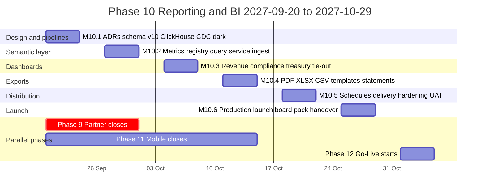
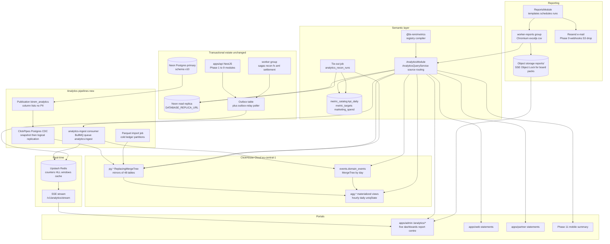
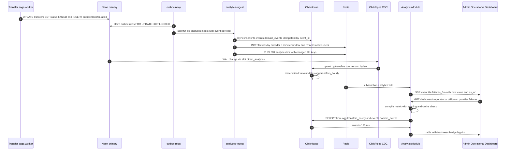
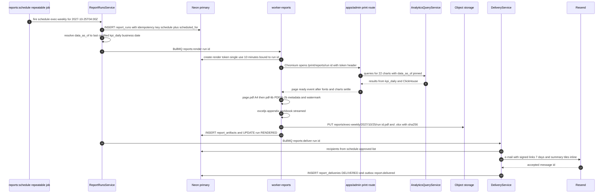
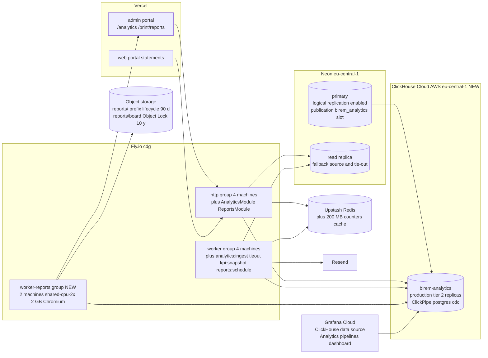
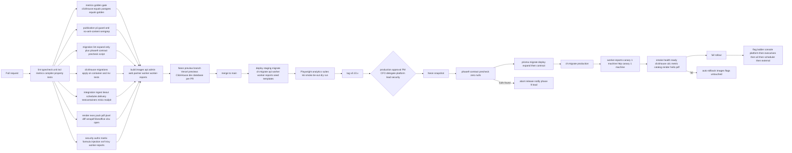

# Phase 10 — Reporting & Business Intelligence

| Field                     | Value                                                                                                                                                                                                                                                                                                                                                                                                                                                                                                                                                                                                                                                                                                                                                                                                                                                                                                                                                                                                                                                                                                                                                                                                                                                                                                                                                                                                                                                                                                                                                                                                                                      |
| ------------------------- | ------------------------------------------------------------------------------------------------------------------------------------------------------------------------------------------------------------------------------------------------------------------------------------------------------------------------------------------------------------------------------------------------------------------------------------------------------------------------------------------------------------------------------------------------------------------------------------------------------------------------------------------------------------------------------------------------------------------------------------------------------------------------------------------------------------------------------------------------------------------------------------------------------------------------------------------------------------------------------------------------------------------------------------------------------------------------------------------------------------------------------------------------------------------------------------------------------------------------------------------------------------------------------------------------------------------------------------------------------------------------------------------------------------------------------------------------------------------------------------------------------------------------------------------------------------------------------------------------------------------------------------------ |
| **Phase**                 | 10 of 13 — `reporting-bi`                                                                                                                                                                                                                                                                                                                                                                                                                                                                                                                                                                                                                                                                                                                                                                                                                                                                                                                                                                                                                                                                                                                                                                                                                                                                                                                                                                                                                                                                                                                                                                                                                  |
| **Dates**                 | 2027-09-20 → 2027-10-29                                                                                                                                                                                                                                                                                                                                                                                                                                                                                                                                                                                                                                                                                                                                                                                                                                                                                                                                                                                                                                                                                                                                                                                                                                                                                                                                                                                                                                                                                                                                                                                                                    |
| **Duration**              | 6 weeks (W1 = 2027-09-20 … 2027-09-24, W6 = 2027-10-25 … 2027-10-29)                                                                                                                                                                                                                                                                                                                                                                                                                                                                                                                                                                                                                                                                                                                                                                                                                                                                                                                                                                                                                                                                                                                                                                                                                                                                                                                                                                                                                                                                                                                                                                       |
| **Team**                  | `platform` (2 backend W1–W2 growing to 4 from W3 when Phase 9 closes on 2027-10-01, 1 frontend W1–W2 + 2 from W3, 1 QA + 1 from W3, solution architect, DevOps/SRE, PM, compliance analyst 25 %, product designer 50 %, 0.5 security engineer; CFO as business owner for Executive/Revenue, COO for Operational, head of treasury for Treasury, MLRO for Compliance; board secretary for the board pack UAT)                                                                                                                                                                                                                                                                                                                                                                                                                                                                                                                                                                                                                                                                                                                                                                                                                                                                                                                                                                                                                                                                                                                                                                                                                               |
| **Depends on**            | Phase 6 — International Remittance (ended 2027-07-23): `transfer_cross_border_details`, `corridors`, `corridor_routes`, `transfer_tracking_events`, `settlement_batches`, `regulatory_reports` store, `intl.transfer.*` events. Phase 7 — FX & Treasury (ended 2027-08-06): `pnl_daily`, `fx_positions_daily`, `transfer_profitability`, `eod_closes` and the `pnl.day.closed` event, `liquidity_positions`, `liquidity_threshold_events`, `settlement_accounts`, `fx_rate_publications`, `fx_trades`, `fx_conversions`, Neon read replica routing in `PrismaService` (`DATABASE_REPLICA_URL`). Phase 8 — AML, Fraud & Compliance (ended 2027-09-17): replica access to `aml_alerts`, `aml_cases` (`exposure_usd_minor`, `loss_usd_minor`, never notes), `aml_transaction_decisions`, `screening_requests`, `aml_risk_profiles`, `sar_reports` (counts only), `aml.*` events, SAR register. Transitively Phase 5 (`transfers`, `transfer_events`, `ledger_entries` monthly partitions, `ledger_account_daily_balances`, `fee_schedules`, `receipts`, `merchants`, `agents`), Phase 4 (`wallet_transactions`, `provider_accounts`, `provider_balance_snapshots`), Phase 3 (`providers`, `provider_connections`, `health_check_results`, `provider_incidents`), Phase 2 (`customer_profiles`, `kyc_applications`, `kyc_level`), Phase 1 (`User`/`Role`/`Permission`, `AuditLog`, `FeatureFlag`, `Setting`, `Outbox` + relay, BullMQ, notifications, `prom-client`). Phase 9 — Partner & Merchant (ends 2027-10-01, overlaps W1–W2): `settlement_runs`, `commission_accruals`, `partner_api_usage_daily`, `partners` on the replica from M9.5 |
| **Unlocks**               | Phase 12 — Production Go-Live (2027-11-01): board-ready launch readiness pack, go-live command-centre Operational Dashboard, daily executive e-mail, regulator statistical return exports; Phase 11 — Mobile (ends 2027-10-15): `GET /v1/analytics/customer/summary` for the in-app "my activity" card and DAU/MAU instrumentation contract; Phase 13 — Expansion (2028-01-03): country onboarding adds dimension rows and targets as data, country growth and corridor profitability marts drive market prioritisation; Phase 9 partners receive scheduled settlement and commission statements through the same report distribution engine                                                                                                                                                                                                                                                                                                                                                                                                                                                                                                                                                                                                                                                                                                                                                                                                                                                                                                                                                                                               |
| **Runs in parallel with** | Phase 9 — Partner & Merchant Portal (core team, until 2027-10-01): we consume its tables from M9.5 and ship the Phase 9 contract migration in our W1 slot; Phase 11 — Mobile (mobile team, until 2027-10-15): we agree the analytics event contract for app sessions in W1                                                                                                                                                                                                                                                                                                                                                                                                                                                                                                                                                                                                                                                                                                                                                                                                                                                                                                                                                                                                                                                                                                                                                                                                                                                                                                                                                                 |

---

## 1. Overview

### 1.1 Objective

Phase 10 gives BI-Rem **executive oversight**. By the end of Phase 9 the platform moves money domestically and across borders, prices FX, closes an end-of-day P&L, monitors AML and settles partners — but every management question ("how much did we make in Kenya last week?", "which provider is failing right now?", "are we liquid in XOF for Monday?", "how many SARs are open past SLA?") is answered by an engineer running SQL on the read replica or by finance copying numbers from four admin screens into a spreadsheet. The treasury dashboard from Phase 7 and the compliance workspace from Phase 8 are operator tools, not management reporting, and none of them is designed to be printed for a board.

This phase ships:

- an **analytics architecture** that keeps the transactional Neon Postgres untouched: change data capture by **logical replication** from Neon into **ClickHouse Cloud** (same AWS `eu-central-1` region as Neon, via ClickPipes Postgres CDC), a **streaming path** from the Phase 1 transactional outbox through a new `analytics-ingest` consumer into ClickHouse event tables and Redis real-time counters, and a **certified KPI snapshot** table in Postgres (`kpi_daily`) produced after a daily tie-out of the warehouse against the ledger, so that board numbers are reproducible even if the warehouse is unavailable;
- a **semantic layer** (`packages/metrics`, `@bi-rem/metrics`): every KPI in the brief defined once as code (formula, grain, dimensions, unit, owner, certification status, ClickHouse and Postgres SQL), compiled to parameterised queries with row-level scoping and served through `/v1/analytics/*`, with the catalogue mirrored in `metric_catalog` for audit;
- five dashboards in the admin portal — **Executive**, **Operational** (real-time), **Revenue**, **Compliance**, **Treasury** — built from the semantic layer with saved views, drill-down to transfer level where the viewer's permissions allow, data-freshness badges and targets vs actuals;
- **exports** in **PDF** (board-quality, rendered by headless Chromium from the same React chart components in a dedicated `worker-reports` process group), **Excel** (`exceljs` streaming workbooks with typed columns and frozen headers) and **CSV** (RFC 4180, UTF-8 BOM, streaming up to 5 M rows), with formula-injection protection, watermarks, signed expiring links and download audit;
- **scheduled report distribution**: report templates (executive weekly pack, operational daily, revenue monthly, compliance monthly, treasury daily, settlement and commission statements for partners, regulator statistical returns where the format is known), cron schedules with time zones, recipients inside and outside the organisation (external recipients under four-eyes approval), delivery by e-mail (links, not attachments, above 10 MB), portal inbox and S3 drop, retries, run history and artefact retention;
- the **program monitoring KPIs**: Active Users, DAU, MAU, Transfer Volume, Transfer Value, Settlement Time, Failure Rate, Provider Uptime, FX Profit, CAC, CLV, Fraud Loss Rate, Liquidity Ratios, Country Growth — plus Transaction Volume, Revenue, Failed Transactions, Provider Performance, Country Activity and FX Profitability, each with an owner and a documented definition, so that the same number appears on the dashboard, in the PDF and in the Excel.

The phase succeeds when, in production, the Operational Dashboard shows a failed transfer and a degraded provider within 30 seconds of the event; the Executive Dashboard reads the same month-to-date revenue, to the minor unit, as `pnl_daily` and the ledger; the CFO receives the weekly executive pack as a PDF every Monday at 07:00 Africa/Nairobi without anyone touching a spreadsheet; and the board secretary signs off a quarterly board pack generated by the system.

### 1.2 In scope

- **Analytics store and pipelines** — ClickHouse Cloud service (`birem-analytics`, AWS `eu-central-1`), Neon publication `birem_analytics` with column lists excluding PII, ClickPipes Postgres CDC into `pg.*` ReplacingMergeTree tables, `analytics-ingest` outbox consumer writing `events.domain_events` and Redis counters, ClickHouse materialized views for hourly/daily aggregates (`agg.*`), Parquet import of Phase 5 cold `ledger_entries` partitions from object storage, pipeline health (`analytics_sync_state`), daily tie-out (`analytics_recon_runs`), certified `kpi_daily` snapshots, Postgres fallback source (replica + `kpi_daily`).
- **Semantic layer** — `@bi-rem/metrics`: metric registry with Zod schema, `MetricCompiler` (dimension/filter whitelist, time grains, currency normalisation to reporting currency USD using Phase 7 `fx_rate_publications` mid rates frozen per business date), `AnalyticsQueryService` with source routing (`CLICKHOUSE` | `POSTGRES` | `AUTO`), per-query cost guard, result cache in Redis (TTL by grain), `metric_catalog` sync at boot, metric versioning and certification workflow (`DRAFT → CANDIDATE → CERTIFIED`, CFO or delegate certifies finance metrics).
- **Dashboards** (admin portal `/analytics/*`) — Executive, Operational, Revenue, Compliance, Treasury; shared filter bar (period, country, corridor, currency, provider, partner, segment); saved views; targets vs actuals (`metric_targets`); freshness badge from `analytics_sync_state`; drill-down tables with export; SSE live tiles on Operational; keyboard-accessible, `en`/`fr`/`pt`; dark mode as the admin portal.
- **KPIs** — all listed in the brief; definitions in §3.6; `marketing_spend` manual input for CAC; cohort retention for CLV; `fraud_losses` sourced from Phase 8 `aml_cases.loss_usd_minor`; liquidity ratios from Phase 7 `liquidity_positions`; provider uptime from Phase 3 `health_check_results` and `provider_incidents`; settlement time from `transfer_events` and Phase 9 `settlement_runs`.
- **Exports** — PDF, XLSX, CSV for every dashboard and drill-down; ad-hoc export jobs with row limits by permission (`analytics:export` ≤ 100 k rows aggregated; `analytics:export:pii` for transfer-level exports including counterparty last-4 and names, ≤ 5 M rows, audited); formula-injection escaping; watermark (requester, time, classification); signed URLs (15 min); artefact retention (90 days, board packs 10 years with Object Lock).
- **Scheduled report distribution** — `report_templates`, `report_schedules`, `report_runs`, `report_artifacts`, `report_deliveries`; BullMQ repeatable jobs; time-zone-aware cron; channels `EMAIL` (Resend, links), `PORTAL` (inbox), `S3_DROP` (finance ERP pickup prefix), `WEBHOOK` (Phase 9 partner webhooks for statements); four-eyes approval for schedules with external recipients; pause/resume; run history; re-run with the same `data_as_of`.
- **Customer and partner surfaces** — customer portal account statement export (PDF/CSV) for the customer's own transfers; Phase 9 partner dashboard settlement and commission statements delivered by schedule; Phase 11 mobile summary endpoint.
- **Operations** — Grafana dashboards for pipeline lag, ClickHouse query latency, render queue; alerts; runbooks (CDC slot lag, schema change, warehouse outage, report failure); on-call ownership (platform).
- **Phase 9 contract migration** in our W1 slot (`merchants.partner_id` and `agents.partner_id` NOT NULL after four weeks of commission engine posting) and the Phase 8 removal of Phase 5 velocity guardrail settings, both handed to "Phase 10 W1" by those plans.

### 1.3 Out of scope

- **Self-serve BI for business users** (drag-and-drop explorers, Metabase/Looker) — Grafana Cloud gets a read-only ClickHouse data source for engineers and analysts; a business-user explorer is a Phase 13 candidate once the semantic layer has stabilised.
- **Machine-learning forecasting** (liquidity forecasts beyond Phase 7's rule-based forecast, churn prediction, CLV models beyond the cohort formula) — Phase 13; this phase produces the labelled history.
- **Regulatory returns whose format is unknown** — templates are shipped for BEAC monthly transfer statistics, CBK monthly remittance return and BoG forex bureau return as `REGULATORY_RETURN` templates using the Phase 6 `regulatory_reports` store; other regulators are added as templates in Phase 13 (`TO_CONFIRM` list in §15.3).
- **Changes to transactional sagas, ledger or fee engine** — Phase 10 reads; it never writes to Phase 5–9 tables other than the two contract migrations above.
- **In-country data residency for analytics** — tracked as Q10.6; the warehouse stays in `eu-central-1` next to Neon until counsel confirms requirements (Phase 8 Q8.10 outcome).
- **General ledger export to an ERP** beyond the `S3_DROP` of CSV/XLSX statements (ERP connectors are a finance-systems project, not platform).
- **Partner-facing analytics API** beyond statements (partner dashboards keep their Phase 9 operational views).

### 1.4 Independent deployability

Phase 10 is additive and read-only with respect to the money path, which makes it the easiest phase to deploy, pause or abandon without touching customers:

- **Nothing in the saga path changes.** The only writes to existing tables are the Phase 9/8 contract migrations scheduled here, which have their own expand → migrate → contract history. New tables (`report_*`, `metric_*`, `kpi_daily`, `analytics_*`, `marketing_spend`, `dashboard_saved_views`) are created by the schema v10 expand migration and referenced by no Phase 1–9 code.
- **Feature flags** (Phase 1 `FeatureFlag` with role rules and percentage): `analytics.warehouse.enabled` (ClickHouse reads), `analytics.cdc.enabled` (ClickPipe running), `analytics.ingest.enabled` (outbox consumer), `analytics.realtime.enabled` (SSE tiles), `admin.analytics.console` (dashboard navigation; dark launch to `platform_engineer` and `executive` roles only in W1–W3), `dashboards.executive`, `dashboards.operational`, `dashboards.revenue`, `dashboards.compliance`, `dashboards.treasury` (individual rollout), `reports.scheduler.enabled`, `reports.delivery.external.enabled`, `reports.pdf.enabled`, `exports.pii.enabled`, `kpi.snapshot.enabled`, `portal.statements.enabled` (customer portal), `partner.statements.scheduled` (Phase 9 portal).
- **Settings** (Phase 1 `Setting`): `analytics.source` (`AUTO` | `CLICKHOUSE` | `POSTGRES`) is the primary kill switch — `POSTGRES` serves every dashboard from `kpi_daily` and replica materialized views at reduced granularity; `analytics.query.max_cost`, `analytics.cache.ttl_seconds.<grain>`, `reports.render.timeout_seconds`, `exports.max_rows.<permission>`.
- **Dark launch**: W1 deploys the migration, the ClickHouse service, the publication and the CDC pipe with every dashboard flag off; CDC and ingest run for two weeks in production before anyone outside the platform team sees a chart, so the tie-out has history when the CFO first looks.
- **Kill switches with known consequences**: `analytics.cdc.enabled=false` pauses the ClickPipe — because a paused logical replication slot retains WAL on Neon, the runbook (§15.4) drops the slot if the pause exceeds 6 hours and re-snapshots on resume; `reports.scheduler.enabled=false` stops every scheduled delivery within one minute while manual runs still work; `reports.delivery.external.enabled=false` holds deliveries to non-`@bi-rem` recipients in `HELD` for later release.
- **"Deployable alone" means**: the API, admin portal and worker images of `v0.10.x` can be deployed on top of a Phase 9 production without a ClickHouse service existing (all `analytics.*` flags off, `analytics.source=POSTGRES`); the Phase 1–9 behaviour is unchanged; the schema v10 expand is backwards-compatible with `v0.9.x` images for rollback; abandoning the phase is `DROP PUBLICATION`, delete the slot, delete the ClickHouse service, flags off — tables stay until a snapshot-protected drop decision.
- **Expand/contract**: `20270920090000_phase10_expand` (new tables, enums, permissions, roles), `20270920100000_phase9_contract` (NOT NULL on `merchants.partner_id`, `agents.partner_id`; drop of the Phase 5 velocity guardrail settings rows), no Phase 10 contract until Phase 12 (candidate: drop `analytics_recon_runs` rows older than 13 months — a retention job, not a schema change).

---

## 2. Milestones

Phase start is Monday **2027-09-20**; week _n_ runs Monday to Friday; milestone dates are the Friday of the week.

| ID        | Week | Target date | Deliverable                                                                                                                                                                                                                                                                                                                                                                                                                                                                                                                                                                                                                                                                                                                                               | Acceptance criteria                                                                                                                                                                                                                                                                                                                                                                                                                                                                                                                                                                                                                                                                                                                                                                                                                                                       | Owner                             |
| --------- | ---- | ----------- | --------------------------------------------------------------------------------------------------------------------------------------------------------------------------------------------------------------------------------------------------------------------------------------------------------------------------------------------------------------------------------------------------------------------------------------------------------------------------------------------------------------------------------------------------------------------------------------------------------------------------------------------------------------------------------------------------------------------------------------------------------- | ------------------------------------------------------------------------------------------------------------------------------------------------------------------------------------------------------------------------------------------------------------------------------------------------------------------------------------------------------------------------------------------------------------------------------------------------------------------------------------------------------------------------------------------------------------------------------------------------------------------------------------------------------------------------------------------------------------------------------------------------------------------------------------------------------------------------------------------------------------------------- | --------------------------------- |
| **M10.1** | W1   | 2027-09-24  | Design freeze and dark infrastructure: ADR-0033 (analytics store — ClickHouse Cloud over BigQuery / replica-only), ADR-0034 (CDC by Neon logical replication + ClickPipes, outbox streaming for real-time, PII column exclusion), ADR-0035 (semantic layer as code in `@bi-rem/metrics`), ADR-0036 (report rendering and distribution); KPI definition sheet v1 signed by CFO/COO/MLRO/treasury; schema v10 expand + Phase 9 contract + Phase 8 settings cleanup applied to staging and production; ClickHouse Cloud service created in staging and production; Neon publication `birem_analytics` with column lists; ClickPipe snapshot + CDC running in staging; `worker-reports` process group deployed dark; Phase 11 analytics event contract agreed | `pnpm db:migrate:dev` applies `20270920090000_phase10_expand` and `20270920100000_phase9_contract` on a Phase 9 snapshot with `prisma migrate diff` empty; contract migration pre-check script reports zero `merchants`/`agents` with NULL `partner_id` in production; ADRs accepted at the Thursday architecture review; KPI sheet (§3.6) has an owner, formula, grain and source for all 20 KPIs; staging ClickPipe initial snapshot of 13 months of synthetic data (≈ 36 M transfers, 220 M ledger entries) completes < 6 h and CDC lag < 10 s under the synthetic load generator; publication contains no column from the PII deny-list (CI test `publication-pii-guard`); `worker-reports` renders a "hello" PDF in staging                                                                                                                                          | Solution Architect                |
| **M10.2** | W2   | 2027-10-01  | `@bi-rem/metrics` registry with all 20 KPIs compiled to ClickHouse and Postgres SQL; `AnalyticsQueryService` with source routing, scoping, cache, cost guard; `/v1/analytics/metrics`, `/v1/analytics/query`, `/v1/analytics/dashboards/:key`; `analytics-ingest` consumer and Redis real-time counters; `agg.*` materialized views; `analytics_sync_state` and freshness; production CDC started dark; Executive and Operational dashboards usable by the platform team (`admin.analytics.console` role rule)                                                                                                                                                                                                                                            | Golden SQL tests: every metric compiles for both dialects and both results agree to the minor unit on the 13-month fixture (`metrics-golden` CI job); `POST /v1/analytics/query` p95 < 500 ms for the 25 dashboard queries against ClickHouse staging at 36 M transfers; cross-tenant scoping suite (country- and partner-scoped roles, 200 queries) leaks zero rows; `analytics-ingest` processes 2 000 events/s in k6 with ClickHouse async insert lag < 5 s; Operational tiles update within 30 s of a `transfer.failed` event on staging via SSE; production CDC running with lag alert configured; publication of a DDL change on staging follows the schema-change runbook without data loss (rehearsed)                                                                                                                                                            | Backend Lead (platform)           |
| **M10.3** | W3   | 2027-10-08  | Revenue, Compliance and Treasury dashboards; targets vs actuals (`metric_targets`) and `marketing_spend` input screens; daily tie-out job (`analytics_recon_runs`) and certified `kpi_daily` snapshots; Postgres fallback source (`analytics.source=POSTGRES`) with replica materialized views; metric certification workflow; Grafana ClickHouse data source for engineers; full team on board from Phase 9                                                                                                                                                                                                                                                                                                                                              | Tie-out of the previous business day: warehouse revenue, volume, value and FX profit equal `pnl_daily` / `ledger_account_daily_balances` to the minor unit for every (corridor, currency), or the mismatch is explained by a listed late-arriving journal and auto-resolves within 24 h; `kpi_daily` rows exist for every certified metric × day × scope since 2027-04-19 (Phase 5 start); switching `analytics.source` to `POSTGRES` keeps all five dashboards rendering (daily grain, no live tiles) with p95 < 1.5 s on the replica; Compliance dashboard shows counts only (semgrep `analytics/no-aml-content` passes); CFO certifies the 8 finance metrics in the admin workflow (audited)                                                                                                                                                                           | Backend Lead / Frontend Lead      |
| **M10.4** | W4   | 2027-10-15  | Exports: PDF rendering pipeline (print routes, render tokens, Chromium hardening), XLSX and CSV streaming, formula-injection guard, watermarks, signed URLs, download audit, PII export permission and limits; ad-hoc export jobs; customer statement export in the customer portal; report templates v1 (executive weekly pack, operational daily, revenue monthly, compliance monthly, treasury daily, settlement statement, commission statement, three regulatory returns)                                                                                                                                                                                                                                                                            | Executive weekly pack (14 pages, 22 charts) renders < 60 s p95 and is pixel-diff-stable (< 0.5 % changed pixels against baseline) in CI; 5 M-row CSV export streams < 4 min with constant memory (< 400 MB RSS on `worker-reports`); XLSX of 1 M rows < 3 min with typed money columns (`BIGINT` minor → decimal with currency column, never floats); formula-injection suite (`=`, `+`, `-`, `@`, tab, CR) escapes 100 % of hostile fixtures in CSV and XLSX; signed URL rejected after 15 min and after one download when `single_use`; every export writes an `audit_logs` row and a `report_runs` row; Chromium cannot reach any host except `apps/admin` print origin (egress test with 20 hostile URLs); customer downloads own statement, cross-customer attempt returns 404; regulatory return XLSX for BEAC matches the regulator's layout fixture cell for cell | Backend Lead / Security           |
| **M10.5** | W5   | 2027-10-22  | Scheduled distribution: `report_schedules` with cron + time zone, recipients, channels (`EMAIL`, `PORTAL`, `S3_DROP`, `WEBHOOK`), four-eyes approval for external recipients, retries, pause/resume, run history, re-run at `data_as_of`; partner statements through Phase 9 webhooks and portal; admin consoles (report centre, schedules, runs, metric catalogue, pipeline health, tie-out); hardening: performance, chaos (ClickHouse unavailable, CDC slot lag, render worker kill), security review, pen test on exports and signed URLs; runbooks; UAT with CFO, COO, treasury, MLRO, board secretary                                                                                                                                               | Schedules fire within 60 s of the cron instant across three time zones (Africa/Nairobi, Africa/Lagos, Africa/Dakar) through a DST-free year test and a leap-day test; a run killed mid-render resumes exactly once (idempotent `report_runs` key) and the recipient gets one e-mail; external recipient schedule cannot activate without a second approver (authz matrix); chaos: ClickHouse unreachable for 30 min → dashboards degrade to `POSTGRES` automatically within 60 s with a banner and recover without stale cache; CDC slot lag injected to 20 min → alert, freshness badge turns amber, no false "certified" snapshot is produced; k6 profile (§9.5) passes; pen-test findings ≥ High closed; UAT scripts (§9.7) signed                                                                                                                                     | QA Lead / Backend Lead / Security |
| **M10.6** | W6   | 2027-10-29  | Production launch: `admin.analytics.console` to all admin roles by permission, five dashboards on, `reports.scheduler.enabled=true`, first scheduled executive pack delivered Monday 2027-10-25 07:00 Africa/Nairobi, external delivery enabled after CFO approval, `kpi.snapshot.enabled`, customer statements on; board pack for Q3-2027 generated and signed by the board secretary; phase exit review; handover to Phases 11/12/13                                                                                                                                                                                                                                                                                                                    | Success criteria (§12) evidenced with production data: Operational Dashboard reflects a staff-executed failed transfer and a simulated provider degradation within 30 s; Executive Dashboard MTD revenue equals `pnl_daily` sum to the minor unit on three consecutive days; 5 consecutive scheduled deliveries succeed first-attempt; Q3-2027 board pack (PDF + XLSX appendix) signed by the board secretary and CFO; tie-out green 7 consecutive days; p95 dashboard query < 500 ms in production; sign-offs (§11) collected; Phase 12 command-centre view and Phase 11 summary endpoint accepted by their leads                                                                                                                                                                                                                                                        | Program Manager                   |



Staffing note: the `platform` team is at half strength in W1–W2 because two backend engineers and two frontend engineers finish Phase 9 hardening and launch (M9.5–M9.6) until 2027-10-01. W1–W2 is therefore deliberately infrastructure- and backend-heavy (pipelines, semantic layer) where the architect and DevOps/SRE carry most of the work; dashboard and export front-end work lands in W3–W5 when three frontend engineers are available. If Phase 9 slips past 2027-10-01, the Revenue and Compliance dashboards move to W4 and the ad-hoc export UI to W5; the scheduled distribution engine is not on that critical path because it is backend-only.

---

## 3. Deliverables

Each deliverable has a definition of done (DoD). "Certified" means a metric whose definition has been approved in the certification workflow by its business owner and whose warehouse value ties out to the ledger daily.

### 3.1 Executive Dashboard

Board-level view at `/analytics/executive`. Tiles: Transaction Volume (count) and Transfer Value (reporting currency USD and native currency toggle), Revenue (gross fee revenue + FX spread − provider fees − commissions = net revenue, with take rate in bps), Active Users / DAU / MAU with the DAU/MAU stickiness ratio, Country Activity map (20 countries, volume, value, growth), Country Growth (month-over-month and year-over-year by country), FX Profit (realised + unrealised from Phase 7), CAC and CLV per country with the CLV/CAC ratio, Fraud Loss Rate, Failure Rate, headline Liquidity Ratio, targets vs actuals from `metric_targets`, and a "what changed" panel listing metrics outside ±10 % of their 4-week trend. Period presets (MTD, QTD, YTD, trailing 13 months) and comparison period.

**DoD**: every tile is a certified metric or carries a visible `UNCERTIFIED` badge; MTD revenue equals the sum of `pnl_daily.net_minor` converted at the frozen daily mid rate to the minor unit; the dashboard renders in < 1.5 s on a 10 Mbit connection (Lighthouse performance ≥ 85); the same view exports to PDF (board layout), XLSX (one sheet per tile with the underlying table) and CSV (tile table); saved views work; Playwright suite green; access limited to `analytics:read` plus `dashboards:executive`.

### 3.2 Operational Dashboard

Real-time command-centre view at `/analytics/operational`. Live tiles (SSE, ≤ 30 s staleness): transfers in flight by saga step, completed/failed per minute, Failure Rate (rolling 5 min / 1 h / 24 h) by provider, corridor and failure code, Provider Performance (success rate, p50/p95 latency from Phase 4 `wallet_transactions`, Phase 3 health status, circuit state, open incidents), Provider Uptime (24 h / 30 d), Settlement Time (customer-visible: `initiated → completed` p50/p95 by corridor; partner: `settlement_runs` period end → `PAID`), queue depths and oldest job age from BullMQ, outbox pending, CDC lag, held transfers awaiting compliance (count), float and nostro accounts under threshold (count, from Phase 7 events), today's volume vs same weekday 4-week average. Incident annotations from Phase 3 `provider_incidents` on the time axis.

**DoD**: a `transfer.failed` event in production is reflected in the failed-per-minute tile and the provider failure-rate table within 30 s (measured by the staff rehearsal script); SSE reconnects with `Last-Event-ID` without duplicate counts; the dashboard works with `analytics.realtime.enabled=false` by polling at 60 s; alert thresholds on the tiles mirror Grafana alerts so operators see the same colour; Phase 12 command-centre acceptance (COO) signed.

### 3.3 Revenue Dashboard

Finance view at `/analytics/revenue`. Revenue waterfall (gross fees → taxes collected → FX spread → provider fees → commissions → treasury fees → net), revenue by corridor, country, currency, product (`TransferType`), customer segment (Phase 7 `CustomerSegment`) and partner; take rate and net margin per transfer; fee schedule effectiveness (realised vs scheduled fee per corridor); commission payouts (Phase 9 `commission_accruals`) and MDR; top partners and merchants by net revenue; FX Profitability by pair (spread captured, realised, unrealised, volume), month-end close status (Phase 7 `eod_closes`), revenue per active user (ARPU) and gross margin per transfer. Reconciliation panel: warehouse vs ledger vs `pnl_daily` for the selected period with the tie-out status.

**DoD**: every monetary figure is derived from `transfer_profitability` / `pnl_daily` / `ledger_entries` (never from fee quotes); the waterfall sums to `pnl_daily.net_minor` for the period; FX conversion to USD uses the frozen business-date mid rate recorded in `kpi_daily.fx_rate_used` so that re-running a month later gives the same numbers; the CFO's month-end checklist can be completed from this screen and its XLSX export alone (UAT scenario U10.3).

### 3.4 Compliance Dashboard

MLRO view at `/analytics/compliance`, counts and durations only — no case content, names or narrative. Alerts by typology, queue, severity and disposition; false-positive rate per rule (from Phase 8 `aml_transaction_decisions` and alert dispositions); alert SLA compliance and ageing; cases open/closed by type and priority with ageing buckets; SARs by status and days to deadline (counts), submissions by regulator and channel; screening volume, hit rate and latency; KYC funnel (Phase 2 `kyc_applications`: started → documents → verified → approved by level and country) and time-to-approve; held transfers and release time; Fraud Loss Rate (confirmed losses from `aml_cases.loss_usd_minor` over transfer value) and fraud alerts by signal kind; watchlist freshness; retention and legal-hold counts. Country and period filters only; no drill-down to subject level from this dashboard (drill-down happens in the Phase 8 workspace with its own permissions).

**DoD**: CI semgrep rule `analytics/no-aml-content` fails on any metric SQL touching `aml_case_notes`, `aml_case_attachments`, `sar_reports` content columns, `screening_matches` names or `watchlist_entry_names`; small-cell suppression (< 5) applied when the viewer lacks a `compliance_*` role (executives see suppressed cells as "< 5"); MLRO signs the metric sheet; exports of this dashboard are classified `CONFIDENTIAL` and watermarked.

### 3.5 Treasury Dashboard

Treasury view at `/analytics/treasury`, complementing the Phase 7 operator screens with management reporting. Liquidity Ratios per currency and account: available / next-24 h projected outflow (coverage ratio), available / 7-day average daily outflow (runway days), float utilisation (Phase 4 `provider_balance_snapshots` vs ledger), nostro concentration by institution; positions (`fx_positions_daily`) and unrealised P&L trend; rebalancing orders and legs by status and cost; threshold breaches by level and duration; prefunding instructions ageing (Phase 6); settlement account variance (ledger vs external balance); FX trades by LP with executed vs mid slippage; EOD close status by currency and time to close; settlement runs to partners by status and value.

**DoD**: liquidity ratio tiles equal the head of treasury's manual morning sheet for three consecutive days (UAT U10.5); ratios use the latest `liquidity_positions` snapshot per account with the snapshot time shown; threshold colours use Phase 7 `ThresholdLevel`; treasury daily report template renders this dashboard at 06:30 local time per currency desk.

### 3.6 KPI catalogue (semantic layer v1)

All 20 KPIs below are implemented as metrics in `@bi-rem/metrics` with the stated definition, grain and source. Reporting currency is USD at the Phase 7 published mid rate frozen per business date; native currency is always available as a dimension.

| KPI                  | Definition (v1)                                                                                                                                                                                                     | Grain / dimensions                                            | Source tables                                                                       | Owner            | Certified by |
| -------------------- | ------------------------------------------------------------------------------------------------------------------------------------------------------------------------------------------------------------------- | ------------------------------------------------------------- | ----------------------------------------------------------------------------------- | ---------------- | ------------ |
| Transaction Volume   | Count of `transfers` reaching `COMPLETED` in period (refunds counted separately)                                                                                                                                    | hour/day; country, corridor, type, provider, partner, segment | `pg.transfers`, `events.domain_events`                                              | COO              | COO          |
| Transfer Volume      | Same as Transaction Volume plus `wallet_transactions` top-ups and withdrawals, shown as "money movements"                                                                                                           | day; country, type                                            | `pg.transfers`, `pg.wallet_transactions`                                            | COO              | COO          |
| Transfer Value       | Sum of `transfers.amount` (principal, minor units) for completed transfers, native and USD                                                                                                                          | hour/day; country, corridor, currency                         | `pg.transfers`, `fx_rate_publications`                                              | CFO              | CFO          |
| Revenue              | Net revenue = fee revenue + FX spread − provider fees − commissions − treasury fees − taxes payable, from `transfer_profitability`; gross and components exposed as sub-metrics                                     | day; corridor, country, currency, segment, partner            | `pg.transfer_profitability`, `pg.pnl_daily`                                         | CFO              | CFO          |
| FX Profit            | Realised + unrealised FX result from `pnl_daily.fx_realised_minor + fx_unrealised_minor` plus captured spread                                                                                                       | day; pair, currency                                           | `pg.pnl_daily`, `pg.fx_positions_daily`                                             | Head of treasury | CFO          |
| FX Profitability     | FX profit / FX-converted value (bps) by pair and segment                                                                                                                                                            | day; pair, segment                                            | as above + `pg.fx_conversions`                                                      | Head of treasury | CFO          |
| Failed Transactions  | Count of transfers reaching `FAILED` (terminal) by `failure_code`, provider, corridor                                                                                                                               | 5 min/hour/day                                                | `events.domain_events`, `pg.transfers`                                              | COO              | COO          |
| Failure Rate         | Failed / (completed + failed) terminal transfers in the window, excluding customer cancellations                                                                                                                    | 5 min/hour/day; provider, corridor, code                      | as above                                                                            | COO              | COO          |
| Provider Performance | Success rate, p50/p95 leg latency, timeout rate, circuit-open minutes per provider connection                                                                                                                       | 5 min/hour/day; provider, connection, country                 | `pg.wallet_transactions`, `pg.wallet_transaction_events`, `pg.health_check_results` | Head of platform | COO          |
| Provider Uptime      | 1 − (minutes with `health_status` in {DOWN, DEGRADED} or open `provider_incidents`) / minutes in window                                                                                                             | hour/day; provider, connection                                | `pg.health_check_results`, `pg.provider_incidents`                                  | Head of platform | COO          |
| Country Activity     | Volume, value, active users, new customers, active agents and merchants per country                                                                                                                                 | day; country                                                  | `pg.transfers`, `pg.users` (non-PII columns), `pg.agents`, `pg.merchants`           | CEO              | COO          |
| Country Growth       | MoM and YoY growth of Transfer Value and Active Users per country; cohort of first-transfer month                                                                                                                   | month; country                                                | `kpi_daily`                                                                         | CEO              | CFO          |
| Active Users         | Distinct `sender_user_id ∪ recipient_user_id` with ≥ 1 completed transfer or wallet transaction in the trailing 30 days                                                                                             | day (trailing 30 d); country, segment                         | `agg.active_users_daily` (uniqState)                                                | CPO              | COO          |
| DAU                  | Distinct users with ≥ 1 authenticated session or transaction on the day (app sessions from Phase 11 events, portal logins from `auth.login.succeeded`)                                                              | day; country, platform                                        | `events.domain_events`                                                              | CPO              | COO          |
| MAU                  | Distinct users as DAU over trailing 30 days; stickiness = DAU / MAU                                                                                                                                                 | day; country, platform                                        | `agg.active_users_daily`                                                            | CPO              | COO          |
| Settlement Time      | Customer: `transfer.completed − transfer.initiated` p50/p95; Partner: `settlement_runs.paid_at − period_end` p50; Cross-border: `transfer_tracking_events` `PAYOUT_CONFIRMED − FX_LOCKED`                           | day; corridor, provider, partner                              | `pg.transfer_events`, `pg.transfer_tracking_events`, `pg.settlement_runs`           | COO              | COO          |
| CAC                  | Approved `marketing_spend` for (month, country, channel) / new customers with first completed transfer in that month and country                                                                                    | month; country, channel                                       | `marketing_spend`, `pg.transfers`                                                   | CMO              | CFO          |
| CLV                  | ARPU (net revenue per active user per month, trailing 3 months) × gross margin % × expected lifetime months (1 / monthly churn, churn = active users lost from the cohort of 12 months ago); v1 capped at 36 months | month; country, segment                                       | `kpi_daily`, cohort tables                                                          | CFO              | CFO          |
| Fraud Loss Rate      | Confirmed fraud losses (`aml_cases.loss_usd_minor` where case type FRAUD and status CLOSED_CONFIRMED) / Transfer Value in USD, bps                                                                                  | month; country, type                                          | `pg.aml_cases` (amount columns only)                                                | MLRO             | CFO          |
| Liquidity Ratios     | Coverage = available / projected 24 h outflow (Phase 7 forecast); Runway days = available / 7-day average outflow; Float utilisation = (ledger float − available) / ledger float                                    | snapshot/day; currency, account, institution                  | `pg.liquidity_positions`, `pg.settlement_accounts`, `pg.provider_balance_snapshots` | Head of treasury | CFO          |

**DoD**: each KPI has a `metric_catalog` row with version 1, a markdown definition page under `docs/handbooks/kpi-catalogue.md`, golden values on the fixture, Postgres and ClickHouse SQL agreeing to the minor unit, and a named certifier whose approval is recorded in `metric_catalog.certified_by_id`.

### 3.7 Analytics architecture (pipelines)

ClickHouse Cloud service, Neon publication with PII column exclusion, ClickPipes CDC, `analytics-ingest` outbox consumer, Redis real-time counters, `agg.*` materialized views, Parquet import of cold partitions, pipeline health model and alerts, daily tie-out, `kpi_daily` snapshots, Postgres fallback.

**DoD**: production CDC lag p95 < 10 s and p99 < 60 s over 7 days; initial snapshot runbook executed twice (staging, production); schema-change runbook rehearsed; tie-out green 7 consecutive days; fallback drill passed; Grafana dashboard "Analytics pipelines" with alerts for slot lag > 5 min, WAL retained > 5 GB, ClickPipe stopped, ingest consumer lag > 60 s, tie-out mismatch; data-loss test (kill ClickPipe mid-batch, restart) shows zero missing primary keys against Postgres.

### 3.8 Semantic layer

`packages/metrics` with registry, compiler, query service, catalogue sync, certification workflow, admin metric catalogue screen.

**DoD**: adding a metric is a pull request touching only `packages/metrics/src/metrics/*.ts` plus golden fixtures; the compiler rejects unknown dimensions, unbounded time ranges (> 25 months) and un-scoped queries from scoped roles; `metric_catalog` is updated at API boot and any drift between code and catalogue fails `/health/ready` with reason `metric-catalog-drift`; OpenAPI documents the query DSL; 100 % of dashboard tiles use the catalogue (ESLint rule forbidding raw SQL in `apps/admin`).

### 3.9 Exports: PDF, Excel, CSV

Render pipeline (`worker-reports` with Chromium), XLSX and CSV streaming writers, export jobs API, download links, audit, classification watermarks, PII export permission and limits, customer statements.

**DoD**: as in M10.4; artefact checksums (`sha256`) recorded; artefacts encrypted at rest; PDF/A-2b conformance for board packs (veraPDF check in CI); XLSX opens without repair prompts in Excel 365 and LibreOffice (CI uses LibreOffice headless to open and re-save); CSV passes `csvlint`; accessibility: PDFs tagged with document title and language.

### 3.10 Scheduled report distribution

Templates, schedules, runs, artefacts, deliveries, approval, channels, retries, run history, admin report centre, partner statement scheduling, regulator return templates.

**DoD**: as in M10.5; first production weekly executive pack delivered 2027-10-25 07:00 Africa/Nairobi; delivery success ≥ 99 % first attempt over the launch week; every delivery to an external address is traceable to an approved schedule and an `audit_logs` row; S3 drop writes to `reports/drops/<schedule>/<yyyy>/<mm>/` with a `.done` marker; webhook deliveries to partners reuse Phase 9 signing.

### 3.11 Success criteria mapping

- **Real-time reporting available** → Operational Dashboard SSE tiles (≤ 30 s), CDC lag p95 < 10 s, freshness badges, fallback polling (§12).
- **Board-ready dashboards generated** → Executive Dashboard, certified metrics, Q3-2027 board pack PDF/A with XLSX appendix signed by the board secretary and CFO, scheduled delivery (§12).

---

## 4. Architecture

### 4.1 Component view (Phase 10 additions)



**Modules added to `apps/api`**: `modules/analytics` (`AnalyticsController`, `AnalyticsQueryService`, `MetricCatalogService`, `SourceRouter`, `ScopingPolicy`, `FreshnessService`, `StreamController` for SSE, `TieOutService`, `KpiSnapshotService`), `modules/reports` (`ReportTemplatesService`, `ReportSchedulesService`, `ReportRunsService`, `ArtifactsService`, `DeliveryService`, `ReportApprovalService`), `modules/analytics-ingest` (worker-only consumer). New package `packages/metrics` (`@bi-rem/metrics`) with no NestJS dependency so that `worker-reports`, the API and tests share it. `packages/shared` gains Zod schemas for the query DSL, report specs and export options. `packages/db` gains the Prisma models in §5 and a `clickhouse/` folder with versioned `.sql` migrations applied by a small runner (`pnpm ch:migrate`) because Prisma does not manage ClickHouse.

**Process groups on Fly**: existing `http` and `worker`; new `worker-reports` (2 machines `shared-cpu-2x`, 2 GB, Chromium installed in the image, queues `reports:render`, `reports:deliver`, `exports:run`); the `worker` group gains queues `analytics:ingest`, `analytics:tieout`, `kpi:snapshot`, `reports:schedule` via `WORKER_QUEUES`.

### 4.2 Design decisions and alternatives rejected

| Decision                       | Chosen                                                                                                                                                                                                | Alternatives rejected                                                                                                                                                                                                                                                                                                                                                                                                                                                                                                                                                                                                                                                                                                                                                                                              | Why                                                                                                                                                                                                                                                                                       |
| ------------------------------ | ----------------------------------------------------------------------------------------------------------------------------------------------------------------------------------------------------- | ------------------------------------------------------------------------------------------------------------------------------------------------------------------------------------------------------------------------------------------------------------------------------------------------------------------------------------------------------------------------------------------------------------------------------------------------------------------------------------------------------------------------------------------------------------------------------------------------------------------------------------------------------------------------------------------------------------------------------------------------------------------------------------------------------------------ | ----------------------------------------------------------------------------------------------------------------------------------------------------------------------------------------------------------------------------------------------------------------------------------------- |
| Analytics store (ADR-0033)     | **ClickHouse Cloud**, AWS `eu-central-1`, production tier with 2 replicas                                                                                                                             | **BigQuery**: different cloud from Neon/Fly (`eu-central-1` → GCP `europe-west3` cross-cloud egress and 20–40 ms), per-scanned-byte pricing is unpredictable with executives clicking filters, data residency story for African regulators is no better; **Postgres replica + materialized views only**: zero new vendor but at 100 k transfers/day the 13-month dashboards scan 36 M transfers and 220 M ledger entries — multi-dimensional p95 measured at 4–9 s on a 2 CU replica in the Phase 8 batch runs, and MV refresh competes with Phase 8 batch monitoring; **Tinybird**: ClickHouse underneath but pipes are proprietary; **self-hosted ClickHouse on Fly**: one SRE cannot own Keeper, backups and upgrades for a finance-grade store; **Snowflake**: cost and no sub-second serving tier at our size | Columnar aggregates with `uniqState` give DAU/MAU and multi-dimensional slicing in < 500 ms; same region as Neon; managed backups; Postgres CDC is a first-party feature (ClickPipes, formerly PeerDB); Grafana has a native plugin; Postgres remains the fallback and the book of record |
| Change data capture (ADR-0034) | **Neon logical replication** → ClickPipes Postgres CDC; publication with **column lists** to exclude PII; `publish_via_partition_root = true` for partitioned tables                                  | **Debezium + Kafka**: two more stateful systems; **dual-write from services**: couples sagas to analytics and loses history on bugs; **nightly dumps**: fails the real-time criterion; **only outbox events**: events do not carry full state (e.g. `ledger_account_daily_balances`) and the ledger is the truth                                                                                                                                                                                                                                                                                                                                                                                                                                                                                                   | Neon supports logical replication on the Scale plan (enabled per project); column lists are supported from Postgres 15 and our project runs 16/17; the slot is monitored because retained WAL costs storage and can fill the project if the pipe stops                                    |
| Real-time path                 | Phase 1 **outbox → BullMQ** fan-out to a new `analytics-ingest` consumer; ClickHouse async inserts (batches of 1 000 rows or 2 s); Redis counters and HyperLogLogs for tiles; SSE to the admin portal | Kafka/Redpanda; WebSockets; polling ClickHouse every 5 s from every open dashboard                                                                                                                                                                                                                                                                                                                                                                                                                                                                                                                                                                                                                                                                                                                                 | The outbox already carries every domain event at-least-once with ordering per aggregate; idempotent inserts by `event_id`; SSE is already used by Phase 9; Redis cost is ~200 MB                                                                                                          |
| Semantic layer (ADR-0035)      | **In-house `@bi-rem/metrics`**: TypeScript metric objects validated with Zod, dual-dialect SQL, compiler with whitelists, catalogue mirrored in Postgres                                              | **Cube.dev** (open-source core): another service with its own auth and caching model, our only consumers are our own portal and reports; **dbt + MetricFlow**: Python toolchain, batch-oriented; **Looker/LookML**: licence and vendor                                                                                                                                                                                                                                                                                                                                                                                                                                                                                                                                                                             | ~25 metrics in v1 do not justify a platform; definitions must live next to tests and be certified in our RBAC/audit model; dual dialect is required for the Postgres fallback                                                                                                             |
| Certified numbers              | Daily **tie-out** of warehouse vs ledger/`pnl_daily`, then **`kpi_daily` snapshots** in Postgres with the FX rate used                                                                                | Trust the warehouse; compute board numbers on the fly                                                                                                                                                                                                                                                                                                                                                                                                                                                                                                                                                                                                                                                                                                                                                              | Finance needs reproducible numbers and an audit trail; a snapshot survives warehouse rebuilds and rate republications                                                                                                                                                                     |
| PDF rendering (ADR-0036)       | **Headless Chromium (Playwright)** in `worker-reports` rendering authenticated print routes of `apps/admin`, PDF/A-2b post-processing with `pdf-lib`                                                  | `pdf-lib` layout code (Phase 5 receipts): fine for one-page receipts, not for 22 charts; `@react-pdf/renderer`: no chart fidelity; third-party PDF API: sends financial data to a vendor                                                                                                                                                                                                                                                                                                                                                                                                                                                                                                                                                                                                                           | Same React components as the screen guarantee "what you see is what the board gets"; Phase 5 keeps `pdf-lib` for receipts                                                                                                                                                                 |
| Excel/CSV                      | **`exceljs` streaming writer**, hand-rolled RFC 4180 CSV writer with escaping and BOM                                                                                                                 | SheetJS community edition (no streaming write), server-side LibreOffice                                                                                                                                                                                                                                                                                                                                                                                                                                                                                                                                                                                                                                                                                                                                            | Constant memory at 5 M rows; typed cells; CI opens files with LibreOffice only to validate                                                                                                                                                                                                |
| Scheduling                     | BullMQ **repeatable jobs** derived from `report_schedules` with `cron-parser` and IANA time zones; a reconciler every 5 min re-syncs repeatables from the table                                       | GitHub Actions cron (no tenant context, no retries), Postgres `pg_cron` (Neon does not expose it for this use)                                                                                                                                                                                                                                                                                                                                                                                                                                                                                                                                                                                                                                                                                                     | Already operated; idempotent run keys `(schedule_id, scheduled_for)`                                                                                                                                                                                                                      |
| Delivery                       | E-mail with **signed links** (attachments only ≤ 10 MB), portal inbox, S3 drop, Phase 9 webhooks                                                                                                      | Always attach files                                                                                                                                                                                                                                                                                                                                                                                                                                                                                                                                                                                                                                                                                                                                                                                                | Board packs can exceed 25 MB; links are revocable and audited                                                                                                                                                                                                                             |
| Currency normalisation         | USD at Phase 7 **published mid rate frozen per business date** in `kpi_daily.fx_rate_used` and `agg.fx_daily`                                                                                         | Spot at query time                                                                                                                                                                                                                                                                                                                                                                                                                                                                                                                                                                                                                                                                                                                                                                                                 | Reproducibility across re-runs; matches `pnl_daily.pnl_currency`                                                                                                                                                                                                                          |

### 4.3 Sequence — change to dashboard in under 30 seconds



### 4.4 Sequence — scheduled executive pack



### 4.5 Deployment and infrastructure delta



Infra delta summary: (a) **ClickHouse Cloud** service `birem-analytics` per environment (staging: development tier; production: production tier, 2 replicas, 24 GB RAM each at launch, autoscaling capped), ClickPipe `neon-birem-prod` with a dedicated Neon replication role `analytics_cdc`; (b) **Neon**: logical replication enabled on the project, publication `birem_analytics`, slot monitoring (`pg_replication_slots` `confirmed_flush_lsn` lag and `wal_status`), WAL retention guard; (c) **Fly**: new `worker-reports` process group (Chromium image +350 MB, `--no-sandbox` avoided by running as non-root with user namespaces, egress restricted by an in-process request interceptor to the admin print origin and object storage), `WORKER_QUEUES` extended on `worker`; (d) **Redis** +≈200 MB (5-minute and hourly counters, HyperLogLogs per country/platform, query cache ≤ 100 MB with TTL); (e) **object storage** prefix `reports/` (lifecycle 90 days), `reports/board/` (Object Lock compliance mode 10 years), `reports/drops/` (finance pickup, 30 days), `analytics/parquet/` (read-only source from Phase 5 exports); (f) **Grafana Cloud**: ClickHouse data source (read-only user, row limit), dashboards "Analytics pipelines", "Reports rendering", alerts (§11); (g) **secrets**: `CLICKHOUSE_URL`, `CLICKHOUSE_USER`, `CLICKHOUSE_PASSWORD`, `CLICKHOUSE_RO_PASSWORD`, `REPORTS_RENDER_TOKEN_SECRET`, `REPORTS_BUCKET`, `ANALYTICS_CDC_ROLE_PASSWORD` (Neon), set with `fly secrets set`; (h) **env vars** documented in `.env.example`: `CLICKHOUSE_*`, `ANALYTICS_SOURCE_DEFAULT`, `ANALYTICS_QUERY_TIMEOUT_MS=8000`, `ANALYTICS_CACHE_MAX_MB=100`, `REPORTS_RENDER_TIMEOUT_MS=120000`, `REPORTS_PRINT_ORIGIN`, `EXPORTS_MAX_ROWS_DEFAULT=100000`, `EXPORTS_MAX_ROWS_PII=5000000`, `WORKER_QUEUES` additions; (i) CI gains a ClickHouse service container (`clickhouse/clickhouse-server:25.3`) and a LibreOffice step for XLSX validation.

---

## 5. Data Model & Migrations

### 5.1 Principles

- Postgres (Neon) stays the **book of record**; Phase 10 adds only reporting-control tables (templates, schedules, runs, artefacts, deliveries), governance tables (`metric_catalog`, `metric_targets`, `marketing_spend`), certified snapshots (`kpi_daily`) and pipeline health (`analytics_sync_state`, `analytics_recon_runs`). No Phase 1–9 table gains a column.
- ClickHouse holds **mirrors** (`pg.*`), **events** (`events.*`) and **aggregates** (`agg.*`); its DDL is versioned in `packages/db/clickhouse/migrations/NNNN_*.sql` and applied by `pnpm ch:migrate` (idempotent, records applied versions in `meta.schema_migrations`).
- Money in Postgres: `BIGINT` minor units + `currency CHAR(3)`; ratios and rates as `DECIMAL(20,10)`; counts as `BIGINT`. In ClickHouse: `Int64` minor units + `LowCardinality(FixedString(3))`, ratios `Decimal(20,10)`, never `Float64` for money.
- PII never leaves Postgres: the publication's column lists exclude names, e-mail, phone, addresses, id hashes, counterparty fields, device data and all AML narrative; `users` is mirrored as (`id`, `realm`, `status`, `country_code`, `locale`, `created_at`, `deleted_at`) only.

### 5.2 Prisma additions (schema v10)

```prisma
// ---------------------------------------------------------------------------
// Phase 10 — Reporting & BI: enums
// ---------------------------------------------------------------------------

enum ReportKind {
  DASHBOARD_EXPORT
  EXECUTIVE_PACK
  OPERATIONAL_DAILY
  REVENUE_MONTHLY
  COMPLIANCE_MONTHLY
  TREASURY_DAILY
  SETTLEMENT_STATEMENT
  COMMISSION_STATEMENT
  CUSTOMER_STATEMENT
  REGULATORY_RETURN
  AD_HOC_EXPORT

  @@map("report_kind")
}

enum ReportFormat {
  PDF
  XLSX
  CSV

  @@map("report_format")
}

enum ReportTrigger {
  SCHEDULE
  MANUAL
  API
  SYSTEM

  @@map("report_trigger")
}

enum ReportRunStatus {
  QUEUED
  RUNNING
  RENDERED
  DELIVERING
  DELIVERED
  PARTIALLY_DELIVERED
  FAILED
  CANCELLED
  EXPIRED

  @@map("report_run_status")
}

enum ReportScheduleStatus {
  DRAFT
  PENDING_APPROVAL
  ACTIVE
  PAUSED
  DISABLED

  @@map("report_schedule_status")
}

enum DeliveryChannel {
  EMAIL
  PORTAL
  S3_DROP
  WEBHOOK

  @@map("delivery_channel")
}

enum DeliveryStatus {
  PENDING
  HELD
  SENT
  DELIVERED
  FAILED
  SKIPPED

  @@map("delivery_status")
}

enum DataClassification {
  INTERNAL
  CONFIDENTIAL
  RESTRICTED

  @@map("data_classification")
}

enum MetricUnit {
  COUNT
  MONEY
  RATIO
  BPS
  DURATION_MS
  DAYS

  @@map("metric_unit")
}

enum MetricCertification {
  DRAFT
  CANDIDATE
  CERTIFIED
  DEPRECATED

  @@map("metric_certification")
}

enum AnalyticsSource {
  CLICKHOUSE
  POSTGRES

  @@map("analytics_source")
}

enum SyncStatus {
  HEALTHY
  LAGGING
  STOPPED
  SNAPSHOTTING
  ERROR

  @@map("sync_status")
}

enum TieOutStatus {
  MATCH
  EXPLAINED
  MISMATCH
  PENDING

  @@map("tie_out_status")
}

enum MarketingChannel {
  PAID_SOCIAL
  PAID_SEARCH
  AGENT_REFERRAL
  CUSTOMER_REFERRAL
  OFFLINE_EVENTS
  PARTNERSHIPS
  BRAND
  OTHER

  @@map("marketing_channel")
}

// ---------------------------------------------------------------------------
// Phase 10 — Semantic layer governance
// ---------------------------------------------------------------------------

/// Mirror of the code registry in @bi-rem/metrics, synced at API boot. One row per
/// (key, version). Drift between code and this table fails readiness.
model MetricCatalog {
  id             String              @id @default(dbgenerated("gen_random_uuid()")) @db.Uuid
  key            String              @db.VarChar(64)
  version        Int
  displayName    String              @map("display_name") @db.VarChar(120)
  description    String
  /// Human-readable formula as shown in the catalogue UI and in PDF footnotes.
  formula        String
  unit           MetricUnit
  /// Grains the compiler allows, e.g. ["5m","1h","1d","1M"].
  grains         String[]            @default([])
  /// Allowed dimension keys, e.g. ["country","corridor","provider"].
  dimensions     String[]            @default([])
  /// Source tables (ClickHouse and Postgres names) for lineage display.
  sources        String[]            @default([])
  ownerRole      String              @map("owner_role") @db.VarChar(64)
  certification  MetricCertification @default(DRAFT)
  certifiedById  String?             @map("certified_by_id") @db.Uuid
  certifiedAt    DateTime?           @map("certified_at") @db.Timestamptz(6)
  classification DataClassification  @default(INTERNAL)
  /// SHA-256 of the compiled definition; used for drift detection.
  checksum       String              @db.VarChar(64)
  publishedAt    DateTime            @default(now()) @map("published_at") @db.Timestamptz(6)
  createdAt      DateTime            @default(now()) @map("created_at") @db.Timestamptz(6)
  updatedAt      DateTime            @updatedAt @map("updated_at") @db.Timestamptz(6)

  certifiedBy User? @relation("MetricCertifiedBy", fields: [certifiedById], references: [id], onDelete: SetNull)
  targets     MetricTarget[]
  snapshots   KpiDaily[]

  @@unique([key, version])
  @@index([certification])
  @@map("metric_catalog")
}

/// Targets vs actuals for the Executive dashboard. Scope columns are nullable; NULL means "all".
model MetricTarget {
  id            String        @id @default(dbgenerated("gen_random_uuid()")) @db.Uuid
  metricId      String        @map("metric_id") @db.Uuid
  periodStart   DateTime      @map("period_start") @db.Date
  periodEnd     DateTime      @map("period_end") @db.Date
  countryCode   String?       @map("country_code") @db.Char(2)
  corridorKey   String?       @map("corridor_key") @db.VarChar(32)
  currency      String?       @db.Char(3)
  /// For MONEY metrics: minor units in `currency` (or USD when currency is NULL).
  targetMinor   BigInt?       @map("target_minor")
  /// For COUNT/RATIO/BPS/DURATION metrics.
  targetValue   Decimal?      @map("target_value") @db.Decimal(24, 10)
  note          String?       @db.VarChar(300)
  createdById   String        @map("created_by_id") @db.Uuid
  approvedById  String?       @map("approved_by_id") @db.Uuid
  approvedAt    DateTime?     @map("approved_at") @db.Timestamptz(6)
  createdAt     DateTime      @default(now()) @map("created_at") @db.Timestamptz(6)
  updatedAt     DateTime      @updatedAt @map("updated_at") @db.Timestamptz(6)

  metric     MetricCatalog @relation(fields: [metricId], references: [id], onDelete: Cascade)
  createdBy  User          @relation("MetricTargetCreatedBy", fields: [createdById], references: [id], onDelete: Restrict)
  approvedBy User?         @relation("MetricTargetApprovedBy", fields: [approvedById], references: [id], onDelete: SetNull)

  @@unique([metricId, periodStart, periodEnd, countryCode, corridorKey, currency])
  @@index([periodStart, periodEnd])
  @@map("metric_targets")
}

/// Certified daily KPI values written after the tie-out; the reproducible source for
/// board numbers and the Postgres fallback. Scope dimensions nullable (NULL = all).
model KpiDaily {
  id            String        @id @default(dbgenerated("gen_random_uuid()")) @db.Uuid
  metricId      String        @map("metric_id") @db.Uuid
  businessDate  DateTime      @map("business_date") @db.Date
  countryCode   String?       @map("country_code") @db.Char(2)
  corridorKey   String?       @map("corridor_key") @db.VarChar(32)
  currency      String?       @db.Char(3)
  providerKey   String?       @map("provider_key") @db.VarChar(64)
  partnerId     String?       @map("partner_id") @db.Uuid
  segment       String?       @db.VarChar(32)
  /// MONEY metrics: native minor units in `currency`.
  valueMinor    BigInt?       @map("value_minor")
  /// MONEY metrics: USD minor units at `fxRateUsed`.
  valueUsdMinor BigInt?       @map("value_usd_minor")
  /// Non-money metrics.
  value         Decimal?      @db.Decimal(24, 10)
  /// Denominator for ratios so that re-aggregation across scopes is exact.
  denominator   Decimal?      @db.Decimal(24, 10)
  /// Phase 7 published mid rate (native per USD) frozen for this business date.
  fxRateUsed    Decimal?      @map("fx_rate_used") @db.Decimal(20, 10)
  fxPublicationId String?     @map("fx_publication_id") @db.Uuid
  source        AnalyticsSource
  tieOutRunId   String?       @map("tie_out_run_id") @db.Uuid
  certified     Boolean       @default(false)
  computedAt    DateTime      @default(now()) @map("computed_at") @db.Timestamptz(6)

  metric  MetricCatalog      @relation(fields: [metricId], references: [id], onDelete: Restrict)
  tieOut  AnalyticsReconRun? @relation(fields: [tieOutRunId], references: [id], onDelete: SetNull)

  @@unique([metricId, businessDate, countryCode, corridorKey, currency, providerKey, partnerId, segment])
  @@index([businessDate])
  @@index([metricId, businessDate])
  @@map("kpi_daily")
}

/// Manual finance input for CAC. Maker-checker: `approvedById` must differ from `enteredById`.
model MarketingSpend {
  id           String           @id @default(dbgenerated("gen_random_uuid()")) @db.Uuid
  month        DateTime         @db.Date
  countryCode  String           @map("country_code") @db.Char(2)
  channel      MarketingChannel
  amountMinor  BigInt           @map("amount_minor")
  currency     String           @db.Char(3)
  /// USD minor at the month-end mid rate, frozen on approval.
  amountUsdMinor BigInt?        @map("amount_usd_minor")
  note         String?          @db.VarChar(300)
  enteredById  String           @map("entered_by_id") @db.Uuid
  approvedById String?          @map("approved_by_id") @db.Uuid
  approvedAt   DateTime?        @map("approved_at") @db.Timestamptz(6)
  createdAt    DateTime         @default(now()) @map("created_at") @db.Timestamptz(6)
  updatedAt    DateTime         @updatedAt @map("updated_at") @db.Timestamptz(6)

  enteredBy  User  @relation("MarketingSpendEnteredBy", fields: [enteredById], references: [id], onDelete: Restrict)
  approvedBy User? @relation("MarketingSpendApprovedBy", fields: [approvedById], references: [id], onDelete: SetNull)

  @@unique([month, countryCode, channel, currency])
  @@index([month])
  @@map("marketing_spend")
}

// ---------------------------------------------------------------------------
// Phase 10 — Pipeline health and tie-out
// ---------------------------------------------------------------------------

/// One row per pipeline component (ClickPipe, ingest consumer, parquet import, replica).
model AnalyticsSyncState {
  id             String     @id @default(dbgenerated("gen_random_uuid()")) @db.Uuid
  pipeline       String     @unique @db.VarChar(64)
  status         SyncStatus @default(STOPPED)
  /// Postgres LSN confirmed by the CDC pipe (text, e.g. "3F/2A1B4C80").
  lastLsn        String?    @map("last_lsn") @db.VarChar(32)
  /// Latest source event time known to be applied.
  watermark      DateTime?  @db.Timestamptz(6)
  lagSeconds     Int?       @map("lag_seconds")
  retainedWalBytes BigInt?  @map("retained_wal_bytes")
  lastError      String?    @map("last_error")
  lastCheckedAt  DateTime   @default(now()) @map("last_checked_at") @db.Timestamptz(6)
  updatedAt      DateTime   @updatedAt @map("updated_at") @db.Timestamptz(6)

  @@map("analytics_sync_state")
}

/// Daily tie-out of warehouse figures against the ledger / pnl_daily per (metric, scope).
model AnalyticsReconRun {
  id              String       @id @default(dbgenerated("gen_random_uuid()")) @db.Uuid
  businessDate    DateTime     @map("business_date") @db.Date
  metricKey       String       @map("metric_key") @db.VarChar(64)
  corridorKey     String?      @map("corridor_key") @db.VarChar(32)
  currency        String?      @db.Char(3)
  ledgerMinor     BigInt?      @map("ledger_minor")
  warehouseMinor  BigInt?      @map("warehouse_minor")
  ledgerValue     Decimal?     @map("ledger_value") @db.Decimal(24, 10)
  warehouseValue  Decimal?     @map("warehouse_value") @db.Decimal(24, 10)
  diffMinor       BigInt?      @map("diff_minor")
  status          TieOutStatus @default(PENDING)
  /// e.g. "late journal <id> posted 02:14 after cut-off" — set by the explainer or an operator.
  explanation     String?      @db.VarChar(500)
  resolvedById    String?      @map("resolved_by_id") @db.Uuid
  resolvedAt      DateTime?    @map("resolved_at") @db.Timestamptz(6)
  startedAt       DateTime     @default(now()) @map("started_at") @db.Timestamptz(6)
  finishedAt      DateTime?    @map("finished_at") @db.Timestamptz(6)

  resolvedBy User?      @relation("ReconResolvedBy", fields: [resolvedById], references: [id], onDelete: SetNull)
  snapshots  KpiDaily[]

  @@unique([businessDate, metricKey, corridorKey, currency])
  @@index([status, businessDate])
  @@map("analytics_recon_runs")
}

// ---------------------------------------------------------------------------
// Phase 10 — Reports
// ---------------------------------------------------------------------------

/// Versioned report specification. `spec` is a Zod-validated JSON document listing sections,
/// metrics, dimensions, layouts and formats; system templates are seeded and read-only.
model ReportTemplate {
  id             String             @id @default(dbgenerated("gen_random_uuid()")) @db.Uuid
  key            String             @db.VarChar(64)
  version        Int                @default(1)
  name           String             @db.VarChar(120)
  kind           ReportKind
  description    String?
  spec           Json
  formats        ReportFormat[]
  /// Permission required to run or schedule this template, e.g. "reports:run:executive".
  permission     String             @db.VarChar(128)
  classification DataClassification @default(INTERNAL)
  /// Longest history the template may request, guards cost.
  maxRangeDays   Int                @default(400) @map("max_range_days")
  locale         String             @default("en") @db.VarChar(10)
  isSystem       Boolean            @default(false) @map("is_system")
  isActive       Boolean            @default(true) @map("is_active")
  createdById    String?            @map("created_by_id") @db.Uuid
  createdAt      DateTime           @default(now()) @map("created_at") @db.Timestamptz(6)
  updatedAt      DateTime           @updatedAt @map("updated_at") @db.Timestamptz(6)

  createdBy User?            @relation("ReportTemplateCreatedBy", fields: [createdById], references: [id], onDelete: SetNull)
  schedules ReportSchedule[]
  runs      ReportRun[]

  @@unique([key, version])
  @@index([kind, isActive])
  @@map("report_templates")
}

/// Cron schedule with IANA time zone. Recipients are user ids (internal) or e-mail addresses
/// (external, encrypted at rest with ENCRYPTION_KEY, masked in API responses). External
/// recipients require a second approver before ACTIVE.
model ReportSchedule {
  id                 String               @id @default(dbgenerated("gen_random_uuid()")) @db.Uuid
  templateId         String               @map("template_id") @db.Uuid
  name               String               @db.VarChar(120)
  cron               String               @db.VarChar(64)
  timezone           String               @db.VarChar(64)
  /// Template parameters: period preset, countries, corridors, currency, partner, locale.
  params             Json                 @default("{}")
  formats            ReportFormat[]
  channels           DeliveryChannel[]
  recipientUserIds   String[]             @default([]) @map("recipient_user_ids") @db.Uuid
  /// Encrypted JSON array of external e-mails.
  recipientsExternalEncrypted String?     @map("recipients_external_encrypted")
  recipientsExternalCount     Int         @default(0) @map("recipients_external_count")
  /// Phase 9 partner for SETTLEMENT/COMMISSION statements, NULL otherwise.
  partnerId          String?              @map("partner_id") @db.Uuid
  s3Prefix           String?              @map("s3_prefix") @db.VarChar(200)
  webhookSubscriptionId String?           @map("webhook_subscription_id") @db.Uuid
  status             ReportScheduleStatus @default(DRAFT)
  nextRunAt          DateTime?            @map("next_run_at") @db.Timestamptz(6)
  lastRunAt          DateTime?            @map("last_run_at") @db.Timestamptz(6)
  consecutiveFailures Int                 @default(0) @map("consecutive_failures")
  createdById        String               @map("created_by_id") @db.Uuid
  approvedById       String?              @map("approved_by_id") @db.Uuid
  approvedAt         DateTime?            @map("approved_at") @db.Timestamptz(6)
  pausedReason       String?              @map("paused_reason") @db.VarChar(300)
  createdAt          DateTime             @default(now()) @map("created_at") @db.Timestamptz(6)
  updatedAt          DateTime             @updatedAt @map("updated_at") @db.Timestamptz(6)

  template   ReportTemplate @relation(fields: [templateId], references: [id], onDelete: Restrict)
  createdBy  User           @relation("ReportScheduleCreatedBy", fields: [createdById], references: [id], onDelete: Restrict)
  approvedBy User?          @relation("ReportScheduleApprovedBy", fields: [approvedById], references: [id], onDelete: SetNull)
  runs       ReportRun[]

  @@index([status, nextRunAt])
  @@index([templateId])
  @@index([partnerId])
  @@map("report_schedules")
}

/// One execution of a template (scheduled, manual, API or system). Idempotent per
/// (scheduleId, scheduledFor) so a crashed worker never produces two packs.
model ReportRun {
  id             String          @id @default(dbgenerated("gen_random_uuid()")) @db.Uuid
  templateId     String          @map("template_id") @db.Uuid
  scheduleId     String?         @map("schedule_id") @db.Uuid
  trigger        ReportTrigger
  status         ReportRunStatus @default(QUEUED)
  /// `<scheduleId>:<scheduledFor ISO>` or `manual:<uuid>`.
  idempotencyKey String          @unique @map("idempotency_key") @db.VarChar(128)
  scheduledFor   DateTime?       @map("scheduled_for") @db.Timestamptz(6)
  params         Json            @default("{}")
  formats        ReportFormat[]
  /// Business date the data is pinned to (last certified kpi_daily unless overridden).
  dataAsOf       DateTime        @map("data_as_of") @db.Date
  /// Watermark of the warehouse at render time, for footnotes and re-runs.
  warehouseWatermark DateTime?   @map("warehouse_watermark") @db.Timestamptz(6)
  sourceUsed     AnalyticsSource? @map("source_used")
  requestedById  String?         @map("requested_by_id") @db.Uuid
  /// Scoping applied (country/partner) copied from the requester at run time.
  scope          Json            @default("{}")
  rowCount       BigInt?         @map("row_count")
  attempts       Int             @default(0)
  startedAt      DateTime?       @map("started_at") @db.Timestamptz(6)
  renderedAt     DateTime?       @map("rendered_at") @db.Timestamptz(6)
  finishedAt     DateTime?       @map("finished_at") @db.Timestamptz(6)
  errorCode      String?         @map("error_code") @db.VarChar(64)
  errorMessage   String?         @map("error_message") @db.VarChar(500)
  correlationId  String?         @map("correlation_id") @db.VarChar(128)
  createdAt      DateTime        @default(now()) @map("created_at") @db.Timestamptz(6)
  updatedAt      DateTime        @updatedAt @map("updated_at") @db.Timestamptz(6)

  template    ReportTemplate   @relation(fields: [templateId], references: [id], onDelete: Restrict)
  schedule    ReportSchedule?  @relation(fields: [scheduleId], references: [id], onDelete: SetNull)
  requestedBy User?            @relation("ReportRunRequestedBy", fields: [requestedById], references: [id], onDelete: SetNull)
  artifacts   ReportArtifact[]
  deliveries  ReportDelivery[]

  @@index([status, createdAt])
  @@index([scheduleId, scheduledFor])
  @@index([requestedById, createdAt])
  @@map("report_runs")
}

/// A rendered file in object storage. Never deleted before `expiresAt`; board packs carry
/// Object Lock and `expiresAt` = 10 years.
model ReportArtifact {
  id            String       @id @default(dbgenerated("gen_random_uuid()")) @db.Uuid
  runId         String       @map("run_id") @db.Uuid
  format        ReportFormat
  objectKey     String       @unique @map("object_key") @db.VarChar(300)
  sizeBytes     BigInt       @map("size_bytes")
  sha256        String       @db.VarChar(64)
  pageCount     Int?         @map("page_count")
  rowCount      BigInt?      @map("row_count")
  classification DataClassification @default(INTERNAL)
  containsPii   Boolean      @default(false) @map("contains_pii")
  objectLocked  Boolean      @default(false) @map("object_locked")
  expiresAt     DateTime     @map("expires_at") @db.Timestamptz(6)
  downloadCount Int          @default(0) @map("download_count")
  lastDownloadedAt DateTime? @map("last_downloaded_at") @db.Timestamptz(6)
  createdAt     DateTime     @default(now()) @map("created_at") @db.Timestamptz(6)

  run ReportRun @relation(fields: [runId], references: [id], onDelete: Cascade)

  @@index([runId])
  @@index([expiresAt])
  @@map("report_artifacts")
}

/// One delivery attempt target per run × channel × recipient. Recipient stored hashed and masked.
model ReportDelivery {
  id             String          @id @default(dbgenerated("gen_random_uuid()")) @db.Uuid
  runId          String          @map("run_id") @db.Uuid
  channel        DeliveryChannel
  recipientUserId String?        @map("recipient_user_id") @db.Uuid
  /// SHA-256 of the lowercase external address; `recipientMasked` like "c***@board.example".
  recipientHash  String?         @map("recipient_hash") @db.VarChar(64)
  recipientMasked String?        @map("recipient_masked") @db.VarChar(120)
  status         DeliveryStatus  @default(PENDING)
  attempts       Int             @default(0)
  /// Resend message id, S3 object key, webhook event id, or portal notification id.
  providerRef    String?         @map("provider_ref") @db.VarChar(200)
  lastError      String?         @map("last_error") @db.VarChar(500)
  heldReason     String?         @map("held_reason") @db.VarChar(200)
  sentAt         DateTime?       @map("sent_at") @db.Timestamptz(6)
  deliveredAt    DateTime?       @map("delivered_at") @db.Timestamptz(6)
  createdAt      DateTime        @default(now()) @map("created_at") @db.Timestamptz(6)
  updatedAt      DateTime        @updatedAt @map("updated_at") @db.Timestamptz(6)

  run ReportRun @relation(fields: [runId], references: [id], onDelete: Cascade)

  @@index([runId])
  @@index([status, createdAt])
  @@map("report_deliveries")
}

/// Per-user saved filter sets for a dashboard; `shared` views are visible to users with the
/// same dashboard permission.
model DashboardSavedView {
  id           String   @id @default(dbgenerated("gen_random_uuid()")) @db.Uuid
  userId       String   @map("user_id") @db.Uuid
  dashboardKey String   @map("dashboard_key") @db.VarChar(32)
  name         String   @db.VarChar(80)
  filters      Json
  isDefault    Boolean  @default(false) @map("is_default")
  shared       Boolean  @default(false)
  createdAt    DateTime @default(now()) @map("created_at") @db.Timestamptz(6)
  updatedAt    DateTime @updatedAt @map("updated_at") @db.Timestamptz(6)

  user User @relation("SavedViewOwner", fields: [userId], references: [id], onDelete: Cascade)

  @@unique([userId, dashboardKey, name])
  @@index([dashboardKey, shared])
  @@map("dashboard_saved_views")
}

/// Short-lived single-use token letting worker-reports' Chromium open a print route as the run.
model RenderToken {
  id         String    @id @default(dbgenerated("gen_random_uuid()")) @db.Uuid
  runId      String    @map("run_id") @db.Uuid
  tokenHash  String    @unique @map("token_hash") @db.VarChar(128)
  expiresAt  DateTime  @map("expires_at") @db.Timestamptz(6)
  usedAt     DateTime? @map("used_at") @db.Timestamptz(6)
  createdAt  DateTime  @default(now()) @map("created_at") @db.Timestamptz(6)

  @@index([runId])
  @@index([expiresAt])
  @@map("render_tokens")
}
```

`User` gains back-relations `metricsCertified`, `metricTargetsCreated`, `metricTargetsApproved`, `marketingSpendEntered`, `marketingSpendApproved`, `reconResolved`, `reportTemplatesCreated`, `reportSchedulesCreated`, `reportSchedulesApproved`, `reportRunsRequested`, `savedViews` (relation names as above). New permissions seeded: `analytics:read`, `analytics:query`, `analytics:export`, `analytics:export:pii`, `analytics:admin`, `analytics:certify`, `dashboards:executive`, `dashboards:operational`, `dashboards:revenue`, `dashboards:compliance`, `dashboards:treasury`, `reports:read`, `reports:run`, `reports:write`, `reports:approve`, `reports:run:executive`, `reports:run:compliance`, `reports:run:treasury`, `reports:run:revenue`, `reports:run:operational`, `kpi:targets:write`, `kpi:targets:approve`, `marketing-spend:write`, `marketing-spend:approve`, `statements:own:read` (customer realm). New system roles: `executive` (all `dashboards:*`, `analytics:read`, `reports:read`, `reports:run:executive`), `analytics_admin` (platform), `finance_analyst` (revenue, treasury read, exports without PII); existing `finance_ops`, `treasury_ops`, `compliance_supervisor`, `mlro`, `ops_lead` gain the matching `dashboards:*` and `reports:run:*` keys.

### 5.3 ClickHouse schema (versioned under `packages/db/clickhouse/migrations/`)

```sql
-- 0001_databases.sql
CREATE DATABASE IF NOT EXISTS pg;      -- CDC mirrors (managed by ClickPipes, DDL here is the expected shape)
CREATE DATABASE IF NOT EXISTS events;  -- outbox event stream
CREATE DATABASE IF NOT EXISTS agg;     -- materialized aggregates
CREATE DATABASE IF NOT EXISTS meta;    -- migrations, dimension helpers

-- 0002_events.sql — one wide table for all domain events; payload kept as JSON string for ad-hoc
CREATE TABLE IF NOT EXISTS events.domain_events
(
  event_id        UUID,
  event_type      LowCardinality(String),
  aggregate_type  LowCardinality(String),
  aggregate_id    String,
  occurred_at     DateTime64(3, 'UTC'),
  ingested_at     DateTime64(3, 'UTC') DEFAULT now64(3),
  country_code    LowCardinality(FixedString(2)),
  corridor_key    LowCardinality(String),
  provider_key    LowCardinality(String),
  partner_id      Nullable(UUID),
  user_id         Nullable(UUID),
  currency        LowCardinality(FixedString(3)),
  amount_minor    Nullable(Int64),
  failure_code    LowCardinality(String),
  payload         String CODEC(ZSTD(3))
)
ENGINE = ReplacingMergeTree(ingested_at)
PARTITION BY toYYYYMMDD(occurred_at)
ORDER BY (event_type, occurred_at, event_id)
TTL toDateTime(occurred_at) + INTERVAL 25 MONTH
SETTINGS index_granularity = 8192;

-- 0003_agg_transfers_hourly.sql — fed by the CDC mirror of transfers (terminal states only)
CREATE TABLE IF NOT EXISTS agg.transfers_hourly
(
  hour            DateTime('UTC'),
  country_code    LowCardinality(FixedString(2)),
  corridor_key    LowCardinality(String),
  transfer_type   LowCardinality(String),
  provider_key    LowCardinality(String),
  partner_id      Nullable(UUID),
  segment         LowCardinality(String),
  currency        LowCardinality(FixedString(3)),
  status          LowCardinality(String),
  failure_code    LowCardinality(String),
  cnt             AggregateFunction(count, UInt64),
  amount_minor    AggregateFunction(sum, Int64),
  fee_total_minor AggregateFunction(sum, Int64),
  duration_ms     AggregateFunction(quantilesTDigest(0.5, 0.95), UInt32)
)
ENGINE = AggregatingMergeTree
PARTITION BY toYYYYMM(hour)
ORDER BY (hour, country_code, corridor_key, transfer_type, provider_key, partner_id, segment, currency, status, failure_code);

CREATE MATERIALIZED VIEW IF NOT EXISTS agg.mv_transfers_hourly TO agg.transfers_hourly AS
SELECT
  toStartOfHour(completed_at) AS hour,
  country_code,
  coalesce(corridor_key, concat(country_code, '-', country_code)) AS corridor_key,
  type AS transfer_type,
  coalesce(provider_key, '') AS provider_key,
  partner_id,
  coalesce(segment, 'RETAIL') AS segment,
  currency,
  status,
  coalesce(failure_code, '') AS failure_code,
  countState() AS cnt,
  sumState(amount) AS amount_minor,
  sumState(fee_total) AS fee_total_minor,
  quantilesTDigestState(0.5, 0.95)(toUInt32(dateDiff('millisecond', created_at, completed_at))) AS duration_ms
FROM pg.transfers
WHERE status IN ('COMPLETED', 'FAILED', 'REFUNDED') AND completed_at IS NOT NULL
GROUP BY hour, country_code, corridor_key, transfer_type, provider_key, partner_id, segment, currency, status, failure_code;

-- 0004_agg_active_users_daily.sql — DAU/MAU with mergeable HyperLogLog states
CREATE TABLE IF NOT EXISTS agg.active_users_daily
(
  day           Date,
  country_code  LowCardinality(FixedString(2)),
  platform      LowCardinality(String),   -- WEB, ANDROID, IOS, USSD, API
  activity      LowCardinality(String),   -- TRANSACTED, SESSION
  users         AggregateFunction(uniq, UUID)
)
ENGINE = AggregatingMergeTree
PARTITION BY toYYYYMM(day)
ORDER BY (day, country_code, platform, activity);

CREATE MATERIALIZED VIEW IF NOT EXISTS agg.mv_active_users_from_events TO agg.active_users_daily AS
SELECT
  toDate(occurred_at) AS day,
  country_code,
  JSONExtractString(payload, 'platform') AS platform,
  multiIf(event_type IN ('transfer.completed', 'wallet.transaction.succeeded'), 'TRANSACTED', 'SESSION') AS activity,
  uniqState(assumeNotNull(user_id)) AS users
FROM events.domain_events
WHERE user_id IS NOT NULL
  AND event_type IN ('transfer.completed', 'wallet.transaction.succeeded', 'auth.login.succeeded', 'app.session.started')
GROUP BY day, country_code, platform, activity;

-- Example query the compiler emits for MAU by country (trailing 30 days ending on :day)
SELECT country_code, uniqMerge(users) AS mau
FROM agg.active_users_daily
WHERE day > toDate({day:Date}) - 30 AND day <= toDate({day:Date})
GROUP BY country_code;

-- 0005_agg_fx_daily.sql — frozen mid rates per business date, copied from pg.fx_rate_publications
CREATE TABLE IF NOT EXISTS agg.fx_daily
(
  business_date Date,
  currency      LowCardinality(FixedString(3)),
  mid_per_usd   Decimal(20, 10),
  publication_id UUID
)
ENGINE = ReplacingMergeTree(publication_id)
ORDER BY (business_date, currency);
```

Postgres side of the pipeline (applied by DevOps as part of M10.1, outside Prisma because it is not schema):

```sql
-- Dedicated replication role for ClickPipes (Neon console enables logical replication first)
CREATE ROLE analytics_cdc WITH REPLICATION LOGIN PASSWORD '<from secret manager>';
GRANT USAGE ON SCHEMA public TO analytics_cdc;
GRANT SELECT ON
  transfers, transfer_events, transfer_fee_lines, transfer_cross_border_details, transfer_tracking_events,
  wallet_transactions, wallet_transaction_events, wallets, provider_accounts, provider_balance_snapshots,
  providers, provider_connections, health_check_results, provider_incidents,
  ledger_accounts, ledger_journals, ledger_entries, ledger_account_daily_balances,
  fee_schedules, corridors, corridor_routes, nostro_accounts, settlement_batches,
  fx_quotes, fx_conversions, fx_trades, fx_rate_publications, fx_positions_daily, pnl_daily, eod_closes,
  transfer_profitability, liquidity_positions, liquidity_threshold_events, settlement_accounts,
  rebalancing_orders, rebalancing_legs,
  aml_alerts, aml_cases, aml_transaction_decisions, screening_requests, aml_risk_profiles, sar_reports, sar_submissions,
  kyc_applications, kyc_reviews,
  partners, settlement_runs, settlement_run_lines, commission_accruals, partner_api_usage_daily,
  merchants, agents, users
TO analytics_cdc;

-- Publication with column lists: PII and content columns are never published.
CREATE PUBLICATION birem_analytics
  FOR TABLE
    users (id, realm, status, country_code, locale, created_at, deleted_at),
    transfers (id, reference, type, status, sender_user_id, recipient_user_id, merchant_id, agent_id,
               country_code, currency, amount, fee_total, tax_total, total_debit, net_credit,
               fee_schedule_id, provider_key, failure_code, kyc_level_at_init, created_at, updated_at, completed_at),
    aml_cases (id, type, status, priority, country_code, sla_at, escalation_level,
               exposure_usd_minor, loss_usd_minor, closed_at, created_at, updated_at),
    sar_reports (id, status, report_type, regulator_profile_id, deadline_at, submitted_at, created_at),
    screening_requests (id, subject_type, trigger, status, country_code, has_hit, latency_ms, created_at),
    kyc_applications (id, kind, status, level, country_code, submitted_at, decided_at, created_at),
    transfer_events, transfer_fee_lines, transfer_cross_border_details, transfer_tracking_events,
    wallet_transactions, wallet_transaction_events, wallets, provider_accounts, provider_balance_snapshots,
    providers, provider_connections, health_check_results, provider_incidents,
    ledger_accounts, ledger_journals, ledger_entries, ledger_account_daily_balances,
    fee_schedules, corridors, corridor_routes, nostro_accounts, settlement_batches,
    fx_quotes, fx_conversions, fx_trades, fx_rate_publications, fx_positions_daily, pnl_daily, eod_closes,
    transfer_profitability, liquidity_positions, liquidity_threshold_events, settlement_accounts,
    rebalancing_orders, rebalancing_legs, aml_alerts, aml_transaction_decisions, aml_risk_profiles,
    sar_submissions, kyc_reviews, partners, settlement_runs, settlement_run_lines, commission_accruals,
    partner_api_usage_daily, merchants, agents
  WITH (publish = 'insert, update, delete', publish_via_partition_root = true);

-- Slot health query used by the sync monitor (every 60 s on the primary)
SELECT slot_name, active, wal_status,
       pg_wal_lsn_diff(pg_current_wal_lsn(), confirmed_flush_lsn) AS retained_wal_bytes
FROM pg_replication_slots WHERE slot_name LIKE 'clickpipes_%';

-- Phase 9 contract, scheduled in this phase's W1 slot (pre-check must return 0 rows)
SELECT 'merchants' AS t, count(*) FROM merchants WHERE partner_id IS NULL
UNION ALL SELECT 'agents', count(*) FROM agents WHERE partner_id IS NULL;
ALTER TABLE merchants ALTER COLUMN partner_id SET NOT NULL;
ALTER TABLE agents    ALTER COLUMN partner_id SET NOT NULL;
-- Phase 8 clean-up handed to this slot: Phase 5 velocity guardrail settings superseded by aml velocity rules
DELETE FROM settings WHERE key LIKE 'limits.velocity.guardrail.%';
```

The CI job `publication-pii-guard` parses the publication statement and fails if any column in `packages/db/analytics/pii-denylist.json` (e.g. `email`, `phone`, `first_name`, `last_name`, `counterparty_*`, `narration`, `mfa_secret`, `password_hash`, `address_*`, `id_number_*`, `summary`, `title`, `notes`, `name`, `aliases`) is published, and if any table from `packages/db/analytics/table-denylist.json` (`aml_case_notes`, `aml_case_attachments`, `screening_matches`, `watchlist_*`, `customer_profiles`, `beneficiaries`, `kyc_documents`, `refresh_tokens`, `api_keys`, `oauth_*`, `partner_api_keys`, `provider_credentials`) appears.

### 5.4 Migration plan (expand → migrate → contract)

| Step                                                        | Window                                   | Content                                                                                                                                                                                                                                                                                                                                                                                                                                                                                                                                                                    | Safety                                                                                                                                                                                                                                                                                          |
| ----------------------------------------------------------- | ---------------------------------------- | -------------------------------------------------------------------------------------------------------------------------------------------------------------------------------------------------------------------------------------------------------------------------------------------------------------------------------------------------------------------------------------------------------------------------------------------------------------------------------------------------------------------------------------------------------------------------- | ----------------------------------------------------------------------------------------------------------------------------------------------------------------------------------------------------------------------------------------------------------------------------------------------- |
| **Expand** (W1, `20270920090000_phase10_expand`)            | M10.1, release command of `v0.10.0`      | 12 enums, 12 tables, indexes, permission and role seeds, 10 system `report_templates` (spec JSON), `metric_catalog` seeded by the API boot sync                                                                                                                                                                                                                                                                                                                                                                                                                            | Pure additions, transactional per file; `v0.9.x` images ignore the tables (rollback-safe)                                                                                                                                                                                                       |
| **Phase 9 contract** (W1, `20270920100000_phase9_contract`) | Same release, after the pre-check script | `merchants.partner_id` and `agents.partner_id` NOT NULL; delete Phase 5 velocity guardrail settings                                                                                                                                                                                                                                                                                                                                                                                                                                                                        | Pre-check in the deploy workflow aborts the release if any NULL remains; `ALTER … SET NOT NULL` on tables of < 100 k rows (lock < 1 s); Phase 8 confirmed `aml.velocity.replace-limits-guardrails` on since 2027-09-10                                                                          |
| **Pipeline enablement** (W1, out of band)                   | DevOps change ticket                     | Neon logical replication on, role, publication, ClickHouse databases via `pnpm ch:migrate`, ClickPipe created with initial snapshot                                                                                                                                                                                                                                                                                                                                                                                                                                        | The initial snapshot reads the primary (logical replication cannot snapshot from the replica); scheduled 02:00 UTC after the Phase 7 EOD close, ClickPipes snapshot parallelism 4, primary IOPS monitored < 30 % headroom (Phase 8 convention), abort-and-resume procedure rehearsed in staging |
| **Migrate / backfill** (W1–W3)                              | Worker jobs, idempotent                  | (1) Parquet import of Phase 5 cold `ledger_entries` partitions from `analytics/parquet/` into `pg.ledger_entries` (older than the snapshot's retained partitions); (2) `agg.fx_daily` from `fx_rate_publications` since 2027-06-28 and from Phase 6 `fx_rates` daily closes before that; (3) `events.domain_events` backfill from `outbox` rows still retained (90 days) — earlier periods rely on mirrors; (4) `kpi_daily` recomputation from 2027-04-19 (Phase 5 start) per metric, day by day, with tie-out, resumable by cursor in `Setting analytics.backfill.cursor` | All inserts idempotent (ReplacingMergeTree / `ON CONFLICT DO NOTHING`); progress metric `analytics_backfill_progress_ratio`; backfill throttled on the replica to < 20 % CPU                                                                                                                    |
| **Verify** (W3)                                             | Tie-out                                  | 7-day green tie-out, row-count parity per table (`pg.*` vs Postgres `count(*)` on the replica, tolerance = rows changed in the last 60 s)                                                                                                                                                                                                                                                                                                                                                                                                                                  | Blocks `kpi.snapshot.enabled` and `dashboards.executive`                                                                                                                                                                                                                                        |
| **Contract**                                                | none in Phase 10                         | No Phase 10 contract; candidate for Phase 12: none (all additions are needed)                                                                                                                                                                                                                                                                                                                                                                                                                                                                                              | —                                                                                                                                                                                                                                                                                               |

### 5.5 Backfill & rollback strategy

- **Backfill order**: fx daily rates → mirrors (snapshot) → Parquet cold ledger → aggregates (ClickHouse rebuilds MV targets with `INSERT … SELECT` for historical ranges since MVs only see new inserts) → `kpi_daily` per metric since 2027-04-19 → tie-out → certification. Expected duration on production-sized data: snapshot 4–6 h, Parquet 1–2 h, aggregates 1 h, `kpi_daily` 3–4 h on the replica.
- **Re-snapshot procedure**: if the slot is lost (Neon restart with WAL exhausted, or paused > 6 h), drop the ClickPipe, truncate `pg.*`, recreate the pipe; `agg.*` tables rebuilt from `pg.*` afterwards; `kpi_daily` is unaffected (Postgres) so dashboards fall back to `POSTGRES` meanwhile. Rehearsed in staging at M10.2.
- **Rollback of the application**: `v0.10.x` → `v0.9.x` images with flags untouched; tables remain; ClickPipe keeps running harmlessly (reads only). To roll back the Phase 9 contract: `ALTER TABLE … DROP NOT NULL` (down migration provided) — only needed if Phase 9 reverts the partner model.
- **Rollback of a bad metric definition**: metrics are versioned; the catalogue keeps old versions; `kpi_daily` rows are keyed by `metric_id` (version-specific), so a re-certification creates a new series and the old one is marked `DEPRECATED`, never overwritten. Board packs reference the metric version in footnotes.
- **Rollback of a bad report template**: templates are versioned (`key, version`); schedules pin a template id; re-runs of historical runs use the pinned version and `data_as_of`.

### 5.6 Data retention

| Data                                                               | Retention                                                                                                                                           | Mechanism                                                                                                           |
| ------------------------------------------------------------------ | --------------------------------------------------------------------------------------------------------------------------------------------------- | ------------------------------------------------------------------------------------------------------------------- |
| `pg.*` mirrors (ClickHouse)                                        | Same as source tables; mirrors of partitioned tables keep 25 months hot, older months dropped by TTL (cold Parquet remains in object storage)       | ClickHouse `TTL`; `data-jobs.yml` verifies                                                                          |
| `events.domain_events`                                             | 25 months                                                                                                                                           | TTL                                                                                                                 |
| `agg.*`                                                            | 10 years (small)                                                                                                                                    | none                                                                                                                |
| `kpi_daily`, `metric_catalog`, `metric_targets`, `marketing_spend` | 10 years (financial records)                                                                                                                        | Append-only; no purge job                                                                                           |
| `analytics_recon_runs`                                             | 13 months detailed, then monthly summary row                                                                                                        | `data-jobs.yml` monthly roll-up                                                                                     |
| `analytics_sync_state`                                             | current state only                                                                                                                                  | upsert                                                                                                              |
| `report_runs`, `report_deliveries`                                 | 24 months                                                                                                                                           | monthly prune of `FAILED`/`EXPIRED` runs older than 24 months; `DELIVERED` runs for board packs kept 10 years       |
| `report_artifacts` (object storage)                                | 90 days default; `EXECUTIVE_PACK` quarterly and `REGULATORY_RETURN` 10 years with Object Lock; `CUSTOMER_STATEMENT` 30 days; `AD_HOC_EXPORT` 7 days | lifecycle rules per prefix; `expiresAt` enforced by a daily job that deletes the object and marks the row `EXPIRED` |
| `render_tokens`                                                    | 24 h                                                                                                                                                | hourly purge                                                                                                        |
| `dashboard_saved_views`                                            | until the user is deleted                                                                                                                           | cascade                                                                                                             |
| Query cache (Redis)                                                | 30 s (5 min grain) to 1 h (daily grain); invalidated by `kpi.snapshot.completed`                                                                    | TTL                                                                                                                 |

---

## 6. API & Integration Surface

### 6.1 Endpoints (all under `/v1`, JWT realm `ADMIN` unless stated; every mutating call writes `audit_logs`)

| Method                      | Path                                                       | Permission                                                  | Description                                                                                                                                                                   |
| --------------------------- | ---------------------------------------------------------- | ----------------------------------------------------------- | ----------------------------------------------------------------------------------------------------------------------------------------------------------------------------- |
| GET                         | `/analytics/metrics`                                       | `analytics:read`                                            | Metric catalogue (key, version, definition, unit, grains, dimensions, certification, classification, freshness)                                                               |
| GET                         | `/analytics/metrics/:key`                                  | `analytics:read`                                            | One metric with lineage, owners, versions, golden examples                                                                                                                    |
| POST                        | `/analytics/metrics/:key/certify`                          | `analytics:certify`                                         | Certification transition `CANDIDATE → CERTIFIED` (certifier ≠ author); records `certified_by_id`                                                                              |
| POST                        | `/analytics/query`                                         | `analytics:query`                                           | Semantic query DSL `{ metrics[], dimensions[], grain, range, filters, compare, limit }`; returns typed series with `as_of`, `source`, `certified` flags; cost-guarded, cached |
| GET                         | `/analytics/dashboards/:key`                               | `analytics:read` + `dashboards:<key>`                       | Pre-composed dashboard payload (all tiles in one call, parallel queries, partial results with per-tile errors)                                                                |
| GET                         | `/analytics/dashboards/:key/tiles/:tile/drilldown`         | `dashboards:<key>`                                          | Paginated drill-down rows; transfer-level rows only with `analytics:export:pii` or ownership scope                                                                            |
| GET                         | `/analytics/stream`                                        | `dashboards:operational`                                    | SSE: `tile` events (key, value, as_of), `freshness` events, heartbeat every 15 s, `Last-Event-ID` resume                                                                      |
| GET                         | `/analytics/freshness`                                     | `analytics:read`                                            | Pipeline states from `analytics_sync_state` (lag seconds, status, watermark)                                                                                                  |
| GET                         | `/analytics/tie-out`                                       | `analytics:admin` or `dashboards:revenue`                   | Tie-out runs by date/metric with status and explanations                                                                                                                      |
| POST                        | `/analytics/tie-out/:id/resolve`                           | `analytics:admin`                                           | Mark `MISMATCH` as `EXPLAINED` with reason (audited; does not alter figures)                                                                                                  |
| POST                        | `/analytics/tie-out/run`                                   | `analytics:admin`                                           | Re-run tie-out for a business date                                                                                                                                            |
| POST                        | `/analytics/kpi/snapshot`                                  | `analytics:admin`                                           | Recompute `kpi_daily` for a date range and metric set (idempotent; new rows only if uncertified or forced with reason)                                                        |
| GET                         | `/analytics/targets`                                       | `analytics:read`                                            | Targets with scope                                                                                                                                                            |
| POST / PATCH / DELETE       | `/analytics/targets[/:id]`                                 | `kpi:targets:write`                                         | Maker                                                                                                                                                                         |
| POST                        | `/analytics/targets/:id/approve`                           | `kpi:targets:approve`                                       | Checker (≠ maker)                                                                                                                                                             |
| GET / POST / PATCH          | `/analytics/marketing-spend[/:id]`                         | `marketing-spend:write`                                     | Monthly spend rows; `POST /:id/approve` with `marketing-spend:approve` freezes USD amount                                                                                     |
| GET / POST / PATCH / DELETE | `/analytics/saved-views[/:id]`                             | `analytics:read`                                            | Saved filter sets per dashboard                                                                                                                                               |
| GET                         | `/analytics/source` · PATCH                                | `analytics:admin`                                           | Read/set `analytics.source` (`AUTO`/`CLICKHOUSE`/`POSTGRES`) — kill switch, audited                                                                                           |
| GET                         | `/reports/templates` · `/:id`                              | `reports:read`                                              | Templates (system and custom), spec, formats, permission                                                                                                                      |
| POST / PATCH                | `/reports/templates[/:id]`                                 | `reports:write`                                             | Custom templates from the dashboard composer (new version on change)                                                                                                          |
| POST                        | `/reports/runs`                                            | `reports:run` + template permission                         | Manual run `{ templateId, params, formats, dataAsOf? }` → `202` with run id; `Idempotency-Key` header honoured                                                                |
| GET                         | `/reports/runs` · `/:id`                                   | `reports:read`                                              | Run history with status, artefacts, deliveries; filters by template, schedule, status, date                                                                                   |
| POST                        | `/reports/runs/:id/cancel`                                 | `reports:run`                                               | Cancel `QUEUED`/`RUNNING`                                                                                                                                                     |
| POST                        | `/reports/runs/:id/rerun`                                  | `reports:run`                                               | Re-run with the same `data_as_of` and params (new run, linked)                                                                                                                |
| GET                         | `/reports/runs/:id/artifacts/:artifactId/download`         | `reports:read` + template permission + scope                | Issues a signed URL (15 min, single-use optional); increments `download_count`; audited                                                                                       |
| POST                        | `/reports/exports`                                         | `analytics:export` (+ `analytics:export:pii` for row-level) | Ad-hoc export of a query or drill-down `{ query, format, filename? }` → run of kind `AD_HOC_EXPORT`; row limits by permission                                                 |
| GET / POST / PATCH          | `/reports/schedules[/:id]`                                 | `reports:write`                                             | Schedules: cron, tz, params, channels, recipients; validation previews the next 5 fire times                                                                                  |
| POST                        | `/reports/schedules/:id/submit`                            | `reports:write`                                             | `DRAFT → PENDING_APPROVAL` (or `ACTIVE` directly when no external recipient)                                                                                                  |
| POST                        | `/reports/schedules/:id/approve` · `/reject`               | `reports:approve`                                           | Four-eyes for external recipients (approver ≠ creator)                                                                                                                        |
| POST                        | `/reports/schedules/:id/pause` · `/resume` · `/run-now`    | `reports:write`                                             | Operations; `run-now` creates a `MANUAL` run with the schedule's params                                                                                                       |
| GET                         | `/reports/inbox`                                           | `reports:read`                                              | Portal inbox: deliveries addressed to the caller                                                                                                                              |
| GET                         | `/reports/deliveries/:id` · POST `/:id/retry` · `/release` | `reports:write`                                             | Delivery detail, retry failed, release `HELD` (requires `reports:approve`)                                                                                                    |
| GET                         | `/statements/me` (realm `CUSTOMER`)                        | `statements:own:read`                                       | Customer statement periods available                                                                                                                                          |
| POST                        | `/statements/me/export` (realm `CUSTOMER`)                 | `statements:own:read`                                       | Own statement PDF/CSV for a month → run of kind `CUSTOMER_STATEMENT`, link by e-mail and portal                                                                               |
| GET                         | `/partner/statements` (Phase 9 realm `PARTNER`)            | `partner_finance` scope                                     | Settlement and commission statements delivered by schedule; download via signed URL                                                                                           |
| GET                         | `/analytics/customer/summary` (realm `CUSTOMER`, Phase 11) | `statements:own:read`                                       | Own monthly counts and values for the mobile "my activity" card (no cross-user data)                                                                                          |
| GET                         | `/health/ready` (extended)                                 | public                                                      | Adds checks `clickhouse` (optional when `analytics.source=POSTGRES`), `analytics-cdc` (lag < 5 min or degraded), `metric-catalog` (no drift)                                  |

Query DSL (Zod in `packages/shared`): `metrics` (1–8 keys), `dimensions` (≤ 3, from the metric's allowed set), `grain` (`5m` only for Operational metrics and ranges ≤ 48 h), `range` (`{ from, to }` ≤ 25 months, or preset), `filters` (equality/in on allowed dimensions), `compare` (`previous_period` | `previous_year`), `currencyMode` (`USD` | `NATIVE`), `limit` ≤ 10 000 rows. Responses carry `meta: { source, asOf, watermark, certified, cacheHit, costUnits, suppressedCells }`.

### 6.2 Events (outbox) and webhooks

| Event                                                                                                                                                                                                                                                                      | Producer                                                   | Payload (no PII)                                                      | Consumers                                                                                               |
| -------------------------------------------------------------------------------------------------------------------------------------------------------------------------------------------------------------------------------------------------------------------------- | ---------------------------------------------------------- | --------------------------------------------------------------------- | ------------------------------------------------------------------------------------------------------- |
| `analytics.sync.lagging` / `analytics.sync.recovered`                                                                                                                                                                                                                      | sync monitor                                               | pipeline, lag seconds, retained WAL                                   | Grafana alert, Operational tile, PagerDuty (platform)                                                   |
| `analytics.sync.stopped`                                                                                                                                                                                                                                                   | sync monitor                                               | pipeline, last error                                                  | PagerDuty                                                                                               |
| `analytics.tieout.completed`                                                                                                                                                                                                                                               | `TieOutService`                                            | business date, matched/explained/mismatch counts                      | Revenue dashboard banner, finance notification                                                          |
| `analytics.tieout.mismatch`                                                                                                                                                                                                                                                | `TieOutService`                                            | metric, scope, diff minor                                             | finance channel, `analytics_admin`                                                                      |
| `kpi.snapshot.completed`                                                                                                                                                                                                                                                   | `KpiSnapshotService`                                       | business date, metrics count, certified                               | cache invalidation, report scheduler (unblocks runs waiting for certified data)                         |
| `kpi.threshold.breached`                                                                                                                                                                                                                                                   | `AnalyticsQueryService` evaluator (hourly)                 | metric, scope, value, threshold from `metric_targets` note or Setting | notifications to metric owner role                                                                      |
| `report.run.queued` / `report.run.rendered` / `report.run.failed`                                                                                                                                                                                                          | `ReportRunsService`                                        | run id, template key, formats, error code                             | portal inbox, audit, Grafana                                                                            |
| `report.delivered` / `report.delivery.failed` / `report.delivery.held`                                                                                                                                                                                                     | `DeliveryService`                                          | run id, channel, recipient hash                                       | audit, retries, approver inbox                                                                          |
| `report.schedule.approved` / `report.schedule.paused`                                                                                                                                                                                                                      | schedules                                                  | schedule id, actor                                                    | audit                                                                                                   |
| `statement.ready`                                                                                                                                                                                                                                                          | runs of kind `CUSTOMER_STATEMENT` / `SETTLEMENT_STATEMENT` | run id, period                                                        | Phase 1 notifications (customer), Phase 9 partner webhook `statement.ready` (signed `BI-Rem-Signature`) |
| Consumed: every `transfer.*`, `wallet.transaction.*`, `intl.transfer.*`, `fx.*`, `pnl.day.closed`, `liquidity.threshold.breached`, `aml.*` (metadata only), `settlement.*`, `commission.*`, `partner.*`, `auth.login.succeeded`, `app.session.started` (Phase 11), `kyc.*` | outbox relay fan-out                                       | mapped by `EventMapper` to `events.domain_events` columns             | `analytics-ingest`                                                                                      |

### 6.3 External integrations

| Integration                                        | Purpose                                          | Auth                                                                                                                                                                                                                                      | Endpoints / protocol                                                                                                                                                      | Sandbox                                                                                    | Rate limits / quotas                                                                                                                                                      | Failure modes and handling                                                                                                                                                                                                                                                                                                                        |
| -------------------------------------------------- | ------------------------------------------------ | ----------------------------------------------------------------------------------------------------------------------------------------------------------------------------------------------------------------------------------------- | ------------------------------------------------------------------------------------------------------------------------------------------------------------------------- | ------------------------------------------------------------------------------------------ | ------------------------------------------------------------------------------------------------------------------------------------------------------------------------- | ------------------------------------------------------------------------------------------------------------------------------------------------------------------------------------------------------------------------------------------------------------------------------------------------------------------------------------------------- |
| **ClickHouse Cloud** (AWS `eu-central-1`)          | Analytics store                                  | Service users: `birem_rw` (ingest, migrations), `birem_ro` (queries, row/time limits via settings profile `analytics_ro`: `max_execution_time=8`, `max_memory_usage=4G`, `readonly=1`), `grafana_ro`; TLS; IP allow-list = Fly egress IPs | HTTPS interface 8443 via `@clickhouse/client` (Node); async inserts `async_insert=1, wait_for_async_insert=0`; Cloud API (bearer) for pipe pause/resume and service state | Development-tier service in staging; CI uses `clickhouse/clickhouse-server:25.3` container | Concurrency 100 queries per replica by default; our profile limits 20 concurrent dashboard queries per API machine via a semaphore; async insert batches 1 000 rows / 2 s | Unreachable → `SourceRouter` fails over to `POSTGRES` after 3 consecutive failures within 60 s (circuit, 5-min half-open); slow → per-query timeout 8 s returns partial dashboard with tile errors; schema drift → ingest DLQ `analytics:ingest:failed` with replay                                                                               |
| **ClickPipes Postgres CDC**                        | Mirrors                                          | Neon role `analytics_cdc` (replication), ClickHouse Cloud API key for pipe management                                                                                                                                                     | Initial snapshot + logical replication from publication `birem_analytics`; pipe settings: sync interval 10 s, parallelism 4                                               | Staging pipe from the staging Neon branch                                                  | One pipe per source database; snapshot throughput bounded by Neon compute                                                                                                 | Pipe stopped → `analytics.sync.stopped` + page; slot lag → `LAGGING` at 5 min, dashboards show amber, `kpi_daily` snapshot waits; DDL on a published table → pipe errors on that table: schema-change runbook (add column in Postgres → pipe auto-adds for new columns in recent ClickPipes versions; type changes require re-sync of that table) |
| **Neon**                                           | Logical replication, replica                     | Project API key (for enabling logical replication, slot monitoring) and `DATABASE_REPLICA_URL`                                                                                                                                            | `pg_replication_slots`, `pg_publication_tables`; Neon API `GET /projects/{id}/...` for compute state                                                                      | Staging project                                                                            | WAL retention grows with slot lag; Neon suspends compute? No — a replication slot keeps the primary active, which is the plan anyway (always-on Scale)                    | Retained WAL > 5 GB → alert; > 20 GB → runbook drops the slot (data continuity by re-snapshot)                                                                                                                                                                                                                                                    |
| **Object storage** (S3-compatible, Phase 2 vendor) | Artefacts, Parquet import, S3 drops              | IAM role for `worker-reports` (write `reports/*`, read `analytics/parquet/*`), separate read-only presigner                                                                                                                               | S3 API: multipart upload, presigned GET (15 min), Object Lock for `reports/board/*`                                                                                       | Separate staging bucket                                                                    | —                                                                                                                                                                         | Upload failure → run `FAILED` after 3 attempts, artefacts partial deleted; presign failure → 503 with retry                                                                                                                                                                                                                                       |
| **Resend** (Phase 1 e-mail)                        | Report delivery e-mails                          | Phase 1 API key                                                                                                                                                                                                                           | `POST /emails` with HTML summary + links; attachments ≤ 10 MB total when `attach=true`                                                                                    | Mailpit locally, Resend test domain in staging                                             | Phase 1 limits (per-second and daily); deliveries batched ≤ 50/min                                                                                                        | 4xx → delivery `FAILED` no retry (bad address); 5xx → BullMQ retry 5× exponential; bounce webhook → `FAILED` + schedule owner notified                                                                                                                                                                                                            |
| **Phase 9 partner webhooks**                       | `statement.ready` to partners                    | Phase 9 signing                                                                                                                                                                                                                           | Phase 9 dispatcher                                                                                                                                                        | Phase 9 `partner-sim`                                                                      | Phase 9                                                                                                                                                                   | Phase 9 semantics (retries, disabling)                                                                                                                                                                                                                                                                                                            |
| **Grafana Cloud**                                  | Engineer ad-hoc exploration, pipeline dashboards | ClickHouse data source with `grafana_ro` user; Grafana SSO as Phase 1                                                                                                                                                                     | Grafana ClickHouse plugin                                                                                                                                                 | Staging stack                                                                              | Row limit 100 k per query in the profile                                                                                                                                  | Read-only; no production impact                                                                                                                                                                                                                                                                                                                   |
| **Chromium (Playwright)** in `worker-reports`      | PDF rendering                                    | Render token (single-use, 10 min) presented as `x-render-token` to `apps/admin` print routes; routes verify against `render_tokens` via the API                                                                                           | Playwright `page.pdf()`; fonts bundled (Inter, Noto Sans)                                                                                                                 | Same image in CI                                                                           | 2 concurrent renders per machine; queue `reports:render` concurrency 2                                                                                                    | Timeout 120 s → retry once with a fresh token, then `FAILED` with `RENDER_TIMEOUT`; crash → job retried on the other machine; network interceptor blocks any request outside `REPORTS_PRINT_ORIGIN` and the storage endpoint                                                                                                                      |

### 6.4 Rate limiting and quotas on our own API

`@nestjs/throttler` buckets: `analytics-query` 120/min per user (dashboards use the composed endpoint, so one dashboard load = 1 request), `analytics-stream` 3 concurrent SSE connections per user, `reports-run` 10/hour per user for manual runs, `exports` 5 concurrent per user and 20/day for `analytics:export:pii`, `statements` 5/day per customer. Cost guard: each compiled query gets `costUnits` (range days × dimensions cardinality estimate × grain factor); above `analytics.query.max_cost` (default 5 000) the API returns `422 query_too_expensive` with a suggestion (coarser grain or shorter range).

---

## 7. Portal Changes

### 7.1 Admin portal (`apps/admin`)

| Screen                | Route                                               | Permission                              | Content                                                                                                                                                                                                                    |
| --------------------- | --------------------------------------------------- | --------------------------------------- | -------------------------------------------------------------------------------------------------------------------------------------------------------------------------------------------------------------------------- |
| Analytics home        | `/analytics`                                        | `analytics:read`                        | Cards for the five dashboards the user may open, freshness strip (CDC lag, last certified date), "my reports" (recent runs and inbox), saved views                                                                         |
| Executive Dashboard   | `/analytics/executive`                              | `dashboards:executive`                  | §3.1 tiles; filter bar (period, compare, country, corridor, currency mode); targets overlay; "what changed" panel; export menu (PDF board layout, XLSX, CSV); schedule button (pre-fills a schedule for this view)         |
| Operational Dashboard | `/analytics/operational`                            | `dashboards:operational`                | §3.2 live tiles via SSE with a live/paused toggle; provider table with sparklines; failure code treemap; queue and pipeline health; incident annotations; sound/visual alert toggle for failure-rate thresholds            |
| Revenue Dashboard     | `/analytics/revenue`                                | `dashboards:revenue`                    | §3.3 waterfall, breakdown tables, FX profitability, close status, reconciliation panel linking to tie-out                                                                                                                  |
| Compliance Dashboard  | `/analytics/compliance`                             | `dashboards:compliance`                 | §3.4 counts; small-cell suppression indicator; link to Phase 8 workspace for authorised roles                                                                                                                              |
| Treasury Dashboard    | `/analytics/treasury`                               | `dashboards:treasury`                   | §3.5 liquidity ratios heatmap (currency × account), positions, threshold timeline, settlement variance, links to Phase 7 operator screens                                                                                  |
| Drill-down drawer     | component                                           | per tile                                | Table with server pagination, column chooser, export (respecting PII permission), link-outs to transfer / partner / case detail pages where permitted                                                                      |
| Metric catalogue      | `/analytics/metrics`, `/analytics/metrics/[key]`    | `analytics:read`                        | Definition, formula, lineage graph, versions, certification state and action (`analytics:certify`), golden examples, where-used                                                                                            |
| Targets & spend       | `/analytics/targets`, `/analytics/marketing-spend`  | `kpi:targets:*`, `marketing-spend:*`    | Maker-checker grids with CSV upload (validated preview), approval queue                                                                                                                                                    |
| Pipeline health       | `/analytics/pipelines`                              | `analytics:admin`                       | Sync states, slot lag chart, retained WAL, ingest DLQ with replay, source switch (`AUTO`/`CLICKHOUSE`/`POSTGRES`) with reason prompt, backfill progress                                                                    |
| Tie-out               | `/analytics/tie-out`                                | `analytics:admin`, `dashboards:revenue` | Calendar heatmap of tie-out status, mismatch list with explain/resolve, re-run                                                                                                                                             |
| Report centre         | `/reports`                                          | `reports:read`                          | Tabs: Inbox (deliveries to me), Runs (history with filters, status chips, artefacts, download), Templates (system/custom, preview), Schedules (list with next run, status, approval state)                                 |
| Schedule editor       | `/reports/schedules/new`, `/reports/schedules/[id]` | `reports:write`                         | Template picker, params form generated from the template spec, cron builder with tz and "next 5 runs" preview, recipients (user picker, external e-mails with domain warnings), channels, formats, submit for approval     |
| Approval inbox        | `/reports/approvals`                                | `reports:approve`                       | Pending schedules with external recipients and `HELD` deliveries; approve/reject with reason                                                                                                                               |
| Print routes          | `/print/reports/[runId]`                            | render token only (no session)          | Server-rendered report pages (A4 portrait/landscape per section), page headers/footers, footnotes with metric versions, `data-ready` signal for Chromium; also used for "print preview" in the browser by authorised users |
| Shell                 | sidebar, command palette                            | —                                       | "Analytics" and "Reports" sections; palette commands "Open executive dashboard", "Export this view", "Run report…"; env badge shows `analytics.source` when not `AUTO`                                                     |

Components: `packages/ui` (introduced by Phase 9) gains `ChartTile`, `KpiTile` (value, delta, target, sparkline, freshness, certified badge), `TimeSeriesChart`, `BarBreakdown`, `Waterfall`, `Heatmap`, `CountryMap` (Africa topojson), `Treemap`, `FilterBar`, `PeriodPicker`, `SuppressedCell`, `FreshnessBadge`, `ExportMenu`, `CronBuilder`, `RecipientPicker`. Charts use a single theme file with the brand palette and colour-blind-safe categorical colours; every chart has a table alternative for screen readers.

### 7.2 Customer portal (`apps/web`)

- `/statements`: list of months with activity, "Download PDF" / "Download CSV" per month (creates a `CUSTOMER_STATEMENT` run, shows progress, link in the notifications bell when ready, e-mail with link); statement content: opening/closing wallet balance, transfers with reference, type, counterparty last-4/name as stored, amounts, fees, FX rate for cross-border, status; language follows the user's locale.
- `/dashboard`: "This month" card (count, value, fees) from `/analytics/customer/summary` — same data as the Phase 11 mobile card.

### 7.3 Partner portal (`apps/partner`, Phase 9)

- `/settlements/statements` and `/commissions/statements`: scheduled statements (PDF/XLSX/CSV) appear with period, generated time, checksum and download (signed URL); partners can toggle schedule frequency within the cycle allowed by their contract; `statement.ready` webhook documented in the developer portal.

### 7.4 Mobile (Phase 11)

- Contract only: `GET /v1/analytics/customer/summary` and the `app.session.started` event payload (`platform`, `app_version`, `country_code`, hashed device id) agreed in W1 so DAU/MAU count app sessions from Phase 11's launch.

---

## 8. Security & Compliance

### 8.1 Threats specific to this phase

| Threat                                                 | Vector                                                                                                   | Control                                                                                                                                                                                                                                                                                                                                             |
| ------------------------------------------------------ | -------------------------------------------------------------------------------------------------------- | --------------------------------------------------------------------------------------------------------------------------------------------------------------------------------------------------------------------------------------------------------------------------------------------------------------------------------------------------- |
| PII exfiltration through the warehouse                 | Replicating names, phones, e-mails, counterparties, AML narrative into ClickHouse; Grafana ad-hoc access | Publication column lists; `publication-pii-guard` CI job with deny-lists; `events.domain_events` mapper whitelists payload fields and drops the rest; `grafana_ro` user cannot read `events.payload` (column-level `GRANT`); ClickHouse IP allow-list; quarterly access review                                                                      |
| Bulk export abuse                                      | An insider exports 5 M transfer rows                                                                     | `analytics:export:pii` granted to named roles only; daily cap 20 exports; every export logged with row count, filters and checksum; watermarks (requester, time, classification) on PDF and as a hidden sheet/column in XLSX/CSV; signed URLs 15 min, single-use for PII exports; anomaly alert on export volume > 3× the requester's 30-day median |
| Tipping-off through compliance figures                 | Counts that identify a subject (e.g. one SAR in a small country)                                         | Counts only; small-cell suppression (< 5) outside `compliance_*` roles; no subject-level drill-down from the Compliance dashboard; `analytics/no-aml-content` semgrep; Compliance exports classified `CONFIDENTIAL`                                                                                                                                 |
| Formula injection in XLSX/CSV                          | Counterparty names or narrations starting with `=`, `+`, `-`, `@`                                        | Writers prefix a `'` and strip control characters; CI fixture suite; XLSX cells written as typed strings, never formulas                                                                                                                                                                                                                            |
| SSRF / data access from the renderer                   | Chromium following a hostile URL embedded in data                                                        | Request interceptor allow-list (`REPORTS_PRINT_ORIGIN`, storage endpoint); no JavaScript from external origins (CSP on print routes `default-src 'self'`); render token single-use, bound to run id, 10 min                                                                                                                                         |
| Render token theft                                     | Token leaked from worker logs                                                                            | Tokens hashed at rest, never logged (pino redaction), single-use, expire in 10 min; print route requires the token header, not a cookie                                                                                                                                                                                                             |
| Signed URL leakage                                     | Link forwarded from an e-mail                                                                            | 15-min expiry, single-use for `RESTRICTED`, download audit with IP/UA, revocable by expiring the artefact; e-mails carry links to the portal (which re-authenticates) by default, direct signed links only when the schedule opts in                                                                                                                |
| Unauthorised schedule to an external address           | Rogue admin schedules the revenue pack to a personal address                                             | Four-eyes approval for external recipients; domain allow-list Setting `reports.external_domains_allowed` (empty = any, warns); `reports.delivery.external.enabled` kill switch; `HELD` deliveries visible to approvers                                                                                                                              |
| Replication slot as a denial-of-service on the primary | Stopped pipe retains WAL until storage is exhausted                                                      | Slot lag and WAL alerts; automated slot drop at 20 GB retained WAL with page; runbook                                                                                                                                                                                                                                                               |
| Query cost abuse                                       | Expensive queries saturating ClickHouse or the replica                                                   | Cost guard; `readonly` settings profile with memory/time limits; per-user throttle; semaphore per API machine                                                                                                                                                                                                                                       |
| Scoped-role leakage                                    | Country-scoped operator seeing other countries through a dimension                                       | `ScopingPolicy` injects mandatory filters from the user's scope claims (Phase 9 tenant pattern); tested by the cross-tenant suite                                                                                                                                                                                                                   |
| Cache poisoning across users                           | Redis cache keyed without scope                                                                          | Cache key = hash(compiled SQL + scope + locale); no caching of PII drill-downs                                                                                                                                                                                                                                                                      |
| Dependency risk in the Chromium image                  | CVEs in Chromium                                                                                         | Trivy on `worker-reports` image, weekly rebuild, Playwright pinned, non-root with user namespaces                                                                                                                                                                                                                                                   |

### 8.2 Data classification

| Class          | Examples                                                                                      | Handling                                                                                                                                         |
| -------------- | --------------------------------------------------------------------------------------------- | ------------------------------------------------------------------------------------------------------------------------------------------------ |
| `INTERNAL`     | Volume, value, failure rate, provider performance, uptime, country activity                   | Any admin with the dashboard permission; exports unwatermarked except footer                                                                     |
| `CONFIDENTIAL` | Revenue, FX profit, margins, CAC/CLV, liquidity ratios, compliance counts, board packs        | `executive`, `finance_*`, `treasury_*`, `compliance_*` roles; watermarked exports; external delivery under approval; Object Lock for board packs |
| `RESTRICTED`   | Transfer-level exports with counterparty last-4/name, customer statements, partner statements | Ownership or `analytics:export:pii`; single-use signed URLs; 7–30 day retention; no caching                                                      |

### 8.3 Regulatory notes

- **Record keeping**: board packs, regulatory returns and `kpi_daily` are financial records — retained 10 years with Object Lock, consistent with Phase 5/6/8 (CBN/BoG/BCEAO/CEMAC 5–10 years).
- **Statistical returns**: BEAC monthly transfer statistics, CBK remittance return and BoG forex bureau return are generated as `REGULATORY_RETURN` templates from the Phase 6 `regulatory_reports` fields and Phase 7 FX data; counsel-confirmed layouts marked `CONFIRMED`, others `TO_CONFIRM` (Q10.4); submission remains a human act (download and file) in this phase.
- **Data protection** (Nigeria NDPA, Kenya DPA, Ghana DPA, Senegal/Côte d'Ivoire CDP/ARTCI): analytics processing is covered by the Phase 2 DPIA; this phase adds a DPIA addendum for the warehouse (purpose: management reporting; minimisation: column lists; retention: 25 months hot) and for customer statements (data subject's own data). Erasure requests: mirrors of `users` carry only ids and country; Phase 8 `LegalHoldService` is consulted before artefact deletion.
- **Tipping-off**: covered in §8.1; the MLRO signs the Compliance dashboard metric sheet.
- **Data residency**: warehouse in `eu-central-1` next to Neon; if Phase 8 Q8.10 concludes that NG or KE require in-country analytics copies, Phase 13 adds a regional ClickHouse service fed from the same publication — the architecture does not preclude it.
- **Audit**: every mutating call writes `audit_logs` (Phase 1 interceptor); every download writes an `audit_logs` row with artefact id and checksum; every certification and approval records two distinct identities.

---

## 9. Test Plan

### 9.1 Test pyramid for the phase

| Layer           | Scope                                                                                                                                                                                                                                                                                                                                                                                                                                                 | Tooling                                                                                        | Volume / gate                                                                                                                                                                                                                   |
| --------------- | ----------------------------------------------------------------------------------------------------------------------------------------------------------------------------------------------------------------------------------------------------------------------------------------------------------------------------------------------------------------------------------------------------------------------------------------------------- | ---------------------------------------------------------------------------------------------- | ------------------------------------------------------------------------------------------------------------------------------------------------------------------------------------------------------------------------------- |
| **Unit**        | `@bi-rem/metrics` compiler (dimension whitelist, grain rules, range caps, scoping injection, both dialects), KPI formulas (CAC, CLV, ratios, stickiness), currency normalisation, cost estimator, cron/time-zone computation (`cron-parser`, IANA), CSV/XLSX writers (escaping, BOM, typed cells), event mapper (field whitelist), small-cell suppression, signed URL builder, render token hashing                                                   | Jest 30 (api, packages), Vitest (admin, web, ui)                                               | ≥ 450 tests; coverage ≥ 90 % on `packages/metrics` and `modules/reports`; property tests with fast-check for the compiler (10 000 random DSL queries never produce SQL outside the whitelist and always parse in both dialects) |
| **Golden**      | Every metric on the 13-month fixture: ClickHouse result = Postgres result = hand-computed golden to the minor unit                                                                                                                                                                                                                                                                                                                                    | `metrics-golden` CI job with ClickHouse and Postgres containers                                | 20 metrics × 6 scopes × 3 grains; zero tolerance for MONEY, 1e-9 for ratios                                                                                                                                                     |
| **Integration** | `AnalyticsQueryService` source routing and failover; ingest consumer idempotency (duplicate outbox deliveries); MV correctness after out-of-order inserts; tie-out job against seeded ledger; `kpi_daily` snapshot idempotency; schedule reconciler (table → BullMQ repeatables); run idempotency under concurrent workers; delivery retries and bounce handling (Mailpit); S3 drop with `.done` marker; render token single-use; artefact expiry job | testcontainers (Postgres 17, ClickHouse 25.3, Redis 7, MinIO), Mailpit                         | ≥ 120 scenarios; runs in `integration.yml`                                                                                                                                                                                      |
| **Contract**    | OpenAPI snapshot for `/analytics/*`, `/reports/*`, `/statements/*`; query DSL JSON Schema export; dashboard payload schemas consumed by `apps/admin` (Zod in `packages/shared`); Phase 11 summary endpoint contract; Phase 9 `statement.ready` webhook payload; ClickHouse expected DDL vs ClickPipes-created tables (`SHOW CREATE TABLE` diff)                                                                                                       | Jest snapshot + `openapi-diff`; nightly DDL diff on staging                                    | Breaking change fails CI unless `BI-Rem-Version` bumped                                                                                                                                                                         |
| **E2E**         | Playwright: open each dashboard, change filters, drill down, export PDF/XLSX/CSV, create saved view; create schedule with external recipient → approval → run-now → inbox download; pipeline page source switch; metric certification; customer statement download; partner statement visibility; print routes render with token and reject without                                                                                                   | Playwright against staging (`deploy-staging.yml`) and ephemeral preview                        | 14 journeys; a11y (axe) on all dashboards ≥ 90                                                                                                                                                                                  |
| **Visual**      | PDF pixel diff for the executive pack and treasury daily against baselines; chart snapshot tests for `packages/ui`                                                                                                                                                                                                                                                                                                                                    | Playwright screenshots, `pixelmatch`                                                           | < 0.5 % changed pixels or explicit baseline update in the PR                                                                                                                                                                    |
| **Performance** | k6: composed dashboard endpoints at 50 concurrent executives/operators; query DSL at 200 rps mixed; SSE 300 concurrent streams; ingest 2 000 events/s; CSV 5 M rows; XLSX 1 M rows; exec pack render; replica fallback                                                                                                                                                                                                                                | k6 Cloud (Grafana), staging ClickHouse with 36 M-transfer fixture                              | §9.5 thresholds, two-night rule                                                                                                                                                                                                 |
| **Chaos**       | ClickHouse unreachable 30 min; CDC slot lag 20 min; ClickPipe stopped; render worker killed mid-render; Redis flush (counters rebuilt from ClickHouse); object storage 503 during upload; Resend 5xx                                                                                                                                                                                                                                                  | Game day in W5 on staging                                                                      | Expected degradations in §9.4 observed, no data loss, alerts fired                                                                                                                                                              |
| **Security**    | Authz matrix (every endpoint × 12 roles × scope); publication PII guard; `no-aml-content` semgrep; formula-injection suite; SSRF suite for the renderer (20 hostile URLs); signed URL expiry/single-use; render token replay; export caps; cache-scope isolation; Trivy on `worker-reports`; pen test (exports, signed URLs, schedules, print routes)                                                                                                 | Jest authz matrix, semgrep, custom suites, external testers W5                                 | Zero High/Critical open at M10.6                                                                                                                                                                                                |
| **UAT**         | CFO, COO, head of treasury, MLRO, board secretary, finance analyst, Phase 9 pilot partner finance contact                                                                                                                                                                                                                                                                                                                                             | Scripts §9.7 on staging with production-shaped synthetic data, then production read-only in W6 | All scripts signed                                                                                                                                                                                                              |

### 9.2 Concrete test cases mapped to success criteria

| ID     | Test                                                                                                | Criterion                       | Expected                                                                                                                                                                      |
| ------ | --------------------------------------------------------------------------------------------------- | ------------------------------- | ----------------------------------------------------------------------------------------------------------------------------------------------------------------------------- |
| T10.1  | Inject `transfer.failed` for provider X on staging; measure time to Operational tile update via SSE | Real-time reporting             | ≤ 30 s end to end; failure-rate table shows the provider in red within the same window                                                                                        |
| T10.2  | Stop SSE (`analytics.realtime.enabled=false`); dashboard polls                                      | Real-time reporting (degraded)  | Tiles update within 60 s; banner "live updates paused"                                                                                                                        |
| T10.3  | CDC lag injected to 20 min (pause pipe)                                                             | Real-time reporting / integrity | `analytics.sync.lagging` fires at 5 min; freshness badge amber; `kpi_daily` snapshot for the day is not certified; dashboards keep serving with the stale watermark displayed |
| T10.4  | Tie-out for a business day with seeded ledger, including one late journal posted after cut-off      | Board-ready (certified numbers) | Revenue, value, volume, FX profit `MATCH` for every (corridor, currency) except the late one, which is `EXPLAINED` automatically after the re-run at +24 h                    |
| T10.5  | Executive Dashboard MTD revenue vs `SUM(pnl_daily.net_minor)` converted at frozen rates             | Board-ready                     | Equal to the minor unit; re-running the query a week later gives the same figure                                                                                              |
| T10.6  | Generate the Q3-2027 board pack (PDF/A-2b + XLSX appendix)                                          | Board-ready                     | veraPDF conformance pass; every chart has a footnote with metric key and version; XLSX appendix totals equal PDF figures; board secretary signs                               |
| T10.7  | Schedule exec weekly pack at 07:00 Africa/Nairobi; simulate clock to Monday                         | Distribution                    | Run created within 60 s of 04:00 UTC with `idempotency_key` `schedule:2027-10-25T04:00:00Z`; one e-mail per recipient; portal inbox row; `report.delivered` event             |
| T10.8  | Kill `worker-reports` mid-render and restart                                                        | Distribution reliability        | Run resumes once; exactly one artefact set; exactly one delivery per recipient                                                                                                |
| T10.9  | Schedule with external recipient submitted by user A; A tries to approve                            | Security                        | 403 and `audit_logs` `DENIED`; B approves → `ACTIVE`                                                                                                                          |
| T10.10 | `analytics.source=POSTGRES`                                                                         | Resilience                      | All five dashboards render from `kpi_daily` + replica MVs; live tiles hidden; banner shows fallback; p95 < 1.5 s                                                              |
| T10.11 | ClickHouse unreachable for 30 min                                                                   | Resilience                      | Automatic failover within 60 s (circuit), `clickhouse` readiness check degraded not failed, recovery without stale cache                                                      |
| T10.12 | Country-scoped `ops_lead` (GH) queries revenue by country                                           | Security                        | Only GH rows; attempt to filter `country=KE` returns 403 `scope_violation`                                                                                                    |
| T10.13 | Export CSV with counterparty name `=HYPERLINK("http://evil")`                                       | Security                        | Cell written as `'=HYPERLINK(...)`; XLSX cell is a string                                                                                                                     |
| T10.14 | Download link reused after 15 min / second time for a PII export                                    | Security                        | 403 expired / 410 consumed; audit rows                                                                                                                                        |
| T10.15 | Compliance dashboard viewed by `executive` with 3 SARs in CV                                        | Tipping-off control             | Cell shows `< 5`; MLRO sees 3                                                                                                                                                 |
| T10.16 | 5 M-row PII export by `finance_analyst` without `analytics:export:pii`                              | Security                        | 403; with permission on `analytics_admin`: streams < 4 min, RSS < 400 MB, audit row with row count and checksum                                                               |
| T10.17 | Publication statement adds `users.email`                                                            | PII guard                       | `publication-pii-guard` CI job fails                                                                                                                                          |
| T10.18 | 13-month golden run: MAU by country from `agg.active_users_daily` vs Postgres `COUNT(DISTINCT)`     | Correctness                     | Within HLL error bound ≤ 0.8 % for `uniq`; exact `uniqExact` used for monthly certified `kpi_daily` and equals Postgres                                                       |
| T10.19 | Customer downloads statement for a month; another customer uses the same URL path                   | Security                        | 200 for owner; 404 for the other; both audited                                                                                                                                |
| T10.20 | Partner statement schedule fires at cycle end                                                       | Phase 9 integration             | PDF/XLSX/CSV in partner portal; `statement.ready` webhook signed and delivered to `partner-sim`                                                                               |
| T10.21 | BEAC monthly return template                                                                        | Regulatory                      | XLSX cells match the regulator layout fixture cell by cell; totals equal Phase 6 `regulatory_reports` figures                                                                 |
| T10.22 | Phase 9 contract pre-check with one NULL `partner_id`                                               | Migration safety                | Deploy workflow aborts before `migrate deploy`; no partial state                                                                                                              |

### 9.3 Provider sandbox / simulator approach

- **ClickHouse**: real service in staging; `clickhouse/clickhouse-server:25.3` container in CI and locally (`docker-compose` profile `analytics`); the ClickPipe does not exist in CI, so mirrors are populated by a `cdc-sim` script (`packages/db/scripts/cdc-sim.ts`) that reads Postgres tables through the same publication column lists and writes to `pg.*` with the same shape ClickPipes produces (`_peerdb_synced_at`, `_peerdb_is_deleted`, `_peerdb_version` columns) — this keeps MV and metric tests honest without a pipe.
- **CDC lag and outages**: `cdc-sim --lag 1200` and the ClickHouse Cloud API in staging (pause/resume pipe) for chaos.
- **Outbox events**: Phase 3–9 simulators (`provider-sim`, `fx-sim`, `partner-sim`, `screening-sim`) plus the Phase 8 synthetic load generator produce realistic event mixes; a new `analytics-load` k6 scenario emits 2 000 events/s directly into the `analytics:ingest` queue.
- **E-mail**: Mailpit locally and in integration; Resend test domain in staging.
- **Object storage**: MinIO in CI with Object Lock enabled bucket; staging bucket with lifecycle rules.
- **Rendering**: same Chromium image in CI; fonts bundled; `TZ=UTC` and fixed `Date.now` in print routes for deterministic baselines.

### 9.4 Test data strategy

- **13-month production-shaped fixture**: extend the Phase 8 generator (`packages/db/scripts/synth-aml`) into `synth-analytics`: 36 M transfers across 20 countries, 60 corridors, 50 providers, 5 partners, realistic daily seasonality (weekend dip, month-end peak, Ramadan/Christmas remittance surges), failure codes by provider with incident windows, FX rates with drift, AML alerts at Phase 8 shadow rates, settlement cycles — loaded into staging Postgres once (6 h) and snapshotted by ClickPipes; a 1 % sample (360 k transfers) for CI with the same shape.
- **Golden values**: computed by an independent Python script (`scripts/golden-kpi.py`, `-I` mode, pandas) from the fixture CSVs — not from either SQL dialect — and committed under `packages/metrics/test/golden/`.
- **Scoped users**: fixture roles for every permission combination (12 personas) with country and partner scopes.
- **Hostile fixtures**: formula-injection strings, Unicode control characters, RTL marks, 10 k-character narrations, hostile URLs for SSRF, replayed render tokens.
- **Time**: tests pin `data_as_of` and use a fake clock for schedules (leap day 2028-02-29, year-end, time zones without DST — all our markets — plus Europe/Paris for staff).

### 9.5 Performance thresholds (k6, staging, 36 M-transfer fixture)

| Scenario                                      | Load                                       | Threshold                                                           |
| --------------------------------------------- | ------------------------------------------ | ------------------------------------------------------------------- |
| `GET /analytics/dashboards/executive`         | 50 concurrent users, 10 min                | p95 < 800 ms (composed 14 tiles), p99 < 1.5 s                       |
| `GET /analytics/dashboards/operational` + SSE | 300 streams, 20 rps tile loads             | p95 < 400 ms; SSE event delivery p95 < 2 s from Redis publish       |
| `POST /analytics/query` mixed DSL             | 200 rps, 10 min                            | p95 < 500 ms; ClickHouse query p95 < 250 ms; cache hit ratio ≥ 60 % |
| Ingest                                        | 2 000 events/s, 15 min                     | insert lag p95 < 5 s; zero DLQ; consumer lag < 60 s                 |
| CSV export                                    | 5 M rows                                   | < 4 min; worker RSS < 400 MB                                        |
| XLSX export                                   | 1 M rows                                   | < 3 min; RSS < 600 MB                                               |
| Executive pack render                         | 14 pages, 22 charts                        | p95 < 60 s; two concurrent renders per machine                      |
| Replica fallback                              | `analytics.source=POSTGRES`, 20 concurrent | p95 < 1.5 s; replica CPU < 70 %                                     |
| Tie-out job                                   | one business day, 100 k transfers          | < 10 min on the replica                                             |
| `kpi_daily` backfill                          | 13 months                                  | < 4 h at < 20 % replica CPU                                         |

### 9.6 Exit criteria

- All CI gates green on `main`; `metrics-golden`, `publication-pii-guard`, `no-aml-content`, visual diff, authz matrix passing.
- Tie-out green 7 consecutive production days; CDC lag p95 < 10 s over the same window.
- k6 thresholds met two consecutive nights; chaos game day findings closed.
- Pen-test High/Critical closed; DPIA addendum signed by the compliance analyst.
- UAT scripts (§9.7) signed; Q3-2027 board pack signed by the board secretary and CFO.
- Runbooks published and on-call rotation updated.

### 9.7 UAT scripts

U10.1 (CFO) open Executive Dashboard, compare MTD revenue and FX profit with the Phase 7 EOD close pack for three days, export PDF, confirm footnotes; U10.2 (COO) run the staff failure rehearsal and watch the Operational Dashboard, acknowledge the alert colours match PagerDuty; U10.3 (finance analyst) complete the month-end checklist from the Revenue Dashboard and XLSX export only; U10.4 (MLRO) review the Compliance Dashboard for a month, confirm no subject-identifying content, confirm suppression as `executive`; U10.5 (head of treasury) compare liquidity ratio tiles with the manual morning sheet for three days, schedule the treasury daily report at 06:30 Africa/Lagos; U10.6 (board secretary) receive the Q3-2027 board pack by schedule, verify PDF/A, pagination, appendix; U10.7 (partner finance) receive the settlement statement, verify totals against the Phase 9 settlement run; U10.8 (customer, staff account) download a monthly statement in French.

---

## 10. CI/CD Pipeline



### 10.1 Workflow changes (`.github/workflows`)

| Workflow                       | Trigger                                                                                  | Phase 10 changes                                                                                                                                                                                                                                                                                                                                                                                                                                                                                                                                                                                                                                                                                                                                          |
| ------------------------------ | ---------------------------------------------------------------------------------------- | --------------------------------------------------------------------------------------------------------------------------------------------------------------------------------------------------------------------------------------------------------------------------------------------------------------------------------------------------------------------------------------------------------------------------------------------------------------------------------------------------------------------------------------------------------------------------------------------------------------------------------------------------------------------------------------------------------------------------------------------------------- |
| `ci.yml`                       | PR, push `main`                                                                          | New jobs: `metrics-unit` (compiler property tests, formula tests), `metrics-golden` (ClickHouse + Postgres service containers, loads the 1 % fixture via `cdc-sim`, compares both dialects with golden files), `clickhouse-migrations` (applies `packages/db/clickhouse/migrations` to the container, runs MV tests), `publication-pii-guard` (parses `packages/db/analytics/publication.sql` against deny-lists), `render-check` (builds `worker-reports` image, renders the executive pack fixture, pixel diff, veraPDF, LibreOffice headless opens the XLSX), `export-safety` (formula injection and CSV lint); `migration-lint` extended to allow the Phase 9 contract file only with the pre-check script present; ESLint rule `no-raw-sql-in-admin` |
| `integration.yml`              | PR touching `apps/api/**`, `packages/db/**`, `packages/metrics/**`, `packages/shared/**` | Adds ClickHouse 25.3, MinIO (Object Lock) and Mailpit services; runs `test:integration:analytics` and `test:integration:reports`, chaos subset (ClickHouse container stopped mid-test, worker kill)                                                                                                                                                                                                                                                                                                                                                                                                                                                                                                                                                       |
| `analytics-contract.yml` (new) | nightly 02:30 UTC, manual                                                                | On staging: `SHOW CREATE TABLE` diff of `pg.*` against expected DDL; row-count parity per mirrored table vs replica; tie-out dry run for the previous day; posts a summary to the platform channel; fails on drift                                                                                                                                                                                                                                                                                                                                                                                                                                                                                                                                        |
| `security.yml`                 | PR, nightly                                                                              | semgrep `analytics/no-aml-content`, `reports/no-token-logging`, `exports/escape-required`; gitleaks patterns for ClickHouse keys; authz matrix test; Trivy on `worker-reports` (Chromium) with weekly rebuild job                                                                                                                                                                                                                                                                                                                                                                                                                                                                                                                                         |
| `perf.yml`                     | nightly, manual                                                                          | k6 scenarios §9.5 against staging ClickHouse; two-night rule; synthetic load generator step for ingest                                                                                                                                                                                                                                                                                                                                                                                                                                                                                                                                                                                                                                                    |
| `deploy-staging.yml`           | push `main`                                                                              | Adds `pnpm ch:migrate` step, deploys `worker-reports` group, seeds system templates and metric catalogue, runs post-deploy checks: render hello PDF, create and fire a test schedule to Mailpit, tie-out dry run                                                                                                                                                                                                                                                                                                                                                                                                                                                                                                                                          |
| `deploy-prod.yml`              | tag `v0.10.*`                                                                            | Environment `production` requires PM + CFO delegate (finance) + platform lead + security reviewer; steps: Neon snapshot → **Phase 9 contract pre-check** (aborts on NULLs) → `prisma migrate deploy` → `pnpm ch:migrate` → `worker-reports` canary → http canary → smoke (`/health/ready` reports `clickhouse` ok or degraded-by-design, `analytics-cdc` lag < 5 min, `metric-catalog` no drift, hello PDF renders) → full rollout → post-deploy tie-out run for the previous day                                                                                                                                                                                                                                                                         |
| `data-jobs.yml`                | nightly 01:00 UTC                                                                        | Adds: ClickHouse TTL/partition verification, `report_artifacts` expiry job verification, `analytics_recon_runs` monthly roll-up, render token purge check, `kpi_daily` completeness check for the previous business day (alerts if < 100 % of certified metrics)                                                                                                                                                                                                                                                                                                                                                                                                                                                                                          |
| `reports-canary.yml` (new)     | daily 05:00 UTC                                                                          | Renders the executive pack and treasury daily on staging from the previous day, posts page count, render time and a thumbnail to the platform channel; fails on render error or pixel drift > 2 % (soft alert)                                                                                                                                                                                                                                                                                                                                                                                                                                                                                                                                            |
| `db-migrate.yml`               | manual                                                                                   | Adds `ch:migrate` option with environment selection and dry-run (`--plan`)                                                                                                                                                                                                                                                                                                                                                                                                                                                                                                                                                                                                                                                                                |
| `release.yml`                  | tag                                                                                      | Changelog sections for metrics (new/changed definitions with versions) generated from `packages/metrics` diff                                                                                                                                                                                                                                                                                                                                                                                                                                                                                                                                                                                                                                             |

### 10.2 Rollout strategy

1. **W1 dark deploy** (`v0.10.0`, 2027-09-23): expand + Phase 9 contract migrations; ClickHouse databases; publication and ClickPipe created in production (snapshot overnight 2027-09-23 → 24); `worker-reports` deployed; all `analytics.*`/`dashboards.*`/`reports.*` flags off; `analytics.cdc.enabled=true` only.
2. **W2 platform-only console** (`v0.10.1`): `analytics.ingest.enabled=true`, `admin.analytics.console` with rule `role in (platform_engineer, analytics_admin)`; `dashboards.executive`, `dashboards.operational` for those roles; `analytics.source=AUTO`.
3. **W3 finance preview** (`v0.10.2`): `kpi.snapshot.enabled=true` after the first green tie-out week; `dashboards.revenue`, `dashboards.treasury`, `dashboards.compliance` for `platform_engineer`, `finance_ops`, `treasury_ops`, `mlro`, `compliance_supervisor`; `admin.analytics.console` extended to `executive` for the CFO and COO only (user rule).
4. **W4 exports** (`v0.10.3`): `reports.pdf.enabled`, `exports.pii.enabled` for `analytics_admin` only, `portal.statements.enabled` 10 % of customers (stable hash) → 100 % after 48 h clean.
5. **W5 distribution** (`v0.10.4`): `reports.scheduler.enabled=true` with internal recipients only; `partner.statements.scheduled` for the 5 Phase 9 pilot partners; `reports.delivery.external.enabled=false`.
6. **W6 launch** (`v0.10.5`, 2027-10-27): `admin.analytics.console` by permission for all admin roles; all `dashboards.*` on; `reports.delivery.external.enabled=true` after CFO approval of the external recipient list; `exports.pii.enabled` for `finance_ops`, `compliance_supervisor`; first external board pack delivery 2027-10-29.

### 10.3 Rollback procedure

| Situation                                   | Action                                                                                                                                                                                                                                                   | Time                                  |
| ------------------------------------------- | -------------------------------------------------------------------------------------------------------------------------------------------------------------------------------------------------------------------------------------------------------- | ------------------------------------- |
| Wrong number on a dashboard (metric defect) | Mark metric `DEPRECATED` in the catalogue (hides the tile with an explanation), hotfix definition as a new version, re-snapshot `kpi_daily` for the affected range after tie-out; scheduled runs paused for templates using the metric                   | < 10 min to hide; fix release-driven  |
| ClickHouse slow or down                     | Automatic failover; manual `analytics.source=POSTGRES` if the circuit flaps; live tiles off                                                                                                                                                              | < 1 min                               |
| CDC pipe broken / slot lag runaway          | `analytics.cdc.enabled=false` pauses the pipe; if > 6 h or WAL > 20 GB, drop the slot; re-snapshot per §5.5; dashboards on `POSTGRES` meanwhile                                                                                                          | < 5 min to stop; 4–6 h to re-snapshot |
| Ingest consumer producing bad rows          | `analytics.ingest.enabled=false`; DLQ replay after fix; affected `events.domain_events` partitions dropped and re-ingested from `outbox` (90-day retention)                                                                                              | < 1 min to stop                       |
| Report rendered with wrong data or layout   | `reports.scheduler.enabled=false`; expire artefacts (`EXPIRED`, objects deleted unless Object Locked — board packs need a correction pack with a superseding note); re-run with pinned `data_as_of` after fix; recipients notified by the schedule owner | < 1 min to stop                       |
| Exports leaking data (permission defect)    | `exports.pii.enabled=false`; revoke outstanding signed URLs (artefacts `EXPIRED`); audit review of downloads                                                                                                                                             | < 1 min                               |
| External delivery mistake                   | `reports.delivery.external.enabled=false`; deliveries move to `HELD`; incident process (Phase 8 data-incident runbook)                                                                                                                                   | < 1 min                               |
| Render worker instability                   | Scale `worker-reports` to 0; manual runs queue; exports fall back to XLSX/CSV only (no Chromium)                                                                                                                                                         | < 5 min                               |
| Application regression                      | `deploy-prod.yml` rollback job → previous images; flags untouched; expand migration compatible                                                                                                                                                           | ≤ 30 min                              |
| Phase 9 contract migration applied wrongly  | Down migration drops NOT NULL; Neon snapshot restore only if data was lost (not expected: no data change)                                                                                                                                                | ≤ 60 min                              |

---

## 11. Production Readiness Checklist

**Observability**

- [ ] Grafana "Analytics pipelines": CDC lag, retained WAL, pipe state, ingest throughput and lag, DLQ depth, ClickHouse query latency/errors by metric, cache hit ratio, source in use
- [ ] Grafana "Reports": render queue depth and age, render duration p95, failures by error code, deliveries by channel/status, artefact storage growth, external deliveries count
- [ ] Alerts: slot lag > 5 min (warn) / > 15 min (page), retained WAL > 5 GB / > 20 GB, pipe stopped, ingest lag > 60 s, DLQ > 50, ClickHouse error rate > 2 % 5 min, dashboard p95 > 1.5 s 10 min, tie-out mismatch unresolved > 24 h, `kpi_daily` incomplete at 06:00 UTC, scheduled run late > 15 min, delivery failure rate > 5 %, render failures > 3/h, exports anomaly
- [ ] Metrics exported: `analytics_cdc_lag_seconds`, `analytics_retained_wal_bytes`, `analytics_ingest_events_total{type,outcome}`, `analytics_query_duration_seconds{metric,source}`, `analytics_cache_hits_total`, `analytics_source_failover_total`, `reports_runs_total{kind,status}`, `reports_render_duration_seconds`, `reports_deliveries_total{channel,status}`, `exports_rows_total{pii}`
- [ ] Sentry on `worker-reports` with run id tags; pino redaction for render tokens, signed URLs and recipient addresses
- [ ] Freshness badge in the admin shell verified against Grafana values

**Reliability**

- [ ] ClickHouse production tier with 2 replicas, backups verified (restore drill of one table), autoscaling cap set
- [ ] Failover drill passed (`CLICKHOUSE` → `POSTGRES` → back) without stale cache
- [ ] Re-snapshot drill executed on staging within 6 h; runbook timed
- [ ] `worker-reports` 2 machines across Fly hosts; render idempotency verified under kill
- [ ] Schedule reconciler recreates repeatables after Redis flush; late-run detector tested
- [ ] Graceful shutdown drains render jobs (≤ 120 s) and closes ClickHouse client
- [ ] Capacity: ClickHouse storage projection 12 months (≈ 180 GB compressed at target scale) within plan; object storage growth projected

**Security**

- [ ] Publication column lists reviewed by security and compliance; `publication-pii-guard` in CI; quarterly review scheduled
- [ ] ClickHouse users, settings profiles (`analytics_ro`), IP allow-list, column grants for `grafana_ro`; credentials in Fly secrets; rotation runbook
- [ ] Authz matrix green; scoped-role suite green; small-cell suppression verified by MLRO
- [ ] Signed URL expiry/single-use, render token single-use, download audit verified in production
- [ ] Formula-injection and SSRF suites green; Trivy clean on `worker-reports`; Chromium non-root
- [ ] Pen-test report: High/Critical closed, Medium with owners and dates
- [ ] External recipient domain allow-list configured; four-eyes approvals tested in production with two real identities

**Data**

- [ ] Tie-out green 7 consecutive days; mismatches explained; `kpi_daily` complete since 2027-04-19
- [ ] Golden fixture and `cdc-sim` kept in sync with the publication (CI job)
- [ ] Row-count parity per mirrored table within tolerance; DDL diff clean
- [ ] Retention TTLs applied in ClickHouse; artefact lifecycle rules and Object Lock on `reports/board/` verified by a delete attempt
- [ ] FX frozen rates (`agg.fx_daily`, `kpi_daily.fx_rate_used`) complete for every business date since 2027-04-19
- [ ] Backfill cursor at end; progress metric at 1.0

**Compliance**

- [ ] KPI definition sheet signed by CFO, COO, head of treasury, MLRO; certifications recorded in `metric_catalog`
- [ ] DPIA addendum (warehouse, statements) signed; records of processing updated
- [ ] Compliance dashboard content review (no narrative, counts only) signed by MLRO; `no-aml-content` semgrep in CI
- [ ] Regulatory return templates: BEAC/CBK/BoG layouts marked `CONFIRMED` or `TO_CONFIRM` with counsel reference
- [ ] Retention periods documented (§5.6) and aligned with Phase 5/6/8 registers

**Operations**

- [ ] Runbooks: CDC slot lag / WAL growth; pipe stopped and re-snapshot; published-table schema change; ClickHouse outage and failover; ingest DLQ replay; tie-out mismatch investigation; `kpi_daily` recompute; render failure; late or missing scheduled report; external delivery incident; signed URL revocation; artefact expiry/legal hold; month-end and quarter-end board pack procedure
- [ ] Platform on-call owns analytics alerts; finance channel receives tie-out and report notifications; escalation to CFO delegate for board pack failures
- [ ] Support macros: "where is my report", "statement not received", "figure looks wrong" (triage flow: certified? freshness? tie-out? metric version?)
- [ ] Cost monitoring: ClickHouse monthly spend alert, object storage, Resend volume

**Documentation**

- [ ] ADR-0033 … ADR-0036 accepted; `docs/handbooks/kpi-catalogue.md`; `docs/handbooks/analytics-pipelines.md`; `docs/handbooks/reports-and-distribution.md`; OpenAPI updated; `.env.example` for api/worker/worker-reports/admin/web
- [ ] Board pack style guide and template versions documented; Phase 11 summary endpoint and session event contract published; Phase 12 command-centre guide

**Sign-offs**

- [ ] CFO — Executive and Revenue dashboards, board pack, external delivery list
- [ ] COO — Operational dashboard and real-time criterion
- [ ] Head of treasury — Treasury dashboard and ratios
- [ ] MLRO — Compliance dashboard and suppression
- [ ] Board secretary — Q3-2027 board pack
- [ ] Security engineer — threat model and pen test closure
- [ ] Compliance analyst — DPIA addendum
- [ ] Solution architect — ADRs and pipeline health
- [ ] Phase 11 lead — summary endpoint and events; Phase 12 lead — go-live command centre; Phase 9 lead — contract migration and partner statements
- [ ] Program manager — phase exit

---

## 12. Success Criteria Verification

| Criterion                                            | How demonstrated                                                                                                                                                                                                                                 | Evidence artifact                                                                                                                                                    |
| ---------------------------------------------------- | ------------------------------------------------------------------------------------------------------------------------------------------------------------------------------------------------------------------------------------------------ | -------------------------------------------------------------------------------------------------------------------------------------------------------------------- |
| Real-time reporting available — event to tile        | Staff rehearsal in production: a controlled failed transfer (provider-sim connection in production staff corridor) and a simulated provider degradation; stopwatch from the saga event to the Operational tile change via SSE, repeated 10 times | `docs/evidence/phase-10/realtime-rehearsal.md` with timestamps, Grafana screenshot of `analytics_ingest_events_total` and SSE delivery latency, Playwright recording |
| Real-time reporting available — pipeline freshness   | 7 consecutive production days with CDC lag p95 < 10 s and p99 < 60 s; ingest lag < 60 s                                                                                                                                                          | Grafana panel export, `analytics_sync_state` history query                                                                                                           |
| Real-time reporting available — degradation          | Chaos game day on staging: ClickHouse outage and CDC pause produce the documented degradations with no data loss                                                                                                                                 | Game-day report, alert screenshots, row-count parity after recovery                                                                                                  |
| Board-ready dashboards generated — certified numbers | Executive Dashboard MTD revenue, value, volume, FX profit equal `pnl_daily`/ledger to the minor unit on 3 consecutive days; tie-out green 7 days                                                                                                 | `docs/evidence/phase-10/tie-out.sql` output, `analytics_recon_runs` export, CFO certification rows in `metric_catalog`                                               |
| Board-ready dashboards generated — board pack        | Q3-2027 board pack generated by schedule, PDF/A-2b conformant, XLSX appendix totals equal PDF, footnotes with metric versions, signed by the board secretary and CFO                                                                             | Signed pack (hash recorded in `report_artifacts`), veraPDF report, `report_runs`/`report_deliveries` rows                                                            |
| Board-ready dashboards generated — distribution      | 5 consecutive weekly executive packs delivered first-attempt at 07:00 Africa/Nairobi; treasury daily at 06:30 Africa/Lagos for 10 days                                                                                                           | `report_deliveries` export, Resend message ids, inbox screenshots                                                                                                    |
| Dashboards delivered (all five)                      | UAT scripts U10.1–U10.8 signed; Playwright suites green in production read-only mode                                                                                                                                                             | Signed UAT sheet, CI run links                                                                                                                                       |
| Exports PDF/Excel/CSV                                | Each dashboard exported in the three formats; security suites green; 5 M-row export within thresholds                                                                                                                                            | k6 report, CI `render-check` and `export-safety` runs, sample artefacts (internal data)                                                                              |
| KPIs implemented                                     | 20 KPIs with catalogue rows, golden tests, certification state                                                                                                                                                                                   | `metric_catalog` export, `metrics-golden` CI run, `docs/handbooks/kpi-catalogue.md`                                                                                  |

---

## 13. Risks & Mitigations

| ID     | Risk                                                                                                                 | Likelihood | Impact | Mitigation                                                                                                                                                                                                | Owner                       |
| ------ | -------------------------------------------------------------------------------------------------------------------- | ---------- | ------ | --------------------------------------------------------------------------------------------------------------------------------------------------------------------------------------------------------- | --------------------------- |
| R10.1  | Neon logical replication slot lag or a stopped ClickPipe retains WAL and threatens primary storage/performance       | Med        | High   | Slot monitoring every 60 s, alerts at 5/15 min and 5/20 GB, automatic slot drop at 20 GB with page, re-snapshot runbook rehearsed, pipe runs two weeks dark before launch                                 | DevOps / Backend Lead       |
| R10.2  | Warehouse figures diverge from the ledger (late journals, out-of-order CDC, MV edge cases) and executives lose trust | Med        | High   | Daily tie-out to the minor unit, `EXPLAINED` auto-resolution for late journals, certification only after tie-out, `kpi_daily` as the reproducible source, footnotes with watermark and version            | Backend Lead / CFO delegate |
| R10.3  | PII leaks into the warehouse through a new column added by a later phase to a published table                        | Med        | High   | Column lists (new columns are not published unless added explicitly), `publication-pii-guard` CI with deny-lists, quarterly review, Grafana user column grants                                            | Security / Architect        |
| R10.4  | Half-strength team in W1–W2 (Phase 9 closing) delays dashboards                                                      | High       | Med    | Infrastructure-first plan, architect and SRE carry W1–W2, front-end work scheduled W3–W5, scope guard (Revenue/Compliance can slip to W4, export UI to W5), distribution engine independent of dashboards | PM                          |
| R10.5  | KPI definitions disputed between finance, product and operations (e.g. what counts as "active" or "revenue")         | High       | Med    | KPI sheet signed at M10.1, owner per metric, versioned definitions, certification workflow, catalogue UI exposing formulas                                                                                | CFO / PM                    |
| R10.6  | ClickHouse Cloud cost exceeds budget under exploratory usage                                                         | Med        | Med    | `analytics_ro` settings profile, cost guard, cache, composed dashboard endpoint, autoscaling cap, monthly spend alert, Grafana row limits                                                                 | DevOps / PM                 |
| R10.7  | Chromium rendering is flaky or slow (fonts, charts not settled, memory)                                              | Med        | Med    | `data-ready` signal from print routes, bundled fonts, fixed viewport, 2 GB machines, concurrency 2, retry with fresh token, pixel-diff CI, XLSX/CSV fallback                                              | Backend Lead                |
| R10.8  | Schema change on a published table by Phase 11/12 hotfix breaks the pipe                                             | Med        | Med    | Schema-change runbook, `analytics-contract.yml` DDL diff nightly, migration-lint warns when a published table changes, pipe handles additive columns                                                      | Architect / DevOps          |
| R10.9  | Executives forward signed links or packs outside the company                                                         | Med        | High   | Portal-first links, 15-min signed URLs, watermarking, external approval, classification labels, awareness note in the first pack                                                                          | Security / CFO              |
| R10.10 | Replica fallback too slow at scale, leaving dashboards unusable during a ClickHouse outage                           | Low        | Med    | `kpi_daily` serves daily grain instantly; replica MVs for the few non-snapshot tiles; k6 fallback scenario; outage expected to be rare with 2 replicas                                                    | Backend Lead                |
| R10.11 | DAU/MAU understated until Phase 11 mobile ships session events                                                       | High       | Low    | Metric notes state the coverage (portal + transactions until 2027-10-15); Phase 11 contract agreed W1; backfill not possible for sessions, documented in the catalogue                                    | CPO / Phase 11 lead         |
| R10.12 | Regulator return layouts unknown or changing                                                                         | Med        | Med    | `TO_CONFIRM` markers, templates as data, counsel review in W3–W4, Phase 13 for remaining regulators                                                                                                       | Compliance analyst          |
| R10.13 | Time-zone or DST bug delivers a board pack at the wrong time or twice                                                | Low        | Med    | `cron-parser` with IANA zones, idempotency key per `scheduled_for`, fake-clock tests for year-end/leap day, late-run detector                                                                             | Backend Lead                |
| R10.14 | Tipping-off via compliance counts in exports to executives                                                           | Low        | High   | Suppression, counts only, MLRO sign-off, classification, no drill-down                                                                                                                                    | MLRO / Security             |
| R10.15 | Object Lock misconfiguration makes a wrong board pack irremovable or a right one deletable                           | Low        | Med    | Delete-attempt test in readiness; correction packs with superseding note; lifecycle per prefix reviewed                                                                                                   | DevOps                      |

---

## 14. Effort & Cost Drivers

### 14.1 Effort (person-weeks, 6-week phase)

| Role               | Person-weeks | Notes                                                                                                                                                                                                 |
| ------------------ | ------------ | ----------------------------------------------------------------------------------------------------------------------------------------------------------------------------------------------------- |
| Backend engineers  | 20           | 2 × W1–W2 (4) + 4 × W3–W6 (16); pipelines and ingest 4, semantic layer and query service 5, tie-out and snapshots 2.5, exports and renderer 3.5, schedules and delivery 3, admin APIs and hardening 2 |
| Frontend engineers | 12           | 1 × W1–W2 (2) + 2.5 average × W3–W6 (10); `packages/ui` charts 2.5, five dashboards 5, report centre and schedule editor 2.5, print routes and portal statements 2                                    |
| QA engineers       | 8            | 1 × 6 + 1 × W5–W6 (2); golden fixtures and `synth-analytics`, Playwright, k6, chaos game day, UAT support                                                                                             |
| Solution architect | 4            | ~65 %; ADRs, pipeline design, metric model, reviews, tie-out design                                                                                                                                   |
| DevOps / SRE       | 3.5          | ~60 %; ClickHouse Cloud, Neon replication, ClickPipe, `worker-reports` image and group, buckets, Grafana, workflows, runbooks                                                                         |
| Program manager    | 3            | 50 %; KPI sheet sign-offs, UAT with executives, vendor contract, cross-phase staffing                                                                                                                 |
| Compliance analyst | 1.5          | 25 %; compliance metric sheet, suppression rules, DPIA addendum, regulator return layouts                                                                                                             |
| Product designer   | 2.5          | ~40 %; dashboard information design, board pack layout, chart theme, print styles                                                                                                                     |
| Security engineer  | 1.5          | 0.5 × W2–W4; threat model, publication review, pen-test coordination                                                                                                                                  |
| Mobile engineer    | 0.5          | W1 contract for session events and summary endpoint                                                                                                                                                   |
| **Total**          | **57**       | Executive, finance and treasury UAT time (business owners) not counted as delivery effort                                                                                                             |

### 14.2 External costs (USD, ranges; assumptions below)

| Item                                                                                                             | Low          | High         | Recurring | Assumption                                                                                                        |
| ---------------------------------------------------------------------------------------------------------------- | ------------ | ------------ | --------- | ----------------------------------------------------------------------------------------------------------------- |
| ClickHouse Cloud production service (2 replicas, ~24 GB RAM each, autoscaling capped) + staging development tier | 7,200        | 18,000       | yearly    | Published Cloud pricing at ~180 GB compressed and moderate query load; dashboards cache heavily; confirm at M10.1 |
| ClickPipes Postgres CDC compute                                                                                  | 1,200        | 4,800        | yearly    | Pipe compute billed hourly; 48 tables, 10 s sync                                                                  |
| Neon: logical replication WAL retention, replica compute growth for fallback and tie-out                         | 1,200        | 3,000        | yearly    | Scale plan already in place (Phase 5); extra storage and 0.5–1 CU replica growth                                  |
| Fly `worker-reports` group (2 × `shared-cpu-2x`, 2 GB)                                                           | 720          | 1,440        | yearly    | Always-on for scheduled renders                                                                                   |
| Redis +200 MB                                                                                                    | 300          | 600          | yearly    | Upstash tier step                                                                                                 |
| Object storage `reports/` and `analytics/parquet/` (+150 GB/year incl. Object Lock board packs)                  | 240          | 720          | yearly    | S3-compatible with Object Lock (Phase 2 vendor)                                                                   |
| Resend volume (report e-mails, statements, ~15 k/month)                                                          | 0            | 240          | yearly    | Within Phase 1 plan at low end                                                                                    |
| Grafana Cloud ClickHouse data source                                                                             | 0            | 0            | —         | Plugin included; usage within existing plan                                                                       |
| Finance/BI consultant for KPI definitions, board pack design and CFO review support                              | 8,000        | 20,000       | one-off   | 10–20 consultant days W1–W5                                                                                       |
| Pen-test extension (exports, signed URLs, schedules, print routes, Chromium)                                     | 5,000        | 10,000       | one-off   | 3–5 tester days, same firm                                                                                        |
| Counsel review of three regulator return layouts                                                                 | 3,000        | 7,500        | one-off   | 1–2 days per regulator                                                                                            |
| Fonts and map data licences (Inter/Noto are free; Africa topojson from open data)                                | 0            | 500          | one-off   | Only if a commercial typeface is chosen for the board pack                                                        |
| veraPDF / LibreOffice in CI                                                                                      | 0            | 0            | —         | Open source                                                                                                       |
| **Total**                                                                                                        | **≈ 26,860** | **≈ 66,800** |           | first year                                                                                                        |

Assumptions: USD figures; 1 M users and 100 k transactions/day target scale drives warehouse size (~36 M transfers and ~220 M ledger entries per year, ~180 GB compressed in ClickHouse with 25-month hot retention); 50 concurrent dashboard users at peak; ~60 scheduled reports per week plus ~5 k customer statements per month; staff costs excluded (internal). BigQuery alternative not budgeted.

---

## 15. Dependencies & Handover

### 15.1 Needs from earlier phases (verified against the repo and sibling plans)

- **Phase 1** (repo): `User`/`Role`/`Permission` with `PermissionsGuard`, audit interceptor, `FeatureFlag` with `rolloutPercentage` and role rules, `Setting`, `Outbox` + `outbox-relay` (BullMQ), notifications (Resend, templates en/fr/pt), `prom-client`, Zod env, Prisma 7 + `@prisma/adapter-pg`, Grafana Cloud/Sentry. Gap to close W1: outbox relay fan-out to a second consumer queue (`analytics:ingest`) — today the relay targets per-event queues; a `RelayFanout` config is added to the relay (small change in `modules/outbox`).
- **Phase 2**: `kyc_applications` status/level columns for the KYC funnel; `customer_profiles` is **not** mirrored.
- **Phase 3**: `health_check_results`, `provider_incidents`, `providers`, `provider_connections` for uptime and performance; `provider-sim` for rehearsals.
- **Phase 4**: `wallet_transactions`, `wallet_transaction_events`, `provider_accounts`, `provider_balance_snapshots`; `data-jobs.yml` partition maintenance (we depend on `publish_via_partition_root`).
- **Phase 5**: `transfers`, `transfer_events`, `ledger_*`, `ledger_account_daily_balances`, `fee_schedules`, monthly partitions, cold Parquet exports to `analytics/parquet/` (confirm the export job exists and its layout — Q10.1), `merchants`/`agents`.
- **Phase 6**: cross-border details, corridors, tracking events, `regulatory_reports` fields for returns.
- **Phase 7**: `pnl_daily`, `transfer_profitability`, `fx_positions_daily`, `eod_closes`, `pnl.day.closed`, `fx_rate_publications` (mid rates), `liquidity_positions`, `settlement_accounts`, Phase 7 liquidity forecast for the coverage ratio (Q10.2), `DATABASE_REPLICA_URL` routing in `PrismaService`.
- **Phase 8**: replica access to AML tables with the counts-only contract; `aml_cases.loss_usd_minor` populated for confirmed fraud; `aml.velocity.replace-limits-guardrails` on for ≥ 1 month before the settings deletion.
- **Phase 9**: `partners`, `settlement_runs`, `commission_accruals`, `partner_api_usage_daily` on the replica from M9.5; webhook dispatcher for `statement.ready`; `merchants.partner_id`/`agents.partner_id` fully backfilled before our W1 contract; `packages/ui` package to host chart components.
- **Phase 11** (parallel): `app.session.started` event emitted to the outbox from the mobile backend endpoints; agreed W1.

### 15.2 Hands to later phases

| Phase                             | What Phase 10 provides                                                                                                                                                                                               | Interface                                                     |
| --------------------------------- | -------------------------------------------------------------------------------------------------------------------------------------------------------------------------------------------------------------------- | ------------------------------------------------------------- |
| **11 — Mobile** (ends 2027-10-15) | `GET /v1/analytics/customer/summary`, session event contract, statement download deep link                                                                                                                           | OpenAPI, `docs/handbooks/mobile-analytics.md`                 |
| **12 — Go-Live** (2027-11-01)     | Operational Dashboard as the launch command centre, go-live readiness pack template (`EXECUTIVE_PACK` variant), daily executive e-mail, alert parity with PagerDuty, runbooks, on-call ownership for analytics       | Admin portal, `docs/handbooks/go-live-command-centre.md`, §11 |
| **13 — Expansion** (2028-01-03)   | Country onboarding = dimension rows + targets + regulator return template; corridor profitability and country growth marts for market prioritisation; labelled history for ML; regional ClickHouse option documented | Metric catalogue, `metric_targets`, ADR-0033 appendix         |
| **Phase 9 partners**              | Scheduled settlement and commission statements, `statement.ready` webhook                                                                                                                                            | Partner portal, developer portal docs                         |
| **Finance systems**               | `S3_DROP` CSV/XLSX for ERP import, `kpi_daily` as the audited KPI source                                                                                                                                             | Bucket prefix contract `reports/drops/`                       |

### 15.3 Open questions

| ID     | Question                                                                                                                                                                   | Owner                           | Needed by          |
| ------ | -------------------------------------------------------------------------------------------------------------------------------------------------------------------------- | ------------------------------- | ------------------ |
| Q10.1  | Does the Phase 5 cold-partition Parquet export exist in production with a documented layout, or must Phase 10 export the detached partitions itself before importing them? | Phase 5 lead / DevOps           | 2027-09-24 (M10.1) |
| Q10.2  | Which Phase 7 liquidity forecast field feeds the 24 h coverage ratio (`runway_hours` vs forecast outflow table)?                                                           | Head of treasury / Phase 7 lead | 2027-09-24 (M10.1) |
| Q10.3  | Reporting currency: USD only, or USD plus a regional presentation currency (XOF/XAF) for the board?                                                                        | CFO                             | 2027-10-01 (M10.2) |
| Q10.4  | Confirmed layouts for BEAC, CBK and BoG statistical returns; which others are needed before go-live?                                                                       | Compliance analyst / Counsel    | 2027-10-08 (M10.3) |
| Q10.5  | CAC inputs: will marketing provide monthly spend by country and channel, and from which month? Agent referral bonuses (Phase 9 commissions) counted as CAC?                | CMO / CFO                       | 2027-10-08 (M10.3) |
| Q10.6  | Data residency for analytics copies (outcome of Phase 8 Q8.10): any regulator requiring in-country warehouse before go-live?                                               | Counsel                         | 2027-10-15 (M10.4) |
| Q10.7  | External board pack recipients and their domains; attachment vs portal link policy for board members without admin accounts                                                | CFO / Board secretary           | 2027-10-22 (M10.5) |
| Q10.8  | CLV v1 formula acceptance (cohort churn, 36-month cap) or a simpler ARPU × 24 months until more history exists                                                             | CFO                             | 2027-10-08 (M10.3) |
| Q10.9  | Should scoped partner users (Phase 9 realm) get read access to their own aggregated analytics beyond statements in this phase?                                             | Head of partnerships            | 2027-10-15 (M10.4) |
| Q10.10 | Neon project settings: is logical replication already enabled on the production project, and does enabling it require a compute restart window?                            | DevOps                          | 2027-09-22         |

### 15.4 Operational procedures established in Phase 10

Daily (platform on-call): pipeline health check at 06:00 UTC (CDC lag, WAL, ingest DLQ, tie-out status, `kpi_daily` completeness) before the first scheduled packs; tie-out mismatch triage with finance before 10:00 UTC. Daily (finance): review the treasury daily and operational daily deliveries; explain or escalate tie-out mismatches. Weekly: executive pack review of footnotes and freshness; export anomaly review (volumes by requester); ClickHouse cost and storage review; schedule failure review. Monthly: metric catalogue review (candidates for certification, deprecations), marketing spend entry and approval by the 5th business day, month-end revenue pack after the Phase 7 month close, regulator return generation and filing log, artefact expiry and legal-hold check, access review of `analytics:export:pii` holders. Quarterly: board pack generation, review and sign-off procedure (T-5 days dry run, T-2 final, Object Lock), publication column-list review with security and compliance, re-snapshot drill on staging, restore drill of one ClickHouse table. On change: schema-change procedure for published tables (migration PR label `published-table`, DDL diff, pipe verification); new-metric procedure (PR with golden values, catalogue sync, certification). Incident: CDC slot runaway, warehouse outage and failover, wrong figure published (deprecate → correct → correction pack), external delivery incident.

### 15.5 Support scenarios this phase prepares for

Executive says a dashboard number "looks wrong" (triage: certified badge? freshness/as-of? tie-out status for that day? metric version changed? scope filters? — macro in the support handbook with the exact catalogue links); scheduled report not received (check `report_deliveries`, Resend status, held for approval, spam; resend from the run); report link expired (re-issue from the portal inbox, never by e-mail reply); customer cannot download a statement or the statement shows a transfer in the wrong month (business-date vs completed-at explanation, re-run statement); partner disputes a statement total (compare with the Phase 9 settlement run, both share the same source); Operational Dashboard shows amber freshness during an incident (explain degraded mode, where to look in Grafana); request for a new KPI or export column (new-metric procedure, owner, certification path); request to export transfer-level data for an audit or regulator (PII export permission, approval, watermark, audit trail); compliance figures with `< 5` cells (explain suppression, who can see exact counts).
