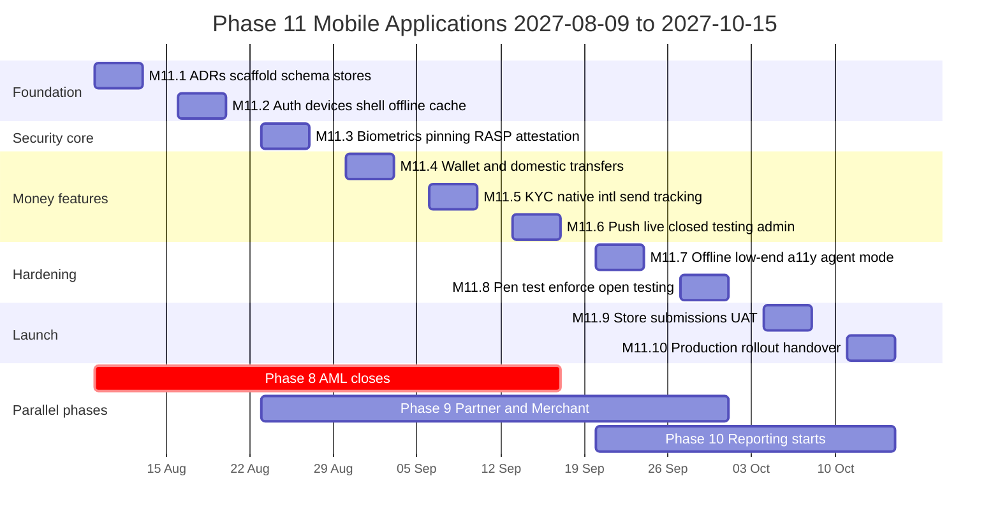
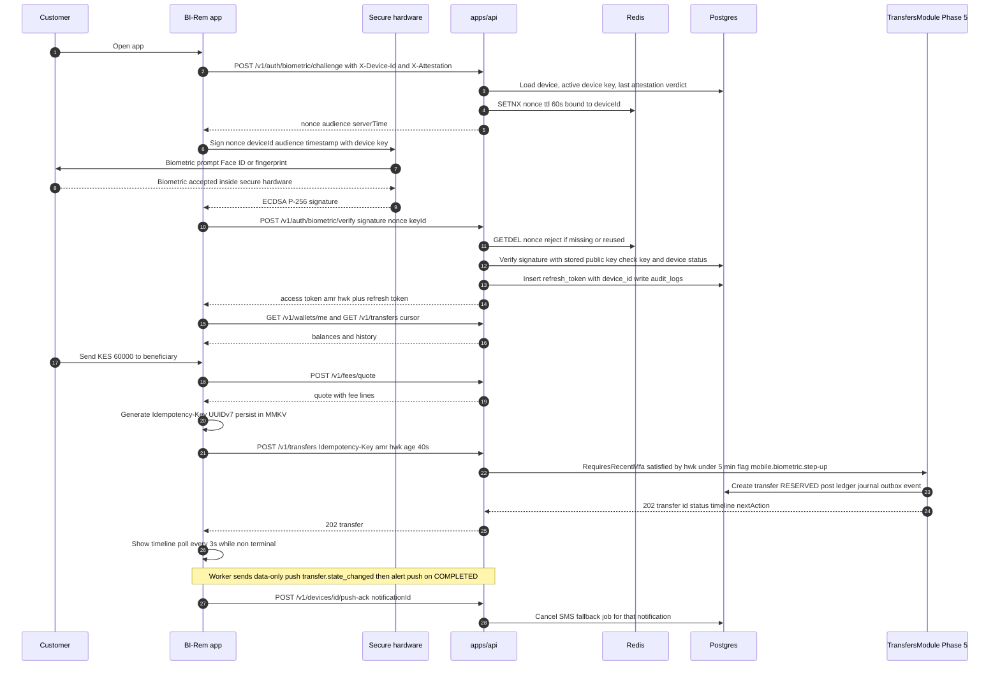
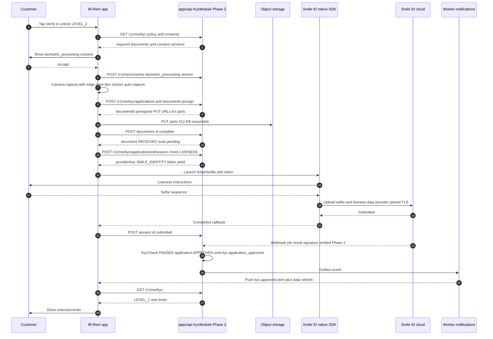
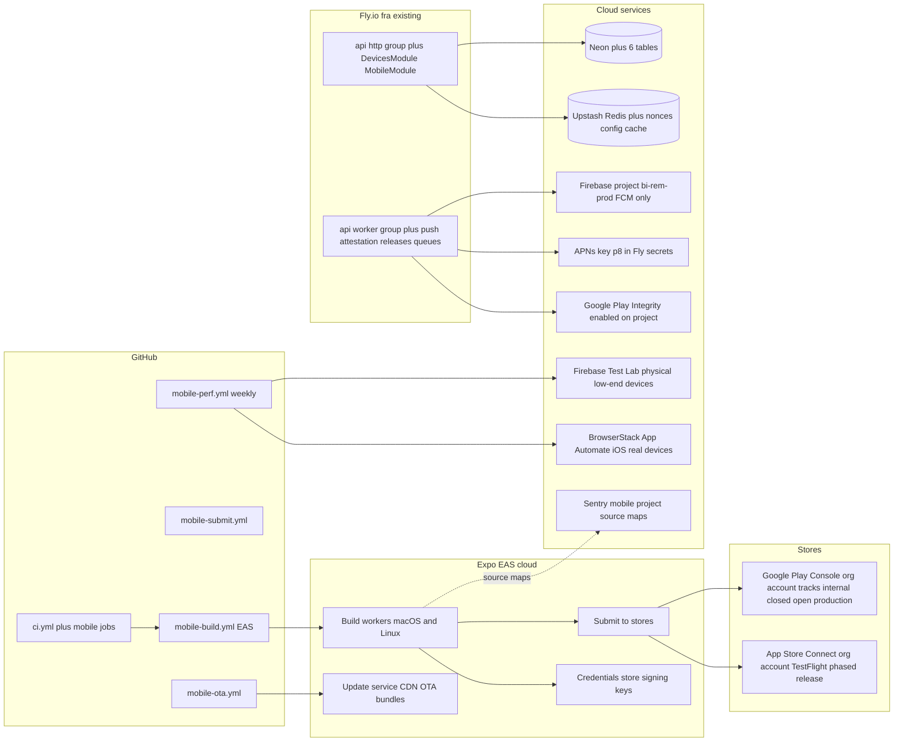
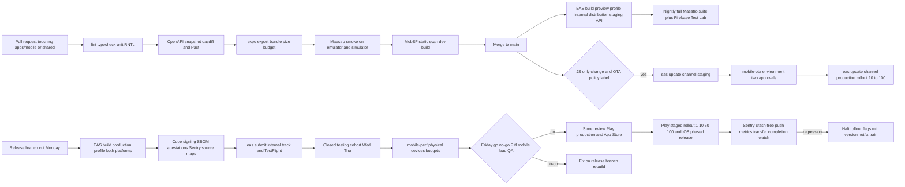

# Phase 11 — Mobile Applications

| Field                     | Value                                                                                                                                                                                                                                                                                                                                                                                                                                                                                                                                                                                                                                                                                                                                                                                                                                                                                                                                                                                                                                                                                                                                                                                                                      |
| ------------------------- | -------------------------------------------------------------------------------------------------------------------------------------------------------------------------------------------------------------------------------------------------------------------------------------------------------------------------------------------------------------------------------------------------------------------------------------------------------------------------------------------------------------------------------------------------------------------------------------------------------------------------------------------------------------------------------------------------------------------------------------------------------------------------------------------------------------------------------------------------------------------------------------------------------------------------------------------------------------------------------------------------------------------------------------------------------------------------------------------------------------------------------------------------------------------------------------------------------------------------- |
| **Phase**                 | 11 of 13 — `mobile`                                                                                                                                                                                                                                                                                                                                                                                                                                                                                                                                                                                                                                                                                                                                                                                                                                                                                                                                                                                                                                                                                                                                                                                                        |
| **Dates**                 | 2027-08-09 → 2027-10-15                                                                                                                                                                                                                                                                                                                                                                                                                                                                                                                                                                                                                                                                                                                                                                                                                                                                                                                                                                                                                                                                                                                                                                                                    |
| **Duration**              | 10 weeks (W1 = 2027-08-09 … 2027-08-13, W10 = 2027-10-11 … 2027-10-15)                                                                                                                                                                                                                                                                                                                                                                                                                                                                                                                                                                                                                                                                                                                                                                                                                                                                                                                                                                                                                                                                                                                                                     |
| **Team**                  | `mobile` (2 mobile engineers full time; 1 backend engineer from `core` W1–W6 then 50 %; 1 frontend engineer 25 % for admin consoles; 1 QA engineer shared 50/50 with Phase 9 until 2027-10-01 then 100 %; solution architect 30 %; DevOps/SRE 30 %; product designer 50 % W1–W6; PM 40 %; compliance analyst 15 %; 0.5 security engineer W3–W8; head of customer operations as business owner)                                                                                                                                                                                                                                                                                                                                                                                                                                                                                                                                                                                                                                                                                                                                                                                                                             |
| **Depends on**            | Phase 2 — Customer Management & KYC (ended 2027-02-19): stateless `/v1/me/*`, `KycApplication` state machine, `/me/kyc/applications/:id/session` returning `{providerKey, token, url}` for Smile ID / Sumsub / Veriff native SDKs, presigned PUT upload pipeline, `MfaDevice` / `OtpCode` (`STEP_UP`), `ConsentRecord` (`biometric_processing`), `@RequiresRecentMfa`. Phase 5 — Domestic Transfers (ended 2027-05-28): `POST /v1/transfers` with `Idempotency-Key`, `timeline[]`, `nextAction`, `GET /v1/transfers/track/:reference`, `/v1/wallets/me`, `/v1/fees/quote`, `/v1/limits/me`, receipts `/r/<code>`, QR payload format, `customerActionRequired` from Phase 4. Phase 6 — International Remittance (ended 2027-07-23): `/v1/intl/*` quote → confirm → timeline, `intl.transfer.state_changed`, deep link `birem://track/<trackingRef>`, `lockedUntil` / `Date` header semantics. Via them: Phase 1 Bearer-token auth with refresh rotation and device metadata on `refresh_tokens`, `NotificationChannel.PUSH` reserved, `FeatureFlag`, `Setting`, `AuditLog`, `Outbox`, BullMQ `notifications` queue; Phase 3 `GET /v1/status/public`; Phase 7 `GET /fx/rates`, `POST /fx/quotes`, mobile `lockSeconds` 180 s |
| **Unlocks**               | Phase 12 — Production Go-Live (2027-11-01): App Store and Google Play listings live, store-review runbook, release-train calendar, push/OTA/force-update runbooks, device-support matrix; Phase 13 — Pan-African Expansion: new country = store listing locale + USSD short code + provider list as data, no native release; Phase 9 agent mode (`/v1/partner/agents/*`) ships inside the same binary behind `mobile.agent-mode`; Phase 8 receives device attestation and device signals on `POST /v1/aml/signals`; Phase 10 reads `devices`, `push_tokens`, `mobile_app_releases` aggregates                                                                                                                                                                                                                                                                                                                                                                                                                                                                                                                                                                                                                              |
| **Runs in parallel with** | Phase 8 — AML, Fraud & Compliance (compliance team, until 2027-09-17; we consume `reviewState`, neutral push templates and the device-signal contract agreed in its W6 = our W2); Phase 9 — Partner & Merchant Portal (core team, 2027-08-23 → 2027-10-01; we build against `/v1/partner/agents/*` with Pact contract tests); Phase 10 — Reporting & BI (platform team, from 2027-09-20)                                                                                                                                                                                                                                                                                                                                                                                                                                                                                                                                                                                                                                                                                                                                                                                                                                   |

---

## 1. Overview

### 1.1 Objective

Phase 11 gives BI-Rem its **customer mobile channels**: one React Native application, built with Expo and shipped to **Google Play** and the **Apple App Store**, that lets a customer in any pilot country (SN, CI, NG, KE, GH, CM and the Phase 6 receive corridors) register, verify identity with the camera and a liveness SDK, fund and manage wallets, send domestic and international transfers, track them in real time with push notifications, and authenticate with device biometrics backed by hardware keys. Until now every customer touch point is the Next.js customer portal (`apps/web`), which is mobile-first responsive but cannot offer biometrics, camera capture with on-device quality checks, push notifications, offline tolerance, or a presence in the stores where our target users look for a remittance product. In the pilot markets > 85 % of internet users are mobile-only and the median device is a 2–3 GB RAM Android phone on a 3G/4G connection with intermittent coverage; the app is therefore designed **Android-first, low-end-first, offline-tolerant**, with iOS as a first-class but smaller channel (diaspora senders in the Phase 6 corridors).

Nothing in this phase changes money semantics: the app consumes the Phase 5/6/7 transfer, wallet, quote and tracking APIs unchanged. The backend additions are confined to **device registration, hardware-bound biometric authentication, push-token management, remote mobile configuration (minimum version, kill switches), app attestation ingestion, and a release registry**; the admin portal gains a mobile operations console.

The phase succeeds when both store listings are approved and public, a customer on a 2 GB Android phone installs the app from Google Play, completes LEVEL_2 KYC with native document capture and liveness, enrols fingerprint login, sends a transfer that completes with a push notification arriving before the SMS, and the same binary passes Apple review and ships on the App Store — all with security controls (certificate pinning, root/jailbreak detection, RASP, hardware-backed keys) verified by an external mobile penetration test.

### 1.2 In scope

- **App foundation** — `apps/mobile` (`@bi-rem/mobile`) in the pnpm/Turborepo monorepo: Expo SDK 54 (React Native 0.81, New Architecture, Hermes), TypeScript `^5.9`, Expo Router (file-based navigation, typed routes, universal deep links `birem://` and `https://app.bi-rem.app/*`), `@tanstack/react-query` `^5` with persisted cache, Zod `^4` schemas from `@bi-rem/shared`, generated OpenAPI client (`openapi-typescript` + `openapi-fetch`) from `/docs`, i18n `en`/`fr`/`pt` with ICU messages, design tokens shared with `@bi-rem/ui`, MMKV storage, `expo-secure-store` + Keychain/Keystore for secrets, Sentry React Native, OpenTelemetry trace propagation (`traceparent`, `x-request-id`).
- **Authentication and biometrics** — phone-first login with OTP, PIN (6 digits, argon2id server-side via existing password path), **biometric login** (Face ID / Touch ID / Android BiometricPrompt class 3) binding a P-256 key pair generated in the Secure Enclave / StrongBox (fallback TEE) to the device; challenge–response signature exchanged for tokens; refresh tokens bound to `device_id`; device list and remote sign-out; step-up (`@RequiresRecentMfa`) satisfied by biometric assertion with `amr: ["pin","hwk"]`; passkeys evaluated and deferred (§1.3).
- **Transfers** — domestic wallet-to-wallet / wallet-to-mobile-money / cash-out (Phase 5), international quote → lock → confirm (Phase 6/7), add money (Phase 4 `customerActionRequired` → "Confirm on your phone" screen with STK/USSD prompt guidance), beneficiaries with contact picker, QR scan and display (Phase 5 payload, Phase 9 `payment_requests`), fee breakdown and limits, step-up above threshold, client-generated `Idempotency-Key` persisted across app kills, resumable submission queue.
- **Wallet management** — balances per currency, statement with keyset pagination and offline cache, add money / withdraw, limits and KYC level card ("what you unlock"), receipts (PDF via Phase 5 signed URL, share sheet), linked mobile-money accounts.
- **KYC** — native document capture (`expo-camera` + on-device guidance: edge detection, glare/blur score, auto-capture, MRZ hint for passports), **liveness via the provider's native SDK** (Smile ID SmartSelfie as primary for African IDs, Sumsub MobileSDK for non-African documents, Veriff fallback) launched with the Phase 2 `{providerKey, token}` session; upload through Phase 2 presigned PUT with resume; status polling and push on decision; `biometric_processing` consent captured in-app before any liveness session.
- **Transaction tracking** — timeline screen from `timeline[]` / `nextAction`, live updates via push + foreground polling (SSE not used on mobile), recipient tracking by deep link `birem://track/<ref>` without login (Phase 5/6 public tracking with OTP), neutral `UNDER_REVIEW` state (Phase 8), travel-rule completion deep link.
- **Notifications** — push via **FCM HTTP v1** (Android) and **APNs token-based auth** (iOS) through a new `PushProvider` in the Phase 1 notifications module (`NotificationChannel.PUSH` becomes live); token registration/rotation/invalidation, per-device preferences, data-only "silent" pushes for state refresh, rich notifications (amount, status), notification inbox backed by `IN_APP`, dedup with SMS (push first, SMS after 60 s if no delivery receipt for money-moving events).
- **Offline-tolerant UX** — read models cached in MMKV/SQLite (balances with `asOf`, last 50 transfers, beneficiaries, providers, fee tables, FX rates with `expiresAt`), explicit staleness banners, mutation outbox (queued transfers are **never auto-submitted**: the user confirms on reconnect, since quotes/limits may have moved), optimistic UI only for non-monetary actions, network quality detection, image compression and chunked resumable uploads, retry with jitter honouring `Retry-After`.
- **Low-end Android performance** — budget: cold start < 2.0 s on a Tecno Spark 10C-class device (Helio G37, 2 GB RAM), APK/AAB download < 25 MB (per-ABI splits via AAB, Hermes bytecode, no Lottie bundles > 100 KB), JS bundle < 4 MB, 60 fps list scrolling with FlashList, memory < 250 MB, 2G/EDGE usable for balance and tracking, Android 8.0 (API 26) minimum, 16 KB page size compliance, Data Saver respect.
- **App security** — TLS certificate pinning (SPKI pins for `api.bi-rem.app` leaf and intermediate, backup pin, pin-set rotation via signed remote config), root/jailbreak and emulator/hook detection (Frida, Magisk, Xposed, debugger, repackaging) with **Talsec freeRASP** as RASP baseline and a commercial RASP evaluation, **Play Integrity API** and **Apple App Attest** device/app attestation verified server-side and fed to Phase 8 `fraud_signals`, screenshot/screen-recording block on sensitive screens, clipboard hygiene, secure keyboard for PIN, tapjacking protection, code obfuscation (R8/ProGuard, Hermes bytecode), no secrets in the binary, `ENCRYPTION`-grade local storage, biometric key invalidation on enrolment change.
- **Store compliance and deployment** — Apple Developer Program and Google Play Console organisation accounts, D-U-N-S, Google Play **Financial Features declaration** and personal-loan exclusion, Data Safety form, Apple App Privacy nutrition labels and Privacy Manifest (`PrivacyInfo.xcprivacy`, required-reason APIs), export compliance (ECCN 5D992 self-classification, `ITSAppUsesNonExemptEncryption`), age rating, accessibility (WCAG 2.2 AA equivalents, TalkBack/VoiceOver), localisation of listings, review notes with demo accounts against the Phase 9 sandbox-like staging, target API level 35.
- **Release trains and OTA policy** — two-week release train with code freeze Tuesday, TestFlight / Play internal → closed → open testing → staged production rollout (1 % → 10 % → 50 % → 100 % over 5 days on Play; 7-day phased release on iOS), EAS Update OTA channel per environment for JS-only fixes under a written policy (no behavioural change to money flows without a store build; OTA for copy, styling, flag defaults, crash hotfixes; runtime version pinned to native fingerprint), minimum supported version enforcement with soft and hard force-update, release registry in the admin portal.
- **USSD fallback (note)** — design note and API readiness for a USSD channel (`*xxx#` through Africa's Talking / MNO aggregator) for feature-phone customers: balance, last transactions, send to saved beneficiary with PIN; **implementation is Phase 13**; Phase 11 reserves the `USSD` client kind on `devices.platform`, documents the menu tree and confirms the Phase 5 API supports PIN-authenticated low-bandwidth calls.
- **Backend and admin** — `devices`, `device_keys`, `push_tokens`, `device_attestations`, `mobile_app_releases`, `mobile_configs` tables; `/v1/devices/*`, `/v1/auth/biometric/*`, `/v1/mobile/config`, `/v1/admin/mobile/*`; admin **Mobile Operations** console (devices per user, remote sign-out, releases, OTA channel state, force-update, push delivery metrics, attestation failures); customer portal "Devices & sessions" page and "Get the app" banners.

### 1.3 Out of scope (deferred)

- **USSD channel implementation** and SMS banking — Phase 13 (menu tree and API readiness documented here, §3.13).
- Passkeys / WebAuthn as a login method — evaluated in W3; deferred to Phase 13 because synced passkeys weaken device binding for step-up and platform support on Android 8–10 is partial. Hardware-bound device keys (this phase) give the same phishing resistance for our use.
- Agent mode UI beyond what Phase 9 defines (`/v1/partner/agents/*` cash-in/cash-out confirmation) — shipped dark behind `mobile.agent-mode` for the Nairobi pilot network; a full agent app is Phase 13.
- Wearables, tablets layout (phone layout scales), widgets, Siri/Assistant intents, NFC tap-to-pay, card issuing.
- Merchant SoftPOS / tap on phone — not planned (no card acquiring).
- In-app chat/support — links to WhatsApp Business and the Phase 5 complaint channel only.
- Huawei AppGallery / HMS Core push — Phase 13 candidate for markets with high Huawei share (CM, SN); Phase 11 ships GMS-only.
- Mobile SDK for partners (embedding BI-Rem flows in third-party apps) — Phase 13 enterprise tier.
- Local biometric template storage — never; biometrics stay in the OS secure hardware, we store only a public key.

### 1.4 Independent deployability strategy

"Deployable alone" for Phase 11 means: **the backend changes are expand-only and inert until a device registers; the app can be built, submitted and approved while every money feature inside it is dark behind remote flags evaluated per user hash; a store release and an OTA update are each independently reversible (staged rollout halt, OTA republish of the previous bundle, `mobile.min-version` force-update); and the customer portal remains the fully functional channel throughout, so a mobile incident never blocks a customer from transacting.**

| Mechanism                                                                                                                                         | Phase 11 application                                                                                                                                                                                                                                                                                                                                                                                                                                                                                                                                                                                                                                                                                                                                                                                                                                                                                                                                                                                                            |
| ------------------------------------------------------------------------------------------------------------------------------------------------- | ------------------------------------------------------------------------------------------------------------------------------------------------------------------------------------------------------------------------------------------------------------------------------------------------------------------------------------------------------------------------------------------------------------------------------------------------------------------------------------------------------------------------------------------------------------------------------------------------------------------------------------------------------------------------------------------------------------------------------------------------------------------------------------------------------------------------------------------------------------------------------------------------------------------------------------------------------------------------------------------------------------------------------- |
| **Feature flags** (Phase 1 `FeatureFlag`, `rolloutPercentage` + `rules`; served to the app in `GET /v1/mobile/config` and cached 5 min with ETag) | `mobile.app.enabled` (master: off → app shows "coming soon" after login except for the staff allow-list rule `email endsWith @bi-rem.app`), `mobile.transfers.domestic`, `mobile.transfers.international`, `mobile.wallet.add-money`, `mobile.kyc.native-sdk` (off → Phase 2 web SDK in an in-app browser), `mobile.kyc.provider.<key>`, `mobile.biometric.enabled`, `mobile.biometric.step-up` (hardware assertion satisfies `@RequiresRecentMfa`), `mobile.push.enabled`, `mobile.push.sms-fallback-seconds`, `mobile.offline.read-cache`, `mobile.offline.mutation-queue`, `mobile.pinning.enforce` (vs report-only), `mobile.rasp.block` (vs report-only), `mobile.attestation.enforce` (vs log), `mobile.agent-mode`, `mobile.qr.payment-requests` (Phase 9), `mobile.ota.channel.<env>` (allow/pause OTA), `mobile.min-version.android` / `mobile.min-version.ios` (soft), `mobile.hard-min-version.*` (hard). Rules support `countryCode`, `platform`, `appVersion` semver ranges and `deviceTier` (`LOW`/`MID`/`HIGH`). |
| **Expand → migrate → contract**                                                                                                                   | W1 migration `20270809090000_phase11_expand` adds 6 tables, 7 enums and nullable `refresh_tokens.device_id`; `NotificationChannel.PUSH` already exists (Phase 1). No contract in this phase. The only later candidate — `refresh_tokens.device_id SET NOT NULL` once web sessions also register a pseudo-device — is deferred to Phase 13 and recorded in §15.3.                                                                                                                                                                                                                                                                                                                                                                                                                                                                                                                                                                                                                                                                |
| **Dark launch**                                                                                                                                   | From W2 production has the tables and `/v1/devices/*` live but unused. From W4 internal builds (`internal` track / TestFlight internal) run against **production** with `mobile.app.enabled` for staff only; from W6 closed testing with 200 invited pilot customers in GH and KE at 100 % of flags for the cohort; from W8 open testing; W10 production listing with `rolloutPercentage` ramp on `mobile.transfers.*`. Push is sent in **shadow** (data-only, not displayed) for two weeks to measure delivery before user-visible pushes replace SMS as the first channel.                                                                                                                                                                                                                                                                                                                                                                                                                                                    |
| **Kill switches**                                                                                                                                 | `mobile.app.enabled=false` → app shows maintenance screen with portal link within 5 min (config TTL) and immediately on next app start; `mobile.transfers.*=false` → send buttons disabled with copy "temporarily unavailable in the app, use the web"; `mobile.push.enabled=false` → `PushProvider` returns `SKIPPED` and SMS/e-mail continue unchanged; `mobile.biometric.enabled=false` → login falls back to PIN + OTP, keys stay; `mobile.ota.channel.production=false` → EAS Update channel paused (no new bundle served); `mobile.hard-min-version.*` bump → blocking update screen; per-device `status=BLOCKED` by admin → refresh fails with `DEVICE_BLOCKED`, tokens revoked.                                                                                                                                                                                                                                                                                                                                         |
| **Worker isolation**                                                                                                                              | Push dispatch (`notifications:push`), token hygiene (`push:cleanup`), attestation verification (`attestation:verify`), release notes rendering and store-metadata sync (`mobile:releases`) run only in the `worker` process group; the `http` group serves config and registration. Push fan-out per event is bounded (`PUSH_MAX_DEVICES_PER_USER=5`).                                                                                                                                                                                                                                                                                                                                                                                                                                                                                                                                                                                                                                                                          |
| **Backward-compatible APIs**                                                                                                                      | New paths only: `/v1/devices/*`, `/v1/auth/biometric/*`, `/v1/mobile/*`, `/v1/admin/mobile/*`. Existing endpoints gain optional request headers (`X-Device-Id`, `X-App-Version`, `X-Platform`, `X-Attestation`) read by an interceptor; no response shape changes. `oasdiff` breaking-change gate stays green. The app pins an OpenAPI snapshot per release and tolerates unknown fields.                                                                                                                                                                                                                                                                                                                                                                                                                                                                                                                                                                                                                                       |
| **Rollback**                                                                                                                                      | Flags first (< 5 min). OTA: `eas update:republish` of the previous group on the channel (< 10 min to 95 % of active devices on next cold start). Store build: halt staged rollout on Play / pause phased release on iOS, then `mobile.min-version` so affected versions are soft-forced to update when a fix ships; a bad native build cannot be "un-shipped", so the previous AAB/IPA is kept promotable and the fix train is expedited (§10.4). Backend: Fly image rollback (`infra/scripts/rollback-api.sh`); tables are additive, no data rollback needed.                                                                                                                                                                                                                                                                                                                                                                                                                                                                  |

---

## 2. Milestones

Phase start is Monday **2027-08-09**; week _n_ runs Monday to Friday; milestone dates are the Friday of the week.

| ID         | Week | Target date | Deliverable                                                                                                                                                                                                                                                                                                                                                                                                                                                                                                                                                                                                                                                                                                     | Acceptance criteria                                                                                                                                                                                                                                                                                                                                                                                                 | Owner                            |
| ---------- | ---- | ----------- | --------------------------------------------------------------------------------------------------------------------------------------------------------------------------------------------------------------------------------------------------------------------------------------------------------------------------------------------------------------------------------------------------------------------------------------------------------------------------------------------------------------------------------------------------------------------------------------------------------------------------------------------------------------------------------------------------------------- | ------------------------------------------------------------------------------------------------------------------------------------------------------------------------------------------------------------------------------------------------------------------------------------------------------------------------------------------------------------------------------------------------------------------- | -------------------------------- |
| **M11.1**  | W1   | 2027-08-13  | Design freeze and foundation: ADR-0033 (Expo managed workflow + EAS vs bare RN/Flutter/native), ADR-0034 (hardware-bound biometric authentication and device model), ADR-0035 (OTA update policy), ADR-0036 (mobile app security controls: pinning, RASP, attestation), ADR-0037 (offline tolerance model); `apps/mobile` scaffold in the monorepo with Expo Router, generated API client, i18n, Sentry, CI lint/typecheck/test; schema v11 _expand_ migration on staging and production; Apple Developer and Google Play organisation accounts, D-U-N-S, EAS project, signing credentials in EAS (Apple distribution cert + provisioning via App Store Connect API key, Play upload key with Play App Signing) | `pnpm --filter @bi-rem/mobile typecheck lint test` green in `ci.yml`; `eas build --profile development` produces Android and iOS dev clients; `20270809090000_phase11_expand` applied with `prisma migrate diff` empty; ADRs accepted at Thursday architecture review; Figma flows for onboarding, home, send, track, KYC capture signed off by PM and compliance; device lab (8 Android, 3 iOS, §9.3) received     | Solution Architect / Mobile Lead |
| **M11.2**  | W2   | 2027-08-20  | Auth: phone + OTP registration/login reusing Phase 2 flows, PIN, session bootstrap, device registration (`POST /v1/devices`), refresh binding to `device_id`, remote sign-out; app shell (home, wallet, activity, profile tabs), design system components, offline read cache v1; Phase 8 device-signal contract and attestation header spec agreed (their W6)                                                                                                                                                                                                                                                                                                                                                  | New user registers and logs in on a Tecno Spark 10C in < 90 s on 3G; `refresh_tokens.device_id` set for 100 % of mobile sessions; sign-out from the portal "Devices" page kills the mobile session within 60 s; home renders cached balances offline with an `asOf` banner; Detox smoke suite on Android emulator and iOS simulator green                                                                           | Mobile Lead / Backend            |
| **M11.3**  | W3   | 2027-08-27  | Biometric authentication: Secure Enclave / StrongBox key generation, `POST /v1/auth/biometric/challenge` + `/verify`, key enrolment/revocation, invalidation on biometric change, step-up via assertion behind `mobile.biometric.step-up`; certificate pinning (report-only) and freeRASP integration (report-only); attestation ingestion (Play Integrity, App Attest) to `device_attestations` and Phase 8 signals                                                                                                                                                                                                                                                                                            | Biometric login p95 < 1.2 s device-to-token on the lab fleet; replayed assertion rejected (`BIOMETRIC_REPLAY`); key invalidated after adding a fingerprint on Android and Face ID re-enrolment on iOS; pinning failure reports arrive in Sentry from a MITM proxy test and zero false positives across 11 lab devices over 72 h; 100 % of lab logins produce an attestation row with `verdict`                      | Mobile Lead / Security           |
| **M11.4**  | W4   | 2027-09-03  | Wallet management and transfers: balances, statement, add money (STK/USSD confirm screen), domestic send wizard with beneficiaries, contact picker, QR scan/display, fee quote, limits, step-up, idempotent resumable submission; receipts; internal testing track on production with `mobile.app.enabled` for staff                                                                                                                                                                                                                                                                                                                                                                                            | Staff send GHS 5 wallet-to-wallet and KES 50 to M-Pesa in production from the app; app-killed-mid-submit resumes with the same `Idempotency-Key` and no duplicate; QR from the Phase 5 portal resolves in the app; add-money STK prompt screen reflects `customerActionRequired` and leg settlement; Android AAB download size < 25 MB, cold start < 2.0 s on Spark 10C                                             | Mobile Lead                      |
| **M11.5**  | W5   | 2027-09-10  | KYC native: document capture with quality guidance, Smile ID SmartSelfie and Sumsub MobileSDK liveness behind `mobile.kyc.native-sdk`, consent capture, resumable upload, decision push; international send (quote → lock → confirm) with countdown using server `Date`; tracking screen and deep links `birem://track/<ref>`, universal links verified (`assetlinks.json`, `apple-app-site-association`)                                                                                                                                                                                                                                                                                                       | Sandbox LEVEL_2 application reaches `APPROVED` from the app for both SDK providers; capture rejects blurry/glare images client-side ≥ 90 % of a 200-image corpus before upload; interrupted upload resumes without re-capture; `CM→GA` sandbox transfer locks and confirms with correct countdown after backgrounding 2 min; deep link from SMS opens tracking without login; Phase 6 OTP flow for recipients works | Mobile Lead / Backend            |
| **M11.6**  | W6   | 2027-09-17  | Push notifications live: `PushProvider` (FCM HTTP v1, APNs token auth), token lifecycle, data-only refresh pushes, rich notifications, inbox, SMS fallback timer, shadow mode for two weeks; closed testing cohort (200 pilot customers GH/KE) invited through Play closed track and TestFlight external; admin Mobile Operations console v1 (devices, releases, push metrics)                                                                                                                                                                                                                                                                                                                                  | Push delivery (FCM/APNs accepted → device displayed) p50 < 3 s, p95 < 30 s measured on the cohort; invalid token cleanup within 24 h; `transfer.completed` push arrives before SMS in ≥ 95 % of cohort events; cohort crash-free sessions ≥ 99.3 %; admin can list a customer's devices and sign one out with an audit row                                                                                          | Backend / Mobile Lead / Frontend |
| **M11.7**  | W7   | 2027-09-24  | Offline and low-end hardening: mutation queue with explicit reconnect confirmation, image compression and chunked uploads, network-quality adaptation, performance budget enforcement in CI (bundle size, startup trace), accessibility pass (TalkBack/VoiceOver), localisation `fr`/`pt` complete, agent mode behind `mobile.agent-mode` against Phase 9 staging (Pact)                                                                                                                                                                                                                                                                                                                                        | All §3.9 budgets met on the 8 lab Android devices; 2G throttled profile (50 kbps, 400 ms RTT) completes login, balance, tracking and a domestic send; mutation queued offline is never submitted without a tap; a11y audit with zero blocker issues; Pact consumer tests for `/v1/partner/agents/*` verified by Phase 9 provider build                                                                              | Mobile Lead / QA                 |
| **M11.8**  | W8   | 2027-10-01  | Security hardening: pinning and RASP switched to enforce for staff cohort, attestation enforce in staging, external mobile pen test (OWASP MASVS L2 + R), screenshot blocking, obfuscation verified, Privacy Manifest, Data Safety and Financial Features declarations drafted; open testing on Play; release train v1 process rehearsed with OTA republish drill                                                                                                                                                                                                                                                                                                                                               | Pen test: zero Critical/High open, Medium with owners and dates; MASVS checklist ≥ 95 % pass; Frida and Magisk-hidden devices detected in ≥ 98 % of lab attempts with zero false positives on the 200-customer cohort over 7 days; `eas update:republish` drill restores previous bundle to 95 % of active staff devices within 10 min; open testing live with ≥ 500 installs                                       | Security / Mobile Lead           |
| **M11.9**  | W9   | 2027-10-08  | Store submissions: App Store review (build with review notes, demo accounts on staging, Financial app documentation), Google Play production review (Financial Features declaration approved, Data Safety published); force-update flows; production readiness checklist; runbooks; UAT with business owner                                                                                                                                                                                                                                                                                                                                                                                                     | App Store build status `Ready for Sale` (or `Pending Developer Release`) and Play production release approved by 2027-10-08; soft and hard force-update screens verified via `mobile.min-version` on staging; §11 checklist ≥ 90 % ticked; UAT scripts (§9) signed by head of customer operations                                                                                                                   | PM / Mobile Lead                 |
| **M11.10** | W10  | 2027-10-15  | Production launch: App Store release, Play staged rollout 1 % → 10 % → 50 % → 100 %, `mobile.transfers.*` ramp, push becomes primary channel, SMS fallback 60 s; phase exit review; handover to Phases 12/13                                                                                                                                                                                                                                                                                                                                                                                                                                                                                                    | Both listings public and installable in GH, KE, NG, SN, CI, CM; ≥ 1 000 installs with crash-free sessions ≥ 99.5 % in the first 72 h; ≥ 200 real transfers initiated from the app with completion rate within 1 pp of the portal; push first-attempt delivery ≥ 97 %; §12 evidence filed; §11 sign-offs collected; Phase 12 receives runbooks and release calendar                                                  | Program Manager                  |



Staffing note: two mobile engineers split by platform ownership rather than feature — one owns Android-specific work (Keystore/StrongBox, Play Integrity, Play Console, low-end performance, AAB), the other iOS-specific work (Secure Enclave, App Attest, App Store Connect, Privacy Manifest) — while both work across features in shared React Native code. Store review lead times (Apple 24–72 h typical, Google financial-app review up to 7 days) drive the W9 submission; the production listing is held in `Pending Developer Release` until the W10 go/no-go. The QA engineer is shared with Phase 9 until 2027-10-01, so simulator/emulator automation (Detox, Maestro) is prioritised over manual passes until W8.

---

## 3. Deliverables

### 3.1 App foundation (`apps/mobile`, `@bi-rem/mobile`)

- **What**: Expo SDK 54 managed project in the monorepo, EAS Build/Submit/Update, Expo Router, generated API client, shared Zod schemas, i18n, observability.
- **DoD**: `apps/mobile` exposes `build` (`expo export` + EAS profile build in CI), `dev`, `lint`, `typecheck`, `test` (Jest with `jest-expo`), `clean` like every workspace; `app.config.ts` reads `EXPO_PUBLIC_API_URL`, `EXPO_PUBLIC_ENV`, validated with Zod at start (`apps/mobile/src/env.ts`) and documented in `apps/mobile/.env.example`; `eas.json` profiles `development` (dev client, staging API), `preview` (internal distribution, staging), `production` (store, production API); `runtimeVersion: { policy: "fingerprint" }` so OTA updates only reach binaries with identical native code; API client generated from `apps/api` OpenAPI snapshot committed at `apps/mobile/src/api/schema.d.ts` with a CI check against `/docs` of the staging API (`oasdiff` non-breaking); `traceparent` and `x-request-id` headers on every call; Sentry with source maps uploaded per EAS build and OTA update, PII scrubbing (phone, names, amounts masked in breadcrumbs); Hermes + New Architecture enabled; Android `minSdkVersion 26`, `targetSdkVersion 35`, iOS 16.0 minimum; app icons, splash, adaptive icons, `en`/`fr`/`pt` with device-locale default and in-app override synced to `users.locale`.

### 3.2 Authentication, device registration and biometrics

- **What**: Phone-first registration/login (Phase 2 OTP), 6-digit PIN, device registration, hardware-bound biometric authentication, device-bound refresh tokens, remote sign-out.
- **DoD**: `POST /v1/devices` on first launch returns `deviceId` (uuid) stored in Keychain/Keystore-backed `expo-secure-store`; every request carries `X-Device-Id`, `X-App-Version`, `X-Platform`; login/refresh writes `refresh_tokens.device_id`; biometric enrolment generates a **P-256 key pair** in Secure Enclave (iOS, `kSecAttrTokenIDSecureEnclave`, access control `biometryCurrentSet`) or Android Keystore with `setIsStrongBoxBacked(true)` falling back to TEE, `setUserAuthenticationRequired(true)`, `setInvalidatedByBiometricEnrollment(true)`, attestation chain captured; public key registered via `POST /v1/devices/:id/keys` (user must have a recent PIN or OTP auth, `amr` contains `pin`); login flow: `POST /v1/auth/biometric/challenge` → 32-byte nonce (Redis, 60 s TTL, single use) → device signs `nonce || deviceId || audience || timestamp` with BiometricPrompt class 3 / LocalAuthentication → `POST /v1/auth/biometric/verify` validates ECDSA signature, nonce freshness, key status, device status, attestation verdict, and issues access/refresh pair with `amr: ["hwk"]` (plus `"pin"` if PIN was entered this session); step-up for `@RequiresRecentMfa` accepted when `amr` includes `hwk` issued < 5 min ago and flag `mobile.biometric.step-up` on, else fall back to Phase 2 OTP/TOTP; keys revoked on remote sign-out, device block, password/PIN reset (`auth.password.changed` event), 90 days unused; PIN brute-force: 5 wrong → 15 min lock escalating (Phase 1 policy), 10 → key revocation; portal and admin list devices (`model`, `osVersion`, `appVersion`, `lastSeenAt`, `city` from IP) and can sign out; **no biometric data ever leaves the device**.

### 3.3 Transfers

- **What**: Domestic (Phase 5) and international (Phase 6/7) send flows, add money (Phase 4/5), cash-out, QR, beneficiaries.
- **DoD**: Send wizard screens (recipient → amount → review → step-up → result) consume `POST /v1/fees/quote`, `GET /v1/limits/me`, `POST /v1/transfers` with a client-generated UUIDv7 `Idempotency-Key` persisted in MMKV before the request leaves the device and reused on retry until a terminal response; international: `POST /v1/intl/quotes` → `/lock` (mobile segment `lockSeconds` 180 s) → confirm with countdown from `lockedUntil` against server `Date`, `REQUOTE` handled with one-tap refresh; add money shows the Phase 4 `customerActionRequired` state as "Confirm on your phone" with provider-specific copy (M-Pesa STK, MTN MoMo approval, Airtel USSD push) and polls `GET /v1/transfers/:id` every 3 s for 2 min then backs off; contact picker (`expo-contacts`, permission requested just-in-time, numbers normalised to E.164 by the user's country) validates via Phase 4 `validate`; QR scanner (`expo-camera` barcode) resolves Phase 5 merchant payloads and Phase 9 `payment_requests` (behind `mobile.qr.payment-requests`); receipts open the Phase 5 signed URL in a native PDF viewer with share sheet; recipient name confirmation when match < 70 % mirrors the portal; all amounts displayed from BIGINT minor units + currency with `Intl.NumberFormat` and never parsed as floats; Detox e2e covers domestic send against the Phase 4 simulators.

### 3.4 Wallet management

- **What**: Balances, statement, limits/KYC level card, linked accounts, receipts.
- **DoD**: Home shows per-currency `available`/`reserved` from `GET /v1/wallets/me` with pull-to-refresh and `asOf` banner when served from cache; statement uses `GET /v1/wallets/me/statement` keyset cursor with FlashList, infinite scroll, cached first page; limit card from `/v1/limits/me` with used/remaining per window and a "verify to unlock" CTA into KYC; linked mobile-money accounts from Phase 4 `/wallet/providers` and verified MSISDNs; withdraw to mobile money reuses the send wizard with `type=WITHDRAWAL`; freeze banner when `wallets.status=FROZEN` (Phase 8 protective action) with neutral copy; statement export requests the Phase 5 PDF/CSV job and notifies by push when ready.

### 3.5 KYC — native document capture and liveness

- **What**: Camera capture with on-device quality guidance, provider native SDK liveness, consent, resumable upload, decision tracking.
- **DoD**: Capture screen (`expo-camera`, 1080p, torch toggle) with document frame overlay per `DocumentType` (ID card, passport MRZ zone, driver licence, voter card), on-device checks: edge detection and perspective (OpenCV-lite via `react-native-vision-camera` frame processor on devices with ≥ 3 GB RAM, static overlay with manual capture on `LOW` tier), Laplacian blur score threshold, glare highlight ratio, auto-capture after 1.5 s stable; images resized ≤ 2048 px, JPEG q85, EXIF stripped; upload to Phase 2 presigned PUT in 512 KB chunks with resume (S3 multipart via Phase 2 `uploads` service extension `POST /v1/me/kyc/documents/:id/parts`), retry with jitter; liveness: `POST /v1/me/kyc/applications/:id/session` with `check=LIVENESS` returns `{providerKey, token}` → `SmileIdAdapter` (Smile ID React Native SDK, SmartSelfie Authentication/Enrollment, `jobType` per level), `SumsubAdapter` (`@sumsub/react-native-mobilesdk-module`), `VeriffAdapter` fallback; result arrives via Phase 2 webhooks → `kyc.application_approved` → push; `biometric_processing` consent (Phase 2 `ConsentRecord`) captured with version and timestamp before the SDK launches, refusable with the Phase 2 web/manual route offered; provider SDKs loaded only when `mobile.kyc.provider.<key>` is on; camera permission denial handled with settings deep link; SDK crash isolation (error boundary, fallback to web SDK in-app browser).

### 3.6 Transaction tracking

- **What**: Timeline screen, live updates, public tracking by deep link, review states.
- **DoD**: Activity tab lists `GET /v1/transfers` with filters (type, status, date) and local search over the cached page; detail screen renders `timeline[]` with customer-safe copy keys from `@bi-rem/shared`, `nextAction` as a primary button (approve prompt, complete profile, contact support), ETA, receipt and share; live updates: data-only push `transfer.state_changed` triggers a refetch; foreground polling every 10 s while a transfer is non-terminal and the screen is visible; `birem://track/<ref>` and `https://app.bi-rem.app/track/<ref>` open the public tracking screen (Phase 5 `GET /v1/transfers/track/:reference`, Phase 6 `/v1/track/*`) with OTP for details, no login; `reviewState=UNDER_REVIEW` renders Phase 8 neutral copy only; `TRAVEL_RULE_INCOMPLETE` opens the profile completion form and resumes.

### 3.7 Notifications (push via FCM / APNs)

- **What**: `PushProvider` in the Phase 1 notifications module, token lifecycle, rich and silent pushes, inbox, SMS fallback.
- **DoD**: `apps/api/src/modules/notifications/providers/push.provider.ts` implements `NotificationProvider` for channel `PUSH`: resolves active `push_tokens` for the user (max 5 devices), sends via **FCM HTTP v1** (`projects/{id}/messages:send`, service-account OAuth2, per-token messages, Android `priority: high` only for money events, `collapse_key` per transfer) and **APNs** (HTTP/2, token-based `p8` auth, `apns-push-type: alert|background`, `apns-collapse-id`, `apns-expiration`), both with 2 retries and backoff; provider error mapping: `UNREGISTERED`/`410` → token `INVALID` and removed, `INVALID_ARGUMENT` → bug alert, `QUOTA_EXCEEDED`/`429` → requeue with `Retry-After`; app registers tokens via `PUT /v1/devices/:id/push-token` on launch and on FCM/APNs rotation, server dedups `(provider, token)`; templates `NotificationTemplate` with `channel=PUSH` for `transfer.*`, `intl.transfer.state_changed`, `kyc.*`, `aml.*` (neutral), `auth.login.new_device`, `wallet.frozen`, in `en`/`fr`/`pt`, body ≤ 178 chars, no PII beyond masked recipient and amount (amount optional per preference `push.show-amounts`); **SMS fallback**: for money-moving events the notifications worker enqueues SMS with a 60 s delay (`mobile.push.sms-fallback-seconds`) cancelled when the device acknowledges receipt (`POST /v1/devices/:id/push-ack` with `notificationId`, batched); inbox = Phase 1 `IN_APP` notifications with read state synced; per-device channel preferences on `notification_preferences` extended with `device_id` scope; iOS notification permission requested after first successful transfer (pre-permission screen), Android 13+ `POST_NOTIFICATIONS` likewise; delivery metrics (`push_sent_total`, `push_delivered_total`, `push_ack_latency_seconds`) in Prometheus.

### 3.8 Offline-tolerant UX

- **What**: Read-model cache, staleness semantics, mutation outbox, network adaptation.
- **DoD**: TanStack Query persisted to MMKV (`asyncStoragePersister` over MMKV) with per-query `gcTime` (balances 24 h, transfers 7 d, beneficiaries 30 d, providers/fees 24 h, FX rates until `expiresAt`), encrypted MMKV instance keyed from Keystore/Keychain; every cached money figure shows `asOf` when older than 60 s and offline; `NetInfo`-driven state (`ONLINE`, `DEGRADED` ≥ 1 s RTT, `OFFLINE`); mutation outbox stores _intents_ (send to beneficiary X amount Y) — on reconnect the user sees "You have 1 pending transfer. Review and send?" and a fresh quote is fetched; nothing monetary is auto-submitted; idempotency keys survive process death; uploads chunked and resumable; images and PDFs cached with LRU 50 MB; low-bandwidth mode (Data Saver or `DEGRADED`) disables avatars, animations and prefetch; all API errors mapped to actionable copy; chaos tests (airplane mode mid-request, DNS failure, 30 % packet loss) in Detox.

### 3.9 Low-end Android performance

- **What**: Performance budgets enforced in CI and on the lab fleet.
- **DoD**: Budgets on the reference device **Tecno Spark 10C (Helio G37, 2 GB, Android 13 Go)** and **Samsung Galaxy A04e (3 GB, Android 12)**: cold start to interactive home < 2.0 s (p90 over 20 launches, `react-native-performance` marks), warm start < 0.8 s, AAB per-ABI download (arm64-v8a, armeabi-v7a) < 25 MB, JS bundle < 4 MB Hermes bytecode, memory peak < 250 MB, scroll jank < 1 % frames over 16.7 ms on statement with 500 rows (FlashList with `estimatedItemSize`), TTI of send review < 300 ms after quote; CI job `mobile-perf` runs Maestro flows on Firebase Test Lab (physical Spark 10C / A04e) weekly and on release branches, failing on > 10 % regression; images in WebP, icons as a single SVG sprite, fonts subset (Latin + Latin Extended), no synchronous storage reads on startup, lazy routes for KYC/SDK/agent mode, Proguard/R8 full mode, 16 KB page size verified, `android:largeHeap` not used; Android Go devices verified; app works on 2G/EDGE profile for balance, tracking and send (payload < 20 KB per screen).

### 3.10 App security — pinning, root/jailbreak detection, RASP, attestation

- **What**: Defence-in-depth per OWASP MASVS L2 + R.
- **DoD**: **Certificate pinning**: SPKI SHA-256 pins for `api.bi-rem.app` (leaf + intermediate + 1 backup key held offline) configured via `expo-build-properties` (Android `network_security_config.xml`, iOS `NSPinnedDomains`) and additionally enforced in the HTTP layer; pin set also delivered in `GET /v1/mobile/config` signed with an Ed25519 key embedded in the binary so a rotation can be pushed without a store release (both sets accepted for 30 days); `mobile.pinning.enforce=false` makes failures report-only (W3–W7); pinning excludes provider SDK hosts (they pin their own). **Root/jailbreak/RASP**: Talsec **freeRASP** (root/jailbreak, hooking frameworks, debugger, emulator, repackaging via signing-cert hash, device binding, unofficial store, developer mode, passcode absent) reporting to Sentry and `POST /v1/aml/signals` (`source=MOBILE`, `type=MOBILE_RASP_<check>`); policy by flag `mobile.rasp.block`: `report` (default until W8), `degrade` (no biometrics, limits capped), `block` (app refuses to run); repackaging and hooking always `block`; commercial RASP (Talsec paid tier / Promon / Appdome) evaluated in W8 with decision recorded (§15.3). **Attestation**: Android **Play Integrity** (standard request on launch, classic request with server nonce on biometric enrolment and above-threshold transfers; verdicts `MEETS_DEVICE_INTEGRITY`, `MEETS_STRONG_INTEGRITY`, app recognition, licensing) decoded server-side via Google Play Integrity API; iOS **App Attest** (key generation, attestation with server challenge, per-request assertions on sensitive calls, `DCAppAttestService`) verified against Apple's root; results in `device_attestations`, `X-Attestation` header on sensitive endpoints, `mobile.attestation.enforce` turns failures into `DEVICE_INTEGRITY_REQUIRED` 403 for biometrics and transfers above `LEVEL_1` limits. **Other**: `FLAG_SECURE` and iOS screen-capture obscuring on PIN, balance detail, KYC and receipt screens; clipboard cleared 30 s after copying a reference; tapjacking `filterTouchesWhenObscured`; secure PIN pad with shuffled digits option; no logs of tokens/amounts in release builds; secrets only in Keychain/Keystore; `allowBackup=false`, iOS Keychain `ThisDeviceOnly`; third-party SDK inventory with data-flow review (Sentry, Smile ID, Sumsub, Veriff, Firebase Messaging, Talsec); SBOM per build (`cdxgen`) scanned by Trivy/OSV; code obfuscation with R8 + Hermes bytecode and iOS symbol stripping; export of debug builds to stores blocked by EAS profile.

### 3.11 Store compliance and deployment

- **What**: Accounts, declarations, listings, review readiness for both stores.
- **DoD**: Apple Developer Program organisation account (D-U-N-S verified), App Store Connect API key for EAS Submit, Team roles least privilege; Google Play Console organisation account with Play App Signing, Developer verification, **Financial Features declaration** ("money transfer / remittance", no personal loans) with licence documents per country (Phase 6 §8.4 licensing table) uploaded, **Data Safety** form generated from the SDK inventory and reviewed by compliance, target API 35; Apple **App Privacy** labels and `PrivacyInfo.xcprivacy` with required-reason APIs (UserDefaults, file timestamps, system boot time, disk space) and tracking domains declared as none; `ITSAppUsesNonExemptEncryption=false` with France exemption documentation if store in FR; age rating 17+/`PEGI 3` with financial content flags; accessibility statement; listings in `en`/`fr`/`pt` with localised screenshots (6.7", 6.5", 5.5", iPad excluded via `UIDeviceFamily` 1), feature graphic, privacy policy and terms URLs (Phase 2 consents versions); review notes with staging demo accounts (phone numbers answering OTP in the Phase 4 simulator, pre-approved KYC LEVEL_2, funded wallets) and a video of the biometric and KYC flows; App Store guideline check (3.1.1 no IAP for financial services, 5.1.1 data collection minimisation, 2.5.1 public APIs only, 4.0 no web-view-only app, 5.1.2 data use); Play policy check (Financial Services, Permissions — `READ_CONTACTS` justified, no `QUERY_ALL_PACKAGES`, no SMS permissions — OTP via SMS Retriever API and iOS one-time-code autofill); first submissions W9 with buffer for one rejection cycle.

### 3.12 Release trains and OTA update policy

- **What**: Predictable cadence, promotion path, and written rules for what may ship over the air.
- **DoD**: **Release train** every two weeks: Monday branch `release/mobile-YYYY.MM.x` cut from `main`, Tuesday code freeze, EAS production builds for both platforms with the same `versionCode`/`buildNumber` scheme (`YYYYMMNN`), internal track + TestFlight internal Tuesday, closed testing Wednesday–Thursday (pilot cohort), Friday go/no-go, following Monday staged rollout 1 % → Tue 10 % → Wed 50 % → Fri 100 % on Play; iOS phased release (7 days, pausable); hotfix trains allowed any day with PM + mobile lead approval; **OTA policy** (ADR-0035): EAS Update allowed for JS/asset-only changes that are copy, styling, flag defaults, crash fixes, performance fixes, analytics; **not allowed** for changes to money flows, authentication, security controls, permissions, SDK versions, or anything a store reviewer would classify as new functionality (Apple 3.3.2 compliance); OTA publishes go through the same CI gates (lint, typecheck, tests, bundle budget) and a two-person approval in the `mobile-ota` GitHub environment; `runtimeVersion` fingerprint ensures OTA never targets an incompatible binary; rollout per channel with `eas update --branch` → `production` channel mapping, 10 % → 100 % via EAS rollout; mandatory `expo-updates` `checkAutomatically: ON_LOAD` with 5 s fallback to cached bundle and background download; every OTA recorded in `mobile_app_releases` (`kind=OTA`) with the git SHA and `updateGroupId`; **minimum version** policy: soft prompt when `appVersion < mobile.min-version.*` (dismissible 3 times), hard block when `< mobile.hard-min-version.*` with store deep link; support window = last 3 store releases (≈ 6 weeks).

### 3.13 USSD fallback (design note, implementation Phase 13)

- **What**: A documented path for feature-phone customers and for smartphone customers without data.
- **DoD**: `docs/handbooks/ussd-channel.md` with the menu tree (1 Balance, 2 Send to saved beneficiary, 3 Last 3 transactions, 4 Track by reference, 5 Help; PIN prompt before 1–3; session ≤ 180 s; 182-char screens), aggregator options (Africa's Talking USSD in KE/NG/UG/TZ, direct MNO short codes via Phase 3 `Connection` for SN/CI/CM), session model mapped to Phase 5 APIs (PIN verifies against the Phase 1 password path with `realm=CUSTOMER`, `Idempotency-Key = sessionId`), limits (USSD-initiated sends capped at LEVEL_1 daily limit), fraud considerations (SIM-swap check via Phase 4 MNO APIs before send), cost model (per-session charges), and regulatory notes (MNO short-code approval lead times 4–8 weeks per country); `devices.platform` enum includes `USSD` and `web` so a future channel registers as a device; the in-app "No data?" help screen shows the planned short code per country from `mobile_configs` once live. Nothing else is built.

### 3.14 Backend additions (`apps/api`)

- **What**: `DevicesModule`, `BiometricAuth` in `AuthModule`, `MobileModule` (config, releases), `PushProvider`, attestation verification, interceptors.
- **DoD**: Prisma models of §5; endpoints of §6 with OpenAPI examples; `DeviceContextInterceptor` reads `X-Device-Id`/`X-App-Version`/`X-Platform`, attaches to request context and `AuditLog.metadata`, updates `devices.last_seen_at` at most once per 5 min (Redis debounce); `AttestationGuard` for `@RequiresAttestation()` endpoints; `MobileConfigService` composes flags (evaluated for the user), min versions, pin set, provider list and USSD codes per country with ETag; `ReleasesService` with store status sync (App Store Connect API `appStoreVersions`, Play Developer API `edits.tracks`) every 15 min; `PushProvider`; token hygiene job; RS256/JWKS migration **not** required (device-bound refresh + HS256 kept; recorded in ADR-0034 as rejected for this phase); env vars `FCM_SERVICE_ACCOUNT_JSON`, `APNS_KEY_ID`, `APNS_TEAM_ID`, `APNS_KEY_P8`, `APNS_BUNDLE_ID`, `APNS_ENV`, `PLAY_INTEGRITY_SERVICE_ACCOUNT_JSON`, `PLAY_PACKAGE_NAME`, `APP_ATTEST_TEAM_ID`, `APP_ATTEST_BUNDLE_ID`, `MOBILE_CONFIG_SIGNING_KEY` (Ed25519 private), `ASC_KEY_ID`/`ASC_ISSUER_ID`/`ASC_KEY_P8`, `PLAY_DEVELOPER_SERVICE_ACCOUNT_JSON` validated with Zod and optional when `mobile.*` flags are off; new permissions `devices:read`, `devices:write`, `devices:read:self`, `devices:write:self`, `mobile:config:read`, `mobile:releases:read`, `mobile:releases:write`, `mobile:push:read`, `mobile:push:send-test`; every mutation audited.

### 3.15 Admin portal and customer portal changes

- **What**: Admin **Mobile Operations** console; customer portal devices page and app banners.
- **DoD**: See §7; Playwright coverage for devices list/sign-out, release registry, force-update change (four-eyes), push test send; customer portal `/settings/devices` lists devices and sessions with sign-out; smart app banners (`apple-itunes-app` meta, Android intent banner) and `/get-the-app` page with store badges and QR; universal link association files served by `apps/web` (`/.well-known/assetlinks.json`, `/.well-known/apple-app-site-association`).

---

## 4. Architecture

### 4.1 Component / container diagram (Phase 11 additions)

```mermaid
flowchart TB
  subgraph Device["Customer device Android 8+ / iOS 16+"]
    APP["BI-Rem app<br/>Expo SDK 54 RN 0.81 Hermes<br/>Expo Router TanStack Query MMKV"]
    SEC["Secure hardware<br/>Secure Enclave / StrongBox TEE<br/>P-256 device key"]
    BIO["Biometric prompt<br/>Face ID Touch ID BiometricPrompt"]
    RASP["freeRASP<br/>root jailbreak hooks debugger repackaging"]
    SDKS["Provider native SDKs<br/>Smile ID SmartSelfie Sumsub Veriff"]
    PUSHC["FCM / APNs client<br/>expo-notifications"]
    UPD["expo-updates<br/>OTA runtime fingerprint"]
    APP --> SEC
    APP --> BIO
    APP --> RASP
    APP --> SDKS
    APP --> PUSHC
    APP --> UPD
  end

  subgraph Stores["Distribution"]
    EAS["EAS Build Submit Update"]
    GP["Google Play<br/>staged rollout Play Integrity"]
    AS["App Store<br/>phased release App Attest"]
    EAS --> GP
    EAS --> AS
    EAS -. "OTA bundles" .-> UPD
  end

  subgraph API["apps/api NestJS 12 Fly.io"]
    direction TB
    DCI["DeviceContextInterceptor<br/>X-Device-Id X-App-Version X-Platform"]
    DEV["DevicesModule<br/>devices device_keys push_tokens"]
    BIOA["AuthModule BiometricAuth<br/>challenge verify amr hwk"]
    ATT["AttestationService<br/>Play Integrity App Attest verify"]
    MOB["MobileModule<br/>config releases min-version pin set"]
    NOTIF["NotificationsModule Phase 1<br/>PushProvider FCM v1 APNs"]
    EXIST["Phase 2 5 6 7 8 9 modules<br/>kyc transfers wallets intl fx aml partner"]
    DCI --> DEV
    DCI --> EXIST
    BIOA --> DEV
    ATT --> DEV
    MOB --> DEV
  end

  subgraph Workers["worker process group"]
    PW["notifications:push<br/>fan-out SMS fallback timer"]
    TH["push:cleanup<br/>invalid token hygiene"]
    AV["attestation:verify"]
    RS["mobile:releases<br/>store status sync"]
  end

  subgraph Data["Data stores"]
    PG[("Neon PostgreSQL<br/>devices device_keys push_tokens<br/>device_attestations mobile_app_releases mobile_configs")]
    RD[("Upstash Redis<br/>biometric nonces config ETag cache<br/>last-seen debounce")]
    S3[("Object storage<br/>KYC docs Phase 2 presigned PUT")]
  end

  subgraph External["External services"]
    FCM["Firebase Cloud Messaging HTTP v1"]
    APNS["Apple Push Notification service HTTP/2"]
    PI["Google Play Integrity API"]
    AA["Apple App Attest root"]
    ASC["App Store Connect API"]
    GPD["Google Play Developer API"]
    SENTRY["Sentry mobile"]
  end

  subgraph Portals["Portals Vercel"]
    ADMIN["apps/admin<br/>Mobile Operations console"]
    WEB["apps/web<br/>Devices page app banners<br/>assetlinks AASA"]
  end

  APP -- "HTTPS pinned Bearer" --> DCI
  APP -- "presigned PUT" --> S3
  SDKS -- "provider HTTPS" --> EXT2["Smile ID Sumsub Veriff APIs"]
  EXT2 -. "Phase 2 webhooks" .-> EXIST
  DEV --> PG
  BIOA --> RD
  MOB --> RD
  NOTIF --> PW
  PW --> FCM
  PW --> APNS
  FCM -.-> PUSHC
  APNS -.-> PUSHC
  ATT --> PI
  ATT --> AA
  RS --> ASC
  RS --> GPD
  APP -. "crashes traces" .-> SENTRY
  RASP -. "signals" .-> EXIST
  ADMIN --> MOB
  ADMIN --> DEV
  WEB --> DEV
```



The app is a thin client over the existing `/v1` API: all money, KYC and compliance logic stays server-side, and the mobile-specific backend surface is limited to identity of the _device_ (registration, hardware key, push token, attestation) and to _configuration_ of the app (flags, minimum version, pin set). This keeps Phase 11 independently deployable and keeps the portals as a complete fallback channel.

### 4.2 Sequence — biometric login and above-threshold transfer with hardware assertion



### 4.3 Sequence — native KYC capture and liveness with provider SDK



### 4.4 Deployment / infrastructure delta



Infra delta summary: no new Fly apps; the existing `http` and `worker` groups gain modules and queues (`WORKER_QUEUES` adds `notifications:push`, `push:cleanup`, `attestation:verify`, `mobile:releases`); Fly secrets gain the FCM/APNs/Play Integrity/App Store Connect/Play Developer credentials and the Ed25519 config signing key; Neon gains 6 tables (< 2 GB at 1 M users); Redis gains nonce and config keys (negligible); new SaaS: Expo EAS (Production plan), Firebase project (Messaging + Test Lab only — Analytics disabled), Apple Developer Program, Google Play Console, BrowserStack App Automate (iOS real devices), Sentry mobile quota; `apps/web` serves `.well-known` association files; GitHub environments `mobile-staging`, `mobile-production`, `mobile-ota` with required reviewers.

### 4.5 Design decisions and alternatives rejected

| ID  | Decision                                                                              | Alternatives rejected                                                                                    | Rationale                                                                                                                                                                                                                                                                                                                                                                                                                                                                                                                                                                                                                                                                                                                                                                                                                                                                                                                                                                                                                                                                           |
| --- | ------------------------------------------------------------------------------------- | -------------------------------------------------------------------------------------------------------- | ----------------------------------------------------------------------------------------------------------------------------------------------------------------------------------------------------------------------------------------------------------------------------------------------------------------------------------------------------------------------------------------------------------------------------------------------------------------------------------------------------------------------------------------------------------------------------------------------------------------------------------------------------------------------------------------------------------------------------------------------------------------------------------------------------------------------------------------------------------------------------------------------------------------------------------------------------------------------------------------------------------------------------------------------------------------------------------- |
| D1  | **React Native with Expo (managed workflow, SDK 54) + EAS Build/Submit/Update**       | Bare React Native; Flutter; native Kotlin + Swift; Kotlin Multiplatform                                  | Two mobile engineers and a TypeScript monorepo: Expo lets us share `@bi-rem/shared` Zod schemas, the generated API client, i18n messages and design tokens with `apps/web`, and removes Xcode/Gradle maintenance from a team without native specialists. Expo's config plugins give us the native capabilities we need (Keystore/Enclave via `expo-secure-store` + a small custom module, `expo-camera`, `expo-notifications`, build properties for pinning) without ejecting; where a native module is needed (biometric key signing, App Attest) we write an Expo Module in Kotlin/Swift (≈ 400 lines) and keep the managed workflow. EAS gives reproducible cloud builds with managed signing credentials, store submission from CI, and a first-party OTA mechanism with runtime-version safety. Flutter would force a second language and duplicate validation schemas; native apps double the team; bare RN gives the same runtime with more maintenance. Risk: Expo SDK upgrade cadence — mitigated by pinning SDK 54 for the phase and upgrading only in a dedicated train. |
| D2  | **Hardware-bound P-256 device key with challenge–response for biometric login**       | "Biometric unlock" of a locally stored refresh token; passkeys/WebAuthn; server-side biometric templates | A local-unlock design only protects the token at rest; it does not prove to the server that _this_ hardware and _this_ biometric gate were used, so it cannot satisfy step-up. The device key design gives a server-verifiable assertion, binds sessions to a device, survives app reinstall (key gone → re-enrol), and is invalidated by the OS on biometric enrolment changes. Passkeys are synced across devices by default (iCloud Keychain, Google Password Manager), which weakens device binding and complicates our "sign out this device" semantics; deferred to Phase 13 as a _login_ convenience. Server-side biometric templates are a regulatory and ethical non-starter (Phase 2 §1.3).                                                                                                                                                                                                                                                                                                                                                                               |
| D3  | **FCM HTTP v1 and APNs token-based directly from our worker**                         | Expo Push Service; OneSignal/Braze; Firebase only on both platforms                                      | Direct delivery keeps push payloads (amounts, references) inside our infrastructure with no third-party relay storing notification content, gives us provider-level error codes for token hygiene, and costs nothing per message. Expo Push is simpler but adds a relay we do not control for financial notifications; marketing suites are out of scope. iOS pushes go to APNs directly rather than via FCM to avoid a second hop and to use `apns-collapse-id`/`interruption-level` fully.                                                                                                                                                                                                                                                                                                                                                                                                                                                                                                                                                                                        |
| D4  | **Talsec freeRASP baseline + Play Integrity + App Attest, commercial RASP evaluated** | No RASP (detection-only in app code); Appdome/Promon from day one; Google SafetyNet                      | Attestation from the platform vendors is the strongest signal that the binary is genuine and the device not compromised; freeRASP adds runtime detections (hooking, debugging, repackaging) at zero licence cost and reports to our Phase 8 fraud signals. A commercial RASP (code hardening, anti-tampering, white-box crypto) is a licence of USD 20–60k/year that we evaluate once we have real attack data from the open-testing cohort; buying before we have data risks paying for protections we cannot measure. SafetyNet is deprecated.                                                                                                                                                                                                                                                                                                                                                                                                                                                                                                                                    |
| D5  | **SPKI pinning with signed remote pin-set rotation and report-only phase**            | No pinning (rely on CT); hard-coded leaf pins only                                                       | Pinning defends against compromised CAs and corporate MITM proxies that are common on cheap Android ROMs in our markets; the historical risk of pinning (bricking the app on certificate rotation) is addressed by pinning intermediate + backup keys, a signed remote pin set, and a 4-week report-only phase. CT monitoring alone cannot protect a client against a locally installed root CA.                                                                                                                                                                                                                                                                                                                                                                                                                                                                                                                                                                                                                                                                                    |
| D6  | **Explicit-confirmation mutation outbox, read-model cache in encrypted MMKV**         | Fully offline-first with automatic sync (WatermelonDB/Realm); no offline support                         | Automatic replay of money intents after reconnect is dangerous (quotes, limits and balances change; the user's context has moved on). We cache aggressively for _reads_ and queue _intents_ that the user confirms with a fresh quote. A full sync engine is heavy for a 2 GB device and solves a problem we do not have (no local-only data). MMKV is ~30× faster than AsyncStorage on low-end devices and supports encryption.                                                                                                                                                                                                                                                                                                                                                                                                                                                                                                                                                                                                                                                    |
| D7  | **Provider native SDKs for liveness, our own capture for documents**                  | Provider SDK for the whole KYC flow; web SDK in a WebView; fully custom liveness                         | Liveness requires certified anti-spoofing that only the vendors provide (ISO 30107-3); document capture is better done by us for UX consistency, bandwidth control (compression, resume) and provider independence. WebView liveness performs poorly on low-end Android cameras and was the Phase 2 stop-gap. Custom liveness would never be certified.                                                                                                                                                                                                                                                                                                                                                                                                                                                                                                                                                                                                                                                                                                                             |
| D8  | **Two-week release train + restricted OTA**                                           | Continuous store releases; unrestricted OTA (CodePush-style for everything)                              | Store review latency and staged rollouts make a predictable train cheaper than continuous submissions; OTA for everything violates Apple 3.3.2 in spirit when behaviour changes and bypasses the store review safety net for money flows. The written policy gives us speed for hotfixes and copy without regulatory or store risk.                                                                                                                                                                                                                                                                                                                                                                                                                                                                                                                                                                                                                                                                                                                                                 |
| D9  | **Keep HS256 JWT with device-bound refresh; no RS256/JWKS migration in this phase**   | RS256/JWKS now (Phase 1 D5 anticipated it)                                                               | The app never needs to verify tokens offline; Phase 9 already introduced ES256/JWKS for the partner API. Device binding is achieved through `refresh_tokens.device_id` and the hardware key, not through asymmetric access tokens. Avoids a cross-cutting auth change in a phase that overlaps three others.                                                                                                                                                                                                                                                                                                                                                                                                                                                                                                                                                                                                                                                                                                                                                                        |
| D10 | **Android-first, low-end-first budgets; iOS 16+ only**                                | Feature parity-first; iOS 15 support                                                                     | > 85 % of pilot-market users are on Android with 2–4 GB RAM devices; iOS users are predominantly diaspora senders on recent devices (iOS 16 covers > 96 % of active iPhones). Budgets are set on the reference Tecno/Samsung devices and enforced in CI so that regressions are caught before the store.                                                                                                                                                                                                                                                                                                                                                                                                                                                                                                                                                                                                                                                                                                                                                                            |
| D11 | **USSD designed, not built**                                                          | Build USSD in Phase 11; ignore USSD                                                                      | USSD needs MNO short-code approvals (4–8 weeks per country) and aggregator contracts that the phase cannot absorb alongside two store launches; the design note and `USSD` device kind ensure Phase 13 can add it as a channel without API changes.                                                                                                                                                                                                                                                                                                                                                                                                                                                                                                                                                                                                                                                                                                                                                                                                                                 |

---

## 5. Data Model & Migrations

### 5.1 Context

Phase 11 adds the _device_ as a first-class entity next to the Phase 1 `User` and `RefreshToken`. Everything else (transfers, wallets, KYC, notifications) is reused unchanged. Tables are small (one row per installed app, a handful per device) and hot on `last_seen_at`/`push_tokens` lookups, so indexes are chosen for "devices of a user" and "active tokens of a user" access paths.

### 5.2 Prisma additions (schema v11)

```prisma
// ---------------------------------------------------------------------------
// Phase 11 — Mobile: enums
// ---------------------------------------------------------------------------

enum DevicePlatform {
  ANDROID
  IOS
  WEB
  USSD

  @@map("device_platform")
}

enum DeviceStatus {
  ACTIVE
  SIGNED_OUT
  BLOCKED
  RETIRED

  @@map("device_status")
}

enum DeviceTier {
  LOW
  MID
  HIGH

  @@map("device_tier")
}

enum DeviceKeyStatus {
  PENDING
  ACTIVE
  REVOKED

  @@map("device_key_status")
}

enum DeviceKeyBacking {
  SECURE_ENCLAVE
  STRONGBOX
  TEE
  SOFTWARE

  @@map("device_key_backing")
}

enum PushProvider {
  FCM
  APNS

  @@map("push_provider")
}

enum PushTokenStatus {
  ACTIVE
  INVALID
  REVOKED

  @@map("push_token_status")
}

enum AttestationKind {
  PLAY_INTEGRITY_STANDARD
  PLAY_INTEGRITY_CLASSIC
  APP_ATTEST_ATTESTATION
  APP_ATTEST_ASSERTION

  @@map("attestation_kind")
}

enum AttestationVerdict {
  PASS
  PASS_BASIC
  FAIL
  ERROR
  UNSUPPORTED

  @@map("attestation_verdict")
}

enum MobileReleaseKind {
  STORE
  OTA

  @@map("mobile_release_kind")
}

enum MobileReleaseStatus {
  DRAFT
  BUILT
  INTERNAL
  CLOSED_TESTING
  OPEN_TESTING
  IN_REVIEW
  REJECTED
  ROLLING_OUT
  RELEASED
  HALTED
  SUPERSEDED

  @@map("mobile_release_status")
}

// ---------------------------------------------------------------------------
// Phase 11 — Mobile: models
// ---------------------------------------------------------------------------

/// One installed app instance (or future USSD/web client) belonging to a user. Created on first
/// launch before login (userId null) and claimed at first successful authentication.
model Device {
  id               String         @id @default(dbgenerated("gen_random_uuid()")) @db.Uuid
  userId           String?        @map("user_id") @db.Uuid
  platform         DevicePlatform
  status           DeviceStatus   @default(ACTIVE)
  /// Stable install identifier generated by the app and stored in Keychain/Keystore; rotates on reinstall.
  installId        String         @map("install_id") @db.VarChar(64)
  /// Marketing name, e.g. "TECNO Spark 10C", "iPhone 13".
  model            String?        @db.VarChar(100)
  manufacturer     String?        @db.VarChar(64)
  osVersion        String?        @map("os_version") @db.VarChar(32)
  appVersion       String?        @map("app_version") @db.VarChar(32)
  /// Native build identifier (Android versionCode / iOS buildNumber).
  buildNumber      String?        @map("build_number") @db.VarChar(32)
  /// expo-updates runtime version (native fingerprint) and current OTA update group, if any.
  runtimeVersion   String?        @map("runtime_version") @db.VarChar(64)
  otaUpdateGroupId String?        @map("ota_update_group_id") @db.VarChar(64)
  locale           String?        @db.VarChar(10)
  timezone         String?        @db.VarChar(64)
  tier             DeviceTier     @default(MID)
  /// Latest RASP posture summary as reported by the app (no raw signals; those go to Phase 8 fraud_signals).
  raspFlags        Json           @default("{}") @map("rasp_flags")
  pushEnabled      Boolean        @default(false) @map("push_enabled")
  biometricEnabled Boolean        @default(false) @map("biometric_enabled")
  lastIp           String?        @map("last_ip") @db.VarChar(45)
  lastCountryCode  String?        @map("last_country_code") @db.Char(2)
  lastSeenAt       DateTime?      @map("last_seen_at") @db.Timestamptz(6)
  signedOutAt      DateTime?      @map("signed_out_at") @db.Timestamptz(6)
  blockedAt        DateTime?      @map("blocked_at") @db.Timestamptz(6)
  blockedReason    String?        @map("blocked_reason") @db.VarChar(128)
  createdAt        DateTime       @default(now()) @map("created_at") @db.Timestamptz(6)
  updatedAt        DateTime       @updatedAt @map("updated_at") @db.Timestamptz(6)

  user          User?               @relation(fields: [userId], references: [id], onDelete: SetNull)
  keys          DeviceKey[]
  pushTokens    PushToken[]
  attestations  DeviceAttestation[]
  refreshTokens RefreshToken[]

  @@unique([platform, installId])
  @@index([userId, status])
  @@index([lastSeenAt])
  @@index([appVersion, platform])
  @@map("devices")
}

/// Public half of a hardware-backed P-256 key pair used for biometric challenge–response.
/// The private key never leaves the device's secure hardware.
model DeviceKey {
  id                 String           @id @default(dbgenerated("gen_random_uuid()")) @db.Uuid
  deviceId           String           @map("device_id") @db.Uuid
  userId             String           @map("user_id") @db.Uuid
  /// Client-side key alias, unique per device.
  keyId              String           @map("key_id") @db.VarChar(64)
  /// SPKI DER, base64. Curve P-256 only in v11.
  publicKey          String           @map("public_key")
  algorithm          String           @default("ES256") @db.VarChar(16)
  backing            DeviceKeyBacking
  /// Android Key Attestation chain or iOS App Attest receipt reference used at enrolment (base64 PEM chain).
  attestationChain   String?          @map("attestation_chain")
  status             DeviceKeyStatus  @default(PENDING)
  /// Monotonic counter from App Attest assertions (anti-replay); null for Android.
  signCounter        BigInt?          @map("sign_counter")
  enrolledWithAmr    String[]         @default([]) @map("enrolled_with_amr")
  lastUsedAt         DateTime?        @map("last_used_at") @db.Timestamptz(6)
  revokedAt          DateTime?        @map("revoked_at") @db.Timestamptz(6)
  revokedReason      String?          @map("revoked_reason") @db.VarChar(64)
  createdAt          DateTime         @default(now()) @map("created_at") @db.Timestamptz(6)
  updatedAt          DateTime         @updatedAt @map("updated_at") @db.Timestamptz(6)

  device Device @relation(fields: [deviceId], references: [id], onDelete: Cascade)
  user   User   @relation(fields: [userId], references: [id], onDelete: Cascade)

  @@unique([deviceId, keyId])
  @@index([userId, status])
  @@map("device_keys")
}

/// FCM or APNs registration token. Tokens are opaque and not secret, but are treated as
/// personal data (they identify a device) and purged with the device.
model PushToken {
  id            String          @id @default(dbgenerated("gen_random_uuid()")) @db.Uuid
  deviceId      String          @map("device_id") @db.Uuid
  userId        String          @map("user_id") @db.Uuid
  provider      PushProvider
  token         String          @db.VarChar(512)
  /// APNs environment or FCM sender id, to detect tokens issued for the wrong environment.
  environment   String          @db.VarChar(16)
  status        PushTokenStatus @default(ACTIVE)
  lastSuccessAt DateTime?       @map("last_success_at") @db.Timestamptz(6)
  lastFailureAt DateTime?       @map("last_failure_at") @db.Timestamptz(6)
  failureCount  Int             @default(0) @map("failure_count")
  lastError     String?         @map("last_error") @db.VarChar(128)
  invalidatedAt DateTime?       @map("invalidated_at") @db.Timestamptz(6)
  createdAt     DateTime        @default(now()) @map("created_at") @db.Timestamptz(6)
  updatedAt     DateTime        @updatedAt @map("updated_at") @db.Timestamptz(6)

  device Device @relation(fields: [deviceId], references: [id], onDelete: Cascade)
  user   User   @relation(fields: [userId], references: [id], onDelete: Cascade)

  @@unique([provider, token])
  @@index([userId, status])
  @@index([deviceId])
  @@map("push_tokens")
}

/// Server-verified platform attestation results (Play Integrity, App Attest). Raw tokens are not
/// stored; only the decoded verdict and the fields needed for fraud analysis.
model DeviceAttestation {
  id             String             @id @default(dbgenerated("gen_random_uuid()")) @db.Uuid
  deviceId       String             @map("device_id") @db.Uuid
  kind           AttestationKind
  verdict        AttestationVerdict
  /// Normalised details: deviceRecognitionVerdict[], appRecognitionVerdict, appLicensingVerdict,
  /// requestHash match, risk flags; or App Attest rpId / counter / receipt status.
  details        Json               @default("{}")
  /// Server nonce the attestation was bound to (hash), to prove freshness.
  nonceHash      String?            @map("nonce_hash") @db.VarChar(128)
  /// Phase 8 fraud_signals id when a signal was emitted.
  fraudSignalId  String?            @map("fraud_signal_id") @db.Uuid
  createdAt      DateTime           @default(now()) @map("created_at") @db.Timestamptz(6)

  device Device @relation(fields: [deviceId], references: [id], onDelete: Cascade)

  @@index([deviceId, createdAt])
  @@index([verdict, createdAt])
  @@map("device_attestations")
}

/// Registry of store builds and OTA updates, synced from EAS, App Store Connect and Google Play.
model MobileAppRelease {
  id                 String              @id @default(dbgenerated("gen_random_uuid()")) @db.Uuid
  kind               MobileReleaseKind
  platform           DevicePlatform
  /// Semver marketing version, e.g. "2027.10.1".
  version            String              @db.VarChar(32)
  buildNumber        String?             @map("build_number") @db.VarChar(32)
  runtimeVersion     String              @map("runtime_version") @db.VarChar(64)
  /// EAS build id or update group id.
  easId              String?             @map("eas_id") @db.VarChar(64)
  gitSha             String              @map("git_sha") @db.VarChar(40)
  channel            String              @db.VarChar(32)
  status             MobileReleaseStatus @default(DRAFT)
  /// Store rollout fraction 0-100 (Play staged rollout / iOS phased day mapped to percentage / EAS rollout).
  rolloutPercentage  Int                 @default(0) @map("rollout_percentage")
  storeReviewNotes   String?             @map("store_review_notes")
  storeRejectReason  String?             @map("store_reject_reason")
  releaseNotes       Json                @default("{}") @map("release_notes")
  /// Minimum app version this release makes mandatory (applied to mobile_configs on RELEASED, four-eyes).
  enforcesMinVersion String?             @map("enforces_min_version") @db.VarChar(32)
  submittedAt        DateTime?           @map("submitted_at") @db.Timestamptz(6)
  releasedAt         DateTime?           @map("released_at") @db.Timestamptz(6)
  haltedAt           DateTime?           @map("halted_at") @db.Timestamptz(6)
  createdById        String?             @map("created_by_id") @db.Uuid
  approvedById       String?             @map("approved_by_id") @db.Uuid
  createdAt          DateTime            @default(now()) @map("created_at") @db.Timestamptz(6)
  updatedAt          DateTime            @updatedAt @map("updated_at") @db.Timestamptz(6)

  createdBy  User? @relation("MobileReleaseCreatedBy", fields: [createdById], references: [id], onDelete: SetNull)
  approvedBy User? @relation("MobileReleaseApprovedBy", fields: [approvedById], references: [id], onDelete: SetNull)

  @@unique([platform, kind, version, buildNumber])
  @@index([status, platform])
  @@map("mobile_app_releases")
}

/// Versioned, signed remote configuration served by GET /v1/mobile/config. One ACTIVE row per
/// platform; previous rows kept for audit and rollback. Flags themselves stay in feature_flags.
model MobileConfig {
  id              String         @id @default(dbgenerated("gen_random_uuid()")) @db.Uuid
  platform        DevicePlatform
  version         Int
  minVersion      String         @map("min_version") @db.VarChar(32)
  hardMinVersion  String         @map("hard_min_version") @db.VarChar(32)
  /// SPKI pin set: { "api.bi-rem.app": ["sha256/...", "sha256/..."], "expiresAt": "..." }
  pinSet          Json           @map("pin_set")
  /// Per-country entries: USSD short code (future), support contacts, store URLs.
  countryConfig   Json           @default("{}") @map("country_config")
  /// Ed25519 signature (base64) over the canonical JSON of the config body.
  signature       String         @db.VarChar(128)
  signingKeyId    String         @map("signing_key_id") @db.VarChar(32)
  isActive        Boolean        @default(false) @map("is_active")
  createdById     String?        @map("created_by_id") @db.Uuid
  approvedById    String?        @map("approved_by_id") @db.Uuid
  activatedAt     DateTime?      @map("activated_at") @db.Timestamptz(6)
  createdAt       DateTime       @default(now()) @map("created_at") @db.Timestamptz(6)

  createdBy  User? @relation("MobileConfigCreatedBy", fields: [createdById], references: [id], onDelete: SetNull)
  approvedBy User? @relation("MobileConfigApprovedBy", fields: [approvedById], references: [id], onDelete: SetNull)

  @@unique([platform, version])
  @@index([platform, isActive])
  @@map("mobile_configs")
}

// ---------------------------------------------------------------------------
// Phase 1 models gain (expand-only):
// ---------------------------------------------------------------------------
// model RefreshToken {
//   deviceId String? @map("device_id") @db.Uuid
//   device   Device? @relation(fields: [deviceId], references: [id], onDelete: SetNull)
//   @@index([deviceId])
// }
// model User {
//   devices                Device[]
//   deviceKeys             DeviceKey[]
//   pushTokens             PushToken[]
//   mobileReleasesCreated  MobileAppRelease[] @relation("MobileReleaseCreatedBy")
//   mobileReleasesApproved MobileAppRelease[] @relation("MobileReleaseApprovedBy")
//   mobileConfigsCreated   MobileConfig[]     @relation("MobileConfigCreatedBy")
//   mobileConfigsApproved  MobileConfig[]     @relation("MobileConfigApprovedBy")
// }
// model NotificationPreference (Phase 1): gains nullable `device_id` and the unique becomes
//   a partial unique index (user_id, channel) WHERE device_id IS NULL plus
//   (user_id, channel, device_id) WHERE device_id IS NOT NULL — see §5.4.
// Phase 8 enum FraudSignalType gains MOBILE_RASP_ROOT, MOBILE_RASP_HOOK, MOBILE_RASP_DEBUGGER,
//   MOBILE_RASP_EMULATOR, MOBILE_RASP_REPACKAGED, MOBILE_ATTESTATION_FAILED (already present).
```

### 5.3 Migration plan

| Step     | Migration                       | When                                              | Content                                                                                                                                                                                                                                                                                                                                                                                                                                                                                                         |
| -------- | ------------------------------- | ------------------------------------------------- | --------------------------------------------------------------------------------------------------------------------------------------------------------------------------------------------------------------------------------------------------------------------------------------------------------------------------------------------------------------------------------------------------------------------------------------------------------------------------------------------------------------- |
| Expand   | `20270809090000_phase11_expand` | W1, 2027-08-10 (staging), 2027-08-12 (production) | 10 enums, 6 tables, `refresh_tokens.device_id` nullable + FK + index, `notification_preferences.device_id` nullable with partial unique indexes replacing the Phase 1 unique constraint, Phase 8 `fraud_signal_type` enum values, new `permissions` rows and role grants (`support` gains `devices:read`; `super_admin` and `mobile_ops` gain all `mobile:*`), seed of one ACTIVE `mobile_configs` row per platform (signed by the CI signing step), new `notification_templates` for `PUSH` in `en`/`fr`/`pt`. |
| Migrate  | —                               | W2–W10                                            | No backfill required: devices appear as apps register. Existing `refresh_tokens` keep `device_id NULL` (web sessions).                                                                                                                                                                                                                                                                                                                                                                                          |
| Contract | —                               | none in Phase 11                                  | Candidate for Phase 13: `refresh_tokens.device_id SET NOT NULL` once `apps/web`/`apps/admin` register a `WEB` pseudo-device (§15.3).                                                                                                                                                                                                                                                                                                                                                                            |

All statements are additive and transactional; applied by the existing `db-migrate.yml` workflow (`prisma migrate deploy`) after a Neon snapshot; `prisma migrate diff` is asserted empty in CI.

### 5.4 Example SQL

```sql
-- 20270809090000_phase11_expand (excerpt)
CREATE TYPE device_platform AS ENUM ('ANDROID', 'IOS', 'WEB', 'USSD');
CREATE TYPE device_status AS ENUM ('ACTIVE', 'SIGNED_OUT', 'BLOCKED', 'RETIRED');
CREATE TYPE device_key_status AS ENUM ('PENDING', 'ACTIVE', 'REVOKED');
CREATE TYPE device_key_backing AS ENUM ('SECURE_ENCLAVE', 'STRONGBOX', 'TEE', 'SOFTWARE');
CREATE TYPE push_provider AS ENUM ('FCM', 'APNS');
CREATE TYPE push_token_status AS ENUM ('ACTIVE', 'INVALID', 'REVOKED');
CREATE TYPE attestation_verdict AS ENUM ('PASS', 'PASS_BASIC', 'FAIL', 'ERROR', 'UNSUPPORTED');

CREATE TABLE devices (
  id                  uuid PRIMARY KEY DEFAULT gen_random_uuid(),
  user_id             uuid REFERENCES users(id) ON DELETE SET NULL,
  platform            device_platform NOT NULL,
  status              device_status NOT NULL DEFAULT 'ACTIVE',
  install_id          varchar(64) NOT NULL,
  model               varchar(100),
  manufacturer        varchar(64),
  os_version          varchar(32),
  app_version         varchar(32),
  build_number        varchar(32),
  runtime_version     varchar(64),
  ota_update_group_id varchar(64),
  locale              varchar(10),
  timezone            varchar(64),
  tier                device_tier NOT NULL DEFAULT 'MID',
  rasp_flags          jsonb NOT NULL DEFAULT '{}'::jsonb,
  push_enabled        boolean NOT NULL DEFAULT false,
  biometric_enabled   boolean NOT NULL DEFAULT false,
  last_ip             varchar(45),
  last_country_code   char(2),
  last_seen_at        timestamptz(6),
  signed_out_at       timestamptz(6),
  blocked_at          timestamptz(6),
  blocked_reason      varchar(128),
  created_at          timestamptz(6) NOT NULL DEFAULT now(),
  updated_at          timestamptz(6) NOT NULL,
  CONSTRAINT devices_platform_install_id_key UNIQUE (platform, install_id)
);
CREATE INDEX devices_user_id_status_idx ON devices (user_id, status);
CREATE INDEX devices_last_seen_at_idx ON devices (last_seen_at);
CREATE INDEX devices_app_version_platform_idx ON devices (app_version, platform);

CREATE TABLE device_keys (
  id                 uuid PRIMARY KEY DEFAULT gen_random_uuid(),
  device_id          uuid NOT NULL REFERENCES devices(id) ON DELETE CASCADE,
  user_id            uuid NOT NULL REFERENCES users(id) ON DELETE CASCADE,
  key_id             varchar(64) NOT NULL,
  public_key         text NOT NULL,
  algorithm          varchar(16) NOT NULL DEFAULT 'ES256',
  backing            device_key_backing NOT NULL,
  attestation_chain  text,
  status             device_key_status NOT NULL DEFAULT 'PENDING',
  sign_counter       bigint,
  enrolled_with_amr  text[] NOT NULL DEFAULT '{}',
  last_used_at       timestamptz(6),
  revoked_at         timestamptz(6),
  revoked_reason     varchar(64),
  created_at         timestamptz(6) NOT NULL DEFAULT now(),
  updated_at         timestamptz(6) NOT NULL,
  CONSTRAINT device_keys_device_id_key_id_key UNIQUE (device_id, key_id)
);
CREATE INDEX device_keys_user_id_status_idx ON device_keys (user_id, status);
-- At most one ACTIVE key per device.
CREATE UNIQUE INDEX device_keys_one_active_per_device
  ON device_keys (device_id) WHERE status = 'ACTIVE';

CREATE TABLE push_tokens (
  id              uuid PRIMARY KEY DEFAULT gen_random_uuid(),
  device_id       uuid NOT NULL REFERENCES devices(id) ON DELETE CASCADE,
  user_id         uuid NOT NULL REFERENCES users(id) ON DELETE CASCADE,
  provider        push_provider NOT NULL,
  token           varchar(512) NOT NULL,
  environment     varchar(16) NOT NULL,
  status          push_token_status NOT NULL DEFAULT 'ACTIVE',
  last_success_at timestamptz(6),
  last_failure_at timestamptz(6),
  failure_count   integer NOT NULL DEFAULT 0,
  last_error      varchar(128),
  invalidated_at  timestamptz(6),
  created_at      timestamptz(6) NOT NULL DEFAULT now(),
  updated_at      timestamptz(6) NOT NULL,
  CONSTRAINT push_tokens_provider_token_key UNIQUE (provider, token)
);
CREATE INDEX push_tokens_user_id_status_idx ON push_tokens (user_id, status);
CREATE INDEX push_tokens_device_id_idx ON push_tokens (device_id);

-- Phase 1 refresh_tokens gains the device binding (nullable: web sessions have none).
ALTER TABLE refresh_tokens
  ADD COLUMN device_id uuid REFERENCES devices(id) ON DELETE SET NULL;
CREATE INDEX refresh_tokens_device_id_idx ON refresh_tokens (device_id);

-- Phase 1 notification_preferences: allow per-device overrides.
ALTER TABLE notification_preferences
  ADD COLUMN device_id uuid REFERENCES devices(id) ON DELETE CASCADE;
ALTER TABLE notification_preferences
  DROP CONSTRAINT notification_preferences_user_id_channel_key;
CREATE UNIQUE INDEX notification_preferences_user_channel_global_key
  ON notification_preferences (user_id, channel) WHERE device_id IS NULL;
CREATE UNIQUE INDEX notification_preferences_user_channel_device_key
  ON notification_preferences (user_id, channel, device_id) WHERE device_id IS NOT NULL;

-- Permissions and role grants (idempotent).
INSERT INTO permissions (key, description, updated_at) VALUES
  ('devices:read',          'List any user''s devices', now()),
  ('devices:write',         'Sign out / block devices', now()),
  ('devices:read:self',     'List own devices', now()),
  ('devices:write:self',    'Manage own devices and keys', now()),
  ('mobile:config:read',    'Read mobile remote config', now()),
  ('mobile:config:write',   'Propose mobile config (min version, pin set)', now()),
  ('mobile:config:approve', 'Approve and activate mobile config', now()),
  ('mobile:releases:read',  'Read release registry', now()),
  ('mobile:releases:write', 'Manage release registry', now()),
  ('mobile:push:read',      'Read push delivery metrics', now()),
  ('mobile:push:send-test', 'Send a test push to own device', now())
ON CONFLICT (key) DO NOTHING;

-- Operational queries
-- Active push targets for a user (fan-out, capped at 5 most recently seen devices):
SELECT pt.provider, pt.token
FROM push_tokens pt
JOIN devices d ON d.id = pt.device_id
WHERE pt.user_id = $1 AND pt.status = 'ACTIVE' AND d.status = 'ACTIVE' AND d.push_enabled
ORDER BY d.last_seen_at DESC NULLS LAST
LIMIT 5;

-- Devices below the hard minimum version (force-update impact analysis):
SELECT platform, app_version, count(*)
FROM devices
WHERE status = 'ACTIVE' AND last_seen_at > now() - interval '30 days'
GROUP BY platform, app_version
ORDER BY platform, string_to_array(app_version, '.')::int[];
```

### 5.5 Backfill and rollback strategy

- **Backfill**: none. Existing customers acquire a `devices` row on first app login; web sessions stay `device_id NULL`. The `notification_preferences` constraint swap is data-preserving (existing rows have `device_id NULL` and satisfy the global partial unique index).
- **Rollback**: the migration is additive. If Phase 11 is abandoned before launch, a reverse migration drops the six tables, the two added columns, the partial indexes (restoring the original unique constraint), the enums and the permission rows; refresh tokens are unaffected. After launch, rollback is operational (flags, OTA republish, store rollout halt) and never schema-level.
- **Idempotency**: `POST /v1/devices` is idempotent on `(platform, installId)`; `PUT /v1/devices/:id/push-token` upserts on `(provider, token)` and moves a token that reappears on another device (reinstall) to the new device.

### 5.6 Data retention

| Data                                    | Retention                                                                                                                                                                        | Mechanism                                                              |
| --------------------------------------- | -------------------------------------------------------------------------------------------------------------------------------------------------------------------------------- | ---------------------------------------------------------------------- |
| `devices`                               | `RETIRED` 180 days after `last_seen_at` or on account closure; row kept 24 months for fraud analysis then hard-deleted (no financial record value)                               | Weekly `devices:retire` job; deletion job honours Phase 2 `legal_hold` |
| `device_keys`                           | Revoked immediately on sign-out/block/credential change; 90 days unused → revoked; purged with the device                                                                        | `push:cleanup` job extended                                            |
| `push_tokens`                           | `INVALID` tokens deleted after 7 days; purged with the device                                                                                                                    | `push:cleanup` daily                                                   |
| `device_attestations`                   | 13 months (fraud investigations, Phase 8 alignment)                                                                                                                              | Monthly partition drop                                                 |
| `mobile_app_releases`, `mobile_configs` | Indefinite (release history and audit)                                                                                                                                           | —                                                                      |
| Push payloads                           | Never stored beyond the Phase 1 `notifications.payload` (scrubbed of sensitive fields); FCM/APNs do not retain beyond delivery TTL (`ttl` 1 h for money events, 24 h for others) | `scrubSensitivePayload` (Phase 1)                                      |
| Device-local data                       | Encrypted MMKV cache wiped on sign-out, device block, 30 days of inactivity, or RASP `block`                                                                                     | App logic + `expo-secure-store`                                        |

---

## 6. API & Integration Surface

### 6.1 Endpoints (all under `/v1`)

| Method   | Path                                           | Permission / auth                                                                                                       | Description                                                                                                                                                                                                                                                        |
| -------- | ---------------------------------------------- | ----------------------------------------------------------------------------------------------------------------------- | ------------------------------------------------------------------------------------------------------------------------------------------------------------------------------------------------------------------------------------------------------------------ |
| `POST`   | `/devices`                                     | `@Public()`, rate-limited 10/min/IP, requires `X-Platform`, `X-App-Version`                                             | Register or re-identify an install: `{installId, platform, model, manufacturer, osVersion, appVersion, buildNumber, runtimeVersion, locale, timezone, tier}` → `{deviceId}`; idempotent on `(platform, installId)`                                                 |
| `PATCH`  | `/devices/:id`                                 | `devices:write:self` (device must belong to caller) or unauthenticated with matching `installId` for pre-login metadata | Update metadata, `otaUpdateGroupId`, `raspFlags`, `pushEnabled`                                                                                                                                                                                                    |
| `GET`    | `/devices/me`                                  | `devices:read:self`                                                                                                     | Caller's devices with last-seen, sessions count, biometric and push status                                                                                                                                                                                         |
| `POST`   | `/devices/:id/sign-out`                        | `devices:write:self` or `devices:write`                                                                                 | Revoke refresh tokens with `device_id`, revoke keys, mark `SIGNED_OUT`; audited                                                                                                                                                                                    |
| `POST`   | `/devices/:id/keys`                            | `devices:write:self`, `@RequiresRecentMfa` (`pin` or `otp` within 5 min), `@RequiresAttestation()`                      | Enrol a hardware key: `{keyId, publicKey, backing, attestationChain}`; validates Android key attestation chain (Google roots, `purpose SIGN`, `userAuthType BIOMETRIC`, StrongBox/TEE) or App Attest attestation object; returns `ACTIVE` or `PENDING` with reason |
| `DELETE` | `/devices/:id/keys/:keyId`                     | `devices:write:self` or `devices:write`                                                                                 | Revoke key                                                                                                                                                                                                                                                         |
| `PUT`    | `/devices/:id/push-token`                      | `devices:write:self`                                                                                                    | Upsert `{provider, token, environment}`; moves token across devices on reinstall                                                                                                                                                                                   |
| `DELETE` | `/devices/:id/push-token`                      | `devices:write:self`                                                                                                    | Revoke on logout / permission revoked                                                                                                                                                                                                                              |
| `POST`   | `/devices/:id/push-ack`                        | `devices:write:self`                                                                                                    | Batch `{notificationIds[]}` acknowledging display; cancels SMS fallback jobs; records `push_ack_latency_seconds`                                                                                                                                                   |
| `POST`   | `/devices/:id/attest`                          | `@Public()` with `X-Device-Id`, rate-limited 6/min/device                                                               | Submit Play Integrity token or App Attest attestation/assertion with the server nonce from `GET /devices/:id/attest/nonce`; returns `{verdict}` and sets the 24 h attestation state used by `AttestationGuard`                                                     |
| `GET`    | `/devices/:id/attest/nonce`                    | `@Public()` with `X-Device-Id`                                                                                          | 32-byte nonce, 5 min TTL, single use                                                                                                                                                                                                                               |
| `POST`   | `/auth/biometric/challenge`                    | `@Public()`, rate-limited 10/min/device                                                                                 | `{deviceId}` → `{nonce, audience, serverTime, expiresAt}`; requires an `ACTIVE` key and non-blocked device                                                                                                                                                         |
| `POST`   | `/auth/biometric/verify`                       | `@Public()`, rate-limited 10/min/device, lockout after 5 failures                                                       | `{deviceId, keyId, nonce, signature, counter?}` → access + refresh tokens (`amr: ["hwk"]`); errors `BIOMETRIC_REPLAY`, `BIOMETRIC_KEY_REVOKED`, `DEVICE_BLOCKED`, `DEVICE_INTEGRITY_REQUIRED`                                                                      |
| `POST`   | `/auth/biometric/step-up`                      | Bearer (any `amr`)                                                                                                      | Same assertion flow but returns a short-lived step-up grant attached to the session (`amr += hwk`, 5 min) for `@RequiresRecentMfa` endpoints when `mobile.biometric.step-up` is on                                                                                 |
| `GET`    | `/mobile/config`                               | `@Public()` (anonymous) or Bearer (per-user flag evaluation); ETag/`If-None-Match`; `Cache-Control: max-age=300`        | Signed config: `{version, minVersion, hardMinVersion, pinSet, flags{}, providers[], countryConfig, serverTime, signature, signingKeyId}`; flags evaluated by user hash + rules (`countryCode`, `platform`, `appVersion`, `deviceTier`)                             |
| `GET`    | `/mobile/releases/current`                     | `@Public()`                                                                                                             | Latest `RELEASED` version per platform for update prompts and the `/get-the-app` page                                                                                                                                                                              |
| `GET`    | `/admin/mobile/devices`                        | `devices:read`                                                                                                          | Search by user, platform, app version, status, RASP flags, attestation verdict                                                                                                                                                                                     |
| `GET`    | `/admin/mobile/devices/:id`                    | `devices:read`                                                                                                          | Device detail incl. keys, tokens, attestations, sessions, audit                                                                                                                                                                                                    |
| `POST`   | `/admin/mobile/devices/:id/block` / `/unblock` | `devices:write`, MFA step-up                                                                                            | Block with reason (fraud, lost device); revokes sessions and keys; audited                                                                                                                                                                                         |
| `GET`    | `/admin/mobile/releases`                       | `mobile:releases:read`                                                                                                  | Registry with store status and rollout percentage                                                                                                                                                                                                                  |
| `POST`   | `/admin/mobile/releases/:id/halt`              | `mobile:releases:write`, MFA                                                                                            | Halt Play staged rollout / pause iOS phased release / pause OTA channel via store APIs and EAS                                                                                                                                                                     |
| `GET`    | `/admin/mobile/configs`                        | `mobile:config:read`                                                                                                    | Config versions per platform                                                                                                                                                                                                                                       |
| `POST`   | `/admin/mobile/configs`                        | `mobile:config:write`                                                                                                   | Propose new config (min versions, pin set, country config) → `DRAFT`                                                                                                                                                                                               |
| `POST`   | `/admin/mobile/configs/:id/activate`           | `mobile:config:approve`, MFA, proposer ≠ approver                                                                       | Sign (worker holds the Ed25519 key) and activate; previous becomes inactive; cache busted                                                                                                                                                                          |
| `GET`    | `/admin/mobile/push/metrics`                   | `mobile:push:read`                                                                                                      | Sent/delivered/acked per provider, template, hour; invalid-token rate                                                                                                                                                                                              |
| `POST`   | `/admin/mobile/push/test`                      | `mobile:push:send-test`                                                                                                 | Send a test notification to the caller's own device                                                                                                                                                                                                                |

Existing endpoints consumed unchanged: Phase 2 `/me/*`, `/me/kyc/*`, `/me/consents`; Phase 5 `/wallets/me`, `/wallets/me/statement`, `/fees/quote`, `/limits/me`, `/transfers*`, `/receipts/*`, `/merchants/resolve-qr`; Phase 6 `/intl/*`, `/track/*`, `/corridors`; Phase 7 `/fx/rates`, `/fx/quotes`, `/lock`; Phase 3 `/status/public`; Phase 4 `/wallet/providers`, `validate`; Phase 8 `/aml/signals` (internal, from `AttestationService` and RASP relay); Phase 9 `/partner/agents/*` (agent mode) and `/payment-requests/*`.

Request headers added by the app on every call: `X-Device-Id`, `X-App-Version`, `X-Platform`, `X-Runtime-Version`, `Accept-Language`, `traceparent`, `x-request-id`; on sensitive calls `X-Attestation: <kind>:<token>` when `mobile.attestation.enforce` requires fresh assertions.

### 6.2 Events (Outbox → consumers)

| Event                                        | Aggregate           | Payload                                                     | Consumers                                                                      |
| -------------------------------------------- | ------------------- | ----------------------------------------------------------- | ------------------------------------------------------------------------------ |
| `device.registered` / `device.claimed`       | `Device`            | deviceId, userId?, platform, model, appVersion, countryCode | Phase 8 (`multiple_accounts_same_device`, `device_country_mismatch`), Phase 10 |
| `device.signed_out` / `device.blocked`       | `Device`            | deviceId, userId, reason, actor                             | Notifications (`auth.login.new_device` style alert to other devices), Phase 8  |
| `device.key.enrolled` / `device.key.revoked` | `DeviceKey`         | deviceId, keyId, backing, reason                            | Notifications (security alert e-mail/SMS), Phase 8                             |
| `device.attestation.failed`                  | `DeviceAttestation` | deviceId, kind, verdict, details                            | Phase 8 `fraud_signals` (`MOBILE_ATTESTATION_FAILED`), admin alert             |
| `device.rasp.detected`                       | `Device`            | deviceId, checks[], policyApplied                           | Phase 8 `fraud_signals` (`MOBILE_RASP_*`)                                      |
| `push.token.invalidated`                     | `PushToken`         | deviceId, provider, reason                                  | Token hygiene, metrics                                                         |
| `push.delivered` / `push.acked`              | `Notification`      | notificationId, deviceId, latencyMs                         | SMS fallback cancellation, metrics, Phase 10                                   |
| `mobile.release.status_changed`              | `MobileAppRelease`  | releaseId, platform, from, to, rolloutPercentage            | Slack `#mobile-releases`, Phase 12 change calendar                             |
| `mobile.config.activated`                    | `MobileConfig`      | platform, version, minVersion, hardMinVersion               | Cache bust, audit, Slack                                                       |

Consumed events (subscriptions added to the notifications worker for `PUSH` templates): `transfer.*`, `intl.transfer.state_changed`, `kyc.application_*`, `aml.review.*`, `aml.security.paused`, `aml.profile.complete_required`, `wallet.frozen`/`unfrozen`, `auth.login.new_device`, `auth.password.changed`, `cashin.*` (Phase 9, agent mode).

### 6.3 External provider integration details

| Provider                                                                                                            | Auth                                                                                                                                           | Endpoints / SDK                                                                                                                                                                                                                                                                                             | Sandbox                                                                                                                          | Rate limits                                                                                                                                                        | Failure modes and handling                                                                                                                                                                                                                                                                                                            |
| ------------------------------------------------------------------------------------------------------------------- | ---------------------------------------------------------------------------------------------------------------------------------------------- | ----------------------------------------------------------------------------------------------------------------------------------------------------------------------------------------------------------------------------------------------------------------------------------------------------------- | -------------------------------------------------------------------------------------------------------------------------------- | ------------------------------------------------------------------------------------------------------------------------------------------------------------------ | ------------------------------------------------------------------------------------------------------------------------------------------------------------------------------------------------------------------------------------------------------------------------------------------------------------------------------------- |
| **Firebase Cloud Messaging HTTP v1**                                                                                | Service account JSON → OAuth2 access token (`https://www.googleapis.com/auth/firebase.messaging`), cached 50 min                               | `POST https://fcm.googleapis.com/v1/projects/{project}/messages:send` per token; Android config `priority`, `ttl`, `collapse_key`, `notification` + `data`                                                                                                                                                  | No sandbox; `validate_only: true` dry-run; test project `bi-rem-staging`                                                         | 600k messages/min per project (far above need); per-device throttling for high-priority                                                                            | `UNREGISTERED`/404 → token `INVALID`; `SENDER_ID_MISMATCH` → environment misconfig alert; `QUOTA_EXCEEDED`/429 → backoff with `Retry-After`; 5xx → retry ×2 then SMS fallback proceeds; Firebase Analytics/Crashlytics disabled (Sentry used), `FirebaseApp` auto-init off except Messaging                                           |
| **Apple Push Notification service**                                                                                 | Token-based: ES256 JWT signed with `.p8` key (`APNS_KEY_ID`, `APNS_TEAM_ID`), refreshed every 50 min                                           | HTTP/2 `POST https://api.push.apple.com/3/device/{token}` (prod) / `api.sandbox.push.apple.com` (dev builds); headers `apns-topic`, `apns-push-type`, `apns-priority` (10 alert / 5 background), `apns-expiration`, `apns-collapse-id`; `interruption-level: time-sensitive` for money events (entitlement) | Sandbox environment for development/TestFlight builds; token environment stored on `push_tokens.environment`                     | Connection-based; keep ≤ 4 persistent HTTP/2 connections per worker                                                                                                | `410 Unregistered` → token `INVALID`; `400 BadDeviceToken` (env mismatch) → delete + alert; `403 ExpiredProviderToken` → refresh JWT; `429 TooManyProviderTokenUpdates` → cache JWT properly; connection reset → reconnect with backoff                                                                                               |
| **Google Play Integrity API**                                                                                       | Service account with `playintegrity` scope; app enables Play Integrity in Play Console (linked Cloud project)                                  | App: `IntegrityManager.requestIntegrityToken` (classic, with nonce) and `StandardIntegrityManager` (standard); server: `POST https://playintegrity.googleapis.com/v1/{package}:decodeIntegrityToken`                                                                                                        | Works for internal-track builds; `decodeIntegrityToken` returns `UNEVALUATED` on sideloaded debug builds → `UNSUPPORTED` verdict | 10k decode requests/day default (quota increase requested in W3 for 1 M users: standard requests cached 24 h per device, classic only on enrolment and high-value) | `TOO_MANY_REQUESTS` client-side → skip attestation this launch, keep last verdict; `MEETS_BASIC_INTEGRITY` only → `PASS_BASIC` (allowed under `LEVEL_1` limits); `FAIL` → signal to Phase 8, enforce policy; API outage → `ERROR` verdict, fail-open for login when `mobile.attestation.enforce=false`, fail-closed for key enrolment |
| **Apple App Attest** (DeviceCheck framework)                                                                        | None (Apple root certificate `Apple App Attestation Root CA` pinned server-side)                                                               | App: `DCAppAttestService.generateKey`, `attestKey(keyId, clientDataHash)`, `generateAssertion`; server verifies CBOR attestation object (`x5c` chain, `rpIdHash`, counter, `aaguid` prod/dev) and assertions per Apple spec                                                                                 | Development `aaguid` (`appattestdevelop`) accepted only in staging                                                               | Apple applies undocumented per-device limits on key generation; one key per device, persisted                                                                      | Unsupported on simulators / some older devices → `UNSUPPORTED`, fall back to PIN+OTP for enrolment; counter regression → key revoked (`BIOMETRIC_REPLAY`); receipt refresh optional (not used)                                                                                                                                        |
| **Expo EAS** (Build, Submit, Update)                                                                                | Expo access token (`EXPO_TOKEN`) in GitHub secrets; credentials stored in EAS (Apple Distribution cert, provisioning profile, Play upload key) | `eas build`, `eas submit` (App Store Connect API key, Play service account), `eas update`, `eas update:republish`, `eas channel`; GraphQL API for status                                                                                                                                                    | `preview` profile internal distribution                                                                                          | Concurrency per plan (Production plan: 2–4 concurrent); build minutes                                                                                              | Build worker outage → self-hosted fallback runner documented (macOS via GitHub `macos-14` runner with `eas build --local`); OTA CDN outage → app keeps embedded/cached bundle (`fallbackToCacheTimeout` 5 s)                                                                                                                          |
| **App Store Connect API**                                                                                           | JWT ES256 (`ASC_KEY_ID`, `ASC_ISSUER_ID`, `.p8`)                                                                                               | `GET /v1/apps/{id}/appStoreVersions`, `builds`, `appStoreVersionPhasedReleases` (`PAUSE`/`COMPLETE`), TestFlight `betaGroups`                                                                                                                                                                               | TestFlight is the sandbox                                                                                                        | 3 600 req/h                                                                                                                                                        | 401 → rotate key; review states polled every 15 min for the release registry                                                                                                                                                                                                                                                          |
| **Google Play Developer API**                                                                                       | Service account with "Release to production/testing tracks" permission                                                                         | `edits.insert`, `edits.tracks.update` (`userFraction` for staged rollout, `status: halted`), `edits.commit`; `reviews` not used                                                                                                                                                                             | Internal/closed tracks                                                                                                           | 200k req/day                                                                                                                                                       | Edit conflicts → retry with new edit; halting requires a fresh edit commit; audit every call                                                                                                                                                                                                                                          |
| **Smile ID React Native SDK** (SmartSelfie Authentication/Enrollment, Document Verification not used — our capture) | Phase 2 partner id + API key server-side; SDK initialised with the session `token` from `/session`                                             | `SmileIDSmartSelfieAuthentication`/`Enrollment` components; `jobId`/`userId` from our session; results via Phase 2 webhooks                                                                                                                                                                                 | Smile ID sandbox environment toggled by `mobile.kyc.provider.smile_identity.sandbox` in staging                                  | Per-job pricing; SDK size ≈ 8 MB (lazy-loaded screen)                                                                                                              | SDK init failure → fallback to Phase 2 web SDK in `expo-web-browser`; camera denied → settings deep link; network drop mid-job → SDK retries, we mark session `INTERRUPTED` and allow restart                                                                                                                                         |
| **Sumsub MobileSDK** (`@sumsub/react-native-mobilesdk-module`)                                                      | Access token from Phase 2 `/session` (`levelName` mapped to `KycLevel`)                                                                        | `SNSMobileSDK.init(token, tokenExpirationHandler)`; status callbacks; results via Phase 2 webhooks                                                                                                                                                                                                          | Sumsub test environment                                                                                                          | —                                                                                                                                                                  | Token expiry handled by `tokenExpirationHandler` calling `/session` again; SDK crash isolated by error boundary                                                                                                                                                                                                                       |
| **Veriff** (fallback)                                                                                               | Phase 2 session URL                                                                                                                            | `@veriff/react-native-sdk` `launchVeriff({sessionUrl})`                                                                                                                                                                                                                                                     | Veriff test                                                                                                                      | —                                                                                                                                                                  | Same fallbacks                                                                                                                                                                                                                                                                                                                        |
| **Talsec freeRASP**                                                                                                 | Free; config in app (package name, signing cert hash, team id, watcher mail)                                                                   | `talsec.start(config)`; callbacks `privilegedAccess`, `debug`, `simulator`, `appIntegrity`, `unofficialStore`, `hooks`, `deviceBinding`, `deviceID`, `passcode`, `secureHardwareNotAvailable`, `systemVPN`, `devMode`, `adbEnabled`, `screenshot`, `screenRecording`                                        | n/a                                                                                                                              | n/a                                                                                                                                                                | Reports batched to `PATCH /devices/:id` (`raspFlags`) and Phase 8 signals; `block` policy only for `appIntegrity` and `hooks`; false-positive triage via Sentry tags                                                                                                                                                                  |
| **Sentry (React Native)**                                                                                           | DSN in `app.config.ts` (public), auth token for source maps in CI                                                                              | `@sentry/react-native` with `expo` plugin; performance tracing sampled 10 %; `beforeSend` scrubs phone/amounts                                                                                                                                                                                              | Separate project `bi-rem-mobile-staging`                                                                                         | Quota per plan                                                                                                                                                     | Offline event caching built in                                                                                                                                                                                                                                                                                                        |
| **Firebase Test Lab / BrowserStack App Automate**                                                                   | GCP service account / BrowserStack access key                                                                                                  | `gcloud firebase test android run` with Maestro flows on physical Spark 10C, A04e, Redmi 9A, Infinix Hot 30i; BrowserStack for iPhone 11/13/15                                                                                                                                                              | n/a                                                                                                                              | Device availability                                                                                                                                                | Flaky device → retry once; results as GitHub check                                                                                                                                                                                                                                                                                    |

---

## 7. Portal Changes

### 7.1 Mobile app (`apps/mobile`) — screen inventory

| Area               | Screens (Expo Router paths)                                                                                                                                              | Notes                                                                                                                                                                             |
| ------------------ | ------------------------------------------------------------------------------------------------------------------------------------------------------------------------ | --------------------------------------------------------------------------------------------------------------------------------------------------------------------------------- |
| Onboarding         | `/(auth)/welcome`, `/(auth)/phone`, `/(auth)/otp`, `/(auth)/pin-setup`, `/(auth)/biometric-offer`, `/(auth)/login`, `/(auth)/pin`, `/(auth)/locked`                      | Country picker from Phase 2 policy; SMS Retriever / one-time-code autofill; biometric offer after first login; forgotten PIN → OTP + identity questions (Phase 2)                 |
| Home               | `/(tabs)/home`                                                                                                                                                           | Balances per currency with `asOf`, quick actions (Send, Add money, Scan, Track), KYC level card, status banner from Phase 3 `/status/public`, pending-intent card (offline queue) |
| Wallet             | `/(tabs)/wallet`, `/wallet/statement`, `/wallet/add-money`, `/wallet/add-money/confirm-on-phone`, `/wallet/withdraw`, `/wallet/limits`, `/wallet/linked-accounts`        | Statement with FlashList + filters; add-money STK/USSD guidance per provider                                                                                                      |
| Send               | `/send`, `/send/recipient`, `/send/amount`, `/send/review`, `/send/step-up`, `/send/result`, `/send/intl/quote`, `/send/intl/review`                                     | Beneficiary list + contact picker + @tag; fee breakdown lines; countdown for international; `Idempotency-Key` persisted                                                           |
| Scan / QR          | `/scan`, `/my-qr`                                                                                                                                                        | Merchant QR (Phase 5), payment requests (Phase 9), customer receive QR                                                                                                            |
| Activity           | `/(tabs)/activity`, `/transfers/[id]`, `/track/[ref]` (public)                                                                                                           | Timeline, `nextAction`, receipt share; public tracking with OTP                                                                                                                   |
| KYC                | `/verify`, `/verify/consent`, `/verify/document-type`, `/verify/capture/[docType]`, `/verify/review-photo`, `/verify/liveness`, `/verify/status`                         | Capture guidance overlays; provider SDK screens; resubmission reasons                                                                                                             |
| Notifications      | `/(tabs)/inbox`, `/settings/notifications`                                                                                                                               | In-app inbox; per-channel and per-device preferences; "show amounts in notifications"                                                                                             |
| Profile & security | `/(tabs)/profile`, `/settings/security`, `/settings/devices`, `/settings/biometrics`, `/settings/change-pin`, `/settings/language`, `/settings/about`, `/settings/legal` | Device list with sign-out; biometric enrol/revoke; consents and policy versions                                                                                                   |
| System             | `/update-required` (hard), update prompt sheet (soft), `/maintenance`, `/blocked`, `/no-data-help` (USSD note per country)                                               | Driven by `GET /v1/mobile/config`                                                                                                                                                 |
| Agent mode (flag)  | `/agent`, `/agent/cash-in`, `/agent/cash-out/confirm`, `/agent/float`                                                                                                    | Phase 9 contracts; visible only to users with `agent_operator` membership                                                                                                         |

Components: `AmountInput` (minor units, locale formatting), `MoneyText`, `StaleBanner`, `NetworkBadge`, `TimelineList`, `DocumentFrameOverlay`, `QualityMeter`, `SecurePinPad`, `BiometricButton`, `OfflineIntentCard`, `ProviderPromptCard` (STK/USSD copy), `UpdateSheet`, `ScreenShield` (FLAG_SECURE / blur on background). Design tokens imported from `@bi-rem/ui` via `react-native-unistyles`; typography scales for 320 dp widths; dark mode supported; RTL not required (no Arabic in pilot countries).

### 7.2 Admin portal (`apps/admin`) — Mobile Operations console

| Route                                       | Content                                                                                                                                                                                                  | Permission                                 |
| ------------------------------------------- | -------------------------------------------------------------------------------------------------------------------------------------------------------------------------------------------------------- | ------------------------------------------ |
| `/mobile`                                   | Overview: active devices by platform/version, crash-free rate (Sentry API), push delivery 24 h, attestation failure rate, current rollouts                                                               | `mobile:releases:read`, `mobile:push:read` |
| `/mobile/devices`, `/mobile/devices/[id]`   | Search and detail: user, model, OS, app version, OTA group, RASP flags, attestations, keys, push tokens, sessions; actions sign-out, block/unblock (MFA, reason), send test push                         | `devices:read`, `devices:write`            |
| `/mobile/releases`, `/mobile/releases/[id]` | Release registry with store status, rollout slider (Play `userFraction`, iOS phased pause/resume, EAS rollout), halt button (MFA), release notes editor (en/fr/pt), submission checklist                 | `mobile:releases:*`                        |
| `/mobile/config`                            | Config versions per platform: min/hard-min versions with impact analysis (devices affected), pin set editor with validation against live certificate SPKI, country config; propose → approve (four-eyes) | `mobile:config:*`                          |
| `/mobile/push`                              | Delivery metrics per template/provider, invalid-token trend, SMS fallback rate, template preview                                                                                                         | `mobile:push:read`                         |
| `/customers/[id]` (Phase 2 360° view)       | New "Devices" tab linking to `/mobile/devices` filtered                                                                                                                                                  | `devices:read`                             |

Components: `DeviceTable` (virtualised), `RolloutSlider` with confirmation, `ImpactPanel`, `PinSetEditor` (SPKI parse + match), `ReleaseTimeline`, `PushMetricsChart`. Server Components by default; live status via SSE on `mobile.release.status_changed`.

### 7.3 Customer portal (`apps/web`)

- `/settings/devices`: devices and sessions (web and mobile) with sign-out; "this is you" marker; security alerts list.
- `/get-the-app`: store badges, QR code, feature list; smart app banners on `/`, `/send`, `/track/*` (`apple-itunes-app` meta with `app-argument` deep link; Android intent banner); `/.well-known/assetlinks.json` and `/.well-known/apple-app-site-association` served with correct content types.
- `/track/[ref]` and `/r/<code>` detect the installed app and offer "Open in app" (universal links).
- Notification settings gain the `PUSH` channel column (read-only "managed in the app" when devices exist).

---

## 8. Security & Compliance

### 8.1 Threats and controls

| ID     | Threat                                               | Vector                                                                             | Controls                                                                                                                                                                                                                                                                                                   |
| ------ | ---------------------------------------------------- | ---------------------------------------------------------------------------------- | ---------------------------------------------------------------------------------------------------------------------------------------------------------------------------------------------------------------------------------------------------------------------------------------------------------- |
| T11.1  | **Account takeover via stolen/unlocked device**      | Phone stolen while unlocked; shoulder-surfed PIN                                   | Biometric or PIN required to open the app and again for step-up; app locks after 60 s background; `ScreenShield` on sensitive screens; remote sign-out from portal/admin; new-device login alerts to all other channels; velocity limits (Phase 5) and Phase 8 `fraud.ato.*` rules fed with device signals |
| T11.2  | **Biometric assertion replay or forgery**            | Replayed signature; software key on rooted device; key extraction                  | Single-use server nonce bound to device and audience with 60 s TTL; key attestation chain verified at enrolment (StrongBox/TEE/Secure Enclave only; `SOFTWARE` keys refused in production); App Attest counter monotonic; key invalidated on biometric enrolment change; `BIOMETRIC_REPLAY` lockout        |
| T11.3  | **MITM / TLS interception**                          | Rogue CA on device, corporate proxy, hostile Wi-Fi                                 | SPKI pinning (leaf + intermediate + backup), signed remote pin set, report-only phase then enforce; TLS 1.2+ with modern ciphers; no cleartext traffic (`usesCleartextTraffic=false`, ATS enforced)                                                                                                        |
| T11.4  | **Tampered / repackaged app (malware clones)**       | Fake "BI-Rem" APK on third-party stores injecting credential theft                 | Play Integrity app recognition + App Attest verify the exact binary; freeRASP signing-cert and unofficial-store checks → `block`; brand monitoring of app stores (Phase 12 runbook); users educated to install only from official stores (`/get-the-app`)                                                  |
| T11.5  | **Runtime hooking / debugging / overlay attacks**    | Frida, Xposed, debugger attach, tapjacking overlays, accessibility-service malware | freeRASP hooks/debugger detection → `block`; `filterTouchesWhenObscured`; secure PIN pad; accessibility-service presence reported as a risk flag (not blocked: assistive tech); obfuscation (R8, Hermes bytecode) raises effort                                                                            |
| T11.6  | **Data leakage on device**                           | Backups, logs, screenshots, clipboard, cache on shared devices                     | `allowBackup=false`, Keychain `ThisDeviceOnly`; encrypted MMKV with Keystore/Keychain-held key; FLAG_SECURE; clipboard auto-clear; release builds strip logs; cache wiped on sign-out/inactivity; no PII in Sentry breadcrumbs                                                                             |
| T11.7  | **Push notification abuse**                          | Spoofed pushes; sensitive data on lock screen; token theft                         | Pushes only from our worker with provider auth; data-only payloads carry ids not amounts unless user opted in; lock-screen preview respects OS settings; tokens are per-app and invalidated on sign-out; no deep-link actions that move money without re-authentication                                    |
| T11.8  | **Deep-link / universal-link hijacking**             | Malicious app claims `birem://` scheme; phishing links                             | Verified universal links (`assetlinks.json`, AASA) with `autoVerify`; custom scheme only opens non-sensitive screens; tracking links carry opaque refs and require OTP for details; no auth tokens in URLs                                                                                                 |
| T11.9  | **OTA update as attack vector**                      | Compromised EAS account pushes malicious JS                                        | EAS code signing (`expo-updates` `codeSigningCertificate`, private key offline in CI OIDC-gated secret); two-person approval in `mobile-ota` environment; runtime version pinning; OTA policy restricts scope; EAS org SSO + 2FA                                                                           |
| T11.10 | **Supply chain (third-party SDKs)**                  | Malicious npm package or SDK update exfiltrating data                              | Lockfile with `pnpm` integrity, Dependabot + `dependency-review`, SBOM per build, provider SDK versions pinned and reviewed, Sentry `beforeSend` scrubbing, network egress inventory per SDK reviewed quarterly, no analytics SDKs                                                                         |
| T11.11 | **Liveness bypass with injection on rooted devices** | Virtual camera feeding a video to the SDK                                          | Provider SDKs' own injection detection; RASP root/emulator flags → KYC routed to `MANUAL` review (Phase 2 `kyc.manual_review_only` per application); Phase 2 risk rules                                                                                                                                    |
| T11.12 | **Denial of service on public device endpoints**     | Mass registrations, nonce floods                                                   | Rate limits per IP/device, Cloudflare WAF rules (Phase 1), nonce TTL 60 s, `(platform, installId)` idempotency, attestation required for key enrolment                                                                                                                                                     |
| T11.13 | **Credential/config exposure in binary**             | Secrets baked into the bundle                                                      | Only public values in the app (API URL, Sentry DSN, Ed25519 public key, FCM public sender id); gitleaks on `apps/mobile`; EAS secrets for build-time tokens only                                                                                                                                           |
| T11.14 | **Offline intent replay**                            | Queued intent submitted twice after reconnect                                      | Intents are never auto-submitted; `Idempotency-Key` persisted and reused; server idempotency (Phase 5)                                                                                                                                                                                                     |

### 8.2 Data classification

| Data                                                     | Class                                  | Handling                                                                                                                                                                          |
| -------------------------------------------------------- | -------------------------------------- | --------------------------------------------------------------------------------------------------------------------------------------------------------------------------------- |
| Biometric templates                                      | **Never collected**                    | Stay in OS secure hardware; we store a public key only                                                                                                                            |
| Device key public keys, attestation verdicts, RASP flags | Internal / security                    | DB, 13–24 months, access `devices:read`                                                                                                                                           |
| Push tokens                                              | Personal (device identifier)           | DB, purged with device; never logged in full                                                                                                                                      |
| Device model/OS/app version, last IP, country            | Personal (telemetry)                   | DB and Sentry (IP truncated to /24 in Sentry)                                                                                                                                     |
| KYC images and selfies                                   | **Sensitive personal** (Phase 2 class) | Captured in app memory, uploaded via presigned PUT, never cached on disk unencrypted (temporary files in app sandbox deleted after upload); liveness data handled by provider SDK |
| Balances, transfers, beneficiaries cached on device      | Confidential                           | Encrypted MMKV, wiped on sign-out/inactivity/block                                                                                                                                |
| Push payloads                                            | Confidential (optional amounts)        | Minimal; amounts only with `push.show-amounts` opt-in                                                                                                                             |
| Crash reports                                            | Internal                               | PII scrubbed; 90-day retention in Sentry                                                                                                                                          |

### 8.3 Regulatory and store notes

- **Data protection**: Kenya DPA 2019, Nigeria NDPA 2023, Ghana Data Protection Act 2012, Senegal/Côte d'Ivoire/Cameroon laws (via Phase 2 DPIA) — biometric processing requires explicit consent (captured per session, versioned); device identifiers and push tokens added to the records of processing; data-subject deletion covers devices and tokens; DPIA addendum for mobile (device signals, attestation) signed by compliance in W4.
- **Google Play**: Financial Services policy — Financial Features declaration (remittance/money transfer), licensing documentation per country uploaded (Phase 6 §8.4 table: BI-Rem licences or partner authorisations), privacy policy link, Data Safety accuracy (Phase 11 SDK inventory), no personal loans; target API 35; `READ_CONTACTS` runtime permission with prominent disclosure; no SMS/Call Log permissions (SMS Retriever API instead); Play Integrity usage disclosed.
- **Apple App Store**: Guidelines 3.1.1 (no IAP), 5.1.1(i)–(iv) data collection and consent, 5.1.2(i) no cross-app tracking, 2.5.1 public APIs, 4.2 minimum functionality (native app, not a web wrapper), 3.3.2-equivalent compliance for OTA (no change of primary purpose), App Privacy labels, Privacy Manifest with required-reason APIs, export compliance self-classification, App Attest entitlement, time-sensitive notifications entitlement with justification, Sign in with Apple **not** required (no third-party login offered).
- **Financial regulators**: pilot central banks (BCEAO, CBN, CBK, BoG, BEAC) require strong customer authentication for digital channels — satisfied by PIN + hardware-bound biometric and step-up above thresholds; CBN "Risk-Based Cybersecurity Framework for Other Financial Institutions" requires secure coding, vulnerability assessment and device security — evidenced by the MASVS pen test and this section; transaction limits per KYC level unchanged (Phase 2/5).
- **Accessibility**: WCAG 2.2 AA mapped to mobile (contrast, focus order, labels, dynamic type up to 200 %), TalkBack/VoiceOver audit in W7.
- **Tipping-off**: neutral review states only (Phase 8); push templates reviewed by the MLRO designate.

---

## 9. Test Plan

### 9.1 Pyramid

| Level                    | Scope                                                                                                                                                                                                                                                                                                                                                                                               | Tooling                                                                                                                                                                                        | Volume / gate                                                                                |
| ------------------------ | --------------------------------------------------------------------------------------------------------------------------------------------------------------------------------------------------------------------------------------------------------------------------------------------------------------------------------------------------------------------------------------------------- | ---------------------------------------------------------------------------------------------------------------------------------------------------------------------------------------------- | -------------------------------------------------------------------------------------------- |
| Unit                     | Amount formatting, idempotency key persistence, offline intent reducer, config signature verification, pin-set parsing, biometric client state machine, template rendering; backend `DevicesService`, `BiometricAuthService` (nonce, signature, counter), `AttestationService` decoders (Play Integrity JSON, App Attest CBOR), `PushProvider` error mapping, `MobileConfigService` flag evaluation | Jest (`jest-expo`) with React Native Testing Library; Jest 30 in `apps/api`                                                                                                                    | ≥ 85 % lines in `apps/mobile/src/{domain,api,security}`; ≥ 90 % in new API modules; every PR |
| Integration (API)        | Device registration idempotency, key enrolment with real attestation fixtures (Android chain from a Pixel and a StrongBox Samsung; App Attest object from an iPhone), biometric challenge/verify against Redis, push fan-out against FCM `validate_only` and an APNs mock, token hygiene, config ETag, admin block flow revoking sessions                                                           | Jest + supertest + Postgres/Redis services (existing `ci.yml` job)                                                                                                                             | Every PR                                                                                     |
| Contract                 | OpenAPI snapshot in `apps/mobile` vs staging `/docs` (`oasdiff` non-breaking); Pact consumer tests for Phase 9 `/v1/partner/agents/*` and Phase 8 signal contract; push payload JSON schema shared in `@bi-rem/shared`                                                                                                                                                                              | `oasdiff`, Pact JS, Zod                                                                                                                                                                        | Every PR; provider verification in Phase 9 CI                                                |
| Component / UI           | Screens with RNTL snapshots per locale and font scale; a11y props present                                                                                                                                                                                                                                                                                                                           | RNTL, `@testing-library/jest-native`                                                                                                                                                           | Every PR                                                                                     |
| E2E (simulator/emulator) | Register → PIN → biometric enrol (simulated biometrics) → send domestic → track → receipt; KYC capture (mock camera) → SDK stub → approved; offline scenarios (airplane mode mid-request); update prompt flows                                                                                                                                                                                      | **Maestro** flows (YAML, readable by QA) + **Detox** for timing-sensitive native flows; Android emulator API 26 and 35, iOS simulator 16 and latest                                            | Smoke < 12 min on every PR touching `apps/mobile`; full suite nightly                        |
| E2E (physical devices)   | Full regression on the lab fleet; performance budgets; biometric hardware (real fingerprints/Face ID with test users); camera quality checks with printed documents; low-network profiles                                                                                                                                                                                                           | Firebase Test Lab (Spark 10C, A04e, Redmi 9A, Infinix Hot 30i, Pixel 6a), BrowserStack App Automate (iPhone 11, 13, 15), in-house lab with Maestro Cloud-like runs via `maestro test --device` | Weekly and on release branches; release gate                                                 |
| Performance              | Cold/warm start, bundle size, memory, scroll jank, network payload sizes, battery (push wake-ups)                                                                                                                                                                                                                                                                                                   | `react-native-performance`, Android Macrobenchmark via Maestro traces, `expo export` size report, Xcode Instruments on iPhone 11                                                               | Weekly `mobile-perf.yml`; fail on > 10 % regression against baseline JSON in repo            |
| Security                 | MASVS L2 + R checklist (static: MobSF on APK/IPA in CI; dynamic: Frida scripts for pinning/RASP bypass attempts, Magisk-hidden root, emulator, repackaged APK), attestation negative tests, nonce replay, key revocation, OTA signature tampering                                                                                                                                                   | MobSF CI job, manual pen test (external, W8), `semgrep` mobile rules                                                                                                                           | MobSF high findings block release; pen test exit criteria                                    |
| UAT                      | Business owner scripts: 12 customer journeys in GH and KE incl. agent cash-in, international `CM→GA`, KYC resubmission, lost-device sign-out; pilot cohort feedback (closed testing)                                                                                                                                                                                                                | TestFlight / Play closed track, in-app feedback link, Sentry user feedback                                                                                                                     | W9 sign-off                                                                                  |

### 9.2 Concrete test cases mapped to success criteria

| ID      | Test                                                                                     | Expected                                                                                                          | Criterion               |
| ------- | ---------------------------------------------------------------------------------------- | ----------------------------------------------------------------------------------------------------------------- | ----------------------- |
| TC11.1  | Fresh install on Spark 10C, register with OTP, set PIN, land on home                     | < 90 s on 3G; `devices` row with `tier=LOW`; `refresh_tokens.device_id` set                                       | Play deployment / M11.2 |
| TC11.2  | Enrol fingerprint, kill app, reopen, biometric login                                     | Token pair issued with `amr=["hwk"]`; p95 < 1.2 s                                                                 | Biometric auth          |
| TC11.3  | Replay captured `/verify` payload                                                        | 401 `BIOMETRIC_REPLAY`; failure counter increments                                                                | Security                |
| TC11.4  | Add a fingerprint on Android / re-enrol Face ID, retry biometric login                   | Key invalidated by OS, server marks `REVOKED`, app offers re-enrolment after PIN                                  | Security                |
| TC11.5  | Send GHS 5 wallet-to-wallet; force-kill app after tapping Send; reopen                   | Same `Idempotency-Key` replayed; exactly one transfer; result screen shows it                                     | Transfers               |
| TC11.6  | International `CM→GA` quote, background app 2 min, return                                | Countdown correct from server time; `REQUOTE` after expiry handled                                                | Transfers               |
| TC11.7  | Add money via M-Pesa STK on KE staff account                                             | "Confirm on your phone" screen; poll completes on leg settlement                                                  | Wallet management       |
| TC11.8  | KYC LEVEL_2 with ID card capture (blurry first attempt) and Smile ID liveness in sandbox | Blur rejected client-side; application `APPROVED` via webhook; push received; limits updated                      | KYC                     |
| TC11.9  | Airplane mode after upload of 2 of 4 parts; reconnect                                    | Upload resumes at part 3; no re-capture                                                                           | Offline                 |
| TC11.10 | Offline: start a send, go offline before quote; reconnect                                | Intent card "Review and send?"; nothing submitted automatically                                                   | Offline                 |
| TC11.11 | `transfer.completed` for a device with push and SMS enabled                              | Push displayed, ack sent, SMS fallback job cancelled; in cohort ≥ 95 % push-before-SMS                            | Notifications           |
| TC11.12 | Uninstall app, trigger a push                                                            | FCM `UNREGISTERED` → token `INVALID`, deleted in 24 h; SMS fallback fires                                         | Notifications           |
| TC11.13 | MITM proxy with user-installed root CA                                                   | `mobile.pinning.enforce=true` → request blocked, report sent; `=false` → request allowed, report sent             | Security                |
| TC11.14 | Magisk with Zygisk DenyList, Frida server running                                        | freeRASP detects hooks → `block` screen; signal in Phase 8 `fraud_signals`                                        | Security                |
| TC11.15 | Repackaged APK with different signing cert                                               | Play Integrity `appRecognitionVerdict=UNRECOGNIZED_VERSION`, RASP `appIntegrity` → blocked; key enrolment refused | Security                |
| TC11.16 | Bump `mobile.hard-min-version.android` above installed                                   | Blocking update screen with store deep link within 5 min                                                          | Release management      |
| TC11.17 | Publish OTA with wrong signing key                                                       | `expo-updates` rejects bundle; app keeps current                                                                  | OTA policy              |
| TC11.18 | `eas update:republish` previous group                                                    | 95 % of active staff devices on previous bundle within 10 min (telemetry `otaUpdateGroupId`)                      | Rollback                |
| TC11.19 | Admin blocks a device                                                                    | Sessions revoked, keys revoked, app shows `/blocked` on next request, audit row                                   | Admin                   |
| TC11.20 | Deep link `birem://track/<ref>` from SMS on device without login                         | Public tracking screen; OTP for details                                                                           | Tracking                |
| TC11.21 | TalkBack navigation through send wizard                                                  | All controls labelled; focus order logical; no traps                                                              | Store compliance        |
| TC11.22 | App Store review build with demo accounts                                                | Status `Ready for Sale` / `Pending Developer Release`                                                             | App Store deployment    |
| TC11.23 | Play production release with Financial Features declaration                              | Release approved; staged rollout 1 % live                                                                         | Google Play deployment  |
| TC11.24 | 2G profile (50 kbps / 400 ms RTT) login, balance, tracking, domestic send                | All complete; payloads < 20 KB/screen                                                                             | Low-end performance     |
| TC11.25 | Cold start ×20 on Spark 10C                                                              | p90 < 2.0 s; AAB < 25 MB                                                                                          | Low-end performance     |

### 9.3 Sandbox / simulator approach and device lab

- **Backend**: staging API with Phase 3/4 provider simulators (`momo-sim`, `mpesa-sim`), Phase 6 corridor sandbox routes, Phase 9 `kyb-sim`/sandbox; Smile ID / Sumsub sandbox via flags; FCM `validate_only` in CI and real FCM/APNs sandbox for dev builds; Play Integrity on internal-track builds; App Attest development `aaguid` accepted in staging.
- **Simulated biometrics**: Android emulator `adb -e emu finger touch 1`; iOS simulator "Features → Face ID → Matching Face"; a `SOFTWARE`-backed key is accepted **only** in staging (`mobile.biometric.allow-software-keys`).
- **Device lab** (purchased W1): Android — Tecno Spark 10C (2 GB, Android 13 Go), Samsung Galaxy A04e (3 GB), Xiaomi Redmi 9A (2 GB, MIUI), Infinix Hot 30i (4 GB), Samsung A14 (4 GB, StrongBox), Pixel 6a (reference), one rooted Pixel 4a (Magisk) and one Huawei P40 lite (no GMS — expected unsupported, documents the Phase 13 gap); iOS — iPhone 11 (iOS 16), iPhone 13, iPhone 15; one jailbroken iPhone X for RASP tests.
- **Network profiles**: Android emulator network throttling and Charles/Proxyman profiles (2G EDGE, 3G, lossy 4G) applied in Maestro runs.

### 9.4 Test data strategy

Synthetic customers per pilot country (Phase 2 fixtures) with KYC levels 0–2, wallets funded in staging via the simulator, beneficiaries across providers; deterministic "magic" MSISDNs from the Phase 4/9 simulators for success, timeout and decline; printed sample ID documents (vendor-provided test IDs, no real documents); staff-only real accounts in production for internal testing with small amounts (GHS 5 / KES 50, capped by a `mobile.internal-cohort` limit override); Sentry and metrics tagged `env` and `cohort` to separate staff from pilot customers.

### 9.5 Exit criteria

- All TC11.x pass on the lab fleet and in CI; nightly Maestro suite green 5 consecutive nights.
- Crash-free sessions ≥ 99.5 % and ANR rate < 0.3 % on the open-testing cohort over the last 7 days before W10.
- Performance budgets (§3.9) met on both reference devices; weekly perf job green.
- Pen test: no Critical/High open; MASVS checklist ≥ 95 %; MobSF no High.
- Store listings approved on both stores; Data Safety and App Privacy published and matching the SDK inventory.
- UAT scripts signed by the head of customer operations; compliance sign-off on consents, templates and DPIA addendum.

---

## 10. CI/CD Pipeline

### 10.1 Pipeline



### 10.2 Workflow changes (`.github/workflows`)

| Workflow                   | Change                                                                                                                                                                                                                                                                                                                                                                                                                                                                                                                                                                     |
| -------------------------- | -------------------------------------------------------------------------------------------------------------------------------------------------------------------------------------------------------------------------------------------------------------------------------------------------------------------------------------------------------------------------------------------------------------------------------------------------------------------------------------------------------------------------------------------------------------------------- |
| `ci.yml`                   | Path-filtered jobs for `apps/mobile`: `mobile-lint-typecheck-test` (Node 22, pnpm, `jest-expo`), `mobile-contract` (`oasdiff` of committed snapshot vs `apps/api` generated spec; Pact publish), `mobile-bundle-budget` (`expo export --platform android,ios`, compare `metafile` sizes against `apps/mobile/perf/budgets.json`), `mobile-e2e-smoke` (Maestro on `ubuntu-latest` Android emulator API 35 with KVM; iOS simulator on `macos-14` only on `main`/release branches to save minutes). API jobs unchanged; new integration tests run in the existing `test` job. |
| `mobile-build.yml` (new)   | Triggers: push to `main` (profile `preview`), push to `release/mobile-*` and manual (profile `production`). Steps: setup, `eas build --non-interactive --profile <p> --platform all --json`, wait, download artefacts, MobSF scan (production: fail on High), `cdxgen` SBOM + `trivy sbom`, `actions/attest-build-provenance` on the AAB/IPA, upload Sentry source maps (`sentry-expo`/`@sentry/cli`), record `mobile_app_releases` row via `POST /v1/admin/mobile/releases` with an admin `ApiKey`. Secrets: `EXPO_TOKEN`, `SENTRY_AUTH_TOKEN`, `BIREM_ADMIN_API_KEY`.    |
| `mobile-submit.yml` (new)  | Manual with inputs `platform`, `build-id`, `track` (`internal`/`closed`/`open`/`production`, `testflight-internal`/`testflight-external`/`app-store`); environment `mobile-staging` for test tracks, `mobile-production` (required reviewers: mobile lead + PM) for production; `eas submit --id <build>`; Play `userFraction` set to 0.01 on production; iOS submitted with `manual release`; updates registry status.                                                                                                                                                    |
| `mobile-rollout.yml` (new) | Manual: `platform`, `release-id`, `action` (`promote` to given percentage / `halt` / `resume` / `complete`); calls Play Developer API or App Store Connect API via a small script in `infra/scripts/mobile-rollout.ts`; environment `mobile-production`; posts to Slack `#mobile-releases`.                                                                                                                                                                                                                                                                                |
| `mobile-ota.yml` (new)     | Triggers: manual or label `ota-eligible` on a merged PR; checks the diff touches only `apps/mobile/src/**` excluding `security/`, `auth/`, `payments/` directories and no native config (`app.config.ts`, `eas.json`, `package.json` deps) — otherwise fails with "store release required"; `eas update --branch staging` then environment `mobile-ota` (two approvals) → `eas update --branch production --rollout-percentage 10`, 24 h later a scheduled job promotes to 100 % unless halted; code-signing key from an OIDC-gated secret; registry row `kind=OTA`.       |
| `mobile-perf.yml` (new)    | Weekly (Sundays 02:00 UTC) and on `release/mobile-*`: builds `preview`, runs Maestro flows on Firebase Test Lab physical devices (`gcloud firebase test android run --device model=TECNO-BG7n,...`) and BrowserStack iOS, extracts startup/memory/jank metrics, compares with `perf/baseline.json`, fails > 10 % regression, uploads traces.                                                                                                                                                                                                                               |
| `security.yml`             | `mobsf` job on nightly dev builds; `gitleaks` path include `apps/mobile`; `dependency-review` already covers the workspace; `semgrep` with `p/react-native` and `p/mobsfscan` rulesets.                                                                                                                                                                                                                                                                                                                                                                                    |
| `deploy-api.yml`           | No structural change; `WORKER_QUEUES` and new secrets added to Fly config; smoke test extended with `GET /v1/mobile/config` signature check.                                                                                                                                                                                                                                                                                                                                                                                                                               |
| `db-migrate.yml`           | Runs `20270809090000_phase11_expand`; adds a post-step that signs and inserts the seed `mobile_configs` row using the worker's signing key.                                                                                                                                                                                                                                                                                                                                                                                                                                |

GitHub environments: `mobile-staging` (no reviewers), `mobile-production` (2 reviewers: mobile lead, PM; wait timer 10 min), `mobile-ota` (2 reviewers from mobile + security). Branch protection adds required checks `ci / mobile-lint-typecheck-test`, `ci / mobile-contract`, `ci / mobile-bundle-budget` when `apps/mobile` changes.

### 10.3 Rollout strategy

1. **Backend first** (W1–W2): tables and endpoints deployed dark through the normal API pipeline; nothing calls them until internal builds exist.
2. **Internal** (W4–W5): staff allow-list rule on `mobile.app.enabled`; production API; Play internal track + TestFlight internal (≤ 100 testers).
3. **Closed testing** (W6–W7): 200 invited pilot customers (GH, KE), flags at 100 % for the cohort rule (`cohort = pilot-mobile`); push shadow mode then live for the cohort; weekly builds.
4. **Open testing** (W8–W9): Play open testing (opt-in, capped at 5 000), TestFlight external (public link, ≤ 10 000); `mobile.transfers.international` at 50 % of cohort; pen test on this build.
5. **Production** (W10): App Store release (phased, 7 days, pausable) and Play staged rollout 1 % → 10 % → 50 % → 100 % over 5 days; flags: `mobile.transfers.domestic` 100 %, `mobile.transfers.international` 25 % → 100 % over the week, `mobile.kyc.native-sdk` 100 %, `mobile.biometric.step-up` 100 %, `mobile.pinning.enforce` 100 %, `mobile.rasp.block=block` for `appIntegrity`/`hooks`, `degrade` for root; `mobile.attestation.enforce` 50 % → 100 % after 7 days of clean data; push SMS fallback at 60 s.
6. **Steady state**: two-week trains; OTA for eligible fixes; min-version raised to N-2 each train.

Watch metrics during every rollout step (automated halt recommendation posted to Slack when breached for 15 min): crash-free sessions < 99.3 %, ANR > 0.5 %, login success < 97 %, transfer initiation error rate > 2 × portal rate, push invalid-token rate > 5 %, pinning failures > 0.5 % of requests, attestation `ERROR` > 2 %.

### 10.4 Rollback procedure

| Scenario                                   | Action                                                                                                                                                                                                                                                            | Time to effect                                                                                                                         |
| ------------------------------------------ | ----------------------------------------------------------------------------------------------------------------------------------------------------------------------------------------------------------------------------------------------------------------- | -------------------------------------------------------------------------------------------------------------------------------------- |
| Feature misbehaving (JS-level), no crash   | Flag off (`mobile.<feature>`)                                                                                                                                                                                                                                     | ≤ 5 min (config TTL) or next launch                                                                                                    |
| Bad OTA bundle (crash loop, broken screen) | `eas update:republish` previous group on `production` channel (via `mobile-ota.yml` `republish` input, one approval in emergencies with post-hoc second review); `expo-updates` also auto-rolls back to the embedded bundle after 3 consecutive crashes on launch | 95 % of active devices within 10 min of next launch                                                                                    |
| Bad store build in staged rollout          | `mobile-rollout.yml halt` (Play `status: halted`; iOS phased release `PAUSE`); keep previous build promotable; hotfix train with expedited review request (Apple)                                                                                                 | Play: immediate for new installs; iOS: immediate pause; already-updated users need the hotfix                                          |
| Bad store build at 100 %                   | Raise `mobile.min-version` once the hotfix is approved so affected versions are soft-forced; `hard-min-version` only for security issues; communicate via in-app banner and SMS                                                                                   | Hours (store review)                                                                                                                   |
| Pin-set rotation gone wrong                | Activate previous `mobile_configs` version (signed), `mobile.pinning.enforce=false`                                                                                                                                                                               | ≤ 5 min; devices that cannot reach the API because pins failed use the embedded backup pin and fetch config over the pinned backup key |
| Push provider outage                       | `mobile.push.enabled=false` → SMS/e-mail as before; queue drains on resume                                                                                                                                                                                        | Immediate                                                                                                                              |
| Backend regression                         | Fly image rollback (`infra/scripts/rollback-api.sh`); schema additive, no data rollback                                                                                                                                                                           | < 2 min                                                                                                                                |
| Compromised signing / EAS account          | Revoke Expo tokens, rotate code-signing certificate (new store build required since the public cert is embedded), pause OTA channel, Play App Signing keeps upload key rotatable                                                                                  | Hours; runbook `mobile-signing-compromise.md`                                                                                          |

---

## 11. Production Readiness Checklist

**Observability**

- [ ] Sentry mobile projects (`bi-rem-mobile`, `-staging`) with source maps for every store build and OTA; release health (crash-free sessions/users) dashboards; alerts: crash-free < 99.3 % (15 min), new crash type > 50 events/h.
- [ ] Prometheus metrics: `mobile_config_requests_total`, `biometric_verify_total{result}`, `biometric_verify_latency_seconds`, `attestation_verdict_total{kind,verdict}`, `push_sent_total{provider,template}`, `push_delivered_total`, `push_acked_total`, `push_ack_latency_seconds`, `push_token_invalid_total`, `sms_fallback_fired_total`, `devices_active_gauge{platform,app_version}`; Grafana dashboard "Mobile" with rollout annotations from `mobile.release.status_changed`.
- [ ] Alerts: push first-attempt delivery < 95 % (30 min), invalid-token rate > 5 %, biometric verify failure > 10 %, attestation `ERROR` > 2 %, pinning failure reports > 0.5 % of requests, `GET /v1/mobile/config` p95 > 200 ms, FCM/APNs auth failures.
- [ ] pino logs carry `deviceId` (hashed), `appVersion`, `platform`; Sentry traces linked to API traces via `traceparent`.
- [ ] Store console monitoring: Play vitals (ANR, crash) and App Store Connect metrics reviewed in the weekly release meeting; Slack `#mobile-releases` feed.

**Reliability**

- [ ] `GET /v1/mobile/config` served from Redis cache with stale-while-revalidate; app falls back to embedded defaults when unreachable.
- [ ] Push worker concurrency and FCM/APNs connection pools sized for 100 k transactions/day × 2 pushes × 1.3 devices; load test at 50 pushes/s sustained, 500/s burst.
- [ ] Biometric nonce store (Redis) failure → fail closed for biometrics, PIN+OTP path unaffected (tested).
- [ ] OTA `fallbackToCacheTimeout` and embedded bundle verified; auto-rollback after launch crashes verified.
- [ ] Staged rollout halt and OTA republish drills executed and timed (M11.8).
- [ ] Rate limits on public device endpoints tested at 10 × expected load; WAF rules in place.

**Security**

- [ ] Pen test (MASVS L2 + R) report: zero Critical/High open; retest evidence.
- [ ] Pinning enforced; backup pin key stored offline (HSM/KMS) with documented rotation procedure; pin expiry calendar aligned with certificate renewal (Let's Encrypt → intermediate pin covers rotation; or fixed-key CSR reuse).
- [ ] Attestation chains validated against Google and Apple roots; roots update procedure documented.
- [ ] freeRASP policy matrix approved by security; false-positive rate measured < 0.1 % on cohort.
- [ ] EAS code signing enabled; signing keys in OIDC-gated secrets; EAS org SSO + 2FA; least-privilege store roles; App Store Connect and Play API keys rotated and inventoried in `infra/scripts/rotate-secrets.md`.
- [ ] No secrets in binary (automated `strings`/gitleaks check on APK/IPA in CI); SBOM archived per release; third-party SDK data-flow review signed.
- [ ] Secure defaults verified: `allowBackup=false`, ATS, cleartext disabled, `FLAG_SECURE` on sensitive screens, Keychain `ThisDeviceOnly`.
- [ ] Threat model (§8.1) reviewed; residual risks accepted in writing.

**Data**

- [ ] Migration `20270809090000_phase11_expand` applied in production; `prisma migrate diff` empty; Neon snapshot before.
- [ ] Retention jobs (`devices:retire`, `push:cleanup`, attestation partition drop) scheduled and tested; account deletion covers devices/tokens/keys.
- [ ] Device-local cache encryption verified (MMKV key in Keystore/Keychain); wipe on sign-out/block tested.
- [ ] Phase 10 read access to `devices`, `push_tokens`, `mobile_app_releases` aggregates granted on the replica.

**Compliance**

- [ ] DPIA addendum (mobile) signed; records of processing updated (device identifiers, push tokens, attestation).
- [ ] `biometric_processing` consent flow reviewed by compliance; consent versions in Phase 2 `ConsentRecord`.
- [ ] Google Play Financial Features declaration approved; Data Safety form published and matched to SDK inventory; Apple App Privacy labels and Privacy Manifest reviewed.
- [ ] Licensing documents per country uploaded to Play Console; store listings reviewed by legal (terms, privacy URLs, disclaimers).
- [ ] Push and in-app templates reviewed for tipping-off (MLRO) and for required disclosures (fees, FX margin strings from Phase 7).
- [ ] Accessibility audit report (TalkBack/VoiceOver) with zero blockers.

**Operations**

- [ ] Runbooks: `mobile-release-train.md`, `mobile-ota-policy.md` (ADR-0035 operationalised), `mobile-store-review.md` (rejection playbook, expedited review), `mobile-rollout-halt.md`, `mobile-force-update.md`, `mobile-pin-rotation.md`, `mobile-push-incident.md`, `mobile-signing-compromise.md`, `mobile-device-support-matrix.md`, `mobile-lost-device.md` (support flow), `ussd-channel.md` (design note).
- [ ] On-call: mobile engineer added to the Phase 1 PagerDuty rotation for mobile alerts; escalation to security for RASP/attestation anomalies.
- [ ] Support tooling: admin device console live; support scripts for lost device, biometric not working, update loop, "app says device compromised", push not received.
- [ ] Release calendar for Phase 12 published (trains, freeze windows around go-live).
- [ ] Store account recovery: owner accounts, 2FA devices, recovery codes held by two officers; D-U-N-S and developer verification renewals calendared.

**Documentation**

- [ ] ADR-0033 … ADR-0037 accepted; `docs/handbooks/mobile-architecture.md`, `mobile-security-controls.md`, `mobile-offline-model.md`; OpenAPI `/docs` includes all §6.1 endpoints with examples; `apps/mobile/README.md` (setup, EAS profiles, device lab); `.env.example` files updated (`apps/api`, `apps/mobile`).
- [ ] Customer help-centre articles (en/fr/pt): install, biometrics, notifications, offline, lost device, supported devices.

**Sign-offs**

- [ ] Mobile Lead — features and performance budgets as built.
- [ ] Solution Architect — architecture, data model, ADRs.
- [ ] Security Engineer — pen test closure, pinning/RASP/attestation controls, signing custody.
- [ ] QA Lead — exit criteria (§9.5) met.
- [ ] Compliance Analyst / MLRO designate — consents, DPIA addendum, templates, store declarations.
- [ ] DevOps/SRE — pipelines, environments, alerts, runbooks.
- [ ] Head of Customer Operations (business owner) — UAT and support readiness.
- [ ] Program Manager — store approvals, go/no-go, handover to Phase 12.

---

## 12. Success Criteria Verification

| Criterion                     | How demonstrated                                                                                                                                                                                 | Evidence artifact                                                                                                                                                       |
| ----------------------------- | ------------------------------------------------------------------------------------------------------------------------------------------------------------------------------------------------ | ----------------------------------------------------------------------------------------------------------------------------------------------------------------------- |
| **App Store deployment**      | iOS build passes App Store review and is released (phased) on the App Store, installable in GH, KE, NG, SN, CI, CM and diaspora storefronts (FR, US, UK); TestFlight → production path exercised | App Store Connect status `Ready for Sale` screenshot and API export; public App Store URL; `mobile_app_releases` row `platform=IOS status=RELEASED`; phased-release log |
| **Google Play deployment**    | Android AAB approved under the Financial Features declaration and released via staged rollout to 100 % in the pilot countries                                                                    | Play Console release page export; policy status "Compliant"; public Play URL; `mobile_app_releases` row `platform=ANDROID status=RELEASED rollout_percentage=100`       |
| Transfers from the app        | ≥ 200 real transfers initiated in-app in the first 72 h with completion rate within 1 pp of the portal                                                                                           | Grafana "Mobile" dashboard panel; Phase 10 query over `transfers` joined to `audit_logs.metadata.deviceId`                                                              |
| Wallet management             | Balances/statement/add money used by ≥ 50 % of active app users in week 1                                                                                                                        | Metrics `mobile_screen_views` (Sentry performance) and API usage by `X-Platform`                                                                                        |
| KYC native                    | ≥ 100 LEVEL_2 applications submitted from the app with approval rate ≥ portal rate and capture-rejection rate ≥ 90 % client-side on the quality corpus                                           | Phase 2 `kyc_applications` by channel; corpus test report                                                                                                               |
| Transaction tracking          | Push-triggered refresh reflects state within 30 s p95; deep links open tracking without login                                                                                                    | Push ack latency histogram; Maestro deep-link test video                                                                                                                |
| Notifications                 | Push first-attempt delivery ≥ 97 %, push-before-SMS ≥ 95 % for money events, invalid-token rate < 5 %                                                                                            | Prometheus/Grafana export; FCM/APNs response logs sample                                                                                                                |
| Biometric authentication      | ≥ 60 % of active devices enrolled within 2 weeks; verify p95 < 1.2 s; zero accepted replays in pen test                                                                                          | `devices.biometric_enabled` ratio; latency histogram; pen-test report                                                                                                   |
| Offline-tolerant UX           | Chaos and 2G test cases pass; zero duplicate transfers from retries in production (idempotency audit)                                                                                            | Maestro reports; Phase 5 idempotency conflict counter                                                                                                                   |
| Low-end Android performance   | Budgets met on Spark 10C / A04e; Play vitals ANR < 0.3 %                                                                                                                                         | `mobile-perf.yml` artefacts; Play vitals export                                                                                                                         |
| App security                  | Pen test closure; pinning/RASP/attestation enforced in production with false-positive rate < 0.1 %                                                                                               | Pen-test report and retest; flag audit rows; `attestation_verdict_total` export                                                                                         |
| Store compliance              | Data Safety / App Privacy / Privacy Manifest / Financial declaration accepted                                                                                                                    | Console screenshots; `PrivacyInfo.xcprivacy` in repo; declaration PDF                                                                                                   |
| Release trains and OTA policy | Two full trains executed (W8, W10) and one OTA with republish drill                                                                                                                              | Release registry; `mobile-ota.yml` runs; drill timing log                                                                                                               |
| USSD fallback note            | Design note reviewed by product and Phase 13 lead                                                                                                                                                | `docs/handbooks/ussd-channel.md` with sign-off                                                                                                                          |

---

## 13. Risks & Mitigations

| ID     | Risk                                                                                                                                                       | Likelihood | Impact | Mitigation                                                                                                                                                                                                                                                                                                                | Owner                  |
| ------ | ---------------------------------------------------------------------------------------------------------------------------------------------------------- | ---------- | ------ | ------------------------------------------------------------------------------------------------------------------------------------------------------------------------------------------------------------------------------------------------------------------------------------------------------------------------- | ---------------------- |
| R11.1  | **Store rejection or prolonged review** (Apple guideline interpretation, Play financial declaration, missing licence docs for a country) delays W10 launch | Med        | High   | Submit W9 with buffer; pre-review checklist (§3.11); demo accounts and video; licence documents gathered by W4 from Phase 6 table; per-country availability can be narrowed at launch (exclude a country rather than delay); expedited review request path; Phase 12 go-live date not dependent on 100 % country coverage | PM                     |
| R11.2  | Two mobile engineers for ten weeks is thin; illness or attrition stalls a platform                                                                         | Med        | High   | Shared RN code base limits platform-specific work; backend engineer and one frontend engineer cross-trained on Expo in W1–W2; contractor on retainer (budgeted, §14.2); scope ladder: agent mode, international send and inbox are first descoping candidates                                                             | Mobile Lead            |
| R11.3  | Certificate pinning bricks the app after a certificate/key rotation                                                                                        | Low        | High   | Intermediate + backup pins; signed remote pin set; 4-week report-only; rotation runbook and calendar; `mobile.pinning.enforce` kill switch; drill in W8                                                                                                                                                                   | Security               |
| R11.4  | RASP/attestation false positives block legitimate low-end or custom-ROM users (common in pilot markets)                                                    | Med        | Med    | Report-only until W8; `degrade` instead of `block` for root; `PASS_BASIC` allowed under LEVEL_1 limits; false-positive dashboard; support script to whitelist a device after identity check                                                                                                                               | Security / Mobile Lead |
| R11.5  | Performance budgets not met on 2 GB devices (SDK weight, Hermes startup)                                                                                   | Med        | Med    | Budgets enforced from W4; lazy-load provider SDKs and agent mode; per-ABI AAB; weekly physical-device perf job; fallback: `LOW` tier disables animations and frame processors                                                                                                                                             | Mobile Lead            |
| R11.6  | Push delivery poor on Chinese-OEM Android (battery optimisation kills FCM)                                                                                 | High       | Med    | High-priority FCM only for money events; in-app guidance for battery whitelisting per OEM; SMS fallback at 60 s; foreground polling; measure per manufacturer and tune fallback delay                                                                                                                                     | Backend                |
| R11.7  | Provider native SDK (Smile ID / Sumsub) crashes or size blocks low-end devices                                                                             | Med        | Med    | Error boundaries and web-SDK fallback; SDK versions pinned; lazy loading; vendor support contacts; Veriff as third option                                                                                                                                                                                                 | Mobile Lead            |
| R11.8  | Biometric hardware fragmentation (no StrongBox, weak biometrics class 2, no secure hardware)                                                               | High       | Low    | Backing recorded; TEE accepted; class 2 biometrics not accepted for keys (PIN fallback); `SOFTWARE` refused in production; device support matrix published                                                                                                                                                                | Mobile Lead            |
| R11.9  | OTA misuse ships a behavioural change without store review (policy breach)                                                                                 | Low        | High   | `mobile-ota.yml` path checks; two approvals; ADR-0035 training; quarterly audit of OTA diffs                                                                                                                                                                                                                              | Security / PM          |
| R11.10 | Overlapping phases (8, 9, 10) contend for backend, QA and staging; Phase 9 `agents` API changes break agent mode                                           | Med        | Med    | Pact contract tests verified in Phase 9 CI; agent mode behind flag and descopable; QA split formalised; staging namespaces per team                                                                                                                                                                                       | Solution Architect     |
| R11.11 | Play Integrity decode quota or Apple App Attest limits hit at scale                                                                                        | Low        | Med    | Standard requests cached 24 h; classic requests only on enrolment/high-value; quota increase requested W3; graceful `ERROR` verdict handling                                                                                                                                                                              | Backend                |
| R11.12 | Huawei/HMS and GMS-less devices unsupported in CM/SN segments                                                                                              | High       | Low    | Documented gap; web portal remains; Phase 13 HMS evaluation; store listing notes supported devices                                                                                                                                                                                                                        | PM                     |
| R11.13 | Device lab procurement and import delays                                                                                                                   | Med        | Low    | Order W1 from local retailers in Accra/Nairobi; Firebase Test Lab and BrowserStack as interim                                                                                                                                                                                                                             | DevOps                 |
| R11.14 | Store account/identity verification (D-U-N-S, Play developer verification) takes weeks                                                                     | Med        | High   | Started before phase (pre-W1 action for PM); fallback: individual developer account for testing only, never for production                                                                                                                                                                                                | PM                     |
| R11.15 | Expo SDK/React Native regressions or EAS outage during the release week                                                                                    | Low        | Med    | SDK pinned; `eas build --local` fallback on GitHub macOS runner documented and tested in W3; release train has one-day slack                                                                                                                                                                                              | DevOps                 |
| R11.16 | Users on very old OS (Android 7, iOS 15) excluded                                                                                                          | Med        | Low    | Minimums chosen on market data (> 94 % coverage); portal remains; USSD note for feature phones                                                                                                                                                                                                                            | PM                     |

---

## 14. Effort & Cost Drivers

### 14.1 Effort (person-weeks, 10-week phase)

| Role                                       | PW     | Main drivers                                                                                                                                                                                                                                                                                                                                                                                                                                                   |
| ------------------------------------------ | ------ | -------------------------------------------------------------------------------------------------------------------------------------------------------------------------------------------------------------------------------------------------------------------------------------------------------------------------------------------------------------------------------------------------------------------------------------------------------------- |
| Mobile engineers (2)                       | 20     | Foundation, navigation, API client, i18n (2); auth, devices, biometric native module Android/iOS (3); wallet and domestic transfers, QR, contacts (3); KYC capture, provider SDKs, uploads (2.5); international send, tracking, deep links (1.5); push client, inbox, preferences (1); offline model, performance, a11y (3); security controls (pinning, RASP, attestation), obfuscation (2); store assets, declarations, submissions, release trains, OTA (2) |
| Backend engineer (1 FT W1–W6, 50 % W7–W10) | 8      | Schema v11 and migration (0.5); `DevicesModule`, interceptor, admin endpoints (1.5); biometric challenge/verify, key attestation chain validation (1.5); `AttestationService` Play Integrity/App Attest (1.5); `PushProvider` FCM/APNs, token hygiene, SMS fallback timer, templates (1.5); `MobileModule` config signing, releases sync with store APIs (1); Phase 8 signals, OpenAPI, tests (0.5)                                                            |
| Frontend engineer (25 %)                   | 2.5    | Admin Mobile Operations console (1.5); customer portal devices page, `/get-the-app`, association files, banners (1)                                                                                                                                                                                                                                                                                                                                            |
| QA engineer (50 % W1–W8, 100 % W9–W10)     | 6      | Maestro/Detox suites and device lab setup (2); attestation/biometric fixtures and security negative tests (1); performance harness and Firebase Test Lab integration (1); UAT, store review rehearsal, exit (2)                                                                                                                                                                                                                                                |
| Solution architect (30 %)                  | 3      | ADR-0033–0037, device/biometric model, OTA and security policies, Phase 8/9 contract alignment, reviews                                                                                                                                                                                                                                                                                                                                                        |
| DevOps / SRE (30 %)                        | 3      | EAS project and credentials, Firebase/APNs/Play Integrity setup, GitHub workflows and environments, store API scripts, dashboards/alerts, runbooks, secrets rotation entries                                                                                                                                                                                                                                                                                   |
| Product designer (50 % W1–W6)              | 3      | Mobile design system on `@bi-rem/ui` tokens, onboarding/send/KYC capture/tracking flows, low-end and offline states, store screenshots, a11y review                                                                                                                                                                                                                                                                                                            |
| Program manager (40 %)                     | 4      | Store accounts and verifications, licence documents, release train process, cohort recruitment, UAT, go/no-go, handover                                                                                                                                                                                                                                                                                                                                        |
| Compliance analyst (15 %)                  | 1.5    | DPIA addendum, consent flow review, Data Safety / App Privacy review, template tipping-off review, licence document pack                                                                                                                                                                                                                                                                                                                                       |
| Security engineer (0.5 FTE W3–W8)          | 3      | Threat model, pinning/RASP/attestation design review, MobSF and semgrep rules, pen-test scoping and closure, signing custody                                                                                                                                                                                                                                                                                                                                   |
| **Total**                                  | **54** |                                                                                                                                                                                                                                                                                                                                                                                                                                                                |

Assumptions: 5-day weeks; Ghana Founders' Day 2027-09-21 and Kenya Mashujaa Day 2027-10-20 (after phase) do not affect the critical path; store organisation accounts and D-U-N-S requested **before** 2027-08-09 by the PM (pre-phase action); Phase 8 device-signal contract frozen by 2027-08-20; Phase 9 `agents` endpoints stable from 2027-09-17; device lab delivered by W2; one store rejection cycle absorbed by the W9 buffer.

### 14.2 External costs (USD; ranges with assumptions)

| Item                                                                                      | Low    | High   | Recurring | Assumptions                                                                                                                                |
| ----------------------------------------------------------------------------------------- | ------ | ------ | --------- | ------------------------------------------------------------------------------------------------------------------------------------------ |
| Apple Developer Program (organisation)                                                    | 99     | 99     | yearly    | D-U-N-S free                                                                                                                               |
| Google Play Console developer registration                                                | 25     | 25     | one-off   | Organisation account                                                                                                                       |
| Expo EAS (Production plan + build credits)                                                | 99     | 999    | monthly   | Production plan ~USD 99–199; extra build minutes for 2 platforms × daily preview + weekly perf; Enterprise tier only if concurrency needed |
| Firebase (Messaging free; Test Lab physical devices)                                      | 50     | 400    | monthly   | Test Lab USD 5/device-hour physical beyond free quota; weekly + release runs                                                               |
| BrowserStack App Automate (iOS real devices, 1 parallel)                                  | 199    | 499    | monthly   | Annual plan priced monthly                                                                                                                 |
| Sentry mobile quota increase (errors + performance + replays off)                         | 50     | 300    | monthly   | ~500 k events/month at 1 M users                                                                                                           |
| Device lab (11 devices incl. rooted/jailbroken units)                                     | 2 500  | 4 500  | one-off   | Local purchase GH/KE; replaced every 2 years                                                                                               |
| Smile ID SmartSelfie liveness per job (increment over Phase 2 volumes)                    | 200    | 1 500  | monthly   | ~USD 0.25–0.50/job; 1 000–3 000 mobile-originated jobs/month at launch                                                                     |
| Sumsub mobile liveness increment                                                          | 100    | 600    | monthly   | Diaspora senders; per-applicant pricing                                                                                                    |
| Talsec freeRASP                                                                           | 0      | 0      | —         | Free tier; commercial RASP (Talsec Business / Promon / Appdome) evaluated W8: USD 20 000–60 000/year **not** included, decision in §15.3   |
| External mobile penetration test (MASVS L2 + R, both platforms, backend device endpoints) | 15 000 | 25 000 | one-off   | 8–10 days, W8, including retest                                                                                                            |
| Store asset production (screenshots en/fr/pt, feature graphics, preview video)            | 1 500  | 4 000  | one-off   | Designer time partly internal                                                                                                              |
| Localisation review (fr/pt copy, store listings, help articles)                           | 1 000  | 3 000  | one-off   | Professional review of ~8 000 words                                                                                                        |
| Mobile contractor on retainer (R11.2)                                                     | 0      | 12 000 | one-off   | 0–3 weeks senior RN engineer if needed                                                                                                     |
| Legal review of store terms, privacy labels, licence pack per country                     | 2 000  | 6 000  | one-off   | 6 jurisdictions, templates reused from Phase 2/9                                                                                           |
| Fly.io / Neon / Upstash delta                                                             | 20     | 80     | monthly   | Push worker CPU, 6 small tables, Redis keys                                                                                                |
| Push delivery (FCM, APNs)                                                                 | 0      | 0      | —         | Free; SMS fallback _saves_ ~30–50 % of Phase 5 SMS spend once push is primary                                                              |
| Google Play / Apple API quotas                                                            | 0      | 0      | —         | Free                                                                                                                                       |
| MobSF (self-hosted in CI)                                                                 | 0      | 0      | —         | Open source                                                                                                                                |

---

## 15. Dependencies & Handover

### 15.1 Needs from earlier phases (verified against the repo and sibling plans)

| Phase                  | Needed                                                                                                                                                                                                                                                                                                                                                                                                                                                                                                                               | Status / verification                                                         |
| ---------------------- | ------------------------------------------------------------------------------------------------------------------------------------------------------------------------------------------------------------------------------------------------------------------------------------------------------------------------------------------------------------------------------------------------------------------------------------------------------------------------------------------------------------------------------------ | ----------------------------------------------------------------------------- |
| 1 — Foundation         | Bearer JWT + opaque rotating refresh with `ip`/`user_agent` (`refresh_tokens` **[REAL]** in `packages/db/prisma/schema.prisma`), `NotificationChannel.PUSH` **[REAL]**, `NotificationService` with provider slot for `PUSH` (`notification.service.ts` comment "Push tokens arrive with the mobile apps (Phase 11)" **[REAL]**), `FeatureFlag` with `rolloutPercentage` + `rules` **[REAL]**, `Setting`, `AuditLog` interceptor, `Outbox`, BullMQ/ioredis, `@nestjs/throttler`, Fly `http`/`worker` groups, Grafana/Sentry/PagerDuty | Verified in repo; worker group and observability per Phase 1 plan             |
| 2 — Customer & KYC     | Stateless `/v1/me/*`; `/me/kyc/applications/:id/session` → `{providerKey, token, url}`; presigned PUT uploads (multipart extension needed — small Phase 11 change in `DocumentsModule`); `ConsentRecord` `biometric_processing`; `MfaDevice`/`OtpCode` `STEP_UP`; `@RequiresRecentMfa` accepting `amr` extension (`hwk`) — one-line change in the decorator                                                                                                                                                                          | Phase 2 plan §7.3 explicitly prepared these; `amr` extension agreed with core |
| 3 — Connectivity       | `GET /v1/status/public` and banner copy keys                                                                                                                                                                                                                                                                                                                                                                                                                                                                                         | Plan §7.3 handover                                                            |
| 4 — Wallet connectors  | `customerActionRequired`, `validate`, `/wallet/providers` per country                                                                                                                                                                                                                                                                                                                                                                                                                                                                | Plan §7.3 frozen contracts                                                    |
| 5 — Domestic transfers | `POST /v1/transfers` idempotent, `timeline[]`, `nextAction`, `/transfers/track/:reference`, receipts `/r/<code>`, QR payload, `/wallets/me`, `/fees/quote`, `/limits/me`, PUSH template slots                                                                                                                                                                                                                                                                                                                                        | Plan §15 handover row for Phase 11                                            |
| 6 — International      | `/intl/*`, `/track/*`, `intl.transfer.state_changed`, `birem://track/<ref>`, `lockedUntil` + `Date` semantics, `docs/handbooks/mobile-intl.md`                                                                                                                                                                                                                                                                                                                                                                                       | Plan §7.3 / §15                                                               |
| 7 — FX & Treasury      | `/fx/rates`, `/fx/quotes`, `/lock` with mobile `lockSeconds` 180 s, `REQUOTE`, margin disclosure strings                                                                                                                                                                                                                                                                                                                                                                                                                             | Plan §7.3                                                                     |
| 8 — AML                | `reviewState` on transfer APIs, neutral templates, `POST /v1/aml/signals` contract and device-attestation header spec (`docs/handbooks/mobile-compliance.md`, agreed Phase 8 W6 = 2027-09-03, **our W4** — we start with a draft contract in W2 and adopt the final one in W4), `FraudSignalType.MOBILE_ATTESTATION_FAILED`                                                                                                                                                                                                          | In progress during our W1–W6                                                  |
| 9 — Partner & Merchant | `/v1/partner/agents/*` cash-in/cash-out confirm, `payment_requests` QR format, Pact provider verification in their CI                                                                                                                                                                                                                                                                                                                                                                                                                | Available from Phase 9 M9.4 (2027-09-17); agent mode behind flag              |

### 15.2 Hands to later phases

| Phase                            | Hand-over                                                                                                                                                                                                                                                                                                                    | Where                                                           |
| -------------------------------- | ---------------------------------------------------------------------------------------------------------------------------------------------------------------------------------------------------------------------------------------------------------------------------------------------------------------------------- | --------------------------------------------------------------- |
| **12 — Go-Live** (2027-11-01)    | Live store listings and accounts (custody documented), release-train calendar with freeze windows, runbooks (§11 Operations), device support matrix, mobile alerts and dashboards, support scripts, rollback drills evidence, min-version policy, Phase 12 go-live checklist inputs (mobile section)                         | `docs/handbooks/mobile-*.md`, admin `/mobile`, Grafana "Mobile" |
| **13 — Expansion**               | Country onboarding as data: store availability per country, `countryConfig` (support contacts, future USSD code), provider list from Phase 4, locale packs; USSD channel design note and `USSD` device kind; HMS/Huawei evaluation notes; passkeys evaluation; commercial RASP evaluation; partner mobile SDK considerations | `docs/handbooks/ussd-channel.md`, ADR-0036 appendix, §15.3      |
| **10 — Reporting**               | Replica read access to `devices`, `push_tokens`, `device_attestations` aggregates, `mobile_app_releases`; `X-Platform` dimension in `audit_logs.metadata` for channel reporting                                                                                                                                              | Replica grants, data dictionary                                 |
| **8 — AML** (ongoing operations) | Device and RASP signals flowing to `fraud_signals`; attestation verdicts; device-bound session revocation hook                                                                                                                                                                                                               | `AttestationService`, event catalogue §6.2                      |
| **9 — Partner**                  | Agent mode consumer tests (Pact) and QR compatibility results                                                                                                                                                                                                                                                                | Pact broker                                                     |

### 15.3 Open questions

| ID    | Question                                                                                                                                                           | Owner                  | Needed by         |
| ----- | ------------------------------------------------------------------------------------------------------------------------------------------------------------------ | ---------------------- | ----------------- |
| Q11.1 | Commercial RASP (Talsec Business / Promon / Appdome) — buy after W8 evaluation or stay on freeRASP + attestation for Phase 12? Budget USD 20–60k/year not in §14.2 | Security / PM          | 2027-10-01        |
| Q11.2 | Huawei AppGallery / HMS push for CM and SN — Phase 13 scope and whether to accept the GMS-only gap at go-live                                                      | PM / Product           | 2027-10-15        |
| Q11.3 | Passkeys as login convenience (synced) vs device-bound only — revisit with Phase 13 after fraud data                                                               | Solution Architect     | Phase 13 planning |
| Q11.4 | Contract `refresh_tokens.device_id SET NOT NULL` after portals register `WEB` pseudo-devices — Phase 13 W1 slot?                                                   | Solution Architect     | Phase 13 planning |
| Q11.5 | Amounts in push notifications default on or off (privacy vs usefulness) — compliance and product decision; default proposed off                                    | Compliance / Product   | 2027-09-10        |
| Q11.6 | USSD aggregator selection and short-code applications per country (lead time 4–8 weeks) — start applications in Phase 12 so Phase 13 can build?                    | PM                     | 2027-11-15        |
| Q11.7 | iOS phased release vs immediate 100 % for hotfixes carrying security fixes — policy exception criteria                                                             | Mobile Lead / Security | 2027-10-01        |
| Q11.8 | Whether the pilot banks/central banks require a formal notification of the new digital channel before launch (CBN, BoG, CBK guidelines on digital channel changes) | Compliance             | 2027-09-17        |

### 15.4 Operational procedures established in Phase 11

- Two-week mobile release train (cut, freeze, build, test tracks, go/no-go, staged rollout, monitoring, min-version bump).
- OTA update policy and approval flow (eligibility check, two approvals, rollout, republish).
- Store review playbook (submission checklist, rejection triage, expedited review, licence document pack maintenance).
- Rollout halt and hotfix train procedure (Play halt, iOS pause, flags, min-version).
- Force-update procedure with impact analysis and four-eyes approval.
- Certificate pin rotation procedure and calendar (signed remote pin set, backup key custody).
- Push incident procedure (provider outage, token purge, SMS fallback tuning, template emergency change).
- Device block / lost-device procedure for support (identity check, block, key revocation, re-enrolment).
- RASP/attestation false-positive triage and device allow-listing with audit.
- Signing and store-account custody and compromise response (Expo tokens, App Store Connect/Play API keys, code-signing certificate rotation).
- Weekly mobile health review (crash-free, ANR, push delivery, attestation failures, version distribution).

### 15.5 Support scenarios this phase prepares for

Customer cannot log in with fingerprint after phone update (key invalidated → PIN then re-enrol; support script); "app says my device is not secure" on a custom ROM (RASP `degrade`, explain limits, offer portal; allow-list after identity check if false positive); push notifications not arriving on a Xiaomi/Tecno (battery optimisation guidance; SMS fallback confirms); lost or stolen phone (sign out device from portal or via support → block; keys and sessions revoked; new-device alert); app stuck on "update required" with no store access (hard-min rationale, APK size, data-saver tips); transfer tapped twice during poor network (idempotency → single transfer; show both attempts resolved to one); KYC selfie keeps failing (lighting guidance, switch provider via resubmission, manual review route); OTA rollback happened and the user sees an older screen (expected, explain); duplicate device entries after reinstall (install id rotates → old device auto-retired after 180 days or manual retire); customer asks what the app stores on the device (encrypted cache contents and wipe behaviour); agent cannot confirm a cash-out in agent mode (Phase 9 flag/permission checks); store listing unavailable in a country (availability list and portal fallback).
