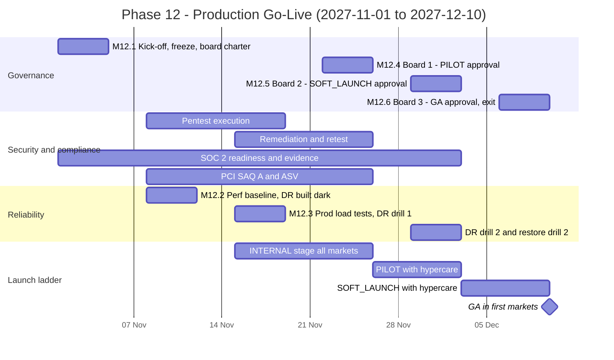
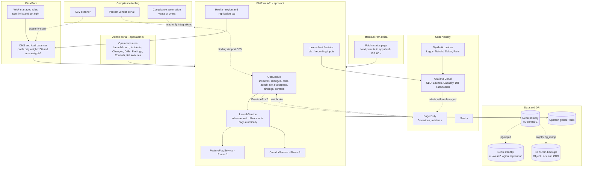
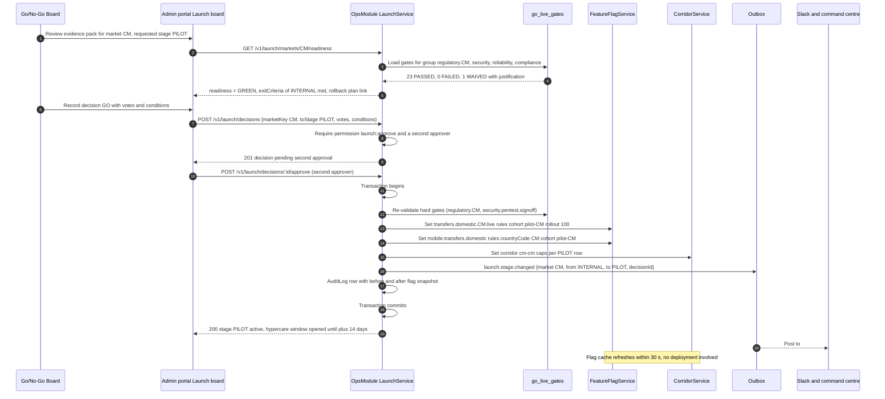
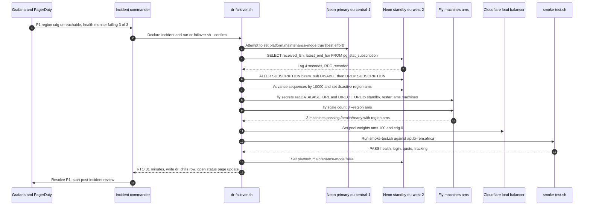
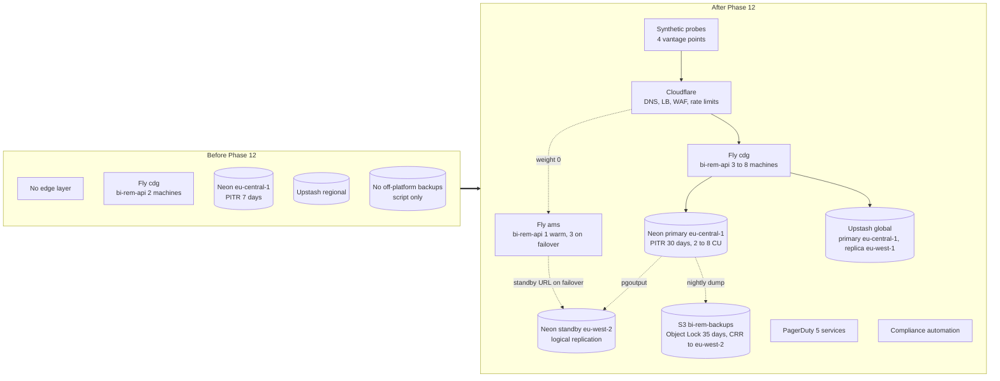
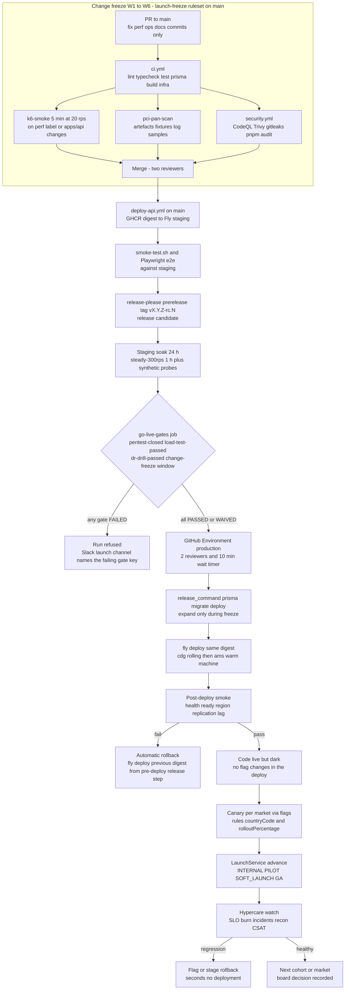

# Phase 12 — Production Go-Live

| Field                     | Value |
| ------------------------- | ----- |
| **Phase**                 | 12 of 13 — `go-live` |
| **Dates**                 | 2027-11-01 → 2027-12-10 |
| **Duration**              | 6 weeks (W1 = 2027-11-01 … 2027-11-05, W2 = 2027-11-08 … 2027-11-12, W3 = 2027-11-15 … 2027-11-19, W4 = 2027-11-22 … 2027-11-26, W5 = 2027-11-29 … 2027-12-03, W6 = 2027-12-06 … 2027-12-10) |
| **Team**                  | `all` — every squad is on launch duty: DevOps/SRE 100 % (launch lead for reliability), security engineer 0.5 FTE for all 6 weeks (pentest coordination, remediation triage), 4 backend engineers (2 on remediation/performance, 1 on the operations module, 1 on DR automation), 3 frontend engineers (operations console, status page, launch comms), 2 mobile engineers (store rollout, hypercare), 2 QA engineers (load/performance/UAT/restore drills), solution architect 80 %, compliance analyst 100 % (SOC 2 / PCI / regulatory sign-offs), product designer 30 %, PM 100 % (go/no-go board secretary); business owners: COO (command centre), MLRO, CFO, Head of Customer Operations, Head of Partnerships, General Counsel |
| **Depends on**            | Phase 8 — AML, Fraud & Compliance (ended 2027-09-17): MLRO sign-off package, §12 criteria green, regulator contact matrix, planted-name rehearsal script, `aml.*` kill switches. Phase 9 — Partner & Merchant Portal (ended 2027-10-01): partner support runbooks, settlement-day procedure, API SLA text, `partner-api` on-call rotation, canary procedure for partner flags. Phase 10 — Reporting & BI (ended 2027-10-29): Operational Dashboard as command centre, `EXECUTIVE_PACK` readiness-pack variant, daily executive e-mail, Grafana/PagerDuty alert parity, `docs/handbooks/go-live-command-centre.md`. Phase 11 — Mobile (ended 2027-10-15): both store listings live, store-review runbook, release-train calendar, push/OTA/force-update runbooks, device-support matrix. Transitively: Phase 1 hosting (Fly.io `cdg`, Neon `eu-central-1`, Vercel `cdg1`, Upstash Redis), `FeatureFlag`/`Setting`/`AuditLog`/`Outbox`, `prom-client` metrics, `/health/*`, `infra/scripts/db-backup.sh` + `db-restore.sh`, `smoke-test.sh`, `deploy-api.yml` → `fly-deploy.yml` with GitHub Environment approval; Phase 3 provider health + `GET /v1/status/public`; Phase 4 connector kill switches `wallet.connector.<key>.live`; Phase 5 `transfers` saga + ledger invariants; Phase 6 corridor status machine `DRAFT → SANDBOX → FRIENDS_FAMILY → LIVE → PAUSED → RETIRED` and `intl.*` flags; Phase 7 FX freeze and EOD close |
| **Unlocks**               | Phase 13 — Pan-African Expansion (2028-01-03): a production platform under SLO with a repeatable **corridor launch playbook** (pilot → soft launch → GA gates as data in `corridor_rollout_stages`), a DR topology that can absorb a second primary region, SOC 2 Type I report and PCI SAQ A attestation that partners and regulators ask for, incident/change/hypercare processes owned by named rotations, and a go/no-go board template reused for every new country |
| **Runs in parallel with** | Nothing: W1–W6 are a programme-wide **change freeze** on new features (`main` accepts only `fix:`, `perf:`, `ops:` and `docs:` commits via the `launch-freeze` branch protection rule; feature work for Phase 13 continues on `next/*` branches without deploying) |

---

## 1. Overview

### 1.1 Objective

Phase 12 turns eleven phases of independently deployed, flag-guarded capability into a **launched, operated, insured-by-evidence production service**. Nothing new is sold to customers in this phase; what changes is that the platform earns the right to carry real money at scale, with the organisation around it able to run it. Concretely, by 2027-12-10 BI-Rem must have: an external penetration test with every Critical/High finding remediated and re-tested; performance and load evidence that the API, workers, database and providers sustain the **100k transactions/day peak model** with headroom; a **multi-region disaster-recovery** topology meeting **RPO < 15 min and RTO < 60 min** proven by a timed drill, not a slide; backups whose restorability is demonstrated by quarterly-cadence drills already run twice; monitoring, alerting and **incident runbooks** owned by on-call rotations that have exercised them; a **SOC 2 Type I** control set with evidence collected and an auditor engaged; **PCI-DSS** scope formally reduced to **SAQ A** and attested; **business continuity plans** for the dependencies that are not software (people, partners, regulators, cash float); and a **go/no-go board** that approves production rollout corridor by corridor on evidence surfaced in the admin portal.

The launch itself is deliberately **not a single day**. Every corridor and country moves through the same gated ladder — `INTERNAL` (staff) → `PILOT` (named cohort, hard caps) → `SOFT_LAUNCH` (percentage rollout, marketing silent) → `GENERAL_AVAILABILITY` — with **hypercare** (24×7 staffed command centre, 15-minute incident acknowledgement, daily launch stand-up) covering the first 14 days after any corridor reaches `SOFT_LAUNCH`, and a written **rollback plan** per ladder step. The 99.9 % monthly availability target applies from the first `SOFT_LAUNCH`; the first full month measured against it is December 2027.

### 1.2 In scope

- **Penetration testing** — external CREST/OSCP-grade vendor engagement covering the API (`/v1/*`, `/docs`, `/health`, `/metrics`), both portals (BFF cookie flows, CSP, SSRF through proxy routes), the partner API and developer portal (Phase 9), the mobile apps (binary + backend, building on the Phase 11 mobile pentest), webhooks (signature verification, replay), provider callbacks (Phase 3/4 static-IP allow-lists), the Fly/Neon/Vercel/Upstash/Cloudflare configuration (cloud review), and a **social-engineering / phishing** exercise against admin users; internal retest; findings registry in the admin portal.
- **Performance testing** — single-request latency budgets per critical endpoint (quote, transfer create, wallet balance, login, tracking) under realistic data volumes (1M users, 25M `transfers` rows, 300M `ledger_entries` rows seeded on a Neon branch of production size); database query plans reviewed; Redis and BullMQ worker throughput; Prisma connection pool and PgBouncer sizing; N+1 and index audits; Next.js portal Core Web Vitals; mobile cold start regression (Phase 11 budgets).
- **Load testing** — k6 scenario suite modelling **100k transactions/day** with an African-market daily shape (two peaks: 07:00–09:00 and 17:00–21:00 local, Friday and month-end ×1.8, Eid/Christmas ×2.5), i.e. a sustained **peak of ~4.2 tx/s with bursts of 12 tx/s** plus the surrounding read traffic (≈ 25 reads per write: balance polls, tracking, quotes, portal pages, push-triggered refreshes) → ≈ **300 rps steady, 900 rps burst** on the API; soak (8 h), stress (to failure), spike (×5 for 2 min) and provider-degradation (Phase 3 `provider-sim` latency/failure profiles) scenarios; capacity model and autoscaling policy derived from results.
- **Disaster recovery** — move from single-region (Fly `cdg` + Neon `eu-central-1`) to **active/warm-standby multi-region**: Fly machines in a second region (`ams`) permanently running at reduced count, a **Neon standby project in a second AWS region (`aws-eu-west-2`, London)** fed by Postgres logical replication with lag alerting, Upstash Redis global database with read replicas, Cloudflare in front of API and portals for DNS/traffic steering and health-based failover, S3 backup bucket cross-region replication; **DR runbook** with decision tree, promotion scripts (`infra/scripts/dr-failover.sh`, `dr-failback.sh`), and two full timed drills (one announced, one surprise) that must each record RPO ≤ 15 min and RTO ≤ 60 min.
- **Backup validation** — nightly `db-backup.sh` dumps to S3 with **Object Lock (compliance mode, 35 days)** + cross-region replica; automated **restore verification job** (`backup-verify.yml`, weekly) that restores the latest dump into an ephemeral Neon branch, runs schema checksum, row-count tie-outs against the production `kpi_daily` and ledger invariants (sum of entries per currency = 0), and records the result in `backup_verifications`; quarterly manual restore drill into an isolated environment including Redis state, object storage (KYC documents, receipts, reports) and secrets; Neon PITR window extended to 30 days on production.
- **Monitoring** — consolidation of the Phase 1 framework into **SLOs with error budgets** (availability 99.9 %, transfer success, quote latency, push delivery, webhook delivery, provider health), Grafana SLO dashboards, burn-rate alerts (fast 1 h / slow 6 h) wired to PagerDuty, synthetic probes from three African vantage points (Lagos, Nairobi, Dakar) plus Paris, business-metric anomaly alerts (transfers/min vs same weekday, failed-per-provider), on-call rotations for `platform`, `payments`, `partner-api`, `mobile`, `compliance` with escalation policies, alert hygiene (every alert has a runbook link, no alert without an owner).
- **Incident runbooks** — a runbook catalogue (`docs/runbooks/*.md`, mirrored into the `runbooks` table for in-portal lookup) covering platform incidents (API down, database failover, Redis loss, queue backlog, certificate expiry, Vercel outage), payment incidents (provider outage, stuck transfers, duplicate payouts, ledger imbalance, FX stale rate, nostro liquidity low, settlement file rejected), security incidents (credential leak, account takeover wave, suspected data breach with regulator notification timelines), compliance incidents (sanctions hit freeze, STR deadline at risk, regulator request), and launch-specific procedures (corridor rollback, flag rollback, store rollout halt); **incident management process** (severity matrix, roles — incident commander, comms lead, scribe — status page updates, customer/partner/regulator comms templates, blameless post-mortem within 5 business days with tracked actions) implemented in the admin portal **Operations** module.
- **SOC 2 readiness (Type I path)** — Trust Services Criteria scope: Security (mandatory), Availability, Confidentiality; control mapping to what the platform already does (RBAC, MFA, audit log, change management via protected branches and approvals, vulnerability management via `security.yml`, backups, DR, logging) plus organisational controls (policies, onboarding/offboarding, access reviews, vendor management, risk assessment, incident response); compliance-automation platform (Vanta or Drata — decision Q12.3) connected to GitHub, Fly, Neon, AWS, Vercel, Google Workspace, PagerDuty; evidence collection; auditor selected and **Type I observation date set for 2028-01-15** with the readiness assessment completed in this phase; Type II observation window planned for Phase 13.
- **PCI-DSS readiness** — formal **scope reduction**: BI-Rem never stores, processes or transmits PAN; card funding (Phase 4 Paystack/Flutterwave on-ramps) uses provider-hosted pages/redirects only; network segmentation irrelevant because no CDE exists in BI-Rem infrastructure; **SAQ A** (v4.0.1) completed and signed with the Attestation of Compliance; quarterly ASV scans of public endpoints contracted; evidence that no card data appears in logs, audit rows or databases (automated scanner in CI and on Loki).
- **Business continuity plans** — BCP per critical function: payments operations (manual payout procedure when the API is down, partner hotline matrix), treasury (float top-up without the admin portal, bank-portal access, signatory matrix), compliance (STR filing offline, sanctions screening fallback via provider portal), customer support (channel degradation ladder: in-app → WhatsApp → SMS broadcast), engineering (loss of a cloud provider: Fly → AWS ECS via `infra/terraform` as the documented cold alternative; loss of GitHub: mirror + signed images in GHCR and ECR), people (key-person coverage, on-call depth ≥ 3 per rotation, time-zone coverage WAT/EAT/CET), facilities and connectivity (remote-first, mobile data stipends, MNO outage procedures); BCP tabletop exercise with executives.
- **Pilot / soft-launch strategy per corridor** — rollout ladder encoded in `corridor_rollout_stages` with entry/exit criteria, caps and cohort definitions; domestic markets `CM`, `SN`, `CI`, `NG`, `KE`, `GH` and cross-border corridors `CM→GA`, `CM→TD`, `CM→CG`, `GA→CM` (wave A), `CM→AO`, `CM→MZ`, `CM→GW` (wave B), `CM→CV`, `CM→ST` (wave C) each with their own schedule; regulatory sign-off per market recorded before `SOFT_LAUNCH`.
- **Hypercare** — 14-day window per market, 24×7 command centre on the Phase 10 Operational Dashboard, launch stand-up at 08:00 WAT daily, hypercare roster, severity-based SLAs tightened (P1 ack 5 min, P2 15 min), daily launch report to the board, exit criteria to return to business-as-usual on-call.
- **Rollback plans** — per ladder step and per component: flag rollback (seconds), corridor `PAUSED` (seconds), API image rollback by digest (minutes), portal deployment promotion (minutes), migration rollback policy (forward-fix; `down.sql` only under freeze), store rollout halt/OTA republish (Phase 11), DR failback; all rehearsed in staging during W2–W3.
- **Regulatory sign-offs** — licence/partner-model confirmations per market (BEAC/COBAC via sponsor EMI for CEMAC, BCEAO via partner for SN/CI, CBN PSP licence status for NG, CBK PSP authorisation for KE, BoG PSP licence for GH), go-live notifications where required, data-protection registrations (NDPC Nigeria, ODPC Kenya, DPC Ghana, CDP Senegal, ARTCI Côte d'Ivoire, CEMAC states), complaint-handling and consumer-protection disclosures, MLRO attestation (Phase 8), external legal opinion filed per market.
- **Launch comms** — internal (all-hands, launch calendar, freeze notices), partner (API status page, SLA activation, settlement calendar, support contacts), customer (staged "you're in" e-mail/SMS/push per cohort, in-app announcement, FAQ and help-centre articles in en/fr/pt, pricing disclosures), regulator courtesy notifications, press/marketing held until `GENERAL_AVAILABILITY` in ≥ 3 markets, crisis-comms templates pre-approved by counsel.

### 1.3 Out of scope (deferred)

- New product features of any kind (Phase 13 backlog); new corridors/countries beyond those listed above.
- SOC 2 **Type II** report (observation window 2028-02 → 2028-07, Phase 13) and ISO 27001 certification (evaluate in Phase 13 once SOC 2 evidence exists).
- PCI-DSS beyond SAQ A (card issuing, acquiring, storing PAN) — not planned; any card-present/acquiring product would reopen scope and requires an ADR.
- Active/active multi-primary database (bi-directional replication) — rejected (§4.4); Phase 13 may move the primary nearer to African regions (Neon `af-south-1` is not offered; options documented in Q12.6).
- Chaos engineering platform beyond the scripted fault injections in this phase (Phase 13 candidate).
- Bug bounty programme — launched only after the pentest retest is clean (W6 decision, Phase 13 budget).
- Full ITSM tooling (Jira Service Management) — the admin portal Operations module is sufficient for launch; evaluate in Phase 13.
- A customer-facing public status page with subscriber notifications **beyond** the Phase 3/9 `GET /v1/status/public` rendering — the phase ships `status.bi-rem.africa` from that endpoint; subscriber e-mail/RSS is a Phase 13 nicety.

### 1.4 Independent deployability strategy

"Deployable alone" for Phase 12 means: **every code change in this phase is operational scaffolding that is inert without configuration (new `ops` module behind `admin.ops.console`, SLO exporters, DR scripts, synthetic probes); the launch ladder is pure data (`corridor_rollout_stages` rows + Phase 6 corridor status + Phase 5/6/11 flags); infrastructure additions (second Fly region, Neon standby, Cloudflare) are added alongside the current topology and only receive traffic when a DNS record or weight changes; and any step of the launch is reversible in under five minutes without a deployment.** The platform at the end of W6 with every launch flag off is functionally identical to the platform at the start of W1.

| Mechanism | Phase 12 application |
| --- | --- |
| **Feature flags** (Phase 1 `FeatureFlag`, `rolloutPercentage` + `rules`, Redis-cached 30 s) | `admin.ops.console` (Operations module visibility), `ops.incidents.pagerduty-sync`, `ops.statuspage.public` (serve `status.bi-rem.africa` from `status_page_components` instead of Phase 3 raw status), `ops.synthetics.enabled`, `ops.slo.burn-rate-alerts`, `launch.market.<cc>.stage` is **not** a flag but a `corridor_rollout_stages` row; the ladder drives the existing flags: Phase 5 `transfers.domestic.<cc>.live`, Phase 6 `intl.corridor.<k>.enabled/live`, Phase 11 `mobile.transfers.*`, Phase 9 `partner.portal.enabled` with `rules: countryCode in [...]` and `rolloutPercentage`. `platform.maintenance-mode` (Phase 1 `Setting`) → API returns 503 `MAINTENANCE` for mutations; `platform.read-only` → GETs served, writes refused; `dr.active-region` (`Setting`, values `cdg` / `ams`) read by the health endpoint and the command centre. |
| **Expand → migrate → contract** | One expand migration `20271101090000_phase12_expand` (15 tables, 12 enums, permissions, roles, `settings` rows). **No contract** in this phase: a change freeze is the worst moment to drop columns. Candidate contracts from Phases 10–11 are listed for Phase 13 W1 (§5.3). The DR standby is created **from a snapshot after this migration** so publisher and subscriber schemas match. |
| **Dark launch** | From W1 the `ops` module is deployed with `admin.ops.console` on for the `OPS_ADMIN` role only; from W2 the second Fly region runs 1 machine receiving **no** public traffic (Cloudflare pool weight 0, health-checked); from W2 the Neon standby replicates with the API never pointed at it; from W3 synthetic probes run against production from all vantage points; from W3 the status page is served on `status.bi-rem.africa` but linked nowhere public until W5. |
| **Kill switches** | `platform.maintenance-mode=true` (30 s, all mutations 503, workers drain); corridor → `PAUSED` (Phase 6, in-flight transfers park `HELD`); `transfers.domestic.<cc>.live=false`; `wallet.connector.<key>.live=false` (Phase 4); `intl.fx.freeze=true` (Phase 7); `mobile.hard-min-version.*` (Phase 11) to force an app update; `partner.api.enabled=false` (Phase 9); Cloudflare **"Under Attack"** mode and WAF managed rules toggled per hostname; `ops.synthetics.enabled=false` if probes themselves cause load. Every switch is listed on the command-centre **Kill Switch Panel** with two-person confirmation for money-affecting ones. |
| **Backward-compatible APIs** | New paths under `/v1/ops/*`, `/v1/launch/*`, `/v1/status/*`; no existing contract changes. `GET /health/ready` gains optional `region` and `replicationLagSeconds` fields. |
| **Rollback** | Flag/data rollback in seconds; `fly releases rollback` / `fly deploy --image <previous digest>` recorded by `fly-deploy.yml` "pre-deploy release" step; Vercel "promote previous deployment"; DR failback runbook returns the primary to `cdg` with reverse replication; migration rollback is forward-fix only (Phase 1 policy) — the expand migration has a tested `down.sql` purely for staging. |

---

## 2. Milestones

Week numbering starts Monday 2027-11-01 (W1). Milestone dates are the Friday of the week.

| ID | Week | Date | Deliverable | Acceptance criteria | Owner |
| --- | --- | --- | --- | --- | --- |
| **M12.1** | W1 | 2027-11-05 | Launch kick-off and freeze: change freeze active; launch plan and corridor ladder approved by the go/no-go board (constitution, members, quorum, evidence standard); pentest vendor onboarded (scope, rules of engagement, test accounts on staging + production read-only); k6 suite skeleton and production-shaped Neon branch (`perf-20271101`) seeded; `20271101090000_phase12_expand` merged and deployed; Operations module dark; SLO definitions (§3.6) signed by COO; Vanta/Drata decision (Q12.3) made and connected | Branch protection `launch-freeze` blocks a `feat:` PR in a dry run; board charter signed by CEO/COO/CFO/MLRO/GC; vendor ROE signed and test credentials issued with `AuditLog` rows; `perf-20271101` contains ≥ 1M `users`, ≥ 25M `transfers`, ≥ 300M `ledger_entries` with realistic distributions; migration applied in production with zero errors and `/health/ready` green; SLO document in `docs/handbooks/slo.md` lists SLI query, target and error budget for each of the 7 SLOs | Program Manager |
| **M12.2** | W2 | 2027-11-12 | Performance baseline and first load-test campaign on staging (`perf-20271101` branch): latency budgets per endpoint measured, top-20 slow queries fixed, pool/PgBouncer sizing set; DR topology **built dark**: Fly `ams` machines (weight 0), Neon standby project `bi-rem-standby` (London) replicating, Upstash global replica, Cloudflare zone active in DNS-only mode, S3 backup bucket with Object Lock + CRR; `backup-verify.yml` first green run; pentest **starts** (W2–W3) | k6 `steady-300rps` 1 h on staging: p95 `POST /v1/transfers` ≤ 600 ms, p95 `POST /v1/intl/quotes` ≤ 250 ms, p95 `GET /v1/wallets/me` ≤ 150 ms, error rate < 0.1 %, zero `outbox_pending_total` growth; replication lag to standby < 30 s over 24 h; `backup_verifications` row with `result=PASS`, ledger invariant check green; Cloudflare proxies `status.bi-rem.africa` only | DevOps/SRE Lead |
| **M12.3** | W3 | 2027-11-19 | Load-test campaign 2 on **production** (off-peak, synthetic tenants, `provider-sim` routed): soak 8 h, stress to failure, spike ×5, provider-degradation; autoscaling policy and capacity model published; **DR drill #1 (announced)** with full failover to `ams`/London and failback; runbook catalogue v1 (≥ 30 runbooks) in portal; on-call rotations live in PagerDuty; synthetic probes from 4 vantage points; `INTERNAL` stage for all markets (staff transacting real money with their own wallets) | Soak: error rate < 0.1 %, no memory growth > 10 % over 8 h, p95 within budgets; stress: graceful degradation (429/503 with `Retry-After`, no ledger imbalance, no duplicate payouts) above 1,200 rps; DR drill: RPO measured ≤ 15 min (actual target ≤ 1 min via logical replication), RTO ≤ 60 min (target ≤ 35 min) with signed drill record in `dr_drills`; every PagerDuty alert links to a runbook; ≥ 200 staff transfers completed across ≥ 6 markets with recon green | Solution Architect |
| **M12.4** | W4 | 2027-11-26 | Pentest report received; Critical/High remediated and **retested clean**; SOC 2 readiness assessment complete (gap list, policies approved, evidence ≥ 90 % collected in the automation platform); **PCI SAQ A** signed with AoC; first ASV scan passed; BCP documents approved and tabletop exercise held; regulatory sign-off pack per market complete; **go/no-go board #1** approves `PILOT` for `CM`, `SN`, `CI`, `KE`, `GH`, `NG` domestic and `CM→GA`, `GA→CM` cross-border; `PILOT` cohorts invited (≤ 500 customers per market, hard caps) | Retest letter shows 0 Critical, 0 High open; Medium findings have owners and dates in `security_findings`; readiness assessment report from the auditor with no "critical gap"; SAQ A + AoC filed, ASV scan "Pass"; BCP tabletop minutes with ≥ 5 actions; sign-off pack per market (licence basis, counsel opinion, DPA registration, complaints procedure, MLRO letter) filed in `go_live_gates` with evidence links; board decision rows recorded with votes | Compliance Analyst / Security Engineer |
| **M12.5** | W5 | 2027-12-03 | `PILOT` running with hypercare in all approved markets; **DR drill #2 (unannounced, run by QA)**; backup restore drill #2 incl. object storage and Redis; hypercare metrics daily; **go/no-go board #2** approves `SOFT_LAUNCH` (25 % → 50 % rollout, marketing silent) for markets meeting pilot exit criteria; wave B corridors to `PILOT`; status page public; partner SLA activated | Pilot exit criteria per market: ≥ 300 transfers, success rate ≥ 98.5 %, recon zero unexplained breaks 5 consecutive days, ≤ 1 P2 incident, CSAT ≥ 4.2/5 from in-app survey; DR drill #2 RPO ≤ 15 min / RTO ≤ 60 min again, no runbook deviations unlogged; restore drill #2 recovers a KYC document and a receipt PDF from backup with hash match; availability since first pilot ≥ 99.9 %; board decisions recorded | Program Manager / COO |
| **M12.6** | W6 | 2027-12-10 | **Go/no-go board #3 — production rollout approved**: `GENERAL_AVAILABILITY` for markets meeting soft-launch exit criteria, remaining markets stay in `SOFT_LAUNCH` with dated review; security audit sign-off letter; SOC 2 Type I audit scheduled (2028-01-15) with evidence frozen; hypercare → BAU transition plan; launch comms executed; phase exit review; handover to Phase 13 | §12 criteria evidenced: availability ≥ 99.9 % over the trailing 30 days (synthetic + real), pentest sign-off letter filed, board approval minutes signed by quorum; `GENERAL_AVAILABILITY` reached in ≥ 3 markets with 100 % rollout and marketing live; hypercare exit criteria met (≤ 2 P3/day trending down, zero open P1/P2, on-call ack ≤ 15 min for 7 days); handover doc accepted by Phase 13 lead; retrospective held | Program Manager |



---

## 3. Deliverables

Every item from the phase brief with its definition of done (DoD). Code lives in `apps/api/src/modules/ops/*` (NestJS `OpsModule` with sub-modules `incidents`, `changes`, `drills`, `launch`, `slo`, `statuspage`, `findings`, `controls`), `apps/admin/app/(ops)/*`, `infra/scripts/dr-*.sh`, `infra/terraform/modules/{dr-standby,backup-bucket}`, `tests/load/k6/*`, `docs/runbooks/*`, `docs/handbooks/{slo,incident-management,hypercare,bcp}.md`, `docs/compliance/{soc2,pci}/*`.

### 3.1 Penetration testing

- **Scope**: API (`/v1/*` incl. partner API and webhooks), customer and admin portals (BFF, cookies, CSP, proxy route `app/api/proxy/[...path]` SSRF), mobile apps (iOS/Android binaries + backend, delta against the Phase 11 report), provider callback endpoints, cloud configuration review (Fly, Neon, Vercel, Upstash, Cloudflare, AWS backup account, GitHub org), phishing simulation of 40 admin users. Methodology: OWASP ASVS 4.0.3 Level 2 for the API and portals, OWASP MASVS L2 + R for mobile, PTES for infrastructure; grey-box with staff credentials for `SUPPORT_AGENT`, `OPS_ADMIN`, `COMPLIANCE_OFFICER`, partner sandbox credentials, two customer accounts per KYC level.
- **DoD**: signed rules of engagement; test window W2–W3 against staging (full) and production (read-only + unauthenticated surface, with Cloudflare WAF in log-only mode for the tester IPs); report with CVSS 3.1 scores imported into `security_findings` (one row per finding, evidence link to the vendor portal); every Critical and High remediated with a linked PR and **retested clean** by 2027-11-26; Medium findings scheduled with owner and due date ≤ 2028-01-31; Low/Info triaged; phishing click rate < 10 % and zero credential submissions (else mandatory training before `PILOT`); security audit sign-off letter from the vendor filed under `go_live_gates` key `security.pentest.signoff`.

### 3.2 Performance testing

- **DoD**: `docs/handbooks/performance-budgets.md` lists, for 18 critical endpoints, the p50/p95/p99 budget and the measured value on the production-shaped branch; the top-20 slowest queries (from `pg_stat_statements` on the perf branch) each have a PR or a documented acceptance; indexes added for `transfers(status, created_at)` partial on non-terminal states, `wallet_transactions(provider_reference)` hash, `audit_logs(resource_type, resource_id, created_at)`; Prisma pool per instance stays 10 with PgBouncer transaction pooling at 200 server connections on Neon (`max_connections` sized for 6 API machines + 4 workers + standby replication slot); BullMQ worker concurrency tuned per queue (`notifications` 20, `transfers-saga` 8, `outbox-relay` 4, `webhooks` 16) with documented rationale; Next.js portals LCP ≤ 2.5 s p75 on a 4G profile, INP ≤ 200 ms; mobile cold start within Phase 11 budget on the reference device after the backend changes; a `perf` label on PRs triggers the k6 smoke in CI (§10).

### 3.3 Load testing (100k tx/day peak modelling)

- **Model** (`tests/load/model.md`): 100,000 transactions/day = 40 % domestic wallet-to-wallet, 25 % wallet-to-mobile-money cash-out, 15 % add-money, 12 % cross-border, 8 % merchant/agent (Phase 9). Daily shape from Phase 5/6 pilot telemetry: 07:00–09:00 local 22 % of volume, 17:00–21:00 38 %, remainder flat; Friday ×1.4, last two business days of the month ×1.8, religious holidays ×2.5 → **design peak 12 tx/s** (≈ 2.9× the mean peak-hour rate of 4.2 tx/s). Read amplification 25:1 → **300 rps steady, 900 rps burst, 1,200 rps stress target**; provider callbacks at 2× transaction rate; push notifications at 3× (Phase 11); webhooks to partners at 1× (Phase 9).
- **Scenarios** (k6, `tests/load/k6/`): `smoke` (5 min, 20 rps, CI), `steady-300rps` (1 h), `peak-900rps` (30 min), `soak-8h` (300 rps), `stress-to-failure` (ramp +100 rps every 5 min until SLO breach), `spike` (×5 for 2 min, three times), `provider-degradation` (Phase 3 `provider-sim` profiles: MTN MoMo CM 3 s latency, M-Pesa 20 % `UNKNOWN`, Airtel GA down), `month-end` (×1.8 for 4 h with Phase 7 EOD close running), `mobile-storm` (50k push-triggered refreshes within 60 s after a mass notification). Each scenario executes real money flows against **synthetic tenants** (users with `email endsWith @loadtest.bi-rem.app`, wallets funded on `provider-sim`, excluded from analytics and regulatory reports by the Phase 10 `is_synthetic` dimension).
- **DoD**: every scenario has thresholds in code (`http_req_failed < 0.1 %`, per-endpoint p95), results stored in `load_test_runs` (summary JSON + Grafana snapshot link); production campaign (M12.3) run in the 01:00–05:00 WAT window with the COO's approval recorded as a `change_requests` row; capacity model (`docs/handbooks/capacity-model.md`) states machines required per 100 rps, the autoscaling policy (Fly `min_machines_running = 3` in `cdg`, `max 8`, scale on request concurrency soft limit 150; `ams` min 1), Neon compute autoscaling 2–8 CU, Upstash plan, and the **headroom rule** (alert at 60 % of stress breakpoint, scale review at 70 %); ledger invariant job run after every production campaign shows zero imbalance; synthetic rows purged by the `loadtest-cleanup` job within 24 h.

### 3.4 Disaster recovery (RPO < 15 min, RTO < 60 min, multi-region)

- **Topology** (§4.3): primary Fly `cdg` + Neon `eu-central-1`; standby Fly `ams` (1 machine warm, scaled to 3 on failover) + Neon project `bi-rem-standby` in `aws-eu-west-2` receiving all tables via logical replication (publication `birem_all`, subscription on the standby, sequences synced by the `dr-sync-sequences.sh` job every 5 min); Upstash Redis global database (primary `eu-central-1`, read replica `eu-west-1`) — queues are **not** failed over (BullMQ jobs are rebuilt from `outbox` and saga state on the standby, Phase 1/5 design); Cloudflare load balancer with two origin pools (`cdg` weight 100, `ams` weight 0) and health monitor on `/health/ready`; object storage (S3 `bi-rem-documents`, `bi-rem-reports`, `bi-rem-backups`) with cross-region replication to `eu-west-2`; secrets duplicated in Fly secrets per app and in AWS Secrets Manager (standby) by `rotate-secrets.md` procedure.
- **Runbook** (`docs/runbooks/dr-failover.md`): decision tree (regional outage vs. Neon incident vs. Fly incident vs. logical corruption — the last uses PITR, not failover), 11-step promotion: declare incident → `platform.maintenance-mode=true` → confirm replication lag (`pg_stat_subscription`) → disable subscription → promote (standby becomes writable; sequences advanced by `+10,000` to avoid collisions) → point `ams` machines at the standby (`fly secrets set DATABASE_URL… --app bi-rem-api --stage`, `fly machine restart` in `ams`) → scale `ams` to 3 → Cloudflare pool weights `ams` 100 / `cdg` 0 → smoke test → `dr.active-region=ams` → maintenance-mode off → notify. Failback reverses with a fresh snapshot and reverse logical replication during a maintenance window.
- **DoD**: two timed drills recorded in `dr_drills` with measured RPO (last committed LSN on primary vs. standby at promotion) and RTO (incident declared → `/health/ready` green via Cloudflare + first real transfer completed); both ≤ 15 min / ≤ 60 min; replication lag alert at 5 min (warning) and 10 min (P2); monthly automated **non-disruptive** DR test (`dr-test.yml`: promote a *clone* of the standby, run smoke + ledger invariants, destroy); `infra/terraform/modules/dr-standby` and `infra/scripts/dr-failover.sh` / `dr-failback.sh` reviewed by two engineers; Phase 1 `infra/aws/README.md` cold alternative kept current as the **loss-of-Fly** BCP path.

### 3.5 Backup validation (restore drills)

- **DoD**: `backup.yml` runs `db-backup.sh --upload s3://bi-rem-backups/production` nightly at 02:30 UTC with KMS encryption, Object Lock compliance mode 35 days, lifecycle to Glacier Deep Archive after 90 days, retention 7 years for month-end dumps (regulatory record-keeping) — bucket policy denies `DeleteObject` even to administrators; `backup-verify.yml` weekly restores the newest dump into Neon branch `verify-<date>` with `db-restore.sh --neon-branch`, runs `prisma migrate status` (no pending), schema checksum vs. production, row counts for 12 key tables within 0.5 % of production at dump time, ledger invariants, and a sampled decrypt of an application-encrypted column with the current `ENCRYPTION_KEY` (proves key availability), writing a `backup_verifications` row and alerting on `FAIL`; two manual restore drills (W2 and W5) each restoring database + S3 object samples + Redis AOF (for audit of what would be lost: Redis is cache/queues only) into an isolated environment and completing the Phase 1 e2e suite against it; Neon PITR extended to 30 days on production; recovery of a deleted KYC document and a receipt PDF demonstrated with SHA-256 match; backup runbook (`docs/runbooks/backup-restore.md`) includes the "who can touch the backup account" matrix (break-glass with MFA + two approvers).

### 3.6 Monitoring

- **SLOs** (`docs/handbooks/slo.md`, exported as `slo_*` recording rules): (1) API availability 99.9 % monthly — SLI = non-5xx responses / all responses on `/v1/*` excluding synthetic tenants, measured at Cloudflare and at the API; (2) transfer success 99.5 % — `transfer.completed` / (`completed` + `failed` not caused by customer or provider decline) over 24 h; (3) quote latency — 99 % of `POST /v1/intl/quotes` and `/v1/fees/quote` < 500 ms; (4) transfer latency — 95 % of domestic transfers reach `COMPLETED` within 60 s and 99 % within 10 min; (5) push delivery (Phase 11) — 97 % first attempt within 30 s; (6) partner webhook delivery (Phase 9) — 99 % within 60 s; (7) provider health (Phase 3) — each live provider ≥ 99 % probe success. Error budgets, burn-rate alert pairs (2 %/1 h fast → page, 5 %/6 h slow → ticket), and a **budget policy** (freeze non-emergency rollouts when the monthly budget is < 25 % remaining).
- **DoD**: Grafana folders `SLO`, `Launch`, `Capacity`, `DR` provisioned from `infra/grafana/*.json` in the repo; synthetic probes (Grafana Synthetic Monitoring or Checkly — Q12.4) from Lagos, Nairobi, Dakar, Paris every 60 s on login, quote, tracking and portal pages, with results in the SLO; business anomaly alerts (transfers/min < 40 % of same weekday-hour median for 10 min, failures per provider > 5 %/5 min, `outbox_pending_total` > 1,000, replication lag, certificate expiry < 14 days, backup age > 26 h); PagerDuty services `platform`, `payments`, `partner-api`, `mobile`, `compliance` with 3-deep rotations and escalation to the DevOps lead then CTO; every alert rule carries `runbook_url`; alert review shows < 5 % false-positive rate over W3–W6; the command-centre dashboard (Phase 10 Operational Dashboard) shows live SLO burn, active incidents, launch stage per market and the kill-switch panel.

### 3.7 Incident runbooks

- **DoD**: ≥ 30 runbooks in `docs/runbooks/` following one template (trigger, severity guidance, impact, pre-checks, steps with exact commands/portal paths, verification, rollback, comms template, owner, last-tested date), mirrored into the `runbooks` table by a docs-sync job (`ops:runbooks:sync`) so the admin portal can link them from alerts and incidents; each runbook **exercised at least once** in W2–W5 (game days) with the `last_tested_at` field updated; incident-management handbook (severity matrix P1–P4 with customer-impact definitions, roles, 15/30/60-minute update cadence, status page policy, regulator notification clock — 72 h GDPR-equivalent / 24 h where NDPA or CBK require, partner notification SLA from Phase 9 contracts, post-mortem within 5 business days using the blameless template with actions tracked in `postmortem_actions`); the Operations module records incidents, timeline events, roles, linked alerts, impact per market and resolution; three tabletop incidents run with the real on-call (provider outage during peak, Neon regional failure, suspected credential leak).

### 3.8 SOC readiness (SOC 2 Type I path)

- **DoD**: scope statement (Security, Availability, Confidentiality; system description covering API, portals, mobile backend, data stores and the Fly/Neon/Vercel/Upstash/AWS/Cloudflare subservice organisations with the carve-out method); control matrix of ≈ 70 controls in `compliance_controls` mapped to TSC points of focus, each with owner, frequency, evidence source (automated via the compliance platform integrations or manual upload in `control_evidence`); 14 policies approved by executives (information security, access control, change management, incident response, business continuity/DR, vendor management, risk management, data classification and retention, acceptable use, secure development, logging and monitoring, encryption and key management, HR security, physical/remote work); access reviews executed for GitHub, Fly, Neon, AWS, Vercel, admin portal roles with evidence; vendor risk assessments for the 12 critical vendors; risk register (≥ 25 risks) reviewed by management; readiness assessment by the selected audit firm with no critical gaps; Type I observation date 2028-01-15 contracted.

### 3.9 PCI-DSS readiness (scope reduction, SAQ type)

- **DoD**: `docs/compliance/pci/scope.md` demonstrates that BI-Rem is a merchant for card-funded wallet top-ups only, that card data entry happens exclusively on Paystack/Flutterwave hosted pages (redirect or provider-hosted fields) with BI-Rem receiving only tokens/references, that no component stores/processes/transmits PAN, and that therefore **SAQ A (PCI DSS v4.0.1)** applies; SAQ A completed with Attestation of Compliance signed by the CFO; the 2 relevant control areas (vendor management of TPSPs, protection of the redirect/iframe page against script injection — requirements 6.4.3 and 11.6.1: CSP with nonces, Subresource Integrity, change-and-tamper detection on the funding page) evidenced; quarterly ASV scan contracted and first scan passed; CI job `pci-pan-scan` greps built artefacts, fixtures and logs samples for Luhn-valid 13–19 digit sequences; Loki query alert for PAN patterns; provider PCI AoCs (Paystack, Flutterwave) on file with expiry tracking in `control_evidence`.

### 3.10 Business continuity plans

- **DoD**: `docs/handbooks/bcp.md` plus one appendix per function (payments ops, treasury, compliance, customer support, engineering/cloud, people, connectivity) each with BIA (MTPD, RTO, RPO per business process), triggers, manual workarounds, contact trees, and recovery steps; the engineering appendix covers loss of Fly (ECS via Terraform, image already in ECR, ≤ 4 h target), loss of GitHub (read-only mirror on a second provider, deploy from GHCR digests), loss of Neon (standby project promotion — §3.4; plus `pg_dump` into RDS as last resort), loss of Cloudflare (DNS at registrar with 300 s TTL, direct Fly/Vercel hostnames documented), loss of Upstash (Fly Redis fallback; API tolerates `REDIS_URL` absence per Phase 1), loss of a payout partner (Phase 6 route fallback; manual payout procedure with partner portals); executive tabletop held with minutes and actions; on-call depth ≥ 3 per rotation; key-person matrix with documented deputies; BCP review cadence set (semi-annual, after any P1).

### 3.11 Pilot / soft-launch strategy per corridor

- **Ladder** (rows in `corridor_rollout_stages`, one per market/corridor): `INTERNAL` → `PILOT` → `SOFT_LAUNCH` → `GENERAL_AVAILABILITY`, each with `caps` (per-transfer, daily per user, daily per market in minor units + currency), `cohort` (rule JSON evaluated by the flag service: staff domain, invited list, percentage), `entryCriteria` / `exitCriteria` snapshot, and `approvedByDecisionId`. Entering a stage writes the underlying Phase 5/6/9/11 flags and corridor status in one audited transaction (`LaunchService.advance()`), so operators never hand-edit six flags.
- **Per-market plan**: domestic `CM` (anchor market, largest Phase 5 history) leads by one week; `SN`, `CI` (BCEAO via partner), `KE`, `GH`, `NG` follow; cross-border wave A (`CM→GA`, `GA→CM`, `CM→TD`, `CM→CG`) rides the `CM` schedule; wave B (`CM→AO`, `CM→MZ`, `CM→GW`) enters `PILOT` only after wave A `SOFT_LAUNCH`; wave C (`CM→CV`, `CM→ST`) stays `SANDBOX` unless partner readiness is confirmed (Q12.7). Pilot cohorts: ≤ 500 invited customers per market drawn from the Phase 2 waiting list with completed LEVEL_2 KYC, per-transfer cap 50 % of the Phase 5 limit, daily market cap set by treasury from nostro coverage; soft launch: 25 % → 50 % → 100 % of eligible customers by stable user-id hash, marketing silent, app listings live but unpromoted.
- **DoD**: ladder implemented and tested (unit + e2e); every market has a row with approvals; stage changes emit `launch.stage.changed` to Slack `#launch` and the command centre; exit criteria evaluated automatically every hour and surfaced as green/amber/red on the Launch board; board packs generated from the Phase 10 `EXECUTIVE_PACK` variant.

### 3.12 Hypercare

- **DoD**: `docs/handbooks/hypercare.md` — 14-day window per market starting at `PILOT`, extended at `SOFT_LAUNCH`; roster with command-centre lead (DevOps/SRE or backend lead), payments on-call, compliance on-call, support lead, partner liaison in three shifts covering 06:00–24:00 WAT with PagerDuty for the remaining hours; tightened SLAs (P1 ack 5 min / update every 15 min, P2 ack 15 min); daily 08:00 WAT launch stand-up with the previous day's launch report (auto-generated by Phase 10 scheduler: volumes, success, incidents, SLO burn, support tickets, top complaints); exit criteria (7 consecutive days with zero P1/P2, ≤ 2 P3/day, SLO budgets > 50 % remaining, support backlog < 24 h) evaluated by the PM and approved by the COO; transition to BAU on-call recorded as a `go_live_gates` item.

### 3.13 Rollback plans

- **DoD**: `docs/runbooks/rollback-*.md` for flags, corridor stage (`LaunchService.rollback()` reverts to the previous stage and flags atomically), API image (`fly deploy --image <digest>` with the digest table kept by `fly-deploy.yml`), portals (Vercel promote), mobile (Play staged rollout halt, iOS phased release pause, EAS Update republish — Phase 11), database (forward-fix policy; `down.sql` only with `platform.maintenance-mode` and a PITR branch taken first), DR failback, Cloudflare configuration (versioned rulesets); each rehearsed in staging during W2–W3 with timing recorded; every board decision references the applicable rollback plan.

### 3.14 Regulatory sign-offs

- **DoD**: per market, a `go_live_gates` group `regulatory.<cc>` with items: licence/partner-model confirmation (CEMAC: sponsor EMI agreement + COBAC notification via the partner; `SN`/`CI`: BCEAO-licensed partner agreement and agent registration; `NG`: CBN PSP licence category and status or partner umbrella; `KE`: CBK PSP authorisation; `GH`: BoG PSP (Enhanced) licence or partner); data-protection registration (NDPC, ODPC, DPC, CDP, ARTCI, national CEMAC authorities) or counsel memo on applicability; consumer-protection disclosures (pricing, FX margin, complaint handling, cooling-off where required) reviewed; MLRO attestation from Phase 8; external counsel opinion per market; regulator courtesy notification letters sent where customary; evidence attached, approver recorded. A market cannot be advanced past `INTERNAL` while any `regulatory.<cc>` gate is not `PASSED` (hard check in `LaunchService.advance()`).

### 3.15 Launch comms

- **DoD**: comms plan in `docs/handbooks/launch-comms.md` with audiences, channels, owners, timing relative to each ladder step; internal (all-hands deck, freeze calendar, Slack `#launch`, daily report); partners (Phase 9 developer portal announcement, API status page URL, SLA activation notice, settlement calendar, escalation matrix); customers (cohort invitation via Phase 1 `NotificationTemplate` keys `launch.pilot.invite`, `launch.soft.welcome`, `launch.ga.announce` in en/fr/pt across e-mail/SMS/push, in-app banner, help-centre articles, pricing page); regulators (courtesy letters); press/marketing embargoed until GA in ≥ 3 markets; crisis templates (service degradation, security incident, provider outage, FX freeze) pre-approved by counsel and stored in `incident_comms_templates`; comms approvals logged in `AuditLog`.

---

## 4. Architecture

### 4.1 Component view — Phase 12 additions

Phase 12 adds an **operations plane** beside the existing product modules: an `OpsModule` in the API, an **Operations** area in the admin portal, a public status page, SLO/synthetic tooling, and the DR/backup infrastructure. Nothing in the money path changes; the launch ladder manipulates existing flags.



Design decisions:

- **D1 — Operations data lives in the platform database, not only in SaaS tools.** Incidents, decisions, drills and findings are regulated evidence (SOC 2, regulators ask "show me your incident log"). PagerDuty remains the paging engine and is synchronised both ways (`ops.incidents.pagerduty-sync`), but the system of record is `incidents` with `AuditLog` coverage. *Rejected*: PagerDuty/Jira as the only record — evidence export at audit time would depend on vendor retention and seats.
- **D2 — The launch ladder is a state machine over existing flags.** `LaunchService.advance(marketKey, toStage)` validates gates, writes the Phase 5/6/9/11 flags and corridor status in one transaction, and emits `launch.stage.changed`. *Rejected*: a new "launch flag" per market layered on top of product flags — two sources of truth, and a bug in the new layer could leave money flags on while the ladder says off.
- **D3 — Warm standby with logical replication rather than active/active.** Neon offers read replicas within a region only; cross-region needs logical replication, which Neon supports as publisher and subscriber. Logical replication keeps RPO near zero while allowing the standby to run a different Postgres patch level and to be promoted independently. *Rejected*: active/active multi-primary (conflict resolution on ledger rows is unacceptable); periodic `pg_dump` every 15 min as the only cross-region copy (meets RPO on paper, but restore time of a 300M-row ledger blows the RTO); moving the primary to RDS Multi-AZ now (loses Neon branching that every phase's test strategy depends on; evaluated for Phase 13 in Q12.6).
- **D4 — Cloudflare in front of everything.** Needed for health-based failover between Fly regions and Vercel, WAF/rate limiting at the edge (Phase 9 D6 anticipated it), bot management for the public tracking pages, and consistent TLS. Fly's own anycast handles region routing but cannot steer to Vercel or hide origin during an attack. *Rejected*: Fly-only (no edge WAF, no cross-provider failover); AWS Route 53 + CloudFront (no WAF parity for Vercel without extra cost, slower change cycle).
- **D5 — Status page rendered by our own code from `status_page_components`**, extending Phase 3's `GET /v1/status/public`. *Rejected*: Atlassian Statuspage — nice subscriber features, but another vendor to review for SOC 2, and our provider-health data already exists; revisit in Phase 13 for subscriptions.
- **D6 — SLOs computed from Prometheus recording rules on existing metrics plus Cloudflare analytics**, not from a separate SLO vendor. The Phase 1 `http_request_duration_seconds`/`http_requests_total` already carry route and status labels; the Phase 10 marts give business SLIs. *Rejected*: Nobl9/Datadog SLO products — cost and another agent.
- **D7 — Compliance automation platform (Vanta or Drata) for SOC 2 evidence**, integrated read-only. *Rejected*: spreadsheets (unsustainable for Type II in Phase 13); building evidence collection ourselves (not our product).

### 4.2 Sequence — go/no-go decision and stage advance



### 4.3 Sequence — regional failover (DR drill)



### 4.4 Deployment / infrastructure delta



Infrastructure deltas, each owned by DevOps/SRE with Terraform or scripted configuration in the repo:

1. **Cloudflare zone** `bi-rem.africa` proxied: load balancer with pools `api-cdg`, `api-ams`, monitors on `/health/ready`; WAF managed ruleset + OWASP core; rate limiting rules (login 10/min/IP, OTP 5/min/IP, public tracking 60/min/IP); bot fight mode on `/r/*` and `/track/*`; Page Rules for `status.bi-rem.africa` cache; Terraform `infra/terraform/modules/cloudflare`.
2. **Fly** second region `ams`: `fly scale count 1 --region ams`, `min_machines_running` becomes 3 in `cdg`, `[http_service.concurrency]` soft/hard 150/200 (tuned after load tests), `[[vm]]` to `shared-cpu-4x`/2 GB if the capacity model requires it; `api.fly.toml` documents both regions; `DR_REGION` env var.
3. **Neon**: production PITR 30 days; compute autoscaling 2–8 CU; logical replication enabled (`wal_level=logical`, Q10.10 answered); publication `birem_all FOR ALL TABLES`; standby project `bi-rem-standby` in `aws-eu-west-2` with subscription `birem_sub`; `max_connections` raised for the replication slot; monitoring of `pg_replication_slots` lag.
4. **Upstash**: regional → global database with read replica; `REDIS_URL` unchanged (global endpoint); eviction remains `noeviction`.
5. **AWS backup account** (separate from any Phase 1 ECS alternative): S3 `bi-rem-backups` with Object Lock compliance mode, KMS CMK, CRR to `eu-west-2`, lifecycle rules; IAM role for GitHub OIDC limited to `PutObject`; Terraform `infra/terraform/modules/backup-bucket`.
6. **GitHub Actions**: new workflows `backup.yml`, `backup-verify.yml`, `dr-test.yml`, `load-test.yml`, `synthetics-config.yml`, `runbooks-sync.yml`; `ci.yml` gains `k6-smoke` and `pci-pan-scan`; `launch-freeze` ruleset.
7. **Grafana Cloud**: dashboards and alert rules provisioned from `infra/grafana/` via Terraform provider; synthetic monitoring probes; Loki retention production 400 days for audit-relevant streams (`audit`, `auth`) and 90 days otherwise.
8. **PagerDuty**: services, schedules, escalation policies, Events API v2 integration keys per service, Slack integration; Terraform `infra/terraform/modules/pagerduty`.
9. **Compliance automation platform**: read-only integrations (GitHub, Fly via API token, Neon, AWS, Vercel, Google Workspace, PagerDuty, Sentry); agent on laptops for device controls.

---

## 5. Data Model & Migrations

### 5.1 Principles

- All Phase 12 tables are **operations evidence**: append-mostly, never hard-deleted (soft `deletedAt` where edits are possible), every mutation audited through the Phase 1 interceptor.
- Money fields (rollout caps, incident financial impact) follow CLAUDE.md: `BIGINT` minor units + ISO-4217 `currency`.
- Durations are stored as integer seconds (`rpoSeconds`, `rtoSeconds`, `ackSeconds`) so SLO arithmetic never touches floats.
- Evidence is referenced by URL/object key, never stored inline (keeps the database small and lets Object-Locked S3 or the vendor portal remain the immutable store).
- No Phase 1–11 table is altered. The standby subscription is created after this migration, so publisher and subscriber schemas match.

### 5.2 Prisma additions

```prisma
// ---------------------------------------------------------------------------
// Phase 12 — Operations plane
// ---------------------------------------------------------------------------

enum RolloutStage {
  INTERNAL
  PILOT
  SOFT_LAUNCH
  GENERAL_AVAILABILITY
  HALTED

  @@map("rollout_stage")
}

enum GateStatus {
  PENDING
  PASSED
  FAILED
  WAIVED

  @@map("gate_status")
}

enum DecisionOutcome {
  GO
  NO_GO
  GO_WITH_CONDITIONS
  DEFERRED

  @@map("decision_outcome")
}

enum IncidentSeverity {
  P1
  P2
  P3
  P4

  @@map("incident_severity")
}

enum IncidentStatus {
  DETECTED
  ACKNOWLEDGED
  MITIGATING
  MONITORING
  RESOLVED
  POSTMORTEM_PENDING
  CLOSED

  @@map("incident_status")
}

enum IncidentEventKind {
  STATUS_CHANGE
  NOTE
  ACTION
  COMMS_SENT
  ALERT_LINKED
  ROLE_ASSIGNED
  KILL_SWITCH

  @@map("incident_event_kind")
}

enum ChangeStatus {
  DRAFT
  SUBMITTED
  APPROVED
  SCHEDULED
  IMPLEMENTED
  ROLLED_BACK
  REJECTED
  CANCELLED

  @@map("change_status")
}

enum DrillType {
  DR_FAILOVER
  DR_FAILBACK
  BACKUP_RESTORE
  TABLETOP
  GAME_DAY
  LOAD_TEST

  @@map("drill_type")
}

enum DrillResult {
  PASS
  PASS_WITH_FINDINGS
  FAIL
  ABORTED

  @@map("drill_result")
}

enum FindingSeverity {
  CRITICAL
  HIGH
  MEDIUM
  LOW
  INFO

  @@map("finding_severity")
}

enum FindingStatus {
  OPEN
  IN_PROGRESS
  REMEDIATED
  RETEST_PENDING
  CLOSED
  RISK_ACCEPTED
  FALSE_POSITIVE

  @@map("finding_status")
}

enum ControlFramework {
  SOC2_SECURITY
  SOC2_AVAILABILITY
  SOC2_CONFIDENTIALITY
  PCI_SAQ_A
  INTERNAL

  @@map("control_framework")
}

enum ComponentStatus {
  OPERATIONAL
  DEGRADED
  PARTIAL_OUTAGE
  MAJOR_OUTAGE
  MAINTENANCE

  @@map("component_status")
}

/// One row per market or corridor per stage transition target. The current stage of a market
/// is the latest row with `activatedAt` set and `deactivatedAt` null.
model CorridorRolloutStage {
  id                   String        @id @default(dbgenerated("gen_random_uuid()")) @db.Uuid
  /// `cm-cm` (domestic) or `cm-ga` (cross-border) — matches Phase 6 corridor keys.
  marketKey            String        @map("market_key") @db.VarChar(16)
  stage                RolloutStage
  /// Cohort rule JSON evaluated by FeatureFlagService (same grammar as `feature_flags.rules`).
  cohortRules          Json          @default("[]") @map("cohort_rules")
  rolloutPercentage    Int           @default(100) @map("rollout_percentage")
  perTransferCapMinor  BigInt?       @map("per_transfer_cap_minor")
  dailyUserCapMinor    BigInt?       @map("daily_user_cap_minor")
  dailyMarketCapMinor  BigInt?       @map("daily_market_cap_minor")
  currency             String?       @db.Char(3)
  /// Snapshot of the criteria this stage requires to enter and to exit (JSON of {key,label,query,threshold}).
  entryCriteria        Json          @default("[]") @map("entry_criteria")
  exitCriteria         Json          @default("[]") @map("exit_criteria")
  /// Flag keys and corridor status written when this stage is activated (for audit and rollback).
  appliedFlags         Json?         @map("applied_flags")
  decisionId           String?       @map("decision_id") @db.Uuid
  hypercareUntil       DateTime?     @map("hypercare_until") @db.Timestamptz(6)
  activatedAt          DateTime?     @map("activated_at") @db.Timestamptz(6)
  deactivatedAt        DateTime?     @map("deactivated_at") @db.Timestamptz(6)
  activatedById        String?       @map("activated_by_id") @db.Uuid
  createdAt            DateTime      @default(now()) @map("created_at") @db.Timestamptz(6)
  updatedAt            DateTime      @updatedAt @map("updated_at") @db.Timestamptz(6)

  decision GoLiveDecision? @relation(fields: [decisionId], references: [id], onDelete: SetNull)

  @@index([marketKey, activatedAt])
  @@index([stage])
  @@map("corridor_rollout_stages")
}

/// Checklist item that must be PASSED (or WAIVED with justification) before a stage advance.
model GoLiveGate {
  id             String     @id @default(dbgenerated("gen_random_uuid()")) @db.Uuid
  /// Dot-separated key, e.g. `regulatory.CM.licence`, `security.pentest.signoff`, `reliability.dr.drill2`.
  key            String     @unique @db.VarChar(128)
  /// `regulatory.CM`, `security`, `reliability`, `compliance`, `operations`, `documentation`, `signoff`.
  groupKey       String     @map("group_key") @db.VarChar(64)
  /// Null = applies to every market; otherwise the market key it gates.
  marketKey      String?    @map("market_key") @db.VarChar(16)
  /// Minimum stage for which this gate is mandatory.
  requiredFor    RolloutStage @map("required_for")
  title          String     @db.VarChar(200)
  description    String?
  status         GateStatus @default(PENDING)
  evidenceUrl    String?    @map("evidence_url") @db.VarChar(1024)
  evidenceSha256 String?    @map("evidence_sha256") @db.VarChar(64)
  ownerRole      String     @map("owner_role") @db.VarChar(64)
  approvedById   String?    @map("approved_by_id") @db.Uuid
  approvedAt     DateTime?  @map("approved_at") @db.Timestamptz(6)
  waiverReason   String?    @map("waiver_reason")
  waiverExpires  DateTime?  @map("waiver_expires") @db.Timestamptz(6)
  createdAt      DateTime   @default(now()) @map("created_at") @db.Timestamptz(6)
  updatedAt      DateTime   @updatedAt @map("updated_at") @db.Timestamptz(6)

  @@index([groupKey, status])
  @@index([marketKey, requiredFor])
  @@map("go_live_gates")
}

/// A go/no-go board decision. Two approvals are required before `appliedAt` is set.
model GoLiveDecision {
  id                 String          @id @default(dbgenerated("gen_random_uuid()")) @db.Uuid
  boardSession       String          @map("board_session") @db.VarChar(32)
  marketKey          String          @map("market_key") @db.VarChar(16)
  fromStage          RolloutStage?   @map("from_stage")
  toStage            RolloutStage    @map("to_stage")
  outcome            DecisionOutcome
  /// [{member, role, vote, comment}]
  votes              Json            @default("[]")
  conditions         String?
  /// Readiness snapshot at decision time: gates, exit-criteria values, SLO budgets.
  readinessSnapshot  Json            @map("readiness_snapshot")
  rollbackPlanUrl    String          @map("rollback_plan_url") @db.VarChar(1024)
  minutesUrl         String?         @map("minutes_url") @db.VarChar(1024)
  proposedById       String          @map("proposed_by_id") @db.Uuid
  firstApproverId    String?         @map("first_approver_id") @db.Uuid
  secondApproverId   String?         @map("second_approver_id") @db.Uuid
  appliedAt          DateTime?       @map("applied_at") @db.Timestamptz(6)
  createdAt          DateTime        @default(now()) @map("created_at") @db.Timestamptz(6)
  updatedAt          DateTime        @updatedAt @map("updated_at") @db.Timestamptz(6)

  stages CorridorRolloutStage[]

  @@index([marketKey, createdAt])
  @@index([boardSession])
  @@map("go_live_decisions")
}

model Incident {
  id                    String           @id @default(dbgenerated("gen_random_uuid()")) @db.Uuid
  /// Human reference `INC-2027-0042`, allocated by sequence.
  reference             String           @unique @db.VarChar(16)
  title                 String           @db.VarChar(200)
  severity              IncidentSeverity
  status                IncidentStatus   @default(DETECTED)
  /// `platform`, `payments`, `partner-api`, `mobile`, `compliance`, `security`.
  service               String           @db.VarChar(32)
  /// Markets or corridors affected, e.g. ["cm-cm","cm-ga"].
  affectedMarkets       String[]         @default([]) @map("affected_markets")
  customerImpact        String?          @map("customer_impact")
  pagerdutyIncidentId   String?          @unique @map("pagerduty_incident_id") @db.VarChar(64)
  commanderId           String?          @map("commander_id") @db.Uuid
  commsLeadId           String?          @map("comms_lead_id") @db.Uuid
  scribeId              String?          @map("scribe_id") @db.Uuid
  detectedAt            DateTime         @map("detected_at") @db.Timestamptz(6)
  acknowledgedAt        DateTime?        @map("acknowledged_at") @db.Timestamptz(6)
  mitigatedAt           DateTime?        @map("mitigated_at") @db.Timestamptz(6)
  resolvedAt            DateTime?        @map("resolved_at") @db.Timestamptz(6)
  closedAt              DateTime?        @map("closed_at") @db.Timestamptz(6)
  /// Estimated financial impact (refunds, fees waived, partner penalties).
  financialImpactMinor  BigInt?          @map("financial_impact_minor")
  financialImpactCcy    String?          @map("financial_impact_ccy") @db.Char(3)
  /// Regulator notification clock, if the incident is notifiable (NDPA 72 h, CBK 24 h, …).
  regulatorNotifyBy     DateTime?        @map("regulator_notify_by") @db.Timestamptz(6)
  regulatorNotifiedAt   DateTime?        @map("regulator_notified_at") @db.Timestamptz(6)
  rootCause             String?          @map("root_cause")
  postmortemUrl         String?          @map("postmortem_url") @db.VarChar(1024)
  isDrill               Boolean          @default(false) @map("is_drill")
  createdAt             DateTime         @default(now()) @map("created_at") @db.Timestamptz(6)
  updatedAt             DateTime         @updatedAt @map("updated_at") @db.Timestamptz(6)

  events            IncidentEvent[]
  postmortemActions PostmortemAction[]
  statusUpdates     StatusPageUpdate[]

  @@index([status, severity])
  @@index([service, detectedAt])
  @@index([detectedAt])
  @@map("incidents")
}

model IncidentEvent {
  id          String            @id @default(dbgenerated("gen_random_uuid()")) @db.Uuid
  incidentId  String            @map("incident_id") @db.Uuid
  kind        IncidentEventKind
  /// For STATUS_CHANGE: {from,to}; for ALERT_LINKED: {source,alertId,url}; for KILL_SWITCH: {key,from,to}.
  payload     Json?
  body        String?
  actorUserId String?           @map("actor_user_id") @db.Uuid
  occurredAt  DateTime          @default(now()) @map("occurred_at") @db.Timestamptz(6)

  incident Incident @relation(fields: [incidentId], references: [id], onDelete: Cascade)

  @@index([incidentId, occurredAt])
  @@map("incident_events")
}

model PostmortemAction {
  id          String    @id @default(dbgenerated("gen_random_uuid()")) @db.Uuid
  incidentId  String    @map("incident_id") @db.Uuid
  title       String    @db.VarChar(200)
  ownerUserId String    @map("owner_user_id") @db.Uuid
  dueAt       DateTime  @map("due_at") @db.Timestamptz(6)
  completedAt DateTime? @map("completed_at") @db.Timestamptz(6)
  trackerUrl  String?   @map("tracker_url") @db.VarChar(1024)
  createdAt   DateTime  @default(now()) @map("created_at") @db.Timestamptz(6)
  updatedAt   DateTime  @updatedAt @map("updated_at") @db.Timestamptz(6)

  incident Incident @relation(fields: [incidentId], references: [id], onDelete: Cascade)

  @@index([ownerUserId, completedAt])
  @@map("postmortem_actions")
}

/// Change calendar: deployments, flag changes affecting money, infra changes, freeze windows.
model ChangeRequest {
  id              String       @id @default(dbgenerated("gen_random_uuid()")) @db.Uuid
  reference       String       @unique @db.VarChar(16)
  title           String       @db.VarChar(200)
  description     String?
  /// `deploy`, `flag`, `infra`, `data`, `vendor`, `freeze`.
  category        String       @db.VarChar(32)
  risk            String       @db.VarChar(8)
  status          ChangeStatus @default(DRAFT)
  scheduledStart  DateTime?    @map("scheduled_start") @db.Timestamptz(6)
  scheduledEnd    DateTime?    @map("scheduled_end") @db.Timestamptz(6)
  implementedAt   DateTime?    @map("implemented_at") @db.Timestamptz(6)
  rollbackPlan    String       @map("rollback_plan")
  /// Links: PR, workflow run, flag key, Terraform plan.
  references      Json         @default("[]")
  requestedById   String       @map("requested_by_id") @db.Uuid
  approvedById    String?      @map("approved_by_id") @db.Uuid
  approvedAt      DateTime?    @map("approved_at") @db.Timestamptz(6)
  createdAt       DateTime     @default(now()) @map("created_at") @db.Timestamptz(6)
  updatedAt       DateTime     @updatedAt @map("updated_at") @db.Timestamptz(6)

  @@index([status, scheduledStart])
  @@index([category])
  @@map("change_requests")
}

model DrDrill {
  id               String      @id @default(dbgenerated("gen_random_uuid()")) @db.Uuid
  type             DrillType
  announced        Boolean     @default(true)
  scenario         String
  startedAt        DateTime    @map("started_at") @db.Timestamptz(6)
  endedAt          DateTime?   @map("ended_at") @db.Timestamptz(6)
  rpoSeconds       Int?        @map("rpo_seconds")
  rtoSeconds       Int?        @map("rto_seconds")
  rpoTargetSeconds Int         @default(900) @map("rpo_target_seconds")
  rtoTargetSeconds Int         @default(3600) @map("rto_target_seconds")
  result           DrillResult?
  /// Timeline, commands run, deviations from the runbook, participants.
  report           Json?
  reportUrl        String?     @map("report_url") @db.VarChar(1024)
  runbookKey       String?     @map("runbook_key") @db.VarChar(128)
  ledByUserId      String      @map("led_by_user_id") @db.Uuid
  incidentId       String?     @map("incident_id") @db.Uuid
  createdAt        DateTime    @default(now()) @map("created_at") @db.Timestamptz(6)
  updatedAt        DateTime    @updatedAt @map("updated_at") @db.Timestamptz(6)

  @@index([type, startedAt])
  @@map("dr_drills")
}

model BackupVerification {
  id                 String      @id @default(dbgenerated("gen_random_uuid()")) @db.Uuid
  backupObjectKey    String      @map("backup_object_key") @db.VarChar(512)
  backupTakenAt      DateTime    @map("backup_taken_at") @db.Timestamptz(6)
  backupSizeBytes    BigInt      @map("backup_size_bytes")
  verifiedAt         DateTime    @default(now()) @map("verified_at") @db.Timestamptz(6)
  restoreSeconds     Int         @map("restore_seconds")
  /// {migrationStatus, schemaChecksumMatch, rowCountDeltas:{table:pct}, ledgerInvariantOk, decryptSampleOk}
  checks             Json
  result             DrillResult
  neonBranch         String?     @map("neon_branch") @db.VarChar(64)
  workflowRunUrl     String?     @map("workflow_run_url") @db.VarChar(1024)
  createdAt          DateTime    @default(now()) @map("created_at") @db.Timestamptz(6)

  @@index([verifiedAt])
  @@index([result])
  @@map("backup_verifications")
}

model LoadTestRun {
  id             String   @id @default(dbgenerated("gen_random_uuid()")) @db.Uuid
  scenario       String   @db.VarChar(64)
  environment    String   @db.VarChar(16)
  gitSha         String   @map("git_sha") @db.VarChar(40)
  startedAt      DateTime @map("started_at") @db.Timestamptz(6)
  endedAt        DateTime @map("ended_at") @db.Timestamptz(6)
  targetRps      Int      @map("target_rps")
  achievedRps    Int      @map("achieved_rps")
  errorRateBps   Int      @map("error_rate_bps")
  /// {route: {p50Ms, p95Ms, p99Ms}}
  latency        Json
  thresholdsMet  Boolean  @map("thresholds_met")
  /// Full k6 summary JSON.
  summary        Json
  grafanaUrl     String?  @map("grafana_url") @db.VarChar(1024)
  changeRequestId String? @map("change_request_id") @db.Uuid
  createdAt      DateTime @default(now()) @map("created_at") @db.Timestamptz(6)

  @@index([scenario, startedAt])
  @@map("load_test_runs")
}

model SecurityFinding {
  id              String          @id @default(dbgenerated("gen_random_uuid()")) @db.Uuid
  /// Vendor reference, e.g. `PT-2027-014`.
  externalRef     String?         @map("external_ref") @db.VarChar(64)
  /// `pentest-2027`, `asv-q4-2027`, `codeql`, `trivy`, `bug-report`.
  source          String          @db.VarChar(32)
  title           String          @db.VarChar(200)
  severity        FindingSeverity
  cvssScore       Int?            @map("cvss_score")
  cvssVector      String?         @map("cvss_vector") @db.VarChar(128)
  /// `api`, `web`, `admin`, `mobile-android`, `mobile-ios`, `partner-api`, `infra`, `process`.
  component       String          @db.VarChar(32)
  status          FindingStatus   @default(OPEN)
  description     String
  remediation     String?
  ownerUserId     String?         @map("owner_user_id") @db.Uuid
  dueAt           DateTime?       @map("due_at") @db.Timestamptz(6)
  remediatedAt    DateTime?       @map("remediated_at") @db.Timestamptz(6)
  retestedAt      DateTime?       @map("retested_at") @db.Timestamptz(6)
  prUrl           String?         @map("pr_url") @db.VarChar(1024)
  evidenceUrl     String?         @map("evidence_url") @db.VarChar(1024)
  riskAcceptedById String?        @map("risk_accepted_by_id") @db.Uuid
  createdAt       DateTime        @default(now()) @map("created_at") @db.Timestamptz(6)
  updatedAt       DateTime        @updatedAt @map("updated_at") @db.Timestamptz(6)

  @@index([status, severity])
  @@index([source])
  @@map("security_findings")
}

model ComplianceControl {
  id            String           @id @default(dbgenerated("gen_random_uuid()")) @db.Uuid
  /// `CC6.1`, `A1.2`, `C1.1`, `PCI-A-6.4.3`, `INT-01`.
  code          String           @unique @db.VarChar(32)
  framework     ControlFramework
  title         String           @db.VarChar(200)
  description   String
  ownerRole     String           @map("owner_role") @db.VarChar(64)
  /// `continuous`, `daily`, `weekly`, `monthly`, `quarterly`, `annual`, `event`.
  frequency     String           @db.VarChar(16)
  /// `automated` (compliance platform integration), `manual`, `hybrid`.
  evidenceMode  String           @map("evidence_mode") @db.VarChar(16)
  automationRef String?          @map("automation_ref") @db.VarChar(128)
  isActive      Boolean          @default(true) @map("is_active")
  createdAt     DateTime         @default(now()) @map("created_at") @db.Timestamptz(6)
  updatedAt     DateTime         @updatedAt @map("updated_at") @db.Timestamptz(6)

  evidence ControlEvidence[]

  @@index([framework])
  @@map("compliance_controls")
}

model ControlEvidence {
  id            String    @id @default(dbgenerated("gen_random_uuid()")) @db.Uuid
  controlId     String    @map("control_id") @db.Uuid
  periodStart   DateTime  @map("period_start") @db.Timestamptz(6)
  periodEnd     DateTime  @map("period_end") @db.Timestamptz(6)
  /// Object key in `bi-rem-compliance` bucket or vendor URL.
  evidenceUrl   String    @map("evidence_url") @db.VarChar(1024)
  sha256        String?   @db.VarChar(64)
  collectedById String?   @map("collected_by_id") @db.Uuid
  collectedAt   DateTime  @default(now()) @map("collected_at") @db.Timestamptz(6)
  reviewedById  String?   @map("reviewed_by_id") @db.Uuid
  reviewedAt    DateTime? @map("reviewed_at") @db.Timestamptz(6)
  notes         String?
  /// Vendor documents (e.g. provider PCI AoC) expire; null otherwise.
  expiresAt     DateTime? @map("expires_at") @db.Timestamptz(6)

  control ComplianceControl @relation(fields: [controlId], references: [id], onDelete: Restrict)

  @@index([controlId, periodEnd])
  @@index([expiresAt])
  @@map("control_evidence")
}

model Runbook {
  id           String    @id @default(dbgenerated("gen_random_uuid()")) @db.Uuid
  /// `dr-failover`, `provider-outage`, `stuck-transfers`, …; equals the file name under docs/runbooks.
  key          String    @unique @db.VarChar(128)
  title        String    @db.VarChar(200)
  service      String    @db.VarChar(32)
  /// Rendered markdown synced from the repository by `ops:runbooks:sync`.
  body         String
  gitSha       String    @map("git_sha") @db.VarChar(40)
  version      Int       @default(1)
  ownerRole    String    @map("owner_role") @db.VarChar(64)
  lastTestedAt DateTime? @map("last_tested_at") @db.Timestamptz(6)
  syncedAt     DateTime  @default(now()) @map("synced_at") @db.Timestamptz(6)

  @@index([service])
  @@map("runbooks")
}

model StatusPageComponent {
  id          String          @id @default(dbgenerated("gen_random_uuid()")) @db.Uuid
  key         String          @unique @db.VarChar(64)
  name        String          @db.VarChar(100)
  /// `core`, `transfers`, `providers`, `partner-api`, `mobile`.
  groupKey    String          @map("group_key") @db.VarChar(32)
  status      ComponentStatus @default(OPERATIONAL)
  /// Phase 3 provider key when the component mirrors provider health automatically.
  providerKey String?         @map("provider_key") @db.VarChar(64)
  sortOrder   Int             @default(0) @map("sort_order")
  isPublic    Boolean         @default(true) @map("is_public")
  createdAt   DateTime        @default(now()) @map("created_at") @db.Timestamptz(6)
  updatedAt   DateTime        @updatedAt @map("updated_at") @db.Timestamptz(6)

  @@index([groupKey, sortOrder])
  @@map("status_page_components")
}

model StatusPageUpdate {
  id            String          @id @default(dbgenerated("gen_random_uuid()")) @db.Uuid
  incidentId    String?         @map("incident_id") @db.Uuid
  componentKeys String[]        @default([]) @map("component_keys")
  status        ComponentStatus
  /// Localised bodies {en, fr, pt}.
  body          Json
  publishedAt   DateTime        @default(now()) @map("published_at") @db.Timestamptz(6)
  publishedById String          @map("published_by_id") @db.Uuid
  isPublic      Boolean         @default(true) @map("is_public")

  incident Incident? @relation(fields: [incidentId], references: [id], onDelete: SetNull)

  @@index([publishedAt])
  @@map("status_page_updates")
}

model IncidentCommsTemplate {
  id         String   @id @default(dbgenerated("gen_random_uuid()")) @db.Uuid
  key        String   @unique @db.VarChar(64)
  /// `customer`, `partner`, `regulator`, `internal`, `status-page`.
  audience   String   @db.VarChar(16)
  /// {en, fr, pt} with {{placeholders}}.
  body       Json
  approvedById String? @map("approved_by_id") @db.Uuid
  approvedAt DateTime? @map("approved_at") @db.Timestamptz(6)
  createdAt  DateTime @default(now()) @map("created_at") @db.Timestamptz(6)
  updatedAt  DateTime @updatedAt @map("updated_at") @db.Timestamptz(6)

  @@map("incident_comms_templates")
}
```

New permissions seeded (`packages/db/prisma/seed-data/permissions.ts`): `launch:read`, `launch:write`, `launch:approve`, `incidents:read`, `incidents:write`, `incidents:command`, `changes:read`, `changes:write`, `changes:approve`, `drills:read`, `drills:write`, `findings:read`, `findings:write`, `controls:read`, `controls:write`, `statuspage:write`, `killswitch:execute`, `runbooks:read`. New system roles: `OPS_ADMIN` (all of the above except `launch:approve`), `INCIDENT_COMMANDER` (`incidents:*`, `statuspage:write`, `killswitch:execute`, `runbooks:read`), `GO_LIVE_BOARD` (`launch:read`, `launch:approve`, `findings:read`, `drills:read`, `controls:read`); existing `COMPLIANCE_OFFICER` gains `controls:*`, `findings:read`; `SUPPORT_AGENT` gains `incidents:read`, `runbooks:read`.

New `settings` rows: `platform.maintenance-mode` (`false`), `platform.read-only` (`false`), `dr.active-region` (`"cdg"`), `ops.hypercare.days` (`14`), `ops.incident.p1-ack-seconds` (`300`), `ops.incident.p2-ack-seconds` (`900`), `ops.regulator-notify-hours.default` (`72`), `launch.freeze.until` (`"2027-12-10T23:59:59Z"`).

### 5.3 Migration plan

| Step | Migration | Content | Window |
| --- | --- | --- | --- |
| **Expand** | `20271101090000_phase12_expand` | 12 enums, 15 tables, indexes, permissions/roles/settings seeds (idempotent upserts in `seed.ts`), `incident_reference_seq` and `change_reference_seq` sequences | W1, 2027-11-02, standard `release_command` path; ~2 s, no locks on existing tables |
| **Backfill** | `ops:backfill:gates` (one-off CLI) | Create the ≈ 180 `go_live_gates` rows from `docs/compliance/gates.yaml` (per market × group), `status_page_components` from Phase 3 providers and corridors, `runbooks` from `docs/runbooks/*.md`, `compliance_controls` from `docs/compliance/soc2/controls.yaml` | W1, idempotent (`upsert` on `key`) |
| **Standby snapshot** | — | After expand is live: create `bi-rem-standby` from a Neon snapshot taken post-migration, create publication/subscription | W2 |
| **Contract** | none | Freeze. Candidates deferred to Phase 13 W1 (2028-01-03): drop Phase 11 `mobile_configs.legacy_flags` if confirmed unused; Phase 10 retention job for `analytics_recon_runs` > 13 months | Phase 13 |

Logical replication constraint: every Phase 1–11 table must have a primary key or `REPLICA IDENTITY FULL` for `UPDATE`/`DELETE` to replicate. A W1 audit script (`infra/scripts/dr-check-replica-identity.sql`) lists offenders; CLAUDE.md conventions make this an empty list in practice, but the check runs in `ci.yml` (`prisma` job) from now on.

### 5.4 Example SQL

```sql
-- 20271101090000_phase12_expand/migration.sql (excerpt)
CREATE TYPE "rollout_stage" AS ENUM ('INTERNAL', 'PILOT', 'SOFT_LAUNCH', 'GENERAL_AVAILABILITY', 'HALTED');
CREATE TYPE "gate_status" AS ENUM ('PENDING', 'PASSED', 'FAILED', 'WAIVED');
CREATE TYPE "incident_severity" AS ENUM ('P1', 'P2', 'P3', 'P4');
CREATE TYPE "incident_status" AS ENUM ('DETECTED', 'ACKNOWLEDGED', 'MITIGATING', 'MONITORING', 'RESOLVED', 'POSTMORTEM_PENDING', 'CLOSED');

CREATE SEQUENCE "incident_reference_seq" START 1;
CREATE SEQUENCE "change_reference_seq" START 1;

CREATE TABLE "incidents" (
  "id"                     uuid PRIMARY KEY DEFAULT gen_random_uuid(),
  "reference"              varchar(16) NOT NULL UNIQUE
                           DEFAULT 'INC-' || to_char(now() AT TIME ZONE 'UTC', 'YYYY') || '-' || lpad(nextval('incident_reference_seq')::text, 4, '0'),
  "title"                  varchar(200) NOT NULL,
  "severity"               "incident_severity" NOT NULL,
  "status"                 "incident_status" NOT NULL DEFAULT 'DETECTED',
  "service"                varchar(32) NOT NULL,
  "affected_markets"       text[] NOT NULL DEFAULT '{}',
  "customer_impact"        text,
  "pagerduty_incident_id"  varchar(64) UNIQUE,
  "commander_id"           uuid,
  "comms_lead_id"          uuid,
  "scribe_id"              uuid,
  "detected_at"            timestamptz(6) NOT NULL,
  "acknowledged_at"        timestamptz(6),
  "mitigated_at"           timestamptz(6),
  "resolved_at"            timestamptz(6),
  "closed_at"              timestamptz(6),
  "financial_impact_minor" bigint,
  "financial_impact_ccy"   char(3),
  "regulator_notify_by"    timestamptz(6),
  "regulator_notified_at"  timestamptz(6),
  "root_cause"             text,
  "postmortem_url"         varchar(1024),
  "is_drill"               boolean NOT NULL DEFAULT false,
  "created_at"             timestamptz(6) NOT NULL DEFAULT now(),
  "updated_at"             timestamptz(6) NOT NULL,
  CONSTRAINT "incidents_financial_impact_ccy_chk"
    CHECK (("financial_impact_minor" IS NULL) = ("financial_impact_ccy" IS NULL))
);
CREATE INDEX "incidents_status_severity_idx" ON "incidents" ("status", "severity");
CREATE INDEX "incidents_service_detected_at_idx" ON "incidents" ("service", "detected_at");

CREATE TABLE "corridor_rollout_stages" (
  "id"                      uuid PRIMARY KEY DEFAULT gen_random_uuid(),
  "market_key"              varchar(16) NOT NULL,
  "stage"                   "rollout_stage" NOT NULL,
  "cohort_rules"            jsonb NOT NULL DEFAULT '[]',
  "rollout_percentage"      integer NOT NULL DEFAULT 100 CHECK ("rollout_percentage" BETWEEN 0 AND 100),
  "per_transfer_cap_minor"  bigint,
  "daily_user_cap_minor"    bigint,
  "daily_market_cap_minor"  bigint,
  "currency"                char(3),
  "entry_criteria"          jsonb NOT NULL DEFAULT '[]',
  "exit_criteria"           jsonb NOT NULL DEFAULT '[]',
  "applied_flags"           jsonb,
  "decision_id"             uuid REFERENCES "go_live_decisions"("id") ON DELETE SET NULL,
  "hypercare_until"         timestamptz(6),
  "activated_at"            timestamptz(6),
  "deactivated_at"          timestamptz(6),
  "activated_by_id"         uuid,
  "created_at"              timestamptz(6) NOT NULL DEFAULT now(),
  "updated_at"              timestamptz(6) NOT NULL,
  CONSTRAINT "rollout_caps_currency_chk"
    CHECK ("currency" IS NOT NULL OR ("per_transfer_cap_minor" IS NULL AND "daily_user_cap_minor" IS NULL AND "daily_market_cap_minor" IS NULL))
);
-- exactly one active stage per market
CREATE UNIQUE INDEX "corridor_rollout_stages_one_active_idx"
  ON "corridor_rollout_stages" ("market_key") WHERE "activated_at" IS NOT NULL AND "deactivated_at" IS NULL;

-- DR: publication on the primary (run once by dr-setup.sh, not by Prisma)
-- CREATE PUBLICATION birem_all FOR ALL TABLES;
-- On the standby:
-- CREATE SUBSCRIPTION birem_sub CONNECTION '<primary direct url>' PUBLICATION birem_all WITH (copy_data = false, create_slot = true);

-- Replica identity audit (CI check)
SELECT n.nspname, c.relname
FROM pg_class c JOIN pg_namespace n ON n.oid = c.relnamespace
WHERE c.relkind = 'r' AND n.nspname = 'public'
  AND NOT EXISTS (SELECT 1 FROM pg_index i WHERE i.indrelid = c.oid AND i.indisprimary)
  AND c.relreplident <> 'f';

-- Weekly backup verification: ledger invariant on the restored branch
SELECT currency, SUM(amount_minor) AS net
FROM ledger_entries
GROUP BY currency
HAVING SUM(amount_minor) <> 0;   -- must return zero rows
```

### 5.5 Backfill and rollback strategy

- **Backfill** is configuration, not data migration: gates, controls, runbooks and status components are upserted from versioned YAML/Markdown in the repo, so the repository stays the source and the database the queryable copy. Re-running is safe.
- **Rollback of the expand migration**: not expected (additive). `down.sql` exists for staging hygiene and drops the 15 tables, 12 enums and 2 sequences; it is never run in production during the freeze. If the `ops` module misbehaves, `admin.ops.console=false` hides it and the tables stay.
- **Rollback of ladder changes**: `LaunchService.rollback(marketKey)` re-applies `applied_flags` of the previous active row and marks the current row `deactivated_at`; every transition stores the full before/after flag snapshot in `AuditLog`.
- **DR data divergence**: after a real failover, the old primary is treated as **read-only forensic copy**; failback always starts from a fresh snapshot of the promoted standby, never by merging.

### 5.6 Data retention

| Data | Retention | Mechanism |
| --- | --- | --- |
| `incidents`, `incident_events`, `postmortem_actions`, `go_live_decisions`, `go_live_gates`, `dr_drills`, `backup_verifications`, `control_evidence` (rows) | 10 years (regulatory record-keeping aligned with Phase 8) | Never deleted; archived to Parquet by the Phase 10 cold-export job after 3 years |
| Evidence objects in `bi-rem-compliance` bucket | 7 years, Object Lock governance mode | S3 lifecycle |
| `load_test_runs` | 2 years | Monthly retention job |
| `security_findings` | Until `CLOSED` + 5 years | Monthly retention job |
| `runbooks` body versions | Current + Git history | Git is the archive |
| `status_page_updates` | 3 years public history, then archived | Retention job |
| Database dumps in `bi-rem-backups` | 35 days hot (Object Lock), month-end dumps 7 years in Glacier Deep Archive | S3 lifecycle; deletion impossible before lock expiry |
| Loki `audit`/`auth` streams | 400 days | Grafana Cloud retention per stream |
| Synthetic probe results | 13 months | Grafana Cloud |

---

## 6. API & Integration Surface

### 6.1 Endpoints (all under `/v1`, Bearer JWT realm `ADMIN` unless marked public)

| Method | Path | Permission | Description |
| --- | --- | --- | --- |
| GET | `/launch/markets` | `launch:read` | Every market/corridor with current stage, hypercare window, caps, exit-criteria evaluation (green/amber/red per criterion) |
| GET | `/launch/markets/:marketKey/readiness` | `launch:read` | Gates by group with status/evidence, exit criteria values, SLO budgets, open incidents, rollback plan link; `?forStage=PILOT` |
| POST | `/launch/decisions` | `launch:approve` | Record a board decision (`marketKey`, `toStage`, `outcome`, `votes[]`, `conditions`, `rollbackPlanUrl`); status pending second approval |
| POST | `/launch/decisions/:id/approve` | `launch:approve` | Second approver (must differ from proposer and first approver) → applies the stage atomically |
| POST | `/launch/markets/:marketKey/rollback` | `launch:write` + `killswitch:execute` | Revert to the previous stage; reason required; no second approval (speed over ceremony on the way down) |
| GET/PATCH | `/launch/gates`, `/launch/gates/:key` | `launch:read` / `launch:write` | List and update gate status, evidence URL/sha, waiver (waiver requires `launch:approve`) |
| GET/POST/PATCH | `/ops/incidents`, `/ops/incidents/:id` | `incidents:read` / `incidents:write` | CRUD with status machine; `PATCH` validates transitions; `?status=&severity=&service=` |
| POST | `/ops/incidents/:id/events` | `incidents:write` | Append timeline event (note, action, comms sent, alert linked) |
| POST | `/ops/incidents/:id/roles` | `incidents:command` | Assign commander / comms lead / scribe |
| POST | `/ops/incidents/:id/postmortem-actions` | `incidents:write` | Add tracked actions; `PATCH …/:actionId` completes |
| POST | `/ops/incidents/:id/kill-switch` | `killswitch:execute` | Execute a named switch from the registry (`platform.maintenance-mode`, `corridor.pause`, `connector.disable`, `fx.freeze`, `partner-api.disable`, `mobile.hard-min-version`); money-affecting switches require `confirmUserId` of a second operator present (step-up MFA for both) |
| POST | `/ops/incidents/webhooks/pagerduty` | public + HMAC (`X-PagerDuty-Signature` v1) | Inbound PagerDuty events → create/ack/resolve incidents |
| GET/POST/PATCH | `/ops/changes`, `/ops/changes/:id` | `changes:read` / `changes:write` / `changes:approve` | Change calendar; `POST …/:id/approve`, `…/implement`, `…/rollback`; refuses scheduling inside a freeze window unless category `fix` with `changes:approve` |
| GET | `/ops/changes/calendar` | `changes:read` | iCal feed of scheduled changes and freeze windows (token-protected) |
| GET/POST/PATCH | `/ops/drills`, `/ops/drills/:id` | `drills:read` / `drills:write` | Record DR/backup/tabletop/game-day drills with measured RPO/RTO |
| GET | `/ops/backups/verifications` | `drills:read` | Backup verification history; `POST` is called only by the `backup-verify.yml` workflow with an `ApiKey` scoped `drills:write` |
| GET/POST | `/ops/load-tests` | `drills:read` / `drills:write` | k6 run registry (`POST` from `load-test.yml` with `ApiKey`) |
| GET/POST/PATCH | `/ops/findings`, `/ops/findings/:id` | `findings:read` / `findings:write` | Security findings registry; `POST /ops/findings/import` accepts vendor CSV; risk acceptance requires `launch:approve` |
| GET/POST/PATCH | `/ops/controls`, `/ops/controls/:code/evidence` | `controls:read` / `controls:write` | Control catalogue and evidence; expiry report `GET /ops/controls/expiring?days=60` |
| GET | `/ops/slo` | `incidents:read` | Current SLO attainment and error budget per SLO (from Prometheus via Grafana API, cached 60 s) |
| GET | `/ops/kill-switches` | `incidents:read` | Registry with current state, last change, owner, two-person requirement |
| GET | `/ops/runbooks`, `/ops/runbooks/:key` | `runbooks:read` | Synced runbooks (rendered Markdown) |
| POST | `/ops/runbooks/sync` | `ApiKey` `runbooks:write` | Called by `runbooks-sync.yml` on merge to `main` |
| GET | `/status/public` | public (Phase 3, extended) | Adds `components[]` from `status_page_components`, `updates[]` last 30 days, `dr.activeRegion` |
| GET | `/status/components`, `/status/updates` | public | Status page data (cached 60 s at Cloudflare) |
| POST/PATCH | `/status/updates`, `/status/components/:key` | `statuspage:write` | Publish an update, set component status (automatic mirroring from Phase 3 provider health can be overridden) |
| GET | `/health/ready` | public (Phase 1, extended) | Adds `region`, `activeRegion`, `replicationLagSeconds` (standby only), `maintenanceMode` |

### 6.2 Events (Outbox → BullMQ → consumers)

| Event | Payload | Consumers |
| --- | --- | --- |
| `launch.stage.changed` | marketKey, fromStage, toStage, decisionId, appliedFlags, hypercareUntil | Slack `#launch`, Phase 10 command centre, Phase 11 `mobile.config` cache bust, launch comms job (cohort invitations) |
| `launch.gate.changed` | key, from, to, evidenceUrl, actor | Launch board live tile, Slack `#launch` |
| `incident.opened` / `incident.status_changed` / `incident.resolved` | reference, severity, service, affectedMarkets, status | PagerDuty sync, Slack `#incidents` (auto-created channel per P1/P2), status page auto-draft, Phase 10 Operational Dashboard |
| `incident.kill_switch.executed` | key, from, to, incidentRef, actors[] | Slack `#incidents`, `AuditLog` already written; Phase 10 anomaly suppression |
| `incident.regulator_clock.warning` | reference, notifyBy, hoursLeft | Compliance on-call page (PagerDuty `compliance` service) |
| `drill.completed` | type, result, rpoSeconds, rtoSeconds | Slack `#reliability`, compliance platform evidence webhook |
| `backup.verification.completed` | result, backupTakenAt, restoreSeconds | Slack `#reliability`; `FAIL` → PagerDuty P2 |
| `change.scheduled` / `change.implemented` / `change.rolled_back` | reference, category, window | Slack `#changes`, Grafana annotation API (deploy markers on every dashboard) |
| `statuspage.update.published` | componentKeys, status, locales | Edge cache purge (Cloudflare API), Phase 9 partner webhook `platform.status` |
| `finding.sla.breached` | id, severity, dueAt | Security engineer, Slack `#security` |

### 6.3 External providers and integrations

| Provider | Purpose | Auth | Endpoints / mechanism | Sandbox | Rate limits | Failure modes and handling |
| --- | --- | --- | --- | --- | --- | --- |
| **PagerDuty** | Paging, on-call schedules, incident sync | Events API v2 routing key per service; REST API token (read schedules); inbound webhook HMAC v1 | `POST https://events.pagerduty.com/v2/enqueue`; REST `/incidents`, `/oncalls`; webhooks v3 → `/v1/ops/incidents/webhooks/pagerduty` | Free developer account for staging | Events API 120 req/min per key; REST 900 req/min | Events API down → alerts still fire via Grafana → Slack; incidents created manually; sync retries with backoff from the outbox |
| **Grafana Cloud** (Prometheus, Loki, Synthetic Monitoring, Alerting) | SLOs, dashboards, probes, alert rules | Service account tokens (Terraform provider), per-stack API keys | Grafana HTTP API `/api/dashboards`, `/api/v1/provisioning/alert-rules`, SM API for checks | Separate stack for staging | SM probes limited by plan (series) | Grafana outage → PagerDuty direct Fly health checks remain (Fly checks + Cloudflare monitor); SLO export cached in the API |
| **Cloudflare** | DNS, load balancing, WAF, rate limiting, cache, failover | API token scoped to zone (Terraform); LB monitors | Load Balancer, Rulesets, Cache Purge APIs | Staging zone `staging.bi-rem.africa` | 1,200 req/5 min API | Cloudflare outage → BCP: registrar DNS switched to direct Fly/Vercel hostnames (TTL 300 s); WAF false positives → rule in log mode first for 48 h |
| **Neon** | Primary + standby Postgres, PITR, branches | `neonctl` API key (CI), project-scoped | Neon API `/projects/:id/branches`, logical replication via `pgoutput` | Branches are the sandbox | API 700 req/min | Replication lag → alert; slot bloat → alert on `pg_replication_slots` retained WAL > 20 GB; standby project unavailable → failover impossible, fall back to PITR + `pg_dump` restore into RDS (BCP) |
| **Fly.io** | API compute in two regions | `FLY_API_TOKEN` deploy token per app (GitHub Environment secret) | `flyctl` (deploy, scale, secrets, releases rollback), Machines API | Staging app | — | Fly platform outage → BCP ECS path; region outage → DR failover |
| **Upstash** | Global Redis | Credentials in `REDIS_URL` | Redis protocol, REST API for config | Staging database | Plan-based ops/s | Loss → API degrades per Phase 1 (in-process cache, queues paused); alert on `bullmq_queue_jobs{state="waiting"}` growth |
| **AWS** (backup account) | Object-Locked backups, CRR, KMS, Secrets Manager (standby secrets) | GitHub OIDC role (`PutObject` only), break-glass IAM users with hardware MFA | S3, KMS, Secrets Manager | Staging prefix | — | Upload failure → backup age alert > 26 h (P2); Object Lock prevents ransomware deletion |
| **Pentest vendor** | External testing, retest, sign-off letter | Vendor portal SSO; CSV export | Manual import `POST /v1/ops/findings/import` | — | — | Schedule slip → R12.2 mitigation (second vendor on retainer) |
| **ASV scanner** (PCI SSC-approved) | Quarterly external scans | Vendor portal | Scans of `api.`, `app.`, `admin.`, `status.`, `developers.bi-rem.africa` | — | — | Failed scan → remediate + rescan within 30 days |
| **Compliance automation** (Vanta or Drata) | SOC 2 evidence, policies, access reviews, vendor management | OAuth/API tokens read-only per integration | Integrations: GitHub, AWS, Fly (custom via API), Neon (custom), Vercel, Google Workspace, PagerDuty, Sentry; webhook for test failures → `control_evidence` | Trial tenant | — | Integration failure → manual evidence upload path; auditor accepts both |
| **k6** (OSS runner on Fly machines in `cdg`/`ams` + Grafana k6 Cloud for distributed runs) | Load generation | k6 Cloud token | `k6 cloud run`, results streamed to Grafana | Staging | Cloud VU-hours by plan | Runner saturation → verify generator CPU < 70 % before trusting results |
| **Slack** | Incident channels, launch feed | Bot token, Incoming webhooks | `chat.postMessage`, `conversations.create` | Staging workspace | Tier 3 (50+/min) | Slack down → PagerDuty + e-mail remain; incidents still recorded in DB |
| **Store consoles** (Phase 11) | Rollout halt / phased release | Phase 11 service accounts | Play Developer API `edits.tracks`, App Store Connect API | Internal tracks | — | Covered by Phase 11 runbooks |
| **Regulators / FIUs** | Notifications, STR deadlines | Portal/e-mail per Phase 8 matrix | Manual | — | — | Clock tracked on `incidents.regulator_notify_by` |

---

## 7. Portal Changes

### 7.1 Admin portal (`apps/admin`) — new **Operations** area (`/(ops)/*`, visible with `admin.ops.console` and the relevant permissions)

| Screen | Route | Components / behaviour |
| --- | --- | --- |
| **Launch board** | `/ops/launch` | Grid of markets × ladder stages; each cell shows stage, days in stage, hypercare countdown, exit-criteria chips (green/amber/red with current value vs threshold), open incidents count, SLO budget bar. Row actions: "Readiness pack" (renders `GET …/readiness` as a printable page with the Phase 10 `EXECUTIVE_PACK` styling), "Propose decision", "Rollback" (reason modal, step-up MFA). |
| **Go/no-go decisions** | `/ops/launch/decisions`, `/ops/launch/decisions/[id]` | Decision form (votes table with member/role/vote/comment, conditions, rollback plan link), approval timeline with two-approver indicator, readiness snapshot viewer (diff vs. current), minutes upload. |
| **Gates** | `/ops/launch/gates` | Filter by group/market/status; inline status change with evidence URL + SHA-256 (computed client-side on upload to the compliance bucket via presigned PUT); waiver dialog (reason, expiry, requires `launch:approve`). |
| **Command centre** | `/ops/command-centre` | Phase 10 Operational Dashboard embedded + Phase 12 panels: active incidents, SLO burn (7 SLOs), launch tiles, DR status (active region, replication lag, last drill), **Kill Switch Panel** (switch list with state, last change, "Execute" requiring a second operator to confirm from their own session within 2 minutes — pending confirmation shown as a banner to all `killswitch:execute` holders). |
| **Incidents** | `/ops/incidents`, `/ops/incidents/[id]` | List with severity/status/service filters; detail: header (reference, severity, status machine buttons), roles card, timeline (events stream, live via SSE), linked alerts and PagerDuty link, affected markets, regulator clock banner (turns red < 6 h), comms drawer (templates by audience with placeholder fill and "Send" → Phase 1 notifications/Slack/status page), kill-switch history, post-mortem tab (root cause, actions table with owners/due dates). "Declare incident" quick form reachable from the global header (⌘K command). |
| **Changes** | `/ops/changes`, `/ops/changes/calendar` | Change request form (category, risk, window, rollback plan, references); calendar view (week) with freeze windows shaded; approval and implement/rollback buttons; iCal link. |
| **Drills & backups** | `/ops/drills`, `/ops/backups` | Drill log with RPO/RTO vs targets (bar chart), report viewer; backup verification history (pass/fail timeline, restore seconds trend, row-count deltas table); "Schedule drill" creates a change request. |
| **Load tests** | `/ops/load-tests` | Run registry with latency per route table and thresholds-met badge; Grafana snapshot link; compare two runs. |
| **Security findings** | `/ops/findings` | Table by severity/status/component with SLA countdown; detail with remediation, PR link, retest evidence, risk-acceptance workflow. CSV import wizard. |
| **Controls & evidence** | `/ops/controls`, `/ops/controls/[code]` | Control catalogue grouped by framework; evidence list per period with reviewer sign-off; expiring-evidence report; export pack (ZIP of evidence index) for the auditor. |
| **Runbooks** | `/ops/runbooks`, `/ops/runbooks/[key]` | Searchable rendered runbooks with "last tested" badge; deep-linked from alerts (`runbook_url`) and from incident timelines. |
| **Status page admin** | `/ops/status` | Component list with status override and provider mirroring toggle; publish update form (en/fr/pt, affected components, status); preview of the public page. |
| **Hypercare** | `/ops/hypercare` | Roster per shift (from a `Setting` JSON), daily launch report viewer (Phase 10 scheduled report), exit-criteria tracker, BAU transition checklist (gate group `operations.hypercare-exit.<cc>`). |

Shared components (`packages/ui`): `StageBadge`, `CriteriaChip`, `SloBudgetBar`, `TwoPersonConfirm`, `RegulatorClock`, `EvidenceUpload` (SHA-256 + presigned PUT), `MarkdownRunbook`.

### 7.2 Customer portal (`apps/web`)

- **Public status page** `status.bi-rem.africa` → `app/status/page.tsx` (ISR 60 s, no auth, en/fr/pt by `Accept-Language`): component groups with status, 30-day uptime bars per component from Phase 3 health history, incident updates feed, "Subscribe" placeholder linking to the Phase 9 developer portal RSS (full subscriptions Phase 13). Also embedded as a banner source: when any `core`/`transfers` component is not `OPERATIONAL`, the portal shows a dismissible banner with the latest update text.
- **Maintenance mode page**: when the API returns 503 `MAINTENANCE`, the portal renders a localized maintenance screen with the status page link and the expected end from `platform.maintenance-mode` metadata; read-only mode shows a yellow "temporarily unavailable" state on action buttons.
- **Launch cohort experience**: invitation deep link `app.bi-rem.africa/welcome?cohort=pilot-CM` → explains pilot caps and feedback channel; in-app CSAT micro-survey after the third completed transfer during hypercare (stored via the Phase 10 `app.session` event contract as `launch.csat`); "Pilot" badge in the header for pilot users.
- **Help centre**: launch FAQ articles (pricing, limits, how to report a problem, data protection notices per country) in en/fr/pt.

### 7.3 Mobile (`apps/mobile`, Phase 11)

- Remote config (`GET /v1/mobile/config`) gains `launch.stage` and `statusPage.url`; the app shows the pilot badge and caps copy, and a status banner mirroring the portal's.
- Maintenance/read-only handling is already in the Phase 11 error layer (`MAINTENANCE` → full-screen state with retry). Verified in e2e.
- No store release is required for Phase 12; copy changes ship by EAS Update under the Phase 11 OTA policy.

---

## 8. Security & Compliance

### 8.1 Threats specific to this phase

| Threat | Vector | Control |
| --- | --- | --- |
| **Kill switch or launch stage abused** (insider or compromised admin turns on a market or disables controls) | Admin portal / API | Two-person rule on money-affecting switches and on stage advance; step-up MFA (`@RequiresRecentMfa`) for both actors; `GO_LIVE_BOARD` role separate from `OPS_ADMIN`; every action audited and streamed to Slack; hard gates re-validated server-side at apply time |
| **DR topology widens the attack surface** (standby database, second region, replication credentials) | Network / credentials | Standby accepts connections only from Fly `ams` egress IPs and the primary's replication source; replication user has `REPLICATION` + `SELECT` only; secrets duplicated via `rotate-secrets.md` procedure with rotation evidence; standby audited identically (same `AuditLog` schema) |
| **Backup exfiltration or destruction** | AWS account | Separate AWS account; Object Lock compliance mode (not even root can delete before expiry); KMS CMK with key policy limited to the backup role; OIDC role `PutObject`-only; read access break-glass with hardware MFA and two approvers; access logged to CloudTrail → Loki |
| **Load tests leak synthetic money into real rails or pollute reporting** | Test design | Synthetic tenants routed to `provider-sim` by Phase 3 connector routing rule (`loadtest` tag), excluded from analytics/regulatory marts, purged within 24 h; production campaigns gated by a change request and the COO's approval |
| **Pentest credentials or report leak** | Vendor | Test accounts time-boxed and disabled at retest end (`expires_at`); report stored in the compliance bucket with Object Lock, access limited to security engineer, CTO, compliance analyst |
| **Status page as an attack oracle** (reveals provider names/outages to fraudsters timing attacks) | Public page | Components named at business level (e.g. "Mobile money payouts — Cameroon") not vendor level unless already public in Phase 9 SLA; incident bodies reviewed by comms lead; no internal hostnames |
| **Edge misconfiguration** (Cloudflare rule blocks legitimate African mobile traffic, or exposes origin) | Config | Rules in log mode 48 h before block; origin hostnames protected by Cloudflare Authenticated Origin Pulls on Fly and Vercel firewall rules; configuration in Terraform with PR review |
| **Alert fatigue hides a real incident during hypercare** | Process | Alert review in W3–W6 targeting < 5 % false positives; every alert has owner + runbook; burn-rate alerts instead of raw thresholds; paging only for P1/P2 |
| **Launch comms used for phishing** (fake "you're in the pilot" messages) | Social | Templates signed with brand footer and never contain links to login; in-app inbox mirrors every external message; customer education article; Phase 1 notification templates only |
| **Regulatory deadline missed** during incident | Process | `regulator_notify_by` clock with escalation to the compliance on-call at T-6 h; templates pre-approved by counsel; MLRO sign-off on any regulator communication |
| **Replication of PII to a second jurisdiction** (standby in London) | Data residency | Counsel confirmation per market (Q10.6 / Q12.5): UK adequacy for EU-held data; African regulators notified of processing locations where required; encryption at rest on both projects; standby has no application users, only replication and break-glass |

### 8.2 Controls summary (mapped to SOC 2 TSC and PCI SAQ A)

- **CC6 Logical access**: RBAC roles above; quarterly access reviews (evidence automated via compliance platform); admin MFA mandatory (Phase 1); break-glass accounts sealed.
- **CC7 System operations**: SLO monitoring, alerting, incident management process with evidence in `incidents`; vulnerability management from `security.yml` (CodeQL, Trivy, gitleaks, `pnpm audit`) + pentest + ASV; change management via protected branches, approvals, `change_requests`.
- **CC8 Change management**: `launch-freeze` ruleset, two reviewers on `main`, release approval in GitHub Environments, migration drift check, change calendar.
- **CC9 Risk mitigation**: risk register, vendor assessments, BCP.
- **A1 Availability**: capacity model, autoscaling, DR with drills, backup verification, SLO 99.9 %.
- **C1 Confidentiality**: data classification policy; encryption (TLS 1.2+ everywhere, Neon at rest, application-layer `ENCRYPTION_KEY` for secrets/MFA seeds, KMS for backups); retention schedule (§5.6).
- **PCI SAQ A**: requirement 2 (vendor defaults — n/a hosted), 6.4.3 (payment page scripts inventory and integrity — CSP nonces + SRI on the funding page), 8 (admin access controls), 9 (n/a), 11.6.1 (change/tamper detection on the payment page — Phase 12 adds a synthetic check hashing the funding page's script inventory every 6 h), 12 (policies, TPSP management — Paystack/Flutterwave AoCs tracked).

### 8.3 Data classification

| Class | Examples in this phase | Handling |
| --- | --- | --- |
| **Restricted** | Pentest report, DR secrets, backup dumps, break-glass credentials | Object Lock bucket, named access, hardware MFA, never in Slack |
| **Confidential** | Incident details with customer identifiers, regulator correspondence, board minutes, control evidence | Admin portal with permissions; compliance bucket; redaction before status page |
| **Internal** | Runbooks, SLO definitions, capacity model, load-test results | Repo (private) and portal |
| **Public** | Status page components/updates, launch announcements, help-centre articles | Reviewed by comms lead; no internal names |

### 8.4 Regulatory notes

- **Operational resilience expectations**: CBN Guidelines on Operational Resilience and the CBK Guidance Note on Cybersecurity for PSPs expect documented BCP/DR with tested RTO/RPO, incident reporting to the regulator (CBK: within 24 h for material cyber incidents; CBN: as prescribed, typically 24 h), and annual penetration testing — the Phase 12 evidence set is built to satisfy these directly. BoG Cyber and Information Security Directive requires an information security officer and incident reporting; BCEAO/BEAC expectations flow through the licensed partners' own obligations and contracts (we provide the partner with our pentest letter, BCP summary and SOC 2 report when available).
- **Data protection**: breach notification clocks — Nigeria NDPA 72 h to the NDPC, Kenya DPA 72 h to the ODPC, Ghana DPA "as soon as practicable", Senegal/CDP and Côte d'Ivoire/ARTCI per national rules, CEMAC states per national law; `ops.regulator-notify-hours.<cc>` settings encode the strictest applicable clock per market and the incident form proposes it automatically from `affectedMarkets`.
- **Consumer protection**: launch comms and pricing pages reviewed against CBN Consumer Protection Framework, CBK consumer protection guidelines, BoG disclosure rules, BCEAO transparency instructions (fee display in XOF, FX margin disclosure).
- **Record-keeping**: incident and decision records kept 10 years (§5.6), consistent with the Phase 8 AML retention.
- **SOC 2 / PCI are not regulatory requirements in these markets** but are contractual expectations of sponsor banks, aggregators and the Phase 9 enterprise partners; the SOC 2 Type I report is also the evidence pack for the Phase 13 licence applications.

---

## 9. Test Plan

### 9.1 Test pyramid for the phase

| Layer | Scope | Tooling | Volume |
| --- | --- | --- | --- |
| **Unit** | `LaunchService` state machine (valid/invalid transitions, gate validation, flag composition, rollback), incident status machine, regulator clock computation, kill-switch two-person logic, SLO budget maths, readiness evaluation, PagerDuty signature verification, PAN scanner | Jest 30 | ≈ 220 tests |
| **Integration** | `OpsModule` against Postgres + Redis (Testcontainers): stage advance writes flags + corridor status + outbox + audit atomically and rolls back on gate failure; PagerDuty webhook → incident; runbook sync; backup verification `POST` by `ApiKey`; status page caching | Jest + supertest | ≈ 70 tests |
| **Contract** | Pact between admin portal and `/v1/launch/*`, `/v1/ops/*`; PagerDuty webhook v3 schema fixtures; Cloudflare LB API fixtures for `dr-failover.sh` (dry-run mode) | Pact, fixtures | 12 pacts |
| **E2E** | Playwright: board decision flow with two approvers; incident declared → kill switch with second confirmer → status update published → public page reflects it; gate waiver requires approval; maintenance mode UX in web and mobile (Detox) | Playwright, Detox | 18 scenarios |
| **Performance / load** | §3.2–3.3 scenarios | k6, Grafana | 9 scenarios × 2 campaigns |
| **Security** | Pentest, retest, ASV, CodeQL/Trivy/gitleaks (existing), ZAP baseline against staging weekly, `pci-pan-scan` | External + CI | continuous |
| **Resilience** | DR drills ×2, monthly automated `dr-test.yml`, restore drills ×2, weekly `backup-verify.yml`, game days (Redis loss, worker kill mid-saga, provider-sim outage, Neon compute restart) | Scripts, chaos toggles | 2 + 2 + 6 game days |
| **UAT / tabletop** | Board members run a mock decision; incident tabletop ×3; BCP executive tabletop; hypercare dry run (one full shift on staging with injected incidents) | Facilitated sessions | 6 sessions |

### 9.2 Concrete test cases mapped to success criteria

| ID | Test | Criterion | Expected |
| --- | --- | --- | --- |
| T12.1 | Synthetic + real availability over trailing 30 days computed from Cloudflare and API metrics excluding synthetic tenants | 99.9 % uptime | ≥ 99.9 %; error budget report in `GET /v1/ops/slo` |
| T12.2 | DR drill #1 and #2: measured RPO from LSN delta, RTO from declaration to first real transfer | 99.9 % uptime (DR), RPO/RTO | ≤ 15 min / ≤ 60 min both times |
| T12.3 | `dr-test.yml` monthly clone promotion with smoke + ledger invariants | RPO/RTO | PASS; drift between primary and standby schema = 0 |
| T12.4 | `backup-verify.yml` weekly | Backup validation | 4 consecutive PASS before board #2; restore seconds < 40 min for full dump |
| T12.5 | Restore drill #2 recovers a deleted KYC document and receipt from S3 version/CRR with SHA-256 match | Backup validation | Match |
| T12.6 | k6 `steady-300rps` 1 h, `peak-900rps` 30 min on production off-peak | Load (100k tx/day model) | Thresholds met; `outbox_pending_total` flat; ledger invariants zero |
| T12.7 | `stress-to-failure` | Load | Breakpoint ≥ 1,200 rps; failure mode = 429/503 with `Retry-After`, no 5xx storm, no duplicate payouts (idempotency verified by recon) |
| T12.8 | `soak-8h` | Load / Performance | Memory growth < 10 %, p95 stable ± 15 % |
| T12.9 | `provider-degradation` | Monitoring / Runbooks | Alert fires within 2 min, runbook linked, circuit opens, route fallback, status component turns DEGRADED automatically |
| T12.10 | Pentest retest letter | Security audit passed | 0 Critical / 0 High open |
| T12.11 | ASV scan | PCI readiness | "Pass" on all 5 public hostnames |
| T12.12 | `pci-pan-scan` on build artefacts, fixtures, 24 h Loki sample | PCI readiness | Zero Luhn-valid 13–19 digit sequences (allow-list for test PANs in simulator fixtures) |
| T12.13 | Attempt to advance `CM` to `PILOT` with gate `regulatory.CM.licence` PENDING | Production rollout approved | 422 `GATE_NOT_PASSED`, no flag written (integration test) |
| T12.14 | Same proposer attempts second approval | Rollout approved (governance) | 403 `SEPARATION_OF_DUTIES` |
| T12.15 | Kill switch `platform.maintenance-mode` executed by one operator without confirmer | Operations | Pending state expires after 120 s, nothing changes; with confirmer: API returns 503 `MAINTENANCE` within 30 s, workers drain |
| T12.16 | Incident declared with `affectedMarkets=["ng-ng"]` | Compliance | `regulator_notify_by = detected_at + 72 h`; warning event at T-6 h |
| T12.17 | Stage rollback `SOFT_LAUNCH → PILOT` | Rollback plans | Previous `applied_flags` restored in < 5 s; cohort users outside pilot get `FEATURE_DISABLED` on new transfers; in-flight transfers complete |
| T12.18 | Alert hygiene audit | Monitoring | 100 % of alert rules have `runbook_url` resolving to a `runbooks` row; false-positive rate < 5 % over W3–W6 |
| T12.19 | Synthetic probes from Lagos/Nairobi/Dakar/Paris | Monitoring | Probe p95 for login + quote + tracking < 1.5 s from African vantage points |
| T12.20 | Hypercare dry run on staging with 6 injected incidents in one shift | Hypercare | All acknowledged within SLA, timeline complete, comms sent via templates |
| T12.21 | Board UAT: mock decision end-to-end by two real board members | Rollout approved | Decision recorded, stage applied, Slack message, minutes attached |
| T12.22 | Pilot exit criteria evaluation job vs. manual SQL | Pilot strategy | Values match to the unit; chips colour correct |
| T12.23 | Mobile maintenance-mode screen (Detox) and status banner | Portal/mobile | Displayed within one config refresh |
| T12.24 | SOC 2 readiness: compliance platform tests | SOC readiness | ≥ 95 % automated tests passing; 0 critical gaps |

### 9.3 Provider sandbox / simulator approach

- Load tests exercise the full saga against the Phase 3 `provider-sim` with realistic latency distributions (fitted to Phase 5/6 production telemetry per provider), failure and `UNKNOWN` outcome rates; synthetic tenants carry a `loadtest` tag that the connector routing honours in production. Real providers are never load-tested; their rate limits (Phase 4) are modelled as simulator caps so throttling behaviour is still exercised.
- PagerDuty, Slack and Cloudflare are tested against staging/developer tenants; `dr-failover.sh --dry-run` prints the exact API calls without executing.
- Pentesters receive staging with the simulator plus production read-only; a dedicated `pentest` simulator profile returns deterministic outcomes so testers can reason about business logic.

### 9.4 Test data strategy

- Perf branch `perf-20271101`: Neon branch of production **with PII pseudonymised** by the Phase 2 anonymiser (names, phones, documents replaced; amounts and timings preserved) then **scaled** by a generator to 1M users / 25M transfers / 300M ledger entries following observed distributions (corridor mix, amount log-normal per corridor, hour-of-day shape). Refreshed once (W1).
- Synthetic launch cohorts in staging: 500 users per market with KYC LEVEL_2, funded simulator wallets.
- Incident/drill fixtures: 40 historical incidents from Phases 5–11 staging post-mortems imported with `is_drill=true` for UI realism.
- Backups used in verification are the real production dumps (restored into isolated Neon branches, PII stays inside Neon, branch deleted after verification; access limited to the CI role).

### 9.5 Exit criteria

- All unit/integration/contract/e2e suites green on `main`; coverage ≥ 85 % on `modules/ops`.
- Two DR drills and two restore drills recorded with PASS or PASS_WITH_FINDINGS and all findings closed or risk-accepted by the CTO.
- Both load-test campaigns completed with thresholds met; capacity model published; autoscaling configured.
- Pentest retest clean on Critical/High; ASV pass; SAQ A signed.
- Alert hygiene audit passed; every runbook tested once.
- Board UAT and hypercare dry run completed with actions closed.
- §12 evidence artefacts filed under `go_live_gates`.

---

## 10. CI/CD Pipeline

### 10.1 Pipeline

Phase 12 does not add a new delivery path; it **hardens the Phase 1 path** (`ci.yml` → `deploy-api.yml` → `fly-deploy.yml` with the `production` GitHub Environment) with release candidates, a staging soak, evidence-backed gates and a per-market canary that is pure configuration. Every production promotion deploys **the exact GHCR digest that soaked on staging** (the existing `workflow_dispatch` `image` input), never a rebuild.



How the stages map onto the phase:

| Stage | Mechanism | Phase 12 rule |
| --- | --- | --- |
| **Release candidate** | `release.yml` (release-please) configured with `prerelease: true` and `prerelease-type: rc` for the duration of the freeze; every `main` merge during W1–W6 lands in `vX.Y.Z-rc.N`; the final `vX.Y.Z` is cut only after board #3 (M12.6) | At most one RC per day; RC notes list the `fix:`/`perf:`/`ops:` commits and the `change_requests` reference each one belongs to |
| **Staging soak** | `deploy-api.yml` on `main` deploys automatically to Fly staging (unchanged); `load-test.yml` runs `steady-300rps` for 1 h against the RC; synthetic probes (staging stack) run for 24 h; Playwright e2e and `smoke-test.sh` run after deploy | A production promotion is refused unless the RC digest has ≥ 24 h on staging **and** a `load_test_runs` row for that `git_sha` with `thresholds_met=true` (waivable by the DevOps lead for `fix:` commits with an incident reference) |
| **Production promotion** | `deploy-api.yml` `workflow_dispatch` with `environment=production` and `image=<digest>`; new `go-live-gates` job runs before `fly-deploy.yml`; GitHub Environment `production` keeps **required reviewers** (DevOps lead + one of solution architect / backend lead; the proposer cannot approve) and gains a **10-minute wait timer** and a **custom deployment protection rule** that calls `GET /v1/ops/changes?window=now` to confirm an `APPROVED`/`SCHEDULED` change request covers the run | Portals: `deploy-web.yml` / `deploy-admin.yml` / `vercel-deploy.yml` unchanged, but production promotion requires the same `go-live-gates` reusable workflow and the Vercel "promote" step is recorded as a `change_requests` row |
| **Canary per market** | None of the Phase 12 code paths are user-visible without flags; new behaviour reaching customers is turned on **per market** through `FeatureFlag.rules` (`countryCode in [...]`) and `rolloutPercentage`, and money paths through the launch ladder (`LaunchService.advance()`), which writes the Phase 5/6/9/11 flags atomically | A deploy never changes flag state; a flag never requires a deploy. Canary order is always `CM` (anchor) → other domestic markets → wave A → wave B; the Kill Switch Panel is open on the command centre during every canary step |
| **Rollback** | `fly-deploy.yml` already records the pre-deploy release; Phase 12 makes the post-deploy smoke **fail the job and redeploy the previous digest automatically** when `/health/ready` is not green on all machines within 5 minutes or `smoke-test.sh` fails; flag and stage rollbacks never involve the pipeline | §10.4 |

### 10.2 Workflow changes (`.github/workflows`)

| Workflow | Change |
| --- | --- |
| `ci.yml` | New jobs: `k6-smoke` (5 min, 20 rps `tests/load/k6/smoke.js` against an ephemeral API started in the job with Testcontainers Postgres/Redis and `provider-sim`; runs when a PR carries the `perf` label or touches `apps/api/src/modules/{transfers,intl,wallets,ops}`; thresholds `http_req_failed < 0.1 %`, p95 per route from `tests/load/budgets.json`); `pci-pan-scan` (greps built artefacts, `packages/db/prisma/seed-data`, test fixtures and a 24 h Loki sample pulled with a read-only token for Luhn-valid 13–19 digit sequences; allow-list `tests/fixtures/pan-allowlist.txt` for simulator test PANs; fails on any hit); `ops-unit` is folded into the existing `test` job (`modules/ops` coverage ≥ 85 % enforced by the Jest threshold). `prisma` job additionally asserts that the only new migration in W1–W6 is `20271101090000_phase12_expand` (freeze guard on `packages/db/prisma/migrations`). |
| `deploy-api.yml` | New job `go-live-gates` (needs `build`, runs before the `deploy-production` call of `fly-deploy.yml`, skipped for staging): calls `GET /v1/launch/gates?keys=security.pentest.signoff,reliability.loadtest.campaign2,reliability.dr.drill1,operations.change-freeze` with a `GO_LIVE_GATES_API_KEY` (`ApiKey` scoped `launch:read`), verifies each is `PASSED` or `WAIVED` (waiver not expired), checks the soak rule (`load_test_runs` for the digest's `git_sha`, ≥ 24 h on staging via the GitHub Deployments API), and verifies the current time is **outside** a freeze window **or** the run is linked to an approved `change_requests` reference passed as the new `change_ref` input. Any failure posts the failing gate key to Slack `#launch` and ends the run. Post-deploy step extended: `/health/ready` must report `region`, `activeRegion` and `maintenanceMode=false` on every machine in `cdg` and `ams`; on failure, `flyctl deploy --image <previous>` runs automatically and the run is marked failed. |
| `fly-deploy.yml` | Pre-deploy release step also writes the previous and new digests into `change_requests.references` via `PATCH /v1/ops/changes/:id` so the rollback digest is visible in the admin portal; `fly deploy` runs with `--strategy rolling` in `cdg` and then restarts the `ams` warm machine so both regions run the same image. |
| `release.yml` | `release-please-config.json` gains `prerelease: true`, `prerelease-type: "rc"` behind a repository variable `LAUNCH_FREEZE=true` (set W1, cleared at M12.6); PR title linter rejects `feat:` while the variable is set (belt and braces with the ruleset). |
| `security.yml` | Weekly ZAP baseline against staging (`zaproxy/action-baseline`, fails on High); `trivy-image` also scans the `worker` image; findings auto-imported into `security_findings` (`source=codeql`/`trivy`) by a small script calling `POST /v1/ops/findings/import`. |
| `db-migrate.yml` | Unchanged mechanics; `action=deploy` on production refused while `LAUNCH_FREEZE=true` unless the migration name matches `20271101090000_phase12_expand` or the run carries an approved `change_ref`. |
| `backup.yml` (new) | Nightly 02:30 UTC: `infra/scripts/db-backup.sh --upload s3://bi-rem-backups/production` via GitHub OIDC role (`PutObject` only), KMS encryption, Object Lock 35 days; month-end dumps tagged `retention=7y`; alert if the run is missing (backup age > 26 h alert is on the Grafana side). |
| `backup-verify.yml` (new) | Weekly Sunday 04:00 UTC: restores the newest dump into Neon branch `verify-<date>` with `db-restore.sh --neon-branch`, runs `prisma migrate status`, schema checksum, row-count tie-outs (12 tables, ± 0.5 %), ledger invariants, decrypt sample; `POST /v1/ops/backups/verifications` with an `ApiKey` scoped `drills:write`; deletes the branch; `FAIL` → PagerDuty P2 via the event. |
| `dr-test.yml` (new) | Monthly (first Tuesday 03:00 UTC) non-disruptive DR test: clones the standby project, promotes the clone, runs `smoke-test.sh` and the ledger invariant job against it, records a `dr_drills` row (`type=DR_FAILOVER`, `announced=true`, `scenario=automated-clone`), destroys the clone. Manual dispatch with `mode=real` is **not** offered — real drills are run by people with `dr-failover.sh`. |
| `load-test.yml` (new) | Manual and on RC tags: `scenario` input (`steady-300rps`, `peak-900rps`, `soak-8h`, `stress-to-failure`, `spike`, `provider-degradation`, `month-end`, `mobile-storm`), `environment` (`staging` default; `production` requires the `production-loadtest` Environment with the COO as required reviewer and a `change_ref`), `k6 cloud run` with results streamed to Grafana; `POST /v1/ops/load-tests` with the summary; schedules `loadtest-cleanup` on production runs. |
| `synthetics-config.yml` (new) | Applies `infra/grafana/synthetics/*.json` (checks for login, quote, tracking, portal pages from Lagos, Nairobi, Dakar, Paris at 60 s) and `infra/grafana/alerts/*.json` through the Grafana Terraform provider on merge to `main`; `terraform plan` on PRs with the diff as a comment. |
| `runbooks-sync.yml` (new) | On merge to `main` touching `docs/runbooks/**`: validates the runbook template (required headings, `owner`, `last_tested_at`), renders Markdown and calls `POST /v1/ops/runbooks/sync` with an `ApiKey` scoped `runbooks:write`; fails if an alert rule in `infra/grafana/alerts` references a `runbook_url` that does not resolve to a runbook key. |
| `go-live-gates.yml` (new, reusable) | `workflow_call` used by `deploy-api.yml`, `deploy-web.yml`, `deploy-admin.yml` and `db-migrate.yml` so the gate logic lives in one place; inputs `gates` (comma-separated keys), `change_ref`, `require_soak`. |

Repository rulesets and environments: ruleset `launch-freeze` on `main` (active W1–W6, `2027-11-01` → `2027-12-10`): required status checks `ci / lint`, `ci / typecheck`, `ci / test`, `ci / prisma`, `ci / build`, `ci / pci-pan-scan`, `security / gitleaks`; commit-message pattern `^(fix|perf|ops|docs|chore\(deps\))(\(.+\))?:`; two reviewers including one code owner; no force pushes; bypass list = release manager role only, every bypass is a `change_requests` row of category `freeze`. GitHub Environments: `staging` (no reviewers), `production` (2 reviewers, 10-minute wait, custom protection rule → change calendar), `production-loadtest` (COO), `dr-operations` (DevOps lead + CTO; holds the standby `DATABASE_URL` and Cloudflare LB token used by `dr-test.yml`), `backups` (OIDC role, no human secrets).

### 10.3 Rollout strategy per market

The rollout is the **launch ladder** (§3.11), executed by board decisions, not by deployments. Dates below are the board sessions in §2; a market that misses its exit criteria stays where it is and is reviewed at the next session.

| Step | When | Who is in | Caps and flags | Entry gate (hard) | Exit criteria (evaluated hourly) | Rollback |
| --- | --- | --- | --- | --- | --- | --- |
| **0 — Dark** | W1–W2 (2027-11-01 → 2027-11-12) | Nobody; Phase 12 code deployed with `admin.ops.console` for `OPS_ADMIN` only | All launch flags unchanged from the end of Phase 11 | `20271101090000_phase12_expand` applied; `go_live_gates` backfilled | Ops module smoke on production; DR built dark (M12.2) | n/a |
| **1 — `INTERNAL`** | From 2027-11-15 (W3) for all markets | Staff (`rules: emailDomain in [bi-rem.africa]`), own wallets, real money | Per-transfer cap 25 % of Phase 5 limit; daily market cap set by treasury (XAF/XOF/NGN/KES/GHS); `transfers.domestic.<cc>.live` rules staff; `intl.corridor.<k>.enabled` staff; `mobile.transfers.*` staff | Gate group `reliability` (load campaign 1, backups) and `operations` (runbooks v1, on-call live) `PASSED` | ≥ 200 staff transfers across ≥ 6 markets, recon green, zero P1 | Flags back to pre-Phase 12 rules (`LaunchService.rollback()`), seconds |
| **2 — `PILOT`** | Board #1 2027-11-26 (M12.4): `CM`, `SN`, `CI`, `KE`, `GH`, `NG` domestic; `CM→GA`, `GA→CM` | ≤ 500 invited customers per market from the Phase 2 waiting list with LEVEL_2 KYC (`cohort pilot-<cc>`), invitation via `launch.pilot.invite` (e-mail/SMS/push, en/fr/pt) | Per-transfer cap 50 % of Phase 5 limit; daily user cap; daily market cap from nostro coverage; `rolloutPercentage=100` for the cohort rule; partner portal on for pilot partners only | `regulatory.<cc>.*` all `PASSED`; `security.pentest.signoff` `PASSED`; `compliance.pci.saq-a` `PASSED`; BCP tabletop held | ≥ 300 transfers, success ≥ 98.5 %, recon zero unexplained breaks 5 consecutive days, ≤ 1 P2, CSAT ≥ 4.2/5 — per market | Stage rollback to `INTERNAL`, cohort users receive `FEATURE_DISABLED` on new transfers, in-flight complete; < 5 s |
| **3 — `SOFT_LAUNCH`** | Board #2 2027-12-03 (M12.5) for markets with pilot exit green; wave A `CM→TD`, `CM→CG` ride `CM`; wave B (`CM→AO`, `CM→MZ`, `CM→GW`) enters `PILOT` | 25 % → 50 % → 100 % of eligible customers by stable user-id hash (`rolloutPercentage` steps at ≥ 48 h intervals, each step a `change_requests` row), marketing silent, store listings unpromoted | Full Phase 5/6 limits; daily market cap raised by treasury per step; `partner.portal.enabled` per market; status page public; partner SLA active | DR drill #2 and restore drill #2 `PASSED`; availability since first pilot ≥ 99.9 %; hypercare roster for the window signed | 7 consecutive days with zero P1/P2, ≤ 2 P3/day, SLO budgets > 50 % remaining, support backlog < 24 h, recon green | `rolloutPercentage` back one step (seconds) or stage rollback to `PILOT` |
| **4 — `GENERAL_AVAILABILITY`** | Board #3 2027-12-10 (M12.6) for ≥ 3 markets; others remain `SOFT_LAUNCH` with dated review | Everyone eligible in the market; marketing live once ≥ 3 markets are GA (`launch.ga.announce`) | 100 %, caps = Phase 5/6 limits; hypercare continues 14 days from the GA date, then BAU on-call | Soft-launch exit criteria; hypercare exit plan; board quorum | n/a (BAU SLOs) | Stage rollback to `SOFT_LAUNCH` at 50 %; corridor `PAUSED` for a single corridor; `platform.maintenance-mode` as last resort |

Wave C (`CM→CV`, `CM→ST`) stays `SANDBOX` unless Q12.7 is answered positively before board #2; it would then enter `INTERNAL` only, never `PILOT`, inside this phase. Watch metrics during every step (halt recommendation posted to Slack `#launch` when breached for 15 minutes): transfer success < 98.5 % per market, API availability burn rate > 2 %/h, recon unexplained breaks > 0, provider failure rate > 5 %/5 min, `outbox_pending_total` > 1,000, support contacts per 100 transfers > 3, CSAT < 4.0 rolling 24 h, app crash-free sessions < 99.3 % (Phase 11).

### 10.4 Rollback procedure

Every board decision references the plan that applies to it (`go_live_decisions.rollback_plan_url`); all of these were rehearsed in staging during W2–W3 with the timings below recorded in `dr_drills` (`type=GAME_DAY`).

| Scenario | Action | Who | Time to effect |
| --- | --- | --- | --- |
| Feature or flag misbehaving in one market | Flag off or `rolloutPercentage` down via the Kill Switch Panel / `PATCH /v1/admin/feature-flags/:key`; money-affecting flags need the second operator | `OPS_ADMIN` + confirmer | ≤ 30 s (flag cache) |
| Launch step wrong for a market (pilot problems, regulator request) | `POST /v1/launch/markets/:marketKey/rollback` with reason → previous `applied_flags` restored atomically, hypercare window kept open, Slack `#launch` notified | `INCIDENT_COMMANDER` or `OPS_ADMIN` with `killswitch:execute` | < 5 s to apply, ≤ 30 s to propagate |
| One corridor unsafe (provider, FX, sanctions) | Corridor → `PAUSED` (Phase 6); in-flight transfers park `HELD`; status component → `DEGRADED` with a published update | Payments on-call | Seconds |
| Bad API release (errors, latency, saga failures) | `flyctl deploy --image <previous digest> --app bi-rem-api` (digest from the pre-deploy release step / `change_requests.references`); automatic when post-deploy smoke fails; manual via `deploy-api.yml` dispatch with the previous digest | DevOps on-call | 2–4 min rolling in `cdg`; `ams` restarted after |
| Bad portal release | Vercel "promote previous deployment" for `apps/web` / `apps/admin`; Cloudflare cache purge for `status.bi-rem.africa` | Frontend on-call | ≤ 2 min |
| Bad migration | Forward-fix only. Under freeze: `platform.maintenance-mode=true`, Neon PITR branch taken first, `down.sql` applied with `db-migrate.yml` and an approved `change_ref`, then redeploy previous digest | DevOps + backend lead, CTO informed | 15–30 min; PITR restore up to 60 min |
| Edge rule blocks legitimate traffic | Cloudflare ruleset version rollback (versioned rulesets, Terraform state), WAF rule to log mode | DevOps on-call | ≤ 1 min |
| Primary region or Neon primary lost | `dr-failover.sh --confirm` (§4.3); later `dr-failback.sh` in a maintenance window | Incident commander + DevOps | RTO ≤ 60 min (target ≤ 35), RPO ≤ 15 min (target ≤ 1) |
| Redis loss or poisoned cache | `FLUSHDB` on the relevant prefix or Upstash failover to replica; API degrades per Phase 1; BullMQ queues rebuilt from `outbox` | DevOps on-call | ≤ 5 min |
| Mobile build or OTA regression during hypercare | Phase 11 procedures: Play staged rollout halt, iOS phased release pause, `eas update:republish`, `mobile.hard-min-version.*` only for security | Mobile on-call | Minutes (OTA) to hours (store) |
| Whole platform must stop accepting money | `platform.maintenance-mode=true` (two-person) → all mutations 503 `MAINTENANCE`, workers drain, portals and app show the maintenance screen, status page updated from template | Incident commander + confirmer | ≤ 30 s |

---

## 11. Production Readiness Checklist

**Observability**
- [ ] Seven SLOs from `docs/handbooks/slo.md` exported as `slo_*` recording rules; Grafana folders `SLO`, `Launch`, `Capacity`, `DR` provisioned from `infra/grafana/*.json`; error-budget policy (freeze non-emergency rollouts below 25 % remaining) signed by the COO.
- [ ] Burn-rate alert pairs (2 %/1 h page, 5 %/6 h ticket) for every SLO wired to the right PagerDuty service; business anomaly alerts (transfers/min < 40 % of weekday-hour median for 10 min, provider failures > 5 %/5 min, `outbox_pending_total` > 1,000, replication lag 5 min warning / 10 min P2, certificate expiry < 14 days, backup age > 26 h).
- [ ] Every alert rule carries `runbook_url` resolving to a `runbooks` row (`runbooks-sync.yml` check green); alert review W3–W6 shows < 5 % false positives; no alert without an owner.
- [ ] Synthetic probes from Lagos, Nairobi, Dakar and Paris every 60 s on login, quote, tracking and portal pages; probe p95 from African vantage points < 1.5 s; probe results excluded from business SLIs via the synthetic tenant tag.
- [ ] Sentry projects for API, web, admin and mobile at production quota; releases tagged with the deployed digest; alert on new issue type > 50 events/h during hypercare.
- [ ] Cloudflare analytics and logs (Logpush to Loki) joined with API metrics so availability is measured at the edge **and** at the origin; Loki retention 400 days for `audit`/`auth` streams.
- [ ] Command centre (Phase 10 Operational Dashboard + Phase 12 panels) shows live SLO burn, active incidents, launch stage per market, DR state (active region, replication lag, last drill) and the Kill Switch Panel; accepted by the COO.

**Reliability**
- [ ] Load campaign 1 (staging, M12.2) and campaign 2 (production off-peak, M12.3) recorded in `load_test_runs` with `thresholds_met=true`; stress breakpoint ≥ 1,200 rps with graceful 429/503 and `Retry-After`; soak 8 h with memory growth < 10 %.
- [ ] Capacity model published (`docs/handbooks/capacity-model.md`); Fly `cdg` `min_machines_running=3`, max 8, concurrency soft/hard 150/200; `ams` min 1; Neon autoscaling 2–8 CU; headroom alerts at 60 % and scale review at 70 % of the breakpoint.
- [ ] PgBouncer transaction pooling at 200 server connections; Prisma pool 10 per instance; BullMQ concurrency per queue (`notifications` 20, `transfers-saga` 8, `outbox-relay` 4, `webhooks` 16) documented.
- [ ] DR topology live and dark: Fly `ams` warm machine, Neon `bi-rem-standby` (`aws-eu-west-2`) replicating with lag < 30 s over 24 h, Upstash global replica, Cloudflare LB pools `api-cdg` 100 / `api-ams` 0 with health monitor on `/health/ready`, S3 CRR to `eu-west-2`.
- [ ] DR drill #1 (announced, M12.3) and #2 (unannounced, M12.5) recorded in `dr_drills` with RPO ≤ 15 min and RTO ≤ 60 min; failback rehearsed; `dr-test.yml` monthly clone test green at least once; `dr-sync-sequences.sh` running every 5 min.
- [ ] `backup.yml` nightly with Object Lock compliance mode 35 days + KMS + CRR; `backup-verify.yml` ≥ 4 consecutive `PASS`; restore drills #1 (W2) and #2 (W5) recovered database, a KYC document and a receipt PDF with SHA-256 match; Neon PITR 30 days on production.
- [ ] Every rollback in §10.4 rehearsed in staging with timing recorded; automatic image rollback on failed post-deploy smoke tested.
- [ ] Six game days executed (Redis loss, worker kill mid-saga, provider-sim outage, Neon compute restart, certificate expiry simulation, queue backlog) with runbook `last_tested_at` updated.
- [ ] Cloudflare WAF managed rules, OWASP core, rate limits (login 10/min/IP, OTP 5/min/IP, public tracking 60/min/IP) in **block** mode after 48 h in log mode with zero legitimate-traffic blocks from the pilot markets' mobile ASNs.

**Security**
- [ ] Pentest (ASVS L2, MASVS L2 + R, PTES, cloud review, phishing of 40 admins) complete; retest letter shows 0 Critical / 0 High open; Medium findings have owner and due date in `security_findings`; sign-off letter filed under gate `security.pentest.signoff`.
- [ ] Phishing click rate < 10 % and zero credential submissions, or mandatory training completed before `PILOT`.
- [ ] Pentest and load-test credentials expired/disabled; vendor report stored in the Object-Locked compliance bucket with named access.
- [ ] Two-person rule and step-up MFA verified for money-affecting kill switches and stage advances (T12.14, T12.15); `GO_LIVE_BOARD`, `OPS_ADMIN`, `INCIDENT_COMMANDER` roles seeded and assigned to named people.
- [ ] Standby database accepts connections only from Fly `ams` egress IPs and the replication source; replication role has `REPLICATION` + `SELECT` only; secrets duplicated per `rotate-secrets.md` with rotation evidence; Cloudflare Authenticated Origin Pulls on Fly and Vercel.
- [ ] Backup AWS account: Object Lock compliance mode, KMS CMK key policy limited to the backup role, OIDC role `PutObject`-only, break-glass users with hardware MFA and two approvers, CloudTrail → Loki.
- [ ] `security.yml` green (CodeQL, Trivy on api and worker images, gitleaks, `pnpm audit` high and above, weekly ZAP baseline); `pci-pan-scan` green on `main`.
- [ ] Access reviews completed for GitHub, Fly, Neon, AWS, Vercel, Cloudflare, Upstash, PagerDuty, Grafana and admin portal roles with evidence in the compliance platform; leavers from Phases 1–11 removed.
- [ ] Threat model §8.1 reviewed; residual risks accepted in writing by the CTO.

**Data**
- [ ] `20271101090000_phase12_expand` applied in production with zero errors; `prisma migrate diff` empty; standby created from the post-migration snapshot so publisher and subscriber schemas match.
- [ ] `ops:backfill:gates` executed: ≈ 180 `go_live_gates`, `status_page_components`, `runbooks`, ≈ 70 `compliance_controls` present and idempotent on re-run.
- [ ] Synthetic tenants (`@loadtest.bi-rem.app`) excluded from analytics and regulatory marts (`is_synthetic`), routed to `provider-sim`, purged by `loadtest-cleanup` within 24 h after campaign 2; ledger invariant job zero imbalance after each campaign.
- [ ] Retention jobs for `load_test_runs` (2 years), `security_findings` (`CLOSED` + 5 years), `status_page_updates` (3 years) scheduled; 10-year retention for incident and decision records confirmed with the Phase 10 cold-export job.
- [ ] Perf branch `perf-20271101` pseudonymised, used only in staging, deleted at M12.4; Neon `verify-*` branches deleted after each verification.
- [ ] Data residency for the London standby confirmed by counsel per market (Q12.5) and reflected in records of processing.

**Compliance**
- [ ] SOC 2 scope statement (Security, Availability, Confidentiality) and system description approved; ≈ 70 controls in `compliance_controls` with owners and evidence sources; 14 policies approved by executives; compliance automation platform (Q12.3) connected to GitHub, Fly, Neon, AWS, Vercel, Google Workspace, PagerDuty, Sentry with ≥ 95 % automated tests passing.
- [ ] Readiness assessment by the audit firm with no critical gap; Type I observation date contracted (2028-01-15) and evidence freeze plan agreed.
- [ ] Vendor risk assessments for the 12 critical vendors; risk register (≥ 25 risks) reviewed by management; Paystack and Flutterwave PCI AoCs on file with expiry tracking in `control_evidence`.
- [ ] PCI: `docs/compliance/pci/scope.md` approved; SAQ A (v4.0.1) signed with AoC by the CFO; requirements 6.4.3 and 11.6.1 evidenced (CSP nonces, SRI, 6-hourly script-inventory hash check on the funding page); first ASV scan "Pass" on all 5 public hostnames.
- [ ] Regulatory gate group `regulatory.<cc>` `PASSED` for every market entering `PILOT`: licence/partner-model confirmation, data-protection registration or counsel memo, consumer-protection disclosures, MLRO attestation (Phase 8), external counsel opinion, courtesy notification sent where customary.
- [ ] Breach-notification clocks encoded in `ops.regulator-notify-hours.<cc>` (NDPA 72 h, ODPC 72 h, CBK 24 h for material cyber incidents, others per counsel); incident form proposes the strictest clock from `affectedMarkets` (T12.16).
- [ ] Launch comms templates (`launch.pilot.invite`, `launch.soft.welcome`, `launch.ga.announce`) and crisis templates in `incident_comms_templates` approved by counsel and MLRO (tipping-off review) in en/fr/pt.
- [ ] Insurance (cyber liability, technology E&O, crime/fidelity) bound before the first `PILOT`; certificates filed under gate `signoff.insurance`.

**Operations**
- [ ] ≥ 30 runbooks in `docs/runbooks/` following the template, each exercised once in W2–W5 (`last_tested_at` set): `dr-failover`, `dr-failback`, `backup-restore`, `api-down`, `database-failover`, `redis-loss`, `queue-backlog`, `certificate-expiry`, `vercel-outage`, `provider-outage`, `stuck-transfers`, `duplicate-payouts`, `ledger-imbalance`, `fx-stale-rate`, `nostro-liquidity-low`, `settlement-file-rejected`, `credential-leak`, `account-takeover-wave`, `data-breach`, `sanctions-hit-freeze`, `str-deadline`, `regulator-request`, `corridor-rollback`, `flag-rollback`, `store-rollout-halt`, `maintenance-mode`, `cloudflare-rule-rollback`, `kill-switch-panel`, `hypercare-shift-handover`, `loss-of-fly`, `loss-of-github`.
- [ ] PagerDuty services `platform`, `payments`, `partner-api`, `mobile`, `compliance` with 3-deep rotations, escalation to the DevOps lead then CTO, Slack integration; on-call ack ≤ 15 min measured for 7 consecutive days before board #3.
- [ ] Incident-management handbook (severity matrix P1–P4, roles, 15/30/60-minute update cadence, status page policy, regulator clock, blameless post-mortem within 5 business days) adopted; three tabletop incidents and the hypercare dry run (T12.20) completed with actions closed.
- [ ] Hypercare roster covering 06:00–24:00 WAT in three shifts with PagerDuty overnight; command-centre lead, payments, compliance, support, partner liaison named per shift; daily 08:00 WAT launch stand-up and auto-generated launch report (Phase 10 scheduler) verified.
- [ ] Change calendar live (`/ops/changes`), freeze windows shaded, iCal feed subscribed by every squad lead; every production change in W1–W6 has a `change_requests` row.
- [ ] Kill Switch Panel lists every switch in §1.4 with owner, state and two-person requirement; every switch tested in staging; `platform.maintenance-mode` tested in production during the campaign 2 window.
- [ ] BCP appendices approved (payments ops, treasury, compliance, customer support, engineering/cloud, people, connectivity); executive tabletop held; manual payout procedure and partner hotline matrix printed and in the command centre; key-person matrix with deputies; on-call depth ≥ 3 per rotation.
- [ ] Support readiness: help-centre launch articles live in en/fr/pt; support scripts for pilot caps, "am I in the pilot", maintenance mode, status page; WhatsApp and SMS broadcast degradation ladder tested.
- [ ] Partner readiness: status page URL, SLA activation notice, settlement calendar and escalation matrix sent via the Phase 9 developer portal; `partner.platform.status` webhook verified with two partners.

**Documentation**
- [ ] `docs/handbooks/{slo,incident-management,hypercare,bcp,capacity-model,performance-budgets,launch-comms,go-live-command-centre}.md` current; `docs/compliance/{soc2,pci}/*` complete; `docs/runbooks/*` synced; `tests/load/model.md` and `tests/load/k6/README.md` describe how to rerun campaigns.
- [ ] ADRs for D1–D7 accepted; `infra/terraform/modules/{cloudflare,dr-standby,backup-bucket,pagerduty}` documented with `README.md`; `api.fly.toml` documents both regions; `.env.example` files list `DR_REGION`, `GO_LIVE_GATES_API_KEY`, `PAGERDUTY_*`, `CLOUDFLARE_*`, `GRAFANA_*`.
- [ ] OpenAPI `/docs` includes every §6.1 endpoint with examples; `GET /health/ready` extension documented for Cloudflare monitor configuration.
- [ ] Board charter, decision template, readiness-pack template and minutes archive in the compliance bucket; `docs/handbooks/corridor-launch-playbook.md` written for Phase 13 (ladder as data, gates per market, evidence standard).
- [ ] Post-mortems from W1–W6 incidents published; phase retrospective and handover document accepted by the Phase 13 lead.

**Sign-offs**
- [ ] DevOps/SRE Lead — DR, backups, capacity, pipelines, monitoring, runbooks (launch lead for reliability).
- [ ] Security Engineer — pentest closure, retest letter, edge and backup security controls, two-person rule verification.
- [ ] Solution Architect — architecture, data model, D1–D7, load-test results and capacity model.
- [ ] QA Lead — exit criteria (§9.5), drills executed, alert hygiene audit.
- [ ] Compliance Analyst — SOC 2 readiness, PCI SAQ A, regulatory gate groups, data residency.
- [ ] MLRO — AML readiness carried from Phase 8, tipping-off review of templates, regulator notification process.
- [ ] CFO — SAQ A attestation, insurance, treasury BCP and market caps.
- [ ] General Counsel — counsel opinions per market, data-protection registrations, crisis comms templates.
- [ ] Head of Customer Operations — support readiness, hypercare roster, help centre.
- [ ] Head of Partnerships — partner SLA activation and comms.
- [ ] COO — command centre, SLO document, hypercare exit criteria, go/no-go board chair.
- [ ] Program Manager — board decisions recorded, launch comms executed, handover to Phase 13.

---

## 12. Success Criteria Verification

| Criterion | How demonstrated | Evidence artifact |
| --- | --- | --- |
| **99.9 % uptime target** | SLO 1 (API availability, non-5xx on `/v1/*` excluding synthetic tenants, measured at Cloudflare and at the API) ≥ 99.9 % over the trailing 30 days at M12.6 (T12.1); synthetic probes from Lagos, Nairobi, Dakar and Paris corroborate (T12.19); the topology that protects the target is proven by DR drill #1 and #2 with RPO ≤ 15 min and RTO ≤ 60 min (T12.2), monthly `dr-test.yml` (T12.3), weekly backup verification (T12.4) and the restore drills (T12.5); load campaigns show the platform holds the 100k tx/day peak model with headroom (T12.6–T12.8) | `GET /v1/ops/slo` export and Grafana `SLO` dashboard snapshot for 2027-11-10 → 2027-12-10; Cloudflare analytics export; `dr_drills` rows for both drills with signed reports; `backup_verifications` history; `load_test_runs` rows for campaigns 1 and 2 with `thresholds_met=true`; `docs/handbooks/capacity-model.md`; gate group `reliability` all `PASSED` |
| **Security audit passed** | External pentest (ASVS L2, MASVS L2 + R, PTES, cloud review, phishing) delivered by M12.4; every Critical and High remediated with a linked PR and retested clean (T12.10); Medium findings scheduled with owners; first ASV scan "Pass" (T12.11); `pci-pan-scan` clean (T12.12); SAQ A signed; SOC 2 readiness assessment with no critical gap (T12.24) | Vendor report and **retest / sign-off letter** filed under gate `security.pentest.signoff`; `security_findings` export showing 0 Critical / 0 High open; ASV scan certificate; SAQ A + AoC PDF; readiness assessment report; compliance platform test summary ≥ 95 % passing |
| **Production rollout approved** | Go/no-go board #1 (`PILOT`, M12.4), #2 (`SOFT_LAUNCH`, M12.5) and #3 (`GENERAL_AVAILABILITY` in ≥ 3 markets, M12.6) record `GO` decisions with quorum, two approvers and readiness snapshots; hard gates enforced server-side (T12.13, T12.14); stage advances applied through `LaunchService.advance()` with audit rows (T12.21); hypercare exit criteria met before BAU | `go_live_decisions` rows with votes, conditions and `readiness_snapshot`; signed board minutes (`minutes_url`); `corridor_rollout_stages` rows showing `GENERAL_AVAILABILITY` for ≥ 3 markets with `rollout_percentage=100`; `AuditLog` entries for each advance; `launch.stage.changed` events in Slack `#launch`; hypercare exit gate `operations.hypercare-exit.<cc>` `PASSED` |
| Pilot and soft-launch strategy executed | Every market passed through `INTERNAL` → `PILOT` → `SOFT_LAUNCH` with exit criteria evaluated hourly (T12.22); ≥ 200 staff transfers in `INTERNAL`; pilot exit criteria met per market before `SOFT_LAUNCH` | Launch board history; `corridor_rollout_stages` timeline per market; Phase 10 launch reports |
| Incident process operating | Every W3–W6 production incident has an `incidents` row, timeline, roles, status page update where customer-facing and a post-mortem within 5 business days; P1 ack ≤ 5 min and P2 ≤ 15 min during hypercare | `incidents` export; PagerDuty ack-time report; `postmortem_actions` completion rate |
| Monitoring and alert hygiene | Every alert rule has a resolving `runbook_url`; false-positive rate < 5 % over W3–W6 (T12.18) | Alert hygiene audit sheet; `runbooks-sync.yml` run log |
| Business continuity | BCP appendices approved; executive tabletop held with ≥ 5 actions; on-call depth ≥ 3 per rotation | `docs/handbooks/bcp.md` with approvals; tabletop minutes; PagerDuty schedule export |
| Regulatory sign-offs | Gate group `regulatory.<cc>` `PASSED` for every market in `PILOT` or beyond; no advance past `INTERNAL` with a pending gate (T12.13) | `go_live_gates` export with evidence links and approvers; counsel opinions; MLRO letters |
| Launch comms | Cohort invitations, soft-launch welcome and GA announcement sent per schedule in en/fr/pt; partner SLA notice and status page URL distributed; press held until GA in ≥ 3 markets | `AuditLog` comms approvals; Phase 1 `notifications` delivery counts per template; developer-portal announcement |

---

## 13. Risks & Mitigations

| ID | Risk | Likelihood | Impact | Mitigation | Owner |
| --- | --- | --- | --- | --- | --- |
| R12.1 | **Critical/High pentest findings arrive late (W3) or require architectural change**, so remediation and retest miss M12.4 and board #1 slips | Med | High | Pentest starts W2 with staging fully available; vendor delivers findings **daily** as they are confirmed (not only in the final report), so remediation begins in W2; two backend engineers dedicated to remediation; Phase 11 mobile pentest and Phase 10 extension already closed the known classes; architectural findings get a documented compensating control + `RISK_ACCEPTED` by the CTO with a Phase 13 fix only if the vendor agrees in the sign-off letter; board #1 can approve `PILOT` for a subset of markets with hard caps if the open finding is market-specific | Security Engineer |
| R12.2 | **Pentest vendor schedule slips** (no tester availability in the W2–W3 window, retest capacity in W4) | Med | High | Vendor contracted before W1 with penalty-backed dates; second CREST vendor on retainer for the retest (budgeted §14.2); rules of engagement signed at M12.1; test accounts and staging ready in W1 so the window cannot be lost to onboarding | Security Engineer / PM |
| R12.3 | **Load test reveals a database bottleneck** (lock contention on `ledger_entries` inserts, slow `transfers` status queries, PgBouncer saturation) that cannot be fixed inside the freeze | Med | High | Campaign 1 on the production-shaped `perf-20271101` branch in W2 leaves two weeks before production campaign 2; top-20 slow queries fixed with indexes already named in §3.2 (expand-only, allowed under freeze); Neon autoscaling to 8 CU and a larger PgBouncer pool are configuration; the capacity model may set a lower documented ceiling with the headroom rule and a Phase 13 action if 1,200 rps is not reached, as long as 900 rps burst holds; `perf:` commits explicitly allowed by the freeze ruleset | Solution Architect |
| R12.4 | **DR drill fails RTO** (promotion steps slower than scripted, Cloudflare health monitor flaps, sequences collide, `ams` machines cannot reach the standby) | Med | High | `dr-failover.sh --dry-run` and the monthly `dr-test.yml` clone promotion exercised before drill #1; drill #1 is announced and run in a maintenance window so a failure is a learning event, not an outage; every deviation logged in `dr_drills.report`; drill #2 is unannounced only after drill #1 passed; RTO target 35 min leaves 25 min of buffer against the 60 min criterion; sequences advanced by 10,000 at promotion; Fly `ams` secrets pre-staged | DevOps/SRE Lead |
| R12.5 | **Regulator or partner approval delayed for a market** (COBAC notification via sponsor EMI, CBN licence status, DPA registration acknowledgement) so the `regulatory.<cc>` gate stays `PENDING` | High | Med | Gates are per market, so one market's delay never blocks another; `CM` (anchor) paperwork complete at the end of Phase 8; counsel opinions commissioned in Phase 10; courtesy letters sent W1; a market may stay in `INTERNAL` indefinitely and still reach board #3 with a dated review; §12 "production rollout approved" needs ≥ 3 GA markets, not all | Compliance Analyst / General Counsel |
| R12.6 | **Provider production credentials or static-IP allow-listing late** for the second region (`ams` egress IPs not allow-listed by MNOs or banks; production keys for a payout partner in wave B missing) | Med | Med | Allow-list requests for `ams` IPs sent to every live provider at M12.1 with a tracking gate `reliability.provider.<key>.ams-allowlist`; DR drill #1 verifies real provider reachability from `ams` with a 1 XAF probe transfer; wave B corridors enter `PILOT` only when their provider gates are green; Phase 3 `provider-sim` keeps load tests independent of real credentials | Head of Partnerships / DevOps |
| R12.7 | **App store rejection or policy action during hypercare** (an OTA or hotfix build rejected, Play financial-features re-review, listing taken down in one country) leaves mobile users without a fix | Low | Med | Phase 11 listings already live and compliant; no store release is planned in Phase 12 — copy ships by OTA under ADR-0035; hotfixes needing a binary use the expedited-review path and `mobile.min-version` soft prompts; customer portal remains the fallback channel; store-review runbook and licence pack maintained by the mobile lead | Mobile Lead |
| R12.8 | **Key-person dependency** (one DevOps/SRE owns DR, Cloudflare and the backup account; one compliance analyst owns SOC 2/PCI/regulatory gates) and illness or attrition in a 6-week phase | Med | High | Deputies named in the key-person matrix (backend engineer on DR automation as second DR operator, solution architect as second Cloudflare/Terraform approver, PM + GC as compliance deputies); every DR and backup procedure executed at least once by the deputy during drills; break-glass credentials held by two officers; runbooks are the system of record, not people | PM |
| R12.9 | **Change-freeze violations** (feature code merged as `fix:`, direct flag edits outside the ladder, infra changes without a change request) introduce regressions during launch | Med | High | `launch-freeze` ruleset with commit-pattern check and two reviewers; `go-live-gates` job refuses production runs without an approved `change_ref` inside freeze windows; `LaunchService` is the only writer of launch flags (direct edits of `transfers.*`/`intl.*` flags require `killswitch:execute` and emit `incident.kill_switch.executed`); Terraform plans reviewed in PRs; weekly freeze audit by the PM listing every bypass as a `change_requests` row of category `freeze` | PM / DevOps |
| R12.10 | **Hypercare staffing** — three shifts × 14 days per market overlapping with remediation and drills exhaust the team; on-call ack SLAs missed | High | Med | Hypercare windows staggered by the ladder (`CM` leads by a week); roster built at M12.2 with depth ≥ 3 per role and no person on more than 4 shifts a week; overnight hours covered by PagerDuty not by shifts; Phase 13 feature work on `next/*` paused for anyone on roster; exit criteria return markets to BAU after 7 clean days; burnout check in the daily stand-up | Program Manager / COO |
| R12.11 | **SOC 2 evidence gaps** (controls without evidence, policies not approved, access reviews incomplete) make the readiness assessment report critical gaps and endanger the 2028-01-15 Type I date | Med | Med | Compliance automation platform connected at M12.1 so automated evidence accrues from W1; weekly gap review with the compliance analyst and auditor; policies drafted from the auditor's templates and approved in a single executive session in W3; manual evidence has a named owner per control in `compliance_controls`; Type I date can move by up to 4 weeks without affecting Phase 13 licence applications | Compliance Analyst |
| R12.12 | **Cloudflare edge misconfiguration** blocks legitimate African mobile traffic (carrier-grade NAT trips rate limits, bot fight mode flags low-end browsers) or exposes the origin | Med | High | Every rule in log mode for 48 h with analysis per pilot-market ASN before block; rate limits keyed on IP + device fingerprint where CGNAT is prevalent; Authenticated Origin Pulls and Fly/Vercel firewall rules; versioned rulesets with one-minute rollback; synthetic probes from Lagos/Nairobi/Dakar detect edge regressions within 2 min | DevOps/SRE Lead |
| R12.13 | **Logical replication lag or slot bloat** on a 300M-row ledger under campaign 2 load, so RPO is not met or the primary's WAL retention threatens disk | Med | Med | Replication lag alerts at 5 and 10 min; `pg_replication_slots` retained WAL alert at 20 GB; standby compute sized at ≥ 50 % of primary; large backfills avoided under freeze; drop and recreate the subscription from a fresh snapshot is a tested runbook step; PITR + `pg_dump` into RDS remains the documented last resort | DevOps/SRE Lead |
| R12.14 | **Production load test harms real customers or data** (synthetic traffic hits real rails, pollutes reporting, saturates a shared provider rate limit, or the 01:00–05:00 WAT window overlaps Phase 7 EOD close) | Low | High | Synthetic tenants routed to `provider-sim` by connector routing rule; `is_synthetic` exclusion in every mart; campaign gated by a `change_requests` row with COO approval and the `production-loadtest` environment; `platform.read-only` never used for tests; EOD close timing checked in the change calendar; ledger invariant job and `loadtest-cleanup` within 24 h; abort criteria (real-customer error rate > 0.5 %) in the runbook | Solution Architect / QA Lead |
| R12.15 | **Anchor market `CM` misses pilot exit criteria** (success rate below 98.5 %, recon breaks, CSAT), delaying wave A corridors that ride its schedule | Med | Med | `CM` has the largest Phase 5 history and enters `INTERNAL` first; exit criteria evaluated hourly from W4 so trends are visible before board #2; board may approve `SOFT_LAUNCH` for other domestic markets independently; wave A corridors can decouple from `CM` by decision if `GA→CM` is green | Program Manager |
| R12.16 | **Alert fatigue during hypercare** hides a real incident (new SLO alerts, synthetic probes and business anomaly rules all land at once) | Med | Med | Burn-rate alerts instead of raw thresholds; paging only for P1/P2; alert review W3–W6 with a < 5 % false-positive target and a weekly tuning session; every alert has an owner and runbook; synthetic probe flaps require 2 of 4 vantage points; noisy rules demoted to tickets, never deleted silently | DevOps/SRE Lead |

---

## 14. Effort & Cost Drivers

### 14.1 Effort (person-weeks, 6-week phase, whole team)

| Role | Person-weeks | Notes |
| --- | --- | --- |
| Backend engineers (4) | 24 | 2 × 6 on pentest remediation and performance (slow queries, indexes, pool tuning, retest support) = 12; 1 × 6 on the `OpsModule` (launch ladder, incidents, changes, findings, controls, status page, PagerDuty sync, kill-switch registry) = 6; 1 × 6 on DR and backup automation (`dr-failover.sh`, `dr-failback.sh`, `dr-sync-sequences.sh`, `backup-verify.yml`, ledger invariant job, `loadtest-cleanup`) = 6 |
| Frontend engineers (3) | 18 | Operations area in `apps/admin` (launch board, decisions, gates, command centre, incidents, changes, drills, findings, controls, runbooks, hypercare) = 10; public status page, maintenance/read-only states, cohort welcome and CSAT survey in `apps/web` = 4; help-centre launch articles, comms templates tooling, `packages/ui` shared components, Core Web Vitals fixes from performance testing = 4 |
| Mobile engineers (2) | 10 | ≈ 85 %: remote config `launch.stage` / status banner and maintenance-mode verification (Detox) = 2; mobile pentest delta remediation and retest = 3; store rollout operations, OTA copy updates, Phase 11 rollback drills during W2–W3 = 2; hypercare mobile on-call and support scripts = 3 |
| QA engineers (2) | 12 | k6 scenario suite and both load campaigns = 4; DR drill #2 (unannounced, QA-led), restore drills, game days = 3; Playwright/Detox e2e for the ops flows, Pact, alert hygiene audit = 2; board UAT, hypercare dry run, pilot exit-criteria verification = 3 |
| DevOps / SRE (1) | 6 | 100 % — launch lead for reliability: Cloudflare, Fly `ams`, Neon standby, Upstash global, backup account, Grafana/PagerDuty Terraform, workflows, DR drill #1, capacity model |
| Compliance analyst (1) | 6 | 100 %: SOC 2 scope, control matrix, policies, evidence, auditor liaison; PCI scope and SAQ A; regulatory gate groups per market; BCP compliance appendix; MLRO/GC coordination |
| Solution architect (1) | 5 | 80 %: D1–D7 ADRs, DR topology review, performance and capacity model, load campaign 2 ownership (M12.3), two-engineer review of DR scripts, Phase 13 playbook |
| Product designer (1) | 2 | 30 %: operations console information design, status page and maintenance states, cohort invitation and CSAT survey, launch comms visuals |
| Program manager (1) | 6 | 100 %: board secretary, change calendar and freeze audit, hypercare roster, launch comms plan, vendor and auditor contracts, handover |
| Security engineer (0.5) | 3 | 0.5 FTE all 6 weeks: pentest scoping, vendor coordination, daily finding triage, phishing exercise, retest, edge/backup security review, sign-off letter |
| **Total** | **92** | Business owners (COO, MLRO, CFO, GC, Head of Customer Operations, Head of Partnerships) and board members' time not counted as delivery effort; hypercare shifts are included in the role lines above |

Assumptions: 5-day weeks; no new feature work (freeze) so the full roster is available; the `perf-20271101` branch is seeded in W1 by the backend DR engineer with the Phase 2 anonymiser; vendors (pentest, auditor, compliance platform, insurance broker) contracted **before** 2027-11-01 by the PM (pre-phase action); Phase 10 Operational Dashboard and Phase 11 store listings accepted at their phase exits; public holidays in the window (Cameroon and Senegal none; Côte d'Ivoire 2027-11-15 National Peace Day; Kenya 2027-12-12 Jamhuri Day falls after the phase) do not touch the critical path; one slipped pentest week absorbed by the W4 buffer before board #1.

### 14.2 External costs (USD, ranges; assumptions below)

| Item | Low | High | Recurring | Assumptions |
| --- | --- | --- | --- | --- |
| External penetration test (API, portals, partner API, mobile delta, cloud configuration review, phishing of 40 admins, retest, sign-off letter) | 45,000 | 90,000 | one-off | CREST/OSCP-grade firm, 20–35 tester days incl. cloud review and phishing; mobile is a delta against the Phase 11 report |
| Second pentest vendor on retainer for retest capacity (R12.2) | 0 | 15,000 | one-off | 0–5 tester days; only drawn if the primary vendor slips |
| Grafana k6 Cloud VU-hours for distributed campaigns (steady, peak, soak 8 h, stress, spike ×3, month-end, mobile-storm) × 2 campaigns | 2,000 | 6,000 | one-off | ≈ 1,500–4,000 VU-hours; OSS k6 on Fly machines used for smoke and steady runs |
| k6 runner machines on Fly (`cdg`/`ams`, performance CPUs for ≈ 60 h) | 200 | 600 | one-off | Destroyed after each campaign |
| Neon `perf-20271101` production-shaped branch (≈ 1.5 TB logical, 8 CU for ≈ 3 weeks) | 1,500 | 4,000 | one-off | Deleted at M12.4; Scale plan storage and compute rates |
| DR drill cloud spend (two full drills with `ams` scaled to 3, standby at full compute, monthly `dr-test.yml` clone) | 500 | 2,000 | one-off | Includes failback snapshot and reverse replication |
| SOC 2 readiness assessment + Type I audit (CPA firm) | 20,000 | 45,000 | one-off | Readiness assessment in this phase; Type I report fee committed now, observation 2028-01-15 |
| Compliance automation platform (Vanta or Drata — Q12.3), ≈ 40 users, 9 integrations | 10,000 | 25,000 | annual | Entry to mid tier; device agents included |
| PCI QSA gap assessment and SAQ A support (scope memo review, 6.4.3 / 11.6.1 evidence review) | 5,000 | 15,000 | one-off | 3–8 QSA days; SAQ A is self-attested so no RoC fee |
| ASV quarterly external scans (5 hostnames) | 1,000 | 3,000 | annual | PCI SSC-approved scanning vendor |
| External counsel per market (licence/partner-model opinions, DPA registrations, consumer-protection review, courtesy letters) — 6 markets | 18,000 | 45,000 | one-off | 2–5 counsel days per market; templates reused from Phases 2, 8 and 9 |
| Data-protection registration fees (NDPC, ODPC, DPC, CDP, ARTCI, CEMAC states) | 500 | 3,000 | one-off | Statutory fees only |
| Insurance: cyber liability, technology E&O, crime/fidelity (first year) | 25,000 | 80,000 | annual | Limits sized to pilot-market exposure and partner contract requirements; broker quote at M12.1 |
| Cloudflare (Business or Enterprise-lite zone, Load Balancing with 2 origins + health checks, WAF managed rules, rate limiting, Logpush) | 250 | 1,500 | monthly | Business plan + LB add-ons at the low end; Enterprise starter if bot management is required |
| Fly `ams` warm standby (1 × `shared-cpu-4x` 2 GB always on; 3 during drills) and `cdg` `min_machines_running` 2 → 3 | 60 | 250 | monthly | Excludes autoscaling growth already in the Phase 5 capacity line |
| Neon standby project `bi-rem-standby` (`aws-eu-west-2`, 2–4 CU, replicated storage) | 400 | 1,200 | monthly | Compute always on to keep lag low; storage mirrors production |
| Neon production PITR 7 → 30 days (history storage) | 150 | 600 | monthly | Depends on daily WAL volume at 100k tx/day |
| Upstash regional → global database with read replica | 50 | 200 | monthly | Replica region `eu-west-1`; same command volume |
| AWS backup account: S3 Object Lock + CRR + KMS + Glacier Deep Archive, CloudTrail, Secrets Manager | 100 | 400 | monthly | ≈ 35 daily dumps hot + month-end archive; CRR data transfer |
| Synthetic monitoring (Grafana Synthetic Monitoring or Checkly — Q12.4), 4 vantage points × 4 checks at 60 s | 150 | 600 | monthly | African probe locations may require private probes on small VMs (included at the high end) |
| PagerDuty (Business tier) for ≈ 15–25 on-call users across 5 services | 600 | 1,500 | monthly | Annual contract priced monthly; Slack and Grafana integrations included |
| Grafana Cloud plan step (series for SLO recording rules, Loki 400-day retention for `audit`/`auth`, alerting) | 300 | 1,200 | monthly | Pro tier usage growth over the Phase 1 plan |
| Sentry quota increase during hypercare | 0 | 200 | monthly | Phase 11 quota mostly sufficient |
| Localisation review of launch comms, help-centre launch articles and status page copy (fr/pt) | 1,500 | 4,000 | one-off | ≈ 10,000 words professional review |
| Launch marketing and PR | — | — | — | **Excluded** — marketing budget sits with the CMO and is embargoed until GA in ≥ 3 markets |
| **Total one-off** | **≈ 94,200** | **≈ 229,600** | | pentest, retainer, load tooling, perf branch, DR drills, auditor, QSA, counsel, DPA fees, localisation |
| **Total recurring** | **≈ 60,700** | **≈ 199,800** | | first year: annual items 36,000–108,000 plus monthly items 2,060–7,650 × 12 |
| **Total first year** | **≈ 155,000** | **≈ 429,000** | | |

Assumptions: USD; 1M users / 100k transactions/day / 50 providers / 20 countries target scale; staff costs, on-call stipends and board members' time excluded; Fly, Neon and Vercel baseline spend from Phases 1–11 excluded (only the Phase 12 delta is listed); bug bounty (Phase 13 decision), SOC 2 Type II audit fees (Phase 13) and ISO 27001 excluded; vendor quotes to be confirmed at M12.1 and recorded in `change_requests` of category `vendor`.

---

## 15. Dependencies & Handover

### 15.1 Needs from earlier phases (verified against the repo and sibling plans)

| Phase | Needed | Status / verification |
| --- | --- | --- |
| 8 — AML, Fraud & Compliance (ended 2027-09-17) | MLRO sign-off package and every Phase 8 §12 criterion green; regulator contact matrix (feeds `incidents.regulator_notify_by` and the courtesy letters); planted-name rehearsal script (reused as a hypercare game day); `aml.*` kill switches registered on the Kill Switch Panel; compliance on-call rotation seed; STR-deadline and sanctions-hit runbooks | Phase 8 plan §15 hands exactly these to "12 — Go-Live"; verified at Phase 8 exit; gate keys `compliance.aml.mlro-signoff`, `compliance.aml.regulator-matrix` created by `ops:backfill:gates` |
| 9 — Partner & Merchant Portal (ended 2027-10-01) | Partner support runbooks and settlement-day procedure (imported into `runbooks`); API status page content and the 99.9 % SLA text (status page components `partner-api`, SLA activation notice at `SOFT_LAUNCH`); developer-portal announcement channel; canary procedure for partner flags (`partner.portal.enabled` with `rules: countryCode`); `partner-api` on-call rotation; `platform.status` partner webhook | Phase 9 plan §15 handover row for Phase 12; Phase 9 D6 anticipated the edge WAF added here |
| 10 — Reporting & BI (ended 2027-10-29) | Operational Dashboard accepted by the COO as the command centre (M10.6); `EXECUTIVE_PACK` readiness-pack variant for board packs; daily executive e-mail and the launch-report schedule; Grafana/PagerDuty alert parity (tile thresholds mirror alerts); `docs/handbooks/go-live-command-centre.md`; `is_synthetic` dimension for load-test exclusion; `kpi_daily` for backup row-count tie-outs; Q10.10 answered (logical replication enabled on the production Neon project) | Phase 10 plan §1 "Unlocks" and §11/§15; the Q10.10 answer is a hard prerequisite for M12.2 and is confirmed at M12.1 |
| 11 — Mobile (ended 2027-10-15) | Both store listings live with custody of store accounts documented; store-review, rollout-halt, force-update, OTA and pin-rotation runbooks; release-train calendar with the Phase 12 freeze windows; device-support matrix; mobile alerts and Sentry projects; `mobile.hard-min-version.*` kill switch; `GET /v1/mobile/config` extension point for `launch.stage` and `statusPage.url`; `MAINTENANCE` handling in the error layer | Phase 11 plan §15.2 handover row for "12 — Go-Live"; mobile section of this checklist derives from Phase 11 §11 |
| 1 — Foundation (transitive) | Fly `cdg`, Neon `eu-central-1`, Vercel `cdg1`, Upstash; `FeatureFlag`/`Setting`/`AuditLog`/`Outbox`/`ApiKey`; `prom-client` metrics and `/health/*`; `infra/scripts/db-backup.sh`, `db-restore.sh`, `smoke-test.sh`; `deploy-api.yml` → `fly-deploy.yml` with the `production` Environment and the pre-deploy release step; `security.yml`; `infra/aws/README.md` cold alternative | Verified in repo (`.github/workflows/*`, `infra/`) |
| 3 / 4 / 5 / 6 / 7 (transitive) | Provider health and `GET /v1/status/public` (3); connector kill switches `wallet.connector.<key>.live` and static-IP allow-lists (4); `transfers` saga, ledger invariants, `transfers.domestic.<cc>.live` (5); corridor status machine, `intl.*` flags, corridor keys used as `market_key` (6); `intl.fx.freeze` and EOD close timing for the load-test window (7) | Plans §15 of each phase; flag keys confirmed in the Phase 1 `feature_flags` seed at M12.1 |

### 15.2 Hands to later phases

| Phase | Hand-over | Where |
| --- | --- | --- |
| **13 — Pan-African Expansion** (2028-01-03) | A production platform under SLO with error budgets and the budget policy; `corridor_rollout_stages` ladder and `go_live_gates` as the **corridor launch playbook** (new country = gate group `regulatory.<cc>` + stage rows + flags, no code; Phase 6 `FRIENDS_FAMILY` maps to `PILOT`, `LIVE` to `SOFT_LAUNCH` then `GENERAL_AVAILABILITY`); go/no-go board charter, decision template and readiness pack reused per country wave; incident, change and hypercare processes owned by named rotations (on-call extended to a second cell in Phase 13); DR warm standby by logical replication (the London standby stays; a future African primary gets its own DR design — Q12.6); backup account and verification jobs; SOC 2 Type I report (observation 2028-01-15) feeding licence applications and the Type II window, with the compliance automation platform collecting evidence from both cells; PCI SAQ A attestation (to be upgraded if card flows change); Cloudflare zone and Terraform modules; hypercare for the last `SOFT_LAUNCH` markets closes in Phase 13 W1; USSD short-code applications (Q11.6) were **not** filed under the freeze and start in Phase 13 W1; Phase 10–11 contract migrations deferred to Phase 13 W1 (§5.3) | `docs/handbooks/corridor-launch-playbook.md`, `docs/handbooks/{slo,incident-management,hypercare,bcp}.md`, admin `/ops/*`, `infra/terraform/modules/*`, `docs/compliance/{soc2,pci}/*` |
| **Operations (BAU)** | On-call rotations and escalation policies; runbook catalogue with `last_tested_at`; weekly backup verification, monthly `dr-test.yml`, quarterly restore drill and ASV scan calendar; semi-annual BCP review; monthly SLO review and error-budget meeting; change calendar | PagerDuty, `runbooks`, `change_requests`, Grafana `SLO` |
| **Phase 8 / Compliance (ongoing)** | Regulator notification clock and templates; incident records as regulatory evidence; `controls:*` for the compliance officer; expiring-evidence report | `incidents`, `incident_comms_templates`, `/ops/controls` |
| **Phase 9 / Partners (ongoing)** | Public status page and `platform.status` webhook; SLA reporting from SLO 6 (webhook delivery) and SLO 1 | `status.bi-rem.africa`, `/ops/slo` |
| **Phase 11 / Mobile (ongoing)** | `launch.stage` and `statusPage.url` in remote config; maintenance-mode behaviour verified; mobile hypercare scripts | `GET /v1/mobile/config`, support scripts |

### 15.3 Open questions

| ID | Question | Owner | Needed by |
| --- | --- | --- | --- |
| Q12.1 | Go/no-go board constitution: voting members (CEO, COO, CFO, MLRO, GC proposed), quorum (≥ 4 incl. MLRO for any market advance?), and whether the CTO has a veto on reliability gates | CEO / PM | 2027-11-05 (M12.1) |
| Q12.2 | Pilot cohort source and size per market: Phase 2 waiting list only, or also staff referrals; 500 cap confirmed by treasury against nostro coverage per market | COO / Head of Treasury | 2027-11-12 (M12.2) |
| Q12.3 | Compliance automation platform: Vanta or Drata (integration coverage for Fly and Neon via custom API, auditor familiarity, price) | Compliance Analyst / CTO | 2027-11-05 (M12.1) |
| Q12.4 | Synthetic monitoring: Grafana Synthetic Monitoring (public probes, no Lagos/Dakar locations — private probes on small VMs needed) vs Checkly (more locations, separate vendor for SOC 2) | DevOps/SRE Lead | 2027-11-12 (M12.2) |
| Q12.5 | Counsel confirmation per market that replicating PII to the London standby (`aws-eu-west-2`) is permitted (UK adequacy for EU-held data; NDPC/ODPC/CDP/ARTCI cross-border transfer conditions) and which regulators need notification of processing locations | General Counsel | 2027-11-19 (M12.3) |
| Q12.6 | Phase 13 primary database location: stay on Neon `eu-central-1` with the London standby, or move the primary nearer to African regions (RDS/Aurora in `af-south-1` loses Neon branching) — options paper only in this phase | Solution Architect | 2027-12-10 (M12.6) |
| Q12.7 | Wave C corridors (`CM→CV`, `CM→ST`): is partner readiness confirmed so they may enter `INTERNAL` in this phase, or do they stay `SANDBOX` until Phase 13 | Head of Partnerships | 2027-12-03 (M12.5) |
| Q12.8 | Insurance limits and carriers for cyber, technology E&O and crime/fidelity; whether sponsor banks or Phase 9 enterprise partners impose minimum limits | CFO / General Counsel | 2027-11-19 (M12.3) |
| Q12.9 | Status page naming policy: may providers be named (e.g. "MTN MoMo Cameroon") where the Phase 9 SLA already names them, or business-level names only (§8.1 "attack oracle") | Comms lead / Security Engineer | 2027-11-19 (M12.3) |
| Q12.10 | Hypercare exit for markets still in `SOFT_LAUNCH` at M12.6: who owns the dated review in Phase 13 W1 and which board quorum applies over the holiday period | COO / Phase 13 lead | 2027-12-10 (M12.6) |
| Q12.11 | Bug bounty programme: launch after the retest is clean (private programme, Phase 13 budget) or defer until SOC 2 Type I is issued | Security Engineer / CTO | 2027-12-10 (M12.6) |
| Q12.12 | Regulator courtesy notifications: which markets expect a formal go-live notification (CBN, CBK, BoG) versus none, and lead time before `SOFT_LAUNCH` | Compliance Analyst / General Counsel | 2027-11-12 (M12.2) |

### 15.4 Operational procedures established in Phase 12

- Go/no-go board cycle per ladder step (readiness pack from the Launch board, decision with votes and conditions, two approvals, atomic stage advance, Slack `#launch` notice, minutes filed).
- Change management under freeze and in BAU (change request, calendar, freeze windows, `go-live-gates` on every production promotion, post-implementation record of digests for rollback).
- Release-candidate and staging-soak procedure (RC tag, 24 h soak with `steady-300rps`, same digest promoted, automatic rollback on failed post-deploy smoke).
- Incident management (declare, roles, severity, 15/30/60-minute updates, status page, regulator clock, kill switches with two-person rule, blameless post-mortem within 5 business days, action tracking).
- Hypercare operation (three shifts, 08:00 WAT stand-up, auto-generated launch report, tightened P1/P2 SLAs, exit criteria and BAU transition gate).
- DR failover and failback with `dr-failover.sh` / `dr-failback.sh`, monthly non-disruptive `dr-test.yml`, replication lag and slot monitoring, sequence sync every 5 minutes.
- Backup lifecycle (nightly Object-Locked dumps, weekly automated restore verification, quarterly manual restore drill incl. object storage and Redis, break-glass access matrix).
- SLO review and error-budget policy (monthly review, burn-rate paging, rollout freeze below 25 % budget, alert hygiene audit each quarter).
- Vulnerability and finding management (`security_findings` SLAs by severity, CI import from CodeQL/Trivy/ZAP, annual pentest, quarterly ASV scan, risk acceptance by the CTO).
- SOC 2 evidence collection (automated via the compliance platform, manual evidence per control with reviewer sign-off, quarterly access reviews, vendor assessment renewals, expiring-evidence report).
- PCI SAQ A annual re-attestation with provider AoC tracking and the 6-hourly funding-page script-inventory check.
- Regulatory gate maintenance per market (licence/partner confirmations, DPA registrations, consumer disclosures, courtesy notifications) reused by Phase 13 for every new country.
- Status page operation (component mirroring from provider health, manual overrides, localized updates, partner webhook, cache purge).
- Load-test campaign procedure (change request, off-peak window, synthetic tenants, thresholds in code, results registry, cleanup, ledger invariant check) rerun before any capacity change.
