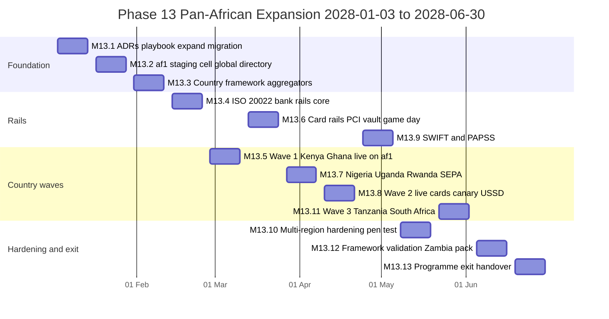
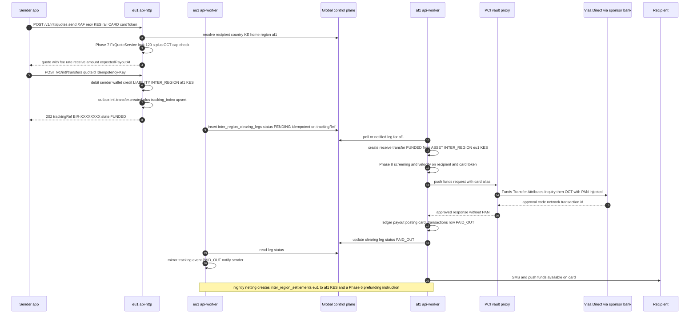
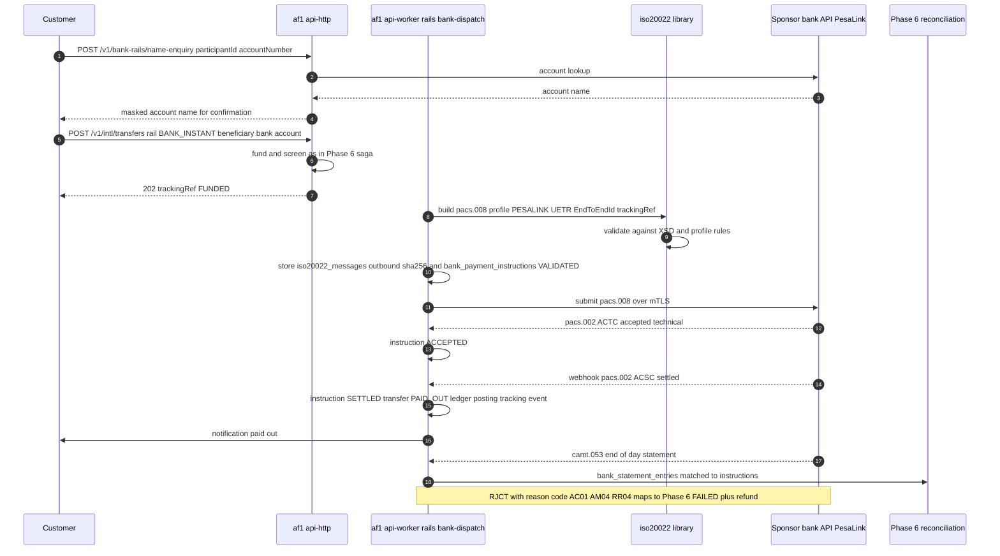
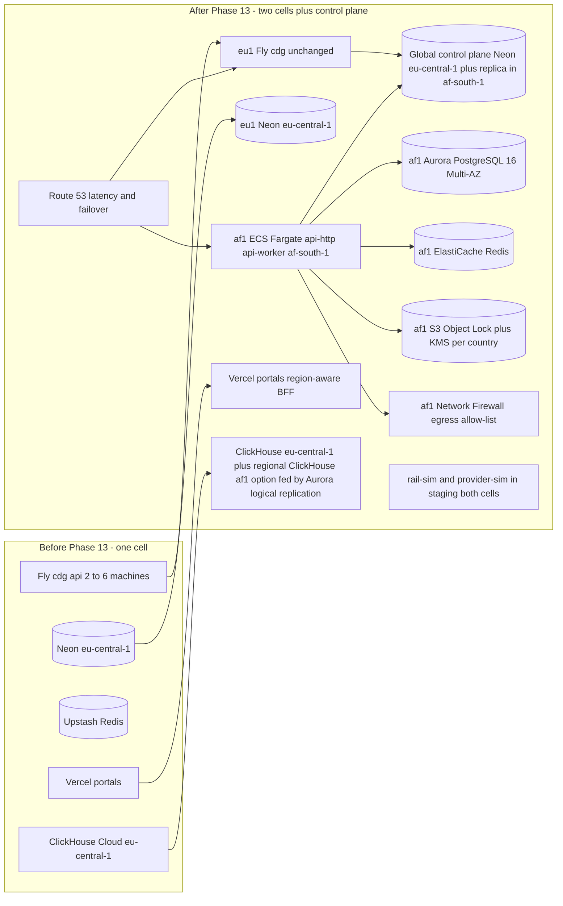

# Phase 13 — Pan-African Expansion

| Field                     | Value |
| ------------------------- | ----- |
| **Phase**                 | 13 of 13 — `pan-african-expansion` |
| **Dates**                 | 2028-01-03 → 2028-06-30 |
| **Duration**              | 26 weeks (W1 = 2028-01-03 … 2028-01-07, W26 = 2028-06-26 … 2028-06-30) |
| **Team**                  | `all` — 4 backend engineers (two "rails" squad: cards + ISO 20022 banks; two "regions" squad: multi-region cells, global directory, country framework), 3 frontend engineers (~55 %: admin Region / Country Launch / Rails consoles, customer send-to-card and send-to-bank, partner portal changes), 2 mobile engineers (~40 %: country packs in the app, USSD help, HMS evaluation, card funding sheet), 2 QA engineers (~85 %: rail simulators, multi-region chaos, country UAT), DevOps/SRE 100 % (+ AWS contractor W2–W9), solution architect 80 %, PM 100 %, compliance analyst 100 % (licensing programme, seven regulators), product designer 40 %, 0.5 security engineer (PCI scope, residency egress guard, pen test), external counsel in each target country, head of expansion as business owner |
| **Depends on**            | Phase 12 — Production Go-Live (ended 2027-12-10): production platform `eu1` (Fly `cdg` + Neon `aws-eu-central-1` + Upstash Redis) at `99.9 %`, `corridor_rollout_stages` (pilot → soft launch → GA gates as data), DR warm standby by Neon logical replication (Phase 12 D3) that "can absorb a second primary region", SOC 2 Type I report (audit 2028-01-15; Type II observation window 2028-02 → 2028-07 runs through this phase), PCI SAQ A attestation, go/no-go board template, incident/change/hyper-care processes, Q12.6 region options. Not delivered by Phase 12 (change freeze): USSD short-code applications (Phase 11 Q11.6) — filed in W1 here. Transitively: Phase 3 provider directory / connections / envelope encryption (`kek_id` per record), Phase 4 `WalletConnector` + conformance suite + `connector-cli` (adapters `mtn-momo`, `orange-money`, `airtel-money`, `moov-money`, `mpesa-daraja`, `unitel-money` and `emola` marked `EXPERIMENTAL`), Phase 5 double-entry ledger and `transfers`, Phase 6 `corridors` / `corridor_routes` / `nostro_accounts` / settlement files / `regulatory_reports` / `PayoutRailType`, Phase 7 `FxQuoteService`, margin schedules, `settlement_accounts`, Phase 8 `regulator_profiles`, screening, travel rule, Phase 9 partner API, `payout_files` (`PAIN_001`), Phase 10 metric catalogue + `REGULATORY_RETURN` templates + regional ClickHouse option, Phase 11 `devices` (`USSD` platform reserved), `mobile_configs` per country, `docs/handbooks/ussd-channel.md` |
| **Unlocks**               | Steady-state **country-launch programme** after the roadmap (quarterly launch cadence from the playbook v2, §15.2); multi-region operations (region evacuation, residency audits) owned by platform on-call; card and ISO 20022 bank rails reusable by Phase 9 partners (`/v1/partner/payouts` gains `CARD` and `BANK_INSTANT` methods); PAPSS and GIMACPAY direct participation as post-programme options; ML anomaly models (Phase 8) and business-user BI explorer (Phase 10) remain post-programme candidates and are **not** in this phase |
| **Runs in parallel with** | Nothing on the roadmap; Phase 12 hyper-care (first 30 days of production, to 2028-01-09) overlaps W1 and consumes the on-call rota, so W1 is planning-heavy and touches production only with the expand migration |

---

## 1. Overview

### 1.1 Objective

Phase 13 turns BI-Rem from a CEMAC + Lusophone remittance platform running in one European region into a **pan-African, multi-region remittance network**. At the end of Phase 12 the platform serves 11 countries (CM, GA, TD, CG, CF, GQ, AO, MZ, CV, GW, ST), six currencies, seven mobile-money adapters and one deployment cell (`eu1`: Fly `cdg` + Neon `aws-eu-central-1`). The target in `schedule.json` is 20 countries, 50 providers, 1 000 000 users and 100 000 transfers per day at 99.9 % with RPO 15 min / RTO 60 min. Reaching it requires three things this phase delivers:

1. **A multi-region deployment architecture** — a second, African deployment cell (`af1`, AWS `af-south-1` Cape Town) with its own Postgres, Redis, object store and API/worker fleet; a thin **global control plane** (region registry, identity and tracking directories, inter-region clearing) that lets portals, the mobile app, partners and the USSD gateway reach the right cell; **data partitioned by home region** so that a Kenyan customer's PII, KYC documents and ledger rows live in Africa, a Cameroonian customer's stay in Europe, and a cross-region transfer between them is a two-leg clearing operation rather than a cross-region database write. The architecture is active-active for stateless routing and active-passive inside each cell for data (Aurora Multi-AZ, Neon HA), with a rehearsed region-evacuation procedure.
2. **A global remittance framework** — "country as configuration": a `CountryLaunch` state machine (`RESEARCH → REGULATORY_REVIEW → PARTNERS_CONTRACTED → SANDBOX → FRIENDS_FAMILY → LIVE`) backed by a **country launch playbook** (licensing route, local partners, data residency class, regulator profile, KYC id types, tax, consumer-protection copy), **country packs** (`packages/country-packs/<cc>`: corridors, fee schedules, limits, purpose codes, notification templates, bank participant directory, USSD menu, store listing locale) applied as data, and **payout network aggregators** (TerraPay, Onafriq, Flutterwave, Paystack) so that a country can go live before BI-Rem's own licence is granted, as agent of a licensed partner, exactly as Phase 6 §8.4 did for CEMAC.
3. **New rails** — **card rails** (Visa Direct OCT push-to-card and AFT card funding, Mastercard Send Payment Transfer, both through a sponsor bank and a PCI vault so no PAN ever touches BI-Rem servers), **bank rails via ISO 20022** (`pacs.008` credit transfer, `pacs.002` status report, `camt.053/054` statements, `pain.001/002` already rendered by Phase 6/9) over sponsor-bank APIs and instant-payment schemes (PesaLink KE, GIP GH, NIP NG, TIPS TZ, eKash RW, PayShap ZA), **SWIFT** (via a service bureau and sponsor bank, gpi UETR tracking) for nostro funding, **SEPA SCT/Inst** collection for EU diaspora senders, and **PAPSS** (Afreximbank's Pan-African Payment and Settlement System) as an indirect participant through a PAPSS member bank for intra-African local-currency settlement.

Seven target markets are launched in three waves: **Wave 1** Kenya and Ghana (Phase 4 adapters `mpesa-daraja` and `mtn-momo` already exist; Phase 11 pilot cohort was GH/KE; Africa's Talking USSD), **Wave 2** Nigeria (inbound-only IMTO model), Uganda and Rwanda (MTN/Airtel adapters exist), **Wave 3** Tanzania and South Africa (new adapters, ADLA partner, card funding). The Phase 4 `EXPERIMENTAL` Unitel Money (AO) and e-Mola (MZ) adapters complete partner UAT and go to production, closing R4.3. Success is demonstrated by (a) a real customer transfer served end-to-end by the `af1` cell with the `eu1` cell unavailable in a game day, a cross-region transfer CM → KE completing through inter-region clearing, and RPO/RTO measured within target; and (b) the framework launching the last country of the programme as pure configuration in ≤ 10 engineering days with no API deploy, plus one rehearsal pack (Zambia) built but not launched to prove it.

### 1.2 In scope

- **Multi-region cells** — `af1` on AWS `af-south-1` built with the Phase 1 Terraform skeleton (`infra/terraform/modules/{vpc,alb,ecs-service,secrets}`, `migration_command = ["migrate"]`): Aurora PostgreSQL 16 (Multi-AZ, one writer + one reader), ElastiCache Redis 7, S3 (Object Lock for Phase 2 documents and Phase 10 artifacts), KMS per cell, ECS Fargate services `api-http` and `api-worker` from the same `ghcr.io/.../bi-rem-api` image, CloudFront + Route 53 latency routing for `api.bi-rem.africa`, VPC endpoints, egress allow-list. `eu1` unchanged (Fly `cdg`, Neon `eu-central-1`). Region abstraction in code (`RegionContext`, `@bi-rem/db` factory per region, Redis namespace per cell, object-store bucket per cell).
- **Global control plane** (`@bi-rem/db-global`, Neon `eu-central-1` + read replica in `af1`): `regions`, `country_regions`, `identity_index` (HMAC of phone/e-mail → region, no PII), `tracking_index` (tracking ref → region), `inter_region_settlements`, `region_migrations`; `GET /v1/global/locate`, portal/mobile/USSD **region-aware routing**; admin portal **cell switcher**; cross-region admin reads via per-cell APIs (never cross-region DB links).
- **Data partitioning and residency** — `users.region_code` (home cell), `data_residency_policies` per country (`IN_REGION_AFRICA`, `IN_COUNTRY`, `EU_OK`), residency egress guard (CI test + runtime assertion that a request in one cell never opens a connection to another cell's database), per-country KMS keys (Phase 3 `kek_id` already supports it), DPIAs and regulator registrations (NDPC, ODPC, Information Regulator, PDPO, NCSA, BoT/BoG data notes), **customer re-homing** (`region_migrations`: export → import → verify → switch directory → purge source, with a 30-day legal-hold window).
- **Inter-region clearing** — a cross-region transfer is two single-region legs joined by an **inter-region clearing account** per cell and currency (`LIABILITY:INTER_REGION:<peer>`), netted and settled daily through Phase 6 nostro accounts and Phase 7 treasury; sagas never span databases; the global tracking ref `BIR-xxxxxxxx` resolves through `tracking_index`.
- **Country launch playbook and framework** — `country_launches`, `country_launch_tasks` (checklist items generated from the playbook template per country: licence, partners, data residency, KYC id types, AML regulator profile, consumer protection, tax, pricing approval, USSD short code, store listing, support readiness, go/no-go), `licences` registry with renewals and capital-requirement tracking, `CountryPackService` applying `packages/country-packs/<cc>` idempotently (dry-run diff → maker-checker apply), `country.<cc>.enabled`/`country.<cc>.stage` flags and settings, admin **Country Launch Console**.
- **Payout network aggregators** — new Phase 4 connectors `@bi-rem/connector-terrapay`, `-onafriq`, `-flutterwave`, `-paystack` (kind `AGGREGATOR`, capabilities wallet/bank/card payout, name enquiry, collections for Flutterwave/Paystack), conformance-suite runs against vendor sandboxes nightly, routing through Phase 6 `corridor_routes` with **aggregator-vs-direct cost routing** (Phase 7 margin schedule aware).
- **Card rails** — PCI vault (VGS or Basis Theory, decision M13.1) with hosted fields in portals/app; `card_tokens` (alias, last4, brand, expiry month/year, issuer country, push eligibility), `card_transactions`; **Visa Direct** (`Funds Transfer Attributes Inquiry`, `Push Funds Transactions` OCT, `Pull Funds Transactions` AFT, `Multi Push`) and **Mastercard Send** (`Payment Transfer` with `transferAcceptorInformation`, account-level eligibility) through sponsor-bank BIN sponsorship; AFT funding through acquirer (Paystack/Flutterwave hosted checkout in NG/GH/KE/ZA); 3-D Secure 2 on funding; scheme simulators in `packages/rail-sim`; PCI DSS 4.0 SAQ A / SAQ A-EP assessment.
- **Bank rails via ISO 20022** — `@bi-rem/iso20022`: typed builders and parsers for `pacs.008.001.08`, `pacs.002.001.10`, `camt.053.001.08`, `camt.054.001.08`, `pain.001.001.09`, `pain.002.001.10`, `head.001` BAH, XSD validation, CBPR+ / local-scheme usage guidelines as profiles; `BankRailConnector` with transports `SPONSOR_BANK_API` (REST carrying ISO XML or JSON-mapped), `SFTP` (Phase 6 egress IPs), `SWIFT_BUREAU` (service bureau over SFTP/MQ, FIN MT103 ↔ pacs.008 translation by the bureau), `PAPSS_PARTICIPANT` (via member bank API); `bank_rails`, `bank_participants` (BIC / sort code / bank code / IBAN rules / name-enquiry support per country), `bank_payment_instructions` with ISO status (`ACTC/ACSP/ACSC/RJCT/PDNG`) and reason codes, `iso20022_messages` (XML in object storage, hash, UETR, MsgId), `bank_statement_entries` feeding Phase 6 reconciliation; name enquiry (NIP `name-enquiry`, PesaLink account lookup, GIP name lookup, PayShap proxy lookup via ShapID) before payout.
- **SWIFT, SEPA, PAPSS** — SWIFT via service bureau + sponsor bank for USD/EUR nostro funding and bank payouts outside instant schemes (gpi tracker, `camt.053` statements into Phase 7 `settlement_statements`); SEPA SCT / SCT Inst collection through the EU sponsor EMI for diaspora senders (virtual IBAN per customer, `camt.054` credit notifications → Phase 4 `WalletTransaction` funding leg); PAPSS as indirect participant via a PAPSS member bank in NG/GH/KE (pacs.008 settled in local currencies, Afreximbank as settlement agent), with a documented path to direct participation; GIMACPAY (Q6.6) kept as a post-programme option.
- **USSD channel** (Phase 11 §3.13 hand-over) — `ussd_sessions`, `UssdModule` implementing the documented menu tree (Balance, Send to saved beneficiary, Last 3 transactions, Track, Help) over Africa's Talking USSD (KE, UG, TZ, NG, RW, GH) with short codes applied for in W1 (Phase 11 Q11.6 — Phase 12's change freeze did not file them; MNO approval 4–8 weeks lands W6–W10); PIN auth via Phase 1 password path; `Idempotency-Key = sessionId`; LEVEL_1 limits; SIM-swap check via Phase 4 MNO APIs.
- **Localisation and channels** — Swahili `sw` locale (KE/TZ/UG/RW), `en` as default for NG/GH/ZA; store listing locales and USSD codes per country in Phase 11 `mobile_configs`; Huawei AppGallery/HMS push evaluation (Q11.2) with a go/no-go, build only if approved.
- **Compliance per country** — Phase 8 `regulator_profiles` rows for NFIU (NG), FIC (GH), FRC (KE), FIA (UG), FIU-TZ, FIC-RW, FIC (ZA); Phase 10 `REGULATORY_RETURN` templates for CBN IMTO returns, BoG remittance returns, CBK monthly remittance return (exists), BoU/BoT/BNR statistical returns, SARB BOP reporting (ADLA category codes); local sanctions lists as Phase 8 `INTERNAL` watchlists; travel-rule thresholds per regulator.
- **Portals** — admin: Region Console (cells, health, failover, re-homing), Country Launch Console (kanban, checklists, licences, pack diff/apply), Rails Console (card transactions, bank instructions, ISO 20022 message viewer, bank participant directory, PAPSS/SWIFT queues), Inter-region Settlement; customer: country selector by residence, send to card, send to bank with bank picker and name enquiry, data-location notice, USSD help; partner (Phase 9): `CARD` and `BANK_INSTANT` payout methods.

### 1.3 Out of scope (deferred post-programme)

- **Direct card-scheme membership** (BI-Rem as Visa/Mastercard principal or associate member) — sponsor-bank model only; evaluated at month 12 of card volumes.
- **Card issuing** (BI-Rem-branded cards), SoftPOS, acquiring for merchants beyond Phase 9 payment requests.
- **Direct PAPSS participation** and **GIMACPAY** direct participation — both require a settlement account at the central-bank level through a participant bank; indirect participation only, direct path documented (§4.5 D13).
- **Own-licence operations in every country** — licence applications are filed and tracked (`licences`), but day-one operation is partner-based where the licence is pending (NG IMTO, KE MRP, ZA ADLA, GH PSP timelines exceed the phase, §3.2). Switching a country from agent model to principal model is a `licences` status change plus corridor `licenceBasis` update, not a new phase.
- **In-country Nigerian hosting cell `ng1`** — designed and costed (§4.4, R13.2); built only if the CBN/NDPC confirm a localisation mandate that regional African hosting does not satisfy (Q13.1).
- Hedging instruments (Phase 7 D12), multi-currency customer wallets in USD/EUR (Phase 7 §1.3), merchant lending (Phase 9), ML anomaly models and adverse media (Phase 8), self-serve BI explorer (Phase 10), passkeys (Phase 11 Q11.3) — unchanged deferrals; this phase does not absorb them.
- Cash pick-up networks (`ConnectorKind.CASH_AGENT`) beyond what TerraPay/Onafriq expose as a payout type through the aggregator adapters.
- Francophone West Africa (SN, CI, ML, BF, BJ, TG, NE) and Zambia/Malawi/DRC — adapters exist for several (Phase 4), but the brief's seven markets fill the phase; the Zambia rehearsal pack (M13.12) is built to validate the framework, not launched.

### 1.4 Independent deployability strategy

"Deployable alone" for Phase 13 means: **every change merges to `main` and deploys to the existing `eu1` production first, where it is inert — the second cell does not exist until Terraform creates it, no country is visible until its `country.<cc>.enabled` flag is on, no rail is routable until a `corridor_route` references it, no customer is homed outside `eu1` until the directory says so — and every one of those switches is reversible without a deploy. Phase 1–12 behaviour in `eu1` is provably unchanged (`oasdiff` gate, Phase 5/6 e2e suites run per release against `eu1`), and a failure in `af1` can never degrade `eu1` beyond the loss of cross-region transfers to `af1`-homed recipients, which park as `HELD` (reason `PEER_REGION_UNAVAILABLE`) and refund after the corridor SLA.**

| Mechanism | Phase 13 application |
| --- | --- |
| **Feature flags** (Phase 1 `FeatureFlag`, Redis-cached 30 s, `rules` + `rolloutPercentage`) | `region.af1.enabled` (cell accepts customer traffic; off → Route 53 health check fails on purpose and `af1` serves 503 `REGION_DISABLED` while workers finish in-flight sagas), `region.routing.global-directory` (portals resolve the cell via `/v1/global/locate` vs static `eu1`), `region.re-homing.enabled`, `residency.enforce` (egress guard blocks vs reports), `intl.inter-region.enabled`, `country.<cc>.enabled` (country visible for registration/send/receive), `country.<cc>.registration` (new sign-ups), `rails.card.visa-direct`, `rails.card.mastercard-send`, `rails.card.funding-aft`, `rails.card.3ds-required`, `rails.bank.iso20022`, `rails.bank.<rail>` (`nip`, `gip`, `pesalink`, `tips`, `ekash`, `payshap`, `sepa-sct`, `sepa-inst`, `swift`, `papss`), `rails.bank.name-enquiry-required`, `aggregator.terrapay`, `aggregator.onafriq`, `aggregator.flutterwave`, `aggregator.paystack`, `aggregator.cost-routing` (cheapest healthy route vs priority order), `channel.ussd.<cc>`, `portal.send-to-card`, `portal.send-to-bank`, `admin.region.console`, `admin.country-launch.console`, `admin.rails.console`, `mobile.hms.push`. Keys registered in `packages/shared/src/constants/feature-flags.ts`; `rules` gain `regionCode` and `countryCode` predicates. |
| **Settings** (Phase 1 `Setting`) | `country.<cc>.stage` (mirror of `country_launches.stage`, read by portals for copy), `region.<code>.api-base-url`, `region.<code>.status` (`ACTIVE`, `DRAINING`, `EVACUATED`), `rails.card.max-oct-minor.<ccy>`, `rails.bank.cutoffs.<rail>`, `inter-region.netting-window-minutes` (default 1 440), `residency.default-class`, `ussd.session-ttl-seconds` (180). |
| **Expand → migrate → contract** | Three expand migrations: `20280103090000_phase13_expand_regions` (W1: `regions`, `country_launches`, `country_launch_tasks`, `licences`, `data_residency_policies`, `region_migrations`, nullable `users.region_code`, `wallets.region_code`, `transfers.region_code`, `PayoutRailType` values `CARD`, `BANK_INSTANT`, `BANK_RTGS`, `ConnectorKind` value `CARD_SCHEME`, `BANK_RAIL`), `20280131090000_phase13_expand_rails` (W5: `card_tokens`, `card_transactions`, `bank_rails`, `bank_participants`, `bank_payment_instructions`, `iso20022_messages`, `bank_statement_entries`, `ussd_sessions`, nullable `beneficiaries.card_token_id`, `beneficiaries.bank_participant_id`), `20280207090000_phase13_expand_inter_region` (W6: `inter_region_clearing_legs`; the global schema gets its own migrations folder in `packages/db-global`). Backfill `users.region_code = 'eu1'` for every row (batched 5 000, idempotent). Two **contracts**: `refresh_tokens.device_id SET NOT NULL` (Phase 11 Q11.4) in **W8 (2028-02-25)** after portals register `WEB` pseudo-devices from W2 and a zero-null pre-check; `users.region_code SET NOT NULL` + `wallets.region_code SET NOT NULL` in **W12 (2028-03-24)** after a zero-null pre-check and Neon snapshot. Every migration runs per cell (`eu1` Neon, `af1` Aurora) from the same `packages/db/prisma/migrations`; `prisma migrate diff` drift gate runs against both engines in CI. |
| **Dark launch** | W2–W4: `af1` staging cell receives synthetic traffic only; W5: `af1` production cell deployed, `region.af1.enabled=false`, no customer homed; W6–W9: staff accounts re-homed to `af1`, KE/GH `SANDBOX` with vendor sandboxes; W10: KE/GH `FRIENDS_FAMILY` (50 named users, KES 10 000 / GHS 500 caps); card rails `SANDBOX` until W12 then `FRIENDS_FAMILY` with `rolloutPercentage` 5 → 25 → 100 over W16–W20; ISO 20022 instructions generated and validated but delivered to the staging SFTP/bureau test environment until each rail's `rails.bank.<rail>` is `LIVE`; PAPSS sandbox only until the participant bank certifies production (W21 target). |
| **Kill switches** | `region.af1.enabled=false` → cell drains in < 60 s (health check fails, Route 53 removes it; in-flight sagas complete on workers; new logins for `af1`-homed users see "temporarily unavailable in your country"); `country.<cc>.enabled=false` → corridors to/from `<cc>` `PAUSED`, registrations closed, existing customers read-only; `rails.card.*=false` → `CARD` routes skipped by routing (`ROUTE_UNAVAILABLE`), AFT funding button hidden, in-flight OCTs complete; `rails.bank.<rail>=false` → instructions park at `GENERATED` (not delivered); `aggregator.<key>=false` → Phase 4 connector kill switch semantics; `intl.inter-region.enabled=false` → cross-region quotes refused (`INTER_REGION_DISABLED`), funded transfers `HELD`; `residency.enforce=true` cannot be turned off without a four-eyes approval (`residency:override`); `channel.ussd.<cc>=false` → aggregator callback answered with a maintenance screen. |
| **Worker isolation** | New BullMQ queues `region:directory-sync`, `region:re-home`, `region:clearing`, `rails:card`, `rails:card-status`, `rails:bank-dispatch`, `rails:bank-status`, `rails:iso-inbound`, `rails:swift`, `rails:papss`, `country:pack-apply`, `ussd:session-gc` (each with `*:dlq`) run only in the `worker` process group of **their own cell**; no worker ever holds a connection to the other cell's Postgres or Redis (enforced by the residency egress guard and by network policy: `af1` security groups and `eu1` Fly private network only allow their own stores). |
| **Backward-compatible APIs** | New paths `/v1/global/*`, `/v1/regions/*`, `/v1/countries/*`, `/v1/licences/*`, `/v1/cards/*`, `/v1/bank-rails/*`, `/v1/bank-instructions/*`, `/v1/iso20022/*`, `/v1/inter-region/*`, `/v1/ussd/*`; existing `/v1/intl/quotes`, `/v1/transfers`, `/v1/beneficiaries` gain optional fields (`payoutRail`, `cardToken`, `bankParticipantId`, `regionCode`); `X-Region` response header added everywhere; `oasdiff` breaking-change gate stays green; Phase 9 partner API adds optional `method: CARD | BANK_INSTANT`. |
| **Data isolation** | Cell-local schemas are identical; only the global control plane is shared, and it holds no PII (HMAC indexes, tracking refs, amounts in clearing). An `af1` outage leaves `eu1` fully functional; a global-directory outage degrades to cached routing (portals cache `locate` 24 h; API falls back to `users.region_code` for authenticated calls). |
| **Rollback** | Flags first (< 1 min). API image per cell: Fly `fly deploy --image <previous>` for `eu1`, ECS task-definition revision rollback (`aws ecs update-service --task-definition <prev>`) for `af1`, both scripted in `infra/scripts/rollback-api.sh <cell>`. Terraform: `infra-af1.yml` plan/apply with state in S3 + DynamoDB lock; destroy only by manual dispatch with typed confirmation. Data: expand-only until the two contracts, each preceded by a snapshot (Neon PITR / Aurora snapshot) and a `down.sql`. Re-homing: `region_migrations` keeps the source copy under legal hold for 30 days; rollback = directory switch back + source un-hold. |

---

## 2. Milestones

Phase start is Monday **2028-01-03**; week _n_ runs Monday to Friday; milestone dates are the Friday of the week. Milestones are bi-weekly because the phase is 26 weeks long; each milestone has a go/no-go for the next country wave.

| ID | Week | Target date | Deliverable | Acceptance criteria | Owner |
| --- | --- | --- | --- | --- | --- |
| **M13.1** | W2 | 2028-01-14 | Programme mobilisation: ADR-0045 (multi-region cell architecture: active-active routing, cell-homed data, AWS `af-south-1` for `af1`, Neon kept for `eu1`), ADR-0046 (global control plane and identity/tracking directories), ADR-0047 (inter-region clearing), ADR-0048 (card rails via sponsor bank + PCI vault), ADR-0049 (ISO 20022 library and bank rail transports), ADR-0050 (country-as-configuration framework), ADR-0051 (PAPSS indirect participation), ADR-0052 (data residency classes and re-homing); country launch playbook v1 (§3.2) with the seven regulatory gap analyses from counsel; `20280103090000_phase13_expand_regions` applied to staging and `eu1` production; `@bi-rem/db-global` scaffold; portals register `WEB` pseudo-devices (Phase 11 Q11.4); RFPs issued to TerraPay, Onafriq, Flutterwave, Paystack, sponsor banks (KE, GH, NG, ZA), SWIFT bureau, PCI vault | ADRs accepted at the Thursday architecture review; playbook v1 signed by compliance and head of expansion; migration applied with `prisma migrate diff` empty on Neon; `pnpm --filter @bi-rem/db-global typecheck test` green; 100 % of new web sessions carry `device_id` on staging; RFP responses due 2028-01-28 | Solution Architect / PM |
| **M13.2** | W4 | 2028-01-28 | Multi-region foundation: Terraform `af1` **staging** cell (VPC, Aurora PostgreSQL 16 Multi-AZ, ElastiCache, ECS `api-http`/`api-worker`, S3 Object Lock, KMS, ALB, CloudFront, Route 53 latency records, VPC endpoints, egress allow-list); `RegionContext`, region-aware `@bi-rem/db` factory, Redis namespace, bucket selection; global directory v1 (`GET /v1/global/locate`, `identity_index`, `tracking_index`, outbox-driven sync); portal BFFs and mobile app resolve the cell; `users.region_code` backfilled to `eu1`; residency egress guard in CI | `af1` staging passes `infra/scripts/smoke-test.sh` and the Phase 5/6 e2e suites against Aurora; p95 API latency from Nairobi to `af1` staging < 120 ms vs ~210 ms to `eu1` (k6 from a `af-south-1` runner); `locate` p99 < 30 ms, cache hit ≥ 95 %; backfill 100 % with zero nulls; egress-guard test fails a deliberately mis-wired connection string | DevOps / Regions squad |
| **M13.3** | W6 | 2028-02-11 | Global remittance framework v1: `CountryLaunchService` stage machine, `country_launch_tasks` generated from the playbook template, `licences` registry, `CountryPackService` (dry-run diff → maker-checker apply) with packs `ke`, `gh`; aggregator connectors `terrapay` and `onafriq` passing the Phase 4 conformance suite against vendor sandboxes; Unitel Money (AO) and e-Mola (MZ) partner UAT started; KE and GH launches at `SANDBOX`; `20280131090000_phase13_expand_rails` and `20280207090000_phase13_expand_inter_region` applied; admin Country Launch Console v1 | Applying pack `ke` to staging creates 4 corridors, 2 fee schedules, 14 purpose codes, 38 bank participants, 6 templates ×3 locales idempotently (second apply = empty diff); conformance ≥ 95 % cases green for both aggregators (remaining cases documented as vendor gaps); Unitel/e-Mola UAT plans signed by partners; console shows KE/GH boards with ≥ 40 tasks each and owners | Regions squad / Frontend |
| **M13.4** | W8 | 2028-02-25 | Bank rails core: `@bi-rem/iso20022` (pacs.008/pacs.002/camt.053/camt.054/pain.001/pain.002, BAH, XSD validation, CBPR+ and local-scheme profiles), `BankRailConnector` with `SPONSOR_BANK_API` and `SFTP` transports, `bank_participants` directory loaded for KE (PesaLink), GH (GIP), NG (NIP via Paystack/Flutterwave name enquiry), ZA (PayShap); `rail-sim` pacs simulator with `ACSP/ACSC/RJCT` scenarios and reason codes; **contract** `refresh_tokens.device_id SET NOT NULL` | 100 % of generated pacs.008 validate against XSD and the sponsor bank's test harness accepts ≥ 98 % (rejections traced to usage-guideline deltas and fixed); round-trip pacs.008 → pacs.002 `ACSC` updates a transfer to `PAID_OUT` on staging in < 5 s; name enquiry returns account name for 20/20 KE and GH test accounts; contract migration applied with pre-check zero nulls and `down.sql` rehearsed on a Neon branch | Rails squad |
| **M13.5** | W10 | 2028-03-10 | **Wave 1 live**: `af1` production cell deployed (`region.af1.enabled=true`), KE and GH `FRIENDS_FAMILY` → `LIVE` with KE/GH-homed customers on `af1`; first real transfer served by `af1`; cross-region transfer CM (`eu1`) → KE (`af1`) through inter-region clearing; `flutterwave` and `paystack` connectors conformance-green (collections + transfers); USSD KE sandbox menu complete; Phase 10 marts show `region` dimension | ≥ 50 real KE/GH transfers with completion rate within 1 pp of CEMAC corridors; CM→KE transfer `PAID_OUT` in < 15 min with clearing legs balanced in both cells; `af1` error budget intact for 7 days; Aurora failover drill (writer reboot) with RTO < 2 min; Grafana shows per-cell SLOs | PM / Regions squad |
| **M13.6** | W12 | 2028-03-24 | Card rails: PCI vault live (hosted fields in `apps/web`, `apps/mobile`), `card_tokens` with Visa **Funds Transfer Attributes Inquiry** eligibility, Visa Direct OCT and Mastercard Send Payment Transfer in **sponsor-bank sandbox**, AFT funding via acquirer with 3-D Secure 2 in sandbox, scheme simulators, PCI DSS 4.0 SAQ A-EP gap assessment; **contract** `users.region_code` / `wallets.region_code` `SET NOT NULL`; multi-region game day #1 (`af1` AZ loss, Aurora failover, `eu1` Neon outage with directory read-only) | Visa Direct OCT sandbox p95 < 4 s inquiry+push; Mastercard Send sandbox certification checklist 100 %; PAN never appears in logs/DB (semgrep + runtime canary test with a known test PAN); SAQ A-EP controls ≥ 90 % met; game day: RPO measured ≤ 15 min, RTO ≤ 60 min for both scenarios, report with actions | Rails squad / Security |
| **M13.7** | W14 | 2028-04-07 | Nigeria at `FRIENDS_FAMILY` (inbound-only IMTO partner model, payouts to NGN bank accounts via NIP and to MoMo PSB / OPay / PalmPay wallets through Flutterwave/Paystack + Onafriq; NDPA assessment and NDPC registration filed; CBN IMTO return template); Uganda and Rwanda packs at `SANDBOX` with Phase 4 `mtn-momo`/`airtel-money` market profiles; SEPA SCT / Inst collection via EU sponsor EMI (virtual IBANs, `camt.054` ingestion) in sandbox; `sw` locale complete | NG name enquiry + payout to 10 pilot recipients across 3 banks and 2 PSB wallets; CBN IMTO monthly return renders from Phase 10 template with real sandbox data; SEPA test credit on a virtual IBAN funds a wallet within 60 s of `camt.054`; UG/RW conformance green; `sw` translation review signed | Regions squad / Compliance |
| **M13.8** | W16 | 2028-04-21 | **Wave 2 live**: NG, UG, RW `LIVE`; card push (`rails.card.visa-direct`) `FRIENDS_FAMILY` then 5 % canary for KE/GH/NG recipients; AFT funding live in GH/KE via acquirer; USSD live in KE and UG (short codes applied for in W1, shared Africa's Talking codes as fallback); HMS go/no-go decision (Q11.2) | ≥ 200 Wave 2 transfers; OCT first-attempt approval ≥ 92 % on the canary with zero PCI findings; AFT funding success ≥ 90 % (3DS challenge rate recorded); USSD sessions complete a send in ≤ 7 screens with p95 aggregator round-trip < 2.5 s; HMS decision recorded in ADR-0053 | PM / Rails squad |
| **M13.9** | W18 | 2028-05-05 | SWIFT and PAPSS: SWIFT connectivity through the service bureau + sponsor bank (outbound MT103/pacs.008 CBPR+ for nostro funding, gpi UETR tracking, `camt.053` daily statements into Phase 7 `settlement_statements`); PAPSS indirect participation via member bank in NG/GH/KE in PAPSS sandbox (pacs.008 local-currency settlement, `pacs.002` status); TZ and ZA country packs; ZA ADLA partner agreement signed; ZA sponsor bank for PayShap | USD nostro top-up executed via SWIFT test environment with UETR visible in gpi tracker; statement auto-matched by Phase 7; PAPSS sandbox NGN→GHS instruction `ACSC` with settlement advice; ADLA partner contract executed; TZ/ZA packs dry-run diff reviewed | Rails squad / Compliance |
| **M13.10** | W20 | 2028-05-19 | Multi-region hardening: active-active routing drills (Route 53 fail-away, directory cache behaviour), **region evacuation runbook** rehearsed by re-homing a 500-customer staff/pilot cohort `eu1`→`af1` and back, `residency.enforce=true` in production, per-country KMS keys, external multi-region architecture review and penetration test; capacity test at 100 000 transfers/day split 60/40 across cells | Re-homing 500 customers completes in < 45 min with zero ledger drift (balances re-derived in target cell equal source) and audit trail; egress guard blocks 100 % of 20 injected cross-cell attempts; pen test zero Critical/High open; k6 100 k transfers/day sustained 2 h with p95 < 800 ms per cell | DevOps / Security / Architect |
| **M13.11** | W22 | 2028-06-02 | **Wave 3**: Tanzania (M-Pesa TZ, Airtel TZ, Mixx by Yas via Onafriq/TerraPay, TIPS via sponsor bank) and South Africa (ADLA partner, PayShap via sponsor bank, card funding via Paystack ZA, Capitec/Standard Bank payouts) at `FRIENDS_FAMILY`; Mastercard Send `LIVE` canary; PAPSS production NG↔GH corridor if the member bank certifies; Unitel Money and e-Mola to production (`EXPERIMENTAL` flag removed) | TZ and ZA friends-and-family transfers ≥ 30 each; SARB BOP reporting categories populated on every ZA transfer; Mastercard Send approval ≥ 92 %; PAPSS production pilot or documented blocker with date; Unitel/e-Mola conformance against production credentials | Regions squad / Compliance |
| **M13.12** | W24 | 2028-06-16 | Framework validation: Zambia rehearsal pack built as data-only in staging (not launched) to time "new country in ≤ 10 engineering days with zero API deploy"; TZ and ZA `LIVE`; targets measured (countries, providers, users, transfers/day); regulator return templates for all seven new regulators in Phase 10 store; playbook v2 | Zambia pack timed at ≤ 10 engineering days from kick-off to `SANDBOX` with zero API deploys (CI log evidence); 18 of 20 target countries `LIVE`; ≥ 30 providers `LIVE` in the Phase 3 directory; seven return templates render; playbook v2 reviewed | Architect / PM |
| **M13.13** | W26 | 2028-06-30 | Programme exit: §12 evidence pack, §11 sign-offs, multi-region and rails runbooks, handover to steady-state country-launch programme and platform on-call; open items with owners | All seven target countries `LIVE` (or `FRIENDS_FAMILY` with dated blocker); success criteria demonstrated to the steering committee; on-call owns both cells; §15.3 open questions each have an owner and date | Program Manager |



Staffing note: the four backend engineers split into a **regions squad** (cells, global directory, clearing, country framework, aggregators, USSD) and a **rails squad** (ISO 20022, bank transports, cards, SWIFT, PAPSS). The compliance analyst runs the licensing programme full time with one external counsel per country; licence decisions arrive after the phase for most regulators, so every launch date assumes the partner model. Public holidays on the critical path: Kenya 2028-04-14 (Good Friday) and 2028-06-01 (Madaraka Day), Ghana 2028-03-06 (Independence Day), Nigeria 2028-06-12 (Democracy Day), South Africa 2028-04-27 (Freedom Day), Rwanda 2028-04-07 (Genocide Memorial Day, coincides with M13.7 — review moved to 2028-04-06 for Rwandan partners). Phase 12 hyper-care ends 2028-01-09.

---
## 3. Deliverables

### 3.1 Multi-region deployment architecture (`af1` cell, region abstraction)

- **What**: A second production cell in Africa built from the Phase 1 Terraform skeleton, and the code changes that make the API, workers, portals and app cell-aware.
- **DoD**: `infra/terraform/environments/{af1-staging,af1-production}.tfvars` with modules `vpc` (3 AZ, private subnets, NAT per AZ), `aurora-postgres` (new module: PostgreSQL 16, Multi-AZ writer + reader, IAM auth off / password in Secrets Manager, Performance Insights, 35-day automated backups, `rds.logical_replication=1` for Phase 10 CDC), `elasticache-redis` (new module: Redis 7 cluster mode off, Multi-AZ, TLS, AUTH token), `s3-buckets` (new module: `birem-af1-documents` with Object Lock compliance mode per Phase 2/10 retention, `birem-af1-iso20022`, `birem-af1-reports`), `kms` (new module: one CMK per cell plus per-country aliases `alias/birem/af1/ke`, `/gh`, …), `ecs-service` ×2 (`api-http` 2–8 tasks, `api-worker` 2–6 tasks, same image, `WORKER_QUEUES` env, `migration_command=["migrate"]` as a one-off task before `api-http` rollout), `alb` (TLS 1.2+, WAF with the same rules as `eu1` Fly proxy equivalents), `cloudfront-route53` (new module: `api.bi-rem.africa` latency-based records `eu1` → Fly anycast, `af1` → ALB; health checks on `/health/ready`; failover records `api-eu1.bi-rem.africa`, `api-af1.bi-rem.africa` as explicit cell endpoints used by the directory), VPC endpoints (S3, Secrets Manager, KMS, ECR, CloudWatch), egress allow-list via Network Firewall (provider hosts from Phase 3 `provider_connections`), OIDC role for GitHub Actions. Code: `RegionContext` (`regionCode`, `cellEndpoints`, `kmsKeyAlias`) derived from `REGION_CODE` env at boot and validated by Zod (`apps/api/src/config/env.ts` gains `REGION_CODE`, `GLOBAL_DATABASE_URL`, `GLOBAL_DATABASE_REPLICA_URL`, `DOCUMENTS_BUCKET`, `ISO_BUCKET`); `@bi-rem/db` factory `createPrisma({ url, region })`; `PrismaService` refuses to start if the database `region_marker` table (one row, `region_code`) does not match `REGION_CODE`; Redis key prefix `birem:<region>:`; `X-Region` response header; Phase 1 `/health/ready` reports `region`, `globalDirectory`, `peerRegions[]`; Grafana per-cell dashboards and SLOs; `infra/scripts/{deploy-api.sh,rollback-api.sh,smoke-test.sh}` take a cell argument.

### 3.2 Country launch playbook

- **What**: The repeatable, regulator-ready procedure for opening a country, as a document (`docs/handbooks/country-launch-playbook.md`), a task template (`packages/country-packs/_template/playbook.yaml`, ≥ 40 tasks in 12 workstreams) and per-country appendices.
- **DoD**: Playbook v1 (M13.1) and v2 (M13.12) approved by compliance, legal and head of expansion. Workstreams: (1) **Market research** — corridor demand (Phase 10 marts), competitor pricing, diaspora populations, MNO/bank share; (2) **Licensing route** — own licence vs agent-of-licensed-partner vs aggregator; application pack, capital, local entity, timeline; (3) **Local partners** — payout (mobile money, banks, aggregators), collection (acquirer, bank transfer), sponsor bank for FX declarations/nostro/scheme access, SMS/USSD aggregator; contracts, SLAs, float terms; (4) **Data residency** — class (`EU_OK`, `IN_REGION_AFRICA`, `IN_COUNTRY`), home cell, DPIA, regulator registration, cross-border transfer basis, per-country KMS key; (5) **AML/CFT** — Phase 8 `regulator_profile` (FIU, STR/CTR formats, thresholds, travel-rule fields), local sanctions lists, PEP sources, KYC id types and Phase 2 provider coverage (Smile ID covers NG/KE/GH/UG/TZ/RW/ZA document types), risk appetite; (6) **Consumer protection and disclosures** — pre-transaction disclosure (fee, rate, receive amount, delivery time), complaint channel, local language, cooling-off rules; (7) **Tax** — VAT/excise on fees (KE 20 % excise on money transfer fees, GH e-levy status, UG 0.5 % mobile money withdrawal tax, TZ levies), withholding, Phase 5 `fee_schedule_taxes`; (8) **Pricing** — fee schedule and margin schedule approval (Phase 7 maker-checker), regulator pricing filing where required (CBN IMTO rates); (9) **Channels** — USSD short code (Phase 12 application), store listing locale, SMS sender ID registration (NG NCC, KE CA, ZA WASPA); (10) **Operations** — support hours and language, local bank holidays calendar, settlement cut-offs and nostro pre-funding plan (Phase 6/7), reconciliation sources; (11) **Reporting** — regulator return templates (Phase 10), BOP/FX declaration codes; (12) **Go/no-go** — readiness checklist, friends-and-family cohort, caps, launch comms. Per-country appendices (§8.4) with the licensing route, regulator, partners, residency class and known blockers. The framework turns each task into a `country_launch_tasks` row with owner role, evidence document id and due date derived from the target launch date.

### 3.3 Country-as-configuration framework (`CountryLaunchService`, country packs)

- **What**: The machinery that makes a country launch a data change.
- **DoD**: `country_launches` stage machine (`RESEARCH → REGULATORY_REVIEW → PARTNERS_CONTRACTED → SANDBOX → FRIENDS_FAMILY → LIVE → PAUSED → EXITED`), each country stage driving the Phase 12 `corridor_rollout_stages` of its corridors (`FRIENDS_FAMILY` → `PILOT`, `LIVE` → `SOFT_LAUNCH` with caps then `GENERAL_AVAILABILITY` via the Phase 12 go/no-go board template), with guards (cannot enter `SANDBOX` without `data_residency_policies` row, regulator profile, at least one `LIVE` or `SANDBOX` payout provider; cannot enter `LIVE` without licence or partner evidence, go/no-go approval by compliance and head of expansion, caps lifted explicitly); `packages/country-packs/<cc>/` = `pack.yaml` (metadata, residency class, home region, locales, currency, id types), `corridors.yaml` (Phase 6 corridor rows + routes referencing provider codes and rails), `fees.yaml` (Phase 5 schedules + taxes), `limits.yaml` (KYC level policies), `purpose-codes.yaml`, `templates/*.yaml` (notification templates per locale), `bank-participants.csv`, `ussd.yaml`, `store-listing/<locale>.yaml`, `regulator.yaml` (Phase 8 profile, Phase 10 return templates), `flags.yaml` (initial flag states); `CountryPackService.plan(cc)` produces a diff (create/update/no-op per row, with Zod validation and referential checks) and `apply(planId)` executes under maker-checker (`countries:apply` + approval by a second `countries:approve` holder) in one transaction per aggregate, writing `AuditLog` rows and an `Outbox` event `country.pack.applied`; `pnpm country plan ke --env staging` CLI wraps the API; a pack applied twice yields an empty diff (idempotency test in CI for every pack); `country.<cc>.stage` setting and `country.<cc>.enabled` flag updated by stage transitions; the Zambia rehearsal (M13.12) proves zero API deploys are required.

### 3.4 Global control plane and region-aware routing

- **What**: `@bi-rem/db-global` (own Prisma schema and migrations, Neon `eu-central-1` primary with a read replica reachable from `af1`), `GlobalModule` in the API, and routing in every client.
- **DoD**: Tables §5.2; `identity_index` keyed by `HMAC-SHA256(GLOBAL_INDEX_KEY, normalised phone | e-mail)` → `region_code` (no PII, key rotated yearly with dual-key lookups); `tracking_index` (tracking ref → region, created by the Phase 6 saga through the outbox); `GET /v1/global/locate` (public, rate-limited 30/min/IP, returns `{ regionCode, apiBaseUrl }` for a hashed identifier or a country code; unknown → home region of the country; never reveals whether an identifier exists — constant-time, identical response shape); portal BFFs cache the resolution in the session cookie; mobile app caches per account with 24 h TTL and re-resolves on `REGION_MOVED` (HTTP 421 with `Location` of the correct cell); USSD gateway resolves by MSISDN hash; Phase 9 partner API resolves by `country` on each request and documents `X-Region`; admin portal cell switcher (per-cell BFF upstream); directory sync is **outbox-driven**: `user.registered`, `user.rehomed`, `intl.transfer.created` events update the index via `region:directory-sync` in the owning cell; a reconciliation job compares index counts with cell counts nightly.

### 3.5 Data partitioning, residency and re-homing

- **What**: Home-region semantics on every PII-bearing or money-bearing aggregate, enforcement, and the procedure to move customers between cells.
- **DoD**: `users.region_code`, `wallets.region_code`, `transfers.region_code` (expand, backfill, contract per §5.3); `data_residency_policies` per country with class, home region, allowed processing regions, legal basis, regulator reference, DPIA document id; **egress guard**: CI test boots the API with every cross-cell URL replaced by a canary host and asserts zero connections; runtime: `PrismaService` and `ioredis` wrappers reject hosts not in `REGION_ALLOWED_HOSTS`; `residency.enforce` flag toggles block vs report (Sentry event `RESIDENCY_VIOLATION`); document store writes go to the cell bucket and object keys embed the region; per-country KMS data keys for Phase 2 documents and Phase 3 credentials (`kek_id` = `alias/birem/<cell>/<cc>`); **re-homing** (`region_migrations`): `PLANNED → EXPORTING → IMPORTING → VERIFYING → SWITCHING → PURGING → DONE | ROLLED_BACK`, export as encrypted NDJSON per aggregate (user, profile, KYC documents by object copy, beneficiaries, wallets, ledger accounts and entries, transfers, notifications, audit logs marked `copied_from_region`), import into target with the same ids, verification re-derives balances from `ledger_entries` and compares `cached_balance`, directory switch, source rows placed under Phase 8 `legal_holds` for 30 days then purged by the retention run; a customer is read-only for the duration (target < 5 min per 100 customers); runbook `docs/runbooks/region-evacuation.md`.

### 3.6 Inter-region clearing

- **What**: The way a transfer from an `eu1`-homed sender to an `af1`-homed recipient (or vice versa) moves money without a database spanning both cells.
- **DoD**: Phase 6 `CrossBorderSaga` gains a step `INTER_REGION_HANDOFF` when `tracking_index`/`country_regions` says the recipient's country is homed elsewhere: the sender cell books the FX at the locked Phase 7 quote, debits the sender wallet and credits `LIABILITY:INTER_REGION:<peer>:<recvCcy>`; it emits `inter_region.leg.created` to the peer through the **global control plane** (`inter_region_clearing_legs` row, idempotent on tracking ref); the peer cell's `region:clearing` worker creates the receive-side transfer (`FUNDED` from `ASSET:INTER_REGION:<peer>:<ccy>`), routes the payout through its own `corridor_routes`, and reports `PAID_OUT`/`FAILED` back through the same table; Phase 6 tracking events are mirrored so the sender sees one timeline; daily netting job (`inter-region.netting-window-minutes`) produces an `inter_region_settlements` row per pair and currency with the net amount, settled through Phase 6 `prefunding_instructions` between the cells' nostro accounts (maker-checker in Phase 7 treasury console); break detection when leg totals differ from the ledger accounts in either cell; `HELD` with `PEER_REGION_UNAVAILABLE` after 3 delivery attempts over 10 min, auto-refund after the corridor `payoutSlaMinutes` × 4.

### 3.7 Payout network aggregators (TerraPay, Onafriq, Flutterwave, Paystack)

- **What**: Four Phase 4 connectors so that any target country has at least two payout routes on day one, plus collections in NG/GH/KE/ZA.
- **DoD per adapter**: `@bi-rem/connector-<key>` generated with `pnpm connector new`, `capabilities()` truthful, 100 % simulator conformance, ≥ 95 % vendor-sandbox conformance, scrubbed fixtures, `CAPABILITIES.md`, Phase 3 provider rows (`terrapay`, `onafriq`, `flutterwave`, `paystack`) with `SANDBOX` and `PRODUCTION` connections, webhook endpoints with per-vendor signature verification (Flutterwave `verif-hash` header, Paystack HMAC-SHA512 of body with secret key, TerraPay callback IP allow-list + HMAC, Onafriq OAuth-issued callback token), idempotency mapping (`requestId`/`reference`), quote-to-payout flows where the vendor quotes (TerraPay `/eig/gsma/quotations`, Onafriq quote endpoints) stored on the Phase 6/7 `FxQuote` as `providerQuoteRef`, status polling fallbacks, settlement statement ingestion into Phase 6 reconciliation. `aggregator.cost-routing`: `RoutingService` scores healthy routes by (fee + FX cost from Phase 7 publication vs vendor quote + SLA penalty) and picks the cheapest within tolerance, else priority order.

### 3.8 Card rails (Visa Direct, Mastercard Send, card funding)

- **What**: Push-to-card payouts and card funding without BI-Rem entering PCI DSS Level 1 scope.
- **DoD**: PCI vault (VGS or Basis Theory) with hosted fields in `apps/web` and `apps/mobile` (Phase 11 secure WebView component) returning an **alias**; `card_tokens` store alias, bin (first 6/8), last4, brand, expiry, issuer country from BIN lookup, `pushEligible` from Visa Funds Transfer Attributes Inquiry / Mastercard account eligibility, `fundingEligible`; outbound scheme calls proxied through the vault so the PAN is injected at the edge; **Visa Direct** via sponsor bank: `POST /visadirect/fundstransfer/v1/pushfundstransactions` (OCT), `/pullfundstransactions` (AFT), `/visadirect/fundstransfer/v1/transactionquery`, `/visadirect/fundstransfer/v1/multipushfundstransactions` for batches, `Funds Transfer Attributes Inquiry`, Two-Way SSL + X-Pay-Token or MLE as the sponsor requires, `systemsTraceAuditNumber` + `retrievalReferenceNumber` idempotency, `businessApplicationId=AA` (account-to-account) / `PP` (person-to-person), `sourceOfFundsCode`, sender/recipient data for AML (Visa Direct requires sender name, address, account); **Mastercard Send**: `POST /send/v1/partners/{partnerId}/transfers/payment` (`transferReference`, `fundingSource`, `paymentType=P2P`, `recipientAccountUri` as token), `GET /send/v1/partners/{partnerId}/transfers/{transferId}`, eligibility `/send/v1/partners/{partnerId}/account-info`, OAuth 1.0a request signing with the Mastercard developer key (`mastercard-oauth1-signer`), optional encryption of card fields (`mastercard-client-encryption`); **AFT funding** via acquirer hosted checkout (Paystack `transaction/initialize` with `channels=["card"]`, Flutterwave `v3/payments`) with 3-D Secure 2, chargeback handling (`card_transactions.status=CHARGEBACK` → Phase 5 reversal + Phase 8 fraud signal); `card_transactions` with scheme, kind (`OCT`, `AFT`, `REFUND`, `CHARGEBACK`), amounts and currency, `approvalCode`, `networkTransactionId`, response codes; `rail-sim` scheme simulator (approve, decline codes `51`, `57`, `59`, timeouts, partial approvals); PCI DSS 4.0 SAQ A-EP self-assessment with QSA review, quarterly ASV scans; `rails.card.max-oct-minor.<ccy>` caps (scheme limits: Visa Direct domestic/cross-border limits per country, Mastercard Send per-transaction caps) enforced at quote time.

### 3.9 Bank rails via ISO 20022 (`@bi-rem/iso20022`, `BankRailConnector`)

- **What**: A typed ISO 20022 library and a bank-rail connector family that reach local instant-payment schemes, RTGS, SEPA, SWIFT and PAPSS.
- **DoD**: `@bi-rem/iso20022` generated from the official XSDs (`pacs.008.001.08`, `pacs.002.001.10`, `camt.053.001.08`, `camt.054.001.08`, `pain.001.001.09`, `pain.002.001.10`, `head.001.001.02`) with `xmlbuilder2` + `fast-xml-parser`, strict Zod types, XSD validation via `libxmljs2` in CI and at runtime (`iso20022.validate` metric), profiles (`CBPR_PLUS`, `SEPA_EPC`, `PAPSS`, `PESALINK`, `TIPS`, `PAYSHAP`, `GENERIC_LOCAL`) applying usage-guideline restrictions (character set, field lengths, mandatory `UETR`, `ChrgBr=SHAR/SLEV`, purpose and category codes, structured postal address by November 2026 CBPR+ rules); `BankRailConnector` interface (`nameEnquiry`, `initiateCredit`, `getStatus`, `fetchStatements`, `capabilities`) with transports `SPONSOR_BANK_API` (bank REST APIs, often JSON mapped to pacs fields — adapters for KE PesaLink via sponsor bank, GH GIP via sponsor bank, NG NIP via Paystack/Flutterwave transfer API with `name-enquiry`, ZA PayShap via sponsor bank API, TZ TIPS via sponsor bank, RW eKash via sponsor bank, UG via bank API or Onafriq), `SFTP` (pacs/pain files with Phase 6 egress IPs and PGP), `SWIFT_BUREAU` (service bureau SFTP/MQ; bureau translates to FIN where required), `PAPSS_PARTICIPANT` (member bank API carrying pacs.008 with PAPSS profile); `bank_payment_instructions` state machine `GENERATED → VALIDATED → SUBMITTED → ACCEPTED (ACTC) → IN_PROGRESS (ACSP/PDNG) → SETTLED (ACSC) | REJECTED (RJCT with reason code) | RETURNED (pacs.004)`; `iso20022_messages` store every outbound/inbound XML in the cell `iso20022` bucket with SHA-256, `MsgId`, `UETR`, direction, related instruction; `camt.053/054` ingestion creates `bank_statement_entries` matched to instructions and to Phase 6 `reconciliation_runs`; Phase 9 `payout_files` reuse `pain.001` through this library (the Phase 6 renderer is replaced behind `rails.bank.iso20022`); name enquiry mandatory where the scheme offers it (`rails.bank.name-enquiry-required`) with fuzzy match ≥ 0.85 (Phase 8 screening normaliser) before payout; `rail-sim` pacs simulator with scheme-specific reason codes (`AC01` invalid account, `AC04` closed, `AM04` insufficient funds, `RR04` regulatory, `CUST` cancelled by customer, `NARR` narrative).

### 3.10 SWIFT, SEPA and PAPSS

- **What**: Global settlement reach for treasury and diaspora collection, and intra-African local-currency settlement.
- **DoD**: **SWIFT** — service bureau contract (bureau holds the BIC connectivity; BI-Rem instructs through pain.001 to the sponsor bank which issues MT103/pacs.008 CBPR+ with gpi), `rails:swift` worker, gpi tracker status via sponsor bank API (`UETR` on every instruction), daily `camt.053` into Phase 7 `settlement_statements`, cut-off calendar (TARGET2/Fedwire holidays) in `bank_rails.cutoffs`; use cases: USD/EUR nostro top-ups (Phase 6 `prefunding_instructions`), bank payouts in countries without instant schemes, partner settlements. **SEPA** — EU sponsor EMI providing virtual IBANs per customer (`beneficiaries`-like `funding_accounts` reuse Phase 4 `provider_accounts`), SCT and SCT Inst collection, `camt.054` credit notifications → Phase 4 `WalletTransaction` funding leg → Phase 6 saga; SCT returns (`pacs.004`) handled as funding reversals; SEPA payouts to EU recipients (diaspora reverse flow) out of scope. **PAPSS** — indirect participation through a PAPSS member bank in NG, GH and KE: BI-Rem instructs in local currency (`pacs.008` PAPSS profile), the member bank submits to PAPSS, Afreximbank settles net in local currencies at end of day, `pacs.002` statuses flow back; pre-funding at the member bank in NGN/GHS/KES; corridor routes `ng-gh`, `gh-ng`, `ng-ke`, `ke-ng` get a `BANK_INSTANT` rail `PAPSS` behind `rails.bank.papss`; ADR-0051 records the direct-participation path (settlement account at a central bank via a participant bank, PAPSS technical certification, ISO 20022 host-to-host) and the decision to revisit at ≥ USD 5 M monthly intra-African volume; GIMACPAY (Q6.6) stays an option with the same connector shape.

### 3.11 USSD channel

- **What**: Implementation of the Phase 11 §3.13 design note for feature-phone customers.
- **DoD**: `UssdModule` with Africa's Talking USSD callback (`POST /v1/ussd/at/callback`, `CON`/`END` responses ≤ 182 chars), `ussd_sessions` (session id, MSISDN HMAC, country, menu state JSON, step count, started/ended, outcome), menu tree from `docs/handbooks/ussd-channel.md` (1 Balance, 2 Send to saved beneficiary, 3 Last 3 transactions, 4 Track by reference, 5 Help), PIN prompt before 1–3 verified against the Phase 1 password path (`realm=CUSTOMER`, lockout after 3 failures per Phase 1 settings), `Idempotency-Key = sessionId`, LEVEL_1 daily limit cap on USSD sends, SIM-swap check via Phase 4 MNO API where available (`mpesa-daraja` no, `airtel-money` KYC enquiry yes, Safaricom SIM-swap check through the aggregator) else 24 h hold on first USSD send after a SIM change signal, Phase 11 `devices` row with `platform=USSD`, `channel.ussd.<cc>` flags, per-country short codes in `country-packs/<cc>/ussd.yaml` and Phase 11 `mobile_configs`, `en`/`sw`/`fr` menu localisation, session metrics (completion rate, drop-off screen).

### 3.12 Compliance, localisation and channel readiness per country

- **What**: Everything the seven regulators need before and after launch.
- **DoD**: Phase 8 `regulator_profiles` for NFIU (goAML), FIC Ghana (goAML), FRC Kenya (goAML), FIA Uganda (goAML), FIU Tanzania, FIC Rwanda (goAML), FIC South Africa (goAML) with STR/CTR thresholds and travel-rule fields; local sanctions lists as Phase 8 `INTERNAL` watchlists with monthly manual ingestion; Phase 10 `REGULATORY_RETURN` templates: CBN IMTO monthly returns, BoG remittance/PSP returns, CBK monthly remittance return (exists), BoU NPS returns, BoT PSP returns, BNR PSP returns, SARB BOP reporting (per-transaction BOPCUS categories via the ADLA partner); Phase 2 KYC id types per country (NG NIN/BVN, GH Ghana Card, KE National ID/Huduma, UG National ID, TZ NIDA, RW National ID, ZA ID/Smart ID) enabled in Smile ID with BVN/NIN verification (NG) and Ghana Card verification through the provider; consumer disclosures and T&Cs per country in `en`/`sw`/`fr`; SMS sender ID registrations; store listing locales; support macros.

### 3.13 Portals and mobile

- **What**: Admin consoles, customer flows and app changes of §7.
- **DoD**: Playwright coverage for Region Console (switch cell, view health, start/approve re-homing), Country Launch Console (board, task edit, pack plan/apply with four-eyes), Rails Console (card transaction search with masked data, bank instruction lifecycle, ISO message viewer with XML download and validation badge, participant directory CRUD import, PAPSS/SWIFT queues), Inter-region Settlement (netting runs, approve settlement); customer portal send-to-card and send-to-bank flows with hosted fields and name enquiry confirmation; mobile app country packs, USSD help, card funding sheet; Phase 9 partner portal `CARD`/`BANK_INSTANT` payout methods and developer docs.

### 3.14 Backend additions (`apps/api`)

- **What**: `GlobalModule`, `RegionsModule`, `CountriesModule`, `LicencesModule`, `CardsModule`, `BankRailsModule`, `Iso20022Module`, `InterRegionModule`, `UssdModule`, plus changes in `IntlModule` (saga handoff), `RoutingService` (rails + cost routing), `NotificationsModule` (`sw` templates), `MobileModule` (country packs in config).
- **DoD**: Prisma models of §5; endpoints of §6 with OpenAPI examples; permissions added to `packages/shared/src/constants/permissions.ts` (resources `regions`, `countries`, `licences`, `cards`, `bank-rails`, `bank-instructions`, `iso20022`, `inter-region`, `ussd`, `residency`); feature flags and settings registered; env vars documented in `.env.example` (`REGION_CODE`, `GLOBAL_DATABASE_URL`, `GLOBAL_DATABASE_REPLICA_URL`, `GLOBAL_INDEX_KEY`, `REGION_ALLOWED_HOSTS`, `DOCUMENTS_BUCKET`, `ISO_BUCKET`, `PCI_VAULT_PROXY_URL`, `PCI_VAULT_ORG_ID`, `VISA_*`, `MASTERCARD_*` as Phase 3 credentials not env, `AT_USSD_USERNAME`, `AT_USSD_API_KEY` likewise via Phase 3); unit coverage ≥ 85 % on new modules; `oasdiff` green.

---

## 4. Architecture

### 4.1 Component / container view (Phase 13 additions)

```mermaid
flowchart TB
  subgraph Clients
    WEB[Customer portal apps/web]
    ADM[Admin portal apps/admin cell switcher]
    MOB[Mobile app apps/mobile]
    USSDGW["USSD aggregator Africa's Talking"]
    PARTNER[Partner API clients]
  end

  subgraph Edge
    R53[Route 53 latency and failover records api.bi-rem.africa]
    LOCATE[GET /v1/global/locate]
  end

  subgraph GCP["Global control plane - Neon eu-central-1 plus af1 read replica"]
    REGIONS[(regions country_regions)]
    IDX[(identity_index tracking_index)]
    CLEAR[(inter_region_clearing_legs inter_region_settlements)]
    REHOME[(region_migrations)]
  end

  subgraph EU1["Cell eu1 - Fly cdg plus Neon eu-central-1"]
    EUAPI[api-http]
    EUWRK[api-worker intl saga rails clearing]
    EUDB[(Neon Postgres eu1)]
    EUREDIS[(Upstash Redis eu1)]
    EUS3[(Object store eu1)]
  end

  subgraph AF1["Cell af1 - AWS af-south-1"]
    AFALB[ALB plus WAF]
    AFAPI[ECS api-http]
    AFWRK[ECS api-worker]
    AFDB[(Aurora PostgreSQL 16 Multi-AZ)]
    AFREDIS[(ElastiCache Redis)]
    AFS3[(S3 Object Lock documents iso20022)]
    AFKMS[KMS per-country keys]
  end

  subgraph Rails["External rails and networks"]
    MOMO[Mobile money adapters Phase 4]
    AGG[TerraPay Onafriq Flutterwave Paystack]
    VAULT[PCI vault proxy]
    VISA[Visa Direct via sponsor bank]
    MC[Mastercard Send via sponsor bank]
    BANKS[Sponsor bank APIs PesaLink GIP NIP TIPS eKash PayShap]
    SWIFT[SWIFT service bureau]
    SEPA[EU sponsor EMI SEPA]
    PAPSS[PAPSS member bank]
  end

  WEB --> R53
  ADM --> R53
  MOB --> R53
  PARTNER --> R53
  USSDGW --> AFALB
  R53 --> EUAPI
  R53 --> AFALB
  AFALB --> AFAPI
  WEB -. resolve cell .-> LOCATE
  MOB -. resolve cell .-> LOCATE
  LOCATE --> IDX
  EUAPI --> EUDB
  EUAPI --> EUREDIS
  EUWRK --> EUDB
  EUWRK --> EUS3
  AFAPI --> AFDB
  AFAPI --> AFREDIS
  AFWRK --> AFDB
  AFWRK --> AFS3
  AFWRK --> AFKMS
  EUWRK <--> CLEAR
  AFWRK <--> CLEAR
  EUWRK --> IDX
  AFWRK --> IDX
  EUWRK --> REHOME
  AFWRK --> REHOME
  EUAPI --> REGIONS
  AFAPI --> REGIONS
  EUWRK --> MOMO
  EUWRK --> AGG
  EUWRK --> SWIFT
  EUWRK --> SEPA
  AFWRK --> MOMO
  AFWRK --> AGG
  AFWRK --> VAULT
  VAULT --> VISA
  VAULT --> MC
  AFWRK --> BANKS
  AFWRK --> PAPSS
  AFWRK --> SWIFT
```



Reading the diagram: the two cells are symmetric deployments of the same image and schema; a request always terminates in the cell that **homes** the authenticated customer (resolved once by the client through `locate`, enforced by the API with HTTP 421 `REGION_MOVED` if a token's `rgn` claim does not match the cell). The control plane is tiny and PII-free; its unavailability degrades to cached routing. Rails are reached from the cell that owns the transfer leg: `af1` owns the African instant schemes, card schemes (sponsor banks in KE/ZA) and PAPSS; `eu1` owns SEPA and the EU/USD SWIFT nostro funding; both own the mobile-money and aggregator adapters for their homed corridors.

### 4.2 Sequence — cross-region transfer with card payout (CM sender in eu1, KE recipient card in af1)



### 4.3 Sequence — ISO 20022 bank payout with pacs.008 / pacs.002



### 4.4 Deployment / infrastructure delta



| Component | `eu1` (existing) | `af1` (new) | Notes |
| --- | --- | --- | --- |
| Compute | Fly `cdg`, `shared-cpu-2x` ×2–6, process groups `http`/`worker` | ECS Fargate `api-http` 2–8 tasks (1 vCPU/2 GB), `api-worker` 2–6 tasks (1 vCPU/4 GB), same image from GHCR mirrored to ECR | Phase 1 D2 kept a Docker path to AWS for this reason |
| Database | Neon `aws-eu-central-1`, pooled + direct endpoints, PITR 7 days | Aurora PostgreSQL 16 Multi-AZ (writer `db.r6g.large`, reader `db.r6g.large`), RDS Proxy for pooling, 35-day backups, cross-region snapshot copy to `eu-central-1` (encrypted) | Neon has no African region (§4.5 D2); Prisma `@prisma/adapter-pg` works unchanged |
| Cache / queues | Upstash Redis | ElastiCache Redis 7 Multi-AZ, TLS, AUTH | BullMQ requires persistent connections; cluster mode off |
| Object store | Phase 2 S3-compatible bucket in EU | S3 `af-south-1` buckets with Object Lock (compliance mode) | Documents never cross cells except during re-homing |
| Secrets / KMS | Fly secrets + Phase 3 envelope encryption with EU KMS | AWS Secrets Manager + KMS CMKs, per-country aliases | `kek_id` per record already supports multiple keys (Phase 3 §8) |
| Egress | Phase 4 static egress IPs | NAT with Elastic IPs (allow-listed by partners) + Network Firewall domain allow-list | Partners in KE/GH/NG/ZA whitelist `af1` IPs |
| Edge | Fly anycast | CloudFront + ALB + WAF | Route 53 latency records choose the nearest healthy cell for unauthenticated calls; authenticated calls are pinned by `rgn` claim |
| Observability | Grafana Cloud + Sentry | Same tenants, labels `region=af1`; CloudWatch → Grafana Cloud via Alloy sidecar container | Per-cell SLOs and error budgets |
| Analytics | ClickHouse Cloud `eu-central-1` via Neon logical replication (Phase 10) | Aurora logical replication slot → ClickPipes (cross-region into `eu-central-1` only for non-PII publication columns) or regional ClickHouse `af1` if Q10.6/Q13.1 require | Publication excludes PII already (Phase 10) |
| Staging | `bi-rem-api-staging` Fly + Neon `staging` | `af1-staging` Terraform workspace, Aurora Serverless v2 (0.5–4 ACU) to save cost | Both cells deployed on every `main` push |

### 4.5 Design decisions and alternatives rejected

| # | Decision | Alternatives rejected | Rationale |
| --- | --- | --- | --- |
| D1 | **Active-active routing, cell-homed data (one home cell per customer), active-passive database inside each cell** | Single global active-active database (CockroachDB/Spanner-style); fully independent per-country deployments; stay single-region in Europe | A globally replicated SQL store would put every write on a cross-continental quorum (≥ 150 ms Frankfurt–Cape Town) and still not satisfy "data stays in Africa" without complex placement rules; per-country deployments multiply cost 7× and make a 20-country target unmanageable; staying in Europe breaks residency expectations (R1.9) and adds ~200 ms to every African request. Cell-homing keeps each ledger local and consistent (Phase 5 D1) and makes cross-region money movement an explicit, auditable clearing operation. |
| D2 | **AWS `af-south-1` with Aurora PostgreSQL for `af1`; Neon stays for `eu1` and the control plane** | Neon in another region (none in Africa — supported regions are US, EU Frankfurt/London, Singapore/Sydney, São Paulo and Azure equivalents); Fly `jnb` + self-managed Postgres; Azure South Africa North; GCP `africa-south1` | Neon's region list has no African option so the brief's "Neon regions" question resolves to "Neon only where it exists"; Aurora is Postgres-compatible for Prisma and the Terraform skeleton already targets AWS (Phase 1); Fly `jnb` would split compute from data across providers with public-internet hops; Azure/GCP South Africa are viable but would introduce a third cloud toolchain. Johannesburg vs Cape Town: AWS has only Cape Town as a full region; the ~20 ms intra-ZA difference is immaterial. |
| D3 | **Global control plane without PII** (HMAC indexes, tracking refs, clearing amounts) | Replicating `users` to a global table; letting clients try each cell | A PII-free directory is residency-neutral and can be replicated anywhere; a replicated `users` table would re-create the residency problem; client-side probing leaks account existence and doubles latency. |
| D4 | **Inter-region clearing through per-cell clearing accounts and a shared leg table, netted daily** | Distributed saga spanning both databases; real-time settlement per transfer | Sagas spanning two Postgres instances need a coordinator and cross-cell credentials, which the egress guard forbids; netting mirrors how Phase 6 settles with partners and keeps treasury (Phase 7) in control of liquidity between cells. |
| D5 | **Sponsor-bank model for card schemes + PCI vault** | Direct Visa/Mastercard membership; aggregator-only card payouts; storing PANs encrypted in-house | Membership takes 9–18 months and capital; aggregators can be a fallback route but have thinner coverage and higher fees; in-house PAN storage pulls BI-Rem into PCI DSS Level 1 scope and the Phase 11 mobile security surface. The vault keeps BI-Rem at SAQ A-EP with hosted fields. |
| D6 | **ISO 20022 as the canonical bank-rail message model, profiles per scheme** | Per-bank JSON mappings only; MT (FIN) messages | Every target instant scheme (PesaLink, TIPS, PayShap, PAPSS) and SWIFT CBPR+ are ISO 20022 native; a typed library lets one `BankRailConnector` serve seven schemes and makes XSD validation a CI gate; banks exposing JSON APIs are wrapped as transports mapping to/from the same pacs model. |
| D7 | **Partner-first licensing** — launch as agent of a licensed partner / via aggregator, file own licences in parallel | Wait for own licences before launch | Own-licence timelines (NG IMTO 3–6 months after CBN acknowledgement, KE MRP 3–6 months, ZA ADLA 6–12 months, GH PSP 3–6 months) exceed the phase; Phase 6 §8.4 proved the agent model. Switching to principal is a data change on `corridors.licence_basis` and `licences`. |
| D8 | **Nigeria inbound-only on day one** (IMTO rules) | Outbound from Nigeria via partners | CBN IMTO guidelines restrict operators to inbound remittances paid in NGN; outbound NGN transfers would require a different licence class and FX approvals. Corridors `ng-*` are created in `DRAFT`. |
| D9 | **Country packs as versioned YAML in the monorepo, applied by maker-checker** | Admin-UI-only configuration; code per country | Packs are reviewable in PRs, diffable, idempotent and testable in CI; the UI remains the apply/approve surface; code per country is what the framework exists to avoid. |
| D10 | **Re-homing by export/import of aggregates with ledger re-derivation**, read-only window | Logical replication between cells; no re-homing | Logical replication would require cross-cell DB connectivity; re-homing volumes are small (residency changes, mis-homed accounts, evacuation drills) and correctness is verified by re-deriving balances from entries. |
| D11 | **USSD through Africa's Talking first, direct MNO short codes later** | Direct MNO integrations everywhere | One aggregator covers KE/UG/TZ/NG/RW/GH; direct short codes are a Phase 3 `Connection` when volume justifies. |
| D12 | **Aggregators as Phase 4 connectors with cost routing** | Hard-coded primary/fallback | Keeps the Phase 4 conformance discipline; cost routing exploits Phase 7 rate publications to pick the cheapest healthy route per transfer. |
| D13 | **PAPSS indirect participation via a member bank** | Direct PAPSS participation now; ignore PAPSS | Direct participation needs settlement arrangements at central-bank level and certification that the phase cannot absorb; indirect participation yields local-currency intra-African settlement for NG/GH/KE immediately and is the documented stepping stone. |
| D14 | **Residency egress guard as a runtime control, not only policy** | Policy documents and network ACLs only | Network ACLs are necessary but silent; the guard makes a violation observable (Sentry) and, when enforced, impossible, which is what a residency audit asks for. |

---
## 5. Data Model & Migrations

Two schemas change: the **cell schema** (`packages/db/prisma/schema.prisma`, deployed identically to `eu1` Neon and `af1` Aurora) and the new **global schema** (`packages/db-global/prisma/schema.prisma`, Neon `eu-central-1`). Conventions follow CLAUDE.md: uuid ids via `gen_random_uuid()`, `timestamptz(6)`, money as `BigInt` minor units + ISO-4217 `currency`, snake_case `@@map`/`@map`.

### 5.1 Cell schema additions (schema v13)

```prisma
// ---------------------------------------------------------------------------
// Phase 13 — enums
// ---------------------------------------------------------------------------

enum CountryLaunchStage {
  RESEARCH
  REGULATORY_REVIEW
  PARTNERS_CONTRACTED
  SANDBOX
  FRIENDS_FAMILY
  LIVE
  PAUSED
  EXITED

  @@map("country_launch_stage")
}

enum LaunchTaskStatus {
  TODO
  IN_PROGRESS
  BLOCKED
  DONE
  NOT_APPLICABLE

  @@map("launch_task_status")
}

enum LicenceKind {
  PAYMENT_SERVICE_PROVIDER
  MONEY_REMITTANCE_PROVIDER
  IMTO
  EMI
  ADLA
  PSSP
  AGENT_OF_PARTNER
  AGGREGATOR_ARRANGEMENT
  DATA_CONTROLLER_REGISTRATION

  @@map("licence_kind")
}

enum LicenceStatus {
  PLANNED
  APPLIED
  UNDER_REVIEW
  GRANTED
  CONDITIONAL
  RENEWAL_DUE
  EXPIRED
  REJECTED
  WITHDRAWN

  @@map("licence_status")
}

enum ResidencyClass {
  EU_OK
  IN_REGION_AFRICA
  IN_COUNTRY

  @@map("residency_class")
}

enum RegionMigrationStatus {
  PLANNED
  EXPORTING
  IMPORTING
  VERIFYING
  SWITCHING
  PURGING
  DONE
  ROLLED_BACK
  FAILED

  @@map("region_migration_status")
}

enum CardScheme {
  VISA
  MASTERCARD
  VERVE

  @@map("card_scheme")
}

enum CardTransactionKind {
  OCT
  AFT
  REFUND
  CHARGEBACK
  REVERSAL

  @@map("card_transaction_kind")
}

enum CardTransactionStatus {
  PENDING
  APPROVED
  DECLINED
  TIMEOUT
  REVERSED
  SETTLED
  CHARGEBACK

  @@map("card_transaction_status")
}

enum BankRailTransport {
  SPONSOR_BANK_API
  SFTP
  SWIFT_BUREAU
  PAPSS_PARTICIPANT

  @@map("bank_rail_transport")
}

enum BankInstructionStatus {
  GENERATED
  VALIDATED
  SUBMITTED
  ACCEPTED
  IN_PROGRESS
  SETTLED
  REJECTED
  RETURNED
  CANCELLED

  @@map("bank_instruction_status")
}

enum Iso20022MessageType {
  PACS_008
  PACS_002
  PACS_004
  CAMT_053
  CAMT_054
  PAIN_001
  PAIN_002

  @@map("iso20022_message_type")
}

enum MessageDirection {
  OUTBOUND
  INBOUND

  @@map("message_direction")
}

enum UssdSessionOutcome {
  IN_PROGRESS
  COMPLETED
  ABANDONED
  TIMED_OUT
  PIN_LOCKED
  ERROR

  @@map("ussd_session_outcome")
}

// Existing Phase 6 enum gains values (ALTER TYPE ... ADD VALUE, expand only):
//   PayoutRailType: CARD, BANK_INSTANT, BANK_RTGS
// Existing Phase 4 enum gains values:
//   ConnectorKind: CARD_SCHEME, BANK_RAIL

// ---------------------------------------------------------------------------
// Phase 13 — regions, countries, licences, residency
// ---------------------------------------------------------------------------

/// Local copy of the region registry (synced from the global control plane; read-mostly).
model Region {
  code          String   @id @db.VarChar(8)
  name          String   @db.VarChar(64)
  cloud         String   @db.VarChar(16)
  location      String   @db.VarChar(64)
  apiBaseUrl    String   @map("api_base_url") @db.VarChar(255)
  /// ACTIVE | DRAINING | EVACUATED | PLANNED
  status        String   @db.VarChar(16)
  isLocal       Boolean  @default(false) @map("is_local")
  createdAt     DateTime @default(now()) @map("created_at") @db.Timestamptz(6)
  updatedAt     DateTime @updatedAt @map("updated_at") @db.Timestamptz(6)

  @@map("regions")
}

model CountryLaunch {
  id                 String             @id @default(dbgenerated("gen_random_uuid()")) @db.Uuid
  countryCode        String             @unique @map("country_code") @db.Char(2)
  stage              CountryLaunchStage @default(RESEARCH)
  homeRegionCode     String             @map("home_region_code") @db.VarChar(8)
  wave               Int?
  targetLaunchDate   DateTime?          @map("target_launch_date") @db.Date
  actualLaunchDate   DateTime?          @map("actual_launch_date") @db.Date
  /// Applied country pack version (git sha + pack semver), null until first apply.
  packVersion        String?            @map("pack_version") @db.VarChar(64)
  packAppliedAt      DateTime?          @map("pack_applied_at") @db.Timestamptz(6)
  /// Friends-and-family caps in minor units of the country currency.
  ffSingleCapMinor   BigInt?            @map("ff_single_cap_minor")
  ffDailyCapMinor    BigInt?            @map("ff_daily_cap_minor")
  currency           String             @db.Char(3)
  ownerUserId        String?            @map("owner_user_id") @db.Uuid
  goNoGoApprovedById String?            @map("go_no_go_approved_by_id") @db.Uuid
  goNoGoApprovedAt   DateTime?          @map("go_no_go_approved_at") @db.Timestamptz(6)
  notes              String?
  createdAt          DateTime           @default(now()) @map("created_at") @db.Timestamptz(6)
  updatedAt          DateTime           @updatedAt @map("updated_at") @db.Timestamptz(6)

  tasks    CountryLaunchTask[]
  licences Licence[]

  @@index([stage])
  @@index([homeRegionCode])
  @@map("country_launches")
}

model CountryLaunchTask {
  id               String           @id @default(dbgenerated("gen_random_uuid()")) @db.Uuid
  countryLaunchId  String           @map("country_launch_id") @db.Uuid
  /// Stable key from the playbook template, e.g. "licensing.route-decided".
  templateKey      String           @map("template_key") @db.VarChar(96)
  workstream       String           @db.VarChar(32)
  title            String           @db.VarChar(200)
  description      String?
  ownerRole        String           @map("owner_role") @db.VarChar(64)
  assigneeUserId   String?          @map("assignee_user_id") @db.Uuid
  status           LaunchTaskStatus @default(TODO)
  /// Stage this task gates; the stage machine refuses the transition while the task is open.
  gatesStage       CountryLaunchStage? @map("gates_stage")
  dueDate          DateTime?        @map("due_date") @db.Date
  evidenceDocumentId String?        @map("evidence_document_id") @db.Uuid
  completedAt      DateTime?        @map("completed_at") @db.Timestamptz(6)
  completedById    String?          @map("completed_by_id") @db.Uuid
  createdAt        DateTime         @default(now()) @map("created_at") @db.Timestamptz(6)
  updatedAt        DateTime         @updatedAt @map("updated_at") @db.Timestamptz(6)

  countryLaunch CountryLaunch @relation(fields: [countryLaunchId], references: [id], onDelete: Cascade)

  @@unique([countryLaunchId, templateKey])
  @@index([status, dueDate])
  @@map("country_launch_tasks")
}

model Licence {
  id                   String        @id @default(dbgenerated("gen_random_uuid()")) @db.Uuid
  countryLaunchId      String        @map("country_launch_id") @db.Uuid
  countryCode          String        @map("country_code") @db.Char(2)
  kind                 LicenceKind
  regulatorCode        String        @map("regulator_code") @db.VarChar(16)
  status               LicenceStatus @default(PLANNED)
  /// Partner holding the licence when kind = AGENT_OF_PARTNER / AGGREGATOR_ARRANGEMENT.
  partnerProviderId    String?       @map("partner_provider_id") @db.Uuid
  licenceNumber        String?       @map("licence_number") @db.VarChar(64)
  appliedAt            DateTime?     @map("applied_at") @db.Date
  grantedAt            DateTime?     @map("granted_at") @db.Date
  validFrom            DateTime?     @map("valid_from") @db.Date
  expiresAt            DateTime?     @map("expires_at") @db.Date
  renewalNoticeDays    Int           @default(90) @map("renewal_notice_days")
  /// Minimum capital or guarantee in minor units of `capitalCurrency`.
  capitalRequiredMinor BigInt?       @map("capital_required_minor")
  capitalCurrency      String?       @map("capital_currency") @db.Char(3)
  conditions           Json          @default("[]")
  evidenceDocumentId   String?       @map("evidence_document_id") @db.Uuid
  createdAt            DateTime      @default(now()) @map("created_at") @db.Timestamptz(6)
  updatedAt            DateTime      @updatedAt @map("updated_at") @db.Timestamptz(6)

  countryLaunch CountryLaunch @relation(fields: [countryLaunchId], references: [id], onDelete: Cascade)

  @@index([countryCode, status])
  @@index([expiresAt])
  @@map("licences")
}

model DataResidencyPolicy {
  id                     String         @id @default(dbgenerated("gen_random_uuid()")) @db.Uuid
  countryCode            String         @unique @map("country_code") @db.Char(2)
  residencyClass         ResidencyClass @map("residency_class")
  homeRegionCode         String         @map("home_region_code") @db.VarChar(8)
  /// Regions allowed to process (not store) data, e.g. ["eu1","af1"] for analytics aggregates.
  processingRegionCodes  String[]       @default([]) @map("processing_region_codes") @db.VarChar(8)
  /// KMS key alias for this country's data keys.
  kmsKeyAlias            String         @map("kms_key_alias") @db.VarChar(128)
  legalBasis             String?        @map("legal_basis")
  regulatorReference     String?        @map("regulator_reference") @db.VarChar(128)
  registrationNumber     String?        @map("registration_number") @db.VarChar(64)
  dpiaDocumentId         String?        @map("dpia_document_id") @db.Uuid
  crossBorderBasis       String?        @map("cross_border_basis")
  reviewDueAt            DateTime?      @map("review_due_at") @db.Date
  approvedById           String?        @map("approved_by_id") @db.Uuid
  approvedAt             DateTime?      @map("approved_at") @db.Timestamptz(6)
  createdAt              DateTime       @default(now()) @map("created_at") @db.Timestamptz(6)
  updatedAt              DateTime       @updatedAt @map("updated_at") @db.Timestamptz(6)

  @@map("data_residency_policies")
}

/// Cell-local record of a customer re-homing (the global schema holds the coordinating row).
model RegionMigration {
  id               String                @id @default(dbgenerated("gen_random_uuid()")) @db.Uuid
  globalMigrationId String               @unique @map("global_migration_id") @db.Uuid
  userId           String                @map("user_id") @db.Uuid
  fromRegionCode   String                @map("from_region_code") @db.VarChar(8)
  toRegionCode     String                @map("to_region_code") @db.VarChar(8)
  status           RegionMigrationStatus @default(PLANNED)
  reason           String                @db.VarChar(64)
  /// Per-aggregate row counts and hashes: { users: {count, sha256}, ledger_entries: {...} }.
  manifest         Json                  @default("{}")
  exportObjectKey  String?               @map("export_object_key") @db.VarChar(512)
  verifiedAt       DateTime?             @map("verified_at") @db.Timestamptz(6)
  switchedAt       DateTime?             @map("switched_at") @db.Timestamptz(6)
  purgeAfter       DateTime?             @map("purge_after") @db.Timestamptz(6)
  purgedAt         DateTime?             @map("purged_at") @db.Timestamptz(6)
  lastError        String?               @map("last_error")
  requestedById    String?               @map("requested_by_id") @db.Uuid
  approvedById     String?               @map("approved_by_id") @db.Uuid
  createdAt        DateTime              @default(now()) @map("created_at") @db.Timestamptz(6)
  updatedAt        DateTime              @updatedAt @map("updated_at") @db.Timestamptz(6)

  @@index([userId])
  @@index([status])
  @@map("region_migrations")
}

// ---------------------------------------------------------------------------
// Phase 13 — card rails
// ---------------------------------------------------------------------------

/// A card stored in the PCI vault; BI-Rem holds only the alias and non-sensitive attributes.
model CardToken {
  id               String     @id @default(dbgenerated("gen_random_uuid()")) @db.Uuid
  userId           String     @map("user_id") @db.Uuid
  /// Vault alias (opaque). Never a PAN.
  vaultAlias       String     @unique @map("vault_alias") @db.VarChar(128)
  scheme           CardScheme
  bin              String     @db.VarChar(8)
  last4            String     @db.Char(4)
  expiryMonth      Int        @map("expiry_month")
  expiryYear       Int        @map("expiry_year")
  issuerCountry    String?    @map("issuer_country") @db.Char(2)
  issuerName       String?    @map("issuer_name") @db.VarChar(120)
  /// Result of Visa Funds Transfer Attributes Inquiry / Mastercard account eligibility.
  pushEligible     Boolean?   @map("push_eligible")
  fundingEligible  Boolean?   @map("funding_eligible")
  fastFunds        Boolean?   @map("fast_funds")
  eligibilityCheckedAt DateTime? @map("eligibility_checked_at") @db.Timestamptz(6)
  cardholderNameHash String?  @map("cardholder_name_hash") @db.VarChar(64)
  label            String?    @db.VarChar(64)
  status           String     @default("ACTIVE") @db.VarChar(16)
  createdAt        DateTime   @default(now()) @map("created_at") @db.Timestamptz(6)
  updatedAt        DateTime   @updatedAt @map("updated_at") @db.Timestamptz(6)
  deletedAt        DateTime?  @map("deleted_at") @db.Timestamptz(6)

  transactions CardTransaction[]

  @@index([userId, status])
  @@map("card_tokens")
}

model CardTransaction {
  id                   String                @id @default(dbgenerated("gen_random_uuid()")) @db.Uuid
  cardTokenId          String                @map("card_token_id") @db.Uuid
  transferId           String?               @map("transfer_id") @db.Uuid
  walletTransactionId  String?               @map("wallet_transaction_id") @db.Uuid
  providerId           String                @map("provider_id") @db.Uuid
  scheme               CardScheme
  kind                 CardTransactionKind
  status               CardTransactionStatus @default(PENDING)
  amountMinor          BigInt                @map("amount_minor")
  currency             String                @db.Char(3)
  /// Idempotency on the scheme side (Visa STAN + RRN, Mastercard transferReference).
  schemeReference      String                @unique @map("scheme_reference") @db.VarChar(64)
  retrievalReference   String?               @map("retrieval_reference") @db.VarChar(32)
  networkTransactionId String?               @map("network_transaction_id") @db.VarChar(64)
  approvalCode         String?               @map("approval_code") @db.VarChar(16)
  responseCode         String?               @map("response_code") @db.VarChar(8)
  responseMessage      String?               @map("response_message") @db.VarChar(255)
  threeDsResult        String?               @map("three_ds_result") @db.VarChar(16)
  requestedAt          DateTime              @default(now()) @map("requested_at") @db.Timestamptz(6)
  respondedAt          DateTime?             @map("responded_at") @db.Timestamptz(6)
  settledAt            DateTime?             @map("settled_at") @db.Timestamptz(6)
  createdAt            DateTime              @default(now()) @map("created_at") @db.Timestamptz(6)
  updatedAt            DateTime              @updatedAt @map("updated_at") @db.Timestamptz(6)

  cardToken CardToken @relation(fields: [cardTokenId], references: [id], onDelete: Restrict)

  @@index([transferId])
  @@index([status, requestedAt])
  @@index([providerId, requestedAt])
  @@map("card_transactions")
}

// ---------------------------------------------------------------------------
// Phase 13 — bank rails and ISO 20022
// ---------------------------------------------------------------------------

model BankRail {
  id            String            @id @default(dbgenerated("gen_random_uuid()")) @db.Uuid
  /// e.g. "pesalink", "gip", "nip", "tips", "ekash", "payshap", "sepa-sct", "sepa-inst", "swift", "papss", "rtgs-ke".
  code          String            @unique @db.VarChar(32)
  name          String            @db.VarChar(120)
  countryCodes  String[]          @map("country_codes") @db.Char(2)
  currencies    String[]          @db.Char(3)
  transport     BankRailTransport
  /// Phase 3 provider connection used to reach the rail (sponsor bank, bureau, member bank).
  providerId    String            @map("provider_id") @db.Uuid
  /// ISO 20022 usage-guideline profile: CBPR_PLUS, SEPA_EPC, PAPSS, PESALINK, TIPS, PAYSHAP, GENERIC_LOCAL.
  isoProfile    String            @map("iso_profile") @db.VarChar(32)
  supportsNameEnquiry Boolean     @default(false) @map("supports_name_enquiry")
  isInstant     Boolean           @default(false) @map("is_instant")
  maxAmountMinor BigInt?          @map("max_amount_minor")
  /// { timezone, cutoffs: ["16:00"], holidaysCalendar }
  cutoffs       Json              @default("{}")
  settlementSlaMinutes Int        @default(60) @map("settlement_sla_minutes")
  status        String            @default("SANDBOX") @db.VarChar(16)
  createdAt     DateTime          @default(now()) @map("created_at") @db.Timestamptz(6)
  updatedAt     DateTime          @updatedAt @map("updated_at") @db.Timestamptz(6)

  participants BankParticipant[]
  instructions BankPaymentInstruction[]

  @@map("bank_rails")
}

/// Directory of reachable banks per rail (loaded from country packs and scheme lists).
model BankParticipant {
  id           String   @id @default(dbgenerated("gen_random_uuid()")) @db.Uuid
  bankRailId   String   @map("bank_rail_id") @db.Uuid
  countryCode  String   @map("country_code") @db.Char(2)
  name         String   @db.VarChar(120)
  bic          String?  @db.VarChar(11)
  /// Scheme-specific code: NIP bank code, GIP code, PesaLink code, PayShap member id.
  schemeCode   String?  @map("scheme_code") @db.VarChar(32)
  /// Account identifier scheme accepted: IBAN, BBAN, NUBAN, PROXY (phone/ShapID).
  accountIdScheme String @map("account_id_scheme") @db.VarChar(16)
  accountNumberRegex String? @map("account_number_regex") @db.VarChar(128)
  isActive     Boolean  @default(true) @map("is_active")
  createdAt    DateTime @default(now()) @map("created_at") @db.Timestamptz(6)
  updatedAt    DateTime @updatedAt @map("updated_at") @db.Timestamptz(6)

  bankRail BankRail @relation(fields: [bankRailId], references: [id], onDelete: Cascade)

  @@unique([bankRailId, schemeCode])
  @@index([countryCode, isActive])
  @@map("bank_participants")
}

model BankPaymentInstruction {
  id                 String                @id @default(dbgenerated("gen_random_uuid()")) @db.Uuid
  bankRailId         String                @map("bank_rail_id") @db.Uuid
  transferId         String?               @map("transfer_id") @db.Uuid
  prefundingInstructionId String?          @map("prefunding_instruction_id") @db.Uuid
  payoutInstructionId String?              @map("payout_instruction_id") @db.Uuid
  direction          MessageDirection      @default(OUTBOUND)
  status             BankInstructionStatus @default(GENERATED)
  /// ISO 20022 identifiers.
  msgId              String                @unique @map("msg_id") @db.VarChar(35)
  endToEndId         String                @map("end_to_end_id") @db.VarChar(35)
  uetr               String                @unique @db.Uuid
  instructionId      String?               @map("instruction_id") @db.VarChar(35)
  amountMinor        BigInt                @map("amount_minor")
  currency           String                @db.Char(3)
  chargeBearer       String                @default("SHAR") @map("charge_bearer") @db.VarChar(4)
  debtorAccountRef   String?               @map("debtor_account_ref") @db.VarChar(64)
  creditorParticipantId String?            @map("creditor_participant_id") @db.Uuid
  /// Masked creditor account for display; the full account lives on the beneficiary row (encrypted).
  creditorAccountMasked String?            @map("creditor_account_masked") @db.VarChar(34)
  creditorNameEnquiryMatch Decimal?        @map("creditor_name_enquiry_match") @db.Decimal(4, 3)
  purposeCode        String?               @map("purpose_code") @db.VarChar(4)
  categoryPurpose    String?               @map("category_purpose") @db.VarChar(4)
  /// Latest ISO transaction status (ACTC, ACSP, ACSC, RJCT, PDNG, RETURNED) and reason code (AC01, AM04, ...).
  isoStatus          String?               @map("iso_status") @db.VarChar(4)
  isoReasonCode      String?               @map("iso_reason_code") @db.VarChar(4)
  isoReasonText      String?               @map("iso_reason_text") @db.VarChar(255)
  submittedAt        DateTime?             @map("submitted_at") @db.Timestamptz(6)
  acceptedAt         DateTime?             @map("accepted_at") @db.Timestamptz(6)
  settledAt          DateTime?             @map("settled_at") @db.Timestamptz(6)
  attempts           Int                   @default(0)
  lastError          String?               @map("last_error")
  createdAt          DateTime              @default(now()) @map("created_at") @db.Timestamptz(6)
  updatedAt          DateTime              @updatedAt @map("updated_at") @db.Timestamptz(6)

  bankRail BankRail           @relation(fields: [bankRailId], references: [id], onDelete: Restrict)
  messages Iso20022Message[]

  @@index([transferId])
  @@index([status, createdAt])
  @@index([endToEndId])
  @@map("bank_payment_instructions")
}

/// Every ISO 20022 document sent or received; the XML body is in the cell `iso20022` bucket.
model Iso20022Message {
  id              String              @id @default(dbgenerated("gen_random_uuid()")) @db.Uuid
  instructionId   String?             @map("instruction_id") @db.Uuid
  bankRailId      String              @map("bank_rail_id") @db.Uuid
  messageType     Iso20022MessageType @map("message_type")
  direction       MessageDirection
  msgId           String              @map("msg_id") @db.VarChar(35)
  uetr            String?             @db.Uuid
  objectKey       String              @map("object_key") @db.VarChar(512)
  sha256          String              @db.Char(64)
  sizeBytes       Int                 @map("size_bytes")
  xsdValid        Boolean             @map("xsd_valid")
  profileValid    Boolean             @map("profile_valid")
  validationErrors Json               @default("[]") @map("validation_errors")
  /// Parsed summary for the admin viewer (no account numbers in clear).
  summary         Json                @default("{}")
  receivedAt      DateTime?           @map("received_at") @db.Timestamptz(6)
  createdAt       DateTime            @default(now()) @map("created_at") @db.Timestamptz(6)

  instruction BankPaymentInstruction? @relation(fields: [instructionId], references: [id], onDelete: SetNull)

  @@unique([bankRailId, messageType, msgId])
  @@index([uetr])
  @@index([createdAt])
  @@map("iso20022_messages")
}

/// camt.053 / camt.054 entries, matched to instructions and fed to Phase 6 reconciliation.
model BankStatementEntry {
  id                 String    @id @default(dbgenerated("gen_random_uuid()")) @db.Uuid
  bankRailId         String    @map("bank_rail_id") @db.Uuid
  messageId          String    @map("message_id") @db.Uuid
  settlementAccountId String?  @map("settlement_account_id") @db.Uuid
  statementId        String    @map("statement_id") @db.VarChar(35)
  entryReference     String?   @map("entry_reference") @db.VarChar(35)
  accountServicerRef String?   @map("account_servicer_ref") @db.VarChar(35)
  endToEndId         String?   @map("end_to_end_id") @db.VarChar(35)
  uetr               String?   @db.Uuid
  /// CRDT or DBIT.
  creditDebit        String    @map("credit_debit") @db.Char(4)
  amountMinor        BigInt    @map("amount_minor")
  currency           String    @db.Char(3)
  bookingDate        DateTime  @map("booking_date") @db.Date
  valueDate          DateTime? @map("value_date") @db.Date
  bankTransactionCode String?  @map("bank_transaction_code") @db.VarChar(16)
  matchedInstructionId String? @map("matched_instruction_id") @db.Uuid
  reconciliationBreakId String? @map("reconciliation_break_id") @db.Uuid
  createdAt          DateTime  @default(now()) @map("created_at") @db.Timestamptz(6)

  @@unique([bankRailId, statementId, entryReference])
  @@index([endToEndId])
  @@index([bookingDate])
  @@map("bank_statement_entries")
}

// ---------------------------------------------------------------------------
// Phase 13 — USSD
// ---------------------------------------------------------------------------

model UssdSession {
  id             String             @id @default(dbgenerated("gen_random_uuid()")) @db.Uuid
  /// Aggregator session id (Africa's Talking sessionId); also the Idempotency-Key for sends.
  externalSessionId String          @unique @map("external_session_id") @db.VarChar(64)
  providerId     String             @map("provider_id") @db.Uuid
  msisdnHash     String             @map("msisdn_hash") @db.VarChar(64)
  userId         String?            @map("user_id") @db.Uuid
  deviceId       String?            @map("device_id") @db.Uuid
  countryCode    String             @map("country_code") @db.Char(2)
  shortCode      String             @map("short_code") @db.VarChar(16)
  locale         String             @db.VarChar(10)
  menuState      Json               @default("{}") @map("menu_state")
  stepCount      Int                @default(0) @map("step_count")
  pinFailures    Int                @default(0) @map("pin_failures")
  outcome        UssdSessionOutcome @default(IN_PROGRESS)
  transferId     String?            @map("transfer_id") @db.Uuid
  startedAt      DateTime           @default(now()) @map("started_at") @db.Timestamptz(6)
  endedAt        DateTime?          @map("ended_at") @db.Timestamptz(6)
  lastActivityAt DateTime           @default(now()) @map("last_activity_at") @db.Timestamptz(6)

  @@index([msisdnHash, startedAt])
  @@index([outcome, startedAt])
  @@map("ussd_sessions")
}

// ---------------------------------------------------------------------------
// Phase 13 — columns added to existing models (shown as fragments)
// ---------------------------------------------------------------------------
// model User            { regionCode String @map("region_code") @db.VarChar(8)  // nullable in expand, NOT NULL after W12 contract }
// model Wallet          { regionCode String @map("region_code") @db.VarChar(8)  // same }
// model Transfer        { regionCode String? @map("region_code") @db.VarChar(8); peerRegionCode String? @map("peer_region_code") @db.VarChar(8); payoutRail PayoutRailType? @map("payout_rail") }
// model Beneficiary     { cardTokenId String? @map("card_token_id") @db.Uuid; bankParticipantId String? @map("bank_participant_id") @db.Uuid }
// model CorridorRoute   { bankRailId String? @map("bank_rail_id") @db.Uuid }
// model RefreshToken    { deviceId String @map("device_id") @db.Uuid  // Phase 11 column, NOT NULL after W8 contract }
```

### 5.2 Global schema (`@bi-rem/db-global`)

```prisma
// packages/db-global/prisma/schema.prisma — PII-free control plane.

enum ClearingLegStatus {
  PENDING
  CLAIMED
  PAID_OUT
  FAILED
  REFUNDED
  SETTLED

  @@map("clearing_leg_status")
}

enum InterRegionSettlementStatus {
  DRAFT
  APPROVED
  INSTRUCTED
  SETTLED
  BROKEN

  @@map("inter_region_settlement_status")
}

model GlobalRegion {
  code         String   @id @db.VarChar(8)
  name         String   @db.VarChar(64)
  cloud        String   @db.VarChar(16)
  location     String   @db.VarChar(64)
  apiBaseUrl   String   @map("api_base_url") @db.VarChar(255)
  status       String   @db.VarChar(16)
  /// Health as last reported by the cell: { ready, lagSeconds, reportedAt }.
  health       Json     @default("{}")
  createdAt    DateTime @default(now()) @map("created_at") @db.Timestamptz(6)
  updatedAt    DateTime @updatedAt @map("updated_at") @db.Timestamptz(6)

  countries CountryRegion[]

  @@map("regions")
}

model CountryRegion {
  countryCode    String   @id @map("country_code") @db.Char(2)
  regionCode     String   @map("region_code") @db.VarChar(8)
  residencyClass String   @map("residency_class") @db.VarChar(24)
  updatedAt      DateTime @updatedAt @map("updated_at") @db.Timestamptz(6)

  region GlobalRegion @relation(fields: [regionCode], references: [code], onDelete: Restrict)

  @@map("country_regions")
}

/// HMAC-SHA256(GLOBAL_INDEX_KEY, normalised identifier) -> home region. No PII.
model IdentityIndex {
  idHash       String   @id @map("id_hash") @db.Char(64)
  /// Which key version produced the hash (rotation with dual lookups).
  keyVersion   Int      @map("key_version")
  regionCode   String   @map("region_code") @db.VarChar(8)
  /// PHONE or EMAIL.
  kind         String   @db.VarChar(8)
  createdAt    DateTime @default(now()) @map("created_at") @db.Timestamptz(6)
  updatedAt    DateTime @updatedAt @map("updated_at") @db.Timestamptz(6)

  @@index([regionCode])
  @@map("identity_index")
}

model TrackingIndex {
  trackingRef  String   @id @map("tracking_ref") @db.VarChar(12)
  regionCode   String   @map("region_code") @db.VarChar(8)
  peerRegionCode String? @map("peer_region_code") @db.VarChar(8)
  createdAt    DateTime @default(now()) @map("created_at") @db.Timestamptz(6)

  @@index([regionCode, createdAt])
  @@map("tracking_index")
}

model InterRegionClearingLeg {
  id              String            @id @default(dbgenerated("gen_random_uuid()")) @db.Uuid
  trackingRef     String            @unique @map("tracking_ref") @db.VarChar(12)
  fromRegionCode  String            @map("from_region_code") @db.VarChar(8)
  toRegionCode    String            @map("to_region_code") @db.VarChar(8)
  recvCountryCode String            @map("recv_country_code") @db.Char(2)
  amountMinor     BigInt            @map("amount_minor")
  currency        String            @db.Char(3)
  /// Phase 7 quote id in the sending cell for audit; amounts are already in receive currency.
  fxQuoteRef      String?           @map("fx_quote_ref") @db.Uuid
  payoutRail      String            @map("payout_rail") @db.VarChar(16)
  status          ClearingLegStatus @default(PENDING)
  claimedByRegion String?           @map("claimed_by_region") @db.VarChar(8)
  claimedAt       DateTime?         @map("claimed_at") @db.Timestamptz(6)
  finalizedAt     DateTime?         @map("finalized_at") @db.Timestamptz(6)
  failureCode     String?           @map("failure_code") @db.VarChar(32)
  settlementId    String?           @map("settlement_id") @db.Uuid
  attempts        Int               @default(0)
  createdAt       DateTime          @default(now()) @map("created_at") @db.Timestamptz(6)
  updatedAt       DateTime          @updatedAt @map("updated_at") @db.Timestamptz(6)

  settlement InterRegionSettlement? @relation(fields: [settlementId], references: [id], onDelete: SetNull)

  @@index([toRegionCode, status, createdAt])
  @@index([fromRegionCode, status])
  @@map("inter_region_clearing_legs")
}

model InterRegionSettlement {
  id               String                      @id @default(dbgenerated("gen_random_uuid()")) @db.Uuid
  fromRegionCode   String                      @map("from_region_code") @db.VarChar(8)
  toRegionCode     String                      @map("to_region_code") @db.VarChar(8)
  currency         String                      @db.Char(3)
  windowStart      DateTime                    @map("window_start") @db.Timestamptz(6)
  windowEnd        DateTime                    @map("window_end") @db.Timestamptz(6)
  grossPaidOutMinor BigInt                     @map("gross_paid_out_minor")
  grossRefundedMinor BigInt                    @map("gross_refunded_minor")
  netMinor         BigInt                      @map("net_minor")
  legCount         Int                         @map("leg_count")
  status           InterRegionSettlementStatus @default(DRAFT)
  /// Phase 6 prefunding instruction ids in each cell.
  fromPrefundingRef String?                    @map("from_prefunding_ref") @db.Uuid
  toPrefundingRef  String?                     @map("to_prefunding_ref") @db.Uuid
  approvedById     String?                     @map("approved_by_id") @db.Uuid
  approvedAt       DateTime?                   @map("approved_at") @db.Timestamptz(6)
  settledAt        DateTime?                   @map("settled_at") @db.Timestamptz(6)
  createdAt        DateTime                    @default(now()) @map("created_at") @db.Timestamptz(6)
  updatedAt        DateTime                    @updatedAt @map("updated_at") @db.Timestamptz(6)

  legs InterRegionClearingLeg[]

  @@unique([fromRegionCode, toRegionCode, currency, windowStart])
  @@map("inter_region_settlements")
}

/// Coordinating row for a customer re-homing; cells hold their own `region_migrations` copy.
model GlobalRegionMigration {
  id             String   @id @default(dbgenerated("gen_random_uuid()")) @db.Uuid
  idHash         String   @map("id_hash") @db.Char(64)
  fromRegionCode String   @map("from_region_code") @db.VarChar(8)
  toRegionCode   String   @map("to_region_code") @db.VarChar(8)
  status         String   @db.VarChar(16)
  exportObjectKey String? @map("export_object_key") @db.VarChar(512)
  manifestSha256 String?  @map("manifest_sha256") @db.Char(64)
  switchedAt     DateTime? @map("switched_at") @db.Timestamptz(6)
  createdAt      DateTime @default(now()) @map("created_at") @db.Timestamptz(6)
  updatedAt      DateTime @updatedAt @map("updated_at") @db.Timestamptz(6)

  @@index([status])
  @@map("region_migrations")
}
```

### 5.3 Migration plan (expand → migrate → contract)

| Step | When | Migration / job | Content | Safety |
| --- | --- | --- | --- | --- |
| Contract 0 (Phase 12 candidates) | W1 (2028-01-05) | `20280103085000_phase13_contract_phase12_candidates` | Drop `mobile_configs.legacy_flags` (confirmed unused by `pg_stat_user_columns`-style query and code grep in W1), Phase 10 retention job for `analytics_recon_runs` > 13 months enabled | Neon snapshot; `down.sql` re-adds the nullable column; skipped if the usage check finds references |
| Expand 1 | W1 (2028-01-05, Wednesday, after hyper-care stand-up) | `20280103090000_phase13_expand_regions` | 6 enums, `regions`, `country_launches`, `country_launch_tasks`, `licences`, `data_residency_policies`, `region_migrations`; nullable `users.region_code`, `wallets.region_code`, `transfers.region_code`, `transfers.peer_region_code`, `transfers.payout_rail`; `ALTER TYPE payout_rail_type ADD VALUE` ×3, `ALTER TYPE connector_kind ADD VALUE` ×2; `region_marker` table | Additive; enum `ADD VALUE` runs outside a transaction (Prisma emits separate statements); applied to Neon `eu1` only (no `af1` yet) |
| Backfill 1 | W2–W3 | `scripts/backfill-phase13-region.ts --batch 5000` | `users.region_code='eu1'`, `wallets.region_code='eu1'`, `transfers.region_code='eu1'` where null; `identity_index` populated for every `CUSTOMER` user (HMAC of phone and e-mail); `tracking_index` for every Phase 6 transfer; `regions` rows `eu1`, `af1 (PLANNED)` | Idempotent cursor on id; runs as one-off Fly machine; logs `AuditLog` `backfill.phase13.region`; expected ≤ 1.2 M `users` rows (Phase 12 scale) at ~20 k rows/min → < 1 h |
| Global schema | W2 | `packages/db-global/prisma/migrations/20280110090000_init` | §5.2 tables; Neon project `bi-rem-global` (`aws-eu-central-1`) with `main`/`staging` branches; read replica endpoint used from `af1` | Separate `prisma.config.ts`; CI job `prisma-global` mirrors the Phase 1 drift gate |
| Pseudo-devices | W2 | code change in `apps/web`/`apps/admin` BFF | Every portal session registers a `WEB` device (Phase 11 `devices`) and refresh tokens carry `device_id` | Backfills itself as sessions renew (max refresh TTL 30 days per Phase 1 settings) |
| Expand 2 | W5 (2028-02-02) | `20280131090000_phase13_expand_rails` | Card and bank enums, `card_tokens`, `card_transactions`, `bank_rails`, `bank_participants`, `bank_payment_instructions`, `iso20022_messages`, `bank_statement_entries`, `ussd_sessions`; nullable `beneficiaries.card_token_id`, `beneficiaries.bank_participant_id`, `corridor_routes.bank_rail_id` | Additive; applied to `eu1` Neon and `af1` Aurora (staging first) — the first migration run through the ECS one-off task |
| `af1` bootstrap | W5 | `prisma migrate deploy` on empty Aurora, then `seed --region af1` | Full migration history replayed from `20261116000000_init` to current; seed loads permission catalogue, system roles, templates, `region_marker='af1'`, `regions` | Proves the migration history is replayable on a second engine (CI already does this from scratch on Postgres 17) |
| Expand 3 | W6 (2028-02-09) | `20280207090000_phase13_expand_inter_region` | Ledger account types for `INTER_REGION` clearing (Phase 5 `LedgerAccountType` values `INTER_REGION_ASSET`, `INTER_REGION_LIABILITY`), `transfers.peer_region_code` index | Additive |
| Pre-check A | W8 Monday 2028-02-21 | `scripts/precheck-phase11-contract.sql` | `SELECT count(*) FROM refresh_tokens WHERE device_id IS NULL AND revoked_at IS NULL AND expires_at > now()` must be 0; expired/revoked null rows are deleted by the Phase 1 token janitor first | Abort release on non-zero |
| **Contract A** | W8 (2028-02-25) | `20280225090000_phase13_contract_refresh_token_device` | `ALTER TABLE refresh_tokens ALTER COLUMN device_id SET NOT NULL` | Neon snapshot before; `down.sql` drops the constraint; lock < 1 s on the index-backed column |
| Pre-check B | W12 Monday 2028-03-20 | `scripts/precheck-phase13-region.sql` | zero nulls in `users.region_code`, `wallets.region_code` in **both** cells | Abort on non-zero |
| **Contract B** | W12 (2028-03-24) | `20280324090000_phase13_contract_region_not_null` | `SET NOT NULL` on `users.region_code`, `wallets.region_code`; CHECK `region_code = (SELECT region_code FROM region_marker)` as a NOT VALID constraint then `VALIDATE` | Snapshots in both cells; `down.sql`; `VALIDATE CONSTRAINT` runs without exclusive lock |
| Data loads | W3–W22 | `CountryPackService.apply` per country | Corridors, fees, participants, templates, regulator profiles, flags | Maker-checker; dry-run diff recorded; idempotent |

### 5.4 Example SQL

```sql
-- 20280103090000_phase13_expand_regions (excerpt)
CREATE TYPE country_launch_stage AS ENUM ('RESEARCH','REGULATORY_REVIEW','PARTNERS_CONTRACTED','SANDBOX','FRIENDS_FAMILY','LIVE','PAUSED','EXITED');
CREATE TYPE residency_class AS ENUM ('EU_OK','IN_REGION_AFRICA','IN_COUNTRY');

ALTER TYPE payout_rail_type ADD VALUE IF NOT EXISTS 'CARD';
ALTER TYPE payout_rail_type ADD VALUE IF NOT EXISTS 'BANK_INSTANT';
ALTER TYPE payout_rail_type ADD VALUE IF NOT EXISTS 'BANK_RTGS';
ALTER TYPE connector_kind   ADD VALUE IF NOT EXISTS 'CARD_SCHEME';
ALTER TYPE connector_kind   ADD VALUE IF NOT EXISTS 'BANK_RAIL';

CREATE TABLE region_marker (
  region_code VARCHAR(8) PRIMARY KEY,
  created_at  TIMESTAMPTZ(6) NOT NULL DEFAULT now(),
  CONSTRAINT region_marker_single_row CHECK (region_code = region_code)
);
-- exactly one row; enforced by a unique index on a constant expression
CREATE UNIQUE INDEX region_marker_one_row ON region_marker ((true));

CREATE TABLE regions (
  code         VARCHAR(8)  PRIMARY KEY,
  name         VARCHAR(64) NOT NULL,
  cloud        VARCHAR(16) NOT NULL,
  location     VARCHAR(64) NOT NULL,
  api_base_url VARCHAR(255) NOT NULL,
  status       VARCHAR(16) NOT NULL,
  is_local     BOOLEAN NOT NULL DEFAULT false,
  created_at   TIMESTAMPTZ(6) NOT NULL DEFAULT now(),
  updated_at   TIMESTAMPTZ(6) NOT NULL
);

CREATE TABLE country_launches (
  id                       UUID PRIMARY KEY DEFAULT gen_random_uuid(),
  country_code             CHAR(2) NOT NULL UNIQUE,
  stage                    country_launch_stage NOT NULL DEFAULT 'RESEARCH',
  home_region_code         VARCHAR(8) NOT NULL,
  wave                     INTEGER,
  target_launch_date       DATE,
  actual_launch_date       DATE,
  pack_version             VARCHAR(64),
  pack_applied_at          TIMESTAMPTZ(6),
  ff_single_cap_minor      BIGINT,
  ff_daily_cap_minor       BIGINT,
  currency                 CHAR(3) NOT NULL,
  owner_user_id            UUID,
  go_no_go_approved_by_id  UUID,
  go_no_go_approved_at     TIMESTAMPTZ(6),
  notes                    TEXT,
  created_at               TIMESTAMPTZ(6) NOT NULL DEFAULT now(),
  updated_at               TIMESTAMPTZ(6) NOT NULL
);
CREATE INDEX country_launches_stage_idx ON country_launches (stage);

ALTER TABLE users     ADD COLUMN region_code VARCHAR(8);
ALTER TABLE wallets   ADD COLUMN region_code VARCHAR(8);
ALTER TABLE transfers ADD COLUMN region_code VARCHAR(8),
                      ADD COLUMN peer_region_code VARCHAR(8),
                      ADD COLUMN payout_rail payout_rail_type;

-- Backfill (run by scripts/backfill-phase13-region.ts in batches of 5 000 by id range)
UPDATE users SET region_code = 'eu1'
 WHERE region_code IS NULL AND id >= $1 AND id < $2;

-- 20280225090000_phase13_contract_refresh_token_device
ALTER TABLE refresh_tokens ALTER COLUMN device_id SET NOT NULL;

-- 20280324090000_phase13_contract_region_not_null
ALTER TABLE users   ALTER COLUMN region_code SET NOT NULL;
ALTER TABLE wallets ALTER COLUMN region_code SET NOT NULL;
ALTER TABLE users ADD CONSTRAINT users_region_matches_cell
  CHECK (region_code = (SELECT region_code FROM region_marker LIMIT 1)) NOT VALID;
ALTER TABLE users VALIDATE CONSTRAINT users_region_matches_cell;

-- Inter-region clearing: nightly netting (global schema), one window per pair and currency
INSERT INTO inter_region_settlements
  (from_region_code, to_region_code, currency, window_start, window_end,
   gross_paid_out_minor, gross_refunded_minor, net_minor, leg_count, status, updated_at)
SELECT l.from_region_code, l.to_region_code, l.currency,
       $1::timestamptz, $2::timestamptz,
       COALESCE(SUM(l.amount_minor) FILTER (WHERE l.status = 'PAID_OUT'), 0),
       COALESCE(SUM(l.amount_minor) FILTER (WHERE l.status = 'REFUNDED'), 0),
       COALESCE(SUM(l.amount_minor) FILTER (WHERE l.status = 'PAID_OUT'), 0)
         - COALESCE(SUM(l.amount_minor) FILTER (WHERE l.status = 'REFUNDED'), 0),
       COUNT(*), 'DRAFT', now()
  FROM inter_region_clearing_legs l
 WHERE l.finalized_at >= $1 AND l.finalized_at < $2 AND l.settlement_id IS NULL
 GROUP BY l.from_region_code, l.to_region_code, l.currency
ON CONFLICT (from_region_code, to_region_code, currency, window_start) DO NOTHING;

-- Residency audit query (per cell): any user homed elsewhere is a violation
SELECT count(*) AS mis_homed
  FROM users u, region_marker m
 WHERE u.region_code <> m.region_code AND u.deleted_at IS NULL;
```

### 5.5 Backfill and rollback strategy

- **Backfill** runs from a one-off machine/task in the owning cell, batched by uuid range with `pg_sleep(0.05)` between batches to respect Neon/Aurora IOPS, idempotent and resumable (cursor persisted in `settings` key `backfill.phase13.region.cursor`), progress and totals written to `AuditLog` (`actorType=SYSTEM`). Identity index population uses the same job and the `GLOBAL_INDEX_KEY` v1; an unexpected hash collision (two users → same hash) aborts the job and alerts (probability negligible; the check exists for key misconfiguration).
- **Rollback of expand migrations**: `down.sql` per migration drops the new tables and columns; because nothing in Phase 1–12 code references them, an image rollback is sufficient and the tables may remain. Enum values cannot be dropped in Postgres without recreating the type; they are harmless and stay.
- **Rollback of contracts**: `down.sql` drops the NOT NULL constraints and the CHECK; snapshots (Neon PITR branch / Aurora snapshot) taken immediately before; both contracts are scheduled on Fridays 09:00 UTC with the release approver online and the previous image promotable.
- **Rollback of `af1`**: as long as no customer is homed there (`region.af1.enabled=false`), the cell can be destroyed and re-created from Terraform without data loss. Once customers are homed, `af1` is a system of record: rollback means re-homing them back to `eu1` through `region_migrations` (rehearsed in M13.10), never deletion.
- **Rollback of a country pack**: `CountryPackService.plan` against the previous pack version produces the inverse diff; corridors are set `PAUSED` rather than deleted; fee schedules are versioned (Phase 5) so prior versions remain.
- **Rollback of a re-homing**: before `PURGING`, flipping the directory back and releasing the source legal hold restores the previous state; after `PURGING` the target is authoritative and a reverse migration is a new `region_migrations` row.

### 5.6 Data retention

| Data | Retention | Mechanism |
| --- | --- | --- |
| `country_launches`, `country_launch_tasks`, `licences`, `data_residency_policies` | Life of the entity + 10 years (regulatory evidence) | Never deleted; soft states (`EXITED`, `EXPIRED`) |
| `region_migrations` + export objects | Export object deleted at `purged_at`; row kept 10 years | Retention run (Phase 8 `retention_policies` key `region_migration_export`), legal hold respected |
| `card_tokens` | Until customer deletes or card expires + 13 months (chargeback window) | Soft delete; vault alias revoked via vault API on delete; PAN never stored |
| `card_transactions` | 10 years (financial record; Phase 5 ledger alignment) | Monthly partitions from year 2 (Phase 5 `data-jobs.yml` pattern) |
| `bank_payment_instructions`, `bank_statement_entries` | 10 years | Same |
| `iso20022_messages` (XML in bucket) | 10 years, Object Lock compliance mode | Bucket lifecycle moves to Glacier Instant Retrieval after 90 days |
| `ussd_sessions` | 90 days detail, then aggregated metrics only | `ussd:session-gc` daily; `menu_state` purged at session end |
| Global `identity_index`, `tracking_index` | Life of the customer / transfer | Deleted on customer erasure (Phase 2 erasure flow) and tracking refs after 10 years |
| `inter_region_clearing_legs`, `inter_region_settlements` | 10 years | Partitioned yearly |
| Per-country KMS keys | Rotated yearly; old versions kept for decryption | AWS KMS automatic rotation; Phase 3 `encryption_key_versions` |

---
## 6. API & Integration Surface

### 6.1 Endpoints (prefix `/v1`)

| Method | Path | Permission | Description |
| --- | --- | --- | --- |
| GET | `/global/locate` | `@Public()` (rate-limited 30/min/IP) | Resolve `{ regionCode, apiBaseUrl }` for `?idHash=` (client-side HMAC not possible — client sends normalised identifier over TLS, server hashes) or `?country=`; constant-time, no existence leak |
| GET | `/global/regions` | `@Public()` | Public list of active regions and their explicit endpoints (for the mobile app and partners) |
| GET | `/regions` | `regions:read` | Region registry with health, homed-user counts, clearing backlog |
| PATCH | `/regions/:code` | `regions:write` | Set status `ACTIVE/DRAINING/EVACUATED`, API base URL (four-eyes) |
| POST | `/regions/:code/drain` | `regions:failover` | Drain a cell (fails health check, stops new logins); audited with reason |
| GET | `/regions/migrations` | `regions:read` | List re-homing jobs |
| POST | `/regions/migrations` | `regions:re-home` | Plan a re-homing for a user or cohort (`userIds[]` or `countryCode` + `limit`) |
| POST | `/regions/migrations/:id/approve` | `regions:approve` | Second approver; starts export |
| POST | `/regions/migrations/:id/rollback` | `regions:re-home` | Switch directory back before purge |
| GET | `/countries` | `countries:read` | Country launches with stage, wave, open gating tasks, pack version |
| GET | `/countries/:cc` | `countries:read` | Launch detail, tasks, licences, residency policy, flags |
| POST | `/countries` | `countries:write` | Create a launch from the playbook template (generates tasks) |
| POST | `/countries/:cc/transition` | `countries:write` | Request stage transition; guards evaluated; `LIVE` requires `countries:approve` co-signature |
| PATCH | `/countries/:cc/tasks/:taskId` | `countries:write` | Update task status, assignee, evidence |
| POST | `/countries/:cc/pack/plan` | `countries:apply` | Dry-run the country pack at a git ref → diff |
| POST | `/countries/:cc/pack/apply` | `countries:apply` (+ approval `countries:approve`) | Apply a plan id |
| GET | `/countries/:cc/public` | `@Public()` | Customer-facing country capabilities: enabled, stage copy, rails, id types, USSD code, support contacts |
| GET/POST/PATCH | `/licences`, `/licences/:id` | `licences:read` / `licences:write` | Licence registry; renewals emit `licence.renewal_due` 90 days ahead |
| GET/PUT | `/residency/policies`, `/residency/policies/:cc` | `residency:read` / `residency:write` (approval `residency:override` for class downgrade) | Residency policies |
| GET | `/residency/audit` | `residency:read` | Mis-homed counts, egress-guard events, last audit run |
| POST | `/cards/tokens/session` | `cards:write` (customer self) | Create a vault hosted-fields session (returns short-lived vault token) |
| POST | `/cards/tokens` | `cards:write` (self) | Register alias returned by the vault; triggers eligibility inquiry |
| GET | `/cards/tokens` | `cards:read` (self) | List own cards (masked) |
| DELETE | `/cards/tokens/:id` | `cards:write` (self) | Revoke alias |
| POST | `/cards/funding/intents` | `transfers:write` (self) | Start AFT/acquirer funding (returns hosted checkout URL or 3DS challenge) |
| GET | `/cards/transactions` | `cards:read-all` (admin) | Search card transactions (masked) |
| POST | `/cards/transactions/:id/refund` | `cards:refund` | Refund an OCT/AFT within scheme rules (maker-checker) |
| GET | `/bank-rails` | `bank-rails:read` | Rails with status, cut-offs, participant counts |
| PATCH | `/bank-rails/:code` | `bank-rails:write` | Status, cut-offs, limits |
| GET | `/bank-rails/:code/participants` | `@Public()` for `LIVE` rails (customer bank picker) | Participant directory |
| POST | `/bank-rails/:code/participants/import` | `bank-rails:write` | CSV import (maker-checker) |
| POST | `/bank-rails/name-enquiry` | `transfers:write` (self), rate-limited 10/min | Account name lookup before payout |
| GET | `/bank-instructions` | `bank-instructions:read` | Instruction search by status, rail, UETR, tracking ref |
| POST | `/bank-instructions/:id/retry` | `bank-instructions:write` | Re-submit after transient failure |
| POST | `/bank-instructions/:id/cancel` | `bank-instructions:approve` | `camt.056` cancellation request where supported |
| GET | `/iso20022/messages` | `iso20022:read` | Message list with validation badges |
| GET | `/iso20022/messages/:id/xml` | `iso20022:read-xml` | Signed URL to the XML (audited read) |
| POST | `/iso20022/validate` | `iso20022:read` | Validate an uploaded XML against XSD + profile (admin tooling) |
| GET | `/inter-region/legs` | `inter-region:read` | Clearing legs by status and peer |
| GET | `/inter-region/settlements` | `inter-region:read` | Netting runs |
| POST | `/inter-region/settlements/:id/approve` | `inter-region:approve` | Approve netting → Phase 6 prefunding instructions |
| POST | `/ussd/at/callback` | `@Public()` (Africa's Talking IP allow-list + HMAC) | USSD session step |
| GET | `/ussd/sessions` | `ussd:read` | Session analytics |
| POST | `/intl/quotes` (existing) | `transfers:write` | Gains `payoutRail`, `cardTokenId`, `bankParticipantId`, `accountNumber` fields; returns `peerRegionCode` when cross-region |
| POST | `/partner/payouts` (Phase 9) | partner scope `payouts:write` | Gains `method: CARD | BANK_INSTANT` with `cardTokenAlias` or `bankParticipantId` |

### 6.2 Events (outbox → BullMQ → Phase 9 partner webhooks where subscribed)

`region.status_changed`, `region.migration.state_changed`, `country.stage_changed`, `country.pack.applied`, `licence.status_changed`, `licence.renewal_due`, `residency.violation_detected`, `card.token.registered`, `card.token.revoked`, `card.transaction.state_changed`, `bank.instruction.state_changed` (payload includes `isoStatus`, `isoReasonCode`, `uetr`), `bank.statement.ingested`, `inter_region.leg.state_changed`, `inter_region.settlement.state_changed`, `ussd.session.completed`, `intl.transfer.state_changed` (Phase 6, now carries `regionCode`, `peerRegionCode`, `payoutRail`). Partner-visible: `transfer.*`, `payout.*` with the new `method` field.

### 6.3 External provider integration details

| Provider | Auth | Key endpoints / messages | Sandbox | Rate limits | Failure modes and handling |
| --- | --- | --- | --- | --- | --- |
| **Visa Direct** (via sponsor bank BIN sponsorship) | Two-Way SSL (client cert from Visa Developer) + `X-Pay-Token` or Message Level Encryption (JWE) per sponsor; credentials in Phase 3 `provider_credentials`/`provider_certificates`; calls proxied through the PCI vault | `POST /visadirect/fundstransfer/v1/pushfundstransactions` (OCT), `/pullfundstransactions` (AFT), `/transactionquery?acquiringBIN&systemsTraceAuditNumber`, `/multipushfundstransactions`, `POST /paai/fundstransferattinq/v1/cardattributes/fundstransferinquiry`; fields `acquiringBin`, `businessApplicationId` (`AA`, `PP`), `senderName/Address/Account`, `recipientPrimaryAccountNumber` (vault-injected), `transactionCurrencyCode`, `sourceOfFundsCode` | Visa Developer Platform sandbox with test PANs and simulated responses; sponsor-bank certification environment before production | Sandbox ~ few hundred/min; production per sponsor agreement; we cap `rails:card` concurrency at 20 | Timeouts → mandatory `transactionquery` before any retry (never blind retry an OCT); decline codes mapped (`51` insufficient funds, `57` not permitted, `59` suspected fraud, `91` issuer unavailable → retry later, `Z3`/`Z1` STIP); duplicate STAN → `transactionquery` reconciles; daily settlement reports via sponsor |
| **Mastercard Send** (via sponsor) | OAuth 1.0a signing (RSA-SHA256 with developer signing key, `mastercard-oauth1-signer`), optional field-level encryption (`mastercard-client-encryption`); keys in Phase 3 credentials | `POST /send/v1/partners/{partnerId}/transfers/payment`, `GET /send/v1/partners/{partnerId}/transfers/{transferId}`, `GET .../transfers?ref=`, `POST /send/v1/partners/{partnerId}/account-info` (eligibility), `transferReference` idempotency | Mastercard Developers sandbox with test cards; sponsor certification | Sandbox 10 TPS; production per agreement | `GET transfers?ref=` on timeout; `declineReason` codes (e.g. `RECEIVING_ACCOUNT_NOT_ELIGIBLE`, `AMOUNT_LIMIT_EXCEEDED`) mapped to customer copy; account-level eligibility cached 30 days on `card_tokens` |
| **PCI vault** (VGS or Basis Theory) | Org API key + per-session hosted-fields token; outbound proxy with client cert | Hosted fields JS/SDK (web, RN), `POST /aliases`, outbound proxy route with alias → PAN substitution headers | Both offer sandboxes | n/a | Vault outage → card rails `ROUTE_UNAVAILABLE`, no fallback to raw PAN handling (by design); alias revocation on delete |
| **Acquirers for AFT / card funding** (Paystack, Flutterwave) | Bearer secret key (Phase 3 credential); webhooks HMAC-SHA512 (Paystack `x-paystack-signature`) / `verif-hash` header (Flutterwave) | Paystack `POST /transaction/initialize`, `GET /transaction/verify/:reference`, `POST /charge` (not used), `POST /refund`; Flutterwave `POST /v3/payments`, `GET /v3/transactions/:id/verify`, `POST /v3/refunds` | Test secret keys with test cards and 3DS simulation | Paystack ~100 req/s; Flutterwave documented per plan | Always verify by reference server-side before crediting; webhook replay protection via Phase 3 delivery log; chargeback webhooks → `card_transactions.CHARGEBACK` + Phase 5 reversal + Phase 8 signal |
| **TerraPay** | Basic auth (username/password) + `X-USERNAME`/`X-PASSWORD`/`X-DATE` headers per their spec, IP allow-list, callback HMAC | `POST /eig/gsma/quotations`, `POST /eig/gsma/transactions`, `GET /eig/gsma/transactions/{id}`, `GET /eig/gsma/accounts/{msisdn}/status` (validation), callbacks for final status | Sandbox (UAT) with scripted MSISDNs/amounts producing specific outcomes | Negotiated; we limit per connection via Phase 4 limiter | Quote expiry (typically 5–15 min) → re-quote; `transactionStatus` polling until callback; status `3000` success / `4xxx` failures mapped to normalised codes; settlement by pre-funding, statements by SFTP |
| **Onafriq (MFS Africa)** | OAuth2 client credentials (token endpoint), callback bearer token | Payout API (`POST /v1/payments`, quote endpoints per wallet/bank), `GET /v1/payments/{id}`, KYC/validation endpoints, webhooks | Sandbox with test wallets per country | Per contract | Token refresh with jitter; idempotency on `clientReference`; vendor maintenance windows → circuit open → cost routing picks TerraPay/direct |
| **Flutterwave / Paystack transfers** (payouts to banks and wallets, name enquiry) | Bearer secret keys | Paystack `GET /bank?country=`, `GET /bank/resolve?account_number&bank_code` (NG/GH name enquiry), `POST /transferrecipient`, `POST /transfer`, `GET /transfer/verify/:ref`, `POST /transfer/bulk`; Flutterwave `POST /v3/accounts/resolve`, `POST /v3/transfers`, `GET /v3/transfers/:id`, `POST /v3/bulk-transfers` | Test mode (Paystack test keys; Flutterwave test environment) | Documented per account; bulk preferred above 50/min | Pending transfers → poll + webhook; OTP-on-transfer disabled for API accounts; NIP downtime (NG) → `PENDING` for hours — SLA copy and Phase 6 `delayed` event |
| **Sponsor bank APIs** (KE PesaLink via sponsor, GH GIP via sponsor, ZA PayShap via sponsor, TZ TIPS, RW eKash) | mTLS + OAuth2 client credentials or API key per bank (Phase 3 connection), IP allow-list of `af1` egress | Bank-specific REST carrying ISO 20022 XML or JSON mapped by the transport adapter; name enquiry / proxy lookup; status callbacks; `camt.053` daily via SFTP or API | Bank UAT environments (availability varies; `rail-sim` fills gaps) | Low (tens/s); batch windows | Cut-off and holiday handling via `bank_rails.cutoffs`; `RJCT` reason codes; duplicate protection by `EndToEndId`/`UETR`; reconciliation via `camt.053` |
| **SWIFT service bureau** (e.g. a SWIFT-certified bureau) + sponsor bank | SFTP with PGP + SSH keys or IBM MQ; bureau-side FIN connectivity | Outbound `pain.001` → bank → MT103 / `pacs.008` CBPR+; inbound `camt.053`, gpi status via bank API (`UETR`) | Bureau test environment + SWIFT Test & Training through the bank | File-based; daily cut-offs | Message rejection (NAK) → operator queue; gpi `ACSC` confirmation; non-STP repairs billed by bank (tracked as fee lines) |
| **EU sponsor EMI (SEPA)** | OAuth2 + webhooks, virtual IBAN API | Virtual IBAN issuance per customer, `camt.054` credit notifications (webhook + file), SCT Inst reachability flag, `pacs.004` returns | EMI sandbox | n/a | Unmatched credits (no virtual IBAN) → suspense account + operator queue; returns reverse funding leg |
| **PAPSS member bank** | Bank API (mTLS + OAuth2) | `pacs.008` with PAPSS profile submitted by the bank, `pacs.002` statuses, settlement advices; pre-funding in local currency | PAPSS/bank sandbox | Low volume | Compliance checks by PAPSS (sanctions) may `RJCT` with `RR04`; local-currency liquidity at the member bank monitored by Phase 7 |
| **Africa's Talking USSD** | API key + username; callback HTTPS with IP allow-list and shared secret | `POST` callback with `sessionId`, `phoneNumber`, `text`; response body `CON ...` / `END ...` | Sandbox with simulator app | Session-based; MNO timeouts ~ 30 s per screen | Screen > 182 chars truncated by MNO → CI check on menu copy; session loss → `TIMED_OUT`, idempotent send by session id |
| **AWS (af1)** | OIDC from GitHub Actions; IAM roles per service | Terraform-managed; Secrets Manager; KMS | `af1-staging` | n/a | Multi-AZ failover ~ 30–60 s Aurora; RDS Proxy keeps pools |

---

## 7. Portal Changes

### 7.1 Admin portal (`apps/admin`)

| Area | Screens / components | Notes |
| --- | --- | --- |
| **Cell switcher** | Global header control listing regions with health dot; selected cell drives the BFF upstream; cross-cell search box (`/global/locate` + per-cell query) | Admin users exist in both cells (synced `ADMIN` realm users via Phase 1 seed + an `admin-sync` job; admin PII is `EU_OK`) |
| **Region Console** (`/regions`) | Cells table (status, homed users, p95 latency, error budget, clearing backlog), drain/undrain with reason (four-eyes), re-homing jobs board with manifest viewer, evacuation runbook launcher (checklist), residency audit panel (mis-homed count, egress-guard events) | `admin.region.console` flag |
| **Country Launch Console** (`/countries`) | Kanban by stage; country page with workstream task board, gating tasks highlighted, licence cards with renewal countdown, residency policy card, pack version + "Plan pack" (diff viewer grouped by aggregate) + "Apply" with approver dialog, flag states, go/no-go form, launch timeline | `admin.country-launch.console`; Playwright for plan/apply/approve |
| **Rails Console** (`/rails`) | Tabs: Card transactions (masked PAN as `•••• 1234`, scheme, status, response code, refund with approval), Bank instructions (status funnel, UETR search, retry/cancel), ISO 20022 messages (validation badges, summary, signed XML download audited), Participants (directory per rail, CSV import with diff), PAPSS/SWIFT queues (cut-off countdown, pending files), Rail settings (cut-offs, limits, name-enquiry threshold) | `admin.rails.console` |
| **Inter-region Settlement** (`/treasury/inter-region`) | Netting runs per pair/currency, leg drill-down, approve → creates Phase 6 prefunding instructions in both cells, break list | Added to the Phase 7 treasury console navigation |
| Existing consoles | Corridor console (Phase 6) shows rail type `CARD`/`BANK_INSTANT` and `bank_rail` on routes; Provider directory (Phase 3) shows `CARD_SCHEME`/`BANK_RAIL` kinds; Compliance (Phase 8) shows new regulator profiles; Reports (Phase 10) lists new return templates; Mobile Ops (Phase 11) shows USSD sessions per country | Additive changes |

### 7.2 Customer portal (`apps/web`)

- **Country and region awareness**: residence country selector at registration limited to `country.<cc>.registration` countries; stage copy (`FRIENDS_FAMILY` shows "early access" banner with caps); data-location notice in privacy settings ("Your data is stored in `<region name>`"); automatic redirect to the home cell after login (`REGION_MOVED` handling in the BFF).
- **Send to card**: beneficiary type "Card" with vault hosted fields (iframe), eligibility result ("Instant to card available" / "Not eligible for this card"), fee/ETA from quote, OCT caps explained.
- **Send to bank**: bank picker from `/bank-rails/:code/participants` (search by name, logos), account number validation by `accountNumberRegex`, **name enquiry confirmation** step showing the masked account name, SLA copy per rail (instant vs same-day vs next-day), `RJCT` reason copy in plain language.
- **Fund with card**: hosted checkout / 3DS flow, "funding pending" state, chargeback-safe copy.
- **USSD help**: per-country short code card ("No data? Dial `*384*xxx#`") driven by `/countries/:cc/public`.
- Locale `sw` added to the language switcher; `en` default for NG/GH/ZA.

### 7.3 Mobile (`apps/mobile`, Phase 11)

- Country packs delivered through Phase 11 `GET /v1/mobile/config` (provider list, USSD code, rails available, id types); no native release needed for a new country (Phase 11 handover contract), except store-listing locale updates.
- Card hosted fields in the Phase 11 secure WebView component; send-to-bank with name enquiry; `REGION_MOVED` re-resolution; `sw` locale; HMS push only if ADR-0053 approves.

### 7.4 Partner portal (Phase 9)

- Payout methods `CARD` and `BANK_INSTANT` in the API and portal (bulk payouts to cards/banks), developer docs for the new fields, webhook payload additions.

---

## 8. Security & Compliance

### 8.1 Threats specific to this phase and controls

| Threat | Control |
| --- | --- |
| Cross-region data leakage (a cell reading or writing another cell's PII) | Residency egress guard (runtime + CI), network isolation (security groups / Fly private network), no shared credentials between cells, PII-free control plane, `region_marker` boot check, quarterly residency audit report |
| Account-existence enumeration through `/global/locate` | Constant-time lookup, identical responses for known/unknown, per-IP rate limit, Phase 8 velocity signals on repeated lookups |
| Token replay across cells | JWT `rgn` claim checked by every cell; refresh tokens bound to `device_id` (Phase 11) and cell; HTTP 421 never issues tokens |
| PAN exposure (logs, DB, screenshots) | PCI vault hosted fields; PAN never reaches BI-Rem; semgrep rule `cards/no-pan-pattern` on code and log redaction paths; runtime canary (known test PAN) in CI and nightly in staging; masked display only; SAQ A-EP with QSA |
| Push-to-card fraud (stolen cards funding, mule cards receiving) | Phase 8 rules: new card + first OCT velocity, BIN country vs recipient country mismatch, chargeback history, device attestation (Phase 11); 3DS2 on AFT; OCT eligibility inquiry; per-card and per-user caps; sponsor-bank fraud monitoring |
| ISO 20022 message tampering or replay | mTLS to sponsor banks, PGP for SFTP, SHA-256 stored per message, `MsgId`/`UETR` uniqueness, duplicate-detection on inbound `pacs.002`, signed XML download audited |
| Wrong beneficiary (fat-finger, APP fraud) | Mandatory name enquiry where available with ≥ 0.85 match or explicit override step, confirmation of masked name, Phase 8 APP-fraud rules, cool-off for new bank beneficiaries above threshold |
| Inter-region clearing manipulation (leg amounts altered in the control plane) | Legs are written only by the sending cell with amounts copied from its ledger; receiving cell re-validates against the mirrored tracking event; nightly reconciliation of leg totals vs clearing ledger accounts in both cells; breaks block settlement approval |
| Aggregator credential compromise | Phase 3 envelope encryption, rotation policies, IP allow-lists both ways, per-connection circuit breakers, vendor callback signature verification |
| USSD session hijack / SIM swap | PIN per session, lockout, SIM-swap signals and 24 h hold, LEVEL_1 caps, session id idempotency, MSISDN hashed at rest |
| Regulatory non-compliance in a new country (operating before licence/partner evidence) | `country_launches` stage guards require licence or partner evidence and compliance co-signature before `LIVE`; `licences` renewals; audit trail of go/no-go |
| Supply-chain risk in new SDKs (vault, scheme SDKs, XML libs) | Phase 1 `security.yml` (Trivy, gitleaks, dependency review), pinned versions, SBOM attestation; XML parsing with entity expansion disabled (XXE), size limits |
| AWS misconfiguration in `af1` | Terraform with `tfsec`/`checkov` in CI, AWS Config conformance pack, no public subnets for data, IMDSv2, S3 Block Public Access, KMS CMKs, CloudTrail to the security account |

### 8.2 Data classification

| Class | Examples | Storage | Residency |
| --- | --- | --- | --- |
| **Restricted – PCI** | PAN, CVV | Never stored by BI-Rem (vault only) | Vault region per contract (EU or US); alias only in cells |
| **Restricted – PII/KYC** | Identity documents, names, phone, address, account numbers | Cell schema + cell bucket, encrypted with per-country KMS keys | Home cell only; `IN_COUNTRY` class would require `ng1` |
| **Confidential – financial** | Ledger entries, transfers, instructions, statements | Cell schema | Home cell; aggregates to analytics only via PII-free publication |
| **Internal – control plane** | Region registry, HMAC indexes, tracking refs, clearing amounts | Global schema | Any region; no PII by design |
| **Public** | Rails, participant directory, country capabilities | Cell schema (cached at edge) | n/a |

### 8.3 Regulatory notes

- **Data protection**: Nigeria NDPA 2023 (NDPC registration as data controller of major importance, DPIA, cross-border transfer basis — adequacy by NDPC or standard contractual clauses; a CBN localisation mandate for payment data is `TO_CONFIRM`, Q13.1); Kenya DPA 2019 (ODPC registration, DPIA, cross-border transfer with safeguards; `IN_REGION_AFRICA` satisfies the Act's transfer conditions with documented safeguards); Ghana DPA 2012 (Data Protection Commission registration); Uganda DPPA 2019 (PDPO registration); Tanzania PDPA 2022 (PDPC registration, cross-border transfer conditions); Rwanda Law 058/2021 (NCSA registration; storage outside Rwanda requires authorisation — hence `af1` + NCSA filing, `TO_CONFIRM`); South Africa POPIA (Information Regulator, s.72 transfers). GDPR continues for EU diaspora senders (`eu1`).
- **Licensing** (see §3.2 and §15.3): NG CBN IMTO (inbound only) via licensed IMTO partner pending own application; GH BoG PSP (Enhanced) via partner DEMI/bank; KE CBK Money Remittance Provider via partner, own application filed; UG BoU NPS licence via partner; TZ BoT PSP via partner; RW BNR PSP via partner; ZA SARB ADLA (Category 2/3) via ADLA partner, FIC registration, FSCA where applicable. Local entities incorporated where the regulator requires a resident company (NG, KE, ZA, GH).
- **AML/CFT**: Phase 8 regulator profiles for NFIU, FIC-GH, FRC-KE, FIA-UG, FIU-TZ, FIC-RW, FIC-ZA; STR/CTR thresholds (e.g. ZA cash threshold reporting ZAR 49 999.99, NG CTR NGN 5 M individuals / 10 M corporates, KE CTR USD 15 000 equivalent — all `TO_CONFIRM` by counsel); travel rule applied on every cross-border and inter-region leg; PAPSS and sponsor banks perform their own screening — mismatches handled as `RJCT RR04` with Phase 8 case creation.
- **Assurance**: SOC 2 Type II observation window (2028-02 → 2028-07, Phase 12 D7 platform) covers both cells — `af1` AWS accounts are connected to the compliance automation platform in W5 and every new control (residency guard, KMS per country, ECS change management) is mapped to the Trust Services Criteria; ISO 27001 evaluation deferred to the post-programme once Type II evidence exists.
- **Card schemes**: PCI DSS 4.0 (SAQ A-EP, upgraded from the Phase 12 SAQ A because hosted fields are embedded in our pages), Visa Direct and Mastercard Send programme rules (sender/recipient data, prohibited MCCs, cross-border limits), sponsor-bank oversight and reporting.
- **Consumer protection**: pre-transaction disclosures (fee, rate, receive amount, timing) in the local language; complaint handling SLAs (CBN 72 h acknowledgement for IMTO complaints, CBK consumer protection guidelines); receipts (Phase 5) per country format.
- **Tax**: KE excise duty 20 % on fees (collected via Phase 5 `fee_schedule_taxes`), UG mobile money levy, TZ levies, GH e-levy status per current law — all encoded in country packs and reviewed by counsel.

---

## 9. Test Plan

### 9.1 Test pyramid

| Layer | Scope | Tooling |
| --- | --- | --- |
| Unit | Stage-machine guards, pack planner diff, HMAC index, clearing netting arithmetic (property-based: sum of legs = net), ISO 20022 builders/parsers per profile, reason-code mapping, routing cost function, USSD menu reducer, OCT cap checks | Jest 30, fast-check; ≥ 85 % on new modules |
| Integration | Prisma repositories on Postgres 17 **and** Aurora-compatible settings (CI runs the suite twice: `postgres:17` and `postgres:16` with Aurora parameter group emulation), BullMQ workers with Testcontainers Redis, vault proxy mock, scheme/pacs simulators (`packages/rail-sim`), SFTP (Testcontainers), MinIO Object Lock, egress guard | Jest + Testcontainers |
| Contract | Pact consumer tests for portals/mobile/partner clients against `/global/locate`, `/countries/:cc/public`, `/bank-rails/*`; provider verification; Phase 4 conformance suite for the four aggregators (simulator + nightly vendor sandbox); ISO 20022 XSD + profile golden files per scheme; OpenAPI `oasdiff` | Pact, conformance suite, libxmljs2 |
| E2E | Playwright: country launch plan/apply/approve, send-to-card, send-to-bank with name enquiry, cell switcher, re-homing flow; mobile Detox/Maestro for card hosted fields and USSD help; USSD simulator session scripts | Playwright, Detox/Maestro |
| Performance | k6: 100 000 transfers/day profile split 60/40 across cells for 2 h; `locate` 500 rps; clearing worker throughput; Aurora failover under load; latency from Nairobi/Lagos/Johannesburg/Accra probes | k6 from `af-south-1` and `eu-central-1` runners, Grafana synthetic monitoring |
| Security | semgrep (`cards/no-pan-pattern`, `residency/no-cross-cell-url`, `iso/no-xxe`), ZAP against `/global/*` and `/ussd/*`, authz matrix for new permissions, egress-guard chaos, PCI ASV scan, external pen test (multi-region + card flows) | security.yml, external vendor |
| Chaos / DR | Game days: `af1` AZ loss, Aurora writer failover, Redis loss, global control plane unavailable, `eu1` Neon outage, cross-cell network partition during clearing, cell drain and evacuation (500 customers) | Scripts in `infra/chaos/`, runbooks |
| UAT | Per-country friends-and-family scripts (register → KYC with local id → fund → send domestic/international → receive on wallet/bank/card → track → support), compliance UAT of returns and STR flows, treasury UAT of inter-region netting, partner UAT (Unitel, e-Mola, sponsor banks, PAPSS bank) | Signed scripts per country |

### 9.2 Concrete test cases mapped to success criteria

| ID | Test | Criterion | Expected |
| --- | --- | --- | --- |
| T13.1 | Deploy `af1` from Terraform in a clean account (staging), replay all migrations, run Phase 5/6 e2e suites | Multi-region architecture validated | All suites green on Aurora; smoke passes |
| T13.2 | k6 100 k transfers/day split 60/40 for 2 h | Multi-region validated | p95 < 800 ms per cell, zero cross-cell DB connections, error rate < 0.1 % |
| T13.3 | Game day: kill Aurora writer under load | Multi-region validated | Failover < 60 s, zero lost committed transfers (idempotency re-drive), RPO 0 for committed, RTO < 2 min |
| T13.4 | Game day: `eu1` Neon unavailable 30 min | Multi-region validated | `af1` customers unaffected; cross-region legs to `eu1` `HELD` then resume; directory served from cache/replica |
| T13.5 | Game day: global control plane unavailable 60 min | Multi-region validated | Logins succeed via cached routing; new cross-region transfers refused with `INTER_REGION_DISABLED`-equivalent copy; domestic unaffected |
| T13.6 | Re-home 500 customers `eu1`→`af1` and back | Multi-region validated | < 45 min each way; balances re-derived equal; audit trail complete; customers read-only < 5 min each |
| T13.7 | Egress guard: inject cross-cell `DATABASE_URL` in 20 services | Multi-region validated / residency | 20/20 blocked in enforce mode, 20/20 reported in report mode |
| T13.8 | Cross-region transfer CM→KE card payout (sandbox schemes) | Global framework operational | `PAID_OUT` within SLA; both ledgers balanced; one customer timeline; netting row next day equals sum |
| T13.9 | Country pack `ke` applied twice | Framework | Second apply empty diff; idempotency for every pack in CI |
| T13.10 | Zambia rehearsal pack kick-off → `SANDBOX` | Framework | ≤ 10 engineering days, zero API deploys (CI log), all gating tasks tracked |
| T13.11 | Stage transition `SANDBOX→LIVE` without licence evidence | Framework / compliance | Refused with gating task list |
| T13.12 | pacs.008 for each profile vs XSD + bank harness; pacs.002 `ACSC`/`RJCT AC01` round trips | Bank rails | 100 % XSD valid; statuses map to transfer states; refund on `RJCT` |
| T13.13 | Name enquiry mismatch (0.6) | Bank rails | Payout blocked; explicit override path audited |
| T13.14 | Visa Direct OCT timeout then `transactionquery` shows approved | Card rails | No duplicate OCT; `card_transactions` reconciled |
| T13.15 | Test PAN appears in any log/DB field (canary) | Card rails / PCI | Build fails / alert fires |
| T13.16 | SEPA `camt.054` credit on virtual IBAN | Rails | Wallet funded within 60 s; return `pacs.004` reverses |
| T13.17 | PAPSS sandbox NGN→GHS instruction | Rails | `ACSC` with settlement advice; local-currency ledger postings |
| T13.18 | USSD send flow on simulator with wrong PIN ×3 | USSD | Lockout; session `PIN_LOCKED`; no send |
| T13.19 | Nightly aggregator conformance | Framework | ≥ 95 % cases green; regressions alert |
| T13.20 | Regulator return templates for seven regulators render from staging data | Compliance | Files produced, layouts reviewed by counsel |

### 9.3 Provider sandbox / simulator approach

`packages/rail-sim` extends the Phase 3/4 `provider-sim`: a **scheme simulator** (Visa/Mastercard-shaped endpoints with scripted responses by amount: `.01` decline 51, `.59` fraud, `.91` issuer timeout, `.99` approved after timeout) and a **pacs simulator** (accepts `pacs.008`, validates XSD/profile, emits `pacs.002` per scripted `EndToEndId` suffix, produces `camt.053` at a configurable cut-off, supports `pacs.004` returns), an **Africa's Talking USSD simulator**, and a **PAPSS member-bank simulator**. Vendor sandboxes (Visa Developer, Mastercard Developers, TerraPay UAT, Onafriq sandbox, Paystack/Flutterwave test mode, sponsor-bank UAT) run nightly through the conformance suite; results post to the platform channel; a vendor sandbox outage does not fail PR CI (simulators are the gate).

### 9.4 Test data strategy

Synthetic customers per country with valid-format ids (NIN/BVN, Ghana Card, KE ID, NIDA, ZA ID with Luhn) from Smile ID test sets; test cards from scheme sandboxes only; bank participants from public scheme lists; HMAC index key fixed in CI (`GLOBAL_INDEX_KEY=ci`), rotated per environment; every e2e run seeds both cells and the control plane; PII scrubbing in recorded fixtures (Phase 4 rules extended for IBAN/PAN/account numbers); Neon preview branches for `eu1` + Aurora Serverless v2 shared `af1-staging` with schema reset per run.

### 9.5 Exit criteria

All §9.2 cases green on staging and the production-relevant ones (T13.3, T13.6, T13.8, T13.10) evidenced in production or production-like game days; zero Critical/High security findings; nightly conformance ≥ 95 % for 14 consecutive days per aggregator; SAQ A-EP signed; seven country UAT scripts signed; §11 checklist ≥ 95 % ticked.

---

## 10. CI/CD Pipeline

```mermaid
flowchart LR
  PR[Pull request] --> LINT[lint typecheck unit incl iso20022 golden and pack idempotency]
  LINT --> DRIFT[prisma drift gate on postgres 16 and 17 plus db-global]
  LINT --> RES[residency egress guard and no-pan semgrep]
  LINT --> ISO[iso20022 xsd validation of all fixtures and profiles]
  LINT --> INT[integration testcontainers rail-sim sftp minio redis]
  LINT --> TF[terraform fmt validate plan tfsec checkov for af1]
  LINT --> SEC[security authz matrix zap global and ussd trivy gitleaks]
  DRIFT --> BUILD[build image api portals mobile config]
  RES --> BUILD
  ISO --> BUILD
  INT --> BUILD
  TF --> BUILD
  SEC --> BUILD
  BUILD --> PREV[Neon preview branch eu1 and shared af1-staging schema per PR]
  PREV --> MERGE[merge to main]
  MERGE --> STGEU[deploy staging eu1 Fly migrate]
  STGEU --> STGAF[deploy staging af1 ECS one-off migrate then services]
  STGAF --> STGG[migrate global staging]
  STGG --> E2E[Playwright k6 smoke conformance simulators cross-cell transfer test]
  E2E --> TAG[tag v0.13.x]
  TAG --> GATE{production approval PM architect compliance security plus treasury for clearing changes}
  GATE --> SNAP[snapshots Neon eu1 Aurora af1 Neon global]
  SNAP --> PRECHK[contract pre-checks zero nulls both cells]
  PRECHK --> MIGEU[migrate eu1 then migrate global]
  MIGEU --> CANEU[eu1 canary 1 machine smoke]
  CANEU --> FULLEU[eu1 full rollout]
  FULLEU --> MIGAF[migrate af1 one-off task]
  MIGAF --> CANAF[af1 canary 1 task smoke]
  CANAF --> FULLAF[af1 full rollout]
  FULLAF --> FLAGS[flag ladder region country rails percentages]
  CANEU -->|fail| RBEU[rollback eu1 image flags untouched]
  CANAF -->|fail| RBAF[rollback af1 task definition eu1 stays on new version]
  PRECHK -->|nulls| STOP[abort release]
```



### 10.1 Workflow changes (`.github/workflows`)

| Workflow | Trigger | Phase 13 changes |
| --- | --- | --- |
| `ci.yml` | PR, push `main` | New jobs: `iso20022-golden` (XSD + profile validation of fixtures, builder/parser round trips), `pack-idempotency` (plan+apply+plan for every `packages/country-packs/*` against a container DB, assert empty second diff), `residency-guard` (boot API with canary cross-cell URLs, assert zero connections), `no-pan` semgrep + canary PAN grep over test logs, `rail-sim` integration suite, `prisma-global` drift gate; `prisma` job matrix on `postgres:16` and `postgres:17` |
| `infra-af1.yml` (new) | PR touching `infra/terraform/**`, manual | `terraform fmt -check`, `validate`, `plan` with OIDC role (read-only) posted as PR comment; `tfsec`/`checkov`; `apply` only on `main` for `af1-staging` and by manual dispatch with typed confirmation for `af1-production` (GitHub Environment `production-af1` with required reviewers: DevOps + architect) |
| `deploy-api.yml` | push `main`, tag `v*`, manual | Becomes a **matrix over cells**: `eu1` (Fly, unchanged steps) and `af1` (ECR mirror of the GHCR digest, `aws ecs run-task` migration one-off waiting for exit 0, `aws ecs update-service` for `api-worker` then `api-http` with deployment circuit breaker and 1-task canary + smoke, then full); cell order enforced (`eu1` before `af1`); per-cell `rollback-api.sh` on smoke failure; `X-Region` asserted by smoke |
| `db-migrate.yml` | manual | Environment choice gains `production-af1`, `staging-af1`, `global-staging`, `global-production`; pre-check scripts selectable; Aurora snapshot step before `deploy` |
| `deploy-web.yml`, `deploy-admin.yml` | unchanged triggers | Portals get `NEXT_PUBLIC_GLOBAL_LOCATE_URL`; BFF region routing config; smoke verifies redirect to both cells |
| `security.yml` | PR, nightly | semgrep rules `cards/no-pan-pattern`, `residency/no-cross-cell-url`, `iso/no-xxe`; ZAP baseline on `/global/*`, `/ussd/*`; Trivy on the ECS image; quarterly ASV scan reminder issue |
| `conformance-nightly.yml` (new) | nightly 01:00 UTC | Phase 4 conformance suite against TerraPay, Onafriq, Flutterwave, Paystack sandboxes; scheme sandbox smoke (eligibility inquiry); pacs harness against sponsor-bank UAT where available; posts summary; two-night rule for alerts |
| `chaos-staging.yml` (new) | weekly Sunday 03:00 UTC, manual | Runs one scripted scenario from `infra/chaos/` on staging (Aurora reboot, Redis failover, control-plane block, cross-cell partition); records RTO/RPO to Grafana annotations |
| `data-jobs.yml` | nightly | Adds: inter-region netting dry-run on staging, residency audit query per cell, `ussd_sessions` GC verification, licence renewal reminders, participant directory freshness check |
| `release.yml` | tag | Changelog sections for country packs (pack versions applied), rails, regions; release notes include contract migrations with pre-check results |

### 10.2 Rollout strategy

1. **W1 expand** (`v0.13.0`, 2028-01-05): expand migration 1 on `eu1`; flags all off; backfill scheduled.
2. **W2–W4 staging cell**: `af1-staging` applied by Terraform; every `main` push deploys both staging cells; production `eu1` keeps receiving releases (`v0.13.1`–`v0.13.3`) that are inert.
3. **W5 production cell dark** (`v0.13.4`): `af1-production` Terraform apply (manual gate), migrations replayed, `region.af1.enabled=false`; Route 53 record exists with weight 0; staff accounts re-homed in W6 (`region.re-homing.enabled` for `platform_engineer` role).
4. **W6–W9 sandbox countries**: `country.ke.enabled`/`country.gh.enabled` with rule `role in (platform_engineer, expansion_ops)`; aggregator flags on for sandbox connections only.
5. **W10 Wave 1** (`v0.13.8`): `region.af1.enabled=true`; KE/GH `FRIENDS_FAMILY` with user list rules; `intl.inter-region.enabled=true` for the cohort; after 7 clean days → `LIVE`, `country.<cc>.registration=true`, Route 53 latency routing live.
6. **W12 cards sandbox → W16 canary**: `rails.card.*` on for staff, then `FRIENDS_FAMILY`, then `rolloutPercentage` 5 → 25 → 100 over W16–W20, each step gated on approval rate ≥ 92 % and zero PCI findings.
7. **W14–W16 Wave 2**, **W18 SWIFT/PAPSS sandbox**, **W21–W24 Wave 3** follow the same ladder: `SANDBOX` (staff) → `FRIENDS_FAMILY` (named cohort, caps) → `LIVE` (registration open, caps lifted by stage transition).
8. **W20 residency enforce**: `residency.enforce=true` in production after 4 weeks of zero report-mode events.

### 10.3 Rollback procedure

Flags (any operator with `feature-flags:write`, < 1 min) → cell image (`infra/scripts/rollback-api.sh eu1|af1`, < 3 min; `af1` uses the previous ECS task definition revision; cells can run different versions for up to one release because migrations are expand-only) → country stage (`PAUSED` parks corridors) → contract migrations (`down.sql` + snapshot restore; only if a contract caused the incident, decided by the architect) → cell drain (`/regions/af1/drain`) as the last resort, which keeps `af1` data intact and refuses new sessions while in-flight sagas finish; evacuation (re-homing everyone) is a planned operation, never an incident response within RTO.

---

## 11. Production Readiness Checklist

**Observability**
- [ ] Per-cell Grafana dashboards (latency, error rate, saturation, queue depth, clearing backlog, instruction funnel, card approval rate, name-enquiry match distribution, USSD completion) with `region` label everywhere
- [ ] SLOs per cell (availability 99.9 %, p95 latency) with error budgets and burn-rate alerts; global SLO for `locate`
- [ ] Alerts: cross-cell egress event, clearing leg stuck > 10 min, netting break, `RJCT` rate > 5 % per rail, OCT approval < 90 %, XSD validation failure, bank cut-off missed, Aurora replica lag > 30 s, control-plane replica lag > 60 s, licence renewal due
- [ ] Traces propagate across cells via the control plane (`traceparent` stored on legs); Sentry projects tagged by region

**Reliability**
- [ ] Aurora Multi-AZ failover tested under load; RDS Proxy pools; connection limits tuned for ECS task counts
- [ ] Game days T13.3–T13.6 executed with reports; RPO ≤ 15 min and RTO ≤ 60 min evidenced for every scenario
- [ ] Route 53 health checks and failover records verified; TTLs ≤ 60 s
- [ ] BullMQ queues per cell with DLQs and alerts; idempotency on every rail call; `transactionquery`/status polling before retries
- [ ] Region evacuation runbook rehearsed (500 customers each way)
- [ ] Capacity: 100 k transfers/day sustained; autoscaling policies on ECS (CPU + queue depth)

**Security**
- [ ] PCI DSS 4.0 SAQ A-EP completed with QSA review; ASV scan passed; PAN canary in CI and nightly
- [ ] External pen test (multi-region, cards, ISO, USSD) closed: zero Critical/High
- [ ] Residency egress guard in enforce mode; network isolation verified (no cross-cell security-group rules)
- [ ] Per-country KMS keys created and used; rotation enabled; Secrets Manager access logged
- [ ] mTLS certificates and PGP keys for banks/bureau in Phase 3 registry with rotation policies
- [ ] Authz matrix tests for all new permissions; four-eyes on drain, pack apply, settlement approval, residency override
- [ ] Terraform scanned (tfsec/checkov) with zero high findings; AWS Config conformance pack active; CloudTrail to security account

**Data**
- [ ] Expand migrations applied in both cells; backfill 100 %; both contracts applied with pre-check evidence and snapshots
- [ ] `region_marker` present in both cells; boot check verified
- [ ] Global schema migrated; replica reachable from `af1`; identity/tracking index counts reconcile nightly
- [ ] Object Lock buckets with retention; lifecycle rules; iso20022 bucket hashes verified by sampling
- [ ] Retention policies registered (Phase 8) for new tables; `ussd_sessions` GC running
- [ ] Analytics publication for Aurora excludes PII; Phase 10 marts show `region`

**Compliance**
- [ ] Country launch gating tasks complete for every `LIVE` country; licence or partner evidence attached
- [ ] Data-protection registrations filed (NDPC, ODPC, DPC-GH, PDPO, PDPC-TZ, NCSA, Information Regulator) and DPIAs approved
- [ ] Regulator profiles (Phase 8) and return templates (Phase 10) for seven regulators tested
- [ ] Consumer disclosures and T&Cs per country approved by counsel; local-language copy reviewed
- [ ] Tax configuration per country reviewed by finance and counsel
- [ ] Scheme programme approvals (Visa Direct, Mastercard Send) through sponsor; SWIFT bureau and PAPSS bank agreements executed
- [ ] SOC 2 Type II evidence collection covers `af1` (AWS accounts connected to the Phase 12 compliance platform); new controls mapped; no evidence gaps for the 2028-02 → 2028-07 window

**Operations**
- [ ] Runbooks: region drain/evacuation, control-plane outage, clearing stuck/break, bank cut-off missed, `RJCT` storm, card decline spike, vault outage, USSD aggregator outage, country pause, licence expiry
- [ ] On-call owns both cells; escalation paths to sponsor banks, aggregators, bureau, PAPSS bank documented with SLAs
- [ ] Support macros per country and rail (name-enquiry mismatch, card not eligible, bank pending, USSD PIN lock)
- [ ] Treasury procedures for inter-region netting and local-currency pre-funding at PAPSS/member banks
- [ ] Country launch calendar and quarterly cadence owned by head of expansion

**Documentation**
- [ ] ADR-0045–0053 accepted; `docs/handbooks/country-launch-playbook.md` v2; `docs/handbooks/multi-region.md`; `docs/handbooks/rails-iso20022.md`; `docs/handbooks/card-rails.md`
- [ ] OpenAPI updated with examples; partner developer docs for new payout methods
- [ ] Terraform README for `af1`; `.env.example` complete; `infra/scripts/*` cell-aware usage documented

**Sign-offs**
- [ ] Solution architect (architecture validation evidence) · DevOps/SRE (game days, capacity) · Security engineer (pen test, PCI) · Compliance analyst and external counsel (licensing, residency, AML per country) · Head of treasury (clearing, nostro, PAPSS liquidity) · Head of expansion (launch readiness per country) · PM (programme exit) · CEO/steering committee (go-live of each wave)

---

## 12. Success Criteria Verification

| Criterion | How demonstrated | Evidence artifact |
| --- | --- | --- |
| **Multi-region deployment architecture validated** | `af1` production cell serving KE/GH/NG/UG/RW/TZ/ZA customers for ≥ 8 weeks at 99.9 %; game days T13.3–T13.6 with RPO ≤ 15 min / RTO ≤ 60 min; region evacuation rehearsal (500 customers each way) with zero ledger drift; egress guard enforce mode with zero violations for 4 weeks; external architecture review sign-off; k6 100 k transfers/day split across cells | Grafana SLO report per cell (W10–W26), `docs/evidence/phase-13/game-days/*.md`, re-homing audit export, residency audit report, pen test and architecture review reports, k6 results in `docs/evidence/phase-13/perf/` |
| **Global remittance framework operational** | Seven countries launched through the `country_launches` stage machine with gating tasks and evidence; country packs applied idempotently (CI logs); cross-region transfers CM→KE and KE→CM completed via inter-region clearing with daily netting approved by treasury; new rails (card, ISO 20022 banks, SEPA, SWIFT, PAPSS) routable through Phase 6 `corridor_routes`; aggregators conformance-green nightly; Zambia rehearsal pack reaches `SANDBOX` in ≤ 10 engineering days with zero API deploys | Country Launch Console export per country, `AuditLog` for pack applies, `inter_region_settlements` with Phase 6 prefunding ids, conformance dashboard, `docs/evidence/phase-13/zambia-rehearsal.md` with CI timeline, Phase 10 marts (countries live = 18, providers live ≥ 30) |
| Brief items: country launch playbook | Playbook v2 approved; used for seven launches and one rehearsal | `docs/handbooks/country-launch-playbook.md`, task templates |
| Brief items: card rails | Visa Direct OCT and Mastercard Send live with approval ≥ 92 %; AFT funding live; SAQ A-EP | Rails Console metrics, QSA attestation |
| Brief items: bank rails via ISO 20022 | pacs.008/pacs.002 in production for ≥ 3 schemes; camt.053 reconciliation auto-match ≥ 95 % | `iso20022_messages` stats, Phase 6 recon dashboard |
| Brief items: PAPSS consideration | ADR-0051 accepted; indirect participation live or dated blocker | ADR, member-bank agreement, sandbox/production evidence |

---

## 13. Risks & Mitigations

| ID | Risk | Likelihood | Impact | Mitigation | Owner |
| --- | --- | --- | --- | --- | --- |
| R13.1 | Licence or regulatory no-objection for a country not obtained within the phase (NG IMTO, KE MRP, ZA ADLA, GH PSP timelines 3–12 months) | High | Med | Partner-first model (agent of licensed partner / aggregator) for day one; own applications filed in W2–W6 and tracked in `licences`; launch dates not dependent on own licences | Compliance analyst |
| R13.2 | A regulator (CBN/NDPC, BNR/NCSA) mandates in-country hosting that `af1` regional hosting does not satisfy | Med | High | Residency class `IN_COUNTRY` modelled; `ng1` cell design and cost in §14; early counsel opinions (W2); re-homing machinery makes a later move feasible | Architect / Counsel |
| R13.3 | Sponsor bank for card schemes (KE/ZA) not contracted in time, delaying Visa Direct / Mastercard Send | Med | Med | Two sponsor candidates per scheme in RFP; aggregator card payouts (TerraPay/Onafriq) as interim route; card milestones decoupled from country waves | PM |
| R13.4 | PCI scope creep (PAN touching BI-Rem through a mis-wired integration) | Low | High | Vault-only architecture, hosted fields, `no-pan` semgrep + runtime canary, QSA review, security engineer sign-off per card change | Security engineer |
| R13.5 | Aurora/AWS operational unfamiliarity vs Neon/Fly leads to incidents | Med | Med | AWS contractor W2–W9, Terraform reviews, game days from W12, runbooks, RDS Proxy, AWS Business Support | DevOps / SRE |
| R13.6 | Inter-region clearing breaks (legs vs ledger mismatch) or stuck legs during partitions | Med | Med | Idempotent legs keyed by tracking ref, nightly reconciliation blocks settlement, `HELD` + auto-refund policy, chaos test of partitions, treasury review of nets | Regions squad / Treasury |
| R13.7 | Sponsor-bank ISO 20022 implementations deviate from XSD/usage guidelines (local flavours) | High | Med | Profiles per scheme in `@bi-rem/iso20022`, bank harness tests in W6–W8, `rail-sim` for gaps, golden files per bank, tolerant parsing with strict building | Rails squad |
| R13.8 | Aggregator sandboxes unreliable or features missing (Unitel/e-Mola partner UAT slips again, R4.3) | Med | Med | Simulators gate CI; nightly vendor runs informational; two routes per country; UAT weeks budgeted (§14) | Regions squad |
| R13.9 | Name-enquiry unavailable in a scheme leads to misdirected payouts | Med | Med | Rail flag `supportsNameEnquiry`; where false, extra confirmation step, lower first-payout limits, Phase 8 APP-fraud rules, partner recall procedures | Product / Compliance |
| R13.10 | Card push fraud (stolen cards funding, mule recipients) spikes on canary | Med | High | 3DS2 on AFT, OCT eligibility inquiry, Phase 8 rules and device attestation, caps per card/user/country, canary ladder gated on fraud rate | Compliance / Rails squad |
| R13.11 | PAPSS member bank not production-ready by W22 | Med | Low | PAPSS corridors fall back to aggregator/SWIFT routes; indirect participation documented as stepping stone; revisit date in §15.3 | Treasury / PM |
| R13.12 | Country packs drift from production data edited via admin UI (two sources of truth) | Med | Med | Pack plan shows drift as diff; admin edits to pack-managed rows require `countries:apply` and generate a "pack export" PR; nightly drift check | Architect |
| R13.13 | USSD short codes (applications only start in W1 because Phase 12 froze changes) not approved by MNOs in time | Med | Low | Shared Africa's Talking codes as interim; USSD not on the launch critical path; HMS/USSD decisions per country | PM |
| R13.14 | Team stretched across seven markets and two cells; key-person risk in rails squad | Med | Med | Two squads with explicit scope, pairing on ISO/cards, contractor budget, waves spaced two weeks apart, W25–W26 buffer | PM |
| R13.15 | Latency or cost of control-plane replica from `af1` to `eu-central-1` degrades `locate`/clearing | Low | Med | Read replica in `af-south-1`, 24 h client caching, async clearing with retries, writes are few | DevOps |
| R13.16 | Tax/levy misconfiguration in a new country (excise, mobile-money levies) | Med | Med | Country pack `fees.yaml` reviewed by counsel and finance; Phase 5 tax lines; UAT receipts per country | Compliance / Finance |

---

## 14. Effort & Cost Drivers

### 14.1 Effort (person-weeks, 26-week phase)

| Role | PW | Main drivers |
| --- | --- | --- |
| Backend engineers (4; regions squad 2, rails squad 2) | 92 | Region abstraction, `RegionContext`, cell boot checks, egress guard (6); global control plane, directory, `locate`, sync jobs (8); re-homing export/import/verify (6); inter-region clearing saga step, netting, breaks (8); country framework, stage machine, pack planner/apply, CLI (10); aggregator connectors ×4 (12); Unitel/e-Mola UAT fixes (3); `@bi-rem/iso20022` builders/parsers/profiles (8); `BankRailConnector` transports and scheme adapters ×7 (10); card rails: vault, Visa Direct, Mastercard Send, AFT, chargebacks (10); SWIFT/SEPA/PAPSS (6); USSD module (3); OpenAPI, tests, reviews (2) |
| Frontend engineers (3, ~55 %) | 42 | Region Console and cell switcher (6); Country Launch Console with diff viewer and approvals (10); Rails Console incl. ISO viewer and participants import (10); inter-region settlement screens (3); customer send-to-card, send-to-bank, funding, country awareness, `sw` locale (9); partner portal payout methods (2); Playwright (2) |
| Mobile engineers (2, ~40 %) | 21 | Country packs in config, bank picker and name enquiry, card hosted fields in secure WebView, `REGION_MOVED` handling, `sw` locale, USSD help, store-listing locales, HMS evaluation (and build only if approved), release trains for seven markets |
| QA engineers (2, ~85 %) | 44 | `rail-sim` scheme/pacs/USSD/PAPSS simulators (8); conformance and nightly pipelines (4); multi-region integration and chaos scripts (8); Playwright/Detox suites (8); performance harness from African probes (4); country UAT ×7 and Zambia rehearsal (10); exit (2) |
| DevOps / SRE (1, 100 %) | 26 | Terraform modules (aurora, elasticache, s3, kms, cloudfront-route53, network firewall) and `af1` staging/production (10); OIDC, workflows matrix, ECR mirror, ECS deploy/rollback scripts (5); observability per cell, SLOs, alerts (3); game days and evacuation drills (4); cost management, AWS support, runbooks (4) |
| Solution architect (80 %) | 21 | ADR-0045–0053, cell and clearing design, ISO profiles review, card architecture with sponsor/vault, residency design, pack framework, architecture review with external firm, Zambia rehearsal lead |
| Program manager (100 %) | 26 | Seven market plans, partner RFPs and contracts (aggregators, sponsor banks, bureau, vault, PAPSS bank), waves and go/no-go, steering committee, budget, handover |
| Compliance analyst (100 %) | 26 | Licensing programme with counsel in seven countries, data-protection registrations and DPIAs, regulator profiles and returns, AML thresholds, consumer disclosures, tax review, PCI SAQ coordination, UAT of compliance flows |
| Product designer (40 %) | 10 | Country Launch and Rails consoles, send-to-card/bank flows, name-enquiry confirmation, data-location copy, `sw` localisation review, USSD screens |
| Security engineer (0.5 FTE) | 13 | PCI scope and SAQ A-EP, vault review, semgrep rules, residency guard review, Terraform security, pen-test scoping and closure, key custody |
| **Total** | **321** | |

Assumptions: 5-day weeks; W1 overlaps Phase 12 hyper-care (planning only); AWS contractor (W2–W9) is an external cost, not in PW; external counsel per country is an external cost; partner UAT availability within two weeks of request; sponsor-bank contracts signed by W8 (cards) and W12 (ISO rails); the HMS build is excluded unless ADR-0053 approves (+4 mobile PW); roadmap roll-ups report the security engineer's 13 PW under DevOps/SRE (platform engineering).

### 14.2 External costs (USD; ranges with assumptions)

| Item | Low | High | Recurring | Assumptions |
| --- | --- | --- | --- | --- |
| AWS `af1` production (Aurora 2× r6g.large + storage/IO, RDS Proxy, ECS Fargate 4–14 tasks, ElastiCache Multi-AZ, NAT, Network Firewall, S3, KMS, CloudFront, CloudWatch) | 2 500 | 4 500 | monthly | On-demand; reserved instances after 6 months cut 30 % |
| AWS `af1` staging (Aurora Serverless v2 0.5–4 ACU, 2 tasks, single-AZ cache) | 500 | 900 | monthly | Paused outside working hours where possible |
| AWS Business Support | 100 | 1 000 | monthly | 10 % of spend, min USD 100 |
| Neon global control plane project + read replica | 70 | 250 | monthly | Launch/Scale plan; tiny dataset |
| AWS/Terraform contractor (W2–W9) | 25 000 | 45 000 | one-off | 8 weeks senior; knowledge transfer to SRE |
| PCI vault (VGS / Basis Theory) | 1 000 | 3 000 | monthly | Volume tier; hosted fields + outbound proxy |
| PCI DSS SAQ A-EP QSA review + quarterly ASV scans | 8 000 | 20 000 | yearly | QSA desk review; ASV ~ USD 2–4 k/yr |
| Visa Direct / Mastercard Send onboarding and certification via sponsor bank | 15 000 | 40 000 | one-off | Sponsor project fees, certification testing; scheme fees per txn below |
| Card scheme and sponsor per-transaction fees | 0.30 | 1.00 | per OCT/AFT | Scheme + sponsor margin; cross-border uplift; passed into Phase 5 fee schedules |
| TerraPay / Onafriq payout fees | 0.5 % | 1.5 % | per payout | Or fixed per wallet payout; pre-funding required (balance sheet, not cost) |
| Flutterwave / Paystack fees | 0.10 | 0.50 | per transfer | NG NGN 10–50 per transfer; collections 1.4–3.9 % (card funding) |
| Sponsor bank API / scheme access fees (KE, GH, NG, ZA, TZ, RW) | 500 | 3 000 | monthly per bank | Connectivity + per-item fees; 4–6 banks |
| SWIFT service bureau + sponsor-bank SWIFT fees | 1 500 | 4 000 | monthly | Bureau subscription; per-message USD 0.20–0.50; onboarding USD 10–20 k one-off included in high |
| EU sponsor EMI (SEPA virtual IBANs) | 500 | 2 000 | monthly | Per-account + per-credit fees |
| PAPSS member-bank arrangement | 0 | 5 000 | one-off | Bank onboarding; per-transaction fees per PAPSS schedule |
| Local counsel and licensing per country (7 countries: applications, legal opinions, DPIAs, T&Cs) | 105 000 | 280 000 | one-off | USD 15–40 k per country |
| Regulatory application fees (CBN IMTO NGN 10 M ≈ USD 6.5 k; CBK, BoG, BoU, BoT, BNR, SARB fees) | 20 000 | 60 000 | one-off | Excludes minimum capital / guarantees (NG IMTO USD 1 M for foreign-owned, KE MRP KES 20 M, GH PSP tiers, ZA ADLA) which are balance-sheet items noted in §15.3 |
| Local entity incorporation and resident directors/compliance officers (NG, KE, GH, ZA) | 20 000 | 60 000 | one-off (+ recurring staff) | Where the regulator requires a local company |
| Data-protection registrations (NDPC, ODPC KES 25 k/yr, DPC-GH, PDPO, PDPC-TZ, NCSA, Information Regulator) | 2 000 | 8 000 | yearly | Fee schedules vary; counsel included above |
| External multi-region architecture review + penetration test (cells, control plane, cards, ISO, USSD) | 30 000 | 50 000 | one-off | 12–15 days + retest |
| USSD aggregator (Africa's Talking) session fees and dedicated short codes | 500 | 3 000 | monthly | Shared codes cheap; dedicated USD 500–2 000/country/month where chosen |
| SMS sender ID registrations and localisation (`sw`, country copy, store listings) | 5 000 | 12 000 | one-off | ~12 000 words professional review |
| Travel and regulator/partner meetings (7 markets) | 20 000 | 40 000 | one-off | Two trips per market |
| Grafana Cloud / Sentry increments (second cell, probes) | 150 | 500 | monthly | Synthetic monitoring from 4 African locations |
| Conditional: `ng1` in-country cell (only if mandated) | 4 000 | 8 000 | monthly | AWS Local Zone Lagos compute + self-managed Postgres HA or local provider; plus ~20 PW engineering — **not** in totals |

---

## 15. Dependencies & Handover

### 15.1 Needs from earlier phases (verified against the repo and sibling plans)

- **Phase 1** (repo): Prisma 7 + `@prisma/adapter-pg` (works on Aurora), Zod env validation (`REGION_CODE` added), `FeatureFlag` rules (gain `regionCode`/`countryCode`), `Setting`, `AuditLog`, `Outbox` relay, RBAC catalogue in `packages/shared`, Terraform skeleton (`infra/terraform`), Fly deploy workflow pattern, `countries.ts` already modelling NG/GH/KE/UG/TZ/RW/ZA as `FUTURE` (flip to `LIVE` per launch), Africa's Talking (D11).
- **Phase 2**: KYC provider abstraction with Smile ID coverage for new id types; `beneficiaries` gains card/bank columns; consent records for card storage and data-location notice; erasure flow extended to the global index.
- **Phase 3**: provider directory and connections for every new counterparty (schemes via sponsor, aggregators, banks, bureau, EMI, PAPSS bank, vault), envelope encryption with `kek_id` per country, webhook verification framework, circuit breakers, egress IPs (now per cell).
- **Phase 4**: `WalletConnector`, conformance suite, `connector-cli`, `ConnectorKind.AGGREGATOR` (Phase 6); Unitel/e-Mola `EXPERIMENTAL` adapters to finish; per-provider limiter.
- **Phase 5**: ledger account types extended for inter-region clearing; fee schedules and taxes per country; receipts per country.
- **Phase 6**: `corridors`, `corridor_routes` (rail type extended), `nostro_accounts`, `prefunding_instructions` (used for inter-region settlement), settlement files and reconciliation (ingest `camt.053`), `regulatory_reports`, `CrossBorderSaga` (gains handoff step), tracking refs.
- **Phase 7**: `FxQuoteService` for cross-region quotes, margin schedules, `settlement_statements` for SWIFT statements, liquidity thresholds for member-bank pre-funding; maker-checker on settlement approvals.
- **Phase 8**: `regulator_profiles` (7 new), screening on card tokens and bank beneficiaries, APP-fraud and card rules, travel rule on inter-region legs, legal holds for re-homing, retention policies for new tables.
- **Phase 9**: partner payout methods, `payout_files` migration to `@bi-rem/iso20022`, partner webhooks for new events.
- **Phase 10**: `region` dimension in marts, return templates for seven regulators, regional ClickHouse option if Q10.6/Q13.1 require, country growth marts for wave prioritisation.
- **Phase 11**: `devices` (`WEB` pseudo-devices from W2, `USSD` platform), `mobile_configs` per country, secure WebView for hosted fields, `REGION_MOVED` handling, store listing locales; `refresh_tokens.device_id` contract executed here (Q11.4).
- **Phase 12**: production baseline SLOs and error budgets, on-call rota (extended to both cells from W5), incident/change processes and go/no-go board template (reused per country wave), `corridor_rollout_stages` (country stages map onto them: `FRIENDS_FAMILY` → `PILOT`, `LIVE` → `SOFT_LAUNCH` then `GENERAL_AVAILABILITY`), DR warm standby by logical replication (the `eu1` standby stays; `af1` gets Aurora Multi-AZ + cross-region snapshot copy instead), SOC 2 Type I report feeding licence applications and the Type II window (evidence from both cells collected by the Phase 12 compliance automation platform), PCI SAQ A attestation (upgraded to SAQ A-EP here), Vanta/Drata integration; hyper-care closed by 2028-01-09; USSD short-code applications were **not** filed (change freeze) and start in W1.

### 15.2 Hands to later programmes

| Recipient | What Phase 13 provides | Interface |
| --- | --- | --- |
| **Steady-state country-launch programme** (post 2028-06-30) | Playbook v2, pack template, Country Launch Console, Zambia rehearsal timings; candidate list SN/CI/ZM/MW/CD with Phase 4 adapters already available | `docs/handbooks/country-launch-playbook.md`, `packages/country-packs/_template`, `country_launches` |
| **Platform on-call** | Two cells, control plane, runbooks, game-day calendar (quarterly), evacuation drill (semi-annual), residency audit (quarterly) | `docs/runbooks/*`, Grafana |
| **Treasury** | Inter-region netting, PAPSS/member-bank liquidity, SWIFT funding automation | Phase 7 console additions |
| **Partners (Phase 9)** | Card and instant-bank payout methods | Developer docs, OpenAPI |
| **Compliance** | Licence registry with renewals, regulator profiles, returns; principal-licence switchovers as data changes | `licences`, Phase 8/10 |
| **Future options** | Direct PAPSS participation (ADR-0051), GIMACPAY (Q6.6), `ng1` cell (R13.2), direct scheme membership, HMS (ADR-0053), hedging (Phase 7 D12) | ADRs and §15.3 |

### 15.3 Open questions

| ID | Question | Owner | Needed by |
| --- | --- | --- | --- |
| Q13.1 | Do the CBN/NDPC (Nigeria) or BNR/NCSA (Rwanda) require in-country hosting of customer or payment data beyond regional African hosting with safeguards? Triggers `ng1` design activation and NCSA authorisation | Counsel / Compliance analyst | 2028-01-28 (M13.2) |
| Q13.2 | PCI vault vendor: VGS vs Basis Theory (data-region options, hosted-fields support in React Native, outbound proxy to Visa/Mastercard via sponsor) | Security engineer / Architect | 2028-01-14 (M13.1) |
| Q13.3 | Sponsor bank(s) for Visa Direct and Mastercard Send: KE and ZA candidates, or a single pan-African sponsor; BIN sponsorship terms | PM / Treasury | 2028-02-25 (M13.4) |
| Q13.4 | Nigeria: which licensed IMTO partner for inbound, and does the partner require BI-Rem's own IMTO application to be filed first? | Compliance analyst | 2028-02-11 (M13.3) |
| Q13.5 | South Africa: ADLA partner (Category 2 vs 3) and whether BI-Rem files its own ADLA application in 2028 | Compliance / CEO | 2028-04-21 (M13.8) |
| Q13.6 | PAPSS member bank per country (NG, GH, KE) and production certification timeline | Treasury / PM | 2028-03-24 (M13.6) |
| Q13.7 | SWIFT: service bureau choice and whether the sponsor bank's own corporate channel (SCORE) suffices instead of a bureau | Treasury / DevOps | 2028-03-10 (M13.5) |
| Q13.8 | Minimum capital and guarantees per licence (NG IMTO USD 1 M foreign-owned, KE MRP KES 20 M, ZA ADLA, GH PSP) — funding plan and whether partner models avoid them for 2028 | CFO | 2028-02-11 (M13.3) |
| Q13.9 | Aurora provisioned vs Serverless v2 for `af1` production at 40 % of 100 k transfers/day; reserved-instance commitment timing | DevOps / CFO | 2028-02-25 (M13.4) |
| Q13.10 | Analytics for `af1`: cross-region publication into `eu-central-1` ClickHouse (PII-free) acceptable under each residency policy, or regional ClickHouse required? (Phase 10 Q10.6) | Counsel / Platform lead | 2028-03-24 (M13.6) |
| Q13.11 | HMS/Huawei AppGallery go/no-go for CM/SN/NG segments (Phase 11 Q11.2) | PM / Product | 2028-04-21 (M13.8) |
| Q13.12 | Name-enquiry fuzzy-match threshold (0.85) and override policy per country; regulator expectations (CBN confirmation-of-payee practices) | Compliance / Product | 2028-02-25 (M13.4) |
| Q13.13 | Tanzania wallets: direct M-Pesa TZ (Vodacom) adapter vs aggregator-only for Wave 3 | Architect / PM | 2028-05-05 (M13.9) |
| Q13.14 | Inter-region netting window (daily) vs intraday for large corridors; treasury liquidity policy between cells | Head of treasury | 2028-03-10 (M13.5) |
| Q13.15 | Excise/levy rates per country at launch (KE 20 % excise on fees, UG, TZ, GH e-levy status) and whether to absorb or pass through | CFO / Counsel | per wave go/no-go |

### 15.4 Operational procedures established in Phase 13

Daily (platform on-call): per-cell health review at 06:00 UTC (SLO burn, clearing backlog, control-plane replica lag, egress-guard events), bank cut-off calendar check, `RJCT`/decline-rate review per rail, netting run approval request to treasury. Daily (treasury): approve inter-region netting, fund PAPSS/member-bank and aggregator pre-funding per Phase 7 thresholds, review SWIFT statements. Daily (compliance): new-country alert queues, name-enquiry override log review. Weekly: country launch board review with head of expansion; conformance and bank-harness results; residency report-mode events; licence renewal horizon. Monthly: residency audit (mis-homed query per cell, egress events, KMS key usage), participant directory refresh from scheme lists, card chargeback review, regulator returns submission per country calendar, AWS cost review. Quarterly: game day (rotating scenario), evacuation drill (semi-annual), residency audit report to the DPO, PCI ASV scan, playbook retrospective. Per launch: playbook task board, go/no-go meeting, friends-and-family cohort management, caps lift, launch comms, post-launch review at +30 days.

### 15.5 Support scenarios this phase prepares for

Customer cannot log in after moving country / "account not found" in one portal region (triage: `locate` result, `identity_index` entry, `region_code`, re-homing status; macro explains data location); transfer to a bank account "pending" for hours (rail status, `isoStatus`/`isoReasonCode`, cut-off, NIP/PesaLink incident; SLA copy; Phase 6 delayed event); payout rejected with `AC01`/`AC04` (invalid/closed account — refund timeline, ask for correct details, name-enquiry re-run); name-enquiry mismatch blocks a send (explain, verify with recipient, override policy); card not eligible for instant push (eligibility result, alternative rails); card funding declined or 3DS failed (acquirer response code copy, retry guidance, no PAN requested by support ever); chargeback on a funding transaction (Phase 5 reversal, Phase 8 case, customer communication); cross-region transfer `HELD` with `PEER_REGION_UNAVAILABLE` (status page, auto-refund timing); USSD PIN locked (unlock via portal/app or support with identity verification); customer asks where their data is stored or requests erasure in a new jurisdiction (data-location notice, Phase 2 erasure extended to indexes); partner asks for card/bank payout method onboarding (developer docs, sandbox credentials); regulator requests an in-country data report (residency audit export per country).
