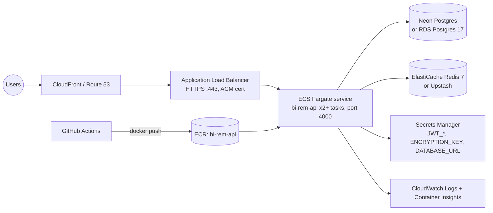

# Alternative: AWS ECS Fargate

Fly.io is the primary target for the API (`infra/fly/`). This document describes the
equivalent AWS footprint for organisations that must run inside their own AWS account
(data-residency, existing landing zone, enterprise support). The Terraform skeleton in
`infra/terraform/` encodes the structure; it is intentionally thin and meant to be completed
module by module.

## Topology



- **Network**: one VPC, 2-3 AZs, public subnets for the ALB, private subnets for tasks, NAT
  gateway (or VPC endpoints for ECR/Logs/Secrets Manager to avoid NAT cost).
- **Compute**: ECS cluster with Fargate + Fargate Spot capacity providers; the API task
  (0.5 vCPU / 1 GiB) runs `node apps/api/dist/main.js` from the same image as Fly
  (`ghcr.io/wouapit999/bi-rem-api`, mirrored to ECR by the deploy workflow when
  `AWS_ROLE_TO_ASSUME` is configured).
- **Migrations**: a one-off ECS task (`ecs run-task` with command override `["migrate"]`)
  executed by the deploy step before `ecs update-service`. Same entrypoint as Fly's
  `release_command`.
- **Database**: Neon remains the recommended Postgres (branching, PITR, serverless scaling).
  RDS Postgres 17 Multi-AZ is the in-account alternative; `citext` and `pgcrypto` are
  available on RDS without parameter changes.
- **Redis**: ElastiCache Redis 7 (cluster mode disabled, Multi-AZ) with in-transit encryption;
  pass `rediss://` to the API.
- **Secrets**: AWS Secrets Manager, injected as ECS `secrets` (valueFrom ARN). Rotation
  procedure in `infra/scripts/rotate-secrets.md`.
- **Observability**: CloudWatch Logs (pino JSON lines), Container Insights, ALB access logs
  to S3, optional OTel collector sidecar reading `OTEL_EXPORTER_OTLP_ENDPOINT`.
- **Scaling**: target-tracking on `ALBRequestCountPerTarget` (target 500) and
  `ECSServiceAverageCPUUtilization` (target 60 %), min 2 / max 10 tasks.

## Deploy flow (GitHub Actions)

1. `deploy-api.yml` builds and pushes the image to GHCR (unchanged).
2. An `aws` job (disabled until `AWS_ROLE_TO_ASSUME` exists in the environment) assumes an
   OIDC role (`aws-actions/configure-aws-credentials`), re-tags the digest into ECR, runs the
   migration task, then updates the service with a new task-definition revision and waits
   for `services-stable`.
3. Rollback: `aws ecs update-service --task-definition <previous revision>`.

## Terraform layout

```
infra/terraform/
├── versions.tf        required_providers (aws ~> 6), backend "s3" (fill bucket/table)
├── providers.tf       aws provider, default tags
├── variables.tf       environment, region, image, sizing, domain
├── main.tf            wires modules: vpc -> secrets -> alb -> ecs-service
├── outputs.tf         ALB DNS, cluster/service names, secret ARNs
├── environments/      *.tfvars per environment (staging.tfvars.example)
└── modules/
    ├── vpc/           VPC, subnets, NAT, VPC endpoints (skeleton)
    ├── secrets/       Secrets Manager secrets + IAM read policy
    ├── alb/           ALB, HTTPS listener, target group, security group
    └── ecs-service/   cluster, task definition, service, autoscaling, log group
```

```bash
cd infra/terraform
terraform init -backend-config=environments/staging.backend.hcl
terraform plan -var-file=environments/staging.tfvars
terraform apply -var-file=environments/staging.tfvars
```

Secret _values_ are never in Terraform state by design: the `secrets` module creates the
containers, values are written with `aws secretsmanager put-secret-value` (or the console)
after the first apply.

## Cost sketch (eu-central-1, monthly, on-demand)

| Item                                 | Estimate   |
| ------------------------------------ | ---------- |
| 2 x Fargate tasks 0.5 vCPU / 1 GiB   | ~USD 30    |
| ALB + LCUs                           | ~USD 25    |
| NAT gateway (1 AZ) + data            | ~USD 35-50 |
| ElastiCache cache.t4g.small Multi-AZ | ~USD 50    |
| CloudWatch logs / metrics            | ~USD 10-20 |
| Neon Launch plan                     | ~USD 19+   |

Roughly USD 170-200 / month for staging-grade production versus ~USD 40-60 on Fly for the
same two machines. Assumes low egress and no Container Insights for the staging account.
